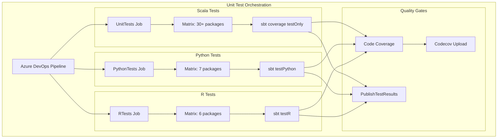
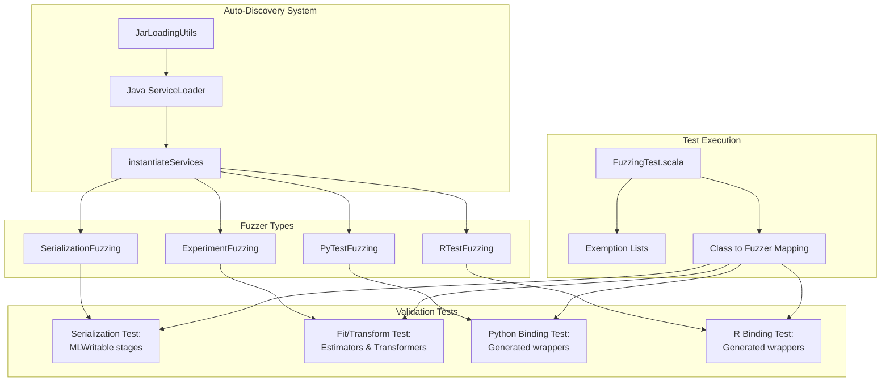
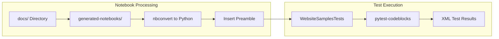
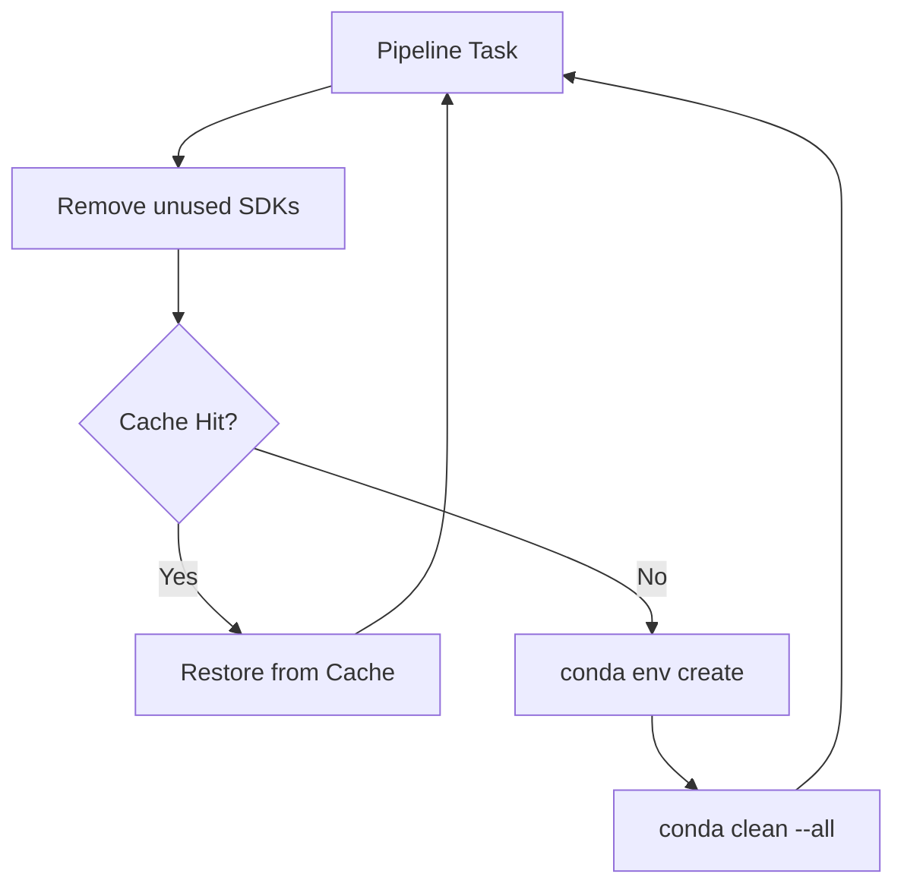
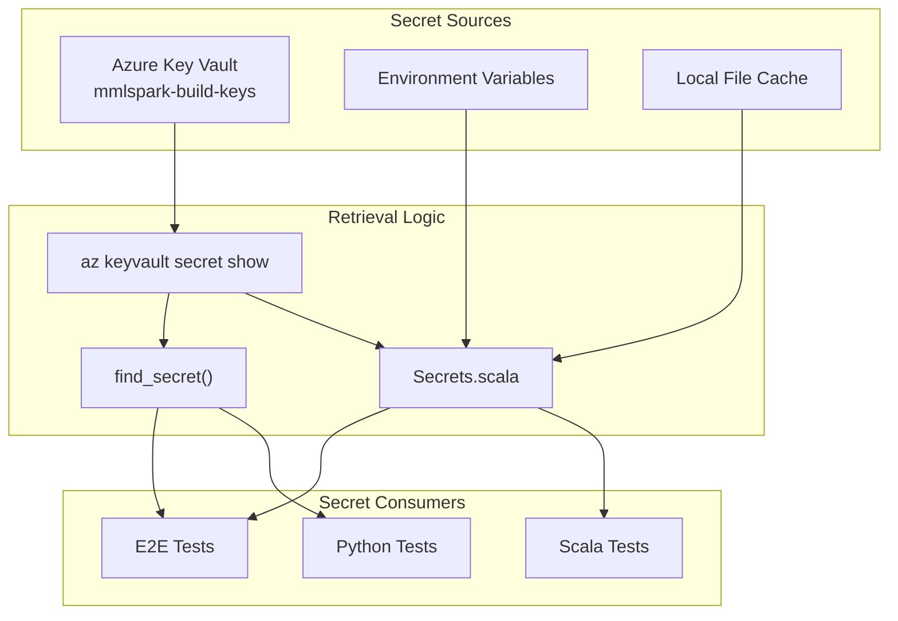
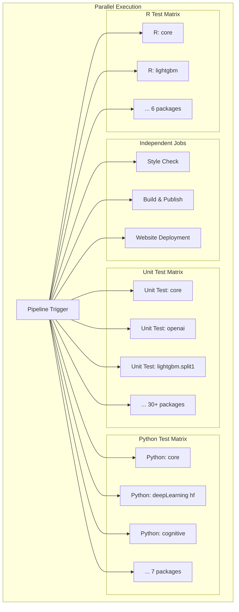

<!-- source: DeepWiki mcp.deepwiki.com · repo microsoft/SynapseML · page 4 Testing Infrastructure · fetched 2026-10-26 -->

# Testing Infrastructure

<details>
<summary>Relevant source files</summary>

The following files were used as context for generating this wiki page:

- [.gitignore](.gitignore)
- [build.sbt](build.sbt)
- [cognitive/src/test/scala/com/microsoft/azure/synapse/ml/services/form/FormOntologyLearnerSuite.scala](cognitive/src/test/scala/com/microsoft/azure/synapse/ml/services/form/FormOntologyLearnerSuite.scala)
- [core/src/test/scala/com/microsoft/azure/synapse/ml/Secrets.scala](core/src/test/scala/com/microsoft/azure/synapse/ml/Secrets.scala)
- [core/src/test/scala/com/microsoft/azure/synapse/ml/nbtest/SharedNotebookE2ETestUtilities.scala](core/src/test/scala/com/microsoft/azure/synapse/ml/nbtest/SharedNotebookE2ETestUtilities.scala)
- [core/src/test/scala/com/microsoft/azure/synapse/ml/nbtest/SynapseExtension/SynapseExtensionSchemas.scala](core/src/test/scala/com/microsoft/azure/synapse/ml/nbtest/SynapseExtension/SynapseExtensionSchemas.scala)
- [core/src/test/scala/com/microsoft/azure/synapse/ml/nbtest/SynapseExtension/SynapseExtensionUtilities.scala](core/src/test/scala/com/microsoft/azure/synapse/ml/nbtest/SynapseExtension/SynapseExtensionUtilities.scala)
- [core/src/test/scala/com/microsoft/azure/synapse/ml/nbtest/SynapseExtension/SynapseExtensionsTests.scala](core/src/test/scala/com/microsoft/azure/synapse/ml/nbtest/SynapseExtension/SynapseExtensionsTests.scala)
- [core/src/test/scala/com/microsoft/azure/synapse/ml/nbtest/SynapseTests.scala](core/src/test/scala/com/microsoft/azure/synapse/ml/nbtest/SynapseTests.scala)
- [core/src/test/scala/com/microsoft/azure/synapse/ml/nbtest/SynapseUtilities.scala](core/src/test/scala/com/microsoft/azure/synapse/ml/nbtest/SynapseUtilities.scala)
- [deep-learning/src/test/python/synapsemltest/dl/conftest.py](deep-learning/src/test/python/synapsemltest/dl/conftest.py)
- [docs/Explore Algorithms/AI Services/Quickstart - Create Audiobooks.ipynb](docs/Explore Algorithms/AI Services/Quickstart - Create Audiobooks.ipynb)
- [docs/Explore Algorithms/AI Services/Quickstart - Document Question and Answering with PDFs.ipynb](docs/Explore Algorithms/AI Services/Quickstart - Document Question and Answering with PDFs.ipynb)
- [docs/Explore Algorithms/Deep Learning/Quickstart - Chat Completion with Azure AI Foundry Model.ipynb](docs/Explore Algorithms/Deep Learning/Quickstart - Chat Completion with Azure AI Foundry Model.ipynb)
- [docs/Explore Algorithms/OpenAI/Langchain.ipynb](docs/Explore Algorithms/OpenAI/Langchain.ipynb)
- [docs/Explore Algorithms/OpenAI/Quickstart - OpenAI Embedding and GPU based KNN.ipynb](docs/Explore Algorithms/OpenAI/Quickstart - OpenAI Embedding and GPU based KNN.ipynb)
- [docs/Explore Algorithms/OpenAI/Quickstart - OpenAI Embedding.ipynb](docs/Explore Algorithms/OpenAI/Quickstart - OpenAI Embedding.ipynb)
- [docs/Explore Algorithms/OpenAI/Quickstart - Understand and Search Forms.ipynb](docs/Explore Algorithms/OpenAI/Quickstart - Understand and Search Forms.ipynb)
- [docs/Get Started/Install SynapseML.md](docs/Get Started/Install SynapseML.md)
- [environment.yml](environment.yml)
- [pipeline.yaml](pipeline.yaml)
- [project/PublishPlugin.scala](project/PublishPlugin.scala)
- [project/Secrets.scala](project/Secrets.scala)
- [sonatype.sbt](sonatype.sbt)
- [src/test/scala/com/microsoft/azure/synapse/ml/core/test/fuzzing/FuzzingTest.scala](src/test/scala/com/microsoft/azure/synapse/ml/core/test/fuzzing/FuzzingTest.scala)
- [templates/codecov.yml](templates/codecov.yml)
- [templates/conda.yml](templates/conda.yml)
- [templates/kv.yml](templates/kv.yml)
- [tools/esrp/prepare_jar.py](tools/esrp/prepare_jar.py)

</details>


## Purpose and Scope

This document describes the comprehensive testing infrastructure used in the SynapseML project, including unit tests, component fuzzing, and end-to-end testing orchestration. For details on platform-specific E2E testing, see [Synapse E2E Testing](#4.2) and [Databricks E2E Testing](#4.3). For information on the CI/CD pipeline orchestration, see [CI/CD Pipeline](#3.1).

The testing infrastructure ensures code quality through multiple layers of validation: unit tests across three language bindings (Scala, Python, R), automated fuzzing of all ML components, and integration tests on actual cloud platforms.

## Testing Strategy Overview

SynapseML employs a multi-layered testing strategy designed to validate functionality at different scales and across multiple execution environments. The strategy balances comprehensive coverage with efficient execution through parallelization and selective test execution.

### Test Type Matrix

The testing infrastructure organizes tests into distinct categories, each serving a specific validation purpose:

| Test Type | Languages | Execution Environment | Purpose |
|-----------|-----------|----------------------|---------|
| Unit Tests | Scala, Python, R | Local Spark | Validate individual components |
| Fuzzing Tests | Scala | Local Spark | Auto-test all PipelineStages |
| Notebook Tests | Python | Local Spark | Validate documentation examples |
| E2E Tests | Python | Synapse, Databricks | Integration testing on cloud platforms |
| Style Tests | Scala, Python | Build Agent | Code quality enforcement |

Sources: [pipeline.yaml:59-772]()

## Unit Testing Infrastructure

### Parallel Test Execution

Unit tests execute in parallel across multiple job matrices to minimize total runtime. The pipeline defines separate job matrices for Scala unit tests (30+ packages), Python tests (7 packages), and R tests (6 packages).



Sources: [pipeline.yaml:357-518](), [pipeline.yaml:614-772]()

### Scala Unit Tests

Scala unit tests execute through the `sbt` build system using ScalaTest framework. Tests are organized by module package and execute with code coverage enabled via `scoverage`. The pipeline defines 30+ test packages in a matrix strategy.

**Key Test Packages:**
- `core`, `automl`, `causal`, `onnx` - Core functionality
- `services.openai`, `services.aifoundry`, `services.language` - AI service integrations
- `lightgbm.split1` through `lightgbm.split6` - LightGBM module (split due to size)
- `explainers.split1` through `explainers.split3` - Model explainability

Tests marked with `FLAKY: "true"` automatically retry once on failure to handle non-deterministic test behavior.

Sources: [pipeline.yaml:614-772](), [build.sbt:250-264]()

### Python Unit Tests

Python tests execute through `sbt testPython`, which invokes `pytest` on the generated Python bindings. The test infrastructure supports sub-path filtering to enable targeted test execution and parallel execution across modules.

**Test Configuration:**
- Uses `publishM2` to make JARs available to PySpark
- Supports `pythonSubTestPath` and `pythonIgnoreTestPath` flags for selective execution
- Automatic retry (up to 3 attempts) on failure
- Timeout: 40 minutes per package

The pipeline splits deep learning tests into Hugging Face (`hf`) and non-Hugging Face (`nohf`) subsets to manage execution time.

Sources: [pipeline.yaml:357-443](), [build.sbt:250-264]()

### R Unit Tests

R tests validate the auto-generated R wrapper functionality using the `testthat` framework. Tests execute through `sbt testR` after downloading a specific Spark distribution.

**R Test Execution:**
1. Download Spark 3.5.0 with Hadoop 3
2. Publish artifacts to local M2 repository
3. Execute R tests via `sbt testR`
4. Generate coverage report

Sources: [pipeline.yaml:446-518]()

## Component Fuzzing Framework

The fuzzing framework automatically discovers and tests all `PipelineStage` implementations in the codebase, ensuring comprehensive validation of serialization, fitting, and language binding generation.

### Fuzzing Architecture



Sources: [src/test/scala/com/microsoft/azure/synapse/ml/core/test/fuzzing/FuzzingTest.scala:1-438]()

### Fuzzing Test Types

The fuzzing framework validates four critical aspects of each `PipelineStage`:

**1. Serialization Testing**

Verifies that all stages implementing `MLWritable` can be saved and loaded correctly. The test discovers all applicable stages and ensures each has a corresponding `SerializationFuzzing` implementation.

```scala
test("Verify all stages can be serialized") {
  val exemptions: Set[String] = Set(/* ... */)
  val applicableStages = pipelineStages.filter(t => !exemptions(t.getClass.getName))
  // Verify each stage has a SerializationFuzzing implementation
}
```

**2. Fit/Transform Testing**

Validates that `Estimator` and `Transformer` stages can be successfully fitted and transformed. Each stage must have an `ExperimentFuzzing` implementation that provides test data and validates output.

**3. Python Binding Testing**

Ensures auto-generated Python wrappers correctly expose Scala functionality. Uses `PyTestFuzzing` implementations to validate parameter passing and return values.

**4. R Binding Testing**

Validates auto-generated R wrapper functionality through `RTestFuzzing` implementations.

Sources: [src/test/scala/com/microsoft/azure/synapse/ml/core/test/fuzzing/FuzzingTest.scala:98-273]()

### Auto-Discovery Mechanism

The fuzzing framework uses `JarLoadingUtils.instantiateServices[T]()` to dynamically discover all implementations of a given trait or class at runtime. This ensures new components are automatically tested without manual registration.

**Discovery Process:**
1. Scan classpath for implementations of `PipelineStage`
2. Instantiate each discovered class
3. Match against fuzzing implementations
4. Report classes without fuzzers as test failures

Sources: [src/test/scala/com/microsoft/azure/synapse/ml/core/test/fuzzing/FuzzingTest.scala:422-437]()

## Notebook and Website Testing

The testing infrastructure converts Jupyter notebooks into executable Python scripts and validates that all code blocks execute successfully. This ensures documentation examples remain functional.

### Notebook Conversion Pipeline



Sources: [core/src/test/scala/com/microsoft/azure/synapse/ml/nbtest/SharedNotebookE2ETestUtilities.scala:82-122](), [pipeline.yaml:528-564]()

### Notebook Test Process

**Conversion Steps:**

1. **Collection**: Recursively find all `.ipynb` files in the `docs/` directory
2. **Normalization**: Copy to `generated-notebooks/` with sanitized names (remove spaces, special chars)
3. **Conversion**: Use `jupyter nbconvert --to python` to convert to `.py` files
4. **Preamble Injection**: Insert test environment setup code at line 2

The preamble ensures magic commands like `%pip install` work in Synapse scheduled jobs by setting up the IPython environment.

**Test Execution:**

The `WebsiteSamplesTests` job executes converted notebooks using `sbt testWebsiteDocs`, which calls `pytest-codeblocks` to validate code blocks. Tests timeout after 30 minutes.

Sources: [core/src/test/scala/com/microsoft/azure/synapse/ml/nbtest/SharedNotebookE2ETestUtilities.scala:22-42](), [build.sbt:361-367]()

## Test Environment Management

### Conda Environment Setup

The testing infrastructure uses a shared Conda environment defined in `environment.yml` with caching to minimize setup time. The environment includes all dependencies needed for testing across Scala, Python, and R.

**Environment Cache Strategy:**



**Cache Key**: `conda | "$(Agent.OS)" | environment.yml`

The cache is restored before environment creation and includes a disk cleanup step that removes unused Android and Google Cloud SDKs to free space on the build agent.

Sources: [templates/conda.yml:1-42](), [environment.yml:1-58]()

### Key Dependencies

The test environment includes:
- **Python**: 3.11.8 with PySpark 3.5.0
- **R**: 4.1.1 with SparklyR 1.8.1
- **ML Libraries**: PyTorch 2.1.0, Horovod, transformers 4.49.0, LangChain 0.0.152
- **Testing**: pytest, pytest-cov, pytest-codeblocks
- **Code Quality**: black 22.3.0, coverage

Sources: [environment.yml:1-58]()

### Secret Management for Tests

Test secrets are retrieved from Azure Key Vault using the `Secrets` object in Scala or the `find_secret()` function in Python. The pipeline uses Azure CLI authentication to access secrets.

**Secret Retrieval Architecture:**



**Common Secrets:**
- `cognitive-api-key` - Azure AI Services authentication
- `openai-api-key-2` - Azure OpenAI authentication  
- `azure-search-key` - Azure Cognitive Search
- `adb-token` - Databricks workspace token
- `nexus-un`, `nexus-pw` - Maven Central publishing
- `pgp-private`, `pgp-public`, `pgp-pw` - JAR signing

Sources: [core/src/test/scala/com/microsoft/azure/synapse/ml/Secrets.scala:12-79](), [templates/kv.yml:1-7]()

### Test Dataset Management

Test datasets are downloaded and cached locally using the `getDatasetsTask` SBT task. The task downloads a compressed archive from Azure Blob Storage and extracts it to a local directory.

**Dataset Location**: `target/datasets/datasets-2023-04-03/`

The dataset directory is exposed to tests via the `datasetDir` BuildInfo key, making it accessible in test code as `BuildInfo.datasetDir`.

Sources: [build.sbt:72-89]()

## Code Coverage and Quality Reporting

### Coverage Collection

Code coverage is collected using `scoverage` for Scala code. The `coverage` SBT setting enables instrumentation during test execution, and `coverageReport` generates the final report.

**Coverage Workflow:**

1. Execute tests with `sbt coverage testOnly`
2. Generate report with `sbt coverageReport`
3. Upload to Codecov using `codecov` CLI
4. Display summary in Azure DevOps

The pipeline retries the Codecov upload task once on failure to handle transient network issues.

Sources: [pipeline.yaml:434-442](), [templates/codecov.yml:1-12]()

### Test Result Publishing

All test jobs publish results using the `PublishTestResults@2` Azure DevOps task. This provides:
- Test result visualization in the pipeline UI
- Failure trend analysis
- Test duration tracking
- Flaky test detection

**Test Result Patterns:**
- Scala: `**/test-reports/TEST-*.xml`
- Python: `**/python-test-*.xml`
- R: `**/r-test-*.xml`
- Website: `**/website-test-result.xml`

Sources: [pipeline.yaml:176-181](), [pipeline.yaml:428-433](), [pipeline.yaml:503-508]()

## Retry Mechanisms and Reliability

### Automatic Retry Configuration

The testing infrastructure implements retry mechanisms at multiple levels to handle transient failures:

**Task-Level Retries:**
- Most Azure CLI tasks: `retryCountOnTaskFailure: 1`
- Critical setup tasks: `retryCountOnTaskFailure: 3`
- Conda environment creation: Retry on failure with 30-minute timeout

**Test-Level Retries:**
- Python tests: Up to 3 retry attempts via `sbt` command chaining
- R tests: `retryCountOnTaskFailure: 3`
- Flaky tests: Single automatic retry when `FLAKY: "true"`

Sources: [pipeline.yaml:399-427](), [pipeline.yaml:491-502]()

### Flaky Test Handling

Tests marked as flaky in the pipeline matrix execute with automatic retry logic. The test command runs twice on first failure before reporting actual failure.

**Flaky Test Execution:**

```bash
(timeout 30m sbt coverage "testOnly com.microsoft.azure.synapse.ml.$(PACKAGE).**") ||
(${FLAKY:-false} && timeout 30m sbt coverage "testOnly com.microsoft.azure.synapse.ml.$(PACKAGE).**")
```

**Flaky Packages:**
- All Azure AI Services packages (`services.openai`, `services.language`, etc.)
- LightGBM splits 1-6
- IO operations (`io.split1`, `io.split2`)

Sources: [pipeline.yaml:754-755]()

### Timeout Configuration

Test jobs have configured timeouts to prevent indefinite hanging:

| Job Type | Timeout | Cancel Timeout |
|----------|---------|----------------|
| Unit Tests | 80 minutes | 1 minute |
| Python Tests | 120 minutes | 0 minutes |
| R Tests | 60 minutes | 0 minutes |
| E2E Tests | 120 minutes | 0 minutes |
| Website Tests | 30 minutes (task) | 0 minutes |

Sources: [pipeline.yaml:358-360](), [pipeline.yaml:447-449](), [pipeline.yaml:616-618]()

## Parallel Test Execution Strategy

The pipeline maximizes test throughput by executing independent test suites in parallel. The Azure DevOps strategy matrix creates multiple concurrent jobs for each test category.

**Concurrency Model:**



The pipeline does not define explicit dependencies between these job families, allowing Azure DevOps to schedule them concurrently based on agent availability.

Sources: [pipeline.yaml:59-772]()

---

