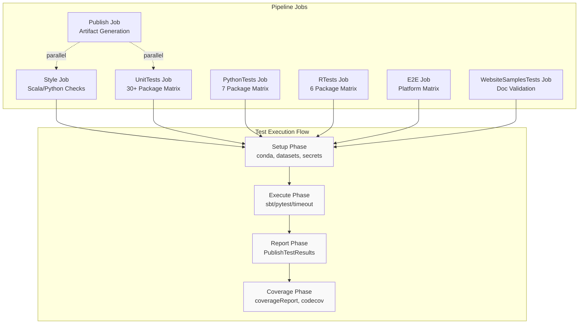
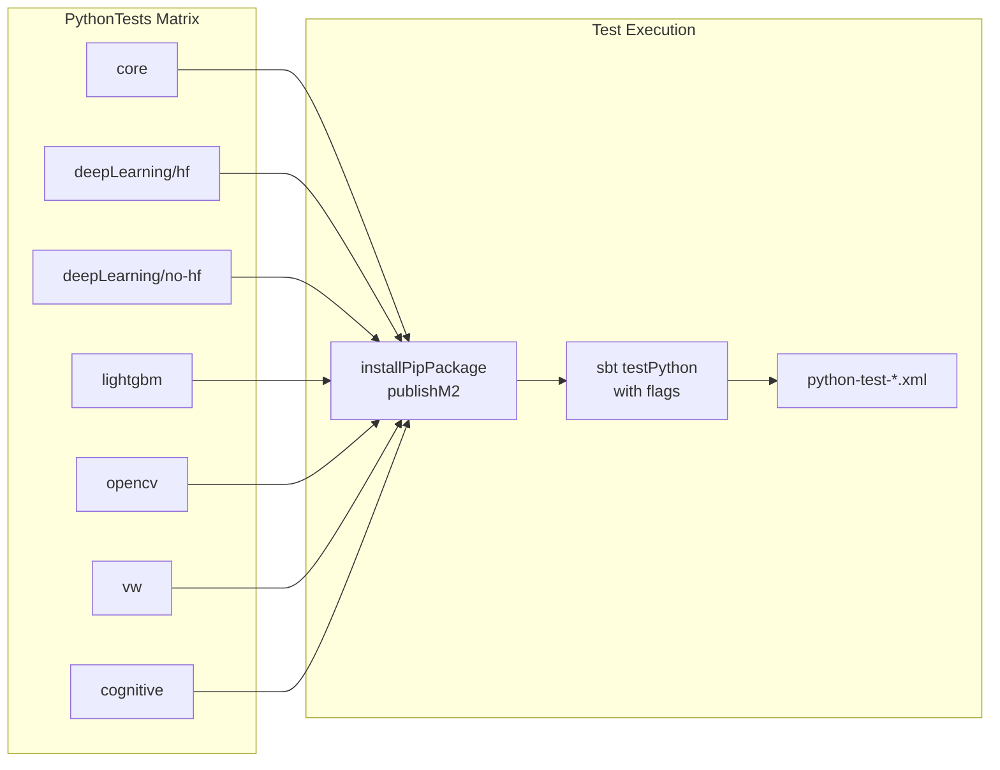
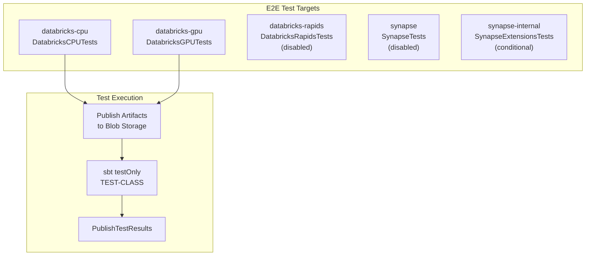
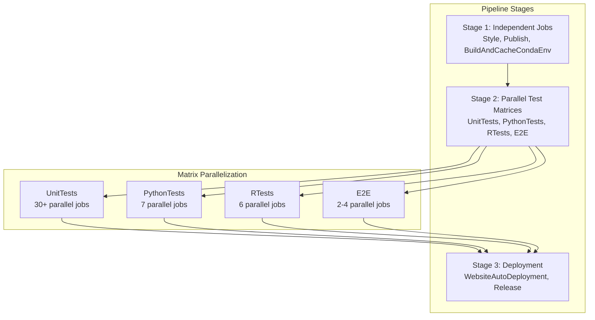
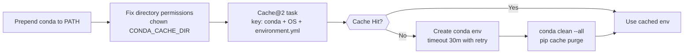
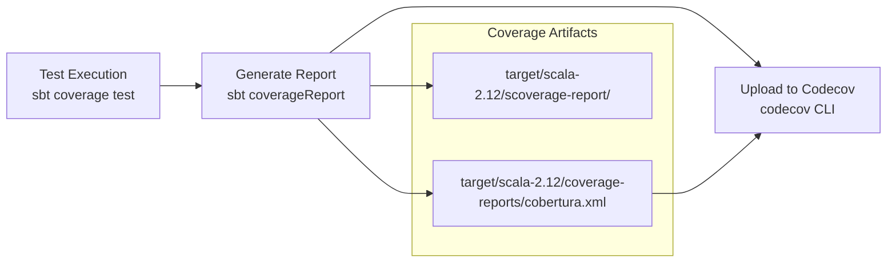

<!-- source: DeepWiki mcp.deepwiki.com · repo microsoft/SynapseML · page 4.1 Testing Strategy · fetched 2026-10-26 -->

# Testing Strategy

<details>
<summary>Relevant source files</summary>

The following files were used as context for generating this wiki page:

- [.gitignore](.gitignore)
- [build.sbt](build.sbt)
- [deep-learning/src/test/python/synapsemltest/dl/conftest.py](deep-learning/src/test/python/synapsemltest/dl/conftest.py)
- [environment.yml](environment.yml)
- [pipeline.yaml](pipeline.yaml)
- [project/PublishPlugin.scala](project/PublishPlugin.scala)
- [project/Secrets.scala](project/Secrets.scala)
- [sonatype.sbt](sonatype.sbt)
- [templates/codecov.yml](templates/codecov.yml)
- [templates/conda.yml](templates/conda.yml)
- [templates/kv.yml](templates/kv.yml)
- [tools/esrp/prepare_jar.py](tools/esrp/prepare_jar.py)

</details>


## Purpose and Scope

This document describes the overall testing strategy for SynapseML, including test categorization, execution orchestration, environment management, and quality gates. It covers the multi-layered testing approach that ensures code quality across Scala, Python, and R implementations on multiple target platforms.

For details on Synapse-specific E2E testing, see [Synapse E2E Testing](#4.2). For Databricks-specific E2E testing, see [Databricks E2E Testing](#4.3). For the automated fuzzing framework, see [Component Fuzzing](#4.4).

## Overview

SynapseML implements a comprehensive multi-layered testing strategy orchestrated through Azure DevOps pipelines. The testing approach includes:

- **Unit tests** for 30+ Scala packages, 7 Python packages, and 6 R packages
- **End-to-end (E2E) tests** on Synapse and Databricks environments
- **Documentation tests** that validate code blocks in website documentation
- **Style checks** for code quality across all languages
- **Fuzzing tests** for serialization and language binding validation
- **Code coverage tracking** integrated with Codecov.io

The strategy emphasizes reliability through automated retry mechanisms, flaky test isolation, and parallel execution across multiple test matrices.

Sources: [pipeline.yaml:1-773](), [build.sbt:1-368]()

## Test Categorization

### Test Job Architecture



Sources: [pipeline.yaml:65-773]()

### Unit Test Matrix

The `UnitTests` job executes Scala tests across 30+ package configurations using a matrix strategy. Each package runs in an isolated job with dedicated timeout and retry settings.

| Package Category | Package Name | Flaky Flag | Special Requirements |
|-----------------|--------------|------------|---------------------|
| Core | `core`, `automl`, `causal`, `onnx` | No | Standard setup |
| Services | `services.openai`, `services.vision`, `services.speech` | Yes | Retry enabled |
| ML Algorithms | `lightgbm.split1-6`, `vw`, `isolationforest` | Yes (LGBM) | Split for speed |
| Media | `opencv`, `image` | No | - |
| Data I/O | `io.split1-2` | Yes | Azure storage access |
| Explainability | `explainers.split1-3` | No | Split for speed |
| Audio/Video | `services.search.split1-2`, `services.speech` | Yes | FFmpeg required |

Sources: [pipeline.yaml:614-727]()

### Python Test Matrix

Python tests execute across 7 package-level configurations, with sub-path filtering for deep learning tests:



Sources: [pipeline.yaml:357-444]()

**Python Test Configuration:**

- **Test path filtering**: Uses `-DpythonSubTestPath` and `-DpythonIgnoreTestPath` flags [pipeline.yaml:414-424]()
- **Retry mechanism**: Triple retry with explicit command repetition [pipeline.yaml:425-427]()
- **Deep learning split**: Separates Hugging Face tests from other DL tests to reduce runtime [pipeline.yaml:368-374]()

### R Test Matrix

R tests execute across 6 packages with Spark environment setup:

```scala
strategy:
  matrix:
    core:        PACKAGE: "core"
    deep-learning: PACKAGE: "deepLearning"
    lightgbm:    PACKAGE: "lightgbm"
    opencv:      PACKAGE: "opencv"
    vw:          PACKAGE: "vw"
    cognitive:   PACKAGE: "cognitive"
```

Sources: [pipeline.yaml:446-518]()

### E2E Test Matrix

End-to-end tests validate notebook execution on actual cloud platforms:



Sources: [pipeline.yaml:138-182]()

## Test Execution Strategy

### Retry Mechanisms

SynapseML implements multiple retry strategies to handle transient failures:

**1. Task-level retries:**
```yaml
retryCountOnTaskFailure: 1  # Azure CLI tasks
retryCountOnTaskFailure: 3  # R tests, critical setup
```

**2. Command-level retries:**
```bash
# Triple retry with explicit command repetition
(sbt testPython) || (sbt testPython) || (sbt testPython)
```

**3. Flaky test isolation:**
```bash
# Unit tests with flaky flag
(timeout 30m sbt coverage "testOnly ...") ||
(${FLAKY:-false} && timeout 30m sbt coverage "testOnly ...")
```

Sources: [pipeline.yaml:401-402](), [pipeline.yaml:754-755]()

### Flaky Test Handling

Tests marked with `FLAKY: "true"` in the matrix receive special treatment:

```yaml
openai:
  PACKAGE: "services.openai"
  FLAKY: "true"  # Retry on failure
```

When a flaky test fails, the conditional `${FLAKY:-false}` allows one retry attempt. This prevents legitimate transient failures (network issues, rate limits) from blocking the pipeline while still catching real regressions.

Sources: [pipeline.yaml:645-671]()

### Timeout Configuration

| Test Type | Timeout | Cancel Timeout | Rationale |
|-----------|---------|----------------|-----------|
| Unit Tests | 80 minutes | 1 minute | Long-running ML tests |
| Python Tests | 120 minutes | 0 (disabled) | Includes model training |
| R Tests | 60 minutes | 0 (disabled) | R environment setup overhead |
| E2E Tests | 120 minutes | 0 (disabled) | Cluster provisioning time |
| Website Tests | 30 minutes | 0 (disabled) | Lightweight doc validation |

Sources: [pipeline.yaml:358-359](), [pipeline.yaml:447-448](), [pipeline.yaml:616-617]()

### Parallel Execution Strategy



The pipeline exploits Azure DevOps matrix strategies to parallelize test execution. Each matrix job runs independently on a separate VM, maximizing throughput while maintaining isolation.

Sources: [pipeline.yaml:143-158](), [pipeline.yaml:363-382](), [pipeline.yaml:620-726]()

## Environment Management

### Conda Environment Setup

SynapseML uses a cached Conda environment to speed up test execution. The caching strategy reduces environment creation time from ~30 minutes to seconds on cache hits.

**Conda Template Workflow:**



Sources: [templates/conda.yml:1-42]()

**Environment Definition:**

The `environment.yml` file defines dependencies for all test types:

- **Python base**: 3.11.8 with PySpark 3.5.0
- **R support**: r-base 4.1.1, r-sparklyr 1.8.1
- **Test frameworks**: pytest, pytest-cov, pytest-codeblocks
- **ML libraries**: torch 2.1.0, transformers 4.49.0, horovod (from git)
- **Documentation**: sphinx 5.0.2, nbconvert, jupyter

Sources: [environment.yml:1-58]()

### Test Dataset Management

The `getDatasetsTask` ensures test datasets are available before test execution:

```scala
val getDatasetsTask = TaskKey[Unit]("getDatasets", "download datasets used for testing")
val datasetName = "datasets-2023-04-03.tgz"
val datasetUrl = new URI(s"https://mmlspark.blob.core.windows.net/installers/$datasetName").toURL

getDatasetsTask := {
  val d = datasetDir.value.getParentFile
  val f = new File(d, datasetName)
  if (!d.exists()) d.mkdirs()
  if (!f.exists()) {
    FileUtils.copyURLToFile(datasetUrl, f)
    UnzipUtils.unzip(f, d)
  }
}
```

The `setup` task depends on `getDatasetsTask`, ensuring datasets are downloaded during test preparation. Datasets are versioned and cached locally to avoid repeated downloads.

Sources: [build.sbt:72-89](), [build.sbt:346-353]()

### Secret Management for Tests

Tests requiring Azure service credentials use the Key Vault template to retrieve secrets:

```yaml
# templates/kv.yml
- task: AzureKeyVault@2
  retryCountOnTaskFailure: 3
  inputs:
    azureSubscription: 'SynapseML Build'
    keyVaultName: mmlspark-keys
```

The `Secrets.scala` implementation provides environment variable fallback:

```scala
private def findAndCacheSecret(env_var: String, name: String, suffix: String = ""): String = {
  val secret = sys.env.getOrElse(env_var, getSecretFromCacheOrKeyvault(name))
  // Cache for future use
}
```

**Secret Priority Order:**
1. Environment variable (loaded by Key Vault task)
2. Local cache file
3. Direct Key Vault fetch (with caching)

Sources: [templates/kv.yml:1-7](), [project/Secrets.scala:130-138]()

## Test Execution Implementation

### Unit Test Execution

Unit tests run through SBT with coverage tracking:

```bash
export SBT_OPTS="-XX:+UseConcMarkSweepGC -XX:+CMSClassUnloadingEnabled -Xss2M -Duser.timezone=GMT"
(timeout 30m sbt coverage "testOnly com.microsoft.azure.synapse.ml.$(PACKAGE).**") ||
(${FLAKY:-false} && timeout 30m sbt coverage "testOnly com.microsoft.azure.synapse.ml.$(PACKAGE).**")
```

**Key aspects:**
- **JVM options**: Configured for test stability (garbage collection, stack size, timezone)
- **Package filtering**: `testOnly` with package glob pattern
- **Coverage tracking**: `coverage` command enables Scoverage instrumentation
- **Timeout enforcement**: Shell-level timeout with retries

Sources: [pipeline.yaml:752-755]()

### Python Test Execution

Python tests use a specialized SBT task with dynamic filtering:

```bash
IGNORE_TEST_PATH_FLAG=""
TEST_SUB_PATH_FLAG=""
if [ -n "$(IGNORE_TEST_PATH)" ]; then
  IGNORE_TEST_PATH_FLAG="-DpythonIgnoreTestPath=$(IGNORE_TEST_PATH)"
fi
if [ -n "$(TEST_SUB_PATH)" ]; then
  TEST_SUB_PATH_FLAG="-DpythonSubTestPath=$(TEST_SUB_PATH)"
fi

(sbt $IGNORE_TEST_PATH_FLAG $TEST_SUB_PATH_FLAG "project $(PACKAGE)" coverage testPython) || \
(sbt $IGNORE_TEST_PATH_FLAG $TEST_SUB_PATH_FLAG "project $(PACKAGE)" coverage testPython) || \
(sbt $IGNORE_TEST_PATH_FLAG $TEST_SUB_PATH_FLAG "project $(PACKAGE)" coverage testPython)
```

**Dynamic filtering example:**
- Package: `deepLearning`
- Sub-path: `hf` → runs only `deep-learning/src/test/python/**/hf/**/*.py`
- Ignore path: `hf` → excludes `hf` subdirectory from tests

Sources: [pipeline.yaml:407-427]()

### R Test Execution

R tests require Spark binary installation before execution:

```bash
# Prepare Spark environment
SPARK_VERSION=3.5.0
HADOOP_VERSION=3
wget https://mmlspark.blob.core.windows.net/installers/spark-${SPARK_VERSION}-bin-hadoop${HADOOP_VERSION}.tgz

# Run R tests
export SBT_OPTS="-Xms2G -Xmx4G -XX:+UseConcMarkSweepGC ..."
timeout 20m sbt -DskipCodegen=true "project $(PACKAGE)" coverage testR
```

R tests use higher memory limits (`-Xmx4G`) due to R's memory overhead. The `-DskipCodegen=true` flag skips code generation since it was already performed during the prepare step.

Sources: [pipeline.yaml:486-502]()

### Website Documentation Tests

Documentation tests validate code blocks in markdown files using `pytest-codeblocks`:

```python
# website/doctest.py execution
python website/doctest.py <version>
```

The `testWebsiteDocs` task in SBT orchestrates this:

```scala
val testWebsiteDocs = TaskKey[Unit]("testWebsiteDocs",
  "test code blocks inside markdowns under folder website/docs/documentation")
testWebsiteDocs := {
  runCmd(
    Seq("python", s"${join(baseDirectory.value, "website/doctest.py")}", version.value)
  )
}
```

Sources: [build.sbt:361-367](), [pipeline.yaml:546-548]()

## Quality Gates and Reporting

### Test Result Publishing

All test jobs publish results using the `PublishTestResults@2` task:

```yaml
- task: PublishTestResults@2
  displayName: 'Publish Test Results'
  inputs:
    testResultsFiles: '**/test-reports/TEST-*.xml'  # Scala/Java tests
    testResultsFiles: '**/python-test-*.xml'        # Python tests
    testResultsFiles: '**/r-test-*.xml'             # R tests
    failTaskOnFailedTests: true
  condition: succeededOrFailed()
```

The `condition: succeededOrFailed()` ensures results are published even when tests fail, allowing developers to see detailed failure information.

Sources: [pipeline.yaml:176-181](), [pipeline.yaml:428-433](), [pipeline.yaml:503-508](), [pipeline.yaml:756-761]()

### Code Coverage Tracking



**Coverage workflow:**

1. **Instrumentation**: `sbt coverage` enables Scoverage instrumentation before tests
2. **Test execution**: Instrumented code records line coverage
3. **Report generation**: `sbt coverageReport` generates Cobertura XML [pipeline.yaml:441](), [pipeline.yaml:516](), [pipeline.yaml:769]()
4. **Upload**: Codecov CLI uploads coverage data [templates/codecov.yml:1-12]()

**Codecov template:**
```yaml
- bash: |
    curl -Os https://cli.codecov.io/latest/linux/codecov
    chmod +x codecov
    ./codecov --verbose upload-process -t $(codecov-token) --dir .
  retryCountOnTaskFailure: 1
  displayName: Upload Coverage Report To Codecov.io
  condition: succeededOrFailed()
```

Sources: [templates/codecov.yml:1-12](), [pipeline.yaml:434-443]()

### Style Checks

The `Style` job enforces code quality standards before other tests run:

**Scala style check:**
```bash
sbt scalastyle test:scalastyle
```

**Python style check:**
```bash
source activate synapseml
black --diff --color . && black --check -q .
```

Style checks have no retry mechanism and must pass cleanly. The `black` formatter validates Python code with `--check` flag (fails on formatting violations) and `--diff` flag (shows violations).

Sources: [pipeline.yaml:66-85]()

## Test Configuration Files

### Build Configuration for Tests

```scala
// build.sbt test settings
val settings = Seq(
  Test / scalastyleConfig := (ThisBuild / baseDirectory).value / "scalastyle-test-config.xml",
  Test / logBuffered := false,          // Stream test logs immediately
  Test / parallelExecution := false,    // Sequential test execution within SBT
  Test / publishArtifact := true,       // Publish test JARs
  // ...
)
```

**Key test settings:**
- **No parallel execution**: Tests within a single SBT project run sequentially to avoid resource conflicts
- **Unbuffered logs**: Test output streams immediately for better debugging
- **Test artifact publishing**: Test classes are published for use in other modules

Sources: [build.sbt:250-264]()

### Python Test Fixtures

Python tests use pytest fixtures for dataset setup:

```python
# deep-learning/src/test/python/synapsemltest/dl/conftest.py
@pytest.fixture(scope="module")
def get_data_path():
    if not os.path.exists(join(dataset_dir, "jpg", delimiter, "train")):
        _download_dataset()
    train_folder = dataset_dir + "jpg" + delimiter + "train"
    test_folder = dataset_dir + "jpg" + delimiter + "test"
    return train_folder, test_folder
```

The `scope="module"` ensures datasets are downloaded once per test module, not per test function. The fixture checks for existing data before downloading to avoid redundant work.

Sources: [deep-learning/src/test/python/synapsemltest/dl/conftest.py:73-79]()

## Continuous Integration Triggers

### Trigger Configuration

```yaml
trigger:
  branches:
    include: [master, spark3.3, spark3.5]
  paths:
    exclude: [README.md, CONTRIBUTORS.md, SECURITY.md, docs/Reference/**, CODEOWNERS]

pr:
  branches:
    include: [master, spark3.3, spark3.5]
  paths:
    exclude: [README.md, CONTRIBUTORS.md, SECURITY.md, docs/Reference/**, CODEOWNERS]

schedules:
  - cron: "0 0 * * *"  # Daily midnight build
    displayName: Daily midnight build
    always: true
    branches:
      include: [master]
```

**Trigger behavior:**
- **Push triggers**: Run on commits to main branches (excluding documentation changes)
- **PR triggers**: Run on pull requests to main branches (same exclusions)
- **Scheduled triggers**: Daily builds on master regardless of commits (`always: true`)

Sources: [pipeline.yaml:4-42]()

### Conditional Test Execution

```yaml
parameters:
  - name: runSynapseExtensionE2ETests
    displayName: Run Synapse Extension E2E Tests
    type: boolean
    default: true
  - name: SYNAPSE_ENVIRONMENT
    displayName: Synapse Extension E2E Test Environment
    type: string
    default: weekly
    values: [dev, daily, weekly]
```

Pipeline parameters allow manual control of expensive E2E tests. The `runSynapseExtensionE2ETests` parameter gates Synapse internal tests, while `SYNAPSE_ENVIRONMENT` selects the test environment.

Sources: [pipeline.yaml:44-56]()

## Test Isolation and Cleanup

### Disk Space Management

The Conda template includes disk space cleanup to prevent out-of-disk errors:

```bash
echo "Removing unused pre-installed SDKs..."
sudo rm -rf /usr/local/lib/android || true
sudo rm -rf /usr/lib/google-cloud-sdk || true
```

This frees ~10-15 GB by removing unused Android and Google Cloud SDKs that come pre-installed on Azure DevOps VMs.

Sources: [templates/conda.yml:18-28]()

### Test Artifact Exclusions

The `.gitignore` file excludes test artifacts from version control:

```gitignore
# Notebook Test Files
/notebooks/**/*.py     # Generated from .ipynb
/notebooks/**/*.txt

# Test outputs
/TestResults
.coverage
coverage.xml
htmlcov

# R output
*.Rout
.Rhistory

# pytest
.pytest_cache/
```

Sources: [.gitignore:54-84]()

## Summary

The SynapseML testing strategy implements a robust, multi-layered approach that balances comprehensiveness with execution speed:

- **30+ parallel unit test jobs** across Scala packages with package-specific retry policies
- **13 parallel Python/R test jobs** with sub-path filtering for fine-grained control
- **2-4 E2E test jobs** validating real-world platform integrations
- **Automatic retry mechanisms** handling transient failures without manual intervention
- **Cached Conda environments** reducing setup time from 30 minutes to seconds
- **Comprehensive coverage tracking** integrated with Codecov.io for continuous quality monitoring

This strategy ensures high code quality while maintaining fast feedback cycles for developers.

---

