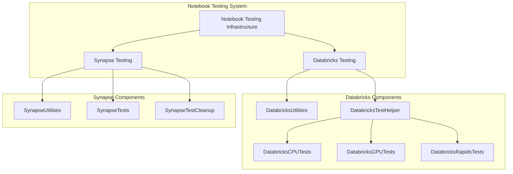
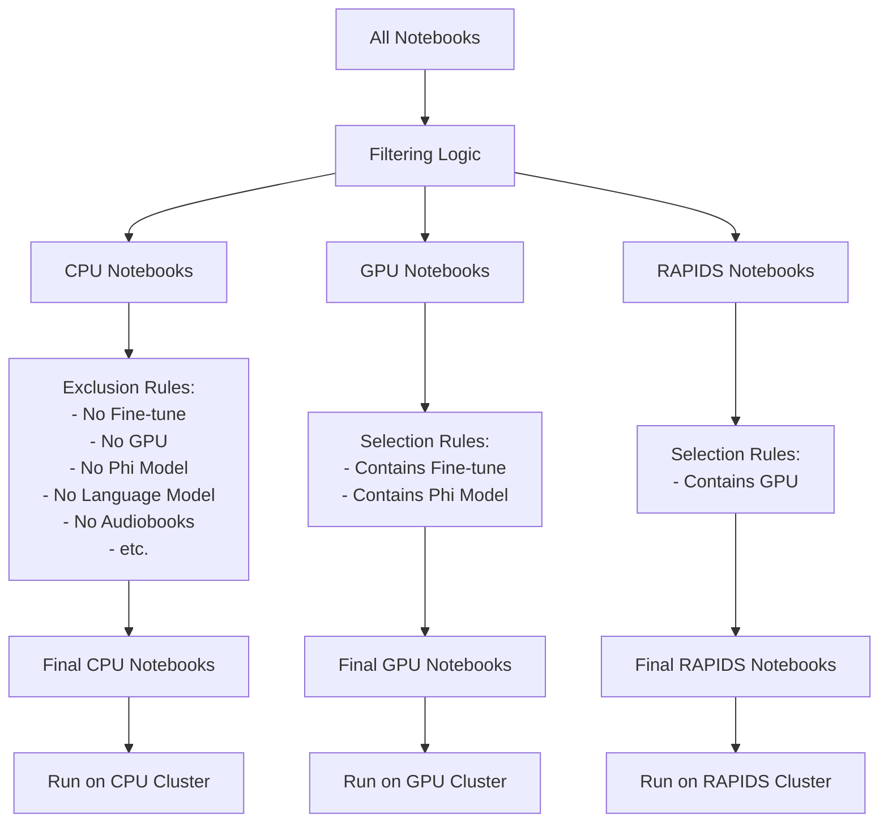
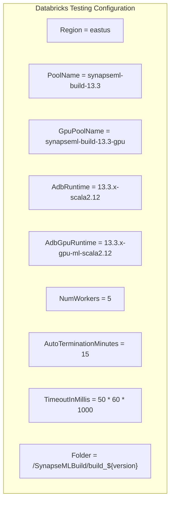
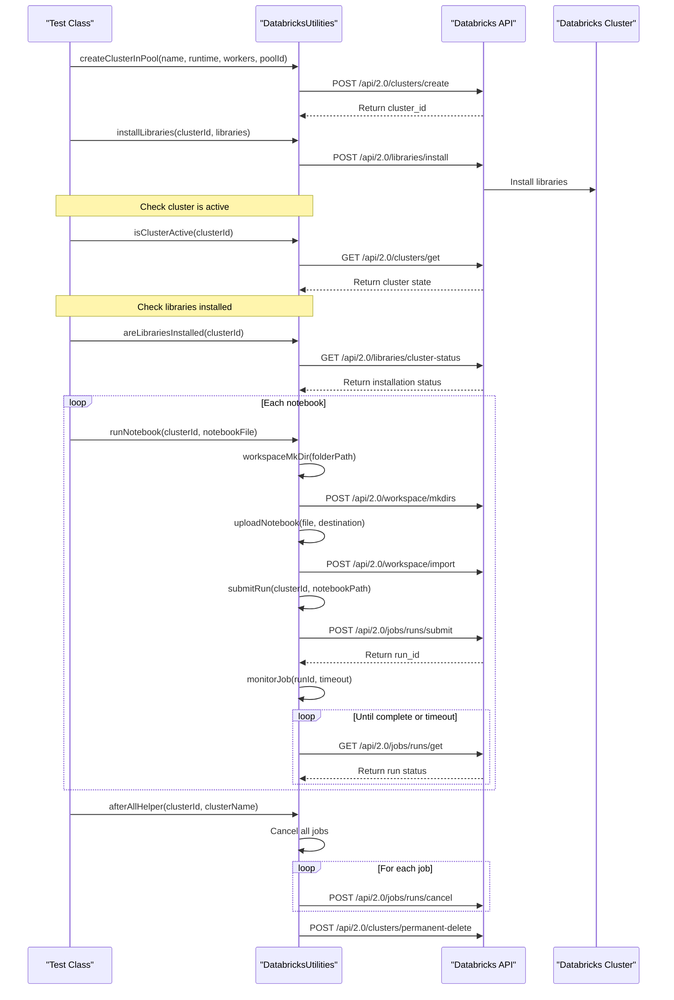
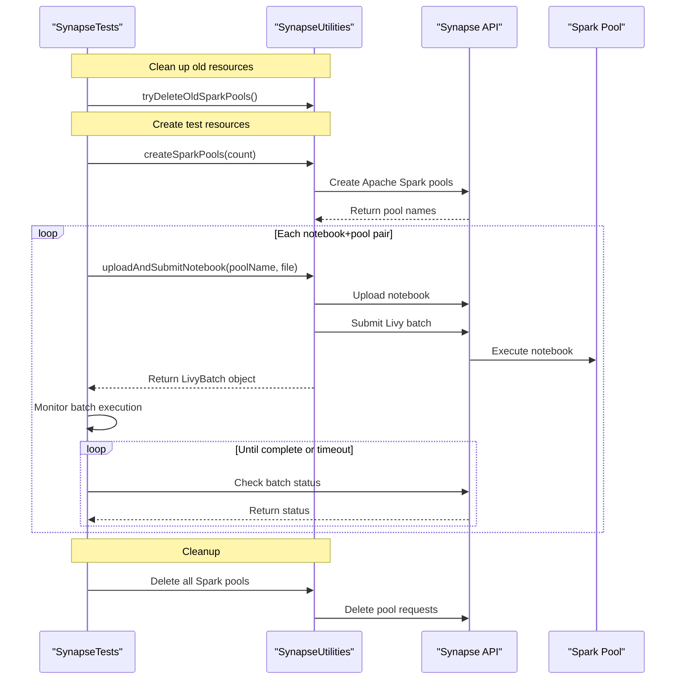
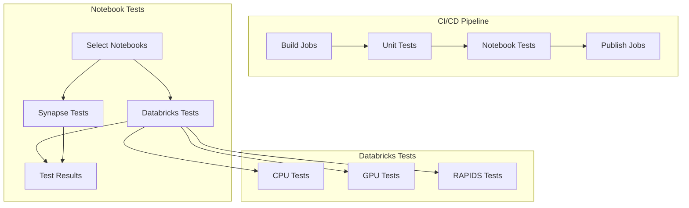

<!-- source: DeepWiki mcp.deepwiki.com · repo microsoft/SynapseML · page 4.2 Synapse E2E Testing · fetched 2026-10-26 -->

# Notebook Testing

<details>
<summary>Relevant source files</summary>

The following files were used as context for generating this wiki page:

- [cognitive/src/test/scala/com/microsoft/azure/synapse/ml/services/form/FormOntologyLearnerSuite.scala](cognitive/src/test/scala/com/microsoft/azure/synapse/ml/services/form/FormOntologyLearnerSuite.scala)
- [core/src/test/scala/com/microsoft/azure/synapse/ml/Secrets.scala](core/src/test/scala/com/microsoft/azure/synapse/ml/Secrets.scala)
- [core/src/test/scala/com/microsoft/azure/synapse/ml/nbtest/SharedNotebookE2ETestUtilities.scala](core/src/test/scala/com/microsoft/azure/synapse/ml/nbtest/SharedNotebookE2ETestUtilities.scala)
- [core/src/test/scala/com/microsoft/azure/synapse/ml/nbtest/SynapseExtension/SynapseExtensionSchemas.scala](core/src/test/scala/com/microsoft/azure/synapse/ml/nbtest/SynapseExtension/SynapseExtensionSchemas.scala)
- [core/src/test/scala/com/microsoft/azure/synapse/ml/nbtest/SynapseExtension/SynapseExtensionUtilities.scala](core/src/test/scala/com/microsoft/azure/synapse/ml/nbtest/SynapseExtension/SynapseExtensionUtilities.scala)
- [core/src/test/scala/com/microsoft/azure/synapse/ml/nbtest/SynapseExtension/SynapseExtensionsTests.scala](core/src/test/scala/com/microsoft/azure/synapse/ml/nbtest/SynapseExtension/SynapseExtensionsTests.scala)
- [core/src/test/scala/com/microsoft/azure/synapse/ml/nbtest/SynapseTests.scala](core/src/test/scala/com/microsoft/azure/synapse/ml/nbtest/SynapseTests.scala)
- [core/src/test/scala/com/microsoft/azure/synapse/ml/nbtest/SynapseUtilities.scala](core/src/test/scala/com/microsoft/azure/synapse/ml/nbtest/SynapseUtilities.scala)
- [docs/Explore Algorithms/AI Services/Quickstart - Create Audiobooks.ipynb](docs/Explore Algorithms/AI Services/Quickstart - Create Audiobooks.ipynb)
- [docs/Explore Algorithms/AI Services/Quickstart - Document Question and Answering with PDFs.ipynb](docs/Explore Algorithms/AI Services/Quickstart - Document Question and Answering with PDFs.ipynb)
- [docs/Explore Algorithms/Deep Learning/Quickstart - Chat Completion with Azure AI Foundry Model.ipynb](docs/Explore Algorithms/Deep Learning/Quickstart - Chat Completion with Azure AI Foundry Model.ipynb)
- [docs/Explore Algorithms/OpenAI/Langchain.ipynb](docs/Explore Algorithms/OpenAI/Langchain.ipynb)
- [docs/Explore Algorithms/OpenAI/Quickstart - OpenAI Embedding and GPU based KNN.ipynb](docs/Explore Algorithms/OpenAI/Quickstart - OpenAI Embedding and GPU based KNN.ipynb)
- [docs/Explore Algorithms/OpenAI/Quickstart - OpenAI Embedding.ipynb](docs/Explore Algorithms/OpenAI/Quickstart - OpenAI Embedding.ipynb)
- [docs/Explore Algorithms/OpenAI/Quickstart - Understand and Search Forms.ipynb](docs/Explore Algorithms/OpenAI/Quickstart - Understand and Search Forms.ipynb)
- [docs/Get Started/Install SynapseML.md](docs/Get Started/Install SynapseML.md)
- [src/test/scala/com/microsoft/azure/synapse/ml/core/test/fuzzing/FuzzingTest.scala](src/test/scala/com/microsoft/azure/synapse/ml/core/test/fuzzing/FuzzingTest.scala)

</details>


This page documents the automated testing system for Jupyter notebooks in SynapseML. The system executes example notebooks across different platforms (Azure Databricks and Azure Synapse Analytics) to ensure that code examples remain functional as the library evolves. This is a critical part of SynapseML's testing infrastructure as it validates real-world usage patterns beyond unit tests.

## Testing Architecture

The notebook testing system is divided into two main components that handle testing on different platforms:



Sources: [core/src/test/scala/com/microsoft/azure/synapse/ml/nbtest/DatabricksUtilities.scala](), [core/src/test/scala/com/microsoft/azure/synapse/ml/nbtest/SynapseTests.scala](), [core/src/test/scala/com/microsoft/azure/synapse/ml/nbtest/DatabricksCPUTests.scala](), [core/src/test/scala/com/microsoft/azure/synapse/ml/nbtest/DatabricksGPUTests.scala](), [core/src/test/scala/com/microsoft/azure/synapse/ml/nbtest/DatabricksRapidsTests.scala]()

## Notebook Categories

Notebooks are categorized based on their resource requirements and testing environment:

| Category | Description | Testing Environment | 
|----------|-------------|---------------------|
| CPU Notebooks | General notebooks not requiring GPU acceleration | Databricks Standard Clusters, Synapse Pools |
| GPU Notebooks | Deep learning notebooks requiring GPU (e.g., Fine-tune, Phi Model) | Databricks GPU Clusters |
| RAPIDS Notebooks | Notebooks using NVIDIA RAPIDS acceleration | Databricks GPU Clusters with RAPIDS |



Sources: [core/src/test/scala/com/microsoft/azure/synapse/ml/nbtest/DatabricksUtilities.scala:108-122](), [core/src/test/scala/com/microsoft/azure/synapse/ml/nbtest/SynapseTests.scala:47-64]()

## Databricks Testing System

The Databricks testing system uses the Databricks REST API to manage clusters, upload notebooks, and execute notebook jobs.

### Configuration Parameters



Sources: [core/src/test/scala/com/microsoft/azure/synapse/ml/nbtest/DatabricksUtilities.scala:34-53](), [core/src/test/scala/com/microsoft/azure/synapse/ml/nbtest/DatabricksUtilities.scala:100]()

### Workflow

The Databricks testing workflow follows these steps:



Sources: [core/src/test/scala/com/microsoft/azure/synapse/ml/nbtest/DatabricksUtilities.scala:198-265](), [core/src/test/scala/com/microsoft/azure/synapse/ml/nbtest/DatabricksUtilities.scala:367-378](), [core/src/test/scala/com/microsoft/azure/synapse/ml/nbtest/DatabricksUtilities.scala:307-365](), [core/src/test/scala/com/microsoft/azure/synapse/ml/nbtest/DatabricksTestHelper.scala:439-479]()

### Key Components

1. **DatabricksUtilities**: Core utility class providing methods for interacting with the Databricks REST API:
   - Cluster management (`createClusterInPool`, `isClusterActive`, `terminateCluster`)
   - Library management (`installLibraries`, `areLibrariesInstalled`)
   - Workspace operations (`workspaceMkDir`, `uploadNotebook`)
   - Job execution (`submitRun`, `monitorJob`, `cancelRun`)

2. **DatabricksTestHelper**: Abstract class with common testing functionality:
   - `databricksTestHelper`: Main method for executing notebooks
   - Uses retries for resilience against transient errors
   - Handles parallel notebook execution

3. **Test Implementations**:
   - `DatabricksCPUTests`: Tests for CPU notebooks (standard ML)
   - `DatabricksGPUTests`: Tests for GPU notebooks (deep learning)
   - `DatabricksRapidsTests`: Tests for RAPIDS-enabled notebooks

Sources: [core/src/test/scala/com/microsoft/azure/synapse/ml/nbtest/DatabricksUtilities.scala](), [core/src/test/scala/com/microsoft/azure/synapse/ml/nbtest/DatabricksTestHelper.scala:431-480](), [core/src/test/scala/com/microsoft/azure/synapse/ml/nbtest/DatabricksCPUTests.scala](), [core/src/test/scala/com/microsoft/azure/synapse/ml/nbtest/DatabricksGPUTests.scala](), [core/src/test/scala/com/microsoft/azure/synapse/ml/nbtest/DatabricksRapidsTests.scala]()

## Synapse Testing System

The Synapse testing system uses the Synapse REST API to manage Spark pools and execute notebooks via Livy batches.

### Workflow

The Synapse testing workflow follows these steps:



Sources: [core/src/test/scala/com/microsoft/azure/synapse/ml/nbtest/SynapseTests.scala:44-113]()

### Key Components

1. **SynapseUtilities**: Provides methods for interacting with Synapse APIs:
   - Spark pool management
   - Notebook upload
   - Livy batch submission and monitoring

2. **SynapseTests**: Main test class for Synapse notebook testing:
   - Creates Spark pools for testing
   - Selects notebooks to test
   - Submits notebooks as Livy batches
   - Monitors execution and cleans up resources

3. **SynapseTestCleanup**: Utility class for cleaning up old Spark pools.

Sources: [core/src/test/scala/com/microsoft/azure/synapse/ml/nbtest/SynapseTests.scala]()

## Required Dependencies

Both testing systems depend on specific library packages:

### Python Packages

The following Python packages are installed on the test clusters:

```
nltk, bs4, plotly, Pillow, onnxmltools, lightgbm, mlflow, openai,
langchain, pdf2image, pdfminer.six, sqlparse, raiwidgets,
interpret-community, numpy, unstructured, pytesseract
```

### GPU-Specific Packages

For GPU tests, additional packages are installed:

```
pytorch-lightning, torchvision, transformers, jinja2, petastorm,
protobuf, accelerate
```

Sources: [core/src/test/scala/com/microsoft/azure/synapse/ml/nbtest/DatabricksUtilities.scala:56-73](), [core/src/test/scala/com/microsoft/azure/synapse/ml/nbtest/DatabricksUtilities.scala:84-93](), [environment.yml]()

## Integration with CI/CD Pipeline

The notebook testing system is integrated with SynapseML's CI/CD pipeline and runs as part of the test phase. This ensures that changes to the library don't break example notebooks.



## Error Handling and Retries

Both testing systems implement robust error handling and retry mechanisms:

1. **Cluster/Pool Availability**:
   - Retry cluster status checks with exponential backoff
   - Maximum retries configurable per test class

2. **Library Installation**:
   - Check for library installation status
   - Report detailed errors for failed installations

3. **Job Monitoring**:
   - Timeout configuration for long-running notebooks
   - Detailed error reporting with run page URLs
   - Handling of various failure states

4. **Resource Cleanup**:
   - Job cancellation on test completion or failure
   - Cluster/pool deletion after tests

Sources: [core/src/test/scala/com/microsoft/azure/synapse/ml/nbtest/DatabricksUtilities.scala:307-365](), [core/src/test/scala/com/microsoft/azure/synapse/ml/nbtest/DatabricksTestHelper.scala:442-446](), [core/src/test/scala/com/microsoft/azure/synapse/ml/nbtest/SynapseTests.scala:88-96]()

## Example: Deep Learning Notebook Testing

To illustrate how notebooks are tested, let's examine how a deep learning vision classifier notebook is tested:

1. The notebook [docs/Explore Algorithms/Deep Learning/Quickstart - Fine-tune a Vision Classifier.ipynb]() is categorized as a GPU notebook because it contains "Fine-tune" in its path.

2. `DatabricksGPUTests` creates a dedicated GPU cluster with specific configurations:
   - Uses the GPU-optimized runtime (`AdbGpuRuntime`)
   - Installs deep learning libraries (`GPULibraries`)
   - Creates the cluster in the GPU instance pool (`GpuPoolId`)

3. The notebook is executed with appropriate GPU resources, and the test monitors for successful completion.

Sources: [core/src/test/scala/com/microsoft/azure/synapse/ml/nbtest/DatabricksGPUTests.scala](), [docs/Explore Algorithms/Deep Learning/Quickstart - Fine-tune a Vision Classifier.ipynb](), [deep-learning/src/main/python/synapse/ml/dl/LitDeepVisionModel.py](), [deep-learning/src/main/python/synapse/ml/dl/DeepVisionClassifier.py]()

## Common Issues and Troubleshooting

1. **Timeout Errors**:
   - Notebooks that run longer than the configured timeout (`TimeoutInMillis = 50 * 60 * 1000`) will fail with a timeout exception
   - This is handled by the `monitorJob` method which tracks the execution time and reports detailed information including the run URL

2. **Library Installation Failures**:
   - The testing infrastructure detects failed library installations and reports detailed errors
   - Common causes include incompatible library versions or network connectivity issues

3. **Resource Constraints**:
   - Tests may fail if the Azure subscription has insufficient quota for the required resources
   - The cleanup process ensures resources are released even if tests fail

Sources: [core/src/test/scala/com/microsoft/azure/synapse/ml/nbtest/DatabricksUtilities.scala:307-365](), [core/src/test/scala/com/microsoft/azure/synapse/ml/nbtest/DatabricksUtilities.scala:297-305]()

## Summary

The notebook testing system is a critical component of SynapseML's quality assurance process. It ensures that example notebooks remain functional as the library evolves by automatically testing them on both Databricks and Synapse platforms. The system handles different types of workloads (CPU, GPU, RAPIDS) and provides robust error handling and reporting.

---

