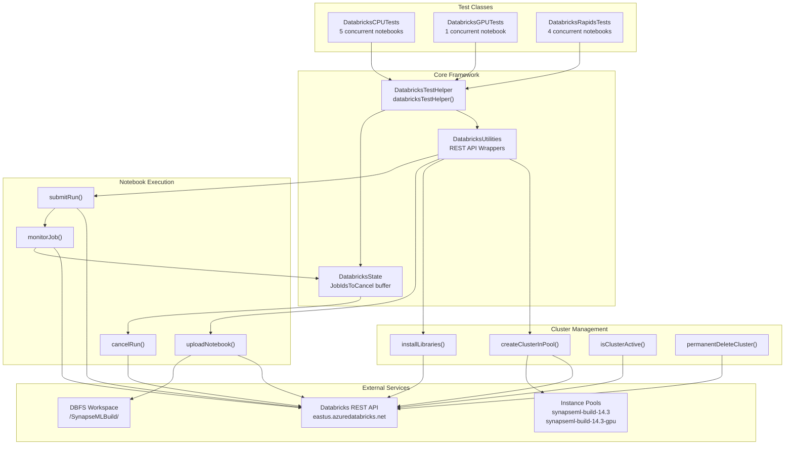
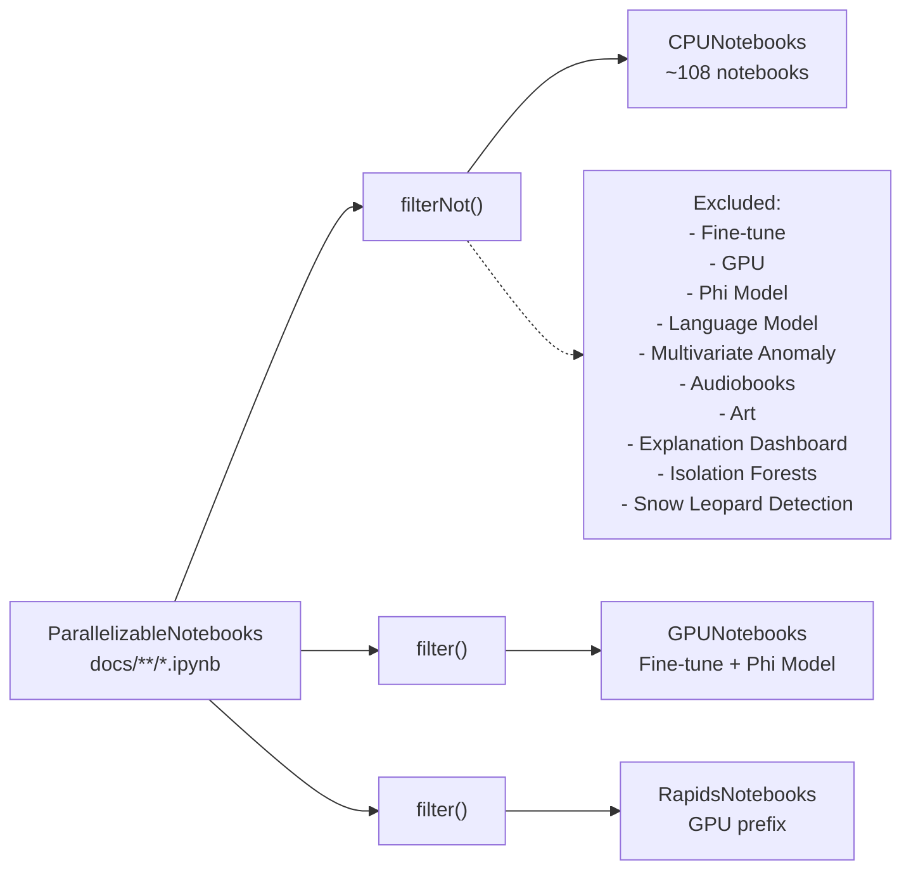
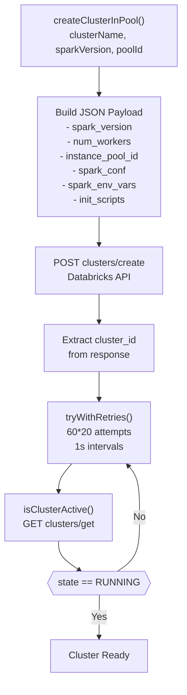
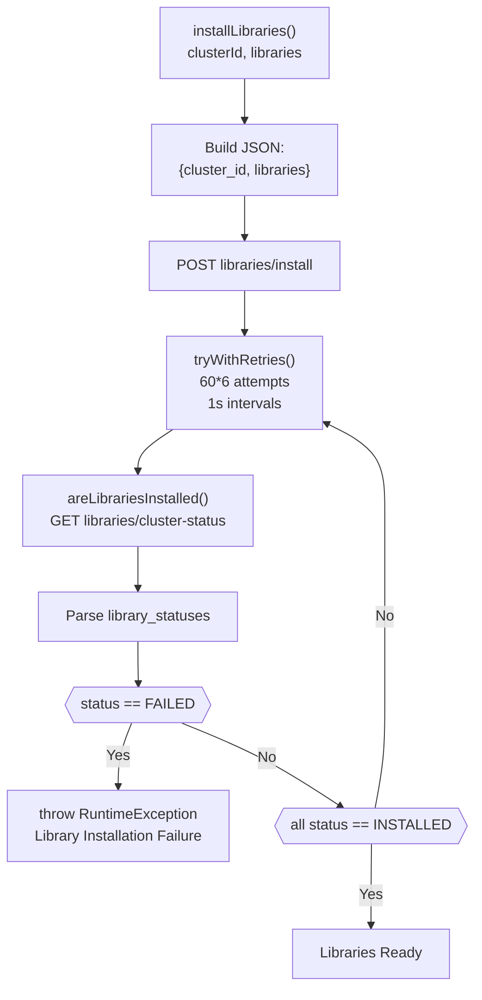
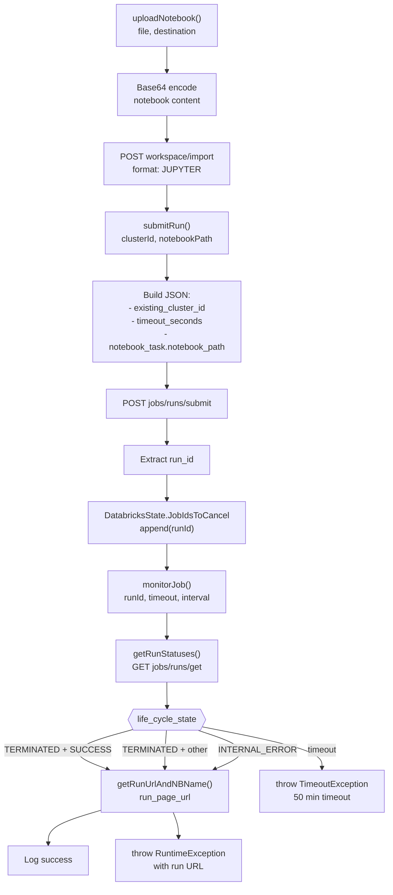
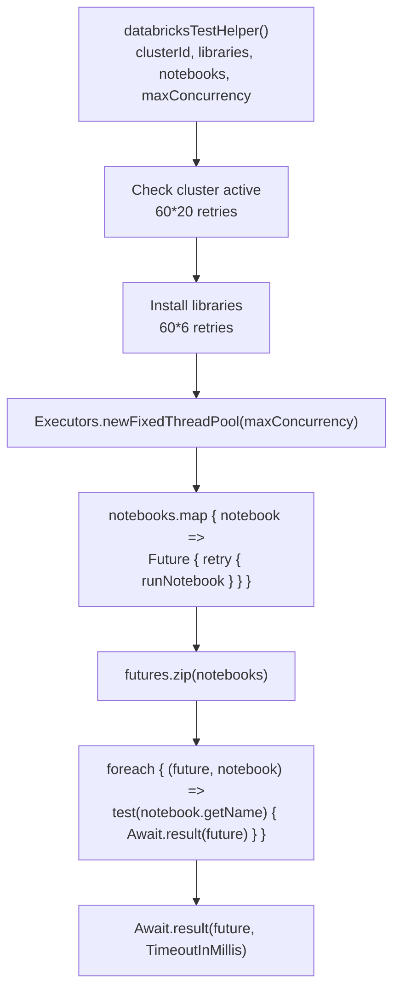
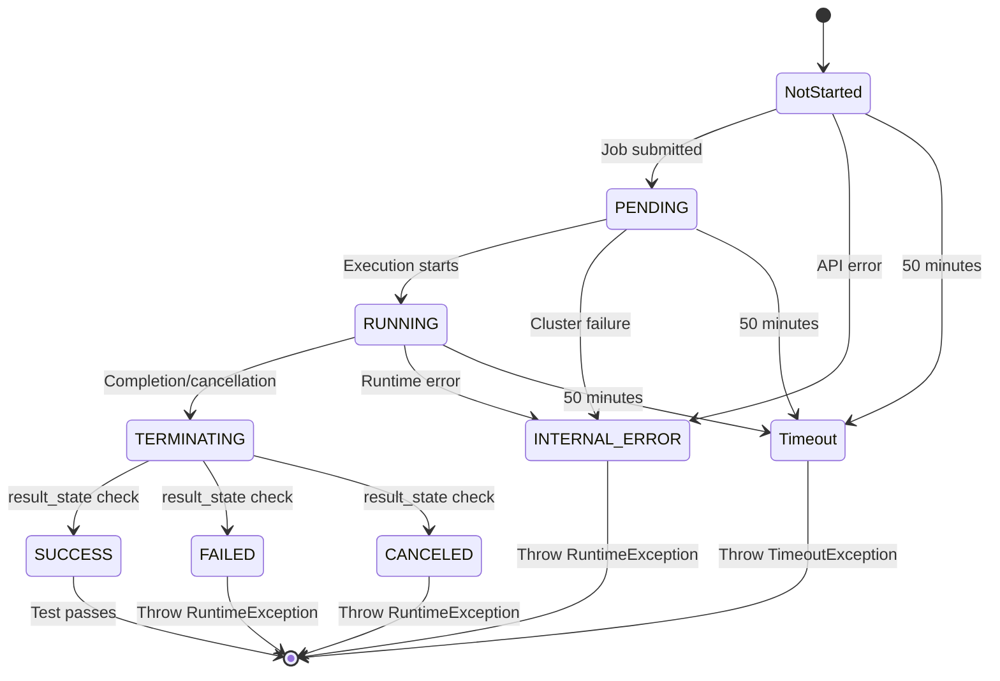
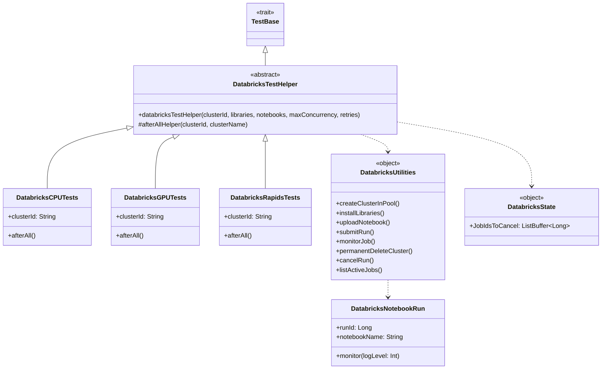

<!-- source: DeepWiki mcp.deepwiki.com · repo microsoft/SynapseML · page 4.3 Databricks E2E Testing · fetched 2026-10-26 -->

# Databricks E2E Testing

<details>
<summary>Relevant source files</summary>

The following files were used as context for generating this wiki page:

- [cognitive/src/test/scala/com/microsoft/azure/synapse/ml/services/anomaly/MultivariateAnamolyDetectionSuite.scala](cognitive/src/test/scala/com/microsoft/azure/synapse/ml/services/anomaly/MultivariateAnamolyDetectionSuite.scala)
- [core/src/test/scala/com/microsoft/azure/synapse/ml/nbtest/DatabricksCPUTests.scala](core/src/test/scala/com/microsoft/azure/synapse/ml/nbtest/DatabricksCPUTests.scala)
- [core/src/test/scala/com/microsoft/azure/synapse/ml/nbtest/DatabricksGPUTests.scala](core/src/test/scala/com/microsoft/azure/synapse/ml/nbtest/DatabricksGPUTests.scala)
- [core/src/test/scala/com/microsoft/azure/synapse/ml/nbtest/DatabricksRapidsTests.scala](core/src/test/scala/com/microsoft/azure/synapse/ml/nbtest/DatabricksRapidsTests.scala)
- [core/src/test/scala/com/microsoft/azure/synapse/ml/nbtest/DatabricksUtilities.scala](core/src/test/scala/com/microsoft/azure/synapse/ml/nbtest/DatabricksUtilities.scala)
- [deep-learning/src/main/python/horovod_installation.sh](deep-learning/src/main/python/horovod_installation.sh)
- [deep-learning/src/main/python/synapse/ml/dl/DeepTextClassifier.py](deep-learning/src/main/python/synapse/ml/dl/DeepTextClassifier.py)
- [deep-learning/src/main/python/synapse/ml/dl/DeepVisionClassifier.py](deep-learning/src/main/python/synapse/ml/dl/DeepVisionClassifier.py)
- [deep-learning/src/main/python/synapse/ml/dl/LitDeepTextModel.py](deep-learning/src/main/python/synapse/ml/dl/LitDeepTextModel.py)
- [deep-learning/src/main/python/synapse/ml/dl/LitDeepVisionModel.py](deep-learning/src/main/python/synapse/ml/dl/LitDeepVisionModel.py)
- [docs/Explore Algorithms/Other Algorithms/Quickstart - Anomalous Access Detection.ipynb](docs/Explore Algorithms/Other Algorithms/Quickstart - Anomalous Access Detection.ipynb)

</details>


## Purpose and Scope

This document describes the end-to-end (E2E) testing infrastructure for executing SynapseML notebooks on Databricks clusters. The system provisions ephemeral Databricks clusters, installs required libraries, executes Jupyter notebooks as tests, and monitors job completion with automatic cleanup.

For Synapse-specific E2E testing, see [Synapse E2E Testing](#4.2). For unit testing strategies, see [Testing Strategy](#4.1).

## System Architecture

The Databricks E2E testing system consists of utilities for cluster lifecycle management, library installation, notebook execution, and job monitoring through the Databricks REST API.



**Sources:** [core/src/test/scala/com/microsoft/azure/synapse/ml/nbtest/DatabricksUtilities.scala:1-488](), [core/src/test/scala/com/microsoft/azure/synapse/ml/nbtest/DatabricksCPUTests.scala:1-26](), [core/src/test/scala/com/microsoft/azure/synapse/ml/nbtest/DatabricksGPUTests.scala:1-20](), [core/src/test/scala/com/microsoft/azure/synapse/ml/nbtest/DatabricksRapidsTests.scala:1-20]()

## Test Suite Organization

The Databricks E2E testing system organizes notebooks into three test suites based on hardware requirements and execution characteristics.

| Test Suite | Class | Cluster Type | Runtime | Workers | Concurrency | Notebooks |
|------------|-------|--------------|---------|---------|-------------|-----------|
| CPU | `DatabricksCPUTests` | CPU Pool | `14.3.x-scala2.12` | 5 | 5 | Most notebooks |
| GPU | `DatabricksGPUTests` | GPU Pool | `14.3.x-gpu-ml-scala2.12` | 2 | 1 | Fine-tune, Phi Model |
| RAPIDS | `DatabricksRapidsTests` | GPU Pool | `14.3.x-gpu-ml-scala2.12` | 1 | 4 | GPU-prefixed notebooks |

### Notebook Classification



The notebook classification logic filters the full set of notebooks discovered from the `docs/` directory:

- **CPUNotebooks**: All notebooks except those requiring GPU or excluded for specific reasons [core/src/test/scala/com/microsoft/azure/synapse/ml/nbtest/DatabricksUtilities.scala:108-118]()
- **GPUNotebooks**: Notebooks containing "Fine-tune" or "Phi Model" in their path [core/src/test/scala/com/microsoft/azure/synapse/ml/nbtest/DatabricksUtilities.scala:120-122]()
- **RapidsNotebooks**: Notebooks containing "GPU" in their path [core/src/test/scala/com/microsoft/azure/synapse/ml/nbtest/DatabricksUtilities.scala:124]()

**Sources:** [core/src/test/scala/com/microsoft/azure/synapse/ml/nbtest/DatabricksUtilities.scala:102-124]()

## Cluster Configuration and Management

### Cluster Specifications

The system uses pre-configured instance pools to provision clusters with specific configurations:

```scala
// Configuration Constants
val PoolName = "synapseml-build-14.3"
val GpuPoolName = "synapseml-build-14.3-gpu"
val AdbRuntime = "14.3.x-scala2.12"
val AdbGpuRuntime = "14.3.x-gpu-ml-scala2.12"
val NumWorkers = 5
val AutoTerminationMinutes = 15
```

**Sources:** [core/src/test/scala/com/microsoft/azure/synapse/ml/nbtest/DatabricksUtilities.scala:33-41]()

### Cluster Creation Process



The `createClusterInPool` method constructs a cluster configuration JSON and submits it to the Databricks API. For RAPIDS tests, it includes init scripts that install CUDA dependencies and NCCL [core/src/test/scala/com/microsoft/azure/synapse/ml/nbtest/DatabricksUtilities.scala:200-233]().

**CPU Cluster Creation:**
```scala
val clusterId: String = createClusterInPool(
  ClusterName, 
  AdbRuntime, 
  NumWorkers, 
  PoolId, 
  memory = Some("7g")
)
```
[core/src/test/scala/com/microsoft/azure/synapse/ml/nbtest/DatabricksCPUTests.scala:12]()

**GPU Cluster Creation:**
```scala
val clusterId: String = createClusterInPool(
  GPUClusterName, 
  AdbGpuRuntime, 
  2, 
  GpuPoolId
)
```
[core/src/test/scala/com/microsoft/azure/synapse/ml/nbtest/DatabricksGPUTests.scala:10]()

**RAPIDS Cluster Creation (with init scripts):**
```scala
val clusterId: String = createClusterInPool(
  GPUClusterName, 
  AdbGpuRuntime, 
  1, 
  GpuPoolId, 
  RapidsInitScripts
)
```
[core/src/test/scala/com/microsoft/azure/synapse/ml/nbtest/DatabricksRapidsTests.scala:10]()

**Sources:** [core/src/test/scala/com/microsoft/azure/synapse/ml/nbtest/DatabricksUtilities.scala:200-233](), [core/src/test/scala/com/microsoft/azure/synapse/ml/nbtest/DatabricksUtilities.scala:290-295]()

## Library Installation

### Library Definitions

The system defines three library configurations for different cluster types:

**Standard Libraries (CPU):**
```scala
val Libraries: String = (
  List(Map("maven" -> Map(
    "coordinates" -> PackageMavenCoordinate, 
    "repo" -> PackageRepository
  ))) ++
  PipPackages.map(p => Map("pypi" -> Map("package" -> p)))
).toJson.compactPrint
```

The `PipPackages` list includes:
- `nltk`, `bs4`, `plotly`, `Pillow`
- `onnxmltools==1.7.0`
- `lightgbm`
- `mlflow==2.21.3`
- `openai==0.28.1`
- `langchain==0.0.331`
- `pdf2image`, `pdfminer.six`, `sqlparse`
- `interpret-community`
- `numpy==1.26.4`
- `unstructured==0.10.24`
- `pytesseract`

[core/src/test/scala/com/microsoft/azure/synapse/ml/nbtest/DatabricksUtilities.scala:56-81]()

**GPU Libraries:**
```scala
val GPULibraries: String = List(
  Map("maven" -> Map("coordinates" -> PackageMavenCoordinate, "repo" -> PackageRepository)),
  Map("pypi" -> Map("package" -> "pytorch-lightning==1.5.0")),
  Map("pypi" -> Map("package" -> "torchvision==0.15.1")),
  Map("pypi" -> Map("package" -> "transformers==4.49.0")),
  Map("pypi" -> Map("package" -> "jinja2==3.1.6")),
  Map("pypi" -> Map("package" -> "petastorm==0.12.1")),
  Map("pypi" -> Map("package" -> "protobuf==5.29.4")),
  Map("pypi" -> Map("package" -> "accelerate==0.26.0"))
).toJson.compactPrint
```
[core/src/test/scala/com/microsoft/azure/synapse/ml/nbtest/DatabricksUtilities.scala:84-93]()

### Installation Process



The library installation system:
1. Sends a `libraries/install` POST request with the cluster ID and library specifications
2. Polls the `libraries/cluster-status` endpoint to verify installation completion
3. Checks for `FAILED` status and throws an exception with error details if found
4. Waits until all libraries have `INSTALLED` status

**Sources:** [core/src/test/scala/com/microsoft/azure/synapse/ml/nbtest/DatabricksUtilities.scala:235-306]()

## Notebook Execution Pipeline

### Execution Workflow



The notebook execution process involves several steps:

1. **Upload**: Notebook is base64-encoded and uploaded to DBFS workspace via `workspace/import` [core/src/test/scala/com/microsoft/azure/synapse/ml/nbtest/DatabricksUtilities.scala:163-177]()

2. **Submit**: A job run is created with `jobs/runs/submit`, specifying the cluster and notebook path [core/src/test/scala/com/microsoft/azure/synapse/ml/nbtest/DatabricksUtilities.scala:274-288]()

3. **Track**: The run ID is added to `DatabricksState.JobIdsToCancel` for cleanup if the test suite fails [core/src/test/scala/com/microsoft/azure/synapse/ml/nbtest/DatabricksUtilities.scala:428-430]()

4. **Monitor**: The `monitorJob` method polls the run status every 10 seconds with jitter to avoid overwhelming the API [core/src/test/scala/com/microsoft/azure/synapse/ml/nbtest/DatabricksUtilities.scala:328-366]()

**Sources:** [core/src/test/scala/com/microsoft/azure/synapse/ml/nbtest/DatabricksUtilities.scala:163-177](), [core/src/test/scala/com/microsoft/azure/synapse/ml/nbtest/DatabricksUtilities.scala:274-288](), [core/src/test/scala/com/microsoft/azure/synapse/ml/nbtest/DatabricksUtilities.scala:328-366](), [core/src/test/scala/com/microsoft/azure/synapse/ml/nbtest/DatabricksUtilities.scala:368-380]()

### Parallel Execution Model

The `databricksTestHelper` method orchestrates parallel notebook execution:



Each test class specifies a different concurrency level:
- **CPU Tests**: 5 concurrent notebooks [core/src/test/scala/com/microsoft/azure/synapse/ml/nbtest/DatabricksCPUTests.scala:14]()
- **GPU Tests**: 1 concurrent notebook [core/src/test/scala/com/microsoft/azure/synapse/ml/nbtest/DatabricksGPUTests.scala:12]()
- **RAPIDS Tests**: 4 concurrent notebooks [core/src/test/scala/com/microsoft/azure/synapse/ml/nbtest/DatabricksRapidsTests.scala:12]()

**Sources:** [core/src/test/scala/com/microsoft/azure/synapse/ml/nbtest/DatabricksUtilities.scala:436-471]()

## Monitoring and Error Handling

### Job Monitoring State Machine



The monitoring system tracks two state dimensions:
1. **life_cycle_state**: `PENDING`, `RUNNING`, `TERMINATING`, `TERMINATED`, `INTERNAL_ERROR`
2. **result_state** (when `TERMINATED`): `SUCCESS`, `FAILED`, `CANCELED`

**Sources:** [core/src/test/scala/com/microsoft/azure/synapse/ml/nbtest/DatabricksUtilities.scala:308-366]()

### Retry and Error Handling

The system implements multiple retry strategies:

**API Request Retries:**
```scala
def databricksGet(path: String, apiVersion: String = "2.0"): JsValue = {
  val request = new HttpGet(baseURL(apiVersion) + path)
  request.addHeader("Authorization", AuthValue)
  val random = new Random()
  RESTHelpers.sendAndParseJson(request, backoffs = List.fill(3) {
    1000 + random.nextInt(1000)
  })
}
```
Uses jittered backoff with 3 retries at 1000-2000ms intervals [core/src/test/scala/com/microsoft/azure/synapse/ml/nbtest/DatabricksUtilities.scala:126-133]()

**Notebook Execution Retries:**
```scala
retry(retries, { () =>
  runNotebook(clusterId, notebook)
})
```
Default retry configuration: single retry after 15 seconds [core/src/test/scala/com/microsoft/azure/synapse/ml/nbtest/DatabricksUtilities.scala:461-463]()

**Error Message Construction:**
When a job fails, the system provides detailed error information:
```scala
case Some(state) =>
  throw new RuntimeException(s"Notebook $nbName failed with state $state. " +
    s"For more information check the run page: \n$url\n")
```
[core/src/test/scala/com/microsoft/azure/synapse/ml/nbtest/DatabricksUtilities.scala:355-357]()

**Sources:** [core/src/test/scala/com/microsoft/azure/synapse/ml/nbtest/DatabricksUtilities.scala:126-141](), [core/src/test/scala/com/microsoft/azure/synapse/ml/nbtest/DatabricksUtilities.scala:328-366]()

## Test Helper Framework

### DatabricksTestHelper Class Structure



### Test Execution Flow

Each test class follows a standard pattern:

**Setup Phase:**
```scala
val clusterId: String = createClusterInPool(ClusterName, AdbRuntime, NumWorkers, PoolId)
```

**Test Phase:**
```scala
databricksTestHelper(clusterId, Libraries, CPUNotebooks, 5)
```

**Cleanup Phase:**
```scala
protected override def afterAll(): Unit = {
  afterAllHelper(clusterId, ClusterName)
  super.afterAll()
}
```

The `afterAllHelper` method performs cleanup:
1. Cancels all tracked jobs via `DatabricksState.JobIdsToCancel`
2. Permanently deletes the cluster via `permanentDeleteCluster`

[core/src/test/scala/com/microsoft/azure/synapse/ml/nbtest/DatabricksUtilities.scala:474-480]()

**Sources:** [core/src/test/scala/com/microsoft/azure/synapse/ml/nbtest/DatabricksUtilities.scala:432-481](), [core/src/test/scala/com/microsoft/azure/synapse/ml/nbtest/DatabricksCPUTests.scala:10-19]()

## Authentication and Configuration

### Authentication Mechanism

The system uses token-based authentication with the Databricks API:

```scala
lazy val Token: String = sys.env.getOrElse("MML_ADB_TOKEN", Secrets.AdbToken)
lazy val AuthValue: String = "Basic " + BaseEncoding.base64()
  .encode(("token:" + Token).getBytes("UTF-8"))
```

All API requests include the authorization header:
```scala
request.addHeader("Authorization", AuthValue)
```

[core/src/test/scala/com/microsoft/azure/synapse/ml/nbtest/DatabricksUtilities.scala:43-45](), [core/src/test/scala/com/microsoft/azure/synapse/ml/nbtest/DatabricksUtilities.scala:128]()

### Regional Configuration

The base URL is constructed from a regional constant:
```scala
val Region = "eastus"
def baseURL(apiVersion: String): String = 
  s"https://$Region.azuredatabricks.net/api/$apiVersion/"
```

[core/src/test/scala/com/microsoft/azure/synapse/ml/nbtest/DatabricksUtilities.scala:34](), [core/src/test/scala/com/microsoft/azure/synapse/ml/nbtest/DatabricksUtilities.scala:76]()

**Sources:** [core/src/test/scala/com/microsoft/azure/synapse/ml/nbtest/DatabricksUtilities.scala:33-76]()

## Deep Learning Integration

For GPU and RAPIDS tests, the system manages specialized deep learning library installations:

### Horovod Installation Script

The RAPIDS clusters use an initialization script that installs Horovod with NCCL support for distributed training:

```bash
# Install prerequisite libraries
pip install pytorch-lightning==1.5.0
pip install torchvision==0.15.1
pip install transformers==4.49.0
pip install petastorm>=0.12.1
pip install protobuf==5.29.4

# Install CUDA and NCCL dependencies
apt-get install --allow-downgrades --no-install-recommends -y \
  cuda-nvml-dev-11-0=11.0.167-1 \
  cuda-nvcc-11-0=11.0.221-1 \
  cuda-cudart-dev-11-0=11.0.221-1 \
  cuda-libraries-dev-11-0=11.0.3-1 \
  libnccl-dev=2.10.3-1+cuda11.0 \
  libcusparse-dev-11-0=11.1.1.245-1

# Build and install Horovod from source
git clone --recursive https://github.com/horovod/horovod.git
HOROVOD_GPU_ALLREDUCE=NCCL HOROVOD_CUDA_HOME=/usr/local/cuda-11/ \
HOROVOD_WITH_PYTORCH=1 HOROVOD_WITHOUT_MXNET=1 \
python setup.py bdist_wheel
```

[deep-learning/src/main/python/horovod_installation.sh:1-48]()

### Deep Learning Test Examples

The GPU notebooks validate models like:
- **DeepTextClassifier**: Fine-tunes transformer models (BERT, DistilBERT) for text classification using Horovod [deep-learning/src/main/python/synapse/ml/dl/DeepTextClassifier.py:27-289]()
- **DeepVisionClassifier**: Fine-tunes vision models (ResNet, VGG, Inception, ViT) for image classification [deep-learning/src/main/python/synapse/ml/dl/DeepVisionClassifier.py:31-269]()

Both classifiers extend `TorchEstimator` from Horovod for distributed training and use PyTorch Lightning for model definition [deep-learning/src/main/python/synapse/ml/dl/LitDeepTextModel.py:29-177](), [deep-learning/src/main/python/synapse/ml/dl/LitDeepVisionModel.py:30-234]().

**Sources:** [deep-learning/src/main/python/horovod_installation.sh:1-48](), [deep-learning/src/main/python/synapse/ml/dl/DeepTextClassifier.py:1-289](), [deep-learning/src/main/python/synapse/ml/dl/DeepVisionClassifier.py:1-269]()

## Workspace Organization

### Directory Structure

Notebooks are uploaded to a versioned workspace directory:

```scala
val Folder = s"/SynapseMLBuild/build_${BuildInfo.version}"
```

During execution, the system:
1. Creates the directory structure: `workspaceMkDir(folderToCreate)`
2. Uploads the notebook: `uploadNotebook(notebookFile, destination)`
3. Maintains the relative path structure from `docs/` to preserve organization

[core/src/test/scala/com/microsoft/azure/synapse/ml/nbtest/DatabricksUtilities.scala:53](), [core/src/test/scala/com/microsoft/azure/synapse/ml/nbtest/DatabricksUtilities.scala:368-380]()

**Sources:** [core/src/test/scala/com/microsoft/azure/synapse/ml/nbtest/DatabricksUtilities.scala:53](), [core/src/test/scala/com/microsoft/azure/synapse/ml/nbtest/DatabricksUtilities.scala:157-198](), [core/src/test/scala/com/microsoft/azure/synapse/ml/nbtest/DatabricksUtilities.scala:368-380]()

---

