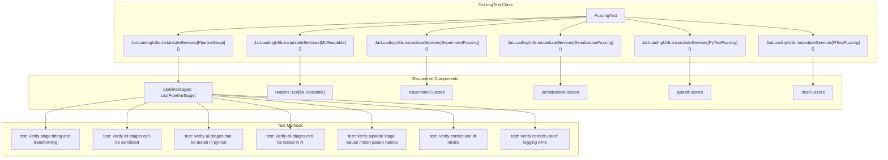
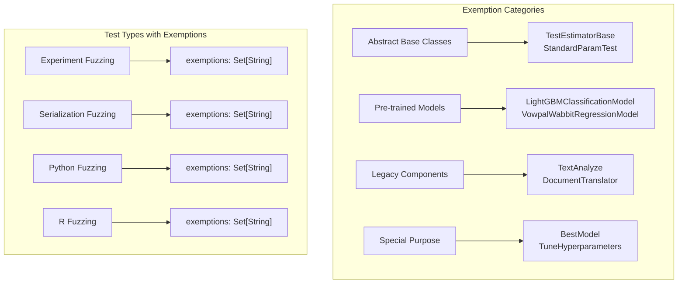
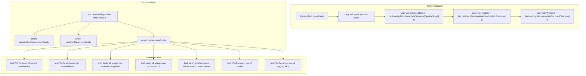

<!-- source: DeepWiki mcp.deepwiki.com · repo microsoft/SynapseML · page 4.4 Component Fuzzing · fetched 2026-10-26 -->

# Component Fuzzing

<details>
<summary>Relevant source files</summary>

The following files were used as context for generating this wiki page:

- [cognitive/src/test/scala/com/microsoft/azure/synapse/ml/services/form/FormOntologyLearnerSuite.scala](cognitive/src/test/scala/com/microsoft/azure/synapse/ml/services/form/FormOntologyLearnerSuite.scala)
- [core/src/test/scala/com/microsoft/azure/synapse/ml/Secrets.scala](core/src/test/scala/com/microsoft/azure/synapse/ml/Secrets.scala)
- [core/src/test/scala/com/microsoft/azure/synapse/ml/nbtest/SharedNotebookE2ETestUtilities.scala](core/src/test/scala/com/microsoft/azure/synapse/ml/nbtest/SharedNotebookE2ETestUtilities.scala)
- [core/src/test/scala/com/microsoft/azure/synapse/ml/nbtest/SynapseExtension/SynapseExtensionSchemas.scala](core/src/test/scala/com/microsoft/azure/synapse/ml/nbtest/SynapseExtension/SynapseExtensionSchemas.scala)
- [core/src/test/scala/com/microsoft/azure/synapse/ml/nbtest/SynapseExtension/SynapseExtensionUtilities.scala](core/src/test/scala/com/microsoft/azure/synapse/ml/nbtest/SynapseExtension/SynapseExtensionUtilities.scala)
- [core/src/test/scala/com/microsoft/azure/synapse/ml/nbtest/SynapseExtension/SynapseExtensionsTests.scala](core/src/test/scala/com/microsoft/azure/synapse/ml/nbtest/SynapseExtension/SynapseExtensionsTests.scala)
- [core/src/test/scala/com/microsoft/azure/synapse/ml/nbtest/SynapseTests.scala](core/src/test/scala/com/microsoft/azure/synapse/ml/nbtest/SynapseTests.scala)
- [core/src/test/scala/com/microsoft/azure/synapse/ml/nbtest/SynapseUtilities.scala](core/src/test/scala/com/microsoft/azure/synapse/ml/nbtest/SynapseUtilities.scala)
- [docs/Explore Algorithms/AI Services/Quickstart - Create Audiobooks.ipynb](docs/Explore Algorithms/AI Services/Quickstart - Create Audiobooks.ipynb)
- [docs/Explore Algorithms/AI Services/Quickstart - Document Question and Answering with PDFs.ipynb](docs/Explore Algorithms/AI Services/Quickstart - Document Question and Answering with PDFs.ipynb)
- [docs/Explore Algorithms/Deep Learning/Quickstart - Chat Completion with Azure AI Foundry Model.ipynb](docs/Explore Algorithms/Deep Learning/Quickstart - Chat Completion with Azure AI Foundry Model.ipynb)
- [docs/Explore Algorithms/OpenAI/Langchain.ipynb](docs/Explore Algorithms/OpenAI/Langchain.ipynb)
- [docs/Explore Algorithms/OpenAI/Quickstart - OpenAI Embedding and GPU based KNN.ipynb](docs/Explore Algorithms/OpenAI/Quickstart - OpenAI Embedding and GPU based KNN.ipynb)
- [docs/Explore Algorithms/OpenAI/Quickstart - OpenAI Embedding.ipynb](docs/Explore Algorithms/OpenAI/Quickstart - OpenAI Embedding.ipynb)
- [docs/Explore Algorithms/OpenAI/Quickstart - Understand and Search Forms.ipynb](docs/Explore Algorithms/OpenAI/Quickstart - Understand and Search Forms.ipynb)
- [docs/Get Started/Install SynapseML.md](docs/Get Started/Install SynapseML.md)
- [src/test/scala/com/microsoft/azure/synapse/ml/core/test/fuzzing/FuzzingTest.scala](src/test/scala/com/microsoft/azure/synapse/ml/core/test/fuzzing/FuzzingTest.scala)

</details>


Component Fuzzing is an automated testing framework that validates all SynapseML `PipelineStage` implementations. The framework uses reflection and service discovery to find all pipeline components in the codebase and systematically tests them for serialization correctness, cross-language compatibility, and interface compliance.

## Overview

The `FuzzingTest` class automatically discovers and validates pipeline components through several mechanisms:

| Test Type | Purpose | Key Validation |
|-----------|---------|----------------|
| Serialization | Save/load model persistence | MLWritable/MLReadable compliance |
| Experiment | Fit/transform workflows | Estimator/Transformer behavior |
| Python | Cross-language bindings | Python SDK compatibility |
| R | Cross-language bindings | R SDK compatibility |
| Interface | Trait implementation | HasInputCol, HasOutputCol, etc. |
| Logging | Telemetry integration | SynapseMLLogging usage |

The framework uses `JarLoadingUtils.instantiateServices[T]()` to dynamically discover all implementations of specific traits, then validates each discovered component against a set of requirements.

Sources:
- [src/test/scala/com/microsoft/azure/synapse/ml/core/test/fuzzing/FuzzingTest.scala:19-34]()
- [src/test/scala/com/microsoft/azure/synapse/ml/core/test/fuzzing/FuzzingTest.scala:422-436]()

## Component Discovery and Test Execution



The `FuzzingTest` class uses lazy evaluation to discover components at runtime, matching each `PipelineStage` implementation with its corresponding fuzzing test implementation using reflection.

Sources:
- [src/test/scala/com/microsoft/azure/synapse/ml/core/test/fuzzing/FuzzingTest.scala:422-436]()
- [src/test/scala/com/microsoft/azure/synapse/ml/core/test/fuzzing/FuzzingTest.scala:28-34]()

## Test Validation Categories

### Stage Fitting and Transforming

The test `"Verify stage fitting and transforming"` ensures that each `PipelineStage` has a corresponding `ExperimentFuzzing` implementation. It validates that:

1. Every applicable `PipelineStage` can be matched to an `ExperimentFuzzing[_]` instance
2. The fuzzing implementation exercises the component's fit/transform workflow
3. The component produces valid output DataFrames

The test uses reflection to extract the generic type parameter from each fuzzer's `experimentTestObjects()` method to map fuzzers to stages.

Sources:
- [src/test/scala/com/microsoft/azure/synapse/ml/core/test/fuzzing/FuzzingTest.scala:36-96]()

### Serialization Compliance

The test `"Verify all stages can be serialized"` validates that all `PipelineStage with MLWritable` implementations have corresponding `SerializationFuzzing` tests. This ensures components can be:

1. Saved to disk using Spark's MLWriter interface
2. Loaded back using the component's MLReadable companion object
3. Used identically after deserialization

Components exempt from this test are typically base classes or abstract implementations not meant to be directly serialized.

Sources:
- [src/test/scala/com/microsoft/azure/synapse/ml/core/test/fuzzing/FuzzingTest.scala:98-158]()

### Python SDK Compatibility

The test `"Verify all stages can be tested in python"` checks that Python wrappers exist and function correctly for each `PipelineStage`. The `PyTestFuzzing` interface generates Python test files that validate:

- Component initialization from Python
- Parameter setting via Python API
- Serialization round-trips through Python SDK

Sources:
- [src/test/scala/com/microsoft/azure/synapse/ml/core/test/fuzzing/FuzzingTest.scala:160-212]()

### R SDK Compatibility

The test `"Verify all stages can be tested in R"` validates R wrapper functionality through `RTestFuzzing` implementations. Similar to Python, this ensures the R SDK can properly interact with the underlying Scala components.

Sources:
- [src/test/scala/com/microsoft/azure/synapse/ml/core/test/fuzzing/FuzzingTest.scala:220-272]()

## Interface and Convention Validation

### Parameter Naming Validation

The test `"Verify all pipeline stage values match their param names"` uses reflection to ensure that `Param[_]` field names match the parameter's logical name. For example, a field `val inputCol` must have `param.name == "inputCol"`.

This validation prevents inconsistencies between the Scala field name and the parameter's public API name.

Sources:
- [src/test/scala/com/microsoft/azure/synapse/ml/core/test/fuzzing/FuzzingTest.scala:288-308]()

### Mixin Trait Enforcement

The test `"Verify correct use of mixins"` validates that components with specific parameter names implement the corresponding trait:

| Parameter Name | Required Trait |
|----------------|----------------|
| inputCol | `HasInputCol` |
| outputCol | `HasOutputCol` |
| labelCol | `HasLabelCol` |
| featuresCol | `HasFeaturesCol` |

This ensures consistent interfaces across the codebase and enables polymorphic usage of components.

Sources:
- [src/test/scala/com/microsoft/azure/synapse/ml/core/test/fuzzing/FuzzingTest.scala:310-368]()

### Logging API Validation

The test `"Verify correct use of logging APIs"` ensures all `PipelineStage` implementations:

1. Extend the `SynapseMLLogging` trait
2. Call `logClass()` in their constructor

The framework checks `SynapseMLLogging.LoggedClasses` to verify that each component registered itself during instantiation.

Sources:
- [src/test/scala/com/microsoft/azure/synapse/ml/core/test/fuzzing/FuzzingTest.scala:370-389]()

### Authentication Interface Validation

The test `"Verify all classes extending HasSubscriptionKey also extend HasAADToken"` enforces that Azure AI service components support both subscription key and Azure AD token authentication methods.

Sources:
- [src/test/scala/com/microsoft/azure/synapse/ml/core/test/fuzzing/FuzzingTest.scala:391-410]()

## Exemption System

The fuzzing framework maintains explicit exemption lists for components that cannot comply with standard validation rules. Each test maintains its own `exemptions: Set[String]` containing fully-qualified class names.

### Common Exemption Patterns



Exemptions typically apply to:
- Abstract base classes used only for testing
- Models that are generated by estimators (not directly instantiable)
- Components with non-standard serialization requirements
- Legacy components being phased out

Sources:
- [src/test/scala/com/microsoft/azure/synapse/ml/core/test/fuzzing/FuzzingTest.scala:37-80]()
- [src/test/scala/com/microsoft/azure/synapse/ml/core/test/fuzzing/FuzzingTest.scala:99-140]()
- [src/test/scala/com/microsoft/azure/synapse/ml/core/test/fuzzing/FuzzingTest.scala:161-198]()
- [src/test/scala/com/microsoft/azure/synapse/ml/core/test/fuzzing/FuzzingTest.scala:221-259]()

## Test Execution Flow



The test suite uses lazy evaluation to defer expensive operations until needed. The `spark` session triggers initialization, which cascades to component discovery. Each test method filters `pipelineStages` by exemptions and validates that required fuzzers exist.

Sources:
- [src/test/scala/com/microsoft/azure/synapse/ml/core/test/fuzzing/FuzzingTest.scala:28-34]()
- [src/test/scala/com/microsoft/azure/synapse/ml/core/test/fuzzing/FuzzingTest.scala:422-436]()

## Implementation Details

### TestObject Structure

The `TestObject` class is a fundamental building block that provides test data for different types of fuzzing tests:

```scala
class TestObject[S <: PipelineStage](
  val stage: S,
  fitDFArg: => DataFrame,
  transDFArg: => DataFrame,
  validateDFArg: => Option[DataFrame]
) {
  lazy val fitDF: DataFrame = fitDFArg
  lazy val transDF: DataFrame = transDFArg
  lazy val validateDF: Option[DataFrame] = validateDFArg
  
  // Convenience constructors
  def this(stage: S, df: => DataFrame) = { this(stage, df, df, None) }
  def this(stage: S, fitDF: => DataFrame, transDF: => DataFrame) = {
    this(stage, fitDF, transDF, None)
  }
}
```

This class encapsulates:
- The pipeline stage to test
- DataFrames for fitting the stage
- DataFrames for transforming
- Optional DataFrames for validation

The lazy evaluation of DataFrames prevents unnecessary computation during test setup.

Sources:
- [src/test/scala/com/microsoft/azure/synapse/ml/core/test/fuzzing/Fuzzing.scala:35-52]()

### Fuzzing Trait

The `Fuzzing` trait combines all types of fuzzing into a comprehensive testing interface:

```scala
trait Fuzzing[S <: PipelineStage with MLWritable] extends SerializationFuzzing[S]
  with ExperimentFuzzing[S] with PyTestFuzzing[S]
  with RTestFuzzing[S] with GetterSetterFuzzing[S] {

  def testObjects(): Seq[TestObject[S]]
  
  def pyTestObjects(): Seq[TestObject[S]] = testObjects()
  def rTestObjects(): Seq[TestObject[S]] = testObjects()
  def serializationTestObjects(): Seq[TestObject[S]] = testObjects()
  def experimentTestObjects(): Seq[TestObject[S]] = testObjects()
  def getterSetterTestObject(): TestObject[S] = testObjects().head
}
```

This trait simplifies the implementation of comprehensive tests by allowing test classes to provide a single set of test objects that can be used for all types of fuzzing tests.

Sources:
- [src/test/scala/com/microsoft/azure/synapse/ml/core/test/fuzzing/Fuzzing.scala:604-630]()

## Summary

The Fuzzing Tests framework in SynapseML provides a comprehensive testing solution that ensures:

1. Pipeline stages work correctly in all supported languages (Scala, Python, R)
2. Components can be properly serialized and deserialized
3. Parameter handling follows consistent patterns
4. Interface implementations adhere to expected standards
5. Naming conventions are consistently applied

By automating these tests and integrating them with the SDK generation process, SynapseML maintains high quality and consistency across its multi-language ecosystem.

Sources:
- [src/test/scala/com/microsoft/azure/synapse/ml/core/test/fuzzing/FuzzingTest.scala]()
- [src/test/scala/com/microsoft/azure/synapse/ml/core/test/fuzzing/Fuzzing.scala]()
- [project/CodegenPlugin.scala]()

---

