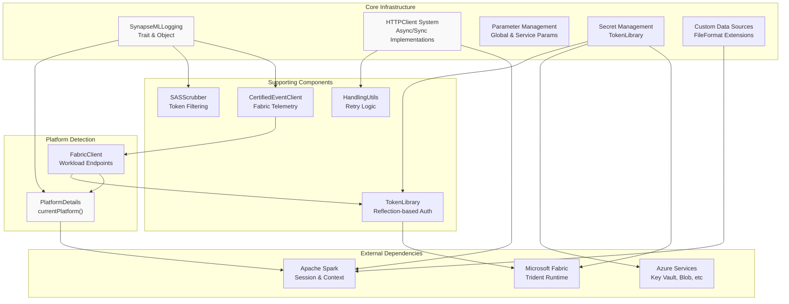
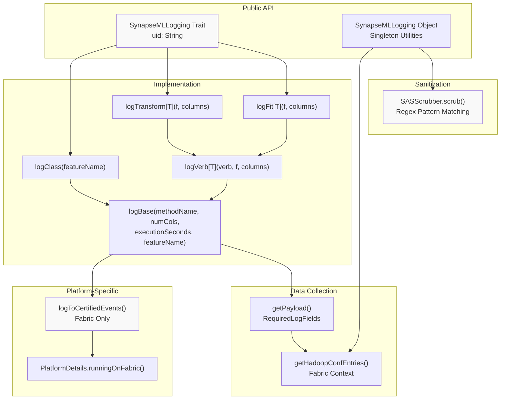
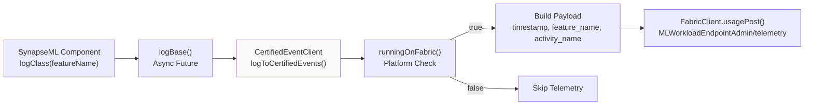
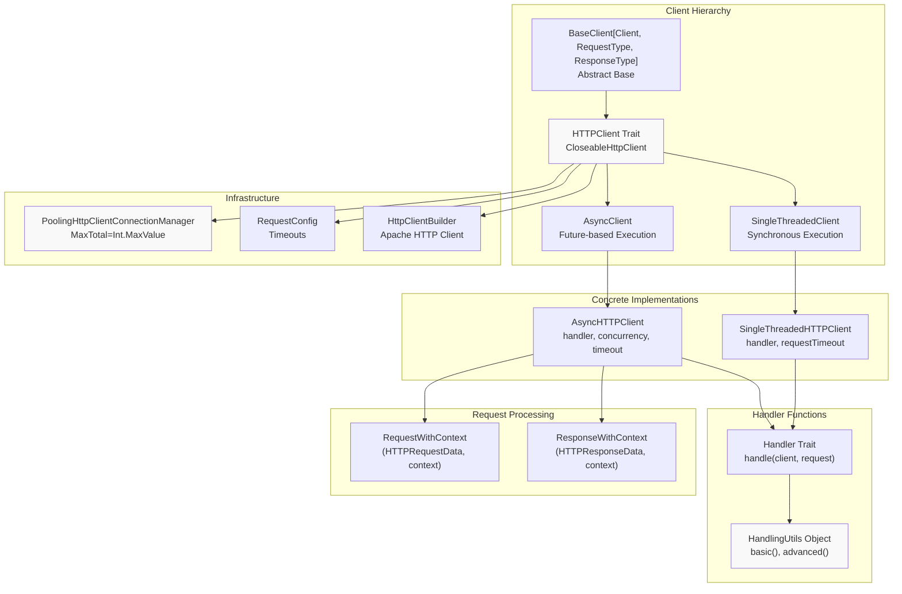
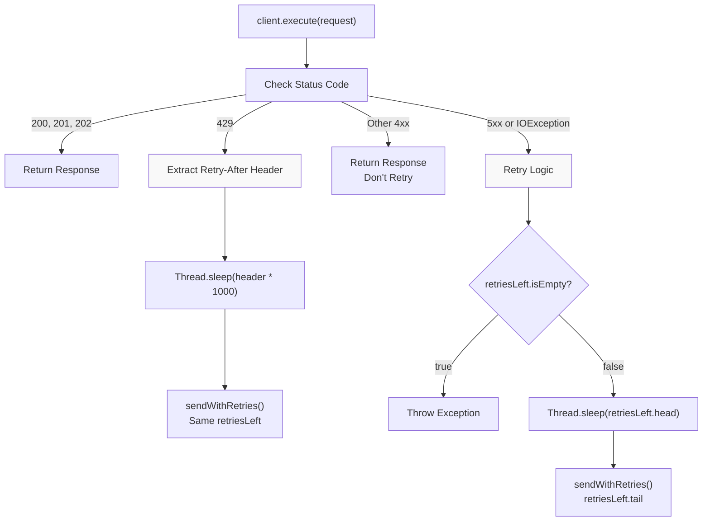
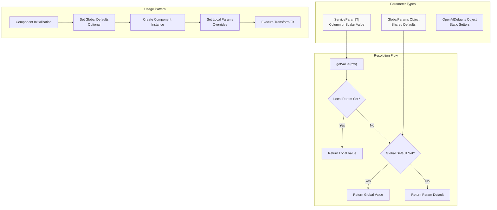
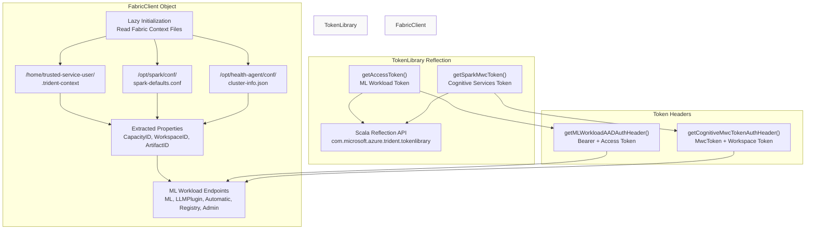

<!-- source: DeepWiki mcp.deepwiki.com · repo microsoft/SynapseML · page 5 Core Functionality · fetched 2026-10-26 -->

# Core Functionality

<details>
<summary>Relevant source files</summary>

The following files were used as context for generating this wiki page:

- [.github/ISSUE_TEMPLATE/bug_report_template.yaml](.github/ISSUE_TEMPLATE/bug_report_template.yaml)
- [.github/ISSUE_TEMPLATE/feature_request.md](.github/ISSUE_TEMPLATE/feature_request.md)
- [core/src/main/scala/com/microsoft/azure/synapse/ml/fabric/FabricClient.scala](core/src/main/scala/com/microsoft/azure/synapse/ml/fabric/FabricClient.scala)
- [core/src/main/scala/com/microsoft/azure/synapse/ml/fabric/TokenLibrary.scala](core/src/main/scala/com/microsoft/azure/synapse/ml/fabric/TokenLibrary.scala)
- [core/src/main/scala/com/microsoft/azure/synapse/ml/io/http/HTTPClients.scala](core/src/main/scala/com/microsoft/azure/synapse/ml/io/http/HTTPClients.scala)
- [core/src/main/scala/com/microsoft/azure/synapse/ml/logging/SynapseMLLogging.scala](core/src/main/scala/com/microsoft/azure/synapse/ml/logging/SynapseMLLogging.scala)
- [core/src/main/scala/com/microsoft/azure/synapse/ml/logging/common/PlatformDetails.scala](core/src/main/scala/com/microsoft/azure/synapse/ml/logging/common/PlatformDetails.scala)
- [core/src/main/scala/com/microsoft/azure/synapse/ml/logging/common/Scrubber.scala](core/src/main/scala/com/microsoft/azure/synapse/ml/logging/common/Scrubber.scala)
- [core/src/main/scala/com/microsoft/azure/synapse/ml/logging/fabric/CertifiedEventClient.scala](core/src/main/scala/com/microsoft/azure/synapse/ml/logging/fabric/CertifiedEventClient.scala)
- [core/src/test/scala/com/microsoft/azure/synapse/ml/logging/LoggingScrubberTests.scala](core/src/test/scala/com/microsoft/azure/synapse/ml/logging/LoggingScrubberTests.scala)
- [vw/src/main/scala/com/microsoft/azure/synapse/ml/vw/VectorZipper.scala](vw/src/main/scala/com/microsoft/azure/synapse/ml/vw/VectorZipper.scala)
- [vw/src/main/scala/com/microsoft/azure/synapse/ml/vw/VowpalWabbitCSETransformer.scala](vw/src/main/scala/com/microsoft/azure/synapse/ml/vw/VowpalWabbitCSETransformer.scala)
- [vw/src/main/scala/com/microsoft/azure/synapse/ml/vw/VowpalWabbitClassifier.scala](vw/src/main/scala/com/microsoft/azure/synapse/ml/vw/VowpalWabbitClassifier.scala)
- [vw/src/main/scala/com/microsoft/azure/synapse/ml/vw/VowpalWabbitContextualBandit.scala](vw/src/main/scala/com/microsoft/azure/synapse/ml/vw/VowpalWabbitContextualBandit.scala)
- [vw/src/main/scala/com/microsoft/azure/synapse/ml/vw/VowpalWabbitDSJsonTransformer.scala](vw/src/main/scala/com/microsoft/azure/synapse/ml/vw/VowpalWabbitDSJsonTransformer.scala)
- [vw/src/main/scala/com/microsoft/azure/synapse/ml/vw/VowpalWabbitFeaturizer.scala](vw/src/main/scala/com/microsoft/azure/synapse/ml/vw/VowpalWabbitFeaturizer.scala)
- [vw/src/main/scala/com/microsoft/azure/synapse/ml/vw/VowpalWabbitRegressor.scala](vw/src/main/scala/com/microsoft/azure/synapse/ml/vw/VowpalWabbitRegressor.scala)

</details>


## Purpose and Scope

This document covers the shared infrastructure and utilities that form the foundation of SynapseML. These components provide cross-cutting concerns used by all higher-level modules including AI services, machine learning algorithms, and data processing components. The core functionality includes platform-aware logging, HTTP communication infrastructure, parameter management, secret retrieval, and custom Spark data sources.

For information about specific ML services that use these core utilities, see [AI Services Integration](#6). For deployment platform configurations, see [Deployment](#8).

---

## System Architecture

The core functionality is organized around five major subsystems that provide essential services to all SynapseML components:



**Sources:** [core/src/main/scala/com/microsoft/azure/synapse/ml/logging/SynapseMLLogging.scala](), [core/src/main/scala/com/microsoft/azure/synapse/ml/io/http/HTTPClients.scala](), [core/src/main/scala/com/microsoft/azure/synapse/ml/logging/common/PlatformDetails.scala](), [core/src/main/scala/com/microsoft/azure/synapse/ml/fabric/FabricClient.scala]()

---

## Logging System

### Overview

The logging system provides platform-aware telemetry with automatic sensitive information scrubbing and optional integration with Microsoft Fabric's certified events system. It consists of the `SynapseMLLogging` trait for component instrumentation and supporting utilities for platform detection and data sanitization.

### Core Components



**Sources:** [core/src/main/scala/com/microsoft/azure/synapse/ml/logging/SynapseMLLogging.scala:19-172](), [core/src/main/scala/com/microsoft/azure/synapse/ml/logging/common/Scrubber.scala:1-25]()

### SynapseMLLogging Trait

Components that want logging capabilities mix in the `SynapseMLLogging` trait, which requires a `uid: String` field and provides instrumented execution methods:

| Method | Purpose | Logged Fields |
|--------|---------|---------------|
| `logClass(featureName)` | Log component instantiation | className, uid, featureName |
| `logFit[T](f, columns)` | Wrap estimator fitting | executionSeconds, numCols |
| `logTransform[T](f, columns)` | Wrap transformer execution | executionSeconds, numCols |
| `logVerb[T](verb, f, columns)` | Generic verb logging | verb, executionSeconds, numCols |

**Sources:** [core/src/main/scala/com/microsoft/azure/synapse/ml/logging/SynapseMLLogging.scala:94-172]()

### Log Payload Structure

Every log entry contains:

```
RequiredLogFields:
- modelUid: String          // Component instance identifier
- className: String         // Fully qualified class name
- method: String            // Method being executed (fit, transform, etc)
- libraryVersion: String    // BuildInfo.version
- libraryName: "SynapseML"
- protocolVersion: "0.0.1"

Optional Fields:
- dfInfo: JSON              // {"input": {"numCols": N}}
- executionSeconds: Double  // Execution time
- errorType: String         // Exception class name
- errorMessage: String      // Exception message

Fabric Context (when available):
- artifactId, workspaceId, capacityId, tenantId, lakehouseId, livyId, artifactType
```

**Sources:** [core/src/main/scala/com/microsoft/azure/synapse/ml/logging/SynapseMLLogging.scala:19-47](), [core/src/main/scala/com/microsoft/azure/synapse/ml/logging/SynapseMLLogging.scala:98-113]()

### Hadoop Configuration Extraction

The system extracts Fabric-specific identifiers from Hadoop configuration when running in Microsoft Fabric:

```
HadoopKeysToLog:
trident.artifact.id       -> artifactId
trident.workspace.id      -> workspaceId
trident.capacity.id       -> capacityId
trident.artifact.workspace.id -> artifactWorkspaceId
trident.lakehouse.id      -> lakehouseId
trident.activity.id       -> livyId
trident.artifact.type     -> artifactType
trident.tenant.id         -> tenantId
```

**Sources:** [core/src/main/scala/com/microsoft/azure/synapse/ml/logging/SynapseMLLogging.scala:52-73]()

### SASScrubber: Sensitive Data Filtering

The `SASScrubber` removes Shared Access Signature (SAS) tokens from log messages using regex pattern matching:

```
Pattern: (?i)sig=[a-z0-9%]{43,63}%3d
Replacement: sig=####
```

This pattern matches URL-encoded Azure Blob Storage SAS signatures (43-63 characters of base64, ending with `%3d` which is URL-encoded `=`).

**Sources:** [core/src/main/scala/com/microsoft/azure/synapse/ml/logging/common/Scrubber.scala:19-24](), [core/src/test/scala/com/microsoft/azure/synapse/ml/logging/LoggingScrubberTests.scala:10-33]()

### Platform Detection

The `PlatformDetails` object identifies the execution environment:

| Platform | Detection Method | Constant |
|----------|-----------------|----------|
| Fabric | File exists: `/home/trusted-service-user/.trident-context` | `PlatformSynapseInternal` |
| Synapse | `AZURE_SERVICE == "Microsoft.ProjectArcadia"` + cluster type check | `PlatformSynapse` |
| Databricks | Directory exists: `/dbfs` | `PlatformDatabricks` |
| Binder | Environment variable: `BINDER_LAUNCH_HOST` | `PlatformBinder` |
| Unknown | None of the above | `PlatformUnknown` |

**Sources:** [core/src/main/scala/com/microsoft/azure/synapse/ml/logging/common/PlatformDetails.scala:8-47]()

### Fabric Certified Events

When running on Microsoft Fabric, the system sends telemetry to the Fabric certified events endpoint:



**Sources:** [core/src/main/scala/com/microsoft/azure/synapse/ml/logging/fabric/CertifiedEventClient.scala:13-35](), [core/src/main/scala/com/microsoft/azure/synapse/ml/logging/SynapseMLLogging.scala:127-140]()

### Usage Example

```scala
class MyEstimator extends Estimator with SynapseMLLogging {
  val uid: String = Identifiable.randomUID("MyEstimator")
  
  logClass(FeatureNames.MyFeature)  // Log instantiation
  
  override def fit(dataset: Dataset[_]): MyModel = {
    logFit({
      // Training logic here
      new MyModel(uid)
    }, dataset.columns.length)
  }
}
```

**Sources:** Examples from [vw/src/main/scala/com/microsoft/azure/synapse/ml/vw/VowpalWabbitClassifier.scala:29-30](), [vw/src/main/scala/com/microsoft/azure/synapse/ml/vw/VowpalWabbitRegressor.scala:22-23]()

---

## HTTP Client System

### Overview

The HTTP client infrastructure provides robust, distributed HTTP request handling with connection pooling, configurable timeouts, retry logic with backoff, and both asynchronous and synchronous execution modes. All HTTP-based services in SynapseML (OpenAI, Cognitive Services, etc.) use this infrastructure.

### Client Architecture



**Sources:** [core/src/main/scala/com/microsoft/azure/synapse/ml/io/http/HTTPClients.scala:21-203]()

### HTTPClient Trait

The `HTTPClient` trait provides the foundation for all HTTP communication:

| Component | Type | Purpose |
|-----------|------|---------|
| `internalClient` | `CloseableHttpClient` | Apache HTTP client with pooling |
| `connectionManager` | `PoolingHttpClientConnectionManager` | Connection reuse across requests |
| `requestConfig` | `RequestConfig` | Timeout configuration |
| `requestTimeout` | `Int` | Milliseconds for connect, request, socket timeouts |

**Configuration:**
- `setDefaultMaxPerRoute(Int.MaxValue)` - Spark handles threading limits
- `setMaxTotal(Int.MaxValue)` - No artificial connection limit
- All three timeout types use the same `requestTimeout` value

**Sources:** [core/src/main/scala/com/microsoft/azure/synapse/ml/io/http/HTTPClients.scala:27-63]()

### Retry Logic and Error Handling

The `HandlingUtils.sendWithRetries` method implements sophisticated retry behavior:



**Retry Behavior:**
- **429 (Rate Limited):** Wait for `Retry-After` seconds, retry without decrementing retry count
- **5xx errors:** Sleep for specified duration, retry with decremented count
- **4xx errors:** No retry (except 429)
- **IOException:** Retry with backoff
- **extraCodesToRetry:** Optional parameter for custom retry codes

**Sources:** [core/src/main/scala/com/microsoft/azure/synapse/ml/io/http/HTTPClients.scala:74-146]()

### Handler Functions

`HandlingUtils` provides two handler factories:

| Handler | Retry Times | Logging | UDF Available |
|---------|-------------|---------|---------------|
| `basic()` | None | No | Yes: `basicUDF` |
| `advanced(retryTimes*)` | Configurable array | Yes (debug & message) | Yes: `advancedUDF(retryTimes*)` |

The `advanced` handler logs:
- Debug: Full request payload (POST body or URI)
- Info: Completion time in milliseconds

**Sources:** [core/src/main/scala/com/microsoft/azure/synapse/ml/io/http/HTTPClients.scala:148-182]()

### Async vs Sync Execution

**AsyncHTTPClient:**
```
Parameters:
- handler: HandlerFunc               // basic or advanced
- concurrency: Int                   // Max parallel requests
- timeout: Duration                  // Overall operation timeout
- requestTimeout: Int                // Per-request timeout
- implicit ec: ExecutionContext      // Thread pool

Usage: Batched requests with Future-based execution
```

**SingleThreadedHTTPClient:**
```
Parameters:
- handler: HandlerFunc               // basic or advanced  
- requestTimeout: Int                // Per-request timeout

Usage: Sequential request processing, simpler lifecycle
```

Both implement `blocking {}` around the handler to signal potential blocking operations to the execution context.

**Sources:** [core/src/main/scala/com/microsoft/azure/synapse/ml/io/http/HTTPClients.scala:184-202]()

### Integration with SynapseML Components

HTTP clients are used by:
- **OpenAI Services:** Chat, completion, embedding endpoints
- **Cognitive Services:** Vision, text, speech APIs
- **Azure AI Foundry:** Model endpoint invocation
- **Custom HTTP transformers:** Distributed HTTP serving

Example instantiation pattern:
```scala
val handler = HandlingUtils.advanced(100, 500, 1000)  // Retry at 100ms, 500ms, 1s
val client = new AsyncHTTPClient(
  handler, 
  concurrency = 10,
  timeout = Duration(300, SECONDS),
  requestTimeout = 60000
)(ExecutionContext.global)
```

**Sources:** [core/src/main/scala/com/microsoft/azure/synapse/ml/io/http/HTTPClients.scala:1-203]()

---

## Parameter Management

### Overview

SynapseML provides a parameter management system that enables global defaults for service configurations while allowing per-instance overrides. This is particularly important for services like OpenAI where parameters like `deployment_name` or `temperature` may be shared across multiple components.

### System Components



**Note:** Specific implementation files for `ServiceParam` and `GlobalParams` were not included in the provided file list, but these concepts are referenced in the OpenAI and Cognitive Services implementations.

### ServiceParam Pattern

The `ServiceParam[T]` class enables parameters to be specified as either:
1. **Column name** (String): Extract value from DataFrame column
2. **Scalar value** (T): Use same value for all rows

This pattern is used extensively in cognitive services and OpenAI integrations to allow batch processing with row-specific or shared parameter values.

---

## Secret Management

### Overview

SynapseML provides platform-agnostic secret retrieval that adapts to the execution environment. The system uses the `TokenLibrary` for Microsoft Fabric authentication and can integrate with Azure Key Vault, Databricks secrets, or other credential stores.

### FabricClient and TokenLibrary



**Sources:** [core/src/main/scala/com/microsoft/azure/synapse/ml/fabric/FabricClient.scala:1-200](), [core/src/main/scala/com/microsoft/azure/synapse/ml/fabric/TokenLibrary.scala:1-52]()

### Fabric Context Extraction

The `FabricClient` reads configuration from multiple sources:

**File: `.trident-context`**
```
Format: key=value pairs
Example:
trident.capacity.id=<guid>
trident.workspace.id=<guid>
trident.artifact.id=<guid>
```

**File: `spark-defaults.conf`**
```
Format: key value pairs (space-separated)
Example:
spark.trident.pbienv public
trident.lakehouse.tokenservice.endpoint https://...
```

**File: `cluster-info.json`**
```
JSON containing cluster metadata:
{
  "cluster_metadata": {
    "workspace-pe-enabled": "true|false",
    ...
  }
}
```

**Sources:** [core/src/main/scala/com/microsoft/azure/synapse/ml/fabric/FabricClient.scala:51-143]()

### Workload Endpoint Construction

FabricClient constructs ML workload endpoints based on environment and private endpoint status:

| Endpoint Type | Path Suffix |
|--------------|-------------|
| `MLWorkloadEndpointML` | `/webapi/capacities/{capacityId}/workloads/ML/ML/Automatic/workspaceid/{workspaceId}/` |
| `MLWorkloadEndpointLLMPlugin` | `/workloads/ML/LlmPlugin/...` |
| `MLWorkloadEndpointAutomatic` | `/workloads/ML/Automatic/...` |
| `MLWorkloadEndpointRegistry` | `/workloads/ML/Registry/...` |
| `MLWorkloadEndpointAdmin` | `/workloads/ML/MLAdmin/...` |
| `MLWorkloadEndpointCognitive` | `{ML endpoint}cognitive/` |
| `MLWorkloadEndpointOpenAI` | `{ML endpoint}cognitive/openai/` |

**Private Endpoint Hosts:**
When `workspace-pe-enabled == true`, hosts are constructed as:
```
https://{cleanedWorkspaceId}.z{first2Chars}.{envMark}c.fabric.microsoft.com
```

**Sources:** [core/src/main/scala/com/microsoft/azure/synapse/ml/fabric/FabricClient.scala:23-189]()

### TokenLibrary Reflection

The `TokenLibrary` uses Scala reflection to invoke methods from the Fabric runtime's `com.microsoft.azure.trident.tokenlibrary.TokenLibrary` object:

**getAccessToken:**
```scala
// Invokes: TokenLibrary.getAccessToken("ml")
// Returns: JWT token for ML workload authentication
```

**getSparkMwcToken:**
```scala
// Invokes: TokenLibrary.getMwcToken(workspaceId, artifactId, 2, "SparkCore")
// Parameters: workspace, artifact, version (2), service name
// Returns: MWC token for Cognitive Services
```

This approach allows SynapseML to work with the Fabric runtime without compile-time dependencies on Trident libraries.

**Sources:** [core/src/main/scala/com/microsoft/azure/synapse/ml/fabric/TokenLibrary.scala:9-51]()

### Authentication Headers

Two authentication patterns are supported:

| Header Type | Format | Usage |
|-------------|--------|-------|
| AAD (Azure AD) | `Bearer {token}` | ML workload endpoints, general Azure resources |
| MWC (Microsoft Workload Context) | `MwcToken {token}` | Cognitive Services through Fabric proxy |

Both are constructed with unique request IDs and workload resource monikers for telemetry correlation.

**Sources:** [core/src/main/scala/com/microsoft/azure/synapse/ml/fabric/FabricClient.scala:145-152](), [core/src/main/scala/com/microsoft/azure/synapse/ml/fabric/TokenLibrary.scala:47-51]()

---

## Custom Spark Data Sources

### Overview

SynapseML extends Apache Spark's data source API with custom `FileFormat` implementations that provide enhanced capabilities for reading images, binary files, and HTTP streams. These formats include retry mechanisms, zip archive support, and workarounds for known Spark issues.

### Data Source Types

| Format | Purpose | Key Features |
|--------|---------|--------------|
| ImageFileFormat | Read images as DataFrames | Retry on flaky image decoding, origin tracking |
| BinaryFileFormat | Read binary files | Zip archive support, recursive directory traversal |
| HTTPSource | Distributed HTTP server | Structured streaming source for serving models |
| HTTPSink | HTTP client streaming | Structured streaming sink for writing via HTTP |

**Note:** Specific implementation files for these custom formats were not included in the provided file list, but they are referenced in the system documentation and form part of the core I/O functionality.

### Image File Format

The custom image format addresses flakiness in Spark's built-in image decoder by implementing retry logic and better error handling. It supports common image formats (JPEG, PNG, etc.) and preserves file origin metadata for downstream processing.

### Binary File Format with Zip Support

Extends Spark's binary file reading to transparently handle zip archives, allowing datasets distributed as compressed files to be read without manual extraction. This is particularly useful for model artifacts and pre-processed feature sets.

### HTTP Sources and Sinks

These components enable SynapseML models to be deployed as distributed HTTP endpoints or to write results via HTTP in streaming contexts, integrating machine learning pipelines with web services and APIs.

---

## Usage Patterns Across SynapseML

The core infrastructure is used consistently across all SynapseML components:

```mermaid
graph TB
    subgraph "Example: VowpalWabbitClassifier"
        VWClass["VowpalWabbitClassifier<br/>class"] --> MixinLog["with SynapseMLLogging"]
        MixinLog --> Constructor["Constructor<br/>logClass(FeatureNames.VowpalWabbit)"]
        Constructor --> Fit["fit(dataset)<br/>logFit({...}, columns.length)"]
    end
    
    subgraph "Example: OpenAIChatCompletion"
        OpenAIClass["OpenAIChatCompletion<br/>class"] --> MixinLog2["with SynapseMLLogging"]
        MixinLog2 --> Constructor2["Constructor<br/>logClass(FeatureNames.OpenAI)"]
        Constructor2 --> Transform["transform(dataset)<br/>Uses AsyncHTTPClient"]
        Transform --> HTTPHandler["HandlingUtils.advanced(100, 500, 1000)"]
    end
    
    subgraph "Example: CertifiedEventClient"
        Service["Fabric-based Service"] --> CheckPlatform["PlatformDetails.runningOnFabric()"]
        CheckPlatform -->|true| BuildPayload["Build Telemetry Payload"]
        BuildPayload --> GetToken["TokenLibrary.getAccessToken()"]
        GetToken --> SendTelemetry["FabricClient.usagePost()"]
    end
    
    style MixinLog fill:#f9f9f9
    style HTTPHandler fill:#f9f9f9
    style CheckPlatform fill:#f9f9f9
```



**Sources:** [vw/src/main/scala/com/microsoft/azure/synapse/ml/vw/VowpalWabbitClassifier.scala:29-30](), [vw/src/main/scala/com/microsoft/azure/synapse/ml/vw/VowpalWabbitRegressor.scala:22-23](), [vw/src/main/scala/com/microsoft/azure/synapse/ml/vw/VowpalWabbitFeaturizer.scala:28-29]()

---

## Summary

The core functionality provides battle-tested infrastructure for:

1. **Observability:** Platform-aware logging with automatic sanitization and optional Fabric telemetry
2. **Reliability:** HTTP retry logic with exponential backoff and rate limit handling
3. **Portability:** Platform detection and authentication abstraction
4. **Performance:** Connection pooling and async execution for HTTP-heavy workloads
5. **Security:** Automatic scrubbing of SAS tokens and secrets from logs

All higher-level SynapseML components depend on these core utilities, ensuring consistent behavior across different deployment environments (Synapse, Fabric, Databricks, standalone Spark) and providing unified telemetry for debugging and monitoring.

---

