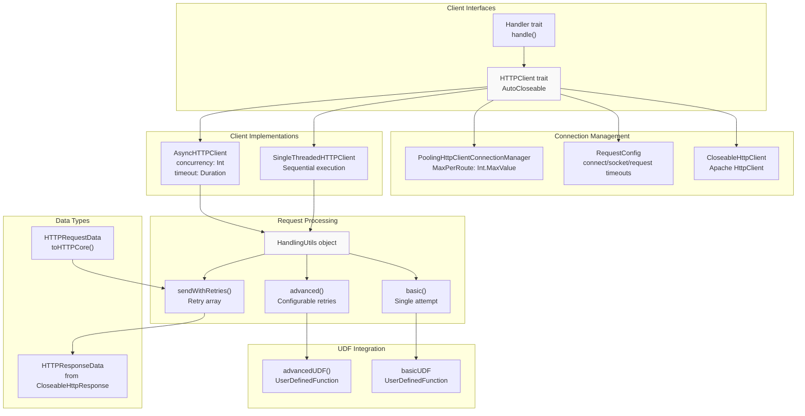
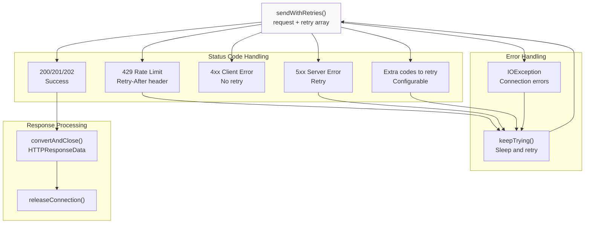
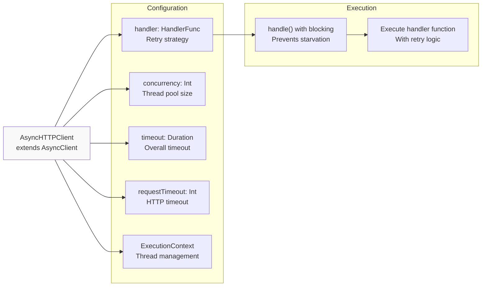
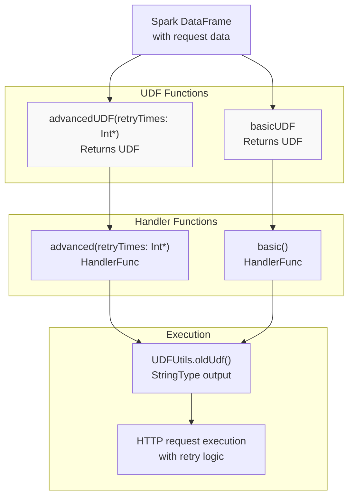
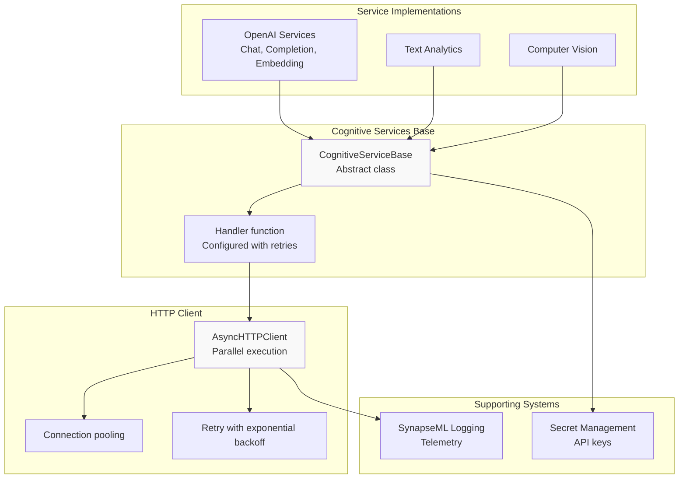

<!-- source: DeepWiki mcp.deepwiki.com · repo microsoft/SynapseML · page 5.2 HTTP Client System · fetched 2026-10-26 -->

# HTTP Client System

<details>
<summary>Relevant source files</summary>

The following files were used as context for generating this wiki page:

- [.github/ISSUE_TEMPLATE/bug_report_template.yaml](.github/ISSUE_TEMPLATE/bug_report_template.yaml)
- [.github/ISSUE_TEMPLATE/feature_request.md](.github/ISSUE_TEMPLATE/feature_request.md)
- [core/src/main/scala/com/microsoft/azure/synapse/ml/fabric/FabricClient.scala](core/src/main/scala/com/microsoft/azure/synapse/ml/fabric/FabricClient.scala)
- [core/src/main/scala/com/microsoft/azure/synapse/ml/fabric/TokenLibrary.scala](core/src/main/scala/com/microsoft/azure/synapse/ml/fabric/TokenLibrary.scala)
- [core/src/main/scala/com/microsoft/azure/synapse/ml/io/http/HTTPClients.scala](core/src/main/scala/com/microsoft/azure/synapse/ml/io/http/HTTPClients.scala)
- [core/src/main/scala/com/microsoft/azure/synapse/ml/logging/SynapseMLLogging.scala](core/src/main/scala/com/microsoft/azure/synapse/ml/logging/SynapseMLLogging.scala)
- [core/src/main/scala/com/microsoft/azure/synapse/ml/logging/common/PlatformDetails.scala](core/src/main/scala/com/microsoft/azure/synapse/ml/logging/common/PlatformDetails.scala)
- [core/src/main/scala/com/microsoft/azure/synapse/ml/logging/common/Scrubber.scala](core/src/main/scala/com/microsoft/azure/synapse/ml/logging/common/Scrubber.scala)
- [core/src/main/scala/com/microsoft/azure/synapse/ml/logging/fabric/CertifiedEventClient.scala](core/src/main/scala/com/microsoft/azure/synapse/ml/logging/fabric/CertifiedEventClient.scala)
- [core/src/test/scala/com/microsoft/azure/synapse/ml/logging/LoggingScrubberTests.scala](core/src/test/scala/com/microsoft/azure/synapse/ml/logging/LoggingScrubberTests.scala)
- [vw/src/main/scala/com/microsoft/azure/synapse/ml/vw/VectorZipper.scala](vw/src/main/scala/com/microsoft/azure/synapse/ml/vw/VectorZipper.scala)
- [vw/src/main/scala/com/microsoft/azure/synapse/ml/vw/VowpalWabbitCSETransformer.scala](vw/src/main/scala/com/microsoft/azure/synapse/ml/vw/VowpalWabbitCSETransformer.scala)
- [vw/src/main/scala/com/microsoft/azure/synapse/ml/vw/VowpalWabbitClassifier.scala](vw/src/main/scala/com/microsoft/azure/synapse/ml/vw/VowpalWabbitClassifier.scala)
- [vw/src/main/scala/com/microsoft/azure/synapse/ml/vw/VowpalWabbitContextualBandit.scala](vw/src/main/scala/com/microsoft/azure/synapse/ml/vw/VowpalWabbitContextualBandit.scala)
- [vw/src/main/scala/com/microsoft/azure/synapse/ml/vw/VowpalWabbitDSJsonTransformer.scala](vw/src/main/scala/com/microsoft/azure/synapse/ml/vw/VowpalWabbitDSJsonTransformer.scala)
- [vw/src/main/scala/com/microsoft/azure/synapse/ml/vw/VowpalWabbitFeaturizer.scala](vw/src/main/scala/com/microsoft/azure/synapse/ml/vw/VowpalWabbitFeaturizer.scala)
- [vw/src/main/scala/com/microsoft/azure/synapse/ml/vw/VowpalWabbitRegressor.scala](vw/src/main/scala/com/microsoft/azure/synapse/ml/vw/VowpalWabbitRegressor.scala)

</details>


## Purpose and Scope

The HTTP Client System provides a robust, distributed HTTP communication layer for SynapseML components. It handles HTTP requests and responses within Spark executors, with features including connection pooling, configurable timeouts, automatic retry logic, and support for both synchronous and asynchronous execution patterns. This system is primarily used by the Cognitive Services module for communicating with Azure AI services, but is available as general infrastructure for any HTTP-based integration.

For information about the logging system that integrates with HTTP clients, see [Logging System](#5.1). For details on how Cognitive Services uses this infrastructure, see [Azure Cognitive Services](#6.2).

## Architecture Overview



**HTTP Client System Architecture**: The system is organized around the `Handler` and `HTTPClient` abstractions. `HTTPClient` manages connection pooling and request configuration, while `HandlingUtils` provides the retry logic. Two client implementations support different execution patterns, and UDF wrappers enable usage in Spark DataFrames.

Sources: [core/src/main/scala/com/microsoft/azure/synapse/ml/io/http/HTTPClients.scala:1-203]()

## Core Components

### Handler Trait

The `Handler` trait defines the contract for HTTP request handling:

```scala
trait Handler {
  def handle(client: CloseableHttpClient, request: HTTPRequestData): HTTPResponseData
}
```

This simple interface allows different retry strategies and error handling policies to be composed with the core HTTP client functionality.

Sources: [core/src/main/scala/com/microsoft/azure/synapse/ml/io/http/HTTPClients.scala:21-25]()

### HTTPClient Trait

The `HTTPClient` trait provides the foundation for all HTTP client implementations:

| Component | Description | Configuration |
|-----------|-------------|---------------|
| `requestTimeout` | Timeout for all HTTP operations | Connect, connection request, and socket timeouts |
| `requestConfig` | Apache HttpClient request configuration | Built from `requestTimeout` parameter |
| `connectionManager` | Connection pool manager | `MaxPerRoute: Int.MaxValue`, `MaxTotal: Int.MaxValue` |
| `internalClient` | Underlying Apache HttpClient | Created with connection manager and request config |

The trait extends `BaseClient`, `AutoCloseable`, and `Handler`, providing lifecycle management and the core `handle()` method. The connection pool is configured to allow unlimited connections per route, as Spark handles threading limits at the executor level.

Sources: [core/src/main/scala/com/microsoft/azure/synapse/ml/io/http/HTTPClients.scala:27-63]()

### Connection Management

Connection pooling is implemented using Apache HttpClient's `PoolingHttpClientConnectionManager`:

- **Max connections per route**: `Int.MaxValue` - Spark controls parallelism at the executor level
- **Max total connections**: `Int.MaxValue` - No artificial limit imposed
- **Timeout configuration**: Unified timeout for connect, connection request, and socket operations
- **Resource cleanup**: `close()` method releases the internal HTTP client

The `sendRequestWithContext()` method wraps requests with contextual information, handling optional requests and propagating context through the request-response cycle.

Sources: [core/src/main/scala/com/microsoft/azure/synapse/ml/io/http/HTTPClients.scala:42-61]()

## Retry and Error Handling

### HandlingUtils Object



**Retry Logic Flow**: The retry mechanism evaluates HTTP status codes and exceptions to determine whether to retry. Rate limiting (429) has special handling with `Retry-After` headers.

Sources: [core/src/main/scala/com/microsoft/azure/synapse/ml/io/http/HTTPClients.scala:65-182]()

### Retry Logic Implementation

The `sendWithRetries()` method implements sophisticated retry logic:

| Status Code | Behavior | Notes |
|-------------|----------|-------|
| 200, 201, 202 | Success - no retry | Request completed successfully |
| 429 | Retry with delay | Respects `Retry-After` header; doesn't count against retry budget |
| 4xx (except 429) | No retry | Client errors typically can't be fixed by retrying |
| 5xx | Retry with delay | Server errors may be transient |
| IOException | Retry with delay | Connection errors may be transient |

The retry array `retriesLeft: Array[Int]` specifies sleep durations in milliseconds between attempts. For example, `Array(100, 500, 1000)` retries up to 3 times with increasing delays.

**Special handling for 429**: When rate-limited, the system reads the `Retry-After` response header and sleeps for that duration. Importantly, 429 responses do not consume a retry attempt from the retry array, allowing the system to handle sustained rate limiting gracefully.

Sources: [core/src/main/scala/com/microsoft/azure/synapse/ml/io/http/HTTPClients.scala:86-146]()

### Handler Functions

`HandlingUtils` provides two main handler functions:

**`advanced(retryTimes: Int*)`** - Full-featured handler with:
- Configurable retry delays
- Debug logging of requests and responses
- Performance timing (logs milliseconds taken)
- Exception handling (returns null on failure)
- Connection release

**`basic()`** - Minimal handler with:
- Single attempt (no retries)
- No logging
- Connection release
- Immediate exception propagation

Both handlers convert the `CloseableHttpResponse` to `HTTPResponseData` and properly release connections.

Sources: [core/src/main/scala/com/microsoft/azure/synapse/ml/io/http/HTTPClients.scala:148-182]()

### Logging Integration

The retry system integrates with the SynapseML logging infrastructure:

```scala
SynapseMLLogging.logDebug(s"sending $message")
val start = System.currentTimeMillis()
val resp = sendWithRetries(client, req, retryTimes.toArray)
SynapseMLLogging.logMessage(
  s"finished sending to ${req.getURI} took (${System.currentTimeMillis() - start}ms)")
```

This provides:
- Debug-level logging of request payloads
- Performance metrics for each request
- Warning logs for error responses (non-2xx status codes)
- Error logs for connection failures
- Automatic scrubbing of sensitive information (SAS tokens)

Sources: [core/src/main/scala/com/microsoft/azure/synapse/ml/io/http/HTTPClients.scala:156-161](), [core/src/main/scala/com/microsoft/azure/synapse/ml/logging/SynapseMLLogging.scala:87-92]()

## Client Implementations

### AsyncHTTPClient



**AsyncHTTPClient Architecture**: Extends `AsyncClient` base class with HTTP-specific functionality, using an `ExecutionContext` for parallel request handling.

The `AsyncHTTPClient` is designed for high-throughput scenarios where multiple HTTP requests can be processed concurrently:

- **Constructor parameters**: 
  - `handler: HandlerFunc` - The retry strategy to use (typically `HandlingUtils.advanced()`)
  - `concurrency: Int` - Maximum number of concurrent requests
  - `timeout: Duration` - Overall timeout for the operation
  - `requestTimeout: Int` - Timeout for individual HTTP requests
  - `ec: ExecutionContext` - Thread pool for async execution

- **Blocking wrapper**: The `handle()` method wraps the handler with `blocking` to inform the execution context that this is a blocking operation, preventing thread pool starvation

Sources: [core/src/main/scala/com/microsoft/azure/synapse/ml/io/http/HTTPClients.scala:184-194]()

### SingleThreadedHTTPClient

The `SingleThreadedHTTPClient` provides a simpler execution model for sequential processing:

- **Constructor parameters**:
  - `handler: HandlerFunc` - The retry strategy to use
  - `requestTimeout: Int` - Timeout for HTTP requests

- **Execution model**: Extends `SingleThreadedClient` base class, processing requests sequentially without concurrency management

- **Use case**: Suitable for scenarios where requests must be processed in order or where the overhead of thread management is unnecessary

Both implementations use the `blocking` wrapper around the handler to properly signal to the execution context that HTTP I/O is occurring.

Sources: [core/src/main/scala/com/microsoft/azure/synapse/ml/io/http/HTTPClients.scala:196-202]()

## UDF Support

The HTTP client system provides User-Defined Functions for use in Spark DataFrame transformations:

### Handler UDFs



**UDF Integration**: Handler functions are wrapped as UDFs for DataFrame operations, returning string-serialized HTTP responses.

### UDF Implementations

**`advancedUDF(retryTimes: Int*): UserDefinedFunction`**
- Wraps the `advanced()` handler as a UDF
- Takes variable retry times as parameters
- Returns `StringType` (serialized `HTTPResponseData`)
- Suitable for production workloads requiring resilience

**`basicUDF: UserDefinedFunction`**
- Wraps the `basic()` handler as a UDF
- No retry logic
- Returns `StringType` (serialized `HTTPResponseData`)
- Suitable for testing or simple use cases

Both UDFs use `UDFUtils.oldUdf()` for backward compatibility with older Spark versions.

Sources: [core/src/main/scala/com/microsoft/azure/synapse/ml/io/http/HTTPClients.scala:171-182]()

## Integration Points

### Cognitive Services Integration

The HTTP Client System is the primary communication layer for Azure Cognitive Services:



**Cognitive Services Integration**: All Azure AI service wrappers use the HTTP Client System through `CognitiveServiceBase`.

Sources: Files referenced in high-level diagrams showing Cognitive Services → HTTPClients relationship

### Fabric Client Integration

The Fabric platform client uses HTTP utilities for workload endpoint communication:

- **RESTUtils trait**: Provides `usagePost()` method for HTTP POST requests
- **Token authentication**: Integrates with `TokenLibrary` for bearer token management
- **Workload endpoints**: Uses HTTP client for ML workload API calls
- **Header management**: Configures Authorization, RequestId, Content-Type headers

The `FabricClient.usagePost()` method demonstrates the integration pattern, posting JSON payloads to Fabric workload endpoints with authentication and request tracking.

Sources: [core/src/main/scala/com/microsoft/azure/synapse/ml/fabric/FabricClient.scala:190-192]()

### Usage Patterns

The HTTP Client System is typically instantiated with one of these patterns:

**Pattern 1: Async with custom retries**
```scala
new AsyncHTTPClient(
  handler = HandlingUtils.advanced(100, 500, 1000),
  concurrency = 10,
  timeout = Duration(60, "seconds"),
  requestTimeout = 30000
)(ExecutionContext.global)
```

**Pattern 2: Single-threaded with default handler**
```scala
new SingleThreadedHTTPClient(
  handler = HandlingUtils.basic,
  requestTimeout = 30000
)
```

**Pattern 3: UDF for DataFrame operations**
```scala
df.withColumn("response", 
  HandlingUtils.advancedUDF(100, 500, 1000)($"request"))
```

Sources: [core/src/main/scala/com/microsoft/azure/synapse/ml/io/http/HTTPClients.scala:184-202]()

### Request and Response Data Types

The system uses specific data types for HTTP operations:

- **`HTTPRequestData`**: Wraps HTTP request information with a `toHTTPCore()` method that converts to Apache HttpClient's request types (`HttpPost`, `HttpGet`, etc.)

- **`HTTPResponseData`**: Constructed from `CloseableHttpResponse`, providing access to status code, headers, and response body

- **`RequestWithContext`**: Pairs an optional `HTTPRequestData` with context information for tracking requests through the pipeline

- **`ResponseWithContext`**: Pairs an optional `HTTPResponseData` with context information, preserving request tracking

The `sendRequestWithContext()` method demonstrates this pattern, mapping requests to responses while preserving context.

Sources: [core/src/main/scala/com/microsoft/azure/synapse/ml/io/http/HTTPClients.scala:57-61]()

## Performance Considerations

### Connection Pooling Strategy

The connection pool configuration prioritizes horizontal scalability:

- **No artificial limits**: `Int.MaxValue` for both per-route and total connections
- **Spark-managed parallelism**: Relies on Spark's executor and partition management rather than HTTP connection limits
- **Trade-off**: Higher memory usage in exchange for eliminating connection pool contention

This design is appropriate for distributed Spark workloads where executor-level parallelism is already constrained by cluster resources.

### Timeout Configuration

All timeouts share a single value (`requestTimeout`):
- **Connect timeout**: Time to establish TCP connection
- **Connection request timeout**: Time to obtain connection from pool
- **Socket timeout**: Time waiting for data after connection established

This simplified configuration ensures consistent behavior but may not be optimal for all scenarios (e.g., slow initial connection but fast data transfer).

### Retry Budget

The retry array design provides flexibility:
- **Exponential backoff**: `Array(100, 500, 1000, 2000)` - increasing delays
- **Fixed retry**: `Array(1000, 1000, 1000)` - consistent delays  
- **Rate limit handling**: 429 responses don't consume retry attempts

The `advanced()` handler logs timing information, enabling performance monitoring and retry strategy tuning.

Sources: [core/src/main/scala/com/microsoft/azure/synapse/ml/io/http/HTTPClients.scala:34-51](), [core/src/main/scala/com/microsoft/azure/synapse/ml/io/http/HTTPClients.scala:87-146]()

---

