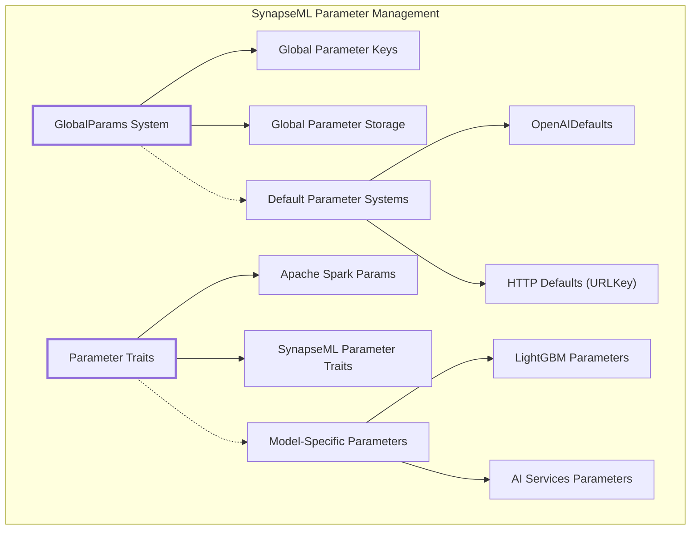
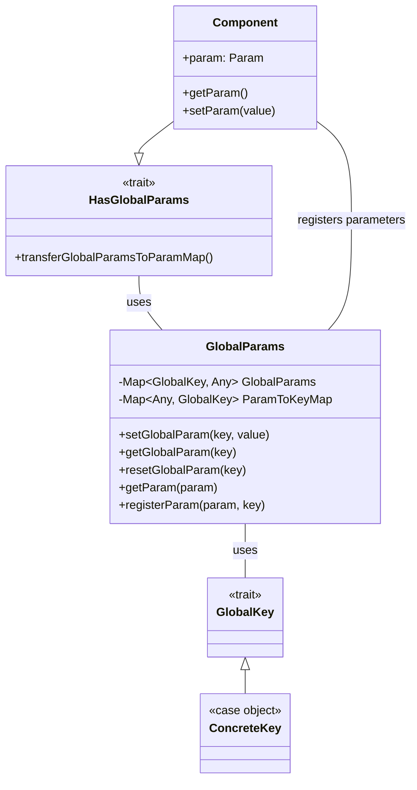
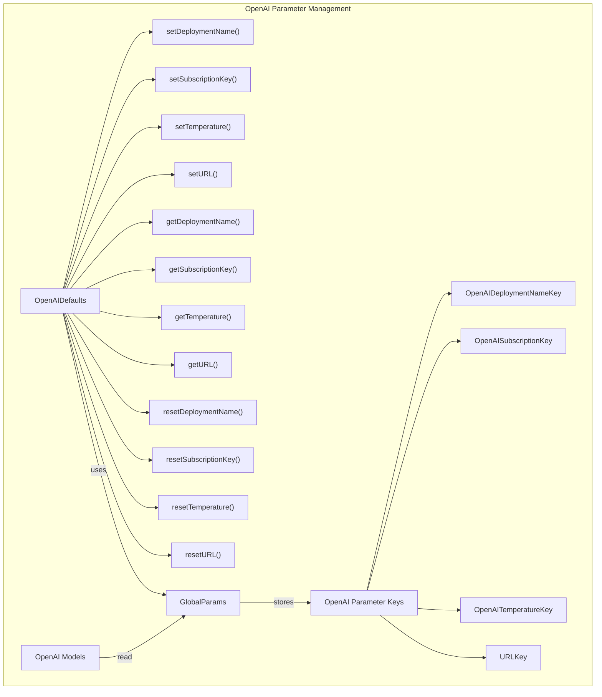
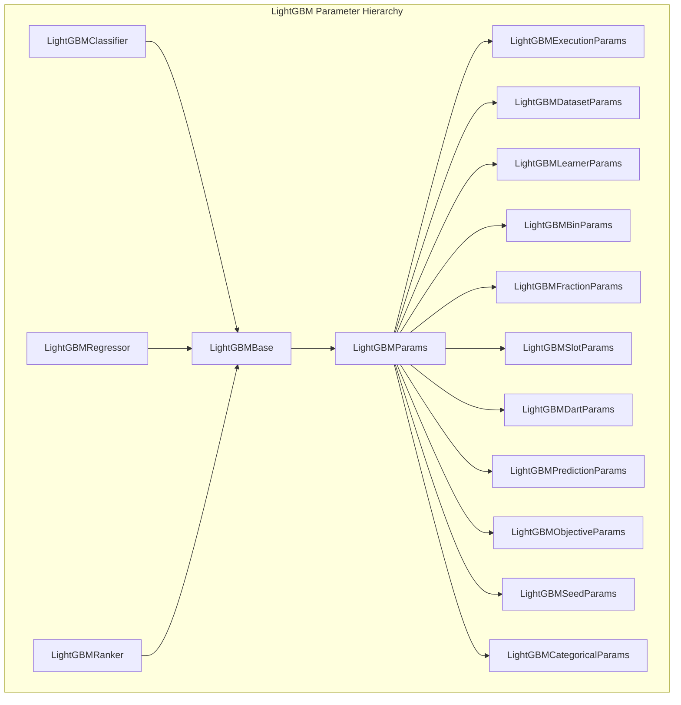
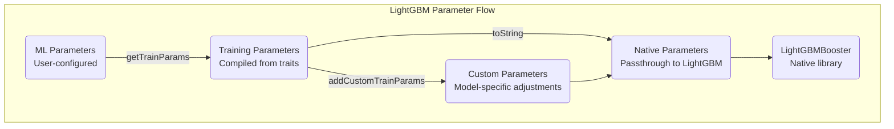

<!-- source: DeepWiki mcp.deepwiki.com · repo microsoft/SynapseML · page 5.3 Parameter Management · fetched 2026-10-26 -->

# Parameter Management

<details>
<summary>Relevant source files</summary>

The following files were used as context for generating this wiki page:

- [cognitive/src/main/python/synapse/ml/services/openai/OpenAIDefaults.py](cognitive/src/main/python/synapse/ml/services/openai/OpenAIDefaults.py)
- [cognitive/src/main/python/synapse/ml/services/openai/__init__.py](cognitive/src/main/python/synapse/ml/services/openai/__init__.py)
- [cognitive/src/main/scala/com/microsoft/azure/synapse/ml/services/CognitiveServiceBase.scala](cognitive/src/main/scala/com/microsoft/azure/synapse/ml/services/CognitiveServiceBase.scala)
- [cognitive/src/main/scala/com/microsoft/azure/synapse/ml/services/aifoundry/AIFoundryChatCompletion.scala](cognitive/src/main/scala/com/microsoft/azure/synapse/ml/services/aifoundry/AIFoundryChatCompletion.scala)
- [cognitive/src/main/scala/com/microsoft/azure/synapse/ml/services/openai/OpenAI.scala](cognitive/src/main/scala/com/microsoft/azure/synapse/ml/services/openai/OpenAI.scala)
- [cognitive/src/main/scala/com/microsoft/azure/synapse/ml/services/openai/OpenAIChatCompletion.scala](cognitive/src/main/scala/com/microsoft/azure/synapse/ml/services/openai/OpenAIChatCompletion.scala)
- [cognitive/src/main/scala/com/microsoft/azure/synapse/ml/services/openai/OpenAICompletion.scala](cognitive/src/main/scala/com/microsoft/azure/synapse/ml/services/openai/OpenAICompletion.scala)
- [cognitive/src/main/scala/com/microsoft/azure/synapse/ml/services/openai/OpenAIDefaults.scala](cognitive/src/main/scala/com/microsoft/azure/synapse/ml/services/openai/OpenAIDefaults.scala)
- [cognitive/src/main/scala/com/microsoft/azure/synapse/ml/services/openai/OpenAIEmbedding.scala](cognitive/src/main/scala/com/microsoft/azure/synapse/ml/services/openai/OpenAIEmbedding.scala)
- [cognitive/src/main/scala/com/microsoft/azure/synapse/ml/services/openai/OpenAIPrompt.scala](cognitive/src/main/scala/com/microsoft/azure/synapse/ml/services/openai/OpenAIPrompt.scala)
- [cognitive/src/main/scala/com/microsoft/azure/synapse/ml/services/openai/OpenAIResponses.scala](cognitive/src/main/scala/com/microsoft/azure/synapse/ml/services/openai/OpenAIResponses.scala)
- [cognitive/src/main/scala/com/microsoft/azure/synapse/ml/services/openai/OpenAISchemas.scala](cognitive/src/main/scala/com/microsoft/azure/synapse/ml/services/openai/OpenAISchemas.scala)
- [cognitive/src/test/python/synapsemltest/services/openai/test_OpenAIDefaults.py](cognitive/src/test/python/synapsemltest/services/openai/test_OpenAIDefaults.py)
- [cognitive/src/test/scala/com/microsoft/azure/synapse/ml/services/aifoundry/AIFoundryChatCompletionSuite.scala](cognitive/src/test/scala/com/microsoft/azure/synapse/ml/services/aifoundry/AIFoundryChatCompletionSuite.scala)
- [cognitive/src/test/scala/com/microsoft/azure/synapse/ml/services/openai/OpenAIChatCompletionSuite.scala](cognitive/src/test/scala/com/microsoft/azure/synapse/ml/services/openai/OpenAIChatCompletionSuite.scala)
- [cognitive/src/test/scala/com/microsoft/azure/synapse/ml/services/openai/OpenAICompletionSuite.scala](cognitive/src/test/scala/com/microsoft/azure/synapse/ml/services/openai/OpenAICompletionSuite.scala)
- [cognitive/src/test/scala/com/microsoft/azure/synapse/ml/services/openai/OpenAIDefaultsSuite.scala](cognitive/src/test/scala/com/microsoft/azure/synapse/ml/services/openai/OpenAIDefaultsSuite.scala)
- [cognitive/src/test/scala/com/microsoft/azure/synapse/ml/services/openai/OpenAIEmbeddingsSuite.scala](cognitive/src/test/scala/com/microsoft/azure/synapse/ml/services/openai/OpenAIEmbeddingsSuite.scala)
- [cognitive/src/test/scala/com/microsoft/azure/synapse/ml/services/openai/OpenAIPromptSuite.scala](cognitive/src/test/scala/com/microsoft/azure/synapse/ml/services/openai/OpenAIPromptSuite.scala)
- [cognitive/src/test/scala/com/microsoft/azure/synapse/ml/services/openai/OpenAIResponsesSuite.scala](cognitive/src/test/scala/com/microsoft/azure/synapse/ml/services/openai/OpenAIResponsesSuite.scala)
- [core/src/main/scala/com/microsoft/azure/synapse/ml/param/GlobalParams.scala](core/src/main/scala/com/microsoft/azure/synapse/ml/param/GlobalParams.scala)
- [docs/Explore Algorithms/OpenAI/OpenAI.ipynb](docs/Explore Algorithms/OpenAI/OpenAI.ipynb)

</details>


This page documents the parameter management systems in SynapseML, providing an overview of how parameters are defined, accessed, and shared across the library. The parameter management system enables configuration of model behavior, API endpoint settings, and processing options throughout the library.

For information about HTTP client configuration specifically, see [HTTP Client System](#5.2).

## Overview of Parameter Management in SynapseML

SynapseML builds upon Apache Spark's parameter system and extends it with global parameter capabilities, default parameter management, and specialized parameter trait hierarchies for different components. This allows for flexible configuration both at the instance level and globally across multiple components.



Sources:
- [core/src/main/scala/com/microsoft/azure/synapse/ml/param/GlobalParams.scala]()
- [cognitive/src/main/scala/com/microsoft/azure/synapse/ml/services/openai/OpenAIDefaults.scala]()
- [lightgbm/src/main/scala/com/microsoft/azure/synapse/ml/lightgbm/params/LightGBMParams.scala]()

## Global Parameter System

The Global Parameter System provides a mechanism to share parameters across different components and classes, allowing for centralized configuration that affects multiple parts of the system.

### Architecture of Global Parameter System



Sources:
- [core/src/main/scala/com/microsoft/azure/synapse/ml/param/GlobalParams.scala]()
- [core/src/test/scala/com/microsoft/azure/synapse/ml/param/GlobalParamsSuite.scala]()

### Key Components

1. **GlobalParams object**: Central storage for global parameters
   - Uses two mutable maps:
     - `GlobalParams`: Maps `GlobalKey[_]` to parameter values
     - `ParamToKeyMap`: Maps parameter objects to their global keys

2. **GlobalKey trait**: Marker trait for defining parameter keys
   - Concrete implementations are typically case objects
   - Example: `URLKey` for HTTP endpoint URLs

3. **HasGlobalParams trait**: Interface for components that use global parameters
   - Provides `transferGlobalParamsToParamMap()` to copy global parameters to component parameters

### Core Methods

| Method | Description |
|--------|------------|
| `GlobalParams.setGlobalParam[T](key: GlobalKey[T], value: T)` | Sets a global parameter value |
| `GlobalParams.getGlobalParam[T](key: GlobalKey[T]): Option[T]` | Gets a global parameter value |
| `GlobalParams.resetGlobalParam[T](key: GlobalKey[T])` | Removes a global parameter |
| `GlobalParams.registerParam[T](p: Param[T], key: GlobalKey[T])` | Associates a parameter with a global key |
| `HasGlobalParams.transferGlobalParamsToParamMap()` | Transfers global parameters to component parameters |

Sources:
- [core/src/main/scala/com/microsoft/azure/synapse/ml/param/GlobalParams.scala:16-42]()
- [core/src/main/scala/com/microsoft/azure/synapse/ml/param/GlobalParams.scala:44-56]()

### Example Usage

```scala
// Define a global key
case object MyParameterKey extends GlobalKey[Double]

// Create a component with a parameter
class MyComponent extends HasGlobalParams {
  val myParam = new DoubleParam(this, "myParam", "My parameter")
  
  // Register the parameter with the global key
  GlobalParams.registerParam(myParam, MyParameterKey)
  
  def getMyParam: Double = $(myParam)
  def setMyParam(v: Double): this.type = set(myParam, v)
}

// Set a global parameter value
GlobalParams.setGlobalParam(MyParameterKey, 42.0)

// Create a component instance and transfer global parameters
val component = new MyComponent()
component.transferGlobalParamsToParamMap()
assert(component.getMyParam == 42.0)
```

Sources:
- [core/src/test/scala/com/microsoft/azure/synapse/ml/param/GlobalParamsSuite.scala:11-30]()
- [core/src/test/scala/com/microsoft/azure/synapse/ml/param/GlobalParamsSuite.scala:36-47]()

## Default Parameter Systems

SynapseML implements specialized default parameter systems for different components, using the global parameter system as a foundation. These systems provide convenient ways to configure common parameters across multiple instances.

### OpenAI Default Parameters

The `OpenAIDefaults` object provides static methods for managing default parameters for OpenAI services.



Sources:
- [cognitive/src/main/scala/com/microsoft/azure/synapse/ml/services/openai/OpenAIDefaults.scala:10-66]()
- [cognitive/src/main/python/synapse/ml/services/openai/OpenAIDefaults.py:20-61]()
- [cognitive/src/test/scala/com/microsoft/azure/synapse/ml/services/openai/OpenAIDefaultsSuite.scala:35-45]()

OpenAIDefaults provides methods for:

| Method | Description |
|--------|------------|
| `setDeploymentName(v: String)` | Sets the default OpenAI deployment name |
| `getDeploymentName: Option[String]` | Gets the default OpenAI deployment name |
| `resetDeploymentName()` | Resets the default OpenAI deployment name |
| `setSubscriptionKey(v: String)` | Sets the default OpenAI subscription key |
| `getSubscriptionKey: Option[String]` | Gets the default OpenAI subscription key |
| `resetSubscriptionKey()` | Resets the default OpenAI subscription key |
| `setTemperature(v: Double)` | Sets the default OpenAI temperature |
| `getTemperature: Option[Double]` | Gets the default OpenAI temperature |
| `resetTemperature()` | Resets the default OpenAI temperature |
| `setURL(v: String)` | Sets the default OpenAI endpoint URL |
| `getURL: Option[String]` | Gets the default OpenAI endpoint URL |
| `resetURL()` | Resets the default OpenAI endpoint URL |

Usage example:

```scala
// Set default parameters
OpenAIDefaults.setDeploymentName("gpt-35-turbo")
OpenAIDefaults.setSubscriptionKey("your-subscription-key")
OpenAIDefaults.setTemperature(0.7)
OpenAIDefaults.setURL("https://your-endpoint.openai.azure.com/")

// Create OpenAI model without explicitly setting parameters
val model = new OpenAIChatCompletion()
  .setMaxTokens(200)
  .setOutputCol("out")
  .setMessagesCol("prompt")

// The model will use the default parameters
```

Sources:
- [cognitive/src/test/scala/com/microsoft/azure/synapse/ml/services/openai/OpenAIDefaultsSuite.scala:35-45]()
- [cognitive/src/test/scala/com/microsoft/azure/synapse/ml/services/openai/OpenAIDefaultsSuite.scala:74-87]()
- [cognitive/src/test/python/synapsemltest/services/openai/test_OpenAIDefaults.py:86-101]()

### URL Parameter Management

The `URLKey` object is a global key used for managing HTTP endpoint URLs across the system.

```scala
case object URLKey extends GlobalKey[String]

trait HasURL extends Params {
  val url: Param[String] = new Param[String](this, "url", "Url of the service")
  
  GlobalParams.registerParam(url, URLKey)
  
  def getUrl: String = $(url)
  def setUrl(value: String): this.type = set(url, value)
}
```

Sources:
- [core/src/main/scala/com/microsoft/azure/synapse/ml/io/http/HTTPTransformer.scala:79-93]()

## Specialized Parameter Hierarchies

SynapseML implements specialized parameter hierarchies for different components, allowing for modular parameter definition and composition.

### LightGBM Parameter System

LightGBM has an extensive parameter system with specialized traits for different aspects of the model.



Sources:
- [lightgbm/src/main/scala/com/microsoft/azure/synapse/ml/lightgbm/params/LightGBMParams.scala:488-504]()
- [lightgbm/src/main/scala/com/microsoft/azure/synapse/ml/lightgbm/LightGBMBase.scala:27-34]()
- [lightgbm/src/main/scala/com/microsoft/azure/synapse/ml/lightgbm/LightGBMClassifier.scala:27-30]()
- [lightgbm/src/main/scala/com/microsoft/azure/synapse/ml/lightgbm/LightGBMRegressor.scala:39-42]()
- [lightgbm/src/main/scala/com/microsoft/azure/synapse/ml/lightgbm/LightGBMRanker.scala:26-29]()

Key parameter traits:

| Trait | Description |
|-------|------------|
| `LightGBMExecutionParams` | Parameters for controlling execution, like parallelism and timeout |
| `LightGBMDatasetParams` | Parameters for dataset handling, like sparse data support |
| `LightGBMLearnerParams` | Parameters for learning process, like early stopping |
| `LightGBMBinParams` | Parameters for histogram bin construction |
| `LightGBMFractionParams` | Parameters for data/feature fractions and bagging |
| `LightGBMSlotParams` | Parameters for feature slots |
| `LightGBMDartParams` | Parameters for DART (Dropouts meet Multiple Additive Regression Trees) |
| `LightGBMPredictionParams` | Parameters for prediction behavior |
| `LightGBMObjectiveParams` | Parameters for objective functions |
| `LightGBMSeedParams` | Parameters for random seeds and determinism |
| `LightGBMCategoricalParams` | Parameters for categorical feature handling |

Sources:
- [lightgbm/src/main/scala/com/microsoft/azure/synapse/ml/lightgbm/params/LightGBMParams.scala:16-159]()
- [lightgbm/src/main/scala/com/microsoft/azure/synapse/ml/lightgbm/params/LightGBMParams.scala:163-183]()
- [lightgbm/src/main/scala/com/microsoft/azure/synapse/ml/lightgbm/params/LightGBMParams.scala:187-227]()
- [lightgbm/src/main/scala/com/microsoft/azure/synapse/ml/lightgbm/params/LightGBMParams.scala:231-241]()
- [lightgbm/src/main/scala/com/microsoft/azure/synapse/ml/lightgbm/params/LightGBMParams.scala:245-275]()

### Parameter Management in LightGBM Models

LightGBM models use a complex parameter management system to handle the wide variety of parameters needed for different aspects of the model.



Sources:
- [lightgbm/src/main/scala/com/microsoft/azure/synapse/ml/lightgbm/LightGBMBase.scala:146-216]()
- [lightgbm/src/main/scala/com/microsoft/azure/synapse/ml/lightgbm/LightGBMBase.scala:240-288]()
- [lightgbm/src/main/scala/com/microsoft/azure/synapse/ml/lightgbm/LightGBMBase.scala:396-447]()

Key parameter handling methods in `LightGBMBase`:

1. `getTrainParams`: Collects parameters from various traits into a single `BaseTrainParams` object
2. `addCustomTrainParams`: Allows model-specific parameter customization
3. `getGeneralParams`, `getDatasetParams`, etc.: Specialized methods for different parameter categories
4. `getDatasetCreationParams`: Formats parameters for native LightGBM dataset creation

Sources:
- [lightgbm/src/main/scala/com/microsoft/azure/synapse/ml/lightgbm/LightGBMBase.scala:249-287]()
- [lightgbm/src/main/scala/com/microsoft/azure/synapse/ml/lightgbm/LightGBMBase.scala:294-359]()
- [lightgbm/src/main/scala/com/microsoft/azure/synapse/ml/lightgbm/LightGBMBase.scala:374-386]()

## Python Integration

SynapseML provides Python wrappers for its parameter management systems, allowing for consistent parameter handling between Scala and Python.

### OpenAI Defaults in Python

The `OpenAIDefaults` Python class provides the same functionality as its Scala counterpart:

```python
class OpenAIDefaults:
    def set_deployment_name(self, name)
    def get_deployment_name(self)
    def reset_deployment_name(self)
    def set_subscription_key(self, key)
    def get_subscription_key(self)
    def reset_subscription_key(self)
    def set_temperature(self, temp)
    def get_temperature(self)
    def reset_temperature(self)
    def set_URL(self, URL)
    def get_URL(self)
    def reset_URL(self)
```

Sources:
- [cognitive/src/main/python/synapse/ml/services/openai/OpenAIDefaults.py:20-61]()
- [cognitive/src/test/python/synapsemltest/services/openai/test_OpenAIDefaults.py:17-52]()

### LightGBM Model Parameters in Python

The `LightGBMModelMixin` in Python provides access to model parameters and methods:

```python
class LightGBMModelMixin:
    def saveNativeModel(self, filename, overwrite=True)
    def getNativeModel(self)
    def getFeatureImportances(self, importance_type="split")
    def getFeatureShaps(self, vector)
    def getBoosterBestIteration(self)
    def getBoosterNumTotalIterations(self)
    def getBoosterNumTotalModel(self)
    def getBoosterNumFeatures(self)
    def setPredictDisableShapeCheck(self, value=None)
```

Sources:
- [lightgbm/src/main/python/synapse/ml/lightgbm/mixin.py:9-93]()

## Best Practices

When working with parameters in SynapseML, consider the following best practices:

1. **Global vs. Local Parameter Settings**
   - Use global parameters when you want consistent settings across multiple instances
   - Use local parameters (instance-specific) for customization
   - Be aware that instance parameters override global parameters

2. **Parameter Hierarchy**
   - Understand the parameter inheritance hierarchy for your model
   - Specialized parameters are grouped into meaningful traits
   - These traits are combined in the final model classes

3. **Default Parameters**
   - Use default parameter systems like `OpenAIDefaults` to set common configurations
   - Reset global parameters when no longer needed to avoid unexpected behavior
   - Check available default parameters before setting them explicitly

4. **Parameter Conversion**
   - Be aware of parameter conversion between different layers (e.g., Spark ML to native LightGBM)
   - Use the appropriate parameter format for your context
   - Check the parameter validation logic to ensure valid values

5. **Python-Scala Interoperability**
   - Use the same parameter names and meanings in both languages
   - Be aware of slight naming differences (camelCase in Scala, snake_case in Python)
   - Global parameters set in one language are available in the other

Sources:
- [core/src/test/scala/com/microsoft/azure/synapse/ml/param/GlobalParamsSuite.scala:36-47]()
- [cognitive/src/test/scala/com/microsoft/azure/synapse/ml/services/openai/OpenAIDefaultsSuite.scala:90-105]()
- [cognitive/src/test/python/synapsemltest/services/openai/test_OpenAIDefaults.py:54-67]()

## Parameter Management Implementation Details

### GlobalParams Implementation

The `GlobalParams` object uses two mutable maps to manage parameters:

1. `ParamToKeyMap`: Maps Spark ML parameter objects to their global keys
2. `GlobalParams`: Maps global keys to their values

When a parameter is registered with a global key using `registerParam`, the association is stored in `ParamToKeyMap`. When a global parameter is set using `setGlobalParam`, the value is stored in `GlobalParams` map.

The `HasGlobalParams` trait provides a method `transferGlobalParamsToParamMap()` that checks if any parameters are not set locally, and if so, tries to look up their values from the global parameter system.

Sources:
- [core/src/main/scala/com/microsoft/azure/synapse/ml/param/GlobalParams.scala:13-42]()
- [core/src/main/scala/com/microsoft/azure/synapse/ml/param/GlobalParams.scala:44-56]()

### OpenAIDefaults Implementation

The `OpenAIDefaults` object provides static methods for managing OpenAI parameters. Each parameter has a corresponding global key, and the methods simply delegate to the GlobalParams system:

```scala
def setDeploymentName(v: String): Unit = {
  GlobalParams.setGlobalParam(OpenAIDeploymentNameKey, Left(v))
}

def getDeploymentName: Option[String] = {
  extractLeft(GlobalParams.getGlobalParam(OpenAIDeploymentNameKey))
}

def resetDeploymentName(): Unit = {
  GlobalParams.resetGlobalParam(OpenAIDeploymentNameKey)
}
```

The `extractLeft` helper method handles the Either type returned by GlobalParams:

```scala
private def extractLeft[T](optEither: Option[Either[T, String]]): Option[T] = {
  optEither match {
    case Some(Left(v)) => Some(v)
    case _ => None
  }
}
```

Sources:
- [cognitive/src/main/scala/com/microsoft/azure/synapse/ml/services/openai/OpenAIDefaults.scala:10-66]()

### LightGBM Parameter Handling

LightGBM models collect parameters from various traits and compile them into a single `BaseTrainParams` object using methods like `getTrainParams` and `addCustomTrainParams`. These parameters are then passed to the native LightGBM library.

The parameter flow is:

1. User sets parameters on the model instance (`setNumIterations`, `setLearningRate`, etc.)
2. `train` method calls `getTrainParams` to collect parameters from various traits
3. `addCustomTrainParams` allows model-specific parameter adjustments
4. Parameters are compiled into a string representation using `toString`
5. Parameters are passed to the native LightGBM library

Sources:
- [lightgbm/src/main/scala/com/microsoft/azure/synapse/ml/lightgbm/LightGBMBase.scala:36-65]()
- [lightgbm/src/main/scala/com/microsoft/azure/synapse/ml/lightgbm/LightGBMBase.scala:396-447]()
- [lightgbm/src/main/scala/com/microsoft/azure/synapse/ml/lightgbm/LightGBMClassifier.scala:43-57]()
- [lightgbm/src/main/scala/com/microsoft/azure/synapse/ml/lightgbm/LightGBMRegressor.scala:60-74]()
- [lightgbm/src/main/scala/com/microsoft/azure/synapse/ml/lightgbm/LightGBMRanker.scala:51-66]()

---

