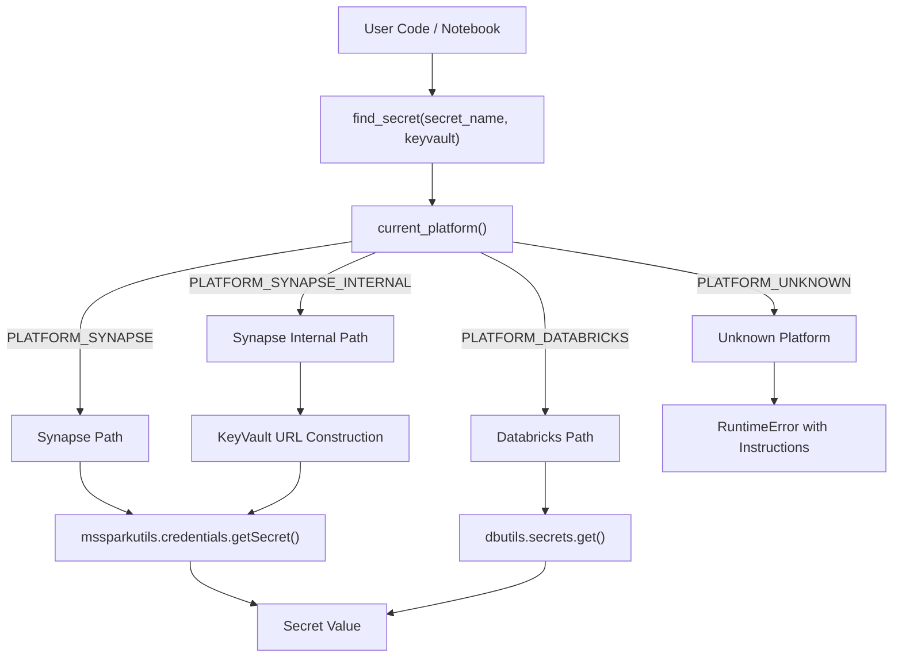
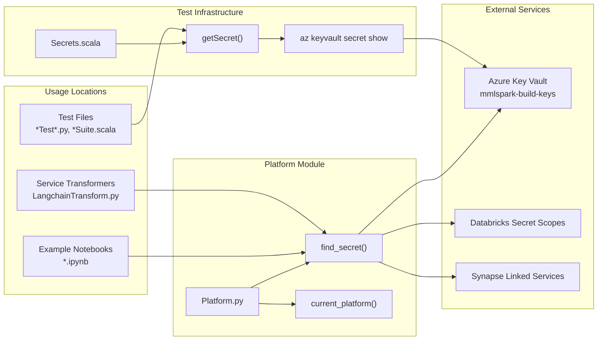
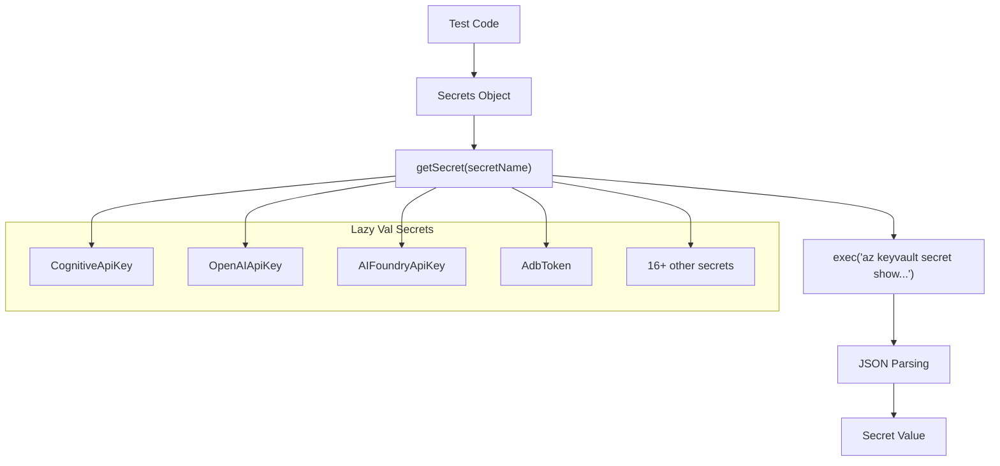

<!-- source: DeepWiki mcp.deepwiki.com · repo microsoft/SynapseML · page 5.4 Secret Management · fetched 2026-10-26 -->

# Secret Management

<details>
<summary>Relevant source files</summary>

The following files were used as context for generating this wiki page:

- [cognitive/src/main/python/synapse/ml/services/langchain/LangchainTransform.py](cognitive/src/main/python/synapse/ml/services/langchain/LangchainTransform.py)
- [cognitive/src/test/python/synapsemltest/services/langchain/test_LangchainTransform.py](cognitive/src/test/python/synapsemltest/services/langchain/test_LangchainTransform.py)
- [cognitive/src/test/python/synapsemltest/services/test_simple.py](cognitive/src/test/python/synapsemltest/services/test_simple.py)
- [cognitive/src/test/scala/com/microsoft/azure/synapse/ml/services/form/FormOntologyLearnerSuite.scala](cognitive/src/test/scala/com/microsoft/azure/synapse/ml/services/form/FormOntologyLearnerSuite.scala)
- [core/src/main/python/synapse/ml/core/init_spark.py](core/src/main/python/synapse/ml/core/init_spark.py)
- [core/src/main/python/synapse/ml/core/logging/SynapseMLLogger.py](core/src/main/python/synapse/ml/core/logging/SynapseMLLogger.py)
- [core/src/main/python/synapse/ml/core/logging/__init__.py](core/src/main/python/synapse/ml/core/logging/__init__.py)
- [core/src/main/python/synapse/ml/core/platform/Platform.py](core/src/main/python/synapse/ml/core/platform/Platform.py)
- [core/src/test/python/synapsemltest/core/test_logging.py](core/src/test/python/synapsemltest/core/test_logging.py)
- [core/src/test/python/synapsemltest/core/test_template.py](core/src/test/python/synapsemltest/core/test_template.py)
- [core/src/test/scala/com/microsoft/azure/synapse/ml/Secrets.scala](core/src/test/scala/com/microsoft/azure/synapse/ml/Secrets.scala)
- [core/src/test/scala/com/microsoft/azure/synapse/ml/nbtest/SharedNotebookE2ETestUtilities.scala](core/src/test/scala/com/microsoft/azure/synapse/ml/nbtest/SharedNotebookE2ETestUtilities.scala)
- [core/src/test/scala/com/microsoft/azure/synapse/ml/nbtest/SynapseExtension/SynapseExtensionSchemas.scala](core/src/test/scala/com/microsoft/azure/synapse/ml/nbtest/SynapseExtension/SynapseExtensionSchemas.scala)
- [core/src/test/scala/com/microsoft/azure/synapse/ml/nbtest/SynapseExtension/SynapseExtensionUtilities.scala](core/src/test/scala/com/microsoft/azure/synapse/ml/nbtest/SynapseExtension/SynapseExtensionUtilities.scala)
- [core/src/test/scala/com/microsoft/azure/synapse/ml/nbtest/SynapseExtension/SynapseExtensionsTests.scala](core/src/test/scala/com/microsoft/azure/synapse/ml/nbtest/SynapseExtension/SynapseExtensionsTests.scala)
- [core/src/test/scala/com/microsoft/azure/synapse/ml/nbtest/SynapseTests.scala](core/src/test/scala/com/microsoft/azure/synapse/ml/nbtest/SynapseTests.scala)
- [core/src/test/scala/com/microsoft/azure/synapse/ml/nbtest/SynapseUtilities.scala](core/src/test/scala/com/microsoft/azure/synapse/ml/nbtest/SynapseUtilities.scala)
- [docs/Explore Algorithms/AI Services/Quickstart - Create Audiobooks.ipynb](docs/Explore Algorithms/AI Services/Quickstart - Create Audiobooks.ipynb)
- [docs/Explore Algorithms/AI Services/Quickstart - Document Question and Answering with PDFs.ipynb](docs/Explore Algorithms/AI Services/Quickstart - Document Question and Answering with PDFs.ipynb)
- [docs/Explore Algorithms/Deep Learning/Quickstart - Chat Completion with Azure AI Foundry Model.ipynb](docs/Explore Algorithms/Deep Learning/Quickstart - Chat Completion with Azure AI Foundry Model.ipynb)
- [docs/Explore Algorithms/OpenAI/Langchain.ipynb](docs/Explore Algorithms/OpenAI/Langchain.ipynb)
- [docs/Explore Algorithms/OpenAI/Quickstart - OpenAI Embedding and GPU based KNN.ipynb](docs/Explore Algorithms/OpenAI/Quickstart - OpenAI Embedding and GPU based KNN.ipynb)
- [docs/Explore Algorithms/OpenAI/Quickstart - OpenAI Embedding.ipynb](docs/Explore Algorithms/OpenAI/Quickstart - OpenAI Embedding.ipynb)
- [docs/Explore Algorithms/OpenAI/Quickstart - Understand and Search Forms.ipynb](docs/Explore Algorithms/OpenAI/Quickstart - Understand and Search Forms.ipynb)
- [docs/Get Started/Install SynapseML.md](docs/Get Started/Install SynapseML.md)
- [docs/Get Started/Set up Cognitive Services.ipynb](docs/Get Started/Set up Cognitive Services.ipynb)
- [src/test/scala/com/microsoft/azure/synapse/ml/core/test/fuzzing/FuzzingTest.scala](src/test/scala/com/microsoft/azure/synapse/ml/core/test/fuzzing/FuzzingTest.scala)

</details>


## Purpose and Scope

The Secret Management system provides a platform-agnostic interface for retrieving secrets from various credential stores across different execution environments (Synapse, Fabric, Databricks, and local). This system abstracts the complexity of accessing secrets from Azure Key Vault, Databricks Secret Scopes, and other platform-specific credential stores, enabling code to run seamlessly across different deployment targets without modification.

For information about platform detection and adaptation, see [Platform Detection and Adaptation](#2.3). For HTTP client authentication, see [HTTP Client System](#5.2).

## Architecture Overview

The secret management system consists of two main components: a Python function for production use (`find_secret()`) and a Scala utility for testing (`Secrets` object). The system detects the execution platform and routes secret retrieval requests to the appropriate platform-specific API.

### Secret Retrieval Flow



**Sources:** [core/src/main/python/synapse/ml/core/platform/Platform.py:57-93]()

### Integration Points in the Codebase



**Sources:** [core/src/main/python/synapse/ml/core/platform/Platform.py](), [core/src/test/scala/com/microsoft/azure/synapse/ml/Secrets.scala]()

## The `find_secret()` Function

The `find_secret()` function is the primary interface for secret retrieval in production code. It accepts two parameters and returns the secret value as a string.

### Function Signature

```python
def find_secret(secret_name: str, keyvault: str) -> str
```

| Parameter | Description |
|-----------|-------------|
| `secret_name` | The name of the secret to retrieve |
| `keyvault` | The name of the Azure Key Vault (for Azure platforms) or the Databricks secret scope name (for Databricks) |

### Implementation Details

The function is implemented in [core/src/main/python/synapse/ml/core/platform/Platform.py:57-93](). It performs the following steps:

1. **Platform Detection**: Calls `current_platform()` to determine the execution environment
2. **Routing**: Routes to the appropriate platform-specific implementation
3. **Error Handling**: Wraps all operations in a try-catch block that provides detailed error messages

### Platform-Specific Implementations

| Platform | API Used | Key Vault Specification |
|----------|----------|------------------------|
| **Synapse** (`PLATFORM_SYNAPSE`) | `notebookutils.mssparkutils.credentials.getSecret(keyvault, secret_name)` | Key vault name directly |
| **Synapse Internal** (`PLATFORM_SYNAPSE_INTERNAL`) | `notebookutils.mssparkutils.credentials.getSecret(keyVaultURL, secret_name)` | Constructs URL: `https://{keyvault}.vault.azure.net/` |
| **Databricks** (`PLATFORM_DATABRICKS`) | `dbutils.secrets.get(scope=keyvault, key=secret_name)` | Secret scope name |
| **Fabric Python** (`PLATFORM_FABRIC_PYTHON`) | Not supported (raises error) | N/A |
| **Unknown** | Not supported (raises error) | N/A |

**Sources:** [core/src/main/python/synapse/ml/core/platform/Platform.py:57-76]()

## Test Infrastructure

For testing purposes, SynapseML provides a Scala-based secret retrieval system that uses the Azure CLI to access Key Vault directly.

### The `Secrets` Object

The `Secrets` object in [core/src/test/scala/com/microsoft/azure/synapse/ml/Secrets.scala]() provides a test-specific secret retrieval mechanism. It is used exclusively in Scala tests and is not available to end users.



### Key Features

1. **Azure CLI Integration**: Uses `az keyvault secret show` command [core/src/test/scala/com/microsoft/azure/synapse/ml/Secrets.scala:40-47]()
2. **Lazy Evaluation**: Secrets are defined as lazy vals, fetched only when needed
3. **Pre-defined Secrets**: Common secrets are exposed as properties (e.g., `CognitiveApiKey`, `OpenAIApiKey`)
4. **Subscription Management**: Automatically sets the Azure subscription via `AccountString` lazy val

### Common Test Secrets

| Secret Property | Key Vault Secret Name | Purpose |
|----------------|----------------------|---------|
| `CognitiveApiKey` | `cognitive-api-key` | Azure AI Services authentication |
| `OpenAIApiKey` | `openai-api-key-2` | Azure OpenAI authentication |
| `AIFoundryApiKey` | `synapseml-ai-foundry-resource-key` | Azure AI Foundry authentication |
| `AdbToken` | `adb-token` | Azure Databricks token |
| `BingSearchKey` | `bing-search-key` | Bing Search API |
| `AzureSearchKey` | `azure-search-key` | Azure Cognitive Search |

**Sources:** [core/src/test/scala/com/microsoft/azure/synapse/ml/Secrets.scala:44-79]()

## Error Handling and Messaging

The secret management system provides comprehensive error messages to guide users when secret retrieval fails.

### Error Message Structure

When `find_secret()` fails, it raises a `RuntimeError` with a detailed message that includes:

1. The secret name and keyvault that failed
2. Platform-specific setup instructions
3. Security best practices
4. Links to documentation

### Example Error Message

```
Could not find {secret_name} in keyvault {keyvault}. 
If you are trying to use the mmlspark-build-keys keyvault, you cant! 
You need to make your own keyvault with secrets or replace this call with a string. 
Make sure your notebook has access to a keyvault named {keyvault} which contains a secret named {secret_name}. 
On synapse, use a linked service keyvault, 
on databricks use their secrets management sdk, 
on fabric make sure your azure identity can access your azure keyvault. 
If you want to avoid making a keyvault, replace this call to find secret with your secret as a string 
like my_secret = 'jdiej38dnal.....'. Note that this has security implications for publishing and sharing notebooks! 
Please see the documentation for more information. 
https://microsoft.github.io/SynapseML/docs/Get%20Started/Set%20up%20Cognitive%20Services/
```

**Sources:** [core/src/main/python/synapse/ml/core/platform/Platform.py:77-92]()

## Usage Patterns

### Pattern 1: Notebook Usage

The most common usage pattern is in example notebooks for authenticating with Azure services:

```python
from synapse.ml.core.platform import find_secret

openai_key = find_secret(
    secret_name="openai-api-key-2", 
    keyvault="mmlspark-build-keys"
)
cognitive_key = find_secret(
    secret_name="ai-services-api-key",
    keyvault="mmlspark-build-keys"
)
```

**Sources:** [docs/Explore Algorithms/AI Services/Quickstart - Document Question and Answering with PDFs.ipynb:142-163](), [docs/Explore Algorithms/OpenAI/Langchain.ipynb:164-174]()

### Pattern 2: Test Code Usage (Scala)

In Scala tests, the `Secrets` object is used directly:

```scala
import com.microsoft.azure.synapse.ml.Secrets

val cognitiveKey = Secrets.CognitiveApiKey
val openAIKey = Secrets.OpenAIApiKey
val synapseToken = Secrets.getAccessToken("https://dev.azuresynapse.net/")
```

**Sources:** [core/src/test/scala/com/microsoft/azure/synapse/ml/nbtest/SynapseUtilities.scala:137-138](), [core/src/test/scala/com/microsoft/azure/synapse/ml/nbtest/SynapseExtension/SynapseExtensionUtilities.scala:6-7]()

### Pattern 3: Test Code Usage (Python)

Python tests use subprocess to call Azure CLI directly:

```python
import subprocess
import json

secretJson = subprocess.check_output(
    "az keyvault secret show --vault-name mmlspark-build-keys --name openai-api-key-2",
    shell=True,
)
openai_api_key = json.loads(secretJson)["value"]
```

**Sources:** [cognitive/src/test/python/synapsemltest/services/langchain/test_LangchainTransform.py:20-24]()

### Pattern 4: Documentation and User Guidance

Documentation notebooks demonstrate the pattern and provide instructions for users to replace with their own secrets:

```python
# Replace the call to find_secret with your key as a python string
ai_services_key = find_secret(
    secret_name="ai-services-api-key", keyvault="mmlspark-build-keys"
)  # Replace this line with a string like: ai_services_key = "your-key-here"
```

**Sources:** [docs/Get Started/Set up Cognitive Services.ipynb:182-184]()

## Platform Configuration

### Constants and Detection Logic

The platform detection system uses specific constants and environment checks defined in [core/src/main/python/synapse/ml/core/platform/Platform.py:6-34]():

| Platform Constant | Detection Method |
|------------------|------------------|
| `PLATFORM_SYNAPSE_INTERNAL` | `os.environ.get("AZURE_SERVICE") == "Microsoft.ProjectArcadia"` and `spark.cluster.type != "synapse"` |
| `PLATFORM_SYNAPSE` | `os.environ.get("AZURE_SERVICE") == "Microsoft.ProjectArcadia"` and `spark.cluster.type == "synapse"` |
| `PLATFORM_DATABRICKS` | `"dbfs" in os.listdir("/")` |
| `PLATFORM_FABRIC_PYTHON` | `"fabric.microsoft.com" in os.environ.get("MSNOTEBOOKUTILS_SPARK_TRIDENT_PBIHOST")` |
| `PLATFORM_BINDER` | `os.environ.get("BINDER_LAUNCH_HOST") is not None` |
| `PLATFORM_UNKNOWN` | Default fallback |

**Sources:** [core/src/main/python/synapse/ml/core/platform/Platform.py:17-34]()

## Setup and Configuration

SynapseML provides detailed setup instructions for configuring secret management on different platforms. The primary documentation for this is located in the "Set up Cognitive Services" notebook.

### Setup Overview by Platform

```mermaid
flowchart TD
    Setup["Secret Management Setup"]
    
    subgraph "Azure Key Vault"
        CreateKV["Create Key Vault"]
        AddSecrets["Add Secrets"]
        SetPerms["Set Permissions"]
    end
    
    subgraph "Synapse Setup"
        LinkedSvc["Create Linked Service"]
        AssignRole["Assign Key Vault Administrator Role"]
    end
    
    subgraph "Databricks Setup"
        CreateScope["Create Secret Scope<br/>databricks#secrets/createScope"]
        ConfigDNS["Configure DNS Name + Resource ID"]
    end
    
    subgraph "Fabric Setup"
        FabricIAM["Configure Azure Identity"]
        FabricKVAccess["Grant Key Vault Access"]
    end
    
    Setup --> CreateKV
    CreateKV --> AddSecrets
    AddSecrets --> SetPerms
    
    SetPerms --> LinkedSvc
    LinkedSvc --> AssignRole
    
    SetPerms --> CreateScope
    CreateScope --> ConfigDNS
    
    SetPerms --> FabricIAM
    FabricIAM --> FabricKVAccess
```



**Sources:** [docs/Get Started/Set up Cognitive Services.ipynb:72-160]()

### Key Vault Creation

1. Create an Azure Key Vault via the Azure Portal
2. Navigate to Access control (IAM) and assign yourself the **Key Vault Administrator Role**
3. Go to Secrets → Generate/Import and create secrets with their values

### Platform-Specific Configuration

**Synapse:**
- Create a linked service to the Key Vault in Synapse Studio (Manage → External connections → Linked services)
- Assign the **Key Vault Administrator** role to the Synapse Workspace managed identity
- Reference the linked service name as the `keyvault` parameter in `find_secret()`

**Databricks:**
- Navigate to `https://<databricks-instance>#secrets/createScope`
- Set Permission model to "Vault access policy" in Azure Key Vault
- Configure DNS Name (Vault URI) and Resource ID from the Key Vault properties
- Reference the scope name as the `keyvault` parameter in `find_secret()`

**Fabric:**
- Assign the Fabric/Power BI Service Account the **Key Vault Administrator** role
- Ensure the Azure identity running the notebook has access to the Key Vault

**Sources:** [docs/Get Started/Set up Cognitive Services.ipynb:88-160]()

## Security Considerations

The secret management system implements several security best practices:

1. **No Hardcoded Secrets**: The system enforces retrieval from secure stores rather than embedding secrets in code
2. **Runtime Retrieval**: Secrets are fetched at runtime, not stored in notebooks or source files
3. **Platform Isolation**: Test secrets (via `Secrets` object) are isolated from production code paths
4. **Error Guidance**: Error messages guide users to secure alternatives rather than insecure workarounds
5. **Documentation Warnings**: All examples include warnings about security implications of hardcoded strings

**Sources:** [core/src/main/python/synapse/ml/core/platform/Platform.py:77-92](), [docs/Get Started/Set up Cognitive Services.ipynb:79-82]()

---

