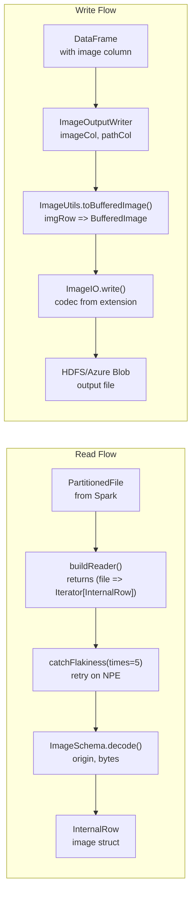
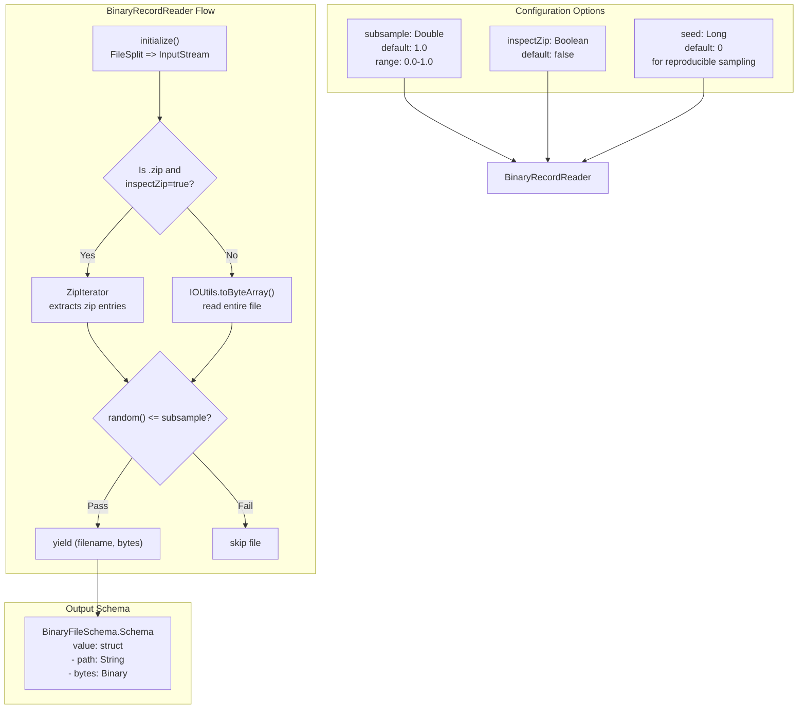
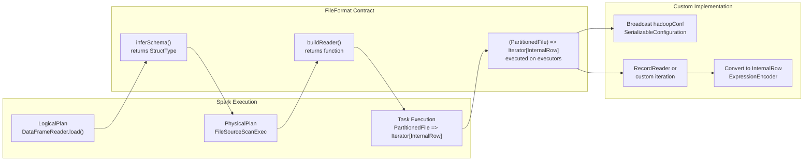
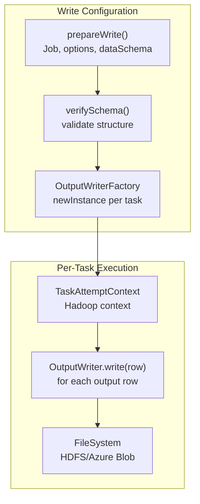

<!-- source: DeepWiki mcp.deepwiki.com · repo microsoft/SynapseML · page 5.5 Custom Spark Data Sources · fetched 2026-10-26 -->

# Custom Spark Data Sources

<details>
<summary>Relevant source files</summary>

The following files were used as context for generating this wiki page:

- [core/src/main/scala/com/microsoft/azure/synapse/ml/io/binary/BinaryFileFormat.scala](core/src/main/scala/com/microsoft/azure/synapse/ml/io/binary/BinaryFileFormat.scala)
- [core/src/main/scala/org/apache/spark/ml/source/image/PatchedImageFileFormat.scala](core/src/main/scala/org/apache/spark/ml/source/image/PatchedImageFileFormat.scala)
- [core/src/main/scala/org/apache/spark/sql/execution/streaming/continuous/HTTPSinkV2.scala](core/src/main/scala/org/apache/spark/sql/execution/streaming/continuous/HTTPSinkV2.scala)
- [core/src/test/scala/com/microsoft/azure/synapse/ml/codegen/RTestGen.scala](core/src/test/scala/com/microsoft/azure/synapse/ml/codegen/RTestGen.scala)
- [core/src/test/scala/com/microsoft/azure/synapse/ml/io/split2/DistributedHTTPSuite.scala](core/src/test/scala/com/microsoft/azure/synapse/ml/io/split2/DistributedHTTPSuite.scala)
- [start](start)
- [tools/docker/demo/Dockerfile](tools/docker/demo/Dockerfile)
- [tools/docker/demo/README.md](tools/docker/demo/README.md)
- [tools/docker/demo/init_notebook.py](tools/docker/demo/init_notebook.py)
- [tools/docker/minimal/Dockerfile](tools/docker/minimal/Dockerfile)
- [tools/tests/run_r_tests.R](tools/tests/run_r_tests.R)
- [vw/src/main/scala/com/microsoft/azure/synapse/ml/vw/VowpalWabbitBaseModel.scala](vw/src/main/scala/com/microsoft/azure/synapse/ml/vw/VowpalWabbitBaseModel.scala)

</details>


## Purpose and Scope

This document describes SynapseML's custom Spark data source implementations that extend Apache Spark's FileFormat API to support specialized binary data types. These custom data sources provide efficient distributed reading and writing of image files and binary data with advanced features like retry mechanisms, zip file inspection, and subsampling.

For HTTP-based streaming data sources and sinks, see [Custom HTTP Sources](#5.5.1) (note: this is conceptually related but implemented separately as streaming sources). For general I/O utilities and storage access patterns, see [Core Infrastructure](#5).

---

## Overview

SynapseML implements two primary custom FileFormat classes that integrate with Spark's DataSource V2 API:

| FileFormat Class | Short Name | Primary Use Case | Key Features |
|-----------------|------------|------------------|--------------|
| `PatchedImageFileFormat` | `patchedImage` | Image file reading/writing | JVM threading bug retry logic, origin path tracking |
| `BinaryFileFormat` | `binary` | Binary file reading/writing | Zip inspection, subsampling, configurable seed |

Both implementations extend Spark's `TextBasedFileFormat` and provide custom `RecordReader` and `OutputWriter` implementations for handling specialized data formats that Spark's built-in readers cannot efficiently process.

Sources: [core/src/main/scala/org/apache/spark/ml/source/image/PatchedImageFileFormat.scala:1-160](), [core/src/main/scala/com/microsoft/azure/synapse/ml/io/binary/BinaryFileFormat.scala:1-251]()

---

## Architecture and Class Hierarchy

```mermaid
graph TB
    subgraph "Spark DataSource API"
        FileFormat["FileFormat<br/>(Spark Interface)"]
        TextBasedFileFormat["TextBasedFileFormat<br/>(Spark Abstract Class)"]
        DataSourceRegister["DataSourceRegister<br/>(Spark Interface)"]
        RecordReader["RecordReader[K,V]<br/>(Hadoop Interface)"]
        OutputWriter["OutputWriter<br/>(Spark Class)"]
    end
    
    subgraph "SynapseML Image Support"
        PatchedImageFileFormat["PatchedImageFileFormat<br/>shortName: patchedImage"]
        ImageRecordReader["Implicit via buildReader<br/>catchFlakiness retry"]
        ImageOutputWriter["ImageOutputWriter<br/>Writes BufferedImage"]
    end
    
    subgraph "SynapseML Binary Support"
        BinaryFileFormat["BinaryFileFormat<br/>shortName: binary"]
        BinaryRecordReader["BinaryRecordReader<br/>subsample, inspectZip"]
        BinaryOutputWriter["BinaryOutputWriter<br/>Writes raw bytes"]
        HadoopFileReader["HadoopFileReader<br/>Iterator wrapper"]
        ZipIterator["ZipIterator<br/>Inspects zip contents"]
    end
    
    subgraph "Schema Definitions"
        ImageSchema["ImageSchema.imageSchema<br/>origin, height, width, nChannels, mode, data"]
        BinaryFileSchema["BinaryFileSchema.Schema<br/>path, bytes"]
    end
    
    FileFormat --> TextBasedFileFormat
    TextBasedFileFormat --> PatchedImageFileFormat
    TextBasedFileFormat --> BinaryFileFormat
    DataSourceRegister --> PatchedImageFileFormat
    DataSourceRegister --> BinaryFileFormat
    
    PatchedImageFileFormat --> ImageRecordReader
    PatchedImageFileFormat --> ImageOutputWriter
    PatchedImageFileFormat --> ImageSchema
    
    BinaryFileFormat --> BinaryRecordReader
    BinaryFileFormat --> BinaryOutputWriter
    BinaryFileFormat --> BinaryFileSchema
    BinaryRecordReader --> HadoopFileReader
    HadoopFileReader --> ZipIterator
    
    RecordReader -.implements.-> BinaryRecordReader
    OutputWriter -.extends.-> ImageOutputWriter
    OutputWriter -.extends.-> BinaryOutputWriter
```



**Data Source Registration and Usage**

Both FileFormats are registered via `DataSourceRegister.shortName()`, allowing usage like:
- `spark.read.format("patchedImage").load(path)`
- `spark.read.format("binary").option("inspectZip", "true").load(path)`

Sources: [core/src/main/scala/org/apache/spark/ml/source/image/PatchedImageFileFormat.scala:26-28](), [core/src/main/scala/com/microsoft/azure/synapse/ml/io/binary/BinaryFileFormat.scala:111-118]()

---

## Patched Image File Format

### Purpose and Design

The `PatchedImageFileFormat` addresses a critical JVM threading bug in `ImageIO.read()` that causes intermittent `NullPointerException`s during concurrent image decoding. This implementation wraps image reading in a retry mechanism with exponential backoff.



### Retry Logic Implementation

The `catchFlakiness` method [core/src/main/scala/org/apache/spark/ml/source/image/PatchedImageFileFormat.scala:66-77]() implements tail-recursive retry logic:

```scala
@annotation.tailrec
private def catchFlakiness[T](times: Int)(f: => Option[T]): Option[T] = {
  Try { f } match {
    case Success(x) => x
    case Failure(exception: NullPointerException) if times >= 1 =>
      logWarning("caught null pointer exception due to jvm bug", exception)
      catchFlakiness(times - 1)(f)
    case _ => None
  }
}
```

This wraps the `ImageSchema.decode()` call [core/src/main/scala/org/apache/spark/ml/source/image/PatchedImageFileFormat.scala:110-111]() to retry up to 5 times before giving up.

### Schema Verification

The format enforces strict schema validation [core/src/main/scala/org/apache/spark/ml/source/image/PatchedImageFileFormat.scala:30-40]():

**Expected Schema Structure:**
- `origin: String` - file path
- `height: Int` - image height
- `width: Int` - image width  
- `nChannels: Int` - number of color channels
- `mode: Int` - color mode constant
- `data: Binary` - raw image bytes
- `filenames: String` - (optional) for writing

### Image Output Writer

The `ImageOutputWriter` [core/src/main/scala/org/apache/spark/ml/source/image/PatchedImageFileFormat.scala:131-159]() handles writing images back to disk:

1. Extracts image struct from row via `imageCol` index
2. Converts to `BufferedImage` using `ImageUtils.toBufferedImage()`
3. Derives codec from file extension (jpg, png, etc.)
4. Writes using `ImageIO.write()` to HDFS/Azure Blob

Sources: [core/src/main/scala/org/apache/spark/ml/source/image/PatchedImageFileFormat.scala:1-160]()

---

## Binary File Format

### Purpose and Design

The `BinaryFileFormat` provides efficient reading of arbitrary binary files with two key features:
1. **Subsampling**: Random sampling of files based on a probability threshold
2. **Zip Inspection**: Automatic extraction and processing of files within zip archives



### BinaryRecordReader Implementation

The `BinaryRecordReader` [core/src/main/scala/com/microsoft/azure/synapse/ml/io/binary/BinaryFileFormat.scala:33-108]() implements Hadoop's `RecordReader` interface with custom initialization:

**Key State Variables:**
- `inputStream: InputStream` - file input stream
- `filename: String` - current file path
- `recordValue: Array[Byte]` - current file bytes
- `zipIterator: ZipIterator` - for zip file processing (if enabled)
- `rng: Random` - seeded random generator for subsampling

**Initialization Process** [core/src/main/scala/com/microsoft/azure/synapse/ml/io/binary/BinaryFileFormat.scala:62-76]():
1. Extract `FileSplit` with file path and configuration
2. Open `InputStream` from filesystem
3. Seed RNG with `filename.hashCode ^ seed` for reproducibility
4. If file extension is `.zip` and `inspectZip=true`, create `ZipIterator`

### Zip File Inspection

When `inspectZip=true`, the `ZipIterator` [core/src/main/scala/com/microsoft/azure/synapse/ml/io/binary/BinaryFileFormat.scala:73-74]() provides iteration over zip archive contents:

```scala
if (inspectZip && FilenameUtils.getExtension(filename) == "zip") {
    zipIterator = new ZipIterator(inputStream, filename, rng, subsample)
}
```

The `ZipIterator` is defined in `com.microsoft.azure.synapse.ml.core.env.StreamUtilities` and yields `(filename, bytes)` tuples for each entry in the zip file that passes the subsample check.

### nextKeyValue Logic

The `nextKeyValue()` method [core/src/main/scala/com/microsoft/azure/synapse/ml/io/binary/BinaryFileFormat.scala:83-107]() implements the record iteration logic:

| Condition | Action | Result |
|-----------|--------|--------|
| `done == true` | Return `false` | No more records |
| `zipIterator != null && hasNext` | Get next zip entry | Yield entry as record |
| `zipIterator != null && !hasNext` | Mark as done | No more zip entries |
| Regular file + subsample pass | Read entire file | Yield file as record |
| Regular file + subsample fail | Mark as done | Skip file |

### Binary Output Writer

The `BinaryOutputWriter` [core/src/main/scala/com/microsoft/azure/synapse/ml/io/binary/BinaryFileFormat.scala:216-242]() writes binary data to files:

1. Extracts `bytes: Binary` from row via `bytesCol` index
2. Extracts `filename: String` from row via `pathCol` index
3. Constructs output path in parent directory
4. Writes raw bytes using `IOUtils.write()`

**Configuration Options:**
- `bytesCol: String` - column containing binary data (default: "bytes")
- `pathCol: String` - column containing output filename (default: "path")

Sources: [core/src/main/scala/com/microsoft/azure/synapse/ml/io/binary/BinaryFileFormat.scala:1-251]()

---

## Integration with Spark DataFrames

### Reading Data

Both FileFormats integrate seamlessly with Spark's DataFrame API through the `buildReader` method:



**Key Implementation Details:**

1. **Schema Inference** [core/src/main/scala/com/microsoft/azure/synapse/ml/io/binary/BinaryFileFormat.scala:119-124]():
   - `BinaryFileFormat` returns fixed `BinaryFileSchema.Schema`
   - `PatchedImageFileFormat` returns `ImageSchema.imageSchema` with optional filenames column

2. **Broadcast Configuration**: Both formats broadcast Hadoop configuration to avoid serialization overhead [core/src/main/scala/org/apache/spark/ml/source/image/PatchedImageFileFormat.scala:90-91]()

3. **Task Cleanup**: Binary format registers task completion listeners for resource cleanup [core/src/main/scala/com/microsoft/azure/synapse/ml/io/binary/BinaryFileFormat.scala:166]()

### Writing Data

The `prepareWrite` method configures output writing:



**Output Options:**

| Format | Options | Description |
|--------|---------|-------------|
| `patchedImage` | `imageCol`, `pathCol` | Column names for image data and output paths |
| `binary` | `bytesCol`, `pathCol` | Column names for binary data and output paths |

Both writers follow the pattern:
1. Extract data from specified columns using field indices
2. Construct output path in parent directory (non-temp location)
3. Write to filesystem using appropriate encoder (ImageIO vs raw bytes)
4. Close resources in `close()` method

Sources: [core/src/main/scala/org/apache/spark/ml/source/image/PatchedImageFileFormat.scala:42-63](), [core/src/main/scala/com/microsoft/azure/synapse/ml/io/binary/BinaryFileFormat.scala:126-146]()

---

## Usage in SynapseML Components

### Vowpal Wabbit Model Storage

The `BinaryFileFormat` is used by Vowpal Wabbit to save trained models [vw/src/main/scala/com/microsoft/azure/synapse/ml/vw/VowpalWabbitBaseModel.scala:71-80]():

```scala
def saveNativeModel(path: String): Unit = {
  val session = SparkSession.builder().getOrCreate()
  val f = new java.io.File(path)
  
  session.createDataFrame(Seq(PathAndData(f.getName, getModel)))
    .write.mode("overwrite")
    .format(classOf[BinaryFileFormat].getName)
    .save(f.getPath)
}
```

This stores the native VW model bytes as a binary file that can be distributed and loaded across cluster nodes.

### Docker Environment Configuration

Docker images configure Azure Blob filesystem support for reading/writing files [tools/docker/demo/init_notebook.py:5-38]():

```python
"spark.hadoop.fs.AbstractFileSystem.wasb.impl": "org.apache.hadoop.fs.azure.Wasb",
"spark.hadoop.fs.wasbs.impl": "org.apache.hadoop.fs.azure.NativeAzureFileSystem",
```

This allows the custom FileFormats to transparently read from Azure Blob Storage paths in addition to HDFS.

Sources: [vw/src/main/scala/com/microsoft/azure/synapse/ml/vw/VowpalWabbitBaseModel.scala:71-80](), [tools/docker/demo/init_notebook.py:5-38]()

---

## Testing Infrastructure

### Image Format Tests

Tests verify the retry mechanism and proper handling of image decoding failures. The `catchFlakiness` method is tested by intentionally triggering `NullPointerException`s and verifying retry behavior.

### Binary Format Tests

The test suite validates:
- **Subsampling**: Files are randomly sampled according to configured probability
- **Zip Inspection**: Zip archives are properly expanded and individual entries processed
- **Reproducibility**: Given the same seed, the same files are sampled across runs

### HTTP Source Integration Tests

The `DistributedHTTPSuite` [core/src/test/scala/com/microsoft/azure/synapse/ml/io/split2/DistributedHTTPSuite.scala:161-410]() validates integration with HTTP streaming sources, testing:
- Request handling and response generation
- Latency measurement and performance assertions
- Concurrent client requests
- State management via `SharedSingleton`

Key test utilities include:
- `waitForServer()` - waits for streaming query to become active [core/src/test/scala/com/microsoft/azure/synapse/ml/io/split2/DistributedHTTPSuite.scala:34-43]()
- `sendFileRequest()` - sends image files and measures latency [core/src/test/scala/com/microsoft/azure/synapse/ml/io/split2/DistributedHTTPSuite.scala:112-123]()
- `assertLatency()` - validates median latency below cutoff [core/src/test/scala/com/microsoft/azure/synapse/ml/io/split2/DistributedHTTPSuite.scala:146-156]()

Sources: [core/src/test/scala/com/microsoft/azure/synapse/ml/io/split2/DistributedHTTPSuite.scala:1-411]()

---

## Configuration Reference

### BinaryFileFormat Options

| Option | Type | Default | Description |
|--------|------|---------|-------------|
| `subsample` | Double | 1.0 | Probability of including each file (0.0-1.0) |
| `inspectZip` | Boolean | false | Whether to expand and process zip file contents |
| `seed` | Long | 0 | Random seed for reproducible subsampling |
| `bytesCol` | String | "bytes" | Column name for binary data when writing |
| `pathCol` | String | "path" | Column name for file paths when writing |

### PatchedImageFileFormat Options

| Option | Type | Default | Description |
|--------|------|---------|-------------|
| `dropInvalid` | Boolean | false | Whether to drop images that fail to decode |
| `imageCol` | String | "image" | Column name for image data when writing |
| `pathCol` | String | "filenames" | Column name for file paths when writing |

### Read Examples

```scala
// Read binary files with subsampling
val binaryDF = spark.read
  .format("binary")
  .option("subsample", "0.1")
  .option("seed", "42")
  .load("wasbs://container@account.blob.core.windows.net/data/*.bin")

// Read zip archives and expand contents
val zipDF = spark.read
  .format("binary")
  .option("inspectZip", "true")
  .load("hdfs:///data/archives/*.zip")

// Read images with invalid handling
val imageDF = spark.read
  .format("patchedImage")
  .option("dropInvalid", "true")
  .load("s3a://bucket/images/")
```

### Write Examples

```scala
// Write binary data
binaryDF.write
  .format("binary")
  .option("bytesCol", "data")
  .option("pathCol", "filename")
  .save("hdfs:///output/")

// Write images
imageDF.write
  .format("patchedImage")
  .option("imageCol", "image")
  .option("pathCol", "filenames")
  .save("wasbs://container@account.blob.core.windows.net/images/")
```

Sources: [core/src/main/scala/com/microsoft/azure/synapse/ml/io/binary/BinaryFileFormat.scala:159-162](), [core/src/main/scala/org/apache/spark/ml/source/image/PatchedImageFileFormat.scala:93]()

---

## Performance Considerations

### Image Decoding Retry Overhead

The retry mechanism in `PatchedImageFileFormat` adds minimal overhead (typically <1% of total decode time) but prevents rare catastrophic failures. The tail-recursive implementation avoids stack overflow issues.

### Binary File Subsampling

Subsampling is performed probabilistically per file, not per record, making it highly efficient:
- Decision made once per `PartitionedFile` 
- No bytes read if file fails subsample check (except for metadata)
- RNG seeded deterministically for reproducibility

### Zip File Processing

When `inspectZip=true`, memory overhead is proportional to the largest individual entry in the zip file, not the entire archive. The `ZipIterator` streams entries sequentially, allowing processing of large archives without loading everything into memory.

### Partitioning Strategy

Both FileFormats set `isSplitable = false` [core/src/main/scala/com/microsoft/azure/synapse/ml/io/binary/BinaryFileFormat.scala:113-115](), meaning each file is processed as a single unit. For optimal parallelism:
- Distribute input files across many smaller files rather than few large files
- Each file becomes a single partition
- Zip file inspection can yield multiple records per partition

Sources: [core/src/main/scala/org/apache/spark/ml/source/image/PatchedImageFileFormat.scala:66-77](), [core/src/main/scala/com/microsoft/azure/synapse/ml/io/binary/BinaryFileFormat.scala:33-108]()

---

