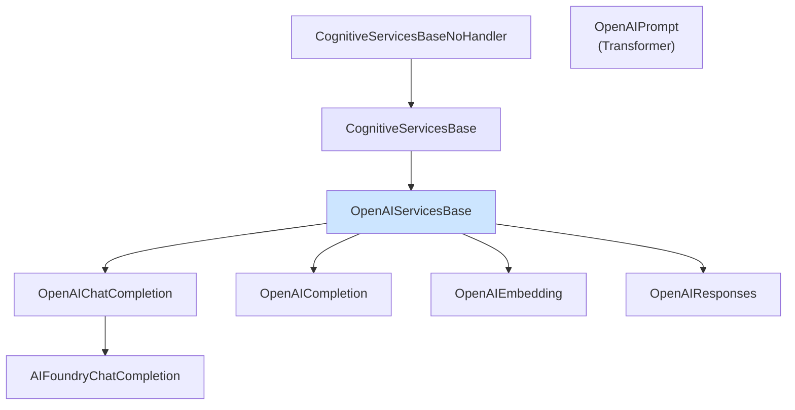
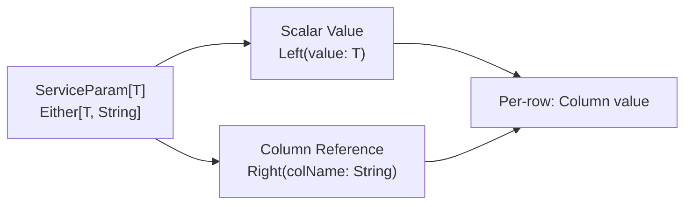
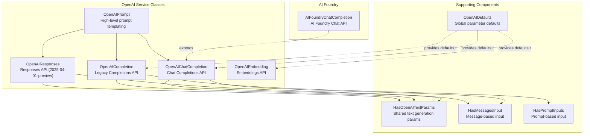
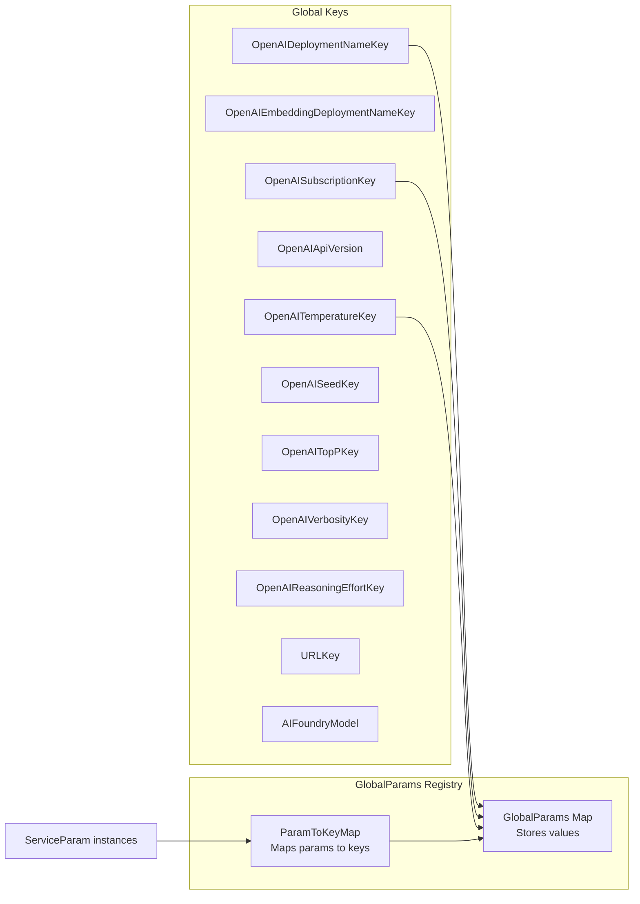
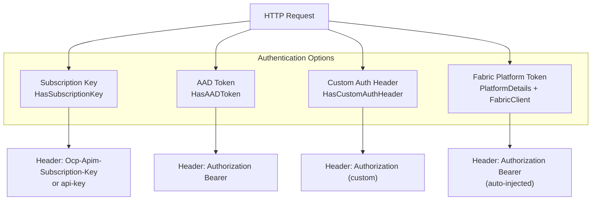
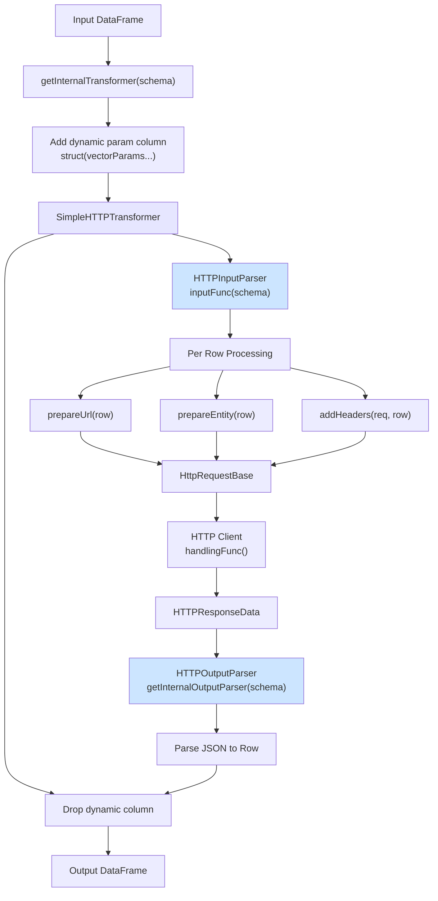
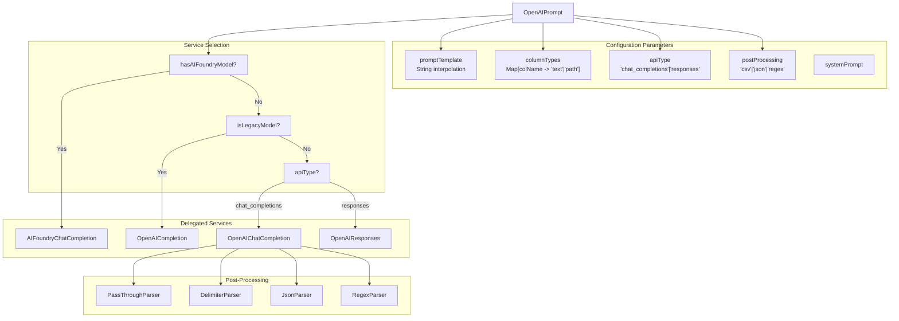
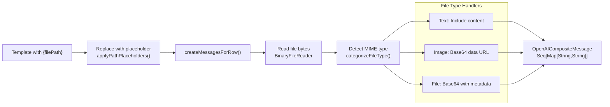

<!-- source: DeepWiki mcp.deepwiki.com · repo microsoft/SynapseML · page 6 AI Services Integration · fetched 2026-10-26 -->

# AI Services Integration

<details>
<summary>Relevant source files</summary>

The following files were used as context for generating this wiki page:

- [CONTRIBUTING.md](CONTRIBUTING.md)
- [README.md](README.md)
- [cognitive/src/main/python/synapse/ml/services/openai/OpenAIDefaults.py](cognitive/src/main/python/synapse/ml/services/openai/OpenAIDefaults.py)
- [cognitive/src/main/python/synapse/ml/services/openai/__init__.py](cognitive/src/main/python/synapse/ml/services/openai/__init__.py)
- [cognitive/src/main/scala/com/microsoft/azure/synapse/ml/services/CognitiveServiceBase.scala](cognitive/src/main/scala/com/microsoft/azure/synapse/ml/services/CognitiveServiceBase.scala)
- [cognitive/src/main/scala/com/microsoft/azure/synapse/ml/services/aifoundry/AIFoundryChatCompletion.scala](cognitive/src/main/scala/com/microsoft/azure/synapse/ml/services/aifoundry/AIFoundryChatCompletion.scala)
- [cognitive/src/main/scala/com/microsoft/azure/synapse/ml/services/openai/OpenAI.scala](cognitive/src/main/scala/com/microsoft/azure/synapse/ml/services/openai/OpenAI.scala)
- [cognitive/src/main/scala/com/microsoft/azure/synapse/ml/services/openai/OpenAIChatCompletion.scala](cognitive/src/main/scala/com/microsoft/azure/synapse/ml/services/openai/OpenAIChatCompletion.scala)
- [cognitive/src/main/scala/com/microsoft/azure/synapse/ml/services/openai/OpenAICompletion.scala](cognitive/src/main/scala/com/microsoft/azure/synapse/ml/services/openai/OpenAICompletion.scala)
- [cognitive/src/main/scala/com/microsoft/azure/synapse/ml/services/openai/OpenAIDefaults.scala](cognitive/src/main/scala/com/microsoft/azure/synapse/ml/services/openai/OpenAIDefaults.scala)
- [cognitive/src/main/scala/com/microsoft/azure/synapse/ml/services/openai/OpenAIEmbedding.scala](cognitive/src/main/scala/com/microsoft/azure/synapse/ml/services/openai/OpenAIEmbedding.scala)
- [cognitive/src/main/scala/com/microsoft/azure/synapse/ml/services/openai/OpenAIPrompt.scala](cognitive/src/main/scala/com/microsoft/azure/synapse/ml/services/openai/OpenAIPrompt.scala)
- [cognitive/src/main/scala/com/microsoft/azure/synapse/ml/services/openai/OpenAIResponses.scala](cognitive/src/main/scala/com/microsoft/azure/synapse/ml/services/openai/OpenAIResponses.scala)
- [cognitive/src/main/scala/com/microsoft/azure/synapse/ml/services/openai/OpenAISchemas.scala](cognitive/src/main/scala/com/microsoft/azure/synapse/ml/services/openai/OpenAISchemas.scala)
- [cognitive/src/test/python/synapsemltest/services/openai/test_OpenAIDefaults.py](cognitive/src/test/python/synapsemltest/services/openai/test_OpenAIDefaults.py)
- [cognitive/src/test/scala/com/microsoft/azure/synapse/ml/services/aifoundry/AIFoundryChatCompletionSuite.scala](cognitive/src/test/scala/com/microsoft/azure/synapse/ml/services/aifoundry/AIFoundryChatCompletionSuite.scala)
- [cognitive/src/test/scala/com/microsoft/azure/synapse/ml/services/openai/OpenAIChatCompletionSuite.scala](cognitive/src/test/scala/com/microsoft/azure/synapse/ml/services/openai/OpenAIChatCompletionSuite.scala)
- [cognitive/src/test/scala/com/microsoft/azure/synapse/ml/services/openai/OpenAICompletionSuite.scala](cognitive/src/test/scala/com/microsoft/azure/synapse/ml/services/openai/OpenAICompletionSuite.scala)
- [cognitive/src/test/scala/com/microsoft/azure/synapse/ml/services/openai/OpenAIDefaultsSuite.scala](cognitive/src/test/scala/com/microsoft/azure/synapse/ml/services/openai/OpenAIDefaultsSuite.scala)
- [cognitive/src/test/scala/com/microsoft/azure/synapse/ml/services/openai/OpenAIEmbeddingsSuite.scala](cognitive/src/test/scala/com/microsoft/azure/synapse/ml/services/openai/OpenAIEmbeddingsSuite.scala)
- [cognitive/src/test/scala/com/microsoft/azure/synapse/ml/services/openai/OpenAIPromptSuite.scala](cognitive/src/test/scala/com/microsoft/azure/synapse/ml/services/openai/OpenAIPromptSuite.scala)
- [cognitive/src/test/scala/com/microsoft/azure/synapse/ml/services/openai/OpenAIResponsesSuite.scala](cognitive/src/test/scala/com/microsoft/azure/synapse/ml/services/openai/OpenAIResponsesSuite.scala)
- [core/src/main/scala/com/microsoft/azure/synapse/ml/param/GlobalParams.scala](core/src/main/scala/com/microsoft/azure/synapse/ml/param/GlobalParams.scala)
- [docs/Explore Algorithms/OpenAI/OpenAI.ipynb](docs/Explore Algorithms/OpenAI/OpenAI.ipynb)

</details>


## Purpose and Scope

This document describes the AI services integration layer in SynapseML, which provides unified Spark DataFrame interfaces to external AI services and distributed ML algorithms. The integration layer abstracts HTTP communication, authentication, parameter management, and platform-specific behaviors to enable scalable processing of AI workloads on Apache Spark.

This page covers the common architecture and patterns shared across all AI service integrations. For details on specific services:
- OpenAI services (chat, completion, embedding, prompting) - see [OpenAI Integration](#6.1)
- Legacy Azure Cognitive Services (vision, text analytics) - see [Azure Cognitive Services](#6.2)  
- LangChain distributed execution - see [LangChain Integration](#6.3)
- Deep learning with ONNX and Horovod - see [Deep Learning Integration](#6.4)
- LightGBM gradient boosting - see [LightGBM Integration](#6.5)
- Vowpal Wabbit online learning - see [Vowpal Wabbit Integration](#6.6)

For deployment and platform-specific configurations, see [Deployment](#8).

---

## Architecture Overview

### Foundation: CognitiveServicesBase

All AI service integrations extend from `CognitiveServicesBase`, which provides the foundational infrastructure for HTTP-based service calls distributed across Spark executors.

**Class Hierarchy**



**Sources:** [cognitive/src/main/scala/com/microsoft/azure/synapse/ml/services/CognitiveServiceBase.scala:542-615](), [cognitive/src/main/scala/com/microsoft/azure/synapse/ml/services/openai/OpenAI.scala:412-427]()

### Core Responsibilities

`CognitiveServicesBase` provides:

| Responsibility | Implementation | Key Classes/Traits |
|----------------|----------------|-------------------|
| HTTP Request Construction | `inputFunc()` creates `HttpRequestBase` per row | `HasCognitiveServiceInput` |
| Authentication | Subscription key, AAD token, or custom auth headers | `HasSubscriptionKey`, `HasAADToken`, `HasCustomAuthHeader` |
| URL Management | URL construction with path and query parameters | `HasURL`, `HasUrlPath`, `HasAPIVersion` |
| Response Parsing | JSON parsing to Spark DataTypes | `HasInternalJsonOutputParser` |
| Error Handling | Error column for failed requests | `HasErrorCol` |
| Concurrency Control | Parallel HTTP requests across partitions | `ConcurrencyParams` |
| Platform Adaptation | Platform-specific endpoints and tokens | Platform detection via `PlatformDetails` |

**Sources:** [cognitive/src/main/scala/com/microsoft/azure/synapse/ml/services/CognitiveServiceBase.scala:1-615]()

### Parameter Management System

Services use `ServiceParam[T]` to support both scalar values and column references:



Example from `HasOpenAITextParams`:
- `temperature: ServiceParam[Double]` can be set as `.setTemperature(0.7)` (scalar) or `.setTemperatureCol("temp_col")` (column)
- At runtime, `getValue(row, temperature)` extracts the appropriate value per row

**Sources:** [cognitive/src/main/scala/com/microsoft/azure/synapse/ml/services/CognitiveServiceBase.scala:34-131](), [cognitive/src/main/scala/com/microsoft/azure/synapse/ml/services/openai/OpenAI.scala:19-352]()

---

## Service Categories

### Generative AI Services

**OpenAI and Azure OpenAI**



**Service Comparison**

| Service | API Type | Primary Use Case | Input Format | Output Schema |
|---------|----------|------------------|--------------|---------------|
| `OpenAIChatCompletion` | Chat Completions | Multi-turn conversations | `messagesCol` (Array of messages) | `ChatModelResponse` |
| `OpenAIResponses` | Responses (preview) | Multimodal with files/images | `messagesCol` (Array of composite messages) | `ResponsesModelResponse` |
| `OpenAICompletion` | Completions (legacy) | Simple text completion | `promptCol` or `batchPromptCol` | `CompletionResponse` |
| `OpenAIEmbedding` | Embeddings | Vector generation | `textCol` | `Vector` (MLlib) |
| `OpenAIPrompt` | High-level wrapper | Prompt templating with post-processing | Template string with column interpolation | Configurable (CSV, JSON, regex, text) |
| `AIFoundryChatCompletion` | AI Foundry Chat | Foundry model endpoints | `messagesCol` + `model` param | `ChatModelResponse` |

**Sources:** [cognitive/src/main/scala/com/microsoft/azure/synapse/ml/services/openai/OpenAIChatCompletion.scala:1-171](), [cognitive/src/main/scala/com/microsoft/azure/synapse/ml/services/openai/OpenAICompletion.scala:1-71](), [cognitive/src/main/scala/com/microsoft/azure/synapse/ml/services/openai/OpenAIResponses.scala:1-198](), [cognitive/src/main/scala/com/microsoft/azure/synapse/ml/services/openai/OpenAIEmbedding.scala:1-100](), [cognitive/src/main/scala/com/microsoft/azure/synapse/ml/services/openai/OpenAIPrompt.scala:1-573](), [cognitive/src/main/scala/com/microsoft/azure/synapse/ml/services/aifoundry/AIFoundryChatCompletion.scala:1-66]()

**Key Parameters** (from `HasOpenAITextParams`)

| Parameter | Type | Description | Payload Name |
|-----------|------|-------------|--------------|
| `deploymentName` | `ServiceParam[String]` | Azure OpenAI deployment name | - |
| `maxTokens` | `ServiceParam[Int]` | Maximum tokens to generate | `max_tokens` |
| `temperature` | `ServiceParam[Double]` | Sampling temperature (0-2) | `temperature` |
| `topP` | `ServiceParam[Double]` | Nucleus sampling (0-1) | `top_p` |
| `seed` | `ServiceParam[Int]` | Deterministic sampling seed | `seed` |
| `verbosity` | `ServiceParam[String]` | Response verbosity hint | `verbosity` |
| `reasoningEffort` | `ServiceParam[String]` | Reasoning effort level | `reasoning_effort` |
| `responseFormat` | `ServiceParam[Map[String, Any]]` | Response format (text, json_object, json_schema) | `response_format` |

**Sources:** [cognitive/src/main/scala/com/microsoft/azure/synapse/ml/services/openai/OpenAI.scala:112-353](), [cognitive/src/main/scala/com/microsoft/azure/synapse/ml/services/openai/OpenAIChatCompletion.scala:21-93]()

### Traditional Machine Learning

Services for gradient boosting and online learning are documented separately:
- **LightGBM**: Distributed gradient boosted decision trees - see [LightGBM Integration](#6.5)
- **Vowpal Wabbit**: Fast online learning and contextual bandits - see [Vowpal Wabbit Integration](#6.6)

### Deep Learning

ONNX model inference and Horovod distributed training are covered in [Deep Learning Integration](#6.4).

---

## Global Parameter Defaults

### OpenAIDefaults System

`OpenAIDefaults` provides static methods to set global default values for OpenAI parameters, reducing boilerplate when creating multiple transformers.

**Supported Global Parameters**



**Usage Pattern**

```scala
// Set global defaults (Scala)
OpenAIDefaults.setDeploymentName("gpt-4")
OpenAIDefaults.setSubscriptionKey(apiKey)
OpenAIDefaults.setTemperature(0.0)
OpenAIDefaults.setSeed(42)

// Transformers automatically pick up defaults
val completion = new OpenAIChatCompletion()
  .setMessagesCol("messages")
  .setOutputCol("out")
// deploymentName, subscriptionKey, temperature, seed inherited from defaults
```

**Python API**

The Python wrapper provides equivalent methods:

```python
# Python
from synapse.ml.services.openai.OpenAIDefaults import OpenAIDefaults

defaults = OpenAIDefaults()
defaults.set_deployment_name("gpt-4")
defaults.set_subscription_key(api_key)
defaults.set_temperature(0.0)
```

**Sources:** [cognitive/src/main/scala/com/microsoft/azure/synapse/ml/services/openai/OpenAIDefaults.scala:1-154](), [cognitive/src/main/python/synapse/ml/services/openai/OpenAIDefaults.py:1-131](), [core/src/main/scala/com/microsoft/azure/synapse/ml/param/GlobalParams.scala:1-57]()

### Global Parameter Registration

Services register their parameters with global keys:

```scala
// From OpenAI.scala
val deploymentName = new ServiceParam[String](...)
GlobalParams.registerParam(deploymentName, OpenAIDeploymentNameKey)

val temperature = new ServiceParam[Double](...)
GlobalParams.registerParam(temperature, OpenAITemperatureKey)
```

The `HasGlobalParams` trait transfers global values to instance parameters before transformation:

```scala
// From HasGlobalParams
private[ml] def transferGlobalParamsToParamMap(): Unit = {
  this.params
    .filter(p => !this.isSet(p))
    .foreach { p =>
      GlobalParams.getParam(p).foreach { v =>
        set(p.asInstanceOf[Param[Any]], v)
      }
    }
}
```

**Sources:** [cognitive/src/main/scala/com/microsoft/azure/synapse/ml/services/openai/OpenAI.scala:54-73,134-169,286-294](), [core/src/main/scala/com/microsoft/azure/synapse/ml/param/GlobalParams.scala:12-56]()

---

## Authentication and Authorization

### Authentication Methods



**Priority Order** (from `getHeaders()` in `HasCognitiveServiceInput`):

1. **Subscription Key**: If `subscriptionKey` is set, uses `Ocp-Apim-Subscription-Key` or `api-key` header (service-specific)
2. **AAD Token**: If `AADToken` is set, uses `Authorization: Bearer <token>` header
3. **Custom Auth Header**: If `CustomAuthHeader` is set, uses custom `Authorization` header value
4. **Fabric Auto-injection**: On Microsoft Fabric platform, automatically injects token from `FabricClient.getCognitiveMWCTokenAuthHeader()`

**Example Authentication Setup**

```scala
// Subscription key
val completion = new OpenAIChatCompletion()
  .setSubscriptionKey("your-api-key")
  .setCustomServiceName("your-openai-service")

// AAD token
val completion = new OpenAIChatCompletion()
  .setAADToken("eyJ0eXAiOiJKV1QiLCJhbGc...")
  .setCustomServiceName("your-openai-service")

// On Fabric - automatic
val completion = new OpenAIChatCompletion()
  .setCustomServiceName("your-openai-service")
  // Token auto-injected
```

**Sources:** [cognitive/src/main/scala/com/microsoft/azure/synapse/ml/services/CognitiveServiceBase.scala:133-195,311-429]()

### Custom Headers

Services support custom HTTP headers via `HasCustomHeaders` for scenarios requiring additional metadata:

```scala
completion.setCustomHeaders(Map(
  "X-ModelType" -> "gpt-4-turbo-chat-completions",
  "X-Custom-Metadata" -> "value"
))
```

**Sources:** [cognitive/src/main/scala/com/microsoft/azure/synapse/ml/services/CognitiveServiceBase.scala:197-212,373-415]()

---

## Request Construction and Execution Flow

### DataFrame to HTTP Request Pipeline



**Key Methods in Request Construction**

| Method | Purpose | Returns | Example |
|--------|---------|---------|---------|
| `prepareUrlRoot(row)` | Constructs base URL + path | `String` | `"https://service.openai.azure.com/openai/deployments/gpt-4/chat/completions"` |
| `prepareUrl(row)` | Adds query parameters | `String` | `prepareUrlRoot + "?api-version=2024-02-01"` |
| `prepareEntity(row)` | Creates request body | `Option[AbstractHttpEntity]` | `StringEntity(jsonPayload)` |
| `prepareMethod()` | HTTP method | `HttpRequestBase` | `HttpPost()` |
| `addHeaders(req, row)` | Adds auth + custom headers | `Unit` (mutates req) | Adds `api-key`, `Content-Type`, etc. |

**Sources:** [cognitive/src/main/scala/com/microsoft/azure/synapse/ml/services/CognitiveServiceBase.scala:329-454,558-598]()

### OpenAI-Specific Request Construction

For `OpenAIChatCompletion`, the entity preparation process:

```scala
override protected def prepareEntity: Row => Option[AbstractHttpEntity] = { r =>
  lazy val optionalParams: Map[String, Any] = getOptionalParams(r)
  val messages = r.getAs[Seq[Row]](getMessagesCol)
  Some(getStringEntity(messages, optionalParams))
}

private[openai] def getStringEntity(messages: Seq[Row], optionalParams: Map[String, Any]): StringEntity = {
  val mappedMessages = encodeMessagesToMap(messages)
    .map(_.filter { case (_, value) => value != null })
  val fullPayload = optionalParams.updated("messages", mappedMessages)
  new StringEntity(fullPayload.toJson.compactPrint, ContentType.APPLICATION_JSON)
}
```

**Sources:** [cognitive/src/main/scala/com/microsoft/azure/synapse/ml/services/openai/OpenAIChatCompletion.scala:118-152]()

---

## Response Processing and Schema Management

### Response Data Types

Each service defines a case class for its response schema, which is automatically converted to Spark `StructType`:

**OpenAI Response Schemas**

```mermaid
graph TB
    subgraph "Chat Completions"
        ChatModelResponse["ChatModelResponse"]
        ChatUsage["ChatUsage"]
        OpenAIChatChoice["OpenAIChatChoice"]
        OpenAIMessage["OpenAIMessage"]
        
        ChatModelResponse --> ChatUsage
        ChatModelResponse --> OpenAIChatChoice
        OpenAIChatChoice --> OpenAIMessage
    end
    
    subgraph "Completions (Legacy)"
        CompletionResponse["CompletionResponse"]
        OpenAIChoice["OpenAIChoice"]
        OpenAILogProbs["OpenAILogProbs"]
        
        CompletionResponse --> OpenAIChoice
        OpenAIChoice --> OpenAILogProbs
    end
    
    subgraph "Embeddings"
        EmbeddingResponse["EmbeddingResponse"]
        EmbeddingObject["EmbeddingObject"]
        Vector["MLlib Vector"]
        
        EmbeddingResponse --> EmbeddingObject
        EmbeddingObject --> Vector
    end
    
    subgraph "Responses API"
        ResponsesModelResponse["ResponsesModelResponse"]
        OpenAIResponsesChoice["OpenAIResponsesChoice"]
        ResponsesOutputContentComponent["ResponsesOutputContentComponent"]
        
        ResponsesModelResponse --> OpenAIResponsesChoice
        OpenAIResponsesChoice --> ResponsesOutputContentComponent
    end
```



**Schema Definitions** (from `OpenAISchemas.scala`):

```scala
case class ChatModelResponse(
  id: String,
  `object`: String,
  created: String,
  model: String,
  choices: Seq[OpenAIChatChoice],
  system_fingerprint: Option[String],
  usage: Option[ChatUsage]
)

case class OpenAIChatChoice(
  message: OpenAIMessage,
  index: Long,
  finish_reason: String
)

case class OpenAIMessage(
  role: String,
  content: String,
  name: Option[String] = None
)
```

**Sources:** [cognitive/src/main/scala/com/microsoft/azure/synapse/ml/services/openai/OpenAISchemas.scala:1-80]()

### JSON Parsing and Output Transformation

Services use `JSONOutputParser` to convert HTTP responses to Spark Rows:

```scala
// From OpenAIChatCompletion
override protected def getInternalOutputParser(schema: StructType): HTTPOutputParser = {
  new JSONOutputParser().setDataType(responseDataType)
}

override def responseDataType: DataType = ChatModelResponse.schema
```

For `OpenAIEmbedding`, a post-processing function converts the response to MLlib `Vector`:

```scala
override protected def getInternalOutputParser(schema: StructType): JSONOutputParser = {
  def responseToVector(r: Row) =
    if (r == null) None
    else Some(Vectors.dense(r.getAs[Seq[Row]]("data").head.getAs[Seq[Double]]("embedding").toArray))

  new JSONOutputParser()
    .setDataType(EmbeddingResponse.schema)
    .setPostProcessFunc[Row, Option[Vector]](responseToVector, VectorType)
}
```

**Sources:** [cognitive/src/main/scala/com/microsoft/azure/synapse/ml/services/CognitiveServiceBase.scala:457-464](), [cognitive/src/main/scala/com/microsoft/azure/synapse/ml/services/openai/OpenAIEmbedding.scala:49-59]()

---

## OpenAIPrompt: High-Level Templating

### Purpose

`OpenAIPrompt` provides a unified interface for prompt templating, multimodal input handling, and response post-processing. It internally delegates to appropriate service classes (`OpenAIChatCompletion`, `OpenAICompletion`, `OpenAIResponses`, or `AIFoundryChatCompletion`) based on configuration.

### Architecture



**Sources:** [cognitive/src/main/scala/com/microsoft/azure/synapse/ml/services/openai/OpenAIPrompt.scala:39-573]()

### Prompt Templating

Supports string interpolation with column references:

```scala
val prompt = new OpenAIPrompt()
  .setPromptTemplate("Give me a comma separated list of 5 {category}, starting with {text}")
  .setOutputCol("result")

// For DataFrame with columns: text, category
// Generates prompts like: "Give me a comma separated list of 5 fruits, starting with apple"
```

**Sources:** [cognitive/src/main/scala/com/microsoft/azure/synapse/ml/services/openai/OpenAIPrompt.scala:58-63,289-291]()

### Multimodal Input Handling

`columnTypes` parameter specifies which columns contain file paths for multimodal inputs:

```scala
val prompt = new OpenAIPrompt()
  .setPromptTemplate("Describe this image: {imagePath}")
  .setColumnType("imagePath", "path")  // Marks column as file path
  .setApiType("responses")  // Required for multimodal
```

For path columns, `OpenAIPrompt`:
1. Replaces `{columnName}` with placeholder text in template
2. Reads file contents using `BinaryFileReader`
3. Encodes as base64 for images or includes text content
4. Constructs `OpenAICompositeMessage` with content parts

**Path Column Processing Flow**



**Sources:** [cognitive/src/main/scala/com/microsoft/azure/synapse/ml/services/openai/OpenAIPrompt.scala:130-155,194-448]()

### Post-Processing Parsers

Parse service responses into structured formats:

| Parser | Configuration | Output Type | Example |
|--------|--------------|-------------|---------|
| `PassThroughParser` | `postProcessing=""` | `StringType` | Raw text response |
| `DelimiterParser` | `postProcessing="csv"`, `delimiter=","` | `ArrayType(StringType)` | `["apple", "orange", "banana"]` |
| `JsonParser` | `postProcessing="json"`, `jsonSchema="..."` | DDL schema | Structured data |
| `RegexParser` | `postProcessing="regex"`, `regex="..."`, `regexGroup=0` | `StringType` | Extracted pattern |

**JSON Schema Example**

```scala
prompt.setPostProcessingOptions(Map(
  "jsonSchema" -> "name STRING, age INT, city STRING"
))
// Output: Row(name="John", age=30, city="Seattle")
```

**Sources:** [cognitive/src/main/scala/com/microsoft/azure/synapse/ml/services/openai/OpenAIPrompt.scala:535-573]()

---

## Platform-Specific Adaptations

### Platform Detection

Services detect the execution platform to adapt endpoints, authentication, and telemetry:

```scala
// From CognitiveServicesBase constructor
if (PlatformDetails.runningOnFabric()) {
  setDefaultInternalEndpoint(FabricClient.MLWorkloadEndpointML)
}

// From OpenAIServicesBase
override protected def getInternalTransformer(schema: StructType): PipelineModel = {
  if (PlatformDetails.runningOnFabric() && usingDefaultOpenAIEndpoint) {
    assertModelStatus(getDeploymentName)  // Check model availability on Fabric
  }
  super.getInternalTransformer(schema)
}
```

**Platform-Specific Behaviors**

| Platform | Endpoint Default | Authentication | Special Handling |
|----------|-----------------|----------------|------------------|
| **Microsoft Fabric** | `FabricClient.MLWorkloadEndpointML + "/cognitive/openai/"` | Auto-injected token from `FabricClient.getCognitiveMWCTokenAuthHeader()` | Model status validation |
| **Synapse Analytics** | Custom service name required | Subscription key or AAD token | - |
| **Databricks** | Custom service name required | Subscription key or AAD token | - |
| **Standalone** | Custom service name required | Subscription key or AAD token | - |

**Sources:** [cognitive/src/main/scala/com/microsoft/azure/synapse/ml/services/CognitiveServiceBase.scala:554-556](), [cognitive/src/main/scala/com/microsoft/azure/synapse/ml/services/openai/OpenAI.scala:416-425](), [cognitive/src/main/scala/com/microsoft/azure/synapse/ml/services/CognitiveServiceBase.scala:363-371]()

### Fabric Model Status Validation

On Fabric, when using the default internal endpoint, services validate that the requested deployment/model is available:

```scala
private def usingDefaultOpenAIEndpoint(): Boolean = {
  getUrl == FabricClient.MLWorkloadEndpointML + "/cognitive/openai/"
}

override protected def getInternalTransformer(schema: StructType): PipelineModel = {
  if (PlatformDetails.runningOnFabric() && usingDefaultOpenAIEndpoint) {
    assertModelStatus(getDeploymentName)  // Throws if model unavailable
  }
  super.getInternalTransformer(schema)
}
```

**Sources:** [cognitive/src/main/scala/com/microsoft/azure/synapse/ml/services/openai/OpenAI.scala:416-425]()

For more details on platform integration, see [Platform Detection and Adaptation](#2.3) and [Microsoft Fabric Deployment](#8.4).

---

## Integration with Core Infrastructure

### HTTP Client Infrastructure

AI services leverage the shared HTTP client system for connection pooling, retry logic, and timeout management. See [HTTP Client System](#5.2) for details on:
- `SimpleHTTPTransformer` for request execution
- Connection pooling via `PoolingHttpClientConnectionManager`
- Retry mechanisms in `HandlingUtils`
- Async vs. sync client selection

**Sources:** [cognitive/src/main/scala/com/microsoft/azure/synapse/ml/services/CognitiveServiceBase.scala:584-593]()

### Logging and Telemetry

Services use `SynapseMLLogging` for platform-aware telemetry:

```scala
class OpenAIChatCompletion(override val uid: String) extends OpenAIServicesBase(uid)
  with ... with SynapseMLLogging {
  logClass(FeatureNames.AiServices.OpenAI)
  
  override def transform(dataset: Dataset[_]): DataFrame = {
    transferGlobalParamsToParamMap()
    logTransform[DataFrame](
      getInternalTransformer(dataset.schema).transform(dataset),
      dataset.columns.length
    )
  }
}
```

See [Logging System](#5.1) for logging infrastructure details.

**Sources:** [cognitive/src/main/scala/com/microsoft/azure/synapse/ml/services/openai/OpenAIChatCompletion.scala:6,97-100]()

### Secret Management

Services integrate with the platform-agnostic secret retrieval system:

```scala
// From test code showing secret usage
val key = find_secret(
  secret_name="openai-api-key-2",
  keyvault="mmlspark-build-keys"
)

completion.setSubscriptionKey(key)
```

See [Secret Management](#5.4) for the `Secrets` object and `getSecret()` method.

**Sources:** [docs/Explore Algorithms/OpenAI/OpenAI.ipynb:69-72]()

---

## Error Handling and Content Filtering

### Error Column Pattern

All services provide an error column (via `HasErrorCol`) that captures HTTP errors, JSON parsing failures, and service-specific errors:

```scala
val completion = new OpenAIChatCompletion()
  .setErrorCol("error")
  .setOutputCol("result")

// Output schema includes both result and error columns
// Row(result=..., error=null) for success
// Row(result=null, error=Row(message=..., ...)) for failure
```

### RAI Content Filtering

OpenAI services implement `HasRAIContentFilter` to detect and handle content filtered by Azure's Responsible AI systems:

```scala
trait HasRAIContentFilter {
  private[openai] def isContentFiltered(outputRow: Row): Boolean
  private[openai] def getFilterReason(outputRow: Row): String
}

// In OpenAIChatCompletion
override private[openai] def isContentFiltered(outputRow: Row): Boolean = {
  val result = ChatModelResponse.makeFromRowConverter(outputRow)
  val firstChoice = result.choices.head
  Option(firstChoice.message.content).isEmpty  // Null content indicates filtering
}

override private[openai] def getFilterReason(outputRow: Row): String = {
  val result = ChatModelResponse.makeFromRowConverter(outputRow)
  result.choices.head.finish_reason  // e.g., "content_filter"
}
```

When content is filtered, `OpenAIPrompt.addRAIErrors()` moves the filter reason into the error column.

**Sources:** [cognitive/src/main/scala/com/microsoft/azure/synapse/ml/services/openai/OpenAI.scala:355-369](), [cognitive/src/main/scala/com/microsoft/azure/synapse/ml/services/openai/OpenAIChatCompletion.scala:159-168](), [cognitive/src/main/scala/com/microsoft/azure/synapse/ml/services/openai/OpenAIPrompt.scala:200-216]()

---

## Response Format Handling

### Response Format Types

OpenAI services support multiple response formats:

| Format Type | String Value | Map Representation | Use Case |
|-------------|-------------|-------------------|----------|
| Text | `"text"` | `Map("type" -> "text")` | Plain text responses |
| JSON Object | `"json_object"` | `Map("type" -> "json_object")` | Freeform JSON |
| JSON Schema | - | `Map("type" -> "json_schema", "json_schema" -> Map(...))` | Structured JSON with schema validation |

### API-Specific Handling

**Chat Completions API** (`OpenAIChatCompletion`):
- Supports `text`, `json_object`, and `json_schema`
- `responseFormat` parameter maps to `response_format` in payload
- Schema structure: `{"type": "json_schema", "json_schema": {"name": "...", "schema": {...}}}`

**Responses API** (`OpenAIResponses`):
- Supports `text`, `json_object`, and `json_schema`
- Wraps format in `text.format` structure: `{"text": {"format": {...}}}`
- Verbosity parameter merges into same `text` object: `{"text": {"format": {...}, "verbosity": "high"}}`

**Validation and Normalization**

`ResponseFormatUtils` (not shown in files but referenced) normalizes input formats:

```scala
def setResponseFormat(value: Map[String, Any]): this.type = {
  val normalized = ResponseFormatUtils.normalize(value)
  // For chat_completions:
  val payload = if (normalized.get("type").exists(_ == "json_schema")) {
    Map("type" -> "json_schema", "json_schema" -> Map(...))
  } else normalized
  setScalarParam(responseFormat, payload)
}
```

**Rejection of Bare "json_schema" String**

Both APIs reject `setResponseFormat("json_schema")` to prevent ambiguity:

```scala
def setResponseFormat(value: String): this.type = {
  if (value.trim.equalsIgnoreCase("json_schema")) {
    throw new IllegalArgumentException(
      "Use a Map for 'json_schema' or pass an inner JSON Schema map.")
  }
  // ... handle "text" or "json_object"
}
```

**Sources:** [cognitive/src/main/scala/com/microsoft/azure/synapse/ml/services/openai/OpenAIChatCompletion.scala:22-69](), [cognitive/src/main/scala/com/microsoft/azure/synapse/ml/services/openai/OpenAIResponses.scala:40-88](), [cognitive/src/test/scala/com/microsoft/azure/synapse/ml/services/openai/OpenAIChatCompletionSuite.scala:398-404](), [cognitive/src/test/scala/com/microsoft/azure/synapse/ml/services/openai/OpenAIResponsesSuite.scala:90-121]()

---

## Summary

The AI Services Integration layer provides:

1. **Unified Spark Interface**: All services extend `CognitiveServicesBase` for consistent DataFrame transformation APIs
2. **Flexible Parameter Management**: `ServiceParam[T]` supports both scalar values and per-row column references
3. **Global Defaults**: `OpenAIDefaults` reduces boilerplate for common configurations
4. **Multi-Modal Authentication**: Subscription keys, AAD tokens, custom headers, and platform auto-injection
5. **Platform Adaptation**: Automatic endpoint and token selection for Fabric, Synapse, Databricks
6. **Response Processing**: Strongly-typed schemas with JSON parsing and optional post-processing
7. **High-Level Abstractions**: `OpenAIPrompt` for templating, multimodal input, and structured output parsing
8. **Error Handling**: Error columns and RAI content filtering support

For implementation details on specific services, refer to the child pages listed at the beginning of this document.

---

