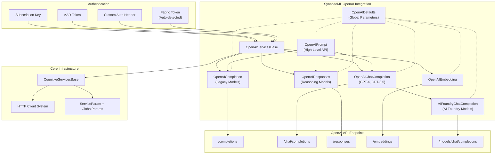
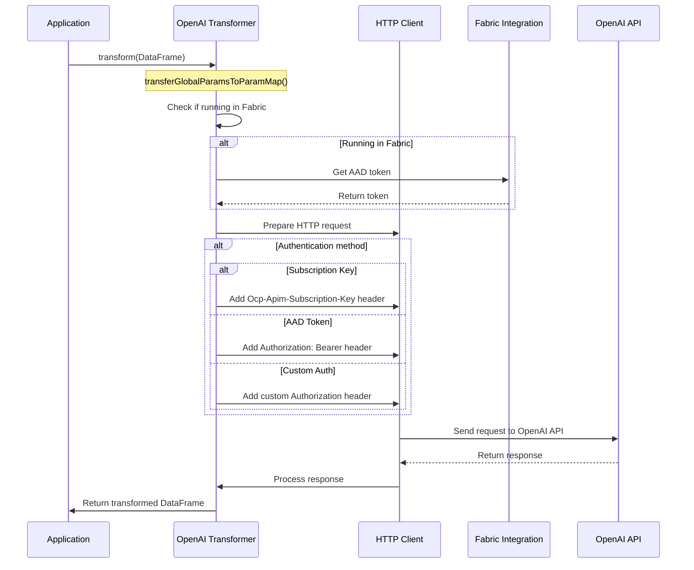

<!-- source: DeepWiki mcp.deepwiki.com · repo microsoft/SynapseML · page 6.1 OpenAI Integration · fetched 2026-10-26 -->

# OpenAI Integration

<details>
<summary>Relevant source files</summary>

The following files were used as context for generating this wiki page:

- [cognitive/src/main/python/synapse/ml/services/openai/OpenAIDefaults.py](cognitive/src/main/python/synapse/ml/services/openai/OpenAIDefaults.py)
- [cognitive/src/main/python/synapse/ml/services/openai/__init__.py](cognitive/src/main/python/synapse/ml/services/openai/__init__.py)
- [cognitive/src/main/scala/com/microsoft/azure/synapse/ml/services/CognitiveServiceBase.scala](cognitive/src/main/scala/com/microsoft/azure/synapse/ml/services/CognitiveServiceBase.scala)
- [cognitive/src/main/scala/com/microsoft/azure/synapse/ml/services/aifoundry/AIFoundryChatCompletion.scala](cognitive/src/main/scala/com/microsoft/azure/synapse/ml/services/aifoundry/AIFoundryChatCompletion.scala)
- [cognitive/src/main/scala/com/microsoft/azure/synapse/ml/services/openai/OpenAI.scala](cognitive/src/main/scala/com/microsoft/azure/synapse/ml/services/openai/OpenAI.scala)
- [cognitive/src/main/scala/com/microsoft/azure/synapse/ml/services/openai/OpenAIChatCompletion.scala](cognitive/src/main/scala/com/microsoft/azure/synapse/ml/services/openai/OpenAIChatCompletion.scala)
- [cognitive/src/main/scala/com/microsoft/azure/synapse/ml/services/openai/OpenAICompletion.scala](cognitive/src/main/scala/com/microsoft/azure/synapse/ml/services/openai/OpenAICompletion.scala)
- [cognitive/src/main/scala/com/microsoft/azure/synapse/ml/services/openai/OpenAIDefaults.scala](cognitive/src/main/scala/com/microsoft/azure/synapse/ml/services/openai/OpenAIDefaults.scala)
- [cognitive/src/main/scala/com/microsoft/azure/synapse/ml/services/openai/OpenAIEmbedding.scala](cognitive/src/main/scala/com/microsoft/azure/synapse/ml/services/openai/OpenAIEmbedding.scala)
- [cognitive/src/main/scala/com/microsoft/azure/synapse/ml/services/openai/OpenAIPrompt.scala](cognitive/src/main/scala/com/microsoft/azure/synapse/ml/services/openai/OpenAIPrompt.scala)
- [cognitive/src/main/scala/com/microsoft/azure/synapse/ml/services/openai/OpenAIResponses.scala](cognitive/src/main/scala/com/microsoft/azure/synapse/ml/services/openai/OpenAIResponses.scala)
- [cognitive/src/main/scala/com/microsoft/azure/synapse/ml/services/openai/OpenAISchemas.scala](cognitive/src/main/scala/com/microsoft/azure/synapse/ml/services/openai/OpenAISchemas.scala)
- [cognitive/src/test/python/synapsemltest/services/openai/test_OpenAIDefaults.py](cognitive/src/test/python/synapsemltest/services/openai/test_OpenAIDefaults.py)
- [cognitive/src/test/scala/com/microsoft/azure/synapse/ml/services/aifoundry/AIFoundryChatCompletionSuite.scala](cognitive/src/test/scala/com/microsoft/azure/synapse/ml/services/aifoundry/AIFoundryChatCompletionSuite.scala)
- [cognitive/src/test/scala/com/microsoft/azure/synapse/ml/services/openai/OpenAIChatCompletionSuite.scala](cognitive/src/test/scala/com/microsoft/azure/synapse/ml/services/openai/OpenAIChatCompletionSuite.scala)
- [cognitive/src/test/scala/com/microsoft/azure/synapse/ml/services/openai/OpenAICompletionSuite.scala](cognitive/src/test/scala/com/microsoft/azure/synapse/ml/services/openai/OpenAICompletionSuite.scala)
- [cognitive/src/test/scala/com/microsoft/azure/synapse/ml/services/openai/OpenAIDefaultsSuite.scala](cognitive/src/test/scala/com/microsoft/azure/synapse/ml/services/openai/OpenAIDefaultsSuite.scala)
- [cognitive/src/test/scala/com/microsoft/azure/synapse/ml/services/openai/OpenAIEmbeddingsSuite.scala](cognitive/src/test/scala/com/microsoft/azure/synapse/ml/services/openai/OpenAIEmbeddingsSuite.scala)
- [cognitive/src/test/scala/com/microsoft/azure/synapse/ml/services/openai/OpenAIPromptSuite.scala](cognitive/src/test/scala/com/microsoft/azure/synapse/ml/services/openai/OpenAIPromptSuite.scala)
- [cognitive/src/test/scala/com/microsoft/azure/synapse/ml/services/openai/OpenAIResponsesSuite.scala](cognitive/src/test/scala/com/microsoft/azure/synapse/ml/services/openai/OpenAIResponsesSuite.scala)
- [core/src/main/scala/com/microsoft/azure/synapse/ml/param/GlobalParams.scala](core/src/main/scala/com/microsoft/azure/synapse/ml/param/GlobalParams.scala)
- [docs/Explore Algorithms/OpenAI/OpenAI.ipynb](docs/Explore Algorithms/OpenAI/OpenAI.ipynb)

</details>


This page documents SynapseML's integration with OpenAI services, which enables users to leverage OpenAI models within Apache Spark workflows. The integration supports text completion, chat completion, embeddings generation, and prompt engineering capabilities through a consistent, Spark-friendly API. For information about other AI service integrations, see [Azure Cognitive Services](#6.2) or [LangChain Integration](#6.3).

## Architecture Overview

The OpenAI integration in SynapseML is built on a modular architecture that extends the core HTTP client system to communicate with OpenAI's API endpoints. It provides Spark transformers for various OpenAI capabilities that seamlessly work within Spark ML pipelines.

**OpenAI Integration Architecture**



Sources:
- [cognitive/src/main/scala/com/microsoft/azure/synapse/ml/services/openai/OpenAI.scala:412-427]()
- [cognitive/src/main/scala/com/microsoft/azure/synapse/ml/services/openai/OpenAICompletion.scala:21-71]()
- [cognitive/src/main/scala/com/microsoft/azure/synapse/ml/services/openai/OpenAIChatCompletion.scala:97-171]()
- [cognitive/src/main/scala/com/microsoft/azure/synapse/ml/services/openai/OpenAIResponses.scala:93-210]()
- [cognitive/src/main/scala/com/microsoft/azure/synapse/ml/services/openai/OpenAIEmbedding.scala:25-99]()
- [cognitive/src/main/scala/com/microsoft/azure/synapse/ml/services/openai/OpenAIPrompt.scala:39-533]()
- [cognitive/src/main/scala/com/microsoft/azure/synapse/ml/services/aifoundry/AIFoundryChatCompletion.scala:48-64]()
- [cognitive/src/main/scala/com/microsoft/azure/synapse/ml/services/openai/OpenAIDefaults.scala:11-153]()

## Class Hierarchy and Parameter System

The OpenAI integration is built on a well-structured class hierarchy with a robust parameter system that enables consistent parameter handling across different services.

**OpenAI Class Hierarchy**

```mermaid
classDiagram
    class CognitiveServicesBase {
        +transform(dataset: Dataset): DataFrame
        #getInternalTransformer(schema: StructType): PipelineModel
        #prepareEntity(r: Row): Option[AbstractHttpEntity]
        #prepareUrlRoot(row: Row): String
    }
    
    class HasOpenAISharedParams {
        +deploymentName: ServiceParam~String~
        +user: ServiceParam~String~
        +getDeploymentName(): String
        +setDeploymentName(v: String)
    }
    
    class HasOpenAITextParams {
        +maxTokens: ServiceParam~Int~
        +temperature: ServiceParam~Double~
        +topP: ServiceParam~Double~
        +stop: ServiceParam~String~
        +n: ServiceParam~Int~
        +logProbs: ServiceParam~Int~
        +presencePenalty: ServiceParam~Double~
        +frequencyPenalty: ServiceParam~Double~
        +seed: ServiceParam~Int~
        +verbosity: ServiceParam~String~
        +reasoningEffort: ServiceParam~String~
    }
    
    class HasOpenAITextParamsExtended {
        +responseFormat: ServiceParam~Map[String, Any]~
        +setResponseFormat(value: Map): this.type
        +setResponseFormat(value: String): this.type
        +getResponseFormatType(): String
    }
    
    class HasOpenAIEmbeddingParams {
        +dimensions: ServiceParam~Int~
        +getDimensions(): Int
        +setDimensions(value: Int): this.type
    }
    
    class HasPromptInputs {
        +prompt: ServiceParam~String~
        +batchPrompt: ServiceParam~Seq[String]~
    }
    
    class HasMessagesInput {
        +messagesCol: Param~String~
        +getMessagesCol(): String
        +setMessagesCol(v: String): this.type
    }
    
    class OpenAIServicesBase {
        +timeout: Double = 360.0
        #assertModelStatus(deploymentName: String): Unit
        #usingDefaultOpenAIEndpoint(): Boolean
    }
    
    class OpenAICompletion {
        +apiVersion: "2024-02-01"
        +prepareUrlRoot: Row =&gt; String
        +responseDataType: CompletionResponse.schema
    }
    
    class OpenAIChatCompletion {
        +apiVersion: "2025-04-01-preview"
        +prepareUrlRoot: Row =&gt; String
        +responseDataType: ChatModelResponse.schema
        +getStringEntity(messages, optionalParams): StringEntity
    }
    
    class OpenAIResponses {
        +apiVersion: "2025-04-01-preview"
        +prepareUrlRoot: Row =&gt; String
        +responseDataType: ResponsesModelResponse.schema
        +getOptionalParams(r: Row): Map[String, Any]
    }
    
    class OpenAIEmbedding {
        +apiVersion: "2025-04-01-preview"
        +text: ServiceParam~String~
        +prepareUrlRoot: Row =&gt; String
        +getInternalOutputParser(): JSONOutputParser
    }
    
    class AIFoundryChatCompletion {
        +model: ServiceParam~String~
        +prepareUrlRoot: Row =&gt; String
        +internalServiceType: "foundry"
    }
    
    class OpenAIPrompt {
        +promptTemplate: Param~String~
        +systemPrompt: Param~String~
        +postProcessing: Param~String~
        +apiType: Param~String~
        +columnTypes: Map~String, String~
        +transform(dataset: Dataset): DataFrame
    }
    
    CognitiveServicesBase <|-- OpenAIServicesBase
    HasOpenAISharedParams <|-- OpenAIServicesBase
    
    OpenAIServicesBase <|-- OpenAICompletion
    HasOpenAITextParams <|-- OpenAICompletion
    HasPromptInputs <|-- OpenAICompletion
    
    OpenAIServicesBase <|-- OpenAIChatCompletion
    HasOpenAITextParams <|-- OpenAIChatCompletion
    HasOpenAITextParamsExtended <|-- OpenAIChatCompletion
    HasMessagesInput <|-- OpenAIChatCompletion
    
    OpenAIServicesBase <|-- OpenAIResponses
    HasOpenAITextParams <|-- OpenAIResponses
    HasMessagesInput <|-- OpenAIResponses
    
    OpenAIServicesBase <|-- OpenAIEmbedding
    HasOpenAIEmbeddingParams <|-- OpenAIEmbedding
    
    OpenAIChatCompletion <|-- AIFoundryChatCompletion
    HasOpenAITextParamsExtended <|-- AIFoundryChatCompletion
    
    OpenAIPrompt ..> OpenAICompletion
    OpenAIPrompt ..> OpenAIChatCompletion
    OpenAIPrompt ..> OpenAIResponses
```



Sources:
- [cognitive/src/main/scala/com/microsoft/azure/synapse/ml/services/openai/OpenAI.scala:19-427]()
- [cognitive/src/main/scala/com/microsoft/azure/synapse/ml/services/CognitiveServiceBase.scala:34-615]()
- [cognitive/src/main/scala/com/microsoft/azure/synapse/ml/services/openai/OpenAICompletion.scala:21-71]()
- [cognitive/src/main/scala/com/microsoft/azure/synapse/ml/services/openai/OpenAIChatCompletion.scala:21-171]()
- [cognitive/src/main/scala/com/microsoft/azure/synapse/ml/services/openai/OpenAIResponses.scala:23-210]()
- [cognitive/src/main/scala/com/microsoft/azure/synapse/ml/services/openai/OpenAIEmbedding.scala:25-99]()
- [cognitive/src/main/scala/com/microsoft/azure/synapse/ml/services/aifoundry/AIFoundryChatCompletion.scala:18-64]()
- [cognitive/src/main/scala/com/microsoft/azure/synapse/ml/services/openai/OpenAIPrompt.scala:39-533]()

## Core Components

### OpenAIServicesBase

`OpenAIServicesBase` is the foundation class for all OpenAI services in SynapseML. It extends `CognitiveServicesBase` and handles:

- Communication with OpenAI API endpoints
- Authentication with OpenAI services
- Default parameter settings
- Integration with Azure Fabric when running in that environment

```scala
abstract class OpenAIServicesBase(override val uid: String) extends CognitiveServicesBase(uid: String)
  with HasOpenAISharedParams with OpenAIFabricSetting {
  setDefault(timeout -> 360.0)
  // ...
}
```

Sources:
- [cognitive/src/main/scala/com/microsoft/azure/synapse/ml/services/openai/OpenAI.scala:304-318]()
- [cognitive/src/main/scala/com/microsoft/azure/synapse/ml/services/CognitiveServiceBase.scala:496-565]()

### Parameter System

The OpenAI integration uses a sophisticated parameter system built on `ServiceParam[T]` that enables:

1. **Type-safe parameters** with compile-time validation
2. **Dynamic parameter binding** - Parameters can reference DataFrame columns or constant values
3. **Global parameter defaults** through `OpenAIDefaults` and `GlobalParams`
4. **API-specific parameter handling** - Different parameters for different model types

**Key Parameter Traits:**

| Trait | Parameters | Description |
|-------|-----------|-------------|
| `HasOpenAISharedParams` | `deploymentName`, `user` | Common parameters for all OpenAI services |
| `HasOpenAITextParams` | `maxTokens`, `temperature`, `topP`, `stop`, `n`, `logProbs`, `presencePenalty`, `frequencyPenalty`, `bestOf`, `echo`, `cacheLevel`, `seed`, `verbosity`, `reasoningEffort` | Parameters for text generation models |
| `HasOpenAITextParamsExtended` | Extends `HasOpenAITextParams` with `responseFormat` | Chat and Responses API with structured outputs |
| `HasOpenAIEmbeddingParams` | `dimensions` | Parameters for embedding models |
| `HasPromptInputs` | `prompt`, `batchPrompt` | Single or batch prompt inputs for legacy models |
| `HasMessagesInput` | `messagesCol` | Chat message arrays for chat/responses models |

**New Parameters in Recent Versions:**

- **`seed`** (Int): Enables deterministic sampling for reproducible results
- **`verbosity`** (String): Controls output verbosity for reasoning models (accepts "low", "medium", "high", or custom strings)
- **`reasoningEffort`** (String): Controls reasoning depth for o1/o3 models (accepts "minimal", "low", "medium", "high", or custom strings)
- **`responseFormat`** (Map[String, Any]): Structured output format including `json_schema` for strict JSON outputs

**ServiceParam Value Binding:**

`ServiceParam[T]` supports dual binding:
```scala
// Bind to a constant value
transformer.setTemperature(0.7)

// Bind to a DataFrame column
transformer.setTemperatureCol("temperature_column")
```

Internally, `ServiceParam[T]` is represented as `Either[T, String]` where `Left(value)` is a constant and `Right(columnName)` is a column reference.

Sources:
- [cognitive/src/main/scala/com/microsoft/azure/synapse/ml/services/openai/OpenAI.scala:57-353]()
- [cognitive/src/main/scala/com/microsoft/azure/synapse/ml/services/CognitiveServiceBase.scala:34-131]()
- [cognitive/src/main/scala/com/microsoft/azure/synapse/ml/services/openai/OpenAIChatCompletion.scala:21-93]()
- [cognitive/src/main/scala/com/microsoft/azure/synapse/ml/services/openai/OpenAIResponses.scala:39-89]()
- [core/src/main/scala/com/microsoft/azure/synapse/ml/param/GlobalParams.scala:10-57]()

### Authentication Mechanisms

The integration supports multiple authentication methods:

| Authentication Method | Description | How to Use |
|-----------------|-------------|-----------|
| Subscription Key | Azure OpenAI API key | `setSubscriptionKey(key)` |
| AAD Token | Azure Active Directory token | `setAADToken(token)` |
| Custom Auth Header | Custom authorization header | `setCustomAuthHeader(header)` |
| Fabric Authentication | Automatic in Azure Fabric | Automatic when running in Fabric |

Sources:
- [cognitive/src/main/scala/com/microsoft/azure/synapse/ml/services/CognitiveServiceBase.scala:132-194]()
- [core/src/main/scala/com/microsoft/azure/synapse/ml/fabric/TokenLibrary.scala:10-51]()
- [cognitive/src/main/scala/com/microsoft/azure/synapse/ml/services/openai/OpenAI.scala:54-86]()

## OpenAI Services

### OpenAICompletion

The `OpenAICompletion` class provides integration with OpenAI's legacy text completion API for models like `text-davinci-003`. This class is primarily maintained for backward compatibility with older models.

**Key Features:**
- Single prompt completions via `setPromptCol()` or `setPrompt()`
- Batch prompt completions via `setBatchPromptCol()` or `setBatchPrompt()`
- Default API version: `2024-02-01`
- Endpoint: `/openai/deployments/{deploymentName}/completions`

**Response Schema:**
The transformer returns `CompletionResponse` with fields: `id`, `object`, `created`, `model`, `choices` (containing `text`, `index`, `logprobs`, `finish_reason`).

Sources:
- [cognitive/src/main/scala/com/microsoft/azure/synapse/ml/services/openai/OpenAICompletion.scala:21-71]()
- [cognitive/src/main/scala/com/microsoft/azure/synapse/ml/services/openai/OpenAI.scala:112-353]()
- [cognitive/src/main/scala/com/microsoft/azure/synapse/ml/services/openai/OpenAISchemas.scala:10-27]()

### OpenAIChatCompletion

`OpenAIChatCompletion` integrates with OpenAI's Chat Completions API for models like GPT-4 and GPT-3.5-turbo. This is the primary API for modern OpenAI models.

**Key Features:**
- Chat messages with roles (`system`, `user`, `assistant`) via `setMessagesCol()`
- Response format control including `json_object` and `json_schema`
- Support for new parameters: `seed`, `verbosity`, `reasoningEffort`
- Default API version: `2025-04-01-preview`
- Endpoint: `/openai/deployments/{deploymentName}/chat/completions`

**Message Schema:**
Messages must be an array of `OpenAIMessage(role: String, content: String, name: Option[String])`. For example:
```scala
Seq(
  OpenAIMessage("system", "You are a helpful assistant"),
  OpenAIMessage("user", "What is Apache Spark?")
)
```

**Response Schema:**
Returns `ChatModelResponse` with fields: `id`, `object`, `created`, `model`, `choices` (containing `message`, `finish_reason`), `system_fingerprint`, `usage`.

**Content Filtering:**
The transformer implements `HasRAIContentFilter` trait to detect and handle content filtered by Azure's Responsible AI system. Filtered content is captured in the error column.

Sources:
- [cognitive/src/main/scala/com/microsoft/azure/synapse/ml/services/openai/OpenAIChatCompletion.scala:97-171]()
- [cognitive/src/main/scala/com/microsoft/azure/synapse/ml/services/openai/OpenAI.scala:21-93,355-410]()
- [cognitive/src/main/scala/com/microsoft/azure/synapse/ml/services/openai/OpenAISchemas.scala:38-59]()

### OpenAIResponses

`OpenAIResponses` is a new transformer for the OpenAI Responses API, designed for reasoning models (o1, o3 series) and advanced multimodal scenarios.

**Key Features:**
- Endpoint: `/openai/responses` (deployment-agnostic)
- Supports multimodal inputs with content parts (text, images, files)
- Model-specific parameter handling: GPT-5 models disable sampling parameters (`temperature`, `top_p`, `seed`)
- Nested parameter structure: `text.verbosity`, `text.format`, `reasoning.effort`
- Default API version: `2025-04-01-preview`

**Parameter Transformations:**

The `getOptionalParams()` method performs sophisticated parameter transformations:

1. **Model parameter**: Converts `deploymentName` to `model` parameter
2. **Text verbosity**: Nests `verbosity` under `text.verbosity`
3. **Response format**: Nests `responseFormat` under `text.format`
4. **Reasoning effort**: Converts `reasoningEffort` to `reasoning.effort`
5. **Sampling parameters**: Removes `temperature`, `top_p`, `seed` for GPT-5 models

**Message Content Format:**

Messages must use content parts with type `input_text`, `input_image`, or `input_file`:
```scala
Seq(
  Map("type" -> "input_text", "text" -> "Describe this image"),
  Map("type" -> "input_image", "image_url" -> "data:image/png;base64,...")
)
```

**Response Schema:**
Returns `ResponsesModelResponse` with fields: `id`, `object`, `created_at`, `model`, `output` (array of `OpenAIResponsesChoice` with `content` parts and `status`), `system_fingerprint`, `usage`.

Sources:
- [cognitive/src/main/scala/com/microsoft/azure/synapse/ml/services/openai/OpenAIResponses.scala:93-210]()
- [cognitive/src/main/scala/com/microsoft/azure/synapse/ml/services/openai/OpenAI.scala:371-410]()
- [cognitive/src/main/scala/com/microsoft/azure/synapse/ml/services/openai/OpenAISchemas.scala:60-74]()

### OpenAIEmbedding

`OpenAIEmbedding` provides integration with OpenAI's embeddings API for converting text to dense vectors.

**Key Features:**
- Text input via `setTextCol()` or `setText()`
- Optional `dimensions` parameter for embedding size
- Returns embeddings as Spark `Vector` type for ML pipelines
- Default API version: `2025-04-01-preview`
- Endpoint: `/openai/deployments/{deploymentName}/embeddings`

**Embedding-Specific Deployment:**

The transformer uses a dedicated global parameter `OpenAIEmbeddingDeploymentNameKey` for embedding models. This allows you to set a default embedding deployment separate from text generation deployments:

```scala
OpenAIDefaults.setEmbeddingDeploymentName("text-embedding-ada-002")
```

If no embedding-specific deployment is set, it falls back to the instance `deploymentName` parameter.

**Response Processing:**

The transformer uses a custom output parser that extracts the embedding vector from the API response and converts it to Spark's `VectorType`:
```scala
def responseToVector(r: Row) =
  if (r == null) None
  else Some(Vectors.dense(r.getAs[Seq[Row]]("data").head.getAs[Seq[Double]]("embedding").toArray))
```

Sources:
- [cognitive/src/main/scala/com/microsoft/azure/synapse/ml/services/openai/OpenAIEmbedding.scala:25-99]()
- [cognitive/src/main/scala/com/microsoft/azure/synapse/ml/services/openai/OpenAI.scala:55,87-103]()
- [cognitive/src/main/scala/com/microsoft/azure/synapse/ml/services/openai/OpenAISchemas.scala:28-36]()

### AIFoundryChatCompletion

`AIFoundryChatCompletion` extends `OpenAIChatCompletion` to support Azure AI Foundry models (formerly Azure AI Studio models).

**Key Differences from OpenAIChatCompletion:**
- Endpoint: `/models/chat/completions` (deployment-agnostic)
- Requires `model` parameter instead of `deploymentName`
- Service name pattern: `{name}.services.ai.azure.com`
- Internal service type: `foundry`

**Usage:**
```scala
new AIFoundryChatCompletion()
  .setCustomServiceName("my-ai-foundry")  // Sets URL to https://my-ai-foundry.services.ai.azure.com/
  .setModel("Llama-3.3-70B-Instruct")
  .setSubscriptionKey(apiKey)
  .setMessagesCol("messages")
```

Sources:
- [cognitive/src/main/scala/com/microsoft/azure/synapse/ml/services/aifoundry/AIFoundryChatCompletion.scala:48-64]()
- [cognitive/src/main/scala/com/microsoft/azure/synapse/ml/services/aifoundry/AIFoundryChatCompletion.scala:18-44]()

## OpenAIPrompt: High-Level Abstraction

`OpenAIPrompt` provides a higher-level abstraction focused on prompt engineering. It automatically handles differences between completion, chat, and responses models, providing a consistent interface regardless of the underlying API.

### Key Features

1. **Template-based prompting**: Define prompts with variable placeholders using `{columnName}` syntax
2. **Post-processing options**: Parse structured responses (CSV, JSON, regex)
3. **System prompt customization**: Configure system behavior for chat models
4. **Automatic model selection**: Detects and uses appropriate API based on deployment name
5. **Multimodal support**: Handle text and file inputs (images, PDFs) with column type annotations
6. **API type selection**: Choose between `chat_completions` and `responses` APIs
7. **Response format options**: Support `json_object` and `json_schema` for structured outputs

**OpenAIPrompt Processing Flow**

```mermaid
flowchart TD
    A["Input DataFrame"] --> B["OpenAIPrompt.transform()"]
    
    subgraph "Processing Pipeline"
        B --> C["applyPathPlaceholders()<br/>(Replace file columns)"]
        C --> D["Functions.template()<br/>(Interpolate {columnName})"]
        
        D --> E{"Model Type<br/>Detection"}
        
        E -->|"Legacy Model<br/>(davinci, etc.)"| F["OpenAICompletion"]
        E -->|"Chat Model<br/>(gpt-4, etc.)"| G["OpenAIChatCompletion"]
        E -->|"Responses API<br/>(apiType=responses)"| H["OpenAIResponses"]
        E -->|"AI Foundry<br/>(model parameter)"| I["AIFoundryChatCompletion"]
        
        F --> J["getOutputMessageText()<br/>(Extract text)"]
        G --> J
        H --> J
        I --> J
        
        J --> K["OutputParser.parse()"]
        K -->|"csv"| L["DelimiterParser"]
        K -->|"json"| M["JsonParser"]
        K -->|"regex"| N["RegexParser"]
        K -->|""| O["PassThroughParser"]
    end
    
    L --> P["Output DataFrame"]
    M --> P
    N --> P
    O --> P
```

Sources:
- [cognitive/src/main/scala/com/microsoft/azure/synapse/ml/services/openai/OpenAIPrompt.scala:39-533]()
- [cognitive/src/main/scala/com/microsoft/azure/synapse/ml/services/openai/OpenAIPrompt.scala:272-327]()
- [cognitive/src/main/scala/com/microsoft/azure/synapse/ml/services/openai/OpenAIPrompt.scala:456-505]()
- [cognitive/src/main/scala/com/microsoft/azure/synapse/ml/services/openai/OpenAIPrompt.scala:535-573]()

### Template Engine

The template engine uses SynapseML's `Functions.template()` to interpolate column values into prompt strings:

```scala
setPromptTemplate("Translate from English to French: {text}")
```

Variables in curly braces `{columnName}` are replaced with values from the corresponding DataFrame columns.

**File Path Handling:**

For columns containing file paths, use `setColumnType()` to mark them as `"path"`:
```scala
setColumnType("imagePath", "path")
setPromptTemplate("Describe this image: {imagePath}")
```

Path columns are replaced with placeholder text in the template, then the actual file content is loaded and attached as multimodal content parts.

Sources:
- [cognitive/src/main/scala/com/microsoft/azure/synapse/ml/services/openai/OpenAIPrompt.scala:130-155]()
- [cognitive/src/main/scala/com/microsoft/azure/synapse/ml/services/openai/OpenAIPrompt.scala:194-198]()
- [cognitive/src/main/scala/com/microsoft/azure/synapse/ml/services/openai/OpenAIPrompt.scala:272-327]()

### Multimodal Support

`OpenAIPrompt` supports multimodal inputs through the `columnTypes` parameter. When you mark a column as type `"path"`, the transformer:

1. Replaces `{columnName}` in the template with an attachment placeholder
2. Loads the file from the path at transformation time
3. Detects the file type (image, text, PDF, audio)
4. Constructs appropriate content parts for the API

**Supported File Types:**

| File Type | Extensions | Content Part Type | Notes |
|-----------|-----------|-------------------|-------|
| Text | `.md`, `.csv`, `.tsv`, `.json`, `.xml` | `input_text` or `text` | Content embedded inline |
| Image | `.jpg`, `.jpeg`, `.png`, `.gif`, `.webp` | `input_image` or `image_url` | Base64 encoded |
| PDF | `.pdf` | `input_file` | Base64 encoded |
| Audio | `.mp3`, `.wav` | Not supported | Throws exception |

**API-Specific Formatting:**

The `apiType` parameter controls how multimodal content is formatted:

- **`chat_completions`**: Only supports text files (embedded inline)
- **`responses`**: Supports images and PDFs with `input_text`, `input_image`, `input_file` types

**Example:**
```scala
new OpenAIPrompt()
  .setApiType("responses")
  .setColumnType("pdfPath", "path")
  .setPromptTemplate("Summarize this document: {pdfPath}")
  .setDeploymentName("gpt-4o")
```

Sources:
- [cognitive/src/main/scala/com/microsoft/azure/synapse/ml/services/openai/OpenAIPrompt.scala:130-155]()
- [cognitive/src/main/scala/com/microsoft/azure/synapse/ml/services/openai/OpenAIPrompt.scala:185-198]()
- [cognitive/src/main/scala/com/microsoft/azure/synapse/ml/services/openai/OpenAIPrompt.scala:348-447]()
- [cognitive/src/main/scala/com/microsoft/azure/synapse/ml/services/openai/OpenAIPrompt.scala:329-346]()

### Post-Processing

The post-processing system provides structured parsing of LLM responses:

| Post-Processing | Description | Configuration | Output Type |
|-----------------|-------------|---------------|-------------|
| `csv` | Parse delimiter-separated values | `setPostProcessingOptions(Map("delimiter" -> ","))` | `Array[String]` |
| `json` | Parse JSON with schema | `setPostProcessingOptions(Map("jsonSchema" -> "field1 TYPE, ..."))` | `Struct` |
| `regex` | Extract with regex | `setPostProcessingOptions(Map("regex" -> "...", "regexGroup" -> "0"))` | `String` |
| None (default) | Return raw text | Default | `String` |

**Automatic Post-Processing Detection:**

If you call `setPostProcessingOptions()` without explicitly setting `postProcessing`, it's automatically inferred:
- `delimiter` key → `csv`
- `jsonSchema` key → `json`
- `regex` key → `regex`

**JSON Schema Cleaning:**

The `JsonParser` automatically removes code fence markers from LLM responses:
```scala
// Handles responses like:
// ```json
// {"name": "John"}
// ```
```

Sources:
- [cognitive/src/main/scala/com/microsoft/azure/synapse/ml/services/openai/OpenAIPrompt.scala:65-103]()
- [cognitive/src/main/scala/com/microsoft/azure/synapse/ml/services/openai/OpenAIPrompt.scala:495-505]()
- [cognitive/src/main/scala/com/microsoft/azure/synapse/ml/services/openai/OpenAIPrompt.scala:535-573]()

### Model Selection Logic

The `getOpenAIChatService()` method implements the model selection logic:

```scala
private def getOpenAIChatService: OpenAIServicesBase with HasTextOutput = {
  val completion: OpenAIServicesBase with HasTextOutput =
    if (hasAIFoundryModel) {
      new AIFoundryChatCompletion()
    }
    else if (legacyModels.contains(getDeploymentName)) {
      new OpenAICompletion()
    }
    else {
      getApiType match {
        case "responses" => new OpenAIResponses()
        case "chat_completions" | _ => new OpenAIChatCompletion()
      }
    }
  // ...
}
```

**Selection Rules:**
1. If `model` parameter is set → `AIFoundryChatCompletion`
2. If `deploymentName` in legacy model list → `OpenAICompletion`
3. If `apiType` is `"responses"` → `OpenAIResponses`
4. Otherwise → `OpenAIChatCompletion` (default)

Legacy models: `ada`, `babbage`, `curie`, `davinci`, `text-ada-001`, `text-babbage-001`, `text-curie-001`, `text-davinci-002`, `text-davinci-003`, `code-cushman-001`, `code-davinci-002`.

Sources:
- [cognitive/src/main/scala/com/microsoft/azure/synapse/ml/services/openai/OpenAIPrompt.scala:449-479]()
- [cognitive/src/main/scala/com/microsoft/azure/synapse/ml/services/openai/OpenAIPrompt.scala:452-454]()

## Global Parameter Configuration with OpenAIDefaults

`OpenAIDefaults` provides a mechanism for setting global default values for commonly used parameters across multiple OpenAI service instances. This is especially useful in notebooks or applications where multiple OpenAI calls are made with the same configuration.

### Configurable Parameters

| Parameter | Type | Description | Method |
|-----------|------|-------------|--------|
| Deployment Name | String | OpenAI model deployment name | `OpenAIDefaults.setDeploymentName(name)` |
| Embedding Deployment Name | String | Separate deployment for embeddings | `OpenAIDefaults.setEmbeddingDeploymentName(name)` |
| Subscription Key | String | OpenAI API key | `OpenAIDefaults.setSubscriptionKey(key)` |
| Temperature | Double | Controls randomness (0.0-2.0) | `OpenAIDefaults.setTemperature(value)` |
| Top P | Double | Nucleus sampling (0.0-1.0) | `OpenAIDefaults.setTopP(value)` |
| Seed | Int | Deterministic sampling seed | `OpenAIDefaults.setSeed(value)` |
| Verbosity | String | Output verbosity hint | `OpenAIDefaults.setVerbosity(value)` |
| Reasoning Effort | String | Reasoning depth hint | `OpenAIDefaults.setReasoningEffort(value)` |
| URL | String | Base URL for OpenAI API | `OpenAIDefaults.setURL(url)` |
| API Version | String | API version string | `OpenAIDefaults.setApiVersion(version)` |
| Model | String | AI Foundry model name | `OpenAIDefaults.setModel(name)` |

**Parameter Validation:**

The `setTemperature()` and `setTopP()` methods validate ranges:
```scala
def setTemperature(v: Double): Unit = {
  require(v >= 0.0 && v <= 2.0, s"Temperature must be between 0.0 and 2.0, got: $v")
  GlobalParams.setGlobalParam(OpenAITemperatureKey, Left(v))
}

def setTopP(v: Double): Unit = {
  require(v >= 0.0 && v <= 1.0, s"TopP must be between 0.0 and 1.0, got: $v")
  GlobalParams.setGlobalParam(OpenAITopPKey, Left(v))
}
```

### Usage

In Scala:
```scala
// Set global defaults
OpenAIDefaults.setDeploymentName("gpt-4")
OpenAIDefaults.setEmbeddingDeploymentName("text-embedding-ada-002")
OpenAIDefaults.setSubscriptionKey("your-key")
OpenAIDefaults.setTemperature(0.0)  // Deterministic
OpenAIDefaults.setSeed(42)
OpenAIDefaults.setURL("https://your-endpoint.openai.azure.com/")

// Create transformer (will use global defaults)
val prompt = new OpenAIPrompt()
  .setPromptTemplate("Summarize this: {text}")
  .setOutputCol("summary")

// Get current values
val currentTemp = OpenAIDefaults.getTemperature  // Option[Double]

// Reset to no default
OpenAIDefaults.resetTemperature()
```

In Python:
```python
# Set global defaults
defaults = OpenAIDefaults()
defaults.set_deployment_name("gpt-4")
defaults.set_embedding_deployment_name("text-embedding-ada-002")
defaults.set_subscription_key("your-key")
defaults.set_temperature(0.0)  # Deterministic
defaults.set_seed(42)
defaults.set_URL("https://your-endpoint.openai.azure.com/")

# Create transformer (will use global defaults)
prompt = OpenAIPrompt() \
  .setPromptTemplate("Summarize this: {text}") \
  .setOutputCol("summary")

# Get current values
current_temp = defaults.get_temperature()  # Returns value or None

# Reset to no default
defaults.reset_temperature()
```

### Global Parameter Mechanism

`OpenAIDefaults` is a wrapper around the core `GlobalParams` system:

```scala
object OpenAIDefaults {
  def setDeploymentName(v: String): Unit = {
    GlobalParams.setGlobalParam(OpenAIDeploymentNameKey, Left(v))
  }
  
  def getDeploymentName: Option[String] = {
    extractLeft(GlobalParams.getGlobalParam(OpenAIDeploymentNameKey))
  }
  // ...
}
```

Each parameter is registered with a `GlobalKey` instance:
- `OpenAIDeploymentNameKey`
- `OpenAIEmbeddingDeploymentNameKey`
- `OpenAITemperatureKey`
- `OpenAISeedKey`
- `OpenAITopPKey`
- `OpenAIVerbosityKey`
- `OpenAIReasoningEffortKey`
- `OpenAISubscriptionKey`
- `OpenAIApiVersion`
- `URLKey`
- `AIFoundryModel`

When a transformer's `transform()` method is called, it invokes `transferGlobalParamsToParamMap()` which automatically fills in unset parameters with global defaults.

Sources:
- [cognitive/src/main/scala/com/microsoft/azure/synapse/ml/services/openai/OpenAIDefaults.scala:11-153]()
- [cognitive/src/main/python/synapse/ml/services/openai/OpenAIDefaults.py:19-131]()
- [cognitive/src/main/scala/com/microsoft/azure/synapse/ml/services/openai/OpenAI.scala:54-110]()
- [core/src/main/scala/com/microsoft/azure/synapse/ml/param/GlobalParams.scala:10-57]()
- [cognitive/src/test/scala/com/microsoft/azure/synapse/ml/services/openai/OpenAIDefaultsSuite.scala:35-182]()
- [cognitive/src/test/python/synapsemltest/services/openai/test_OpenAIDefaults.py:20-170]()

## Request Flow and Fabric Integration

The OpenAI integration follows a detailed processing flow for requests and has special integration with Azure Fabric environments.



### Fabric Integration

When running in Azure Fabric environments, the OpenAI integration automatically:

1. Detects the Fabric runtime environment
2. Uses appropriate authentication tokens
3. Sets default endpoints based on the Fabric configuration
4. Manages workspace and capacity IDs for proper routing

Sources:
- [cognitive/src/main/scala/com/microsoft/azure/synapse/ml/services/openai/OpenAI.scala:304-318]()
- [cognitive/src/main/scala/com/microsoft/azure/synapse/ml/services/CognitiveServiceBase.scala:309-564]()
- [core/src/main/scala/com/microsoft/azure/synapse/ml/fabric/FabricClient.scala:14-151]()
- [core/src/main/scala/com/microsoft/azure/synapse/ml/fabric/TokenLibrary.scala:10-51]()

## Common Usage Examples

### Text Completion (Legacy Models)

```scala
// Using legacy completion models
val completion = new OpenAICompletion()
  .setDeploymentName("text-davinci-003")
  .setCustomServiceName("your-openai-service")
  .setSubscriptionKey("your-api-key")
  .setPromptCol("prompt")
  .setMaxTokens(200)
  .setTemperature(0.7)
  .setOutputCol("completion")

// Transform DataFrame with prompts column
val result = completion.transform(df)
```

### Chat Completion

```scala
// Import for OpenAIMessage
import com.microsoft.azure.synapse.ml.services.openai.OpenAIMessage

// Create DataFrame with messages
val messagesDF = Seq(
  Seq(
    OpenAIMessage("system", "You are a helpful assistant"),
    OpenAIMessage("user", "What is Apache Spark?")
  )
).toDF("messages")

// Create chat completion transformer
val chatCompletion = new OpenAIChatCompletion()
  .setDeploymentName("gpt-4")
  .setCustomServiceName("your-openai-service")
  .setSubscriptionKey("your-api-key")
  .setMessagesCol("messages")
  .setMaxTokens(1000)
  .setTemperature(0)
  .setOutputCol("response")

// Transform DataFrame
val result = chatCompletion.transform(messagesDF)
```

### Embeddings

```scala
// Create DataFrame with text
val textDF = Seq("Apache Spark is a data processing framework").toDF("text")

// Create embedding transformer
val embedding = new OpenAIEmbedding()
  .setDeploymentName("text-embedding-ada-002")
  .setCustomServiceName("your-openai-service")
  .setSubscriptionKey("your-api-key")
  .setTextCol("text")
  .setOutputCol("embedding")

// Transform DataFrame
val result = embedding.transform(textDF)
```

### Prompt Engineering

```scala
// Create DataFrame with input data
val df = Seq(
  ("apple", "fruits"),
  ("mercedes", "cars"),
  ("cake", "dishes")
).toDF("text", "category")

// Create prompt transformer
val prompt = new OpenAIPrompt()
  .setDeploymentName("gpt-35-turbo")
  .setCustomServiceName("your-openai-service")
  .setSubscriptionKey("your-api-key")
  .setPromptTemplate("Generate a list of 5 {category} similar to {text}, comma separated:")
  .setPostProcessing("csv")
  .setOutputCol("result")

// Transform DataFrame
val result = prompt.transform(df)
```

Sources:
- [cognitive/src/test/scala/com/microsoft/azure/synapse/ml/services/openai/OpenAICompletionSuite.scala:34-91]()
- [cognitive/src/test/scala/com/microsoft/azure/synapse/ml/services/openai/OpenAIChatCompletionSuite.scala:17-245]()
- [cognitive/src/test/scala/com/microsoft/azure/synapse/ml/services/openai/OpenAIPromptSuite.scala:24-159]()

## Advanced Features

### Response Format Options

Modern OpenAI models support structured output formats through the `responseFormat` parameter.

**Supported Formats:**

| Format | Description | Usage |
|--------|-------------|-------|
| `text` | Plain text (default) | `setResponseFormat("text")` |
| `json_object` | Unstructured JSON object | `setResponseFormat("json_object")` |
| `json_schema` | Strict JSON with schema validation | `setResponseFormat(schemaMap)` |

**JSON Object Format:**

For GPT-4 and compatible models:
```scala
val chatCompletion = new OpenAIChatCompletion()
  .setDeploymentName("gpt-4")
  .setResponseFormat("json_object")  // Forces JSON output
```

**JSON Schema Format:**

For strict schema validation with GPT-4 and newer:
```scala
val schemaMap: Map[String, Any] = Map(
  "type" -> "json_schema",
  "json_schema" -> Map(
    "name" -> "answer_schema",
    "strict" -> true,
    "schema" -> Map(
      "type" -> "object",
      "properties" -> Map(
        "answer" -> Map("type" -> "string"),
        "confidence" -> Map("type" -> "number")
      ),
      "required" -> Seq("answer"),
      "additionalProperties" -> false
    )
  )
)

val chatCompletion = new OpenAIChatCompletion()
  .setDeploymentName("gpt-4")
  .setResponseFormat(schemaMap)
```

**Response Format Normalization:**

The `ResponseFormatUtils.normalize()` helper handles various input formats:
- Bare string: `"json_object"` → `Map("type" -> "json_object")`
- Flattened schema: `Map("type" -> "json_schema", "name" -> "...", "schema" -> ...)` → Nested structure
- Nested schema: Preserved as-is

**API-Specific Formatting:**

- **Chat Completions**: Uses `response_format` parameter with nested `json_schema` structure
- **Responses API**: Uses `text.format` parameter with flattened structure

**OpenAIPrompt Integration:**

`OpenAIPrompt` supports both `responseFormat` for API-level control and `postProcessing` for client-side parsing:

```scala
// API-level JSON enforcement + client-side parsing
val prompt = new OpenAIPrompt()
  .setPromptTemplate("Convert this to JSON: {text}")
  .setResponseFormat("json_object")  // API enforces JSON
  .setPostProcessing("json")  // Parse and validate
  .setPostProcessingOptions(Map("jsonSchema" -> "name STRING, age INT, city STRING"))
```

**Rejection of Bare "json_schema" String:**

Both `OpenAIChatCompletion` and `OpenAIPrompt` reject the bare string `"json_schema"` to prevent errors:
```scala
// This throws IllegalArgumentException:
transformer.setResponseFormat("json_schema")

// Use a Map instead:
transformer.setResponseFormat(Map("type" -> "json_schema", ...))
```

Sources:
- [cognitive/src/main/scala/com/microsoft/azure/synapse/ml/services/openai/OpenAIChatCompletion.scala:21-93]()
- [cognitive/src/main/scala/com/microsoft/azure/synapse/ml/services/openai/OpenAIResponses.scala:39-72]()
- [cognitive/src/main/scala/com/microsoft/azure/synapse/ml/services/openai/OpenAIPrompt.scala:65-103]()
- [cognitive/src/test/scala/com/microsoft/azure/synapse/ml/services/openai/OpenAIChatCompletionSuite.scala:153-194,348-404]()
- [cognitive/src/test/python/synapsemltest/services/openai/test_OpenAIDefaults.py:172-234]()

### Error Handling

The OpenAI integration provides robust error handling:

1. **Error Column**: All transformers include an error column that captures API errors
2. **RAI Filtering**: Automatically handles content filtered by Responsible AI systems
3. **Null Handling**: Properly handles null inputs and outputs

Sources:
- [cognitive/src/main/scala/com/microsoft/azure/synapse/ml/services/openai/OpenAIPrompt.scala:129-146]()
- [core/src/main/scala/com/microsoft/azure/synapse/ml/io/http/SimpleHTTPTransformer.scala:23-70]()
- [cognitive/src/test/scala/com/microsoft/azure/synapse/ml/services/openai/OpenAIChatCompletionSuite.scala:142-152]()

### Authentication Options

The integration supports multiple authentication methods:

```scala
// Using subscription key (Azure OpenAI)
transformer.setSubscriptionKey("your-key")

// Using AAD token
transformer.setAADToken("your-token")

// Using custom authentication header
transformer.setCustomAuthHeader("your-auth-header")

// Set a custom service name (Azure OpenAI)
transformer.setCustomServiceName("your-openai-service")

// Set a custom URL root for direct API access
transformer.setCustomUrlRoot("https://api.openai.com/v1/")
```

Sources:
- [cognitive/src/main/scala/com/microsoft/azure/synapse/ml/services/CognitiveServiceBase.scala:134-194]()
- [cognitive/src/main/scala/com/microsoft/azure/synapse/ml/services/CognitiveServiceBase.scala:215-232]()
- [cognitive/src/main/scala/com/microsoft/azure/synapse/ml/services/CognitiveServiceBase.scala:282-347]()

---

