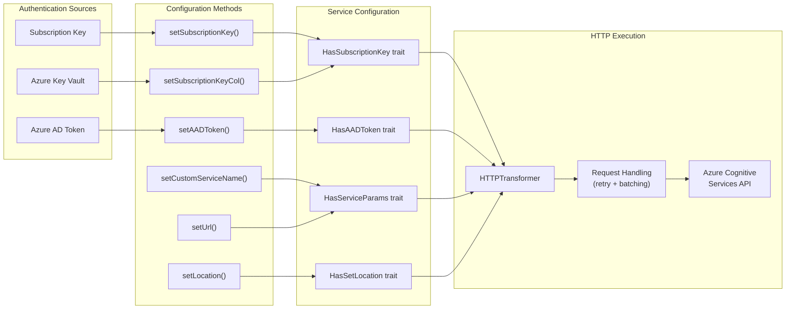
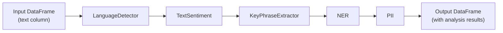
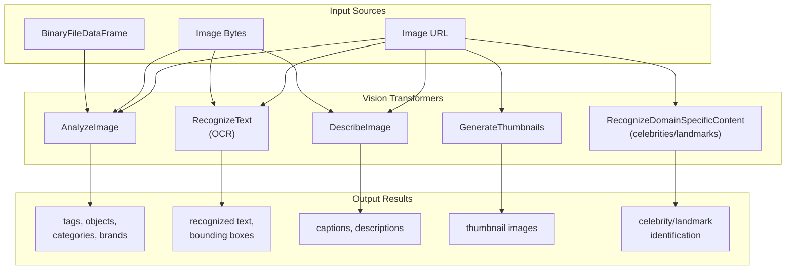
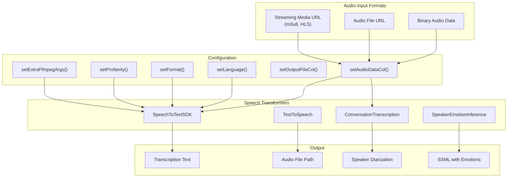
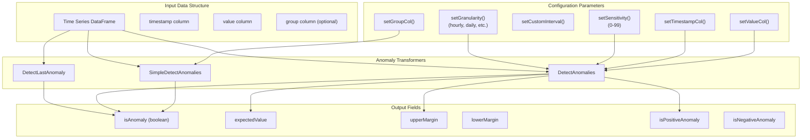
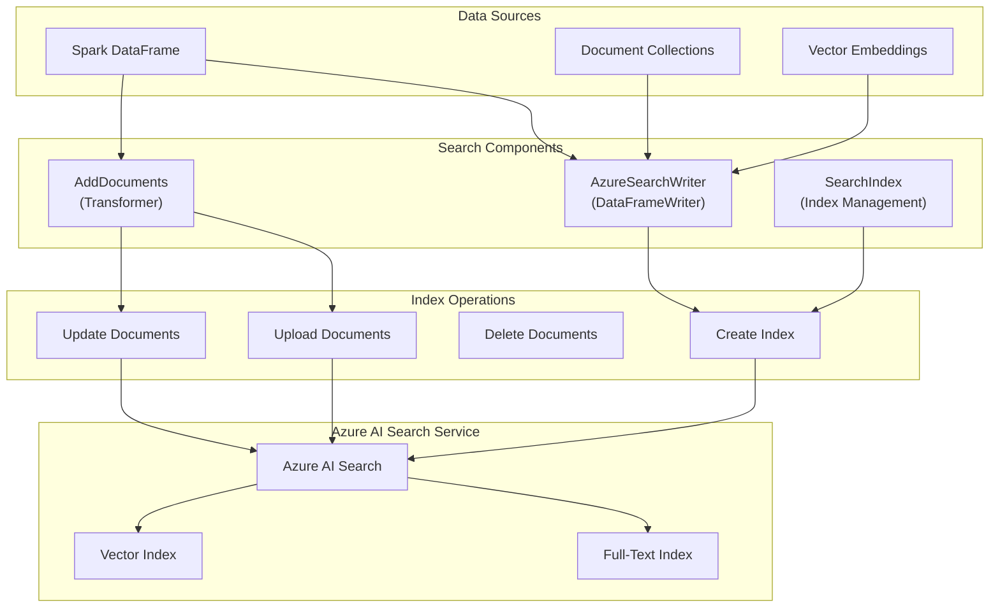
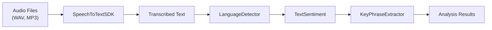
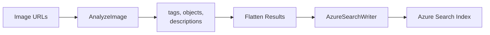
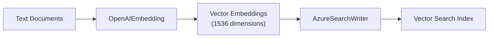

<!-- source: DeepWiki mcp.deepwiki.com · repo microsoft/SynapseML · page 6.2 Azure Cognitive Services · fetched 2026-10-26 -->

# Azure Cognitive Services

<details>
<summary>Relevant source files</summary>

The following files were used as context for generating this wiki page:

- [tools/gateway/setup-gateway.sh](tools/gateway/setup-gateway.sh)

</details>


This page documents SynapseML's integration with Azure Cognitive Services, a collection of pre-trained AI models provided as REST APIs. These integrations enable distributed processing of images, text, speech, and time-series data using Spark DataFrames.

**Note**: Azure Cognitive Services represents the legacy generation of Microsoft's AI services. For newer AI capabilities, including large language models and advanced embeddings, see the [OpenAI Integration](#6.1) page. For LangChain integration, see [LangChain Integration](#6.3).

## Overview

The Azure Cognitive Services integration in SynapseML provides Spark `Transformer` implementations that wrap Azure's REST APIs. Each service is accessible through a Spark-native interface that handles:
- Authentication via subscription keys or Azure AD tokens
- Distributed HTTP request batching and retry logic
- Serialization and deserialization of API payloads
- Error handling and logging

All cognitive services transformers extend from [cognitive/src/main/scala/com/microsoft/azure/synapse/ml/services/CognitiveServicesBase.scala]() and use the HTTP client infrastructure documented in section 5.2.

## Architecture Overview

Azure Cognitive Services integration in SynapseML follows a consistent pattern where each service is wrapped as a Spark transformer that handles authentication, request formation, serialization/deserialization, and error handling.

### Class Hierarchy and Architecture

The following diagram shows the core class hierarchy for Azure Cognitive Services integration:

```mermaid
graph TB
    subgraph "Core Infrastructure"
        CognitiveServicesBase["CognitiveServicesBase<br/>(abstract base)"]
        HasServiceParams["HasServiceParams"]
        HasCognitiveServiceInput["HasCognitiveServiceInput"]
        HasInternalJsonOutputParser["HasInternalJsonOutputParser"]
    end
    
    subgraph "Service-Specific Base Classes"
        TextAnalyticsBase["TextAnalyticsBase"]
        SpeechSDKBase["SpeechSDKBase"]
        AnomalyDetectorBase["AnomalyDetectorBase"]
        VisionBase["VisionBase"]
        SearchBase["SearchBase"]
    end
    
    subgraph "Concrete Service Implementations"
        LanguageDetector["LanguageDetector"]
        TextSentiment["TextSentiment"]
        EntityDetector["EntityDetector"]
        KeyPhraseExtractor["KeyPhraseExtractor"]
        NER["NER"]
        PII["PII"]
        AnalyzeHealthText["AnalyzeHealthText"]
        
        SpeechToTextSDK["SpeechToTextSDK"]
        TextToSpeech["TextToSpeech"]
        ConversationTranscription["ConversationTranscription"]
        
        DetectLastAnomaly["DetectLastAnomaly"]
        DetectAnomalies["DetectAnomalies"]
        SimpleDetectAnomalies["SimpleDetectAnomalies"]
        
        AnalyzeImage["AnalyzeImage"]
        RecognizeText["RecognizeText"]
        DescribeImage["DescribeImage"]
        
        AddDocuments["AddDocuments"]
        AzureSearchWriter["AzureSearchWriter"]
    end
    
    CognitiveServicesBase --> TextAnalyticsBase
    CognitiveServicesBase --> SpeechSDKBase
    CognitiveServicesBase --> AnomalyDetectorBase
    CognitiveServicesBase --> VisionBase
    CognitiveServicesBase --> SearchBase
    
    HasServiceParams --> CognitiveServicesBase
    HasCognitiveServiceInput --> CognitiveServicesBase
    HasInternalJsonOutputParser --> CognitiveServicesBase
    
    TextAnalyticsBase --> LanguageDetector
    TextAnalyticsBase --> TextSentiment
    TextAnalyticsBase --> EntityDetector
    TextAnalyticsBase --> KeyPhraseExtractor
    TextAnalyticsBase --> NER
    TextAnalyticsBase --> PII
    TextAnalyticsBase --> AnalyzeHealthText
    
    SpeechSDKBase --> SpeechToTextSDK
    SpeechSDKBase --> TextToSpeech
    SpeechSDKBase --> ConversationTranscription
    
    AnomalyDetectorBase --> DetectLastAnomaly
    AnomalyDetectorBase --> DetectAnomalies
    AnomalyDetectorBase --> SimpleDetectAnomalies
    
    VisionBase --> AnalyzeImage
    VisionBase --> RecognizeText
    VisionBase --> DescribeImage
    
    SearchBase --> AddDocuments
    SearchBase --> AzureSearchWriter
```



**Key Classes**:
- `CognitiveServicesBase`: Abstract base providing HTTP client integration, authentication, and retry logic
- `HasServiceParams`: Trait for subscription key, AAD token, and location parameters
- `TextAnalyticsBase`: Base for all text analytics services
- `SpeechSDKBase`: Base for speech services using Azure Speech SDK
- `AnomalyDetectorBase`: Base for anomaly detection services
- `VisionBase`: Base for computer vision services
- `SearchBase`: Base for Azure AI Search integration

Sources: [cognitive/src/main/scala/com/microsoft/azure/synapse/ml/services/CognitiveServicesBase.scala](), [cognitive/src/main/scala/com/microsoft/azure/synapse/ml/services/text/TextAnalytics.scala](), [cognitive/src/main/scala/com/microsoft/azure/synapse/ml/services/speech/SpeechToTextSDK.scala](), [cognitive/src/main/scala/com/microsoft/azure/synapse/ml/services/anomaly/AnomalyDetector.scala](), [cognitive/src/main/scala/com/microsoft/azure/synapse/ml/services/vision/AnalyzeImage.scala](), [cognitive/src/main/scala/com/microsoft/azure/synapse/ml/services/search/AzureSearch.scala]()

### Authentication and Configuration

The following diagram shows how authentication and service configuration flow through the system:



**Authentication Methods**:

1. **Subscription Key**: Set via `setSubscriptionKey(key)` or `setSubscriptionKeyCol(colName)` for per-row keys
2. **Azure AD Token**: Set via `setAADToken(token)` for AAD-based authentication
3. **Key Vault Integration**: Use column-based keys retrieved from Azure Key Vault (see section 5.4)

**Configuration Parameters**:

| Parameter | Method | Description |
|-----------|--------|-------------|
| Subscription Key | `setSubscriptionKey()` | API subscription key |
| AAD Token | `setAADToken()` | Azure AD authentication token |
| Location | `setLocation()` | Azure region (e.g., "eastus") |
| Custom Service Name | `setCustomServiceName()` | Custom domain name for private endpoints |
| URL | `setUrl()` | Full custom endpoint URL |

Sources: [cognitive/src/main/scala/com/microsoft/azure/synapse/ml/services/CognitiveServicesBase.scala](), [cognitive/src/test/scala/com/microsoft/azure/synapse/ml/services/anomaly/AnamolyDetectionSuite.scala:90-105](), [cognitive/src/test/scala/com/microsoft/azure/synapse/ml/services/text/TextAnalyticsSuite.scala:48-51]()

## Supported Services

SynapseML provides `Transformer` implementations for the following Azure Cognitive Services:

| Service Category | Transformer Classes | Key Methods | Description |
|------------------|---------------------|-------------|-------------|
| **Text Analytics** | `LanguageDetector`<br/>`EntityDetector`<br/>`TextSentiment`<br/>`KeyPhraseExtractor`<br/>`NER`<br/>`PII`<br/>`AnalyzeHealthText` | `setTextCol()`<br/>`setLanguageCol()`<br/>`setOutputCol()` | Language detection, entity extraction, sentiment analysis, key phrase extraction, named entity recognition, PII detection and redaction, healthcare text analysis |
| **Computer Vision** | `AnalyzeImage`<br/>`RecognizeText`<br/>`DescribeImage`<br/>`GenerateThumbnails`<br/>`RecognizeDomainSpecificContent` | `setImageUrlCol()`<br/>`setImageBytesCol()`<br/>`setOutputCol()` | Image analysis, OCR, image description, thumbnail generation, celebrity/landmark recognition |
| **Speech Services** | `SpeechToTextSDK`<br/>`TextToSpeech`<br/>`ConversationTranscription`<br/>`SpeakerEmotionInference` | `setAudioDataCol()`<br/>`setOutputFileCol()`<br/>`setLanguage()` | Speech-to-text transcription, text-to-speech synthesis, multi-speaker conversation transcription, emotion inference |
| **Anomaly Detection** | `DetectLastAnomaly`<br/>`DetectAnomalies`<br/>`SimpleDetectAnomalies` | `setGranularity()`<br/>`setSensitivity()`<br/>`setOutputCol()` | Time series anomaly detection for single points, entire series, or grouped data |
| **Azure AI Search** | `AddDocuments`<br/>`AzureSearchWriter`<br/>`SearchIndex` | `write()`<br/>`setIndexName()`<br/>`setKeyCol()` | Document indexing, vector search, schema inference, index management |

Sources: [cognitive/src/main/scala/com/microsoft/azure/synapse/ml/services/text/TextAnalytics.scala](), [cognitive/src/main/scala/com/microsoft/azure/synapse/ml/services/vision/AnalyzeImage.scala](), [cognitive/src/main/scala/com/microsoft/azure/synapse/ml/services/speech/SpeechToTextSDK.scala](), [cognitive/src/main/scala/com/microsoft/azure/synapse/ml/services/anomaly/AnomalyDetector.scala](), [cognitive/src/main/scala/com/microsoft/azure/synapse/ml/services/search/AzureSearch.scala](), [cognitive/src/test/scala/com/microsoft/azure/synapse/ml/services/text/TextAnalyticsSuite.scala:1-371](), [cognitive/src/test/scala/com/microsoft/azure/synapse/ml/services/speech/SpeechToTextSDKSuite.scala:1-487](), [cognitive/src/test/scala/com/microsoft/azure/synapse/ml/services/anomaly/AnamolyDetectionSuite.scala:1-251]()

### Text Analytics

The `TextAnalyticsBase` class provides the foundation for all text analytics services. Each concrete implementation extends this base and provides specific NLP capabilities.

#### Text Analytics Pipeline



**Available Transformers**:

| Class | Purpose | Key Output Fields |
|-------|---------|-------------------|
| `LanguageDetector` | Detects input text language | `language`, `score` |
| `TextSentiment` | Analyzes sentiment | `sentiment`, `positive`, `neutral`, `negative` |
| `EntityDetector` | Extracts general entities | `entities` (array of entity objects) |
| `KeyPhraseExtractor` | Extracts key phrases | `keyPhrases` (array of strings) |
| `NER` | Named entity recognition | `entities` with categories (Person, Location, etc.) |
| `PII` | Detects PII and redacts | `redactedText`, `entities` |
| `AnalyzeHealthText` | Healthcare entity extraction | `entities`, `relations` |

**Configuration Example**:

The following shows a typical configuration for `TextSentiment`:

```scala
import com.microsoft.azure.synapse.ml.services.text.TextSentiment

val sentiment = new TextSentiment()
  .setSubscriptionKey(cognitiveKey)
  .setLocation("eastus")
  .setTextCol("text")
  .setLanguageCol("language")
  .setOutputCol("sentiment")
  .setErrorCol("error")

val results = sentiment.transform(inputDF)
```

Sources: [cognitive/src/main/scala/com/microsoft/azure/synapse/ml/services/text/TextAnalytics.scala](), [cognitive/src/test/scala/com/microsoft/azure/synapse/ml/services/text/TextAnalyticsSuite.scala:1-371](), [cognitive/src/test/scala/com/microsoft/azure/synapse/ml/services/text/TextAnalyticsSuite.scala:122-128]()

### Computer Vision

The `VisionBase` class provides image analysis capabilities through Azure Computer Vision API.

#### Computer Vision Services Flow



**Configuration Example**:

```scala
import com.microsoft.azure.synapse.ml.services.vision.AnalyzeImage

val vision = new AnalyzeImage()
  .setSubscriptionKey(visionKey)
  .setLocation("eastus")
  .setImageUrlCol("url")
  .setOutputCol("analysis")
  .setVisualFeatures(Array(
    "Categories", "Tags", "Description", 
    "Objects", "Brands", "Color", "Adult"
  ))

val imageAnalysis = vision.transform(imageDF)
```

Sources: [cognitive/src/main/scala/com/microsoft/azure/synapse/ml/services/vision/AnalyzeImage.scala](), [cognitive/src/main/scala/com/microsoft/azure/synapse/ml/services/vision/VisionBase.scala]()

### Speech Services

The `SpeechSDKBase` class integrates with Azure Speech SDK for audio processing.

#### Speech Services Architecture



**Key Features**:
- `SpeechToTextSDK`: Transcribes audio with custom models via `setEndpointId()`
- `TextToSpeech`: Synthesizes speech with voice selection via `setVoiceName()`
- `ConversationTranscription`: Multi-speaker diarization with speaker IDs
- `SpeakerEmotionInference`: Generates emotion-tagged SSML from text

**Streaming Media Support**:

For streaming URLs (HLS, m3u8), use `setExtraFfmpegArgs()` to control ffmpeg behavior:

```scala
val speechToText = new SpeechToTextSDK()
  .setSubscriptionKey(speechKey)
  .setLocation("eastus")
  .setAudioDataCol("audioUrl")
  .setExtraFfmpegArgs(Array("-t", "60"))  // Process first 60 seconds
  .setOutputCol("transcription")
```

Sources: [cognitive/src/main/scala/com/microsoft/azure/synapse/ml/services/speech/SpeechToTextSDK.scala](), [cognitive/src/main/scala/com/microsoft/azure/synapse/ml/services/speech/SpeechSDKBase.scala](), [cognitive/src/test/scala/com/microsoft/azure/synapse/ml/services/speech/SpeechToTextSDKSuite.scala:225-232](), [cognitive/src/test/scala/com/microsoft/azure/synapse/ml/services/speech/SpeechToTextSDKSuite.scala:250-261](), [cognitive/src/test/scala/com/microsoft/azure/synapse/ml/services/speech/TextToSpeechSuite.scala:1-72]()


### Anomaly Detection

The `AnomalyDetectorBase` class provides time series anomaly detection using Azure's Anomaly Detector service.

#### Anomaly Detection Workflow



**Configuration Example**:

```scala
import com.microsoft.azure.synapse.ml.services.anomaly.DetectAnomalies

val anomalyDetector = new DetectAnomalies()
  .setSubscriptionKey(anomalyKey)
  .setLocation("westus2")
  .setTimestampCol("timestamp")
  .setValueCol("value")
  .setGranularity("hourly")
  .setSensitivity(95)
  .setOutputCol("anomalies")

val results = anomalyDetector.transform(timeSeriesDF)
```

**Use Cases**:
- `DetectLastAnomaly`: Real-time monitoring of the most recent data point
- `DetectAnomalies`: Batch analysis of historical time series
- `SimpleDetectAnomalies`: Group-wise anomaly detection for multiple time series

Sources: [cognitive/src/main/scala/com/microsoft/azure/synapse/ml/services/anomaly/AnomalyDetector.scala](), [cognitive/src/test/scala/com/microsoft/azure/synapse/ml/services/anomaly/AnamolyDetectionSuite.scala:1-251](), [cognitive/src/test/scala/com/microsoft/azure/synapse/ml/services/anomaly/AnamolyDetectionSuite.scala:90-105]()

### Azure AI Search

The `SearchBase` class and `AzureSearchWriter` enable integration with Azure AI Search (formerly Azure Cognitive Search) for document indexing and vector search.

#### Azure Search Integration Architecture



**Key Components**:

| Component | Purpose | Usage |
|-----------|---------|-------|
| `AddDocuments` | Transformer for adding/updating documents | `new AddDocuments().setActionCol("indexAction")` |
| `AzureSearchWriter` | DataFrame writer for batch indexing | `df.write.format("com.microsoft.azure.synapse.ml.services.search").mode("append")` |
| `SearchIndex` | Index schema management | `new SearchIndex().createIfNoneExists(serviceName, indexName, schema)` |

**Vector Search Configuration**:

```scala
import com.microsoft.azure.synapse.ml.services.search.AzureSearchWriter

val vectorCols = """[
  {"name": "contentVector", "dimension": 1536},
  {"name": "titleVector", "dimension": 1536}
]"""

AzureSearchWriter.write(
  df,
  Map(
    "subscriptionKey" -> searchKey,
    "serviceName" -> serviceName,
    "indexName" -> indexName,
    "keyCol" -> "id",
    "vectorCols" -> vectorCols
  )
)
```

**Schema Inference**:

The writer automatically infers schema from DataFrame structure, mapping Spark types to Azure Search field types. Vector columns must be explicitly configured via the `vectorCols` parameter.

Sources: [cognitive/src/main/scala/com/microsoft/azure/synapse/ml/services/search/AzureSearch.scala](), [cognitive/src/test/scala/com/microsoft/azure/synapse/ml/services/search/SearchWriterSuite.scala:1-707](), [cognitive/src/test/scala/com/microsoft/azure/synapse/ml/services/search/SearchWriterSuite.scala:525-532](), [cognitive/src/test/scala/com/microsoft/azure/synapse/ml/services/search/SearchWriterSuite.scala:675-706]()

## Usage Patterns

### Basic Transformer Pattern

All Cognitive Services transformers follow the Spark `Transformer` pattern:

1. Instantiate the transformer class
2. Configure authentication (subscription key or AAD token)
3. Set input/output column names
4. Call `transform()` on a DataFrame

**Example with `TextSentiment`**:

```scala
import com.microsoft.azure.synapse.ml.services.text.TextSentiment
import org.apache.spark.sql.functions.col

// Create input DataFrame
val textDF = Seq(
  ("en", "This is a great product!"),
  ("en", "I am very disappointed.")
).toDF("language", "text")

// Configure transformer
val sentiment = new TextSentiment()
  .setSubscriptionKey(cognitiveServicesKey)
  .setLocation("eastus")
  .setTextCol("text")
  .setLanguageCol("language")
  .setOutputCol("sentiment")
  .setErrorCol("error")

// Transform DataFrame
val results = sentiment.transform(textDF)
  .select("text", "sentiment.document.sentiment", "sentiment.document.confidenceScores")

results.show()
```

The output DataFrame includes the original columns plus new columns for results and errors (if `setErrorCol()` was called).

Sources: [cognitive/src/test/scala/com/microsoft/azure/synapse/ml/services/text/TextAnalyticsSuite.scala:122-128](), [cognitive/src/main/scala/com/microsoft/azure/synapse/ml/services/text/TextAnalytics.scala]()

### Authentication Patterns

**Static Subscription Key**:

```scala
val transformer = new LanguageDetector()
  .setSubscriptionKey(cognitiveKey)
  .setLocation("eastus")
  .setTextCol("text")
  .setOutputCol("language")
```

**Per-Row Subscription Keys** (from DataFrame column):

```scala
val transformer = new TextSentiment()
  .setSubscriptionKeyCol("apiKey")  // Column name containing keys
  .setLocation("eastus")
  .setTextCol("text")
  .setOutputCol("sentiment")
```

This is useful when processing data from multiple cognitive services accounts or when keys are stored per-tenant.

**Azure AD Token Authentication**:

```scala
val transformer = new DetectAnomalies()
  .setAADToken(azureAdToken)
  .setLocation("westus2")
  .setTimestampCol("ts")
  .setValueCol("value")
  .setOutputCol("anomalies")
```

**Custom Endpoints**:

For private endpoints or custom domains:

```scala
val transformer = new TextSentiment()
  .setSubscriptionKey(key)
  .setUrl("https://my-custom-endpoint.cognitiveservices.azure.com/")
  .setTextCol("text")
  .setOutputCol("sentiment")
```

Sources: [cognitive/src/test/scala/com/microsoft/azure/synapse/ml/services/text/TextAnalyticsSuite.scala:48-51](), [cognitive/src/test/scala/com/microsoft/azure/synapse/ml/services/anomaly/AnamolyDetectionSuite.scala:91-98](), [cognitive/src/main/scala/com/microsoft/azure/synapse/ml/services/CognitiveServicesBase.scala]()

### Input Data Types

Different services accept different input formats:

**Text Services** (columns containing strings):

```scala
val df = Seq(
  "Hello world",
  "Azure Cognitive Services are great"
).toDF("text")

new KeyPhraseExtractor()
  .setTextCol("text")
  .transform(df)
```

**Vision Services** (image URLs or binary data):

```scala
// From URLs
val imageUrls = Seq(
  "https://example.com/image1.jpg",
  "https://example.com/image2.jpg"
).toDF("imageUrl")

new AnalyzeImage()
  .setImageUrlCol("imageUrl")
  .transform(imageUrls)

// From binary data (using BinaryFileDataFrame)
val images = spark.read.format("binaryFile")
  .load("path/to/images/*.jpg")

new AnalyzeImage()
  .setImageBytesCol("content")
  .transform(images)
```

**Speech Services** (audio URLs, binary data, or streaming):

```scala
// Audio file URL
val audioUrl = Seq("https://example.com/audio.wav").toDF("audioUrl")

new SpeechToTextSDK()
  .setAudioDataCol("audioUrl")
  .transform(audioUrl)

// Streaming media (HLS)
val streamUrl = Seq("http://stream.example.com/live.m3u8").toDF("streamUrl")

new SpeechToTextSDK()
  .setAudioDataCol("streamUrl")
  .setExtraFfmpegArgs(Array("-t", "60"))  // Process 60 seconds
  .transform(streamUrl)
```

**Anomaly Detection** (time series with timestamp and value):

```scala
val timeSeries = Seq(
  ("2023-01-01T00:00:00Z", 10.5),
  ("2023-01-01T01:00:00Z", 12.3),
  ("2023-01-01T02:00:00Z", 45.7)  // Anomaly
).toDF("timestamp", "value")

new DetectAnomalies()
  .setTimestampCol("timestamp")
  .setValueCol("value")
  .transform(timeSeries)
```

Sources: [cognitive/src/test/scala/com/microsoft/azure/synapse/ml/services/speech/SpeechToTextSDKSuite.scala:225-232](), [cognitive/src/test/scala/com/microsoft/azure/synapse/ml/services/speech/SpeechToTextSDKSuite.scala:250-261](), [cognitive/src/main/scala/com/microsoft/azure/synapse/ml/services/vision/AnalyzeImage.scala]()

### Batching Strategies

Azure Cognitive Services APIs have rate limits and quota constraints. SynapseML provides batching mechanisms to optimize throughput.

**Automatic Internal Batching**:

Most transformers automatically batch requests internally. Control batch size via `setConcurrency()`:

```scala
val sentiment = new TextSentiment()
  .setSubscriptionKey(key)
  .setConcurrency(10)  // Process 10 concurrent requests
  .setTextCol("text")
  .setOutputCol("sentiment")
```

**DataFrame-Level Batching with `FixedMiniBatchTransformer`**:

For explicit control over batch boundaries:

```scala
import com.microsoft.azure.synapse.ml.stages.FixedMiniBatchTransformer

// Create mini-batches of 10 rows each
val batchedDF = new FixedMiniBatchTransformer()
  .setBatchSize(10)
  .transform(inputDF)

// Process batches
val results = new TextSentiment()
  .setSubscriptionKey(key)
  .setTextCol("text")
  .setOutputCol("sentiment")
  .transform(batchedDF)
  .withColumn("result", explode(col("sentiment")))
```

**Coalescing Partitions**:

Reduce partition count to increase batch sizes:

```scala
val results = textAnalyzer.transform(largeDF.coalesce(10))
```

This is useful when you have many small partitions and want to increase effective batch sizes.

Sources: [cognitive/src/test/scala/com/microsoft/azure/synapse/ml/services/text/TextAnalyticsSuite.scala:148-155](), [core/src/main/scala/com/microsoft/azure/synapse/ml/stages/MiniBatchTransformer.scala]()

### Error Handling

Use `setErrorCol()` to capture errors without failing the entire job:

```scala
import org.apache.spark.sql.functions.col

val sentiment = new TextSentiment()
  .setSubscriptionKey(key)
  .setLocation("eastus")
  .setTextCol("text")
  .setOutputCol("sentiment")
  .setErrorCol("error")  // Capture errors here

val results = sentiment.transform(inputDF)

// Separate successful and failed rows
val successful = results.filter(col("error").isNull)
val failed = results.filter(col("error").isNotNull)

// Inspect errors
failed.select("text", "error.message", "error.statusCode").show()
```

**Error Structure**:

The error column contains:
- `message`: Error message text
- `statusCode`: HTTP status code (e.g., 429 for rate limiting, 401 for auth failure)
- `error`: Full error response from the API

**Retry Logic**:

The HTTP client infrastructure (see section 5.2) automatically retries transient failures (5xx errors, timeouts). Configure retry behavior via:

```scala
val transformer = new TextSentiment()
  .setSubscriptionKey(key)
  .setBackoffs(Array(100, 500, 1000))  // Retry with backoffs in ms
  .setMaxRetries(3)
```

Sources: [cognitive/src/test/scala/com/microsoft/azure/synapse/ml/services/speech/TextToSpeechSuite.scala:38-42](), [cognitive/src/main/scala/com/microsoft/azure/synapse/ml/services/CognitiveServicesBase.scala]()

## Multi-Service Pipeline Examples

### Speech-to-Text with Text Analytics

Transcribe audio and analyze the resulting text:



**Implementation**:

```scala
// Step 1: Transcribe audio
val transcription = new SpeechToTextSDK()
  .setSubscriptionKey(speechKey)
  .setLocation("eastus")
  .setAudioDataCol("audioUrl")
  .setOutputCol("transcription")
  .transform(audioDF)
  .select("audioUrl", "transcription.DisplayText")
  .withColumnRenamed("DisplayText", "text")

// Step 2: Detect language
val withLanguage = new LanguageDetector()
  .setSubscriptionKey(textKey)
  .setLocation("eastus")
  .setTextCol("text")
  .setOutputCol("language")
  .transform(transcription)

// Step 3: Analyze sentiment
val withSentiment = new TextSentiment()
  .setSubscriptionKey(textKey)
  .setLocation("eastus")
  .setTextCol("text")
  .setLanguageCol("language")
  .setOutputCol("sentiment")
  .transform(withLanguage)

// Step 4: Extract key phrases
val results = new KeyPhraseExtractor()
  .setSubscriptionKey(textKey)
  .setLocation("eastus")
  .setTextCol("text")
  .setLanguageCol("language")
  .setOutputCol("keyPhrases")
  .transform(withSentiment)
```

Sources: [cognitive/src/test/scala/com/microsoft/azure/synapse/ml/services/speech/SpeechToTextSDKSuite.scala:286-304]()

### Image Analysis with Search Indexing

Analyze images and index results for search:



**Implementation**:

```scala
import org.apache.spark.sql.functions._

// Step 1: Analyze images
val analyzed = new AnalyzeImage()
  .setSubscriptionKey(visionKey)
  .setLocation("eastus")
  .setImageUrlCol("url")
  .setOutputCol("analysis")
  .setVisualFeatures(Array("Tags", "Description", "Objects"))
  .transform(imageDF)

// Step 2: Flatten results
val flattened = analyzed
  .select(
    col("url").as("id"),
    col("url"),
    col("analysis.description.captions")(0)("text").as("description"),
    col("analysis.tags.name").as("tags")
  )

// Step 3: Index in Azure Search
AzureSearchWriter.write(
  flattened,
  Map(
    "subscriptionKey" -> searchKey,
    "serviceName" -> searchServiceName,
    "indexName" -> "image-index",
    "keyCol" -> "id"
  )
)
```

Sources: [cognitive/src/test/scala/com/microsoft/azure/synapse/ml/services/search/SearchWriterSuite.scala:448-475]()

### OpenAI Embeddings with Vector Search

Generate embeddings using OpenAI and store in Azure Search (see section 6.1 for OpenAI details):



**Implementation**:

```scala
// Step 1: Generate embeddings (requires OpenAI key)
val embeddings = new OpenAIEmbedding()
  .setSubscriptionKey(openaiKey)
  .setDeploymentName("text-embedding-ada-002")
  .setTextCol("text")
  .setOutputCol("embedding")
  .transform(textDF)

// Step 2: Index with vector search
val vectorConfig = """[
  {"name": "embedding", "dimension": 1536}
]"""

AzureSearchWriter.write(
  embeddings,
  Map(
    "subscriptionKey" -> searchKey,
    "serviceName" -> searchServiceName,
    "indexName" -> "vector-index",
    "keyCol" -> "id",
    "vectorCols" -> vectorConfig
  )
)
```

Sources: [cognitive/src/test/scala/com/microsoft/azure/synapse/ml/services/search/SearchWriterSuite.scala:675-706]()

## Advanced Configuration

### Custom Endpoints and Private Links

For private endpoints or custom domains:

```scala
// Option 1: Custom service name
new TextSentiment()
  .setSubscriptionKey(key)
  .setLocation("eastus")
  .setCustomServiceName("my-text-analytics")  // Resolves to my-text-analytics.cognitiveservices.azure.com
  .setTextCol("text")
  .setOutputCol("sentiment")

// Option 2: Full custom URL
new TextSentiment()
  .setSubscriptionKey(key)
  .setUrl("https://my-private-endpoint.privatelink.cognitiveservices.azure.com/")
  .setTextCol("text")
  .setOutputCol("sentiment")
```

### Custom Models and Endpoints

**Speech Services with Custom Models**:

```scala
val speechToText = new SpeechToTextSDK()
  .setSubscriptionKey(customSpeechKey)
  .setLocation("eastus")
  .setEndpointId("custom-model-endpoint-id")  // Your custom speech model
  .setAudioDataCol("audio")
  .setOutputCol("transcription")
```

**Computer Vision with Custom Models**:

```scala
val customVision = new AnalyzeImage()
  .setSubscriptionKey(customVisionKey)
  .setUrl("https://my-custom-vision.cognitiveservices.azure.com/")
  .setImageUrlCol("imageUrl")
  .setOutputCol("analysis")
```

Sources: [cognitive/src/test/scala/com/microsoft/azure/synapse/ml/services/speech/SpeechToTextSDKSuite.scala:152-155](), [cognitive/src/main/scala/com/microsoft/azure/synapse/ml/services/CognitiveServicesBase.scala]()

### Output File Handling

**Saving Generated Audio Files**:

```scala
val textToSpeech = new TextToSpeech()
  .setSubscriptionKey(speechKey)
  .setLocation("eastus")
  .setTextCol("text")
  .setVoiceName("en-US-JennyNeural")
  .setOutputFileCol("audioPath")  // Save to file system

val results = textToSpeech.transform(textDF)
// Results include "audioPath" column with file paths
```

**Saving Transcription Results**:

```scala
val speechToText = new SpeechToTextSDK()
  .setSubscriptionKey(speechKey)
  .setLocation("eastus")
  .setAudioDataCol("audioUrl")
  .setRecordAudioData(true)  // Save processed audio
  .setRecordedFileNameCol("processedAudio")
  .setOutputCol("transcription")
```

### Vector Search Schema Configuration

Configure multiple vector columns with different dimensions:

```scala
val vectorSchema = """[
  {"name": "titleVector", "dimension": 1536, "type": "Collection(Edm.Single)"},
  {"name": "contentVector", "dimension": 1536, "type": "Collection(Edm.Single)"},
  {"name": "smallVector", "dimension": 384, "type": "Collection(Edm.Single)"}
]"""

AzureSearchWriter.write(
  df,
  Map(
    "subscriptionKey" -> searchKey,
    "serviceName" -> serviceName,
    "indexName" -> indexName,
    "keyCol" -> "id",
    "vectorCols" -> vectorSchema,
    "vectorFilterable" -> "true"  // Enable filtering on vectors
  )
)
```

Sources: [cognitive/src/test/scala/com/microsoft/azure/synapse/ml/services/search/SearchWriterSuite.scala:525-532]()

## Performance Considerations

- Use batching for better throughput when processing large datasets
- Consider record size limits when batching
- Set appropriate timeout values for larger files or complex operations
- For streaming media, use the `setExtraFfmpegArgs` parameter to limit processing time
- Use the record functions for audio data to save processed files

Sources: [cognitive/src/test/scala/com/microsoft/azure/synapse/ml/services/speech/SpeechToTextSDKSuite.scala:270-279](), [cognitive/src/test/scala/com/microsoft/azure/synapse/ml/services/text/TextAnalyticsSuite.scala:148-155]()

---

