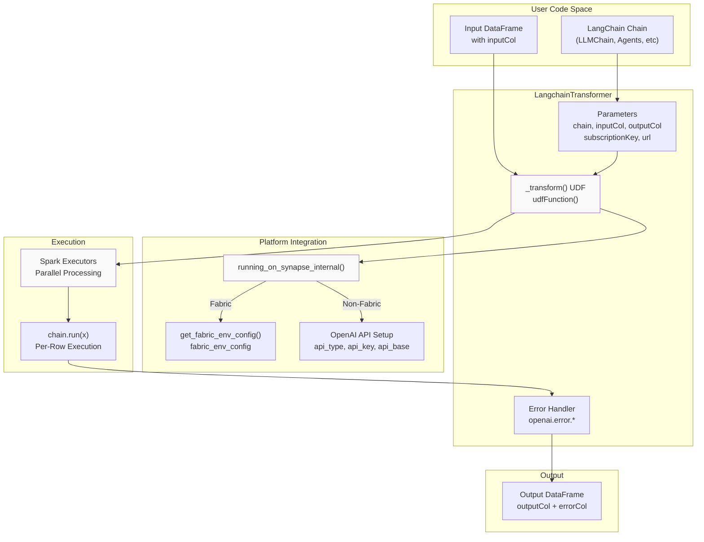
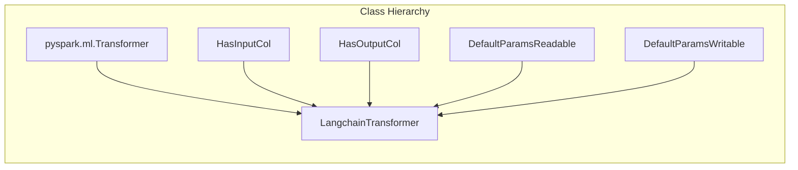
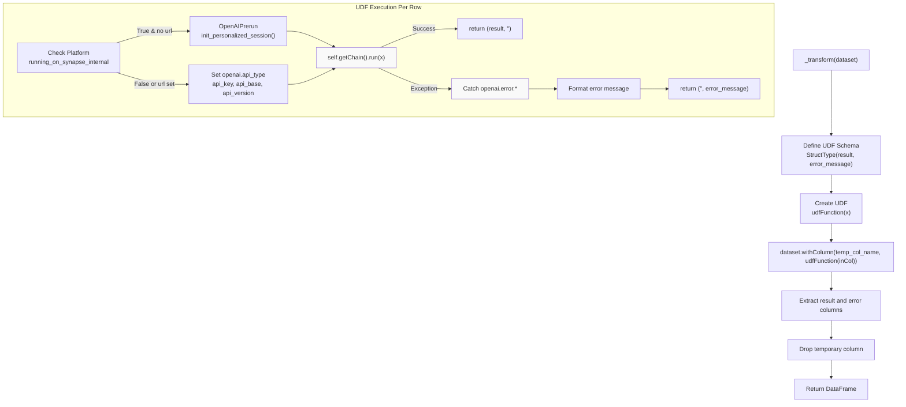
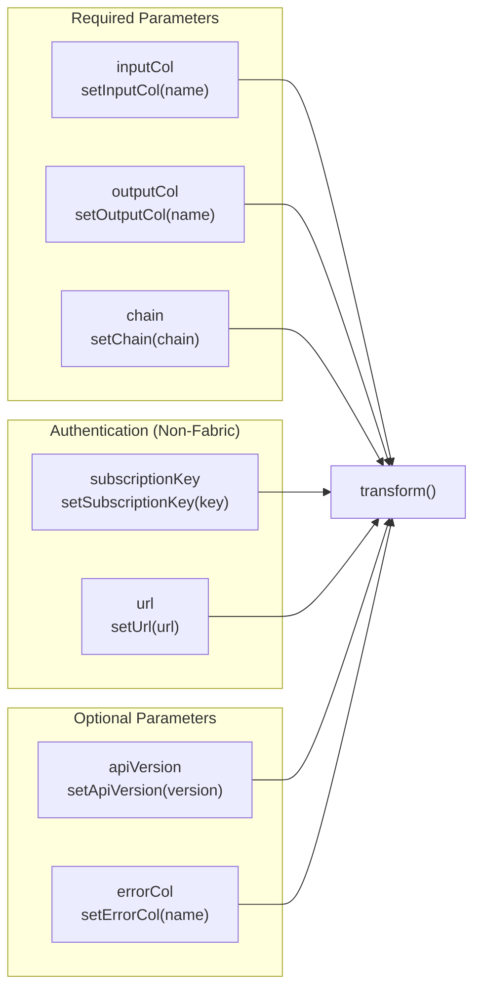
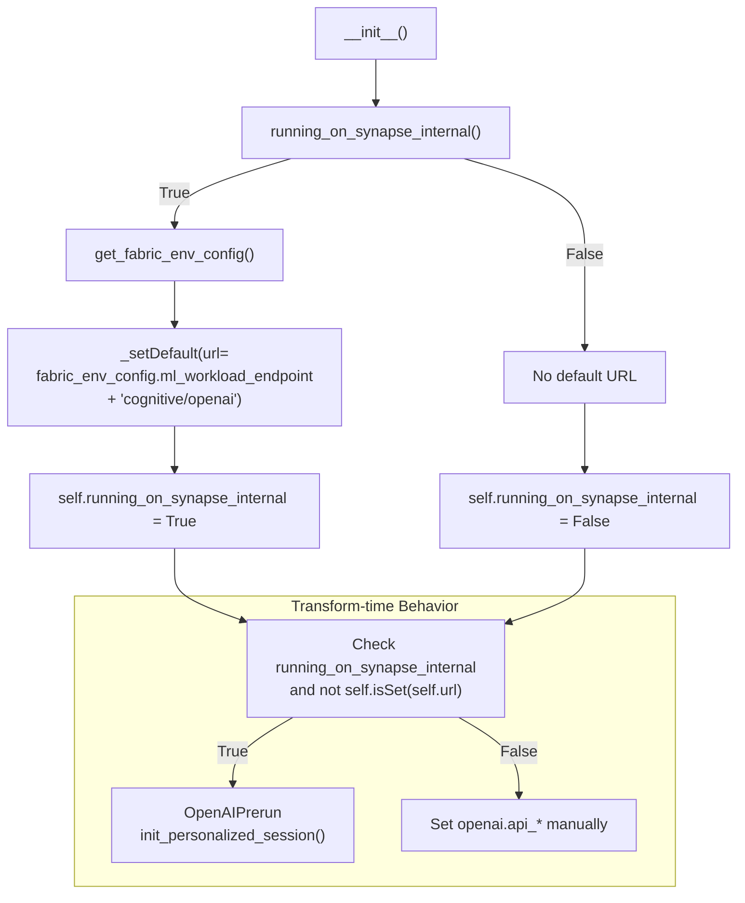
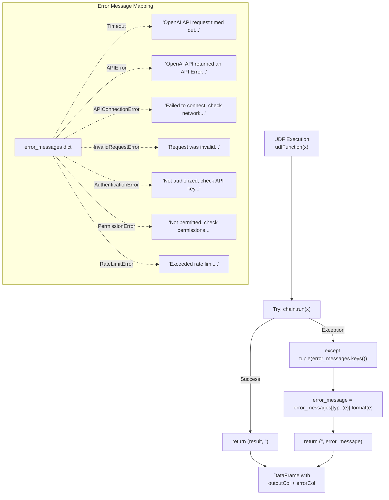
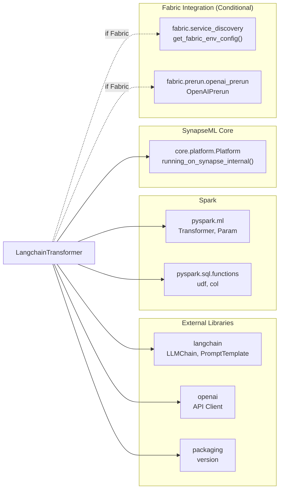

<!-- source: DeepWiki mcp.deepwiki.com · repo microsoft/SynapseML · page 6.3 LangChain Integration · fetched 2026-10-26 -->

# LangChain Integration

Relevant source files

The following files were used as context for generating this wiki page:

- [cognitive/src/main/python/synapse/ml/services/langchain/LangchainTransform.py](cognitive/src/main/python/synapse/ml/services/langchain/LangchainTransform.py)
- [cognitive/src/test/python/synapsemltest/services/langchain/test_LangchainTransform.py](cognitive/src/test/python/synapsemltest/services/langchain/test_LangchainTransform.py)
- [cognitive/src/test/python/synapsemltest/services/test_simple.py](cognitive/src/test/python/synapsemltest/services/test_simple.py)
- [core/src/main/python/synapse/ml/core/init_spark.py](core/src/main/python/synapse/ml/core/init_spark.py)
- [core/src/main/python/synapse/ml/core/logging/SynapseMLLogger.py](core/src/main/python/synapse/ml/core/logging/SynapseMLLogger.py)
- [core/src/main/python/synapse/ml/core/logging/__init__.py](core/src/main/python/synapse/ml/core/logging/__init__.py)
- [core/src/main/python/synapse/ml/core/platform/Platform.py](core/src/main/python/synapse/ml/core/platform/Platform.py)
- [core/src/test/python/synapsemltest/core/test_logging.py](core/src/test/python/synapsemltest/core/test_logging.py)
- [core/src/test/python/synapsemltest/core/test_template.py](core/src/test/python/synapsemltest/core/test_template.py)
- [docs/Get Started/Set up Cognitive Services.ipynb](docs/Get Started/Set up Cognitive Services.ipynb)

## Purpose and Scope

The LangChain Integration provides a Spark-native transformer that enables distributed execution of [LangChain](https://python.langchain.com/) chains across large datasets using Apache Spark DataFrames. This integration allows users to apply pre-configured LangChain chains (such as prompt templates, LLM chains, and agents) to each row of a DataFrame in parallel, leveraging Spark's distributed computing capabilities.

This page covers the `LangchainTransformer` implementation, its architecture, platform integration, and usage patterns. For Azure OpenAI services integration without LangChain, see [OpenAI Integration](#6.1). For general cognitive services, see [Azure Cognitive Services](#6.2).

## Architecture Overview

The LangChain integration is built around a single transformer class that wraps LangChain chains and executes them as Spark UDFs. The transformer handles platform-specific configuration, error management, and serialization.

Sources: [cognitive/src/main/python/synapse/ml/services/langchain/LangchainTransform.py:1-296]()

## Core Components

### LangchainTransformer Class

The `LangchainTransformer` class is the primary interface for LangChain integration. It extends Spark ML's `Transformer` base class and implements parameter management for chain configuration.

**Key Parameters:**
- `chain`: The LangChain chain object to execute [cognitive/src/main/python/synapse/ml/services/langchain/LangchainTransform.py:125-129]()
- `inputCol`: Column name containing input data [cognitive/src/main/python/synapse/ml/services/langchain/LangchainTransform.py:195-199]()
- `outputCol`: Column name for chain results [cognitive/src/main/python/synapse/ml/services/langchain/LangchainTransform.py:201-205]()
- `subscriptionKey`: Azure OpenAI API key [cognitive/src/main/python/synapse/ml/services/langchain/LangchainTransform.py:130]()
- `url`: Azure OpenAI API base URL [cognitive/src/main/python/synapse/ml/services/langchain/LangchainTransform.py:131]()
- `apiVersion`: OpenAI API version (default: "2022-12-01") [cognitive/src/main/python/synapse/ml/services/langchain/LangchainTransform.py:52]()
- `errorCol`: Column name for error messages [cognitive/src/main/python/synapse/ml/services/langchain/LangchainTransform.py:134]()

Sources: [cognitive/src/main/python/synapse/ml/services/langchain/LangchainTransform.py:110-219]()

### Transform Execution Flow

The `_transform()` method implements the core execution logic using a Spark UDF that applies the chain to each row:

Sources: [cognitive/src/main/python/synapse/ml/services/langchain/LangchainTransform.py:220-284]()

## Usage Patterns

### Basic Usage

A typical usage pattern involves creating a LangChain chain and wrapping it with `LangchainTransformer`:

| Step | Component | Description |
|------|-----------|-------------|
| 1 | Create LLM | Initialize `AzureChatOpenAI` or similar LangChain LLM |
| 2 | Create Prompt | Define `PromptTemplate` with input variables |
| 3 | Create Chain | Build `LLMChain(llm=llm, prompt=prompt)` |
| 4 | Create Transformer | Initialize `LangchainTransformer()` with parameters |
| 5 | Transform | Call `transformer.transform(dataframe)` |

**Example from test suite:**
The test creates a simple copy chain that repeats input text:
- LLM: `AzureChatOpenAI` with deployment "gpt-4o" [cognitive/src/test/python/synapsemltest/services/langchain/test_LangchainTransform.py:38-43]()
- Prompt: `PromptTemplate` with variable "technology" [cognitive/src/test/python/synapsemltest/services/langchain/test_LangchainTransform.py:50-53]()
- Chain: `LLMChain(llm=llm, prompt=copy_prompt)` [cognitive/src/test/python/synapsemltest/services/langchain/test_LangchainTransform.py:55]()
- Transformer: Configured with inputCol="technology", outputCol="copied_technology" [cognitive/src/test/python/synapsemltest/services/langchain/test_LangchainTransform.py:56-63]()

Sources: [cognitive/src/test/python/synapsemltest/services/langchain/test_LangchainTransform.py:37-69]()

### Parameter Configuration

Sources: [cognitive/src/main/python/synapse/ml/services/langchain/LangchainTransform.py:168-218]()

## Platform Integration

### Platform Detection and Configuration

The transformer adapts its behavior based on the execution environment using the platform detection system:

**Platform-Specific Behavior:**

| Platform | URL Configuration | Authentication |
|----------|------------------|----------------|
| Fabric (Synapse Internal) | Auto-configured from `fabric_env_config.ml_workload_endpoint` | Handled by `OpenAIPrerun.init_personalized_session()` |
| Non-Fabric | User-provided via `setUrl()` | User-provided via `setSubscriptionKey()` |

Sources: [cognitive/src/main/python/synapse/ml/services/langchain/LangchainTransform.py:133-142](), [cognitive/src/main/python/synapse/ml/services/langchain/LangchainTransform.py:238-246](), [core/src/main/python/synapse/ml/core/platform/Platform.py:37-54]()

### OpenAI API Configuration

The UDF execution sets up OpenAI API parameters differently based on the platform:

**Fabric (Internal) Path:**
1. Detect `running_on_synapse_internal == True` and URL not explicitly set
2. Import `OpenAIPrerun` from `synapse.ml.fabric.prerun.openai_prerun`
3. Call `OpenAIPrerun(api_base=self.getUrl()).init_personalized_session(None)`

**Standard Path:**
1. Set `openai.api_type = "azure"`
2. Set `openai.api_key = self.getSubscriptionKey()`
3. Set `openai.api_base = self.getUrl()`
4. Set `openai.api_version = self.getApiVersion()`

Sources: [cognitive/src/main/python/synapse/ml/services/langchain/LangchainTransform.py:238-246]()

## Save/Load Mechanism

### Serialization Architecture

The transformer implements custom save/load logic to handle LangChain chain serialization:

```mermaid
graph TB
    subgraph "Save Process"
        SaveCall["transformer.save(path)"] --> Writer["write()<br/>LangchainTransformerParamsWriter"]
        Writer --> SaveImpl["saveImpl(path)"]
        SaveImpl --> CheckMemory["Check chain.memory"]
        CheckMemory -->|"Not None"| ThrowError["Raise NotImplementedError<br/>'Memory saving not supported'"]
        CheckMemory -->|"None"| SerializeChain["_chain_serializer(chain)<br/>json.dumps(chain.dict())"]
        SerializeChain --> SaveMetadata["DefaultParamsWriter.saveMetadata()"]
    end
    
    subgraph "Load Process"
        LoadCall["LangchainTransformer.load(path)"] --> Reader["read()<br/>LangchainTransformerParamsReader"]
        Reader --> LoadMeta["loadMetadata(path)"]
        LoadMeta --> DeserializeChain["load_chain_from_config(<br/>json.loads(chain_str))"]
        DeserializeChain --> SetParams["getAndSetParams()"]
        SetParams --> ReturnInstance["Return instance"]
    end
```

**Limitations:**
- Chains with memory cannot be saved [cognitive/src/main/python/synapse/ml/services/langchain/LangchainTransform.py:59-64]()
- Only chains that support `chain.dict()` serialization are compatible

**Custom Writer/Reader Classes:**
- `LangchainTransformerParamsWriter`: Extends `DefaultParamsWriter` with chain serialization [cognitive/src/main/python/synapse/ml/services/langchain/LangchainTransform.py:56-82]()
- `LangchainTransformerParamsReader`: Extends `DefaultParamsReader` with chain deserialization [cognitive/src/main/python/synapse/ml/services/langchain/LangchainTransform.py:84-107]()

Sources: [cognitive/src/main/python/synapse/ml/services/langchain/LangchainTransform.py:56-107](), [cognitive/src/main/python/synapse/ml/services/langchain/LangchainTransform.py:286-295]()

## Error Handling

### Error Capture Mechanism

The transformer captures errors at execution time and stores them in the error column rather than failing the entire job:

**Error Handling Features:**
- Different error messages for OpenAI API versions (< 1.0.0 vs >= 1.0.0) [cognitive/src/main/python/synapse/ml/services/langchain/LangchainTransform.py:249-262]()
- Detailed error messages with troubleshooting guidance [cognitive/src/main/python/synapse/ml/services/langchain/LangchainTransform.py:250-258]()
- Empty result with populated error message on failure [cognitive/src/main/python/synapse/ml/services/langchain/LangchainTransform.py:268-269]()
- Allows partial dataset processing (successful rows return results, failed rows return errors)

**Test Coverage:**
The test suite validates error handling with content filter violations [cognitive/src/test/python/synapsemltest/services/langchain/test_LangchainTransform.py:115-127]()

Sources: [cognitive/src/main/python/synapse/ml/services/langchain/LangchainTransform.py:248-271](), [cognitive/src/test/python/synapsemltest/services/langchain/test_LangchainTransform.py:104-127]()

## Output Schema

The transformer returns a DataFrame with the original columns plus the output and error columns:

| Column Type | Column Name | Data Type | Content |
|-------------|-------------|-----------|---------|
| Original | (unchanged) | (unchanged) | Input DataFrame columns |
| Output | `outputCol` (configurable) | StringType | Chain execution result or empty string on error |
| Error | `errorCol` (default: "errorCol") | StringType | Error message or empty string on success |

The output schema is defined as a `StructType` with two fields: [cognitive/src/main/python/synapse/ml/services/langchain/LangchainTransform.py:226-231]()
- "result": StringType, nullable=True
- "error_message": StringType, nullable=True

These are then extracted into separate columns via column projection [cognitive/src/main/python/synapse/ml/services/langchain/LangchainTransform.py:279-283]()

Sources: [cognitive/src/main/python/synapse/ml/services/langchain/LangchainTransform.py:226-284]()

## Dependencies and Integration Points

### External Dependencies

The transformer integrates with several external libraries and internal SynapseML components:

**Key Integration Points:**
1. **LangChain Core**: Uses `chain.run()` for execution and `chain.dict()` for serialization [cognitive/src/main/python/synapse/ml/services/langchain/LangchainTransform.py:33](), [cognitive/src/main/python/synapse/ml/services/langchain/LangchainTransform.py:265]()
2. **OpenAI Client**: Configures Azure OpenAI via module-level settings [cognitive/src/main/python/synapse/ml/services/langchain/LangchainTransform.py:243-246]()
3. **Platform Detection**: Uses `running_on_synapse_internal()` to detect Fabric environments [cognitive/src/main/python/synapse/ml/services/langchain/LangchainTransform.py:50]()
4. **Fabric Services**: Conditionally imports Fabric-specific modules when running on internal Synapse [cognitive/src/main/python/synapse/ml/services/langchain/LangchainTransform.py:136-141](), [cognitive/src/main/python/synapse/ml/services/langchain/LangchainTransform.py:239-241]()

Sources: [cognitive/src/main/python/synapse/ml/services/langchain/LangchainTransform.py:31-50](), [cognitive/src/main/python/synapse/ml/services/langchain/LangchainTransform.py:133-142](), [cognitive/src/main/python/synapse/ml/services/langchain/LangchainTransform.py:235-246]()

## Testing and Validation

The test suite validates the transformer's core functionality across different scenarios:

**Test Structure:**
- Test class: `LangchainTransformTest` [cognitive/src/test/python/synapsemltest/services/langchain/test_LangchainTransform.py:16]()
- Setup: Configures OpenAI credentials from Azure Key Vault [cognitive/src/test/python/synapsemltest/services/langchain/test_LangchainTransform.py:20-32]()
- Test DataFrame: Simple 3-row dataset with "technology" column [cognitive/src/test/python/synapsemltest/services/langchain/test_LangchainTransform.py:66-68]()

**Test Cases:**

| Test Method | Validation | Lines |
|-------------|------------|-------|
| `test_langchainTransform` | Basic transformation with successful output | [96-102]() |
| `test_langchainTransformErrorHandling` | Error column populated on content filter violations | [115-127]() |
| `test_save_load` (skipped) | Serialization/deserialization of transformer | [129-141]() |

**Assertions:**
- Output contains input text (case-insensitive) [cognitive/src/test/python/synapsemltest/services/langchain/test_LangchainTransform.py:92-94]()
- Error column contains expected error text on filtered content [cognitive/src/test/python/synapsemltest/services/langchain/test_LangchainTransform.py:111-113]()

Sources: [cognitive/src/test/python/synapsemltest/services/langchain/test_LangchainTransform.py:1-145]()

---

