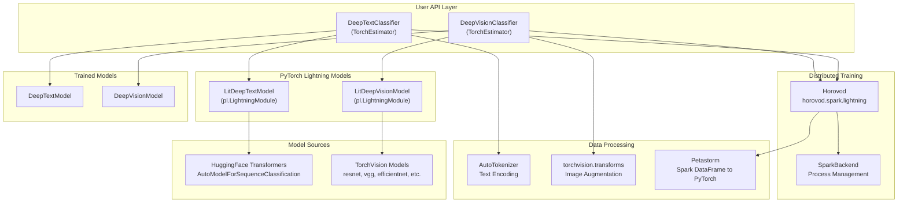
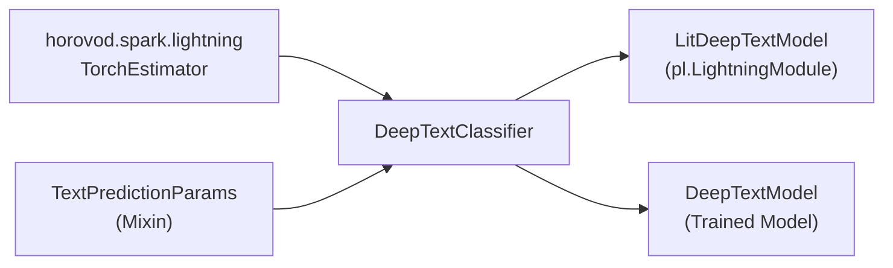
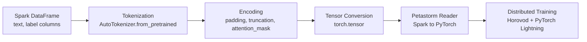
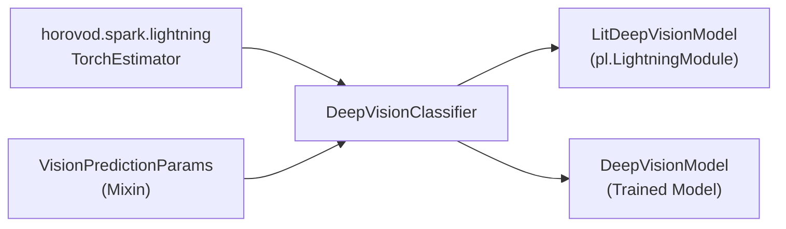
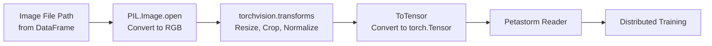
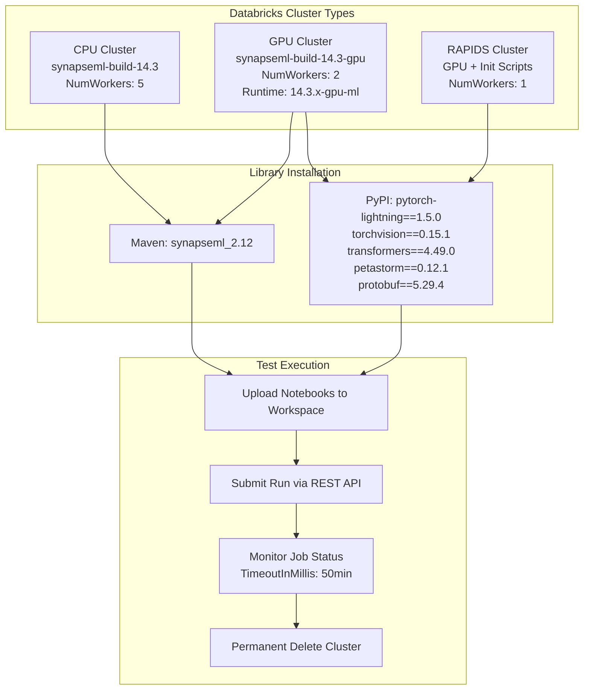
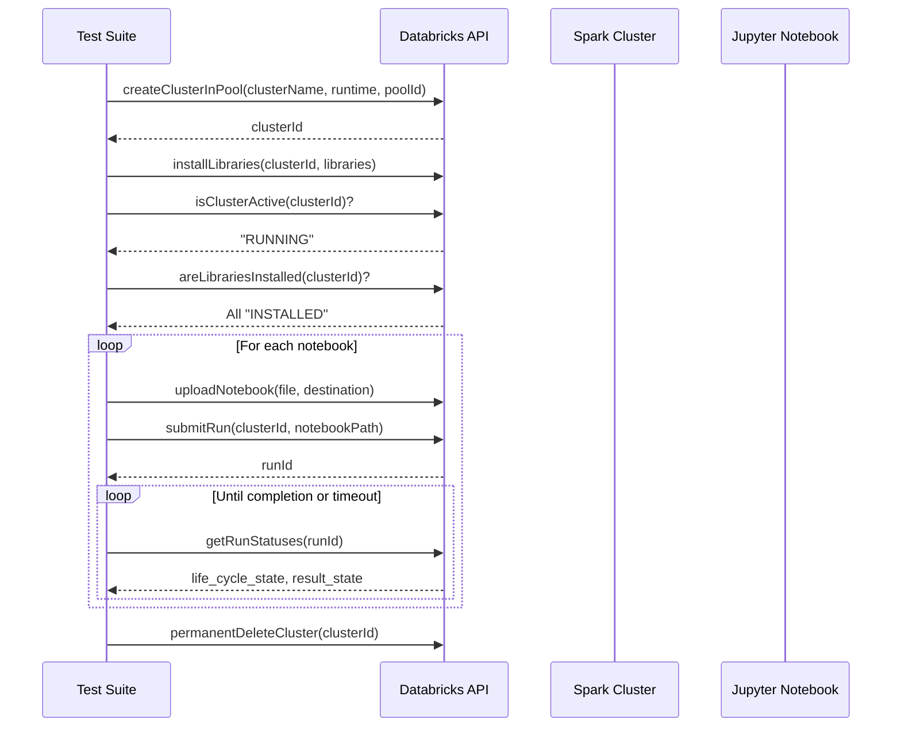

<!-- source: DeepWiki mcp.deepwiki.com · repo microsoft/SynapseML · page 6.4 Deep Learning Integration · fetched 2026-10-26 -->

# Deep Learning Integration

<details>
<summary>Relevant source files</summary>

The following files were used as context for generating this wiki page:

- [cognitive/src/test/scala/com/microsoft/azure/synapse/ml/services/anomaly/MultivariateAnamolyDetectionSuite.scala](cognitive/src/test/scala/com/microsoft/azure/synapse/ml/services/anomaly/MultivariateAnamolyDetectionSuite.scala)
- [core/src/main/scala/com/microsoft/azure/synapse/ml/io/binary/BinaryFileFormat.scala](core/src/main/scala/com/microsoft/azure/synapse/ml/io/binary/BinaryFileFormat.scala)
- [core/src/main/scala/org/apache/spark/ml/source/image/PatchedImageFileFormat.scala](core/src/main/scala/org/apache/spark/ml/source/image/PatchedImageFileFormat.scala)
- [core/src/main/scala/org/apache/spark/sql/execution/streaming/continuous/HTTPSinkV2.scala](core/src/main/scala/org/apache/spark/sql/execution/streaming/continuous/HTTPSinkV2.scala)
- [core/src/test/scala/com/microsoft/azure/synapse/ml/codegen/RTestGen.scala](core/src/test/scala/com/microsoft/azure/synapse/ml/codegen/RTestGen.scala)
- [core/src/test/scala/com/microsoft/azure/synapse/ml/io/split2/DistributedHTTPSuite.scala](core/src/test/scala/com/microsoft/azure/synapse/ml/io/split2/DistributedHTTPSuite.scala)
- [core/src/test/scala/com/microsoft/azure/synapse/ml/nbtest/DatabricksCPUTests.scala](core/src/test/scala/com/microsoft/azure/synapse/ml/nbtest/DatabricksCPUTests.scala)
- [core/src/test/scala/com/microsoft/azure/synapse/ml/nbtest/DatabricksGPUTests.scala](core/src/test/scala/com/microsoft/azure/synapse/ml/nbtest/DatabricksGPUTests.scala)
- [core/src/test/scala/com/microsoft/azure/synapse/ml/nbtest/DatabricksRapidsTests.scala](core/src/test/scala/com/microsoft/azure/synapse/ml/nbtest/DatabricksRapidsTests.scala)
- [core/src/test/scala/com/microsoft/azure/synapse/ml/nbtest/DatabricksUtilities.scala](core/src/test/scala/com/microsoft/azure/synapse/ml/nbtest/DatabricksUtilities.scala)
- [deep-learning/src/main/python/horovod_installation.sh](deep-learning/src/main/python/horovod_installation.sh)
- [deep-learning/src/main/python/synapse/ml/dl/DeepTextClassifier.py](deep-learning/src/main/python/synapse/ml/dl/DeepTextClassifier.py)
- [deep-learning/src/main/python/synapse/ml/dl/DeepVisionClassifier.py](deep-learning/src/main/python/synapse/ml/dl/DeepVisionClassifier.py)
- [deep-learning/src/main/python/synapse/ml/dl/LitDeepTextModel.py](deep-learning/src/main/python/synapse/ml/dl/LitDeepTextModel.py)
- [deep-learning/src/main/python/synapse/ml/dl/LitDeepVisionModel.py](deep-learning/src/main/python/synapse/ml/dl/LitDeepVisionModel.py)
- [docs/Explore Algorithms/Other Algorithms/Quickstart - Anomalous Access Detection.ipynb](docs/Explore Algorithms/Other Algorithms/Quickstart - Anomalous Access Detection.ipynb)
- [start](start)
- [tools/docker/demo/Dockerfile](tools/docker/demo/Dockerfile)
- [tools/docker/demo/README.md](tools/docker/demo/README.md)
- [tools/docker/demo/init_notebook.py](tools/docker/demo/init_notebook.py)
- [tools/docker/minimal/Dockerfile](tools/docker/minimal/Dockerfile)
- [tools/tests/run_r_tests.R](tools/tests/run_r_tests.R)
- [vw/src/main/scala/com/microsoft/azure/synapse/ml/vw/VowpalWabbitBaseModel.scala](vw/src/main/scala/com/microsoft/azure/synapse/ml/vw/VowpalWabbitBaseModel.scala)

</details>


The deep learning integration in SynapseML provides distributed training capabilities for neural network models using Horovod and PyTorch Lightning. This system enables large-scale fine-tuning of pre-trained models for text and vision classification tasks, leveraging Apache Spark for distributed data processing and Horovod for distributed training across multiple GPUs.

This page covers the deep learning components specifically. For traditional ML algorithms like LightGBM, see [LightGBM Integration](#6.5). For Vowpal Wabbit online learning, see [Vowpal Wabbit Integration](#6.6). For ONNX model inference without distributed training, ONNX capabilities are included in this module but not extensively covered in the provided files.

## Architecture Overview

The deep learning integration consists of two primary components: text classifiers and vision classifiers, both built on top of Horovod's distributed training framework and PyTorch Lightning's modular training system.



**Sources**: [deep-learning/src/main/python/synapse/ml/dl/DeepTextClassifier.py:1-289](), [deep-learning/src/main/python/synapse/ml/dl/DeepVisionClassifier.py:1-269](), [deep-learning/src/main/python/synapse/ml/dl/LitDeepTextModel.py:1-177](), [deep-learning/src/main/python/synapse/ml/dl/LitDeepVisionModel.py:1-234]()

## Horovod Distributed Training Framework

SynapseML's deep learning components use **Horovod** as the distributed training backend, specifically the `horovod.spark.lightning.TorchEstimator` class. This integration enables data-parallel training across multiple Spark executors, with each executor potentially utilizing multiple GPUs.

### Key Components

| Component | Class | Purpose |
|-----------|-------|---------|
| Estimator | `TorchEstimator` | Base class for distributed training, handles data distribution and model synchronization |
| Backend | `SparkBackend` | Manages Spark executor processes for Horovod training |
| Data Converter | Petastorm | Converts Spark DataFrames to PyTorch tensors for training |
| Model | `pl.LightningModule` | PyTorch Lightning module defining model architecture and training logic |

### Installation

Horovod requires specific compilation with NCCL support for GPU training. The installation script demonstrates the required dependencies:

```bash
# Install PyTorch ecosystem
pip install pytorch-lightning==1.5.0
pip install torchvision==0.15.1
pip install transformers==4.49.0
pip install petastorm>=0.12.1

# Install CUDA and NCCL libraries
apt-get install --allow-downgrades --no-install-recommends -y \
    cuda-nvml-dev-11-0=11.0.167-1 \
    cuda-nvcc-11-0=11.0.221-1 \
    libnccl-dev=2.10.3-1+cuda11.0

# Compile Horovod with NCCL
HOROVOD_GPU_ALLREDUCE=NCCL HOROVOD_CUDA_HOME=/usr/local/cuda-11/ \
HOROVOD_WITH_PYTORCH=1 python setup.py bdist_wheel
```

**Sources**: [deep-learning/src/main/python/horovod_installation.sh:1-48]()

### Backend Configuration

The `get_or_create_backend` utility function manages the Spark backend configuration for Horovod:

```python
def get_or_create_backend(backend, num_proc, verbose, use_gpu):
    """Creates or retrieves existing SparkBackend for distributed training."""
    # Implementation creates SparkBackend with appropriate GPU/CPU configuration
```

Both `DeepTextClassifier` and `DeepVisionClassifier` override the default backend creation to ensure proper GPU configuration.

**Sources**: [deep-learning/src/main/python/synapse/ml/dl/DeepTextClassifier.py:226-229](), [deep-learning/src/main/python/synapse/ml/dl/DeepVisionClassifier.py:217-221]()

## Text Classification with DeepTextClassifier

### Class Hierarchy



### Parameters

The `DeepTextClassifier` provides the following key parameters:

| Parameter | Type | Default | Description |
|-----------|------|---------|-------------|
| `checkpoint` | String | Required | HuggingFace model checkpoint (e.g., "bert-base-uncased") |
| `num_classes` | Int | Required | Number of target classes for classification |
| `text_col` | String | "text" | Input column containing text data |
| `label_col` | String | "label" | Input column containing integer labels |
| `additional_layers_to_train` | Int | 3 | Number of final layers to fine-tune (0 = only classifier head) |
| `train_from_scratch` | Boolean | True | If False, freezes base model and only trains specified layers |
| `learning_rate` | Float | Auto (5e-5 for BERT) | Learning rate for optimizer |
| `optimizer_name` | String | "adam" | Optimizer function name from `torch.optim` |
| `loss_name` | String | "cross_entropy" | Loss function name from `torch.nn.functional` |
| `max_token_len` | Int | 128 | Maximum sequence length for tokenization |
| `tokenizer` | AutoTokenizer | Auto | HuggingFace tokenizer (auto-loaded from checkpoint) |

**Sources**: [deep-learning/src/main/python/synapse/ml/dl/DeepTextClassifier.py:27-65]()

### Text Processing Pipeline

The text classification pipeline performs the following transformations on input DataFrames:



The transformation function (`_encoding_text`) in `DeepTextClassifier._update_transformation_fn()` handles tokenization:

```python
def _encoding_text(row):
    text = row[text_col]
    label = row[label_col]
    encoding = tokenizer(
        text,
        max_length=max_token_len,
        padding="max_length",
        truncation=True,
        return_attention_mask=True,
        return_tensors="pt",
    )
    input_ids = encoding["input_ids"].flatten().numpy()
    attention_mask = encoding["attention_mask"].flatten().numpy()
    return {
        "input_ids": input_ids,
        "attention_mask": attention_mask,
        "labels": torch.tensor(label, dtype=int),
    }
```

This transformation is applied using Petastorm's `transformation_fn` mechanism, which converts each row before feeding to the model.

**Sources**: [deep-learning/src/main/python/synapse/ml/dl/DeepTextClassifier.py:231-267]()

### LitDeepTextModel Architecture

The `LitDeepTextModel` class encapsulates the PyTorch Lightning training logic:

```mermaid
graph TB
    subgraph "LitDeepTextModel Initialization"
        CheckParams["_check_params<br/>Load AutoModelForSequenceClassification"]
        ValidateLoss["Validate loss_name in F.__dict__"]
        ValidateOptim["Validate optimizer_name in optim.__dict__"]
        SetLR["_update_learning_rate<br/>Default 5e-5 for BERT"]
    end
    
    subgraph "configure_optimizers"
        FreezeLayers["Freeze base_model parameters"]
        FineTune["_fine_tune_layers<br/>Unfreeze last N layers"]
        CreateOptim["Create optimizer with tunable params"]
    end
    
    subgraph "Training Steps"
        TrainingStep["training_step<br/>Forward pass + loss calculation"]
        ValidationStep["validation_step<br/>Validation loss"]
        LogMetrics["Log train_loss, val_loss"]
    end
    
    CheckParams --> ValidateLoss
    ValidateLoss --> ValidateOptim
    ValidateOptim --> SetLR
    
    FreezeLayers --> FineTune
    FineTune --> CreateOptim
    
    TrainingStep --> LogMetrics
    ValidationStep --> LogMetrics
```



The fine-tuning logic selectively unfreezes layers:

```python
def _fine_tune_layers(self):
    if self.additional_layers_to_train < 0:
        raise ValueError("additional_layers_to_train has to be non-negative")
    
    children = list(self.model.base_model.children())
    added_layer, cur_layer = 0, -1
    while added_layer < self.additional_layers_to_train and -cur_layer < len(children):
        tunable = False
        for p in children[cur_layer].parameters():
            p.requires_grad = True
            tunable = True
        if tunable:
            added_layer += 1
        cur_layer -= 1
```

This iterates backwards through the model's layers, unfreezing the last `additional_layers_to_train` layers that contain trainable parameters.

**Sources**: [deep-learning/src/main/python/synapse/ml/dl/LitDeepTextModel.py:29-177]()

### Supported Models

The `DeepTextClassifier` supports any HuggingFace checkpoint compatible with `AutoModelForSequenceClassification`, including:

- **BERT variants**: `bert-base-uncased`, `bert-large-cased`, `distilbert-base-uncased`
- **RoBERTa**: `roberta-base`, `roberta-large`
- **ALBERT**: `albert-base-v2`, `albert-large-v2`
- **ELECTRA**: `google/electra-small-discriminator`, `google/electra-base-discriminator`
- **DeBERTa**: `microsoft/deberta-base`, `microsoft/deberta-large`

The implementation enforces `transformers==4.49.0` for compatibility.

**Sources**: [deep-learning/src/main/python/synapse/ml/dl/LitDeepTextModel.py:14-24](), [core/src/test/scala/com/microsoft/azure/synapse/ml/nbtest/DatabricksUtilities.scala:88]()

## Vision Classification with DeepVisionClassifier

### Class Hierarchy



### Parameters

| Parameter | Type | Default | Description |
|-----------|------|---------|-------------|
| `backbone` | String | Required | TorchVision model name (e.g., "resnet50", "efficientnet_b0") |
| `num_classes` | Int | Required | Number of target classes for classification |
| `image_col` | String | "image" | Input column containing image paths |
| `label_col` | String | "label" | Input column containing integer labels |
| `additional_layers_to_train` | Int | 0 | Number of final layers to fine-tune (0-3) |
| `optimizer_name` | String | "adam" | Optimizer function name |
| `loss_name` | String | "cross_entropy" | Loss function name |
| `dropout_aux` | Float | 0.7 | Dropout for GoogLeNet InceptionAux modules |
| `transform_fn` | Compose | Auto | TorchVision transforms pipeline |

**Sources**: [deep-learning/src/main/python/synapse/ml/dl/DeepVisionClassifier.py:32-66]()

### Image Processing Pipeline



The default transformation pipeline:

```python
transform = transforms.Compose([
    transforms.RandomResizedCrop(crop_size),  # 224x224 or 299x299 for Inception
    transforms.RandomHorizontalFlip(),
    transforms.ToTensor(),
    transforms.Normalize(mean=[0.485, 0.456, 0.406], std=[0.229, 0.224, 0.225])
])

def _transform_row(row):
    path = row[image_col]
    label = row[label_col]
    image = Image.open(path).convert("RGB")
    image = transform(image).numpy()
    return {image_col: image, label_col: label}
```

**Sources**: [deep-learning/src/main/python/synapse/ml/dl/DeepVisionClassifier.py:223-250]()

### LitDeepVisionModel Architecture

The `LitDeepVisionModel` handles model initialization and layer-specific modifications:

#### Model Initialization and Classifier Head Replacement

```python
# Load pre-trained model
self.model = models.__dict__[self.backbone](pretrained=True)

# Freeze all parameters initially
for p in self.model.parameters():
    p.requires_grad = False

# Replace classifier head based on architecture
if backbone.startswith("resnet"):
    self.model.fc = nn.Linear(self.model.fc.in_features, num_classes)
elif backbone.startswith("efficientnet"):
    num_ftrs = self.model.classifier[-1].in_features
    self.model.classifier = nn.Linear(num_ftrs, num_classes)
elif backbone.startswith("vit"):
    num_ftrs = self.model.heads.head.in_features
    self.model.heads.head = nn.Linear(num_ftrs, num_classes)
# ... additional architectures
```

Each architecture family has a specific way to access and replace the final classification layer. The implementation handles 15+ architecture families.

**Sources**: [deep-learning/src/main/python/synapse/ml/dl/LitDeepVisionModel.py:62-120]()

#### Fine-Tuning Strategy

```python
def _fine_tune_layers(self):
    children = list(self.model.children())
    added_layer, cur_layer = 0, -1
    while added_layer < self.additional_layers_to_train and -cur_layer < len(children):
        tunable = False
        for p in children[cur_layer].parameters():
            p.requires_grad = True
            tunable = True
        if tunable:
            added_layer += 1
        cur_layer -= 1
```

This method unfreezes the last N layers working backwards through the model architecture.

**Sources**: [deep-learning/src/main/python/synapse/ml/dl/LitDeepVisionModel.py:176-189]()

#### Special Handling for Inception Models

Inception v3 models have auxiliary classifiers that require special handling during training:

```python
def _step(self, batch, validation):
    inputs = {"x": batch[self.image_col].reshape(self.input_shape)}
    label = batch[self.label_col]
    output = self(**inputs)
    
    if self.backbone.startswith("inception") and not validation:
        loss1 = self.loss_fn(output.logits, label.long())
        loss2 = self.loss_fn(output.aux_logits, label.long())
        loss = loss1 + 0.4 * loss2
    else:
        loss = self.loss_fn(output, label.long())
    return loss
```

During training, Inception models return both main and auxiliary outputs, and the total loss is a weighted combination.

**Sources**: [deep-learning/src/main/python/synapse/ml/dl/LitDeepVisionModel.py:205-217]()

### Supported Backbones

The `DeepVisionClassifier` supports all TorchVision models (version >= 0.14.1):

| Family | Examples | Input Size |
|--------|----------|------------|
| ResNet | `resnet18`, `resnet34`, `resnet50`, `resnet101`, `resnet152` | 224x224 |
| EfficientNet | `efficientnet_b0` through `efficientnet_b7` | 224x224 |
| Vision Transformer | `vit_b_16`, `vit_b_32`, `vit_l_16` | 224x224 |
| MobileNet | `mobilenet_v2`, `mobilenet_v3_small`, `mobilenet_v3_large` | 224x224 |
| ConvNeXt | `convnext_tiny`, `convnext_small`, `convnext_base` | 224x224 |
| VGG | `vgg11`, `vgg13`, `vgg16`, `vgg19` | 224x224 |
| Inception | `inception_v3` | 299x299 |
| DenseNet | `densenet121`, `densenet161`, `densenet169` | 224x224 |

The implementation includes a retry mechanism for downloading pre-trained weights to handle transient network failures:

```python
def _retry_download(self, func, times_left):
    try:
        return func()
    except URLError as e:
        if times_left == 0:
            raise e
        else:
            time.sleep(1)
            return self._retry_download(func, times_left - 1)

self.model = self._retry_download(
    lambda: models.__dict__[self.backbone](pretrained=True), 5
)
```

**Sources**: [deep-learning/src/main/python/synapse/ml/dl/LitDeepVisionModel.py:135-153]()

## Testing Infrastructure

### Test Environment Configuration



### Test Classes

| Test Class | Cluster Type | Notebooks | Concurrency |
|------------|--------------|-----------|-------------|
| `DatabricksCPUTests` | CPU Pool (5 workers) | `CPUNotebooks` (excludes GPU/Fine-tune) | 5 parallel |
| `DatabricksGPUTests` | GPU Pool (2 workers) | `GPUNotebooks` (Fine-tune, Phi Model) | 1 sequential |
| `DatabricksRapidsTests` | GPU Pool (1 worker) + Init Scripts | `RapidsNotebooks` (contains "GPU") | 4 parallel |

**Sources**: [core/src/test/scala/com/microsoft/azure/synapse/ml/nbtest/DatabricksCPUTests.scala:10-25](), [core/src/test/scala/com/microsoft/azure/synapse/ml/nbtest/DatabricksGPUTests.scala:8-19](), [core/src/test/scala/com/microsoft/azure/synapse/ml/nbtest/DatabricksRapidsTests.scala:8-19]()

### GPU Libraries Configuration

The GPU test clusters install specific library versions:

```scala
val GPULibraries: String = List(
  Map("maven" -> Map("coordinates" -> PackageMavenCoordinate, "repo" -> PackageRepository)),
  Map("pypi" -> Map("package" -> "pytorch-lightning==1.5.0")),
  Map("pypi" -> Map("package" -> "torchvision==0.15.1")),
  Map("pypi" -> Map("package" -> "transformers==4.49.0")),
  Map("pypi" -> Map("package" -> "jinja2==3.1.6")),
  Map("pypi" -> Map("package" -> "petastorm==0.12.1")),
  Map("pypi" -> Map("package" -> "protobuf==5.29.4")),
  Map("pypi" -> Map("package" -> "accelerate==0.26.0"))
).toJson.compactPrint
```

**Sources**: [core/src/test/scala/com/microsoft/azure/synapse/ml/nbtest/DatabricksUtilities.scala:84-93]()

### Notebook Filtering Logic

The test framework categorizes notebooks based on naming patterns:

```scala
val CPUNotebooks: Seq[File] = ParallelizableNotebooks
  .filterNot(_.getAbsolutePath.contains("Fine-tune"))
  .filterNot(_.getAbsolutePath.contains("GPU"))
  .filterNot(_.getAbsolutePath.contains("Phi Model"))
  .filterNot(_.getAbsolutePath.contains("Language Model"))
  // ... additional exclusions

val GPUNotebooks: Seq[File] = ParallelizableNotebooks.filter { file =>
  file.getAbsolutePath.contains("Fine-tune") || file.getAbsolutePath.contains("Phi Model")
}

val RapidsNotebooks: Seq[File] = ParallelizableNotebooks.filter(
  _.getAbsolutePath.contains("GPU")
)
```

**Sources**: [core/src/test/scala/com/microsoft/azure/synapse/ml/nbtest/DatabricksUtilities.scala:108-124]()

### Test Execution Flow



**Sources**: [core/src/test/scala/com/microsoft/azure/synapse/ml/nbtest/DatabricksUtilities.scala:436-481]()

### Retry and Error Handling

The test framework includes retry logic for library installation and cluster readiness:

```scala
tryWithRetries(Seq.fill(60 * 20)(1000).toArray) { () =>
  assert(isClusterActive(clusterId))
}

installLibraries(clusterId, libraries)
tryWithRetries(Seq.fill(60 * 6)(1000).toArray) { () =>
  assert(areLibrariesInstalled(clusterId))
}
```

Library installation failures are detected and surfaced:

```scala
if (libraryStatuses.exists(_.select[String]("status") == "FAILED")) {
  val error = libraryStatuses.filter(_.select[String]("status") == "FAILED").toJson.compactPrint
  throw new RuntimeException(s"Library Installation Failure: $error")
}
```

**Sources**: [core/src/test/scala/com/microsoft/azure/synapse/ml/nbtest/DatabricksUtilities.scala:442-452](), [core/src/test/scala/com/microsoft/azure/synapse/ml/nbtest/DatabricksUtilities.scala:297-306]()

## Docker Environment Support

### Container Images

SynapseML provides Docker images for local development and testing:

| Image Type | Base | Components |
|------------|------|------------|
| `demo` | Ubuntu 20.04 | Spark 3.5.0, Jupyter, SynapseML, OpenMPI |
| `minimal` | Ubuntu 20.04 | Spark 3.5.0, Jupyter, minimal dependencies |
| `developer` | Ubuntu 20.04 | Full development environment with all tools |

**Sources**: [tools/docker/demo/Dockerfile:1-71](), [tools/docker/minimal/Dockerfile:1-52]()

### Spark Configuration for Deep Learning

The demo container includes an initialization script that configures Spark for SynapseML:

```python
synapseMLConf = pyspark.SparkConf().setAll([
    ("spark.hadoop.fs.wasb.impl", "org.apache.hadoop.fs.azure.NativeAzureFileSystem"),
    ("spark.jars.packages", 
     "com.microsoft.azure:synapseml_2.12:" + os.getenv("SYNAPSEML_VERSION", "1.1.0") +
     ",org.apache.hadoop:hadoop-azure:2.7.0,org.apache.hadoop:hadoop-common:2.7.0"),
    ("spark.jars.repositories", "https://mmlspark.azureedge.net/maven,...")
])

spark = (
    SparkSession.builder.master("local[*]")
    .appName("SynapseML Docker App")
    .config(conf=synapseMLConf)
    .getOrCreate()
)
```

This configuration:
- Enables Azure Blob Storage access
- Downloads SynapseML JARs from Maven repository
- Configures Hadoop Azure dependencies

**Sources**: [tools/docker/demo/init_notebook.py:1-47]()

### Container Usage

```bash
# Build image
docker build . -f tools/docker/demo/Dockerfile -t synapseml

# Run with Jupyter and Spark UI exposed
docker run -p4040:4040 -p8888:8888 -ti synapseml jupyter notebook ./
```

Access points:
- Jupyter Notebook: `http://localhost:8888`
- Spark UI: `http://localhost:4040`

**Sources**: [tools/docker/demo/README.md:1-30]()

## Custom Data Sources for Deep Learning

### Patched Image File Format

SynapseML includes a custom Spark data source for reading images with retry logic to handle JVM multi-threading bugs:

```scala
class PatchedImageFileFormat extends ImageFileFormat {
  override def shortName(): String = "patchedImage"
  
  @annotation.tailrec
  private def catchFlakiness[T](times: Int)(f: => Option[T]): Option[T] = {
    Try { f } match {
      case Success(x) => x
      case Failure(exception: NullPointerException) if times >= 1 =>
        logWarning("caught null pointer exception due to jvm bug", exception)
        catchFlakiness(times - 1)(f)
      case _ => None
    }
  }
  
  // Retry image decoding up to 5 times
  val resultOpt = catchFlakiness(5)(
    ImageSchema.decode(origin.toString(), bytes)
  )
}
```

This addresses flakiness in `javax.imageio.ImageIO` when called from multiple threads simultaneously.

**Sources**: [core/src/main/scala/org/apache/spark/ml/source/image/PatchedImageFileFormat.scala:26-129]()

### Binary File Format with Zip Support

The `BinaryFileFormat` enables reading binary files and supports automatic extraction of zip archives:

```scala
class BinaryRecordReader(val subsample: Double, val inspectZip: Boolean, val seed: Long) {
  override def initialize(inputSplit: InputSplit, context: TaskAttemptContext): Unit = {
    // ...
    if (inspectZip && FilenameUtils.getExtension(filename) == "zip") {
      zipIterator = new ZipIterator(inputStream, filename, rng, subsample)
    }
  }
  
  override def nextKeyValue(): Boolean = {
    if (zipIterator != null) {
      if (zipIterator.hasNext) {
        val (fn, barr) = zipIterator.next
        filename = fn
        recordValue = barr
        true
      } else false
    } else {
      // Read entire file as bytes
      recordValue = IOUtils.toByteArray(inputStream)
      true
    }
  }
}
```

This is particularly useful for datasets distributed as zip archives containing multiple files.

**Sources**: [core/src/main/scala/com/microsoft/azure/synapse/ml/io/binary/BinaryFileFormat.scala:33-108]()

## Version Compatibility Matrix

| Component | Version | Notes |
|-----------|---------|-------|
| PyTorch Lightning | 1.5.0 | Fixed version for compatibility |
| TorchVision | 0.15.1 | Requires >= 0.14.1 |
| Transformers | 4.49.0 | Exact version required |
| Horovod | 0.28.1 | Built with NCCL for GPU |
| Petastorm | >= 0.12.1 | Spark DataFrame to PyTorch conversion |
| Protobuf | 5.29.4 | Required by Petastorm |
| Accelerate | 0.26.0 | HuggingFace optimization library |
| CUDA | 11.0 | For GPU training |
| NCCL | 2.10.3 | GPU collective operations |

**Sources**: [deep-learning/src/main/python/synapse/ml/dl/LitDeepTextModel.py:16-24](), [deep-learning/src/main/python/synapse/ml/dl/LitDeepVisionModel.py:19-27](), [core/src/test/scala/com/microsoft/azure/synapse/ml/nbtest/DatabricksUtilities.scala:84-93](), [deep-learning/src/main/python/horovod_installation.sh:9-14]()

---

