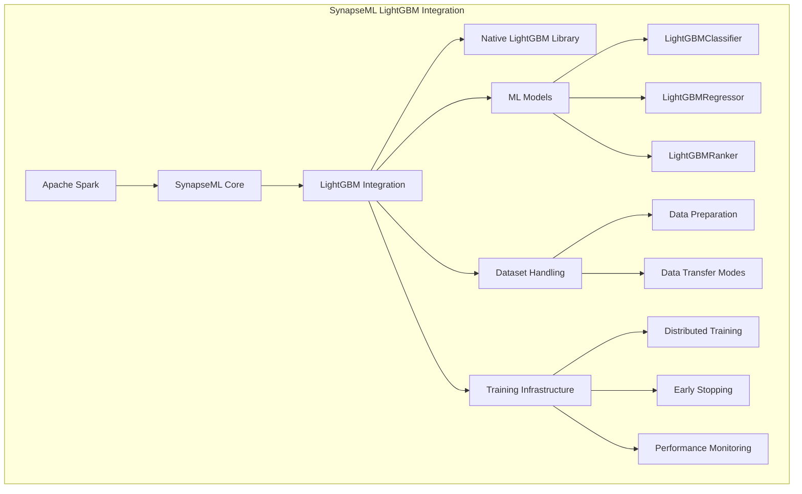
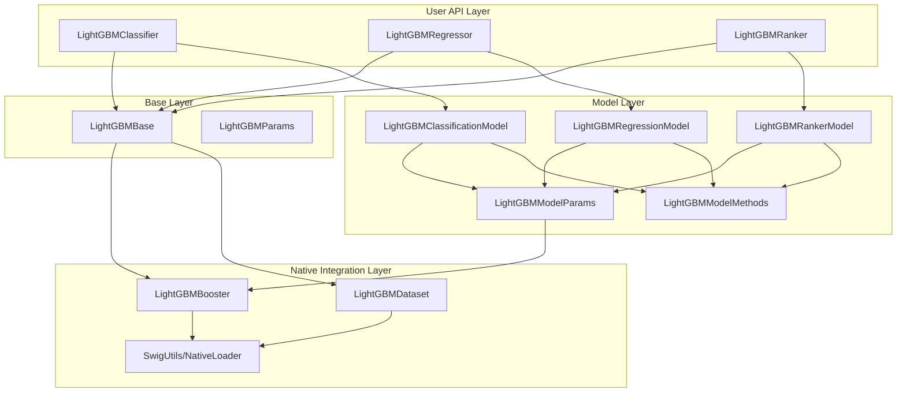
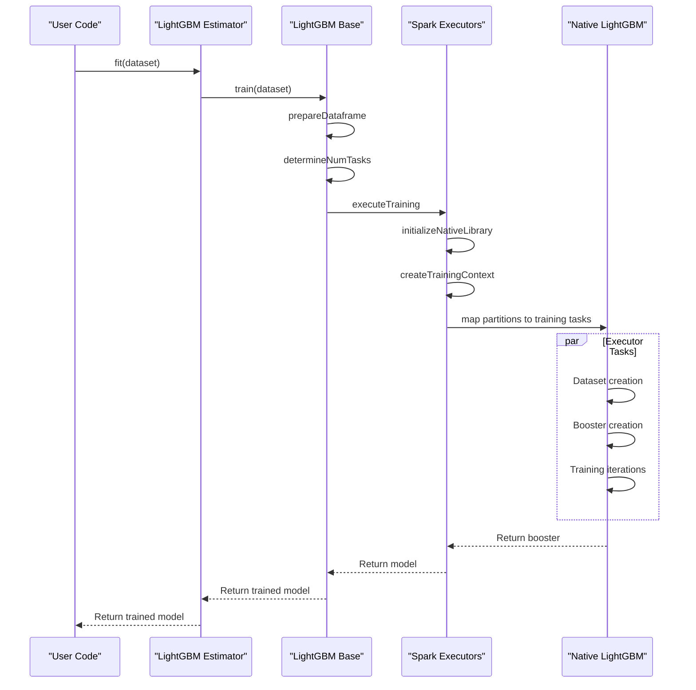
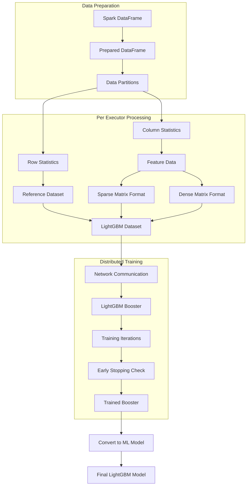
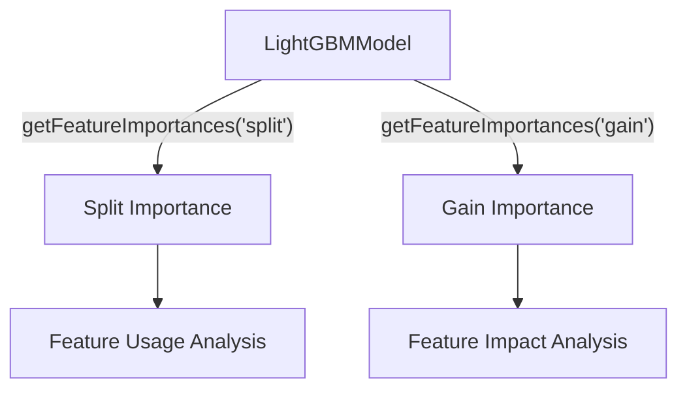
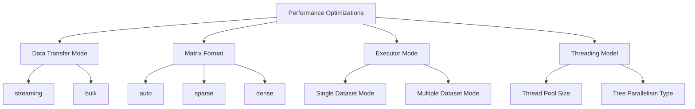
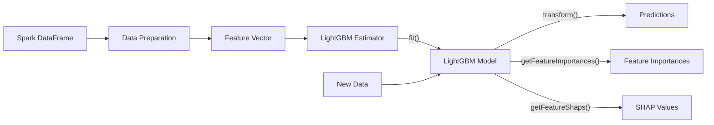

<!-- source: DeepWiki mcp.deepwiki.com · repo microsoft/SynapseML · page 6.5 LightGBM Integration · fetched 2026-10-26 -->

# LightGBM Integration

Relevant source files

The following files were used as context for generating this wiki page:

- [.github/ISSUE_TEMPLATE/bug_report_template.yaml](.github/ISSUE_TEMPLATE/bug_report_template.yaml)
- [.github/ISSUE_TEMPLATE/feature_request.md](.github/ISSUE_TEMPLATE/feature_request.md)
- [CONTRIBUTING.md](CONTRIBUTING.md)
- [README.md](README.md)
- [core/src/main/scala/com/microsoft/azure/synapse/ml/fabric/FabricClient.scala](core/src/main/scala/com/microsoft/azure/synapse/ml/fabric/FabricClient.scala)
- [core/src/main/scala/com/microsoft/azure/synapse/ml/fabric/TokenLibrary.scala](core/src/main/scala/com/microsoft/azure/synapse/ml/fabric/TokenLibrary.scala)
- [core/src/main/scala/com/microsoft/azure/synapse/ml/io/http/HTTPClients.scala](core/src/main/scala/com/microsoft/azure/synapse/ml/io/http/HTTPClients.scala)
- [core/src/main/scala/com/microsoft/azure/synapse/ml/logging/SynapseMLLogging.scala](core/src/main/scala/com/microsoft/azure/synapse/ml/logging/SynapseMLLogging.scala)
- [core/src/main/scala/com/microsoft/azure/synapse/ml/logging/common/PlatformDetails.scala](core/src/main/scala/com/microsoft/azure/synapse/ml/logging/common/PlatformDetails.scala)
- [core/src/main/scala/com/microsoft/azure/synapse/ml/logging/common/Scrubber.scala](core/src/main/scala/com/microsoft/azure/synapse/ml/logging/common/Scrubber.scala)
- [core/src/main/scala/com/microsoft/azure/synapse/ml/logging/fabric/CertifiedEventClient.scala](core/src/main/scala/com/microsoft/azure/synapse/ml/logging/fabric/CertifiedEventClient.scala)
- [core/src/test/scala/com/microsoft/azure/synapse/ml/logging/LoggingScrubberTests.scala](core/src/test/scala/com/microsoft/azure/synapse/ml/logging/LoggingScrubberTests.scala)
- [vw/src/main/scala/com/microsoft/azure/synapse/ml/vw/VectorZipper.scala](vw/src/main/scala/com/microsoft/azure/synapse/ml/vw/VectorZipper.scala)
- [vw/src/main/scala/com/microsoft/azure/synapse/ml/vw/VowpalWabbitCSETransformer.scala](vw/src/main/scala/com/microsoft/azure/synapse/ml/vw/VowpalWabbitCSETransformer.scala)
- [vw/src/main/scala/com/microsoft/azure/synapse/ml/vw/VowpalWabbitClassifier.scala](vw/src/main/scala/com/microsoft/azure/synapse/ml/vw/VowpalWabbitClassifier.scala)
- [vw/src/main/scala/com/microsoft/azure/synapse/ml/vw/VowpalWabbitContextualBandit.scala](vw/src/main/scala/com/microsoft/azure/synapse/ml/vw/VowpalWabbitContextualBandit.scala)
- [vw/src/main/scala/com/microsoft/azure/synapse/ml/vw/VowpalWabbitDSJsonTransformer.scala](vw/src/main/scala/com/microsoft/azure/synapse/ml/vw/VowpalWabbitDSJsonTransformer.scala)
- [vw/src/main/scala/com/microsoft/azure/synapse/ml/vw/VowpalWabbitFeaturizer.scala](vw/src/main/scala/com/microsoft/azure/synapse/ml/vw/VowpalWabbitFeaturizer.scala)
- [vw/src/main/scala/com/microsoft/azure/synapse/ml/vw/VowpalWabbitRegressor.scala](vw/src/main/scala/com/microsoft/azure/synapse/ml/vw/VowpalWabbitRegressor.scala)

This page documents the integration of Microsoft's LightGBM (Light Gradient Boosting Machine) framework with Apache Spark in the SynapseML library. LightGBM is a high-performance gradient boosting framework that uses tree-based learning algorithms and is designed for distributed training.

## Overview

SynapseML provides a comprehensive integration with LightGBM, enabling efficient training of gradient boosting models on distributed Spark datasets. The integration offers three main model types:

- Classification (binary and multiclass)
- Regression 
- Ranking

The implementation bridges the gap between Spark's distributed computing capabilities and LightGBM's efficient gradient boosting algorithm by handling data conversion, distributed training coordination, and seamless integration with Spark ML pipelines.

Sources:
- [lightgbm/src/main/scala/com/microsoft/azure/synapse/ml/lightgbm/LightGBMBase.scala]()
- [lightgbm/src/main/scala/com/microsoft/azure/synapse/ml/lightgbm/params/LightGBMParams.scala]()
- [lightgbm/src/main/scala/com/microsoft/azure/synapse/ml/lightgbm/LightGBMClassifier.scala]()
- [lightgbm/src/main/scala/com/microsoft/azure/synapse/ml/lightgbm/LightGBMRegressor.scala]()
- [lightgbm/src/main/scala/com/microsoft/azure/synapse/ml/lightgbm/LightGBMRanker.scala]()

## Architecture

The LightGBM integration in SynapseML follows a layered architecture that connects Spark's distributed computing with LightGBM's native implementation:

Sources:
- [lightgbm/src/main/scala/com/microsoft/azure/synapse/ml/lightgbm/LightGBMBase.scala]()
- [lightgbm/src/main/scala/com/microsoft/azure/synapse/ml/lightgbm/params/LightGBMParams.scala]()
- [lightgbm/src/main/scala/com/microsoft/azure/synapse/ml/lightgbm/booster/LightGBMBooster.scala]()
- [lightgbm/src/main/scala/com/microsoft/azure/synapse/ml/lightgbm/LightGBMModelMethods.scala]()

## Training Process

The training process for LightGBM models in SynapseML involves several stages to handle distributed training efficiently:

Sources:
- [lightgbm/src/main/scala/com/microsoft/azure/synapse/ml/lightgbm/LightGBMBase.scala:36-64]()
- [lightgbm/src/main/scala/com/microsoft/azure/synapse/ml/lightgbm/LightGBMBase.scala:396-447]()
- [lightgbm/src/main/scala/com/microsoft/azure/synapse/ml/lightgbm/LightGBMBase.scala:569-604]()
- [lightgbm/src/main/scala/com/microsoft/azure/synapse/ml/lightgbm/TrainUtils.scala]()

### Training Data Flow

The following diagram illustrates how data flows through the system during training:

Sources:
- [lightgbm/src/main/scala/com/microsoft/azure/synapse/ml/lightgbm/LightGBMBase.scala:109-144]()
- [lightgbm/src/main/scala/com/microsoft/azure/synapse/ml/lightgbm/dataset/DatasetAggregator.scala]()
- [lightgbm/src/main/scala/com/microsoft/azure/synapse/ml/lightgbm/TrainUtils.scala:98-135]()

## Model Types

### LightGBM Classifier

The `LightGBMClassifier` implements binary and multiclass classification models. It extends Spark's `ProbabilisticClassifier` and supports both raw predictions and probability outputs.

Key features:
- Binary classification (default)
- Multiclass classification
- Class probability estimation
- Handling of unbalanced datasets
- Support for feature importance and SHAP values

Sources:
- [lightgbm/src/main/scala/com/microsoft/azure/synapse/ml/lightgbm/LightGBMClassifier.scala]()

### LightGBM Regressor

The `LightGBMRegressor` implements regression models with various loss functions. It extends Spark's `BaseRegressor`.

Key features:
- Multiple objective functions (L1, L2, Huber, Quantile, etc.)
- Alpha parameter for Huber loss and Quantile regression
- Tweedie regression support
- Feature importance and SHAP values

Sources:
- [lightgbm/src/main/scala/com/microsoft/azure/synapse/ml/lightgbm/LightGBMRegressor.scala]()

### LightGBM Ranker

The `LightGBMRanker` implements learning-to-rank models. It extends Spark's `Ranker`.

Key features:
- Support for group-based ranking
- NDCG and MAP optimization
- Position-based evaluation
- Feature importance and SHAP values

Sources:
- [lightgbm/src/main/scala/com/microsoft/azure/synapse/ml/lightgbm/LightGBMRanker.scala]()

## Parameters and Configuration

The LightGBM integration offers a wide range of parameters for customizing model behavior. These parameters are organized into several categories:

### General Parameters

These parameters control the general behavior of LightGBM models.

| Parameter | Description | Default |
|-----------|-------------|---------|
| numIterations | Number of boosting iterations | 100 |
| learningRate | Learning rate or shrinkage rate | 0.1 |
| numLeaves | Maximum number of leaves in each tree | 31 |
| maxDepth | Maximum depth of each tree | -1 (no limit) |
| objective | Learning objective | Classification: "binary", Regression: "regression" |
| metric | Evaluation metric | "" (uses default for objective) |
| earlyStoppingRound | Early stopping round | 0 (disabled) |
| parallelism | Tree learner parallelism | "data_parallel" |

Sources:
- [lightgbm/src/main/scala/com/microsoft/azure/synapse/ml/lightgbm/params/LightGBMParams.scala:505-537]()

### Execution Parameters

These parameters control how the model executes in the distributed environment.

| Parameter | Description | Default |
|-----------|-------------|---------|
| dataTransferMode | How data is transferred to LightGBM | "streaming" |
| useSingleDatasetMode | Use single dataset per executor | true |
| numTasks | Number of tasks for distributed training | 0 (auto) |
| numThreads | Number of threads for LightGBM | 0 (auto) |
| useBarrierExecutionMode | Use barrier execution mode | false |
| timeout | Timeout in seconds | 1200 |

Sources:
- [lightgbm/src/main/scala/com/microsoft/azure/synapse/ml/lightgbm/params/LightGBMParams.scala:16-158]()

### Dataset Parameters

These parameters control how datasets are handled.

| Parameter | Description | Default |
|-----------|-------------|---------|
| maxBin | Maximum number of bins for features | 255 |
| binSampleCount | Number of samples for bin construction | 200000 |
| minDataInLeaf | Minimum number of data in one leaf | 20 |
| categoricalSlotIndexes | Indexes of categorical features | [] |
| categoricalSlotNames | Names of categorical features | [] |

Sources:
- [lightgbm/src/main/scala/com/microsoft/azure/synapse/ml/lightgbm/params/LightGBMParams.scala:231-296]()

### Model-Specific Parameters

Each model type has additional parameters:

#### Classification
- `isUnbalance`: Handle unbalanced datasets (boolean)

#### Regression
- `alpha`: Parameter for Huber loss and Quantile regression
- `tweedieVariancePower`: Control variance of Tweedie distribution

#### Ranking
- `maxPosition`: Position to optimize NDCG at
- `evalAt`: Positions for NDCG and MAP evaluation
- `labelGain`: Relevance gain for each label

Sources:
- [lightgbm/src/main/scala/com/microsoft/azure/synapse/ml/lightgbm/LightGBMClassifier.scala:37-41]()
- [lightgbm/src/main/scala/com/microsoft/azure/synapse/ml/lightgbm/LightGBMRegressor.scala:49-58]()
- [lightgbm/src/main/scala/com/microsoft/azure/synapse/ml/lightgbm/LightGBMRanker.scala:36-49]()

## Feature Importance and Interpretability

LightGBM models in SynapseML provide built-in support for feature importance and SHAP (SHapley Additive exPlanations) values for model interpretability.

### Feature Importance

Feature importance can be obtained using the `getFeatureImportances` method with two types:
- `split`: Number of times a feature is used in a model
- `gain`: Total gains of splits that use the feature

Sources:
- [lightgbm/src/main/scala/com/microsoft/azure/synapse/ml/lightgbm/LightGBMModelMethods.scala:14-21]()

### SHAP Values

SHAP values can be calculated for individual predictions using:
- During prediction with `setFeaturesShapCol`
- Programmatically with `getFeatureShaps` or `featuresShap`

SHAP values explain how each feature contributes to pushing the prediction higher or lower from the base (average) value.

Sources:
- [lightgbm/src/main/scala/com/microsoft/azure/synapse/ml/lightgbm/LightGBMModelMethods.scala:22-50]()
- [lightgbm/src/main/python/synapse/ml/lightgbm/mixin.py:29-49]()

## Performance Optimizations

SynapseML's LightGBM integration includes several optimization strategies to improve performance:

### Data Transfer Modes

Two primary data transfer modes are available:
- `streaming`: Stream data to LightGBM (default, recommended for large datasets)
- `bulk`: Legacy mode for data transfer

### Matrix Representation

Data can be represented in different formats:
- `auto`: Automatically determine based on data sparsity
- `sparse`: Use sparse matrix format (CSR)
- `dense`: Use dense matrix format

### Dataset Mode

- `useSingleDatasetMode`: When enabled (default), creates a single native dataset per executor to reduce memory and communication overhead

### Parallelism and Threading

- `numThreads`: Controls the number of threads used by LightGBM
- `parallelism`: Controls the tree learning algorithm parallelism ("data_parallel" or "voting_parallel")

Sources:
- [lightgbm/src/main/scala/com/microsoft/azure/synapse/ml/lightgbm/params/LightGBMParams.scala:86-110]()
- [lightgbm/src/main/scala/com/microsoft/azure/synapse/ml/lightgbm/params/LightGBMParams.scala:139-158]()

## Example Usage

To use LightGBM models in SynapseML, you create an estimator, configure it with parameters, and fit it to your data. The resulting model can then be used for predictions.

Here's a conceptual flow for using LightGBM in SynapseML:

LightGBM models can be used like any other Spark ML model in a Pipeline, making them easy to integrate into existing workflows.

Sources:
- [lightgbm/src/main/scala/com/microsoft/azure/synapse/ml/lightgbm/LightGBMClassifier.scala:26-89]()
- [lightgbm/src/main/scala/com/microsoft/azure/synapse/ml/lightgbm/LightGBMRegressor.scala:39-92]()
- [lightgbm/src/main/scala/com/microsoft/azure/synapse/ml/lightgbm/LightGBMRanker.scala:26-120]()

## Saving and Loading Models

LightGBM models in SynapseML can be saved and loaded in two ways:

1. **Spark ML Model Format**: Standard Spark ML model persistence
   - `model.write().overwrite().save(path)`
   - `LightGBMClassificationModel.load(path)`

2. **Native LightGBM Format**: Save just the LightGBM booster
   - `model.saveNativeModel(path)`
   - `LightGBMClassificationModel.loadNativeModelFromFile(path)`
   - `LightGBMClassificationModel.loadNativeModelFromString(modelString)`

The native format allows for interoperability with other LightGBM implementations.

Sources:
- [lightgbm/src/main/scala/com/microsoft/azure/synapse/ml/lightgbm/LightGBMClassifier.scala:196-211]()
- [lightgbm/src/main/scala/com/microsoft/azure/synapse/ml/lightgbm/LightGBMRegressor.scala:136-150]()
- [lightgbm/src/main/scala/com/microsoft/azure/synapse/ml/lightgbm/LightGBMRanker.scala:167-182]()
- [lightgbm/src/main/scala/com/microsoft/azure/synapse/ml/lightgbm/LightGBMModelMethods.scala:95-109]()

## Performance Measurement

SynapseML's LightGBM integration includes built-in performance measurement capabilities to help understand and optimize training time:

- Total time measurement
- Component-level timing:
  - Column statistics
  - Row statistics
  - Training iterations
  - Data preparation
  - Network communication
  - Dataset creation

These measurements can help identify bottlenecks in the training process and guide optimization efforts.

Sources:
- [lightgbm/src/test/scala/com/microsoft/azure/synapse/ml/lightgbm/split1/VerifyLightGBMCommon.scala:147-200]()

## Python API

SynapseML provides a Python API for LightGBM integration that mirrors the Scala API. It includes additional methods for model interaction:

- `saveNativeModel`: Save the booster in string format
- `getNativeModel`: Get the native model serialized representation
- `getFeatureImportances`: Get feature importances
- `getFeatureShaps`: Get SHAP values for a feature vector
- `getBoosterBestIteration`: Get the best iteration from early stopping
- `setPredictDisableShapeCheck`: Control shape checking during prediction

Sources:
- [lightgbm/src/main/python/synapse/ml/lightgbm/mixin.py]()

---

