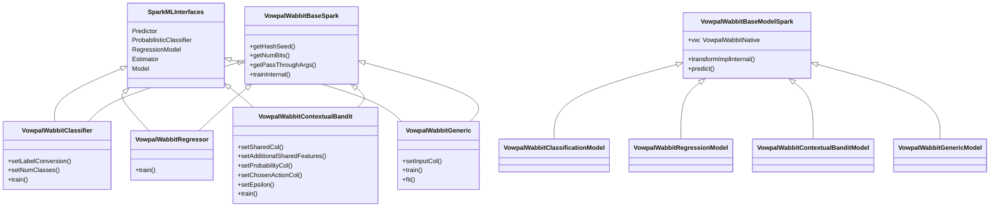
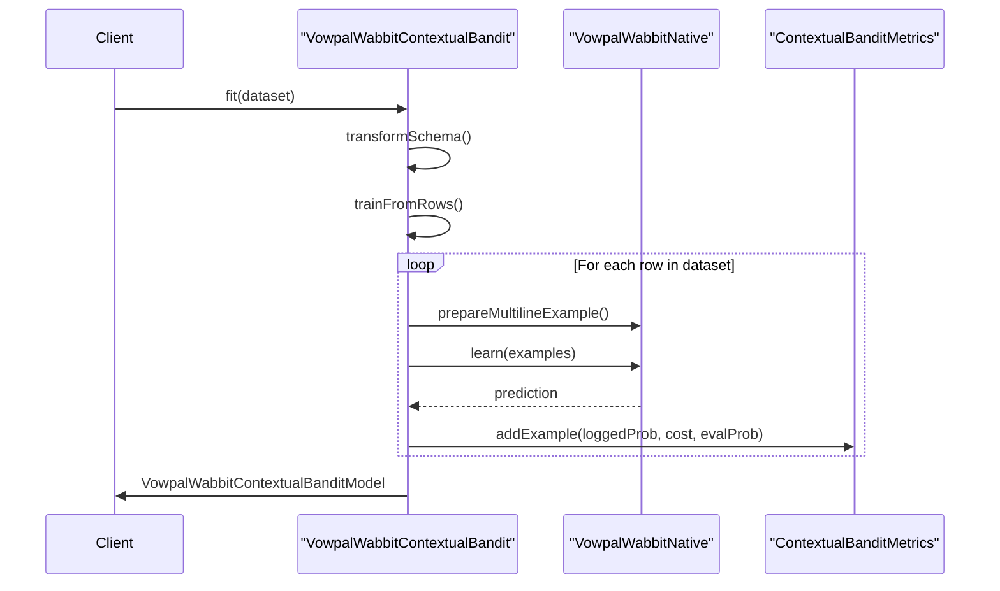
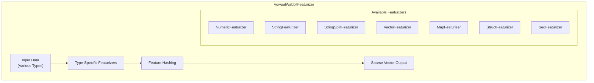

<!-- source: DeepWiki mcp.deepwiki.com · repo microsoft/SynapseML · page 6.6 Vowpal Wabbit Integration · fetched 2026-10-26 -->

# Vowpal Wabbit Integration

<details>
<summary>Relevant source files</summary>

The following files were used as context for generating this wiki page:

- [.github/ISSUE_TEMPLATE/bug_report_template.yaml](.github/ISSUE_TEMPLATE/bug_report_template.yaml)
- [.github/ISSUE_TEMPLATE/feature_request.md](.github/ISSUE_TEMPLATE/feature_request.md)
- [core/src/main/scala/com/microsoft/azure/synapse/ml/fabric/FabricClient.scala](core/src/main/scala/com/microsoft/azure/synapse/ml/fabric/FabricClient.scala)
- [core/src/main/scala/com/microsoft/azure/synapse/ml/fabric/TokenLibrary.scala](core/src/main/scala/com/microsoft/azure/synapse/ml/fabric/TokenLibrary.scala)
- [core/src/main/scala/com/microsoft/azure/synapse/ml/io/http/HTTPClients.scala](core/src/main/scala/com/microsoft/azure/synapse/ml/io/http/HTTPClients.scala)
- [core/src/main/scala/com/microsoft/azure/synapse/ml/logging/SynapseMLLogging.scala](core/src/main/scala/com/microsoft/azure/synapse/ml/logging/SynapseMLLogging.scala)
- [core/src/main/scala/com/microsoft/azure/synapse/ml/logging/common/PlatformDetails.scala](core/src/main/scala/com/microsoft/azure/synapse/ml/logging/common/PlatformDetails.scala)
- [core/src/main/scala/com/microsoft/azure/synapse/ml/logging/common/Scrubber.scala](core/src/main/scala/com/microsoft/azure/synapse/ml/logging/common/Scrubber.scala)
- [core/src/main/scala/com/microsoft/azure/synapse/ml/logging/fabric/CertifiedEventClient.scala](core/src/main/scala/com/microsoft/azure/synapse/ml/logging/fabric/CertifiedEventClient.scala)
- [core/src/test/scala/com/microsoft/azure/synapse/ml/logging/LoggingScrubberTests.scala](core/src/test/scala/com/microsoft/azure/synapse/ml/logging/LoggingScrubberTests.scala)
- [vw/src/main/scala/com/microsoft/azure/synapse/ml/vw/VectorZipper.scala](vw/src/main/scala/com/microsoft/azure/synapse/ml/vw/VectorZipper.scala)
- [vw/src/main/scala/com/microsoft/azure/synapse/ml/vw/VowpalWabbitCSETransformer.scala](vw/src/main/scala/com/microsoft/azure/synapse/ml/vw/VowpalWabbitCSETransformer.scala)
- [vw/src/main/scala/com/microsoft/azure/synapse/ml/vw/VowpalWabbitClassifier.scala](vw/src/main/scala/com/microsoft/azure/synapse/ml/vw/VowpalWabbitClassifier.scala)
- [vw/src/main/scala/com/microsoft/azure/synapse/ml/vw/VowpalWabbitContextualBandit.scala](vw/src/main/scala/com/microsoft/azure/synapse/ml/vw/VowpalWabbitContextualBandit.scala)
- [vw/src/main/scala/com/microsoft/azure/synapse/ml/vw/VowpalWabbitDSJsonTransformer.scala](vw/src/main/scala/com/microsoft/azure/synapse/ml/vw/VowpalWabbitDSJsonTransformer.scala)
- [vw/src/main/scala/com/microsoft/azure/synapse/ml/vw/VowpalWabbitFeaturizer.scala](vw/src/main/scala/com/microsoft/azure/synapse/ml/vw/VowpalWabbitFeaturizer.scala)
- [vw/src/main/scala/com/microsoft/azure/synapse/ml/vw/VowpalWabbitRegressor.scala](vw/src/main/scala/com/microsoft/azure/synapse/ml/vw/VowpalWabbitRegressor.scala)

</details>


This page documents the integration of Vowpal Wabbit (VW) within SynapseML. Vowpal Wabbit is a fast, efficient machine learning library that excels in online learning, sparse data, and large-scale problems. The SynapseML integration wraps Vowpal Wabbit's functionality and exposes it as Spark ML pipeline stages, enabling the use of Vowpal Wabbit's algorithms in distributed big data scenarios.

Sources: [README.md:47-53](), [README.md:306-307]()

## Architecture Overview

The Vowpal Wabbit integration in SynapseML is designed to bridge Spark's distributed computing capabilities with Vowpal Wabbit's efficient learning algorithms. The integration follows a layered architecture that exposes Vowpal Wabbit functionality as standard Spark ML components while handling the complexities of distributed execution and integration with the broader SynapseML ecosystem.

```mermaid
flowchart TD
    subgraph "SynapseML Vowpal Wabbit Integration"
        Base["VowpalWabbitBaseSpark
        VowpalWabbitBaseModel"]
        subgraph "Core Components"
            Classifier["VowpalWabbitClassifier
            VowpalWabbitClassificationModel"]
            Regressor["VowpalWabbitRegressor
            VowpalWabbitRegressionModel"]
            ContextualBandit["VowpalWabbitContextualBandit
            VowpalWabbitContextualBanditModel"]
            Generic["VowpalWabbitGeneric
            VowpalWabbitGenericModel"]
        end
        subgraph "Utility Components"
            Featurizer["VowpalWabbitFeaturizer"]
            VectorZipper["VectorZipper"]
            CSETransformer["VowpalWabbitCSETransformer"]
            DSJsonTransformer["VowpalWabbitDSJsonTransformer"]
        end
        subgraph "Native VW"
            VWNative["org.vowpalwabbit.spark.*"]
        end
        
        Base --> Classifier
        Base --> Regressor
        Base --> ContextualBandit
        Base --> Generic
        
        Classifier --> VWNative
        Regressor --> VWNative
        ContextualBandit --> VWNative
        Generic --> VWNative
        Featurizer --- Core Components
    end
    
    SparkML["Apache Spark ML APIs"] --> Base
    SynapseMLLogging["SynapseML Logging System"] --> Base
```

Sources: [vw/src/main/scala/com/microsoft/azure/synapse/ml/vw/VowpalWabbitClassifier.scala](), [vw/src/main/scala/com/microsoft/azure/synapse/ml/vw/VowpalWabbitRegressor.scala](), [vw/src/main/scala/com/microsoft/azure/synapse/ml/vw/VowpalWabbitContextualBandit.scala](), [vw/src/main/scala/com/microsoft/azure/synapse/ml/vw/VowpalWabbitGeneric.scala](), [vw/src/main/scala/com/microsoft/azure/synapse/ml/vw/VowpalWabbitFeaturizer.scala]()

## Core Components

The Vowpal Wabbit integration provides several core components that extend Spark ML's basic abstractions for machine learning. Each component is designed to support specific learning tasks while maintaining compatibility with Spark ML pipelines.



Sources: [vw/src/main/scala/com/microsoft/azure/synapse/ml/vw/VowpalWabbitClassifier.scala:25-87](), [vw/src/main/scala/com/microsoft/azure/synapse/ml/vw/VowpalWabbitRegressor.scala:19-41](), [vw/src/main/scala/com/microsoft/azure/synapse/ml/vw/VowpalWabbitContextualBandit.scala:105-170](), [vw/src/main/scala/com/microsoft/azure/synapse/ml/vw/VowpalWabbitGeneric.scala:19-81]()

### Classification and Regression

The Vowpal Wabbit integration offers two standard supervised learning components:

1. **VowpalWabbitClassifier**: Implements classification algorithms for both binary and multi-class classification tasks.
   - Supports label conversion between Spark ML style (0/1) and VW style (-1/1)
   - Handles multi-class classification through the `numClasses` parameter
   - Produces probability distributions and raw predictions following Spark ML conventions

2. **VowpalWabbitRegressor**: Implements regression algorithms for predicting continuous values.
   - Follows the standard Spark ML regressor interface
   - Leverages VW's optimization algorithms for efficient regression

Both components maintain compatibility with Spark ML pipelines and can be used interchangeably with other Spark ML estimators and transformers.

Sources: [vw/src/main/scala/com/microsoft/azure/synapse/ml/vw/VowpalWabbitClassifier.scala](), [vw/src/main/scala/com/microsoft/azure/synapse/ml/vw/VowpalWabbitRegressor.scala]()

### Contextual Bandit

The `VowpalWabbitContextualBandit` component implements contextual bandit algorithms, which are particularly useful for personalization, recommendation, and online learning scenarios. This component:

- Supports exploration strategies (e.g., epsilon-greedy via the `epsilon` parameter)
- Handles shared features across actions
- Processes contextual data to make action selections
- Tracks important metrics like IPS (Inverse Propensity Scoring) and SNIPS (Stabilized Normalized IPS)

The contextual bandit implementation follows Vowpal Wabbit's action-dependent features approach (`cb_explore_adf`), which allows for different feature sets per action.



Sources: [vw/src/main/scala/com/microsoft/azure/synapse/ml/vw/VowpalWabbitContextualBandit.scala:105-308]()

### Generic Interface

The `VowpalWabbitGeneric` component provides a lower-level interface that accepts VW-style examples (e.g., "0 |a b c") directly. This is useful for:

- Users familiar with Vowpal Wabbit's native format
- Legacy applications that already generate VW-formatted data
- Advanced use cases that require fine-grained control over the input format

This component maintains the same pipeline compatibility as the other Vowpal Wabbit components while offering more flexibility in input formatting.

Sources: [vw/src/main/scala/com/microsoft/azure/synapse/ml/vw/VowpalWabbitGeneric.scala:19-132]()

## Utility Components

The Vowpal Wabbit integration includes several utility components that enhance the core functionality:

### Featurization

The `VowpalWabbitFeaturizer` component implements Vowpal Wabbit's feature hashing technique for Spark ML pipelines. This component:

- Converts various Spark SQL data types (strings, numerics, arrays, etc.) into hashed feature vectors
- Supports namespace prefixing and feature ordering
- Offers configurable hash sizes and collision handling
- Enables efficient handling of high-cardinality categorical features

The featurizer uses the same hashing algorithm as native VW, ensuring compatibility between the Spark and native implementations.



Sources: [vw/src/main/scala/com/microsoft/azure/synapse/ml/vw/VowpalWabbitFeaturizer.scala:25-231]()

### Vector Zipper

The `VectorZipper` utility combines multiple input columns into a sequence in the output column. This is particularly useful for preparing data for multi-line formats required by some Vowpal Wabbit algorithms, such as contextual bandits with action-dependent features.

Sources: [vw/src/main/scala/com/microsoft/azure/synapse/ml/vw/VectorZipper.scala:21-42]()

### Evaluation and Transformation Utilities

Two additional components facilitate working with Vowpal Wabbit in real-world scenarios:

1. **VowpalWabbitCSETransformer**: Emits continuous success experimentation metrics for contextual bandit predictions. It calculates important offline policy evaluation metrics like SNIPS, IPS, and Cressie-Read interval estimates.

2. **VowpalWabbitDSJsonTransformer**: Transforms Decision Service JSON data into a format suitable for Vowpal Wabbit processing, extracting rewards, probabilities, and action indices.

These components enable more sophisticated workflows like offline policy evaluation and integration with existing decision service infrastructures.

Sources: [vw/src/main/scala/com/microsoft/azure/synapse/ml/vw/VowpalWabbitCSETransformer.scala](), [vw/src/main/scala/com/microsoft/azure/synapse/ml/vw/VowpalWabbitDSJsonTransformer.scala]()

## Usage Patterns

The Vowpal Wabbit components in SynapseML follow standard Spark ML usage patterns. Here's an overview of common usage patterns:

### Classification Example

```
// Create a VowpalWabbitClassifier
val classifier = new VowpalWabbitClassifier()
  .setFeaturesCol("features")
  .setLabelCol("label")
  .setPredictionCol("prediction")
  .setPassThroughArgs("--loss_function logistic")

// Train the model
val model = classifier.fit(trainingData)

// Make predictions
val predictions = model.transform(testData)
```

### Contextual Bandit Example

```
// Create a VowpalWabbitContextualBandit
val bandit = new VowpalWabbitContextualBandit()
  .setFeaturesCol("actionFeatures")
  .setSharedCol("sharedFeatures")
  .setChosenActionCol("action")
  .setProbabilityCol("probability")
  .setLabelCol("cost")
  .setPassThroughArgs("--cb_explore_adf --epsilon 0.1")

// Train the model
val model = bandit.fit(trainingData)

// Get action probabilities for new contexts
val predictions = model.transform(newContexts)
```

### Using the Featurizer

```
// Create a VowpalWabbitFeaturizer
val featurizer = new VowpalWabbitFeaturizer()
  .setInputCols(Array("userFeatures", "itemFeatures"))
  .setOutputCol("features")
  .setNumBits(18)
  .setStringSplitInputCols(Array("userFeatures"))

// Apply featurization
val featurizedData = featurizer.transform(rawData)
```

Sources: [vw/src/main/scala/com/microsoft/azure/synapse/ml/vw/VowpalWabbitClassifier.scala](), [vw/src/main/scala/com/microsoft/azure/synapse/ml/vw/VowpalWabbitContextualBandit.scala](), [vw/src/main/scala/com/microsoft/azure/synapse/ml/vw/VowpalWabbitFeaturizer.scala]()

## Integration with SynapseML

The Vowpal Wabbit integration is fully integrated with the broader SynapseML ecosystem. All Vowpal Wabbit components:

1. **Implement Logging**: Use SynapseML's unified logging system to track usage, errors, and performance metrics.

2. **Support Cross-Language APIs**: Available in Python, Scala, and R through SynapseML's automatic binding generation.

3. **Provide Deployment Options**: Can be deployed in various environments supported by SynapseML, including Azure Synapse, Databricks, and standalone Spark clusters.

4. **Integrate with Pipelines**: Work seamlessly with other SynapseML and Spark ML components in pipeline scenarios.

```mermaid
flowchart LR
    subgraph "Platform Integrations"
        AzureSynapse["Azure Synapse"]
        MSFabric["Microsoft Fabric"]
        Databricks["Databricks"]
        Standalone["Standalone Spark"]
    end
    
    subgraph "Language Bindings"
        PySpark["PySpark (Python)"]
        ScalaAPI["Scala API"]
        RAPI["R API"]
    end
    
    subgraph "VW Components"
        VWClassifier["VowpalWabbitClassifier"]
        VWRegressor["VowpalWabbitRegressor"]
        VWContextualBandit["VowpalWabbitContextualBandit"]
        VWFeaturizer["VowpalWabbitFeaturizer"]
    end
    
    VW["Vowpal Wabbit Native"] --> VW Components
    
    VW Components --> SynapseMLLogging["SynapseML Logging"]
    
    VW Components --> Language Bindings
    Language Bindings --> Platform Integrations
```

Sources: [core/src/main/scala/com/microsoft/azure/synapse/ml/logging/SynapseMLLogging.scala](), [README.md:70-85]()

## Performance Considerations

When using Vowpal Wabbit within SynapseML, consider the following performance factors:

1. **Hash Size**: The `numBits` parameter controls the size of the feature hash space. Larger values reduce collisions but increase memory usage.

2. **Example Format**: For large datasets, using the VowpalWabbitFeaturizer can be more efficient than string-based example formats.

3. **Parallel Processing**: The contextual bandit implementation supports parallel model fitting via the `parallelism` parameter.

4. **Memory Management**: The integration manages memory efficiently by reusing example objects through the `ExampleStack` class.

5. **Native Performance**: Vowpal Wabbit's core algorithms run as native code, providing high performance regardless of the Spark integration layer.

Sources: [vw/src/main/scala/com/microsoft/azure/synapse/ml/vw/VowpalWabbitContextualBandit.scala:27-51](), [vw/src/main/scala/com/microsoft/azure/synapse/ml/vw/VowpalWabbitFeaturizer.scala:35-46]()

## Summary

The Vowpal Wabbit integration in SynapseML provides a comprehensive set of components for leveraging Vowpal Wabbit's powerful learning algorithms within Spark ML pipelines. From standard classification and regression to advanced contextual bandit algorithms, these components combine the efficiency of Vowpal Wabbit with the scalability of Apache Spark. 

The integration is designed to be flexible, supporting various data formats and learning scenarios while maintaining compatibility with the broader SynapseML ecosystem. This makes it a valuable tool for large-scale machine learning applications, particularly those involving online learning, personalization, and sparse data processing.

Sources: [README.md:47-53](), [vw/src/main/scala/com/microsoft/azure/synapse/ml/vw]()

---

