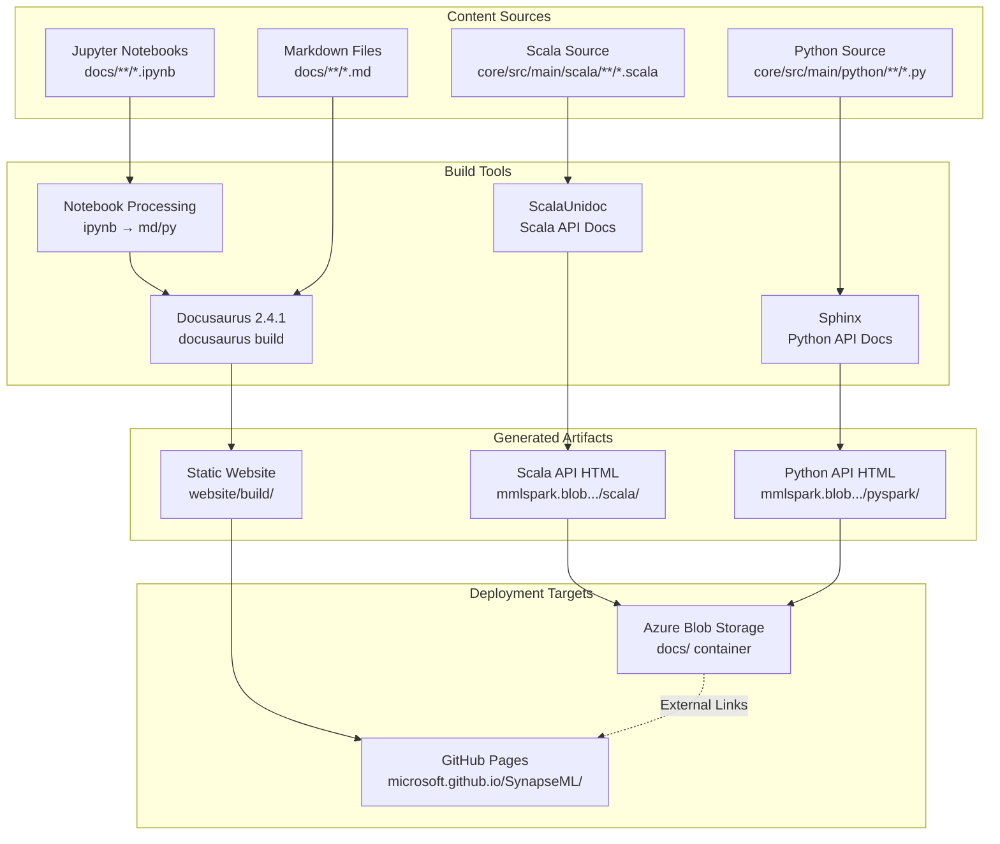
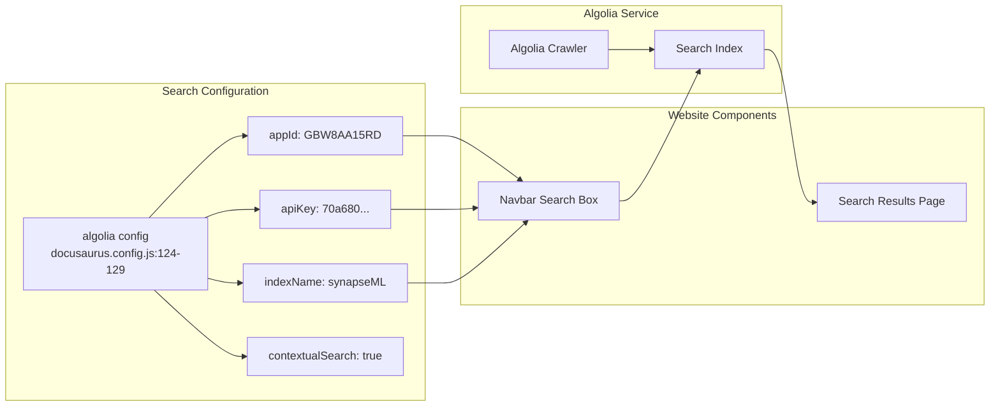
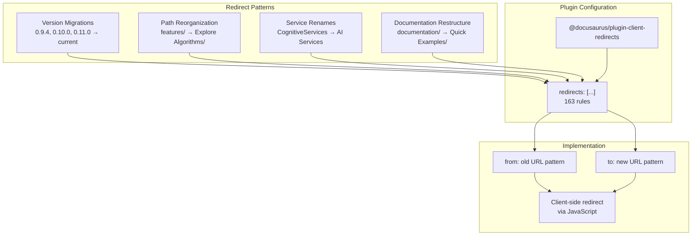
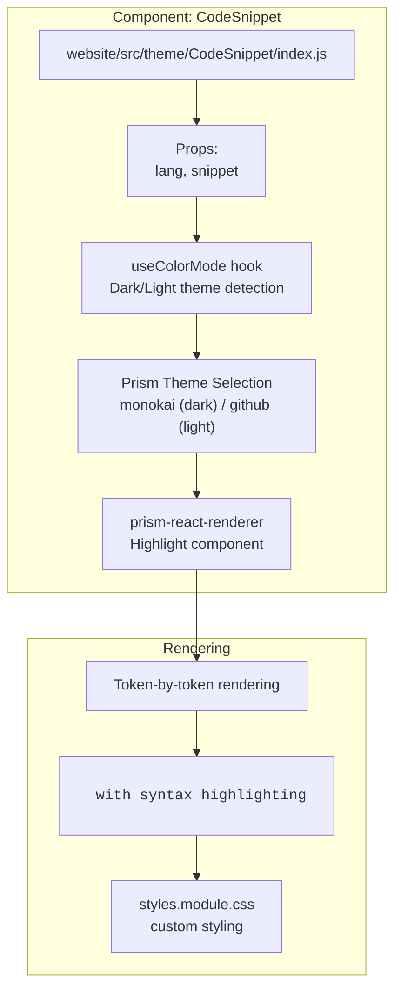
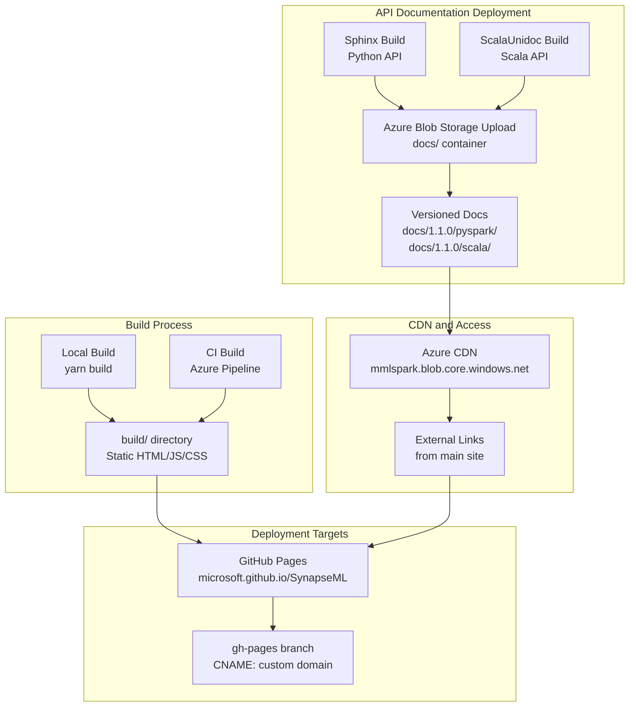

<!-- source: DeepWiki mcp.deepwiki.com · repo microsoft/SynapseML · page 7 Documentation System · fetched 2026-10-26 -->

# Documentation System

<details>
<summary>Relevant source files</summary>

The following files were used as context for generating this wiki page:

- [docs/Explore Algorithms/Vowpal Wabbit/Quickstart - Classification using VW-native Format.ipynb](docs/Explore Algorithms/Vowpal Wabbit/Quickstart - Classification using VW-native Format.ipynb)
- [website/docusaurus.config.js](website/docusaurus.config.js)
- [website/package.json](website/package.json)
- [website/src/theme/CodeSnippet/index.js](website/src/theme/CodeSnippet/index.js)
- [website/src/theme/NotFound/index.js](website/src/theme/NotFound/index.js)
- [website/src/theme/SampleSnippet/index.js](website/src/theme/SampleSnippet/index.js)
- [website/yarn.lock](website/yarn.lock)

</details>


## Purpose and Scope

The Documentation System encompasses the infrastructure, build processes, and deployment mechanisms that generate and serve the SynapseML public-facing documentation website. This includes the Docusaurus-based site, API documentation generation, notebook examples, and search integration. For information about testing documentation quality, see [Testing Infrastructure](#4). For CI/CD pipeline integration, see [CI/CD Pipeline](#3.1).

## Overview

The documentation system transforms multiple content sources (Jupyter notebooks, markdown files, source code) into a unified, versioned website hosted on GitHub Pages at `https://microsoft.github.io/SynapseML/`. It uses Docusaurus 2.4.1 as the static site generator, Algolia for search, and Azure Blob Storage for hosting API documentation artifacts.

**Key Characteristics:**
- Multi-version support (0.9.4, 0.10.0, 1.1.0)
- Internationalization ready with locale dropdown
- Dark mode default theme
- Math rendering via KaTeX
- 160+ URL redirects for backward compatibility
- Google Analytics integration (tracking ID: G-RWPE0183E8)

Sources: [website/docusaurus.config.js:1-480](), [website/package.json:1-65]()

## Content Sources and Flow



**Content Processing Pipeline:**

1. **Jupyter Notebooks**: Serve dual purposes as both executable examples and documentation pages. Notebooks are converted to markdown during the build process and integrated into Docusaurus.

2. **Markdown Documentation**: Authored in `docs/` directory, organized by topic (Get Started, Explore Algorithms, etc.), processed directly by Docusaurus with remark-math and rehype-katex for mathematical notation.

3. **API Documentation**: Generated separately from source code annotations. Scala API uses ScalaUnidoc, Python API uses Sphinx. These are uploaded to Azure Blob Storage and linked from the main site via external URLs.

Sources: [website/docusaurus.config.js:135-158](), Diagram 5 from high-level architecture

## Docusaurus Configuration

The primary configuration resides in `docusaurus.config.js`, which defines the site structure, plugins, and integrations.

### Core Configuration

| Property | Value | Purpose |
|----------|-------|---------|
| `title` | "SynapseML" | Site title |
| `url` | "https://microsoft.github.io" | Base domain |
| `baseUrl` | "/SynapseML/" | Path prefix |
| `organizationName` | "microsoft" | GitHub org |
| `projectName` | "SynapseML" | GitHub repo |
| `trailingSlash` | `true` | URL formatting |
| `version` | "1.1.0" | Current version |

Sources: [website/docusaurus.config.js:6-17]()

### Theme Configuration

The site uses a custom Prism theme configuration with separate light/dark modes:

```javascript
prism: {
    theme: require('./src/plugins/prism_themes/github'),
    darkTheme: require('./src/plugins/prism_themes/monokai'),
    additionalLanguages: ['csharp', 'powershell'],
}
```

**Default Mode**: Dark mode (`colorMode.defaultMode: 'dark'`)

**Supported Languages**: JavaScript, Python, Scala, C#, PowerShell, YAML (via custom themes)

Sources: [website/docusaurus.config.js:26-32]()

### Algolia Search Integration



**Configuration Details**:
- **App ID**: `GBW8AA15RD`
- **Index Name**: `synapseML`
- **Contextual Search**: Enabled to scope results by documentation version
- **Theme Integration**: Search box appears in navbar via `@docusaurus/theme-search-algolia` plugin

Sources: [website/docusaurus.config.js:124-129](), [website/package.json:22]()

## Navigation and Versioning

### Navbar Structure

The navbar configuration defines the primary navigation structure:

```javascript
navbar: {
    items: [
        {to: 'docs/Overview', label: 'Docs', position: 'left'},
        {to: 'blog', label: 'Blog', position: 'left'},
        {to: 'videos', label: 'Videos', position: 'left'},
        {
            type: 'docsVersionDropdown',
            position: 'right',
        },
        {
            type: 'localeDropdown',
            position: 'right',
        },
        {
            label: 'Developer Docs',
            position: 'right',
            items: [
                {
                    label: 'Python',
                    href: `https://mmlspark.blob.core.windows.net/docs/${version}/pyspark/index.html`,
                },
                {
                    label: 'Scala',
                    href: `https://mmlspark.blob.core.windows.net/docs/${version}/scala/com/microsoft/azure/synapse/ml/index.html`,
                }
            ]
        },
        // GitHub link icon
    ],
}
```

**Key Features**:
- **Version Dropdown**: Automatically populated from `versions.json` file
- **Locale Dropdown**: Prepared for internationalization (i18n)
- **External API Links**: Point to version-specific API docs on Azure Blob Storage
- **GitHub Icon**: Links to source repository

Sources: [website/docusaurus.config.js:35-74]()

### Version Management

The documentation supports multiple versions with version-specific documentation:

**Current Versions**:
- 1.1.0 (latest)
- 0.10.0
- 0.9.4

**Version-Specific Resources**:
- Each version has separate API documentation URLs
- Sidebars can differ between versions
- Content is duplicated and frozen for each version

Sources: [website/docusaurus.config.js:4](), [website/docusaurus.config.js:59-63]()

## URL Redirect System

The documentation system maintains extensive backward compatibility through a redirect plugin configuration with 160+ redirect rules.

### Redirect Categories



**Example Redirect Rules**:

| From | To | Reason |
|------|-----|--------|
| `/docs/about/` | `/docs/Overview/` | Documentation restructure |
| `/docs/features/cognitive_services/CognitiveServices%20-%20Overview/` | `/docs/Explore Algorithms/AI Services/Overview/` | Path reorganization + service rename |
| `/docs/getting_started/installation/` | `/docs/Get Started/Install SynapseML/` | Space-normalized paths |
| `/docs/0.9.4/features/lightgbm/LightGBM%20-%20Overview/` | `/docs/Explore Algorithms/LightGBM/Overview/` | Version migration |

Sources: [website/docusaurus.config.js:159-478]()

### Redirect Implementation

The `@docusaurus/plugin-client-redirects` plugin generates HTML files at old URLs that immediately redirect to new locations using JavaScript. This approach:
- Maintains SEO value from old URLs
- Works without server-side configuration
- Supports complex pattern matching
- Handles percentage-encoded URLs

Sources: [website/docusaurus.config.js:160-478](), [website/package.json:19]()

## Custom React Components

The website extends Docusaurus with custom React components for enhanced code presentation.

### CodeSnippet Component



**Implementation Details**:

The component handles theme-aware syntax highlighting with server-side rendering (SSR) compatibility:

```javascript
const [mounted, setMounted] = useState(false);
useEffect(() => {
    setMounted(true);
}, []);

const {isDarkTheme} = useColorMode();
const lightModeTheme = prism.theme || monokai;
const darkModeTheme = prism.darkTheme || lightModeTheme;
const prismTheme = isDarkTheme ? darkModeTheme : lightModeTheme;
```

**Key Features**:
- **SSR Compatibility**: Uses `mounted` state to force re-render after hydration, preventing theme flash
- **Theme Switching**: Dynamically selects Prism theme based on color mode
- **Language Support**: Accepts `lang` prop for syntax highlighting (defaults to YAML)
- **Token-Level Rendering**: Uses `getLineProps` and `getTokenProps` for fine-grained styling

Sources: [website/src/theme/CodeSnippet/index.js:1-58]()

### SampleSnippet Component

An enhanced code snippet component with copy functionality and optional "Read more" link:

**Component Structure**:
```javascript
function SampleSnippet(props) {
  const { lang = "python", config, copyBit, further } = props;
  
  const handleCopyCode = () => {
    copy(copySnippet);
    setShowCopied(true);
    setTimeout(() => setShowCopied(false), 2000);
  };
  
  // Returns Highlight component with:
  // - Copy button (shows "Copied" for 2 seconds)
  // - Optional "Read more" link
  // - Same theme-aware rendering as CodeSnippet
}
```

**Features**:
- **Copy Button**: Uses `copy-text-to-clipboard` library with visual feedback
- **Customizable Copy Text**: `copyBit` prop can differ from displayed `config`
- **Further Reading Link**: Optional `further` prop adds navigation button
- **Internationalization**: Uses `@docusaurus/Translate` for button labels
- **Styling**: Custom CSS classes via `styles.module.css`

Sources: [website/src/theme/SampleSnippet/index.js:1-119]()

### NotFound Component (404 Page)

Custom 404 page with user-friendly messaging:

```javascript
function NotFound() {
  return (
    <Layout title="Page Not Found">
      <div className="container margin-vert--xl">
        <div className="row">
          <div className={classnames("col col--6 col--offset-3", styles.notFoundContainer)}>
            <h1 className="hero__title">Sorry! Page Not Found</h1>
            <p>We have been doing some work on our website, chances are that 
               the page you're looking for is <a href="./docs/Overview/">in the new docs section</a>.</p>
          </div>
        </div>
      </div>
    </Layout>
  );
}
```

**Purpose**: Guides users to the new documentation structure after recent reorganization

Sources: [website/src/theme/NotFound/index.js:1-30]()

## Build Dependencies

### Core Dependencies

The website relies on several key npm packages:

| Package | Version | Purpose |
|---------|---------|---------|
| `@docusaurus/core` | ^2.4.1 | Static site generator core |
| `@docusaurus/preset-classic` | ^2.4.1 | Default theme and plugins |
| `@docusaurus/plugin-client-redirects` | ^2.4.1 | URL redirect handling |
| `@docusaurus/theme-search-algolia` | ^2.4.1 | Algolia search integration |
| `react` | ^16.8.4 | UI framework |
| `react-dom` | ^16.8.4 | React rendering |
| `remark-math` | 3 | Markdown math support |
| `rehype-katex` | 4 | Math rendering (LaTeX) |
| `react-player` | ^2.11.0 | Video playback (for Videos page) |

Sources: [website/package.json:17-38]()

### Security Resolutions

The package.json includes security resolutions to override vulnerable transitive dependencies:

```javascript
"resolutions": {
    "@docusaurus/core/**/set-value": "^4.0.1",
    "@docusaurus/**/trim": "^0.0.3",
    "@docusaurus/**/glob-parent": "^5.1.2",
    "@docusaurus/**/ansi-html-community": "^0.0.8",
    "@docusaurus/**/immer": "^9.0.6",
    "@docusaurus/**/browserslist": "^4.16.5",
    "@docusaurus/**/nth-check": "^2.0.1",
    // ...
}
```

These resolutions ensure that vulnerable versions of indirect dependencies are replaced with patched versions.

Sources: [website/package.json:39-52]()

## Build and Deployment Scripts

### NPM Scripts

```javascript
"scripts": {
    "start": "docusaurus start",        // Development server
    "build": "docusaurus build",        // Production build
    "swizzle": "docusaurus swizzle",    // Component customization
    "deploy": "docusaurus deploy",      // GitHub Pages deployment
    "clear": "docusaurus clear",        // Clear cache
    "serve": "docusaurus serve",        // Serve production build
    "audit:fix": "npx yarn-audit-fix"   // Security audit fix
}
```

**Development Workflow**:
1. `yarn start` - Launches development server with hot reload at `http://localhost:3000`
2. `yarn build` - Generates static site in `website/build/` directory
3. `yarn serve` - Serves production build locally for testing
4. `yarn deploy` - Deploys to GitHub Pages

Sources: [website/package.json:8-16]()

### Build Configuration

The Docusaurus preset configures the build process:

```javascript
presets: [
    [
        '@docusaurus/preset-classic',
        {
            docs: {
                sidebarPath: require.resolve('./sidebars.js'),
                remarkPlugins: [math],
                rehypePlugins: [katex],
            },
            theme: {
                customCss: require.resolve('./src/css/custom.css'),
            },
            gtag: {
                trackingID: 'G-RWPE0183E8',
                anonymizeIP: true,
            },
            blog: {
                feedOptions: {
                    type: 'all',
                },
            },
        },
    ],
]
```

**Configuration Elements**:
- **Sidebar**: Generated from `sidebars.js` configuration file
- **Math Support**: `remark-math` processes `$...$` syntax, `rehype-katex` renders to HTML
- **Custom CSS**: Site-wide styles from `src/css/custom.css`
- **Analytics**: Google Analytics 4 with anonymized IPs
- **Blog RSS**: Generates RSS, Atom, and JSON feeds

Sources: [website/docusaurus.config.js:135-158]()

## Footer Configuration

The footer provides navigation and community links:

```javascript
footer: {
    style: 'dark',
    links: [
        {
            title: 'Docs',
            items: [
                {label: 'Installation', to: 'docs/Get%20Started/Install%20SynapseML'},
                {label: 'Getting Started', to: 'docs/Get%20Started/Quickstart%20-%20Your%20First%20Models'},
                {label: 'Python API Reference', to: 'https://mmlspark.blob.core.windows.net/docs/1.0.13/pyspark/index.html'},
                {label: 'Scala API Reference', to: 'https://mmlspark.blob.core.windows.net/docs/1.1.0/scala/index.html'},
            ],
        },
        {
            title: 'More',
            items: [
                {label: 'Blog', to: 'blog'},
                {label: 'Videos', to: 'videos'},
            ],
        },
        {
            title: 'Community',
            items: [
                {label: 'GitHub', href: 'https://github.com/microsoft/SynapseML'},
            ],
        },
    ],
    copyright: `Copyright © ${new Date().getFullYear()} Microsoft.`,
}
```

**Notable Features**:
- External links to version-specific API documentation on Azure Blob Storage
- Links to different documentation versions (note Python link still points to 1.0.13)
- GitHub repository link for community engagement

Sources: [website/docusaurus.config.js:75-123]()

## Math Rendering Integration

The documentation system supports mathematical notation using KaTeX:

### Configuration

```javascript
// In docusaurus.config.js
stylesheets: [
    {
        href: "https://cdn.jsdelivr.net/npm/katex@0.13.11/dist/katex.min.css",
        integrity: "sha384-Um5gpz1odJg5Z4HAmzPtgZKdTBHZdw8S29IecapCSB31ligYPhHQZMIlWLYQGVoc",
        crossorigin: "anonymous",
    },
],

// In preset configuration
docs: {
    remarkPlugins: [math],
    rehypePlugins: [katex],
}
```

**Processing Pipeline**:
1. `remark-math` (version 3) parses LaTeX syntax in markdown (`$inline$` and `$$block$$`)
2. `rehype-katex` (version 4) converts parsed math to HTML with KaTeX classes
3. KaTeX CSS stylesheet styles the rendered math

**Usage in Documentation**:
```markdown
Inline math: $E = mc^2$

Block math:
$$
\frac{\partial f}{\partial x} = \lim_{h \to 0} \frac{f(x+h) - f(x)}{h}
$$
```

Sources: [website/docusaurus.config.js:18-24](), [website/docusaurus.config.js:141-142](), [website/package.json:35-36]()

## Announcement Bar

The site includes a persistent announcement bar encouraging GitHub stars:

```javascript
announcementBar: {
    id: 'announcementBar-1', // Increment on change
    content: `⭐️ If you like SynapseML, consider giving it a star on 
              <a target="_blank" rel="noopener noreferrer" 
              href="https://github.com/Microsoft/SynapseML">GitHub</a> ⭐`,
}
```

**Purpose**: Drive community engagement through GitHub stars
**Dismissible**: Users can close the bar; dismissed state persists via `id` versioning

Sources: [website/docusaurus.config.js:130-133]()

## Example Notebooks as Documentation

Jupyter notebooks serve as both executable examples and documentation content. The provided example demonstrates the standard notebook structure:

### Notebook Structure Pattern

```python
# 1. Header with visual branding


# 2. Title and description
# Binary Classification with VowpalWabbit on Criteo Dataset

# 3. Step-by-step code with explanations
## SparkML Vector input
#### Read dataset
# Code cells with actual implementation

# 4. Results and metrics display
from synapse.ml.train import ComputeModelStatistics
metrics = ComputeModelStatistics(...)
display(metrics)
```

**Key Characteristics**:
- Markdown cells provide narrative structure
- Code cells are executable in Synapse/Databricks environments
- `display()` function shows interactive dataframes
- External resources (images, datasets) hosted on Azure Blob Storage
- Self-contained examples with all necessary imports

**Integration with Website**:
- Notebooks are converted to markdown pages during build
- Code blocks become syntax-highlighted examples
- Output is preserved or re-generated during testing
- Notebooks also serve as E2E tests (see [Synapse E2E Testing](#4.2) and [Databricks E2E Testing](#4.3))

Sources: [docs/Explore Algorithms/Vowpal Wabbit/Quickstart - Classification using VW-native Format.ipynb:1-191]()

## Deployment Architecture



### GitHub Pages Deployment

**Deployment Command**: `docusaurus deploy`

**Process**:
1. Builds static site to `build/` directory
2. Creates/updates `gh-pages` branch in repository
3. Pushes static files to `gh-pages` branch
4. GitHub Pages serves from `gh-pages` branch at configured URL

**Configuration**:
- **Organization Name**: `microsoft`
- **Project Name**: `SynapseML`
- **Base URL**: `/SynapseML/`
- **Trailing Slash**: Enabled for consistent URLs

Sources: [website/docusaurus.config.js:6-14]()

### API Documentation Deployment

API documentation is deployed separately to Azure Blob Storage:

**Storage Structure**:
```
mmlspark.blob.core.windows.net/docs/
├── 1.1.0/
│   ├── pyspark/
│   │   └── index.html
│   └── scala/
│       └── com/microsoft/azure/synapse/ml/index.html
├── 0.10.0/
│   ├── pyspark/
│   └── scala/
└── ...
```

**Access Pattern**:
- Python API: `https://mmlspark.blob.core.windows.net/docs/{version}/pyspark/index.html`
- Scala API: `https://mmlspark.blob.core.windows.net/docs/{version}/scala/com/microsoft/azure/synapse/ml/index.html`

**Integration**: Main website links to these external docs via navbar "Developer Docs" dropdown

Sources: [website/docusaurus.config.js:54-66]()

## Quality Assurance

### Dead Link Checking

The CI/CD pipeline includes dead link validation:

**Tool**: `wget --spider --recursive` or similar link checker
**Scope**: Validates all internal links and external references
**Timing**: Runs as part of website build in CI pipeline

For details on the testing infrastructure, see [Testing Infrastructure](#4).

### Code Block Testing

Jupyter notebooks undergo automated testing:

**Tool**: `pytest-codeblocks` (Python)
**Process**:
1. Extract code blocks from notebook cells
2. Execute code in isolated environment
3. Validate output and check for errors
4. Report test failures

**Integration**: Code blocks in website documentation are derived from tested notebooks, ensuring accuracy

For details on notebook testing, see [Synapse E2E Testing](#4.2) and [Website Code Tests](#4.1).

Sources: Diagram 4 from high-level architecture, [Testing Infrastructure](#4)

---

**Related Pages**:
- [Website Architecture](#7.1) - Detailed technical architecture of Docusaurus site
- [Homepage and Components](#7.2) - React components and homepage design
- [Example Notebooks](#7.3) - Notebook system and conversion pipeline
- [CI/CD Pipeline](#3.1) - Integration of documentation builds in CI/CD
- [Testing Infrastructure](#4) - Quality assurance for documentation

---

