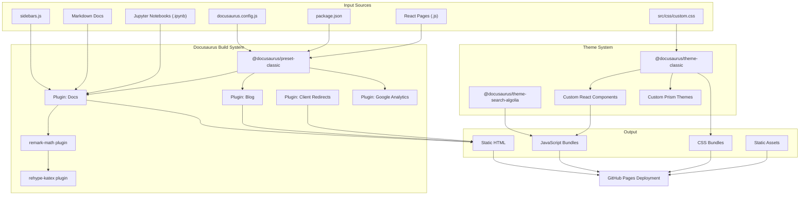
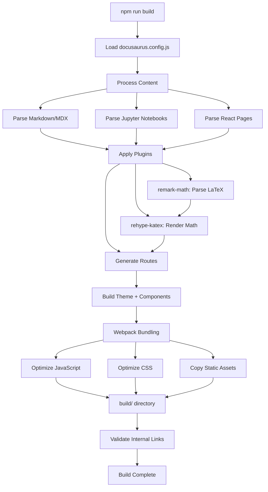
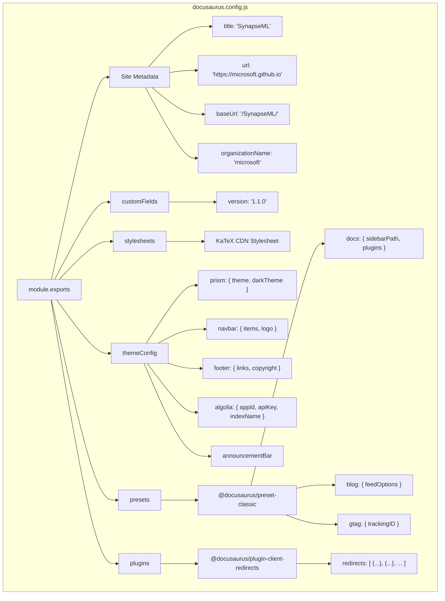
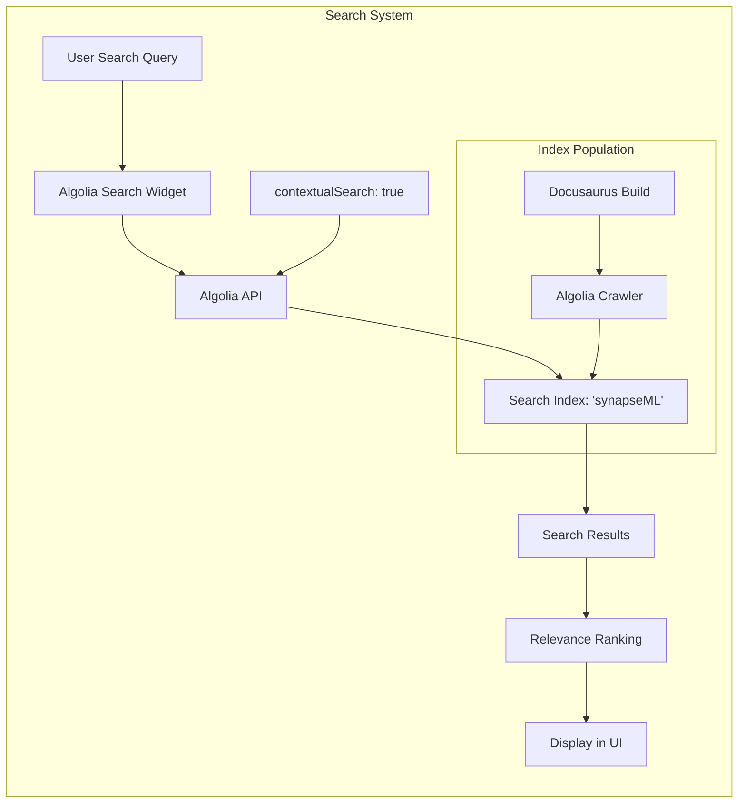
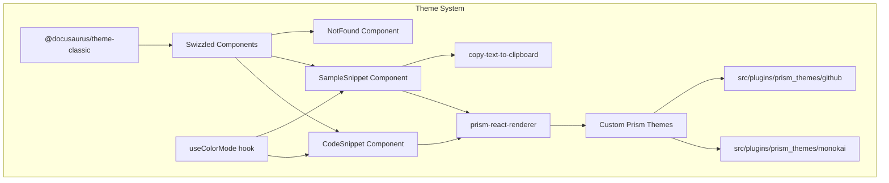
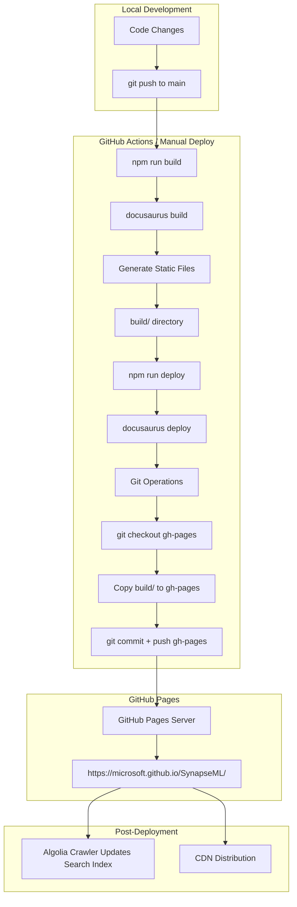
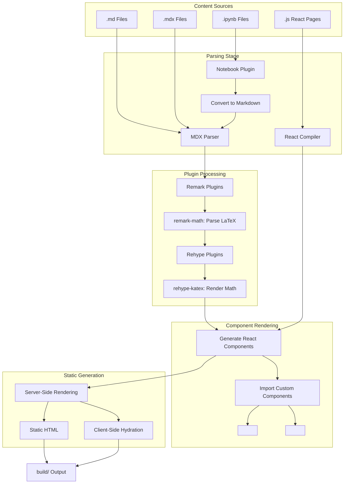

<!-- source: DeepWiki mcp.deepwiki.com · repo microsoft/SynapseML · page 7.1 Website Architecture · fetched 2026-10-26 -->

# Website Architecture

<details>
<summary>Relevant source files</summary>

The following files were used as context for generating this wiki page:

- [docs/Explore Algorithms/Vowpal Wabbit/Quickstart - Classification using VW-native Format.ipynb](docs/Explore Algorithms/Vowpal Wabbit/Quickstart - Classification using VW-native Format.ipynb)
- [website/docusaurus.config.js](website/docusaurus.config.js)
- [website/package.json](website/package.json)
- [website/src/theme/CodeSnippet/index.js](website/src/theme/CodeSnippet/index.js)
- [website/src/theme/NotFound/index.js](website/src/theme/NotFound/index.js)
- [website/src/theme/SampleSnippet/index.js](website/src/theme/SampleSnippet/index.js)
- [website/yarn.lock](website/yarn.lock)

</details>


This page documents the technical architecture of the SynapseML documentation website, including the Docusaurus build system, versioning strategy, search integration, and deployment pipeline.

## Technology Stack

The SynapseML website is built on **Docusaurus v2.4.1**, a React-based static site generator optimized for technical documentation. The core technology stack includes:

| Component | Technology | Version |
|-----------|-----------|---------|
| Static Site Generator | Docusaurus | 2.4.1 |
| UI Framework | React | 16.8.4 |
| Syntax Highlighting | Prism React Renderer | - |
| Math Rendering | KaTeX | 0.13.11 |
| Search | Algolia DocSearch | - |
| Package Manager | Yarn | - |
| Build Tool | Node.js | 16.18.1+ |

The site is hosted on **GitHub Pages** at `https://microsoft.github.io/SynapseML/`.

Sources: [website/package.json:1-65](), [website/docusaurus.config.js:1-25]()

## Architecture Overview

**Docusaurus Architecture Diagram**



Sources: [website/docusaurus.config.js:135-158](), [website/package.json:17-38]()

## Build System

The build system uses npm/yarn scripts defined in `package.json` to orchestrate the Docusaurus build pipeline.

**Build Scripts**

| Script | Command | Purpose |
|--------|---------|---------|
| `start` | `docusaurus start` | Starts local development server with hot reload |
| `build` | `docusaurus build` | Produces optimized production build |
| `serve` | `docusaurus serve` | Serves production build locally for testing |
| `deploy` | `docusaurus deploy` | Deploys to GitHub Pages |
| `clear` | `docusaurus clear` | Clears build cache and temp files |
| `swizzle` | `docusaurus swizzle` | Ejects theme components for customization |

**Build Process Flow**



The build outputs a fully static site in the `build/` directory with:
- Pre-rendered HTML for all pages (SEO-optimized)
- Code-split JavaScript bundles
- Optimized CSS files
- Copied static assets (images, fonts, etc.)

Sources: [website/package.json:8-16](), [website/docusaurus.config.js:1-6]()

## Configuration Architecture

**docusaurus.config.js Structure**

The main configuration file exports a JavaScript object with the following structure:



Key configuration sections:

**Site Metadata** ([website/docusaurus.config.js:6-14]()):
- `title`: "SynapseML"
- `tagline`: "Simple and Distributed Machine Learning"
- `url`: Base URL for GitHub Pages
- `baseUrl`: "/SynapseML/"
- `organizationName`: "microsoft"
- `projectName`: "SynapseML"

**Theme Configuration** ([website/docusaurus.config.js:25-134]()):
- `prism`: Custom syntax highlighting themes for light/dark modes
- `colorMode`: Default to dark theme
- `navbar`: Navigation bar with version dropdown, locale selector, and external API docs links
- `footer`: Links to documentation, community resources
- `algolia`: Search integration configuration
- `announcementBar`: Site-wide announcement banner

**Presets** ([website/docusaurus.config.js:135-158]()):
The `@docusaurus/preset-classic` bundle includes:
- Docs plugin with `remark-math` and `rehype-katex` for LaTeX rendering
- Blog plugin with RSS/Atom feed generation
- Google Analytics (`gtag`) for tracking
- Custom CSS from `src/css/custom.css`

**Plugins** ([website/docusaurus.config.js:159-479]()):
- `@docusaurus/plugin-client-redirects`: Manages 100+ URL redirects for backward compatibility

Sources: [website/docusaurus.config.js:1-480]()

## Versioning System

The website supports multiple documentation versions corresponding to SynapseML releases. Version management is handled through Docusaurus's built-in versioning system.

**Version Configuration**

The current version is defined in [website/docusaurus.config.js:4]():
```javascript
let version = "1.1.0";
```

This version variable is used throughout the configuration:
- Custom fields exposed to React components ([website/docusaurus.config.js:15-17]())
- External API documentation links ([website/docusaurus.config.js:59-64]())

**Version Dropdown**

The navbar includes a version dropdown ([website/docusaurus.config.js:45-48]()) configured with:
```javascript
{
    type: 'docsVersionDropdown',
    position: 'right',
}
```

This allows users to switch between:
- Latest version (1.1.0)
- Previous versions (0.9.4, 0.10.0, etc.)

**Versioned API Documentation**

External API documentation is versioned and hosted on Azure Blob Storage:
- **Python API**: `https://mmlspark.blob.core.windows.net/docs/${version}/pyspark/index.html`
- **Scala API**: `https://mmlspark.blob.core.windows.net/docs/${version}/scala/com/microsoft/azure/synapse/ml/index.html`

These links are dynamically generated based on the current version.

**Version-Specific Content**

Each documentation version maintains:
- Separate sidebar configuration
- Version-specific markdown/notebook files
- Independent build artifacts

The versioning system ensures users can access documentation matching their installed SynapseML version.

Sources: [website/docusaurus.config.js:4](), [website/docusaurus.config.js:15-17](), [website/docusaurus.config.js:45-65]()

## Search Integration

The website uses **Algolia DocSearch** for full-text search across all documentation pages.

**Algolia Configuration**

Configuration in [website/docusaurus.config.js:124-129]():

```javascript
algolia: {
    appId: 'GBW8AA15RD',
    apiKey: '70a6807005c645678741ab941bb89ed8',
    indexName: 'synapseML',
    contextualSearch: true,
}
```

**Search Architecture**



**Search Features**:
- **Contextual search**: Results scoped to current documentation version
- **Full-text indexing**: All markdown, notebook content, and code snippets
- **Ranking algorithm**: Prioritizes title matches, then heading matches, then body content
- **Instant results**: Search-as-you-type with debouncing
- **Keyboard navigation**: Full keyboard support for accessibility

The Algolia index is automatically updated when new content is deployed to GitHub Pages via the Algolia crawler.

Sources: [website/docusaurus.config.js:124-129](), [website/package.json:22]()

## Theme and Custom Components

The website extends the default Docusaurus theme with custom React components for enhanced code display and user experience.

**Custom Theme Components**



**CodeSnippet Component** ([website/src/theme/CodeSnippet/index.js:1-57]()):

This component renders syntax-highlighted code blocks with theme awareness:

```javascript
function CodeSnippet(props) {
  const { isDarkTheme } = useColorMode();
  const prismTheme = isDarkTheme ? darkModeTheme : lightModeTheme;
  
  return (
    <Highlight theme={prismTheme} code={snippet} language={lang}>
      {({ className, style, tokens, getLineProps, getTokenProps }) => (
        <pre className={className} style={style}>
          {/* Render code tokens */}
        </pre>
      )}
    </Highlight>
  );
}
```

Key features:
- Automatic light/dark theme switching based on `useColorMode()` hook
- Uses `prism-react-renderer` for syntax highlighting
- Supports multiple languages (Python, Scala, JavaScript, etc.)
- Server-side rendering safe with `mounted` state

**SampleSnippet Component** ([website/src/theme/SampleSnippet/index.js:1-118]()):

Enhanced code snippet with interactive features:

```javascript
function SampleSnippet(props) {
  const [showCopied, setShowCopied] = useState(false);
  
  const handleCopyCode = () => {
    copy(copySnippet);
    setShowCopied(true);
    setTimeout(() => setShowCopied(false), 2000);
  };
  
  return (
    <Highlight theme={prismTheme} code={config} language={lang}>
      {/* Code rendering */}
      <button onClick={handleCopyCode}>
        {showCopied ? "Copied" : "Copy"}
      </button>
      {further && <Link to={further}>Read more</Link>}
    </Highlight>
  );
}
```

Key features:
- Copy-to-clipboard functionality with visual feedback
- Optional "Read more" links to detailed documentation
- Same theme awareness as CodeSnippet
- Used on homepage for installation instructions

**NotFound Component** ([website/src/theme/NotFound/index.js:1-30]()):

Custom 404 page that provides helpful navigation:

```javascript
function NotFound() {
  return (
    <Layout title="Page Not Found">
      <h1>Sorry! Page Not Found</h1>
      <p>Chances are that the page you're looking for is 
         <a href="./docs/Overview/">in the new docs section</a>.</p>
    </Layout>
  );
}
```

This component is particularly useful given the extensive redirect system (100+ redirects) for legacy URLs.

**Custom Prism Themes**:
- **Light mode**: GitHub theme (`src/plugins/prism_themes/github`)
- **Dark mode**: Monokai theme (`src/plugins/prism_themes/monokai`)
- Additional language support configured in [website/docusaurus.config.js:26-30]()

Sources: [website/src/theme/CodeSnippet/index.js:1-57](), [website/src/theme/SampleSnippet/index.js:1-118](), [website/src/theme/NotFound/index.js:1-30](), [website/docusaurus.config.js:26-30]()

## Deployment Pipeline

The website deploys to **GitHub Pages** using Docusaurus's built-in deployment command.

**Deployment Flow**



**Deployment Configuration**

The site is configured for GitHub Pages deployment in [website/docusaurus.config.js:9-13]():

```javascript
url: 'https://microsoft.github.io',
baseUrl: '/SynapseML/',
organizationName: 'microsoft',
projectName: 'SynapseML',
trailingSlash: true,
```

Key deployment settings:
- **URL**: `https://microsoft.github.io`
- **Base URL**: `/SynapseML/` (project path)
- **Organization**: `microsoft`
- **Project**: `SynapseML`
- **Trailing Slash**: Required for GitHub Pages compatibility

**Static Site Characteristics**:
- Fully pre-rendered HTML (no server-side rendering required)
- Optimized JavaScript bundles with code-splitting
- Optimized CSS with minification
- Asset optimization (images, fonts)
- Service worker for offline support (optional)

**Deployment Triggers**:
1. Manual deployment via `npm run deploy`
2. Automated CI/CD pipeline deployment (via Azure DevOps or GitHub Actions)

After deployment, the Algolia crawler automatically indexes the new content for search.

Sources: [website/docusaurus.config.js:9-14](), [website/package.json:12]()

## Content Pipeline

Docusaurus processes multiple content types through a unified pipeline that converts them into static HTML pages.

**Content Processing Flow**



**Markdown/MDX Processing**:

Standard markdown and MDX files are processed through:
1. **remark-math** plugin ([website/docusaurus.config.js:141]()): Parses LaTeX math expressions (e.g., `$f(x) = x^2$`)
2. **rehype-katex** plugin ([website/docusaurus.config.js:142]()): Renders LaTeX using KaTeX library
3. MDX component imports: Allows embedding React components in markdown

**Jupyter Notebook Processing**:

Jupyter notebooks (.ipynb) are automatically:
1. Converted to markdown format
2. Code cells rendered as syntax-highlighted code blocks
3. Output cells preserved as images or text
4. Frontmatter metadata extracted for page metadata

**React Page Processing**:

React pages in `src/pages/` are:
1. Compiled as standard React components
2. Server-side rendered for initial page load
3. Hydrated on client-side for interactivity

**External API Documentation**:

Python and Scala API documentation is:
- Generated separately using Sphinx and Scaladoc
- Uploaded to Azure Blob Storage
- Linked from navbar ([website/docusaurus.config.js:54-66]())

Sources: [website/docusaurus.config.js:139-143](), [website/docusaurus.config.js:18-24]()

## Redirect Management

The website maintains backward compatibility with legacy URLs through a comprehensive redirect system using the `@docusaurus/plugin-client-redirects` plugin.

**Redirect Configuration**

Configured in [website/docusaurus.config.js:160-479](), the redirect system handles 100+ URL mappings:

```javascript
{
  '@docusaurus/plugin-client-redirects',
  {
    redirects: [
      {
        to: '/docs/Explore Algorithms/AI Services/Quickstart - Create Audiobooks/',
        from: '/docs/features/cognitive_services/CognitiveServices%20-%20Create%20Audiobooks/',
      },
      {
        to: '/docs/Overview/',
        from: '/docs/about/',
      },
      // ... 100+ more redirects
    ],
  },
}
```

**Redirect Categories**:

1. **Documentation reorganization**: Old feature paths → New algorithm exploration paths
2. **Version migration**: 0.9.4, 0.10.0, 0.11.0 paths → Current version paths
3. **Naming changes**: "CognitiveServices" → "AI Services", "about" → "Overview"
4. **URL encoding fixes**: Spaces and special characters in URLs

**Redirect Implementation**:

The plugin generates client-side redirects that:
1. Match the `from` URL pattern
2. Perform instant browser redirect to `to` URL
3. Preserve query parameters and hash fragments
4. Work with static hosting (no server-side redirects required)

This extensive redirect system ensures:
- External links continue to work
- Search engine indexed pages redirect properly
- Bookmarks from old documentation remain functional
- Smooth migration path for users upgrading SynapseML versions

Sources: [website/docusaurus.config.js:160-479](), [website/package.json:19]()

## Dependencies and Package Management

The website uses Yarn for deterministic dependency management with lockfile-based resolution.

**Core Dependencies**

Key packages from [website/package.json:17-38]():

| Package | Version | Purpose |
|---------|---------|---------|
| `@docusaurus/core` | 2.4.1 | Core Docusaurus framework |
| `@docusaurus/preset-classic` | 2.4.1 | Classic documentation preset |
| `@docusaurus/theme-classic` | 2.4.1 | Default theme |
| `@docusaurus/theme-search-algolia` | 2.4.1 | Algolia search integration |
| `@docusaurus/plugin-client-redirects` | 2.4.1 | Client-side redirects |
| `react` | 16.8.4 | React library |
| `react-dom` | 16.8.4 | React DOM rendering |
| `remark-math` | 3 | LaTeX math parsing |
| `rehype-katex` | 4 | KaTeX math rendering |
| `prism-react-renderer` | - | Syntax highlighting |

**Security Resolutions**

The package includes security resolutions for vulnerable dependencies ([website/package.json:39-52]()):

```javascript
"resolutions": {
  "@docusaurus/core/**/set-value": "^4.0.1",
  "@docusaurus/**/trim": "^0.0.3",
  "@docusaurus/**/ansi-html-community": "^0.0.8",
  "@docusaurus/**/browserslist": "^4.16.5",
  "node-fetch": "^2.6.7",
  "minimatch": "^3.0.5",
  // ...
}
```

These resolutions override transitive dependencies to patch known security vulnerabilities.

**Dependency Lockfile**

The `yarn.lock` file ([website/yarn.lock:1-40000+]()) contains exact version pins for all dependencies and their transitive dependencies, ensuring:
- Reproducible builds across environments
- Protection against supply chain attacks
- Consistent behavior in CI/CD pipelines

Sources: [website/package.json:17-52](), [website/yarn.lock:1-100]()

## Versioning System

The website supports multiple versions of documentation corresponding to different SynapseML releases. This functionality is configured in `docusaurus.config.js`:

- Version dropdown in the navigation bar allows users to switch between versions
- Current version is defined as `1.0.11` in the configuration
- API documentation links point to versioned documentation

This versioning system ensures users can access documentation specific to their installed SynapseML version.

Sources: [website/docusaurus.config.js:4-4](), [website/docusaurus.config.js:45-52](), [tools/docker/demo/Dockerfile:3-3]()

## Redirects Management

The website uses the `@docusaurus/plugin-client-redirects` plugin to manage URL redirects from old documentation paths to new ones. This ensures that links from external sources or bookmarks continue to work even after documentation reorganization.

The redirects are configured in the `docusaurus.config.js` file with numerous mappings for legacy URLs.

Sources: [website/docusaurus.config.js:159-477]()

## Conclusion

The SynapseML website is designed as a comprehensive documentation platform built on modern web technologies. Its modular architecture, organized content structure, and custom components provide an effective user experience for both beginners and advanced users of the SynapseML library.

For information about the SynapseML library itself, refer to the [Overview](1) page. For details on the CI/CD infrastructure that builds and deploys the website, see the [CI/CD Pipeline](3.1) page.

---

