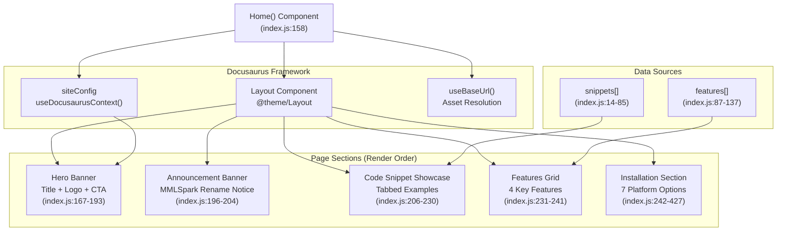
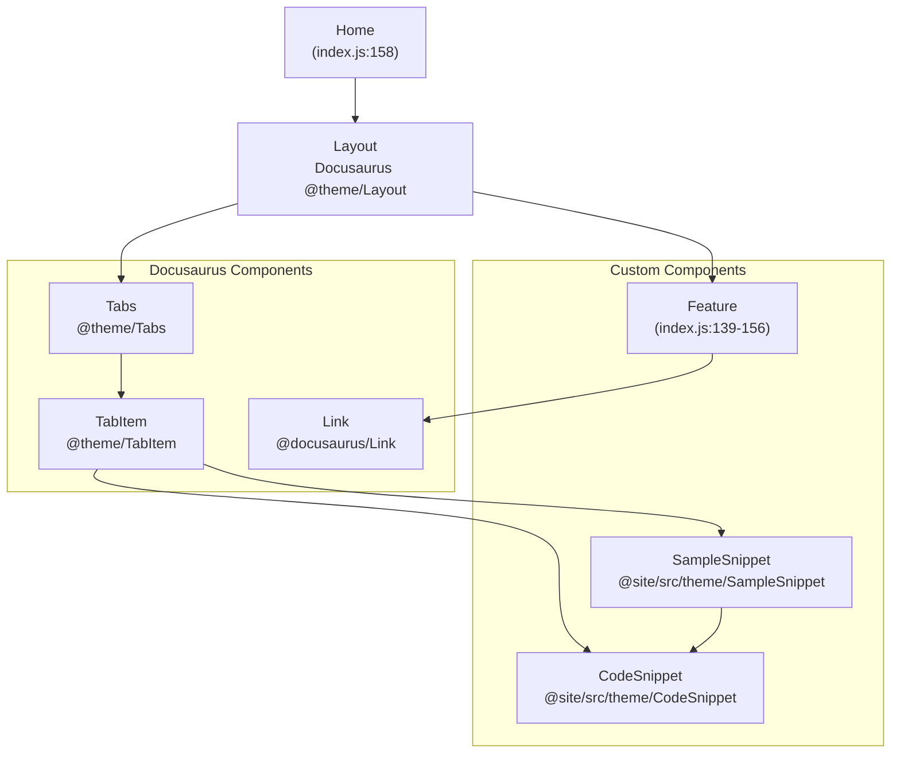
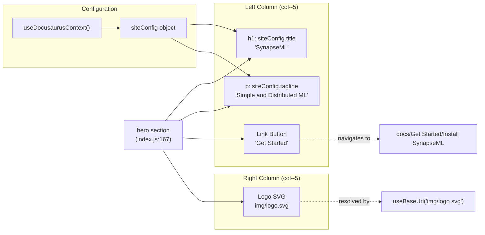
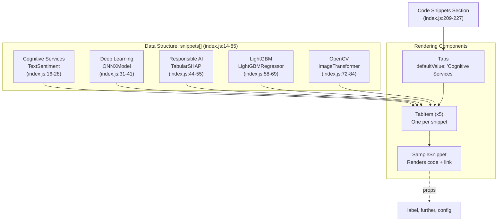
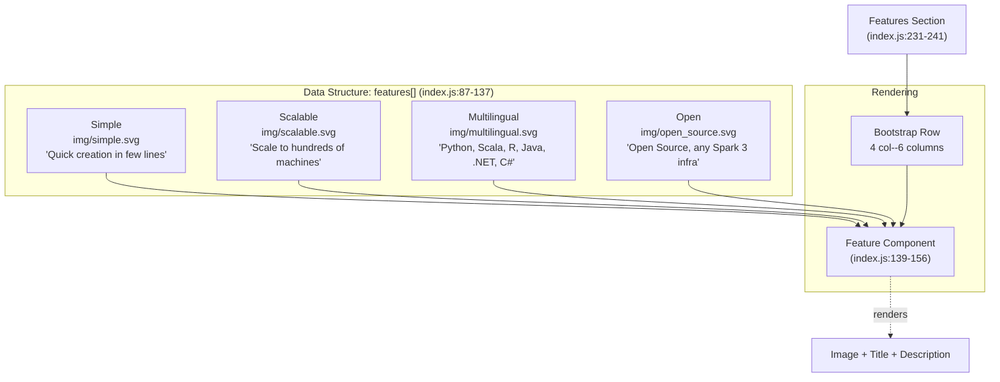
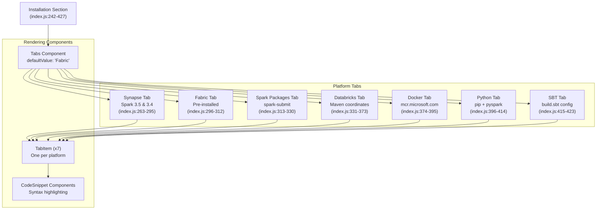

<!-- source: DeepWiki mcp.deepwiki.com · repo microsoft/SynapseML · page 7.2 Homepage and Components · fetched 2026-10-26 -->

# Homepage and Components

<details>
<summary>Relevant source files</summary>

The following files were used as context for generating this wiki page:

- [website/src/pages/index.js](website/src/pages/index.js)

</details>


## Purpose and Scope

This document describes the SynapseML website homepage implementation, including its React component structure, content organization, and the various sections that present SynapseML capabilities and installation instructions to visitors. The homepage serves as the primary entry point for users and showcases code examples, key features, and platform-specific installation guides.

For the overall website architecture and build process, see [Website Architecture](#7.1). For example notebooks that provide deeper technical content, see [Example Notebooks](#7.3).

---

## Homepage Structure Overview

The homepage is implemented as a React component in [website/src/pages/index.js:158-433]() and consists of five main sections that render sequentially from top to bottom.



**Sources:** [website/src/pages/index.js:1-433]()

---

## React Component Hierarchy

The homepage uses a combination of custom and Docusaurus-provided React components organized in a hierarchical structure.



**Component Responsibilities:**

| Component | Purpose | Location |
|-----------|---------|----------|
| `Home` | Root homepage component | [index.js:158-433]() |
| `Layout` | Docusaurus page wrapper with header/footer | Imported at [index.js:3]() |
| `Feature` | Renders individual feature cards with icon and description | [index.js:139-156]() |
| `CodeSnippet` | Displays formatted code with syntax highlighting | Imported at [index.js:8]() |
| `SampleSnippet` | Wraps code snippets with "Further Reading" links | Imported at [index.js:9]() |
| `Tabs` | Container for tabbed interface | Imported at [index.js:10]() |
| `TabItem` | Individual tab content | Imported at [index.js:11]() |

**Sources:** [website/src/pages/index.js:1-12](), [website/src/pages/index.js:139-156]()

---

## Hero Banner Section

The hero banner is the first visible section, presenting the SynapseML branding and primary call-to-action.



The hero banner uses a two-column Bootstrap grid layout ([index.js:169-191]()):
- **Left column**: Title, tagline, and "Get Started" button
- **Right column**: SynapseML logo image

The button links to the installation documentation using [index.js:179]() with the path `"docs/Get%20Started/Install%20SynapseML"`.

**Sources:** [website/src/pages/index.js:167-193]()

---

## Code Snippet Showcase

The code snippet showcase demonstrates SynapseML capabilities through five tabbed Python examples, each highlighting a different module.



Each snippet object in the array ([index.js:14-85]()) contains three properties:

| Property | Type | Purpose | Example |
|----------|------|---------|---------|
| `label` | String | Tab display name | `"Cognitive Services"` |
| `further` | String | Link to detailed documentation | `"docs/Explore%20Algorithms/AI%20Services/Overview#text-analytics-sample"` |
| `config` | String | Python code example | Multi-line code string |

The `SampleSnippet` component wraps each code example and adds a "Further Reading" link that navigates to the documentation specified in the `further` property ([index.js:219-222]()).

**Example Snippet Structure:**

The Cognitive Services example ([index.js:16-28]()) demonstrates the `TextSentiment` transformer:
```python
from synapse.ml.cognitive import *

sentiment_df = (TextSentiment()
    .setTextCol("text")
    .setLocation("eastus")
    .setSubscriptionKey(key)
    .setOutputCol("sentiment")
    .setErrorCol("error")
    .setLanguageCol("language")
    .transform(input_df))
```

**Sources:** [website/src/pages/index.js:14-85](), [website/src/pages/index.js:209-227]()

---

## Features Section

The features section presents four key value propositions of SynapseML in a responsive grid layout.



The `Feature` component ([index.js:139-156]()) is a functional React component that accepts three props:

```javascript
function Feature({ imageUrl, title, description })
```

Each feature object in the array contains:

| Feature | Image | Key Message |
|---------|-------|-------------|
| **Simple** | `img/simple.svg` | "Quickly create, train, and use distributed machine learning tools in only a few lines of code" |
| **Scalable** | `img/scalable.svg` | "Scale ML workloads to hundreds of machines on your Apache Spark cluster" |
| **Multilingual** | `img/multilingual.svg` | "Use SynapseML from any Spark compatible language including Python, Scala, R, Java, .NET and C#" |
| **Open** | `img/open_source.svg` | "Open Source and can be installed and used on any Spark 3 infrastructure" |

The features are rendered in a responsive grid using Bootstrap classes `col col--6` ([index.js:142]()), creating a 2x2 layout on larger screens that collapses to single column on mobile devices.

**Sources:** [website/src/pages/index.js:87-137](), [website/src/pages/index.js:139-156](), [website/src/pages/index.js:231-241]()

---

## Installation Section

The installation section provides platform-specific installation instructions through a tabbed interface supporting seven different deployment scenarios.



### Platform-Specific Configuration Details

#### Synapse Configuration

The Synapse tab ([index.js:263-295]()) provides two separate configurations:

**Spark 3.5 Pools** ([index.js:265-279]()):
- Package: `com.microsoft.azure:synapseml_2.12:1.1.0`
- Repository: `https://mmlspark.azureedge.net/maven`
- Configuration applied via `%%configure -f` magic command
- Includes JAR excludes and classpath settings

**Spark 3.4 Pools** ([index.js:280-294]()):
- Package: `com.microsoft.azure:synapseml_2.12:1.0.15`
- Same repository and configuration pattern

#### Fabric Configuration

The Fabric tab ([index.js:296-312]()) notes that SynapseML is pre-installed but provides configuration for overriding the version:
- Uses template placeholder: `[THE_SYNAPSEML_VERSION_YOU_WANT]`
- Same configuration structure as Synapse

#### Databricks Configuration

The Databricks tab ([index.js:331-373]()) provides:
- **Spark 3.5**: `com.microsoft.azure:synapseml_2.12:1.1.0` ([index.js:346-349]())
- **Spark 3.4**: `com.microsoft.azure:synapseml_2.12:1.0.15` ([index.js:350-354]())
- Maven resolver: `https://mmlspark.azureedge.net/maven` ([index.js:356-359]())
- Example notebooks archive: `https://mmlspark.blob.core.windows.net/dbcs/SynapseMLExamplesv1.1.0.dbc` ([index.js:369-372]())

#### Docker Configuration

The Docker tab ([index.js:374-395]()) provides:
- Container run command: `docker run -it -p 8888:8888 -e ACCEPT_EULA=yes mcr.microsoft.com/mmlspark/release` ([index.js:377-379]())
- Jupyter accessible at `http://localhost:8888` ([index.js:383]())
- EULA command: `docker run -it -p 8888:8888 mcr.microsoft.com/mmlspark/release eula` ([index.js:391-393]())

#### Python Standalone Configuration

The Python tab ([index.js:396-414]()) demonstrates:
1. Install PySpark: `pip install pyspark` ([index.js:399-401]())
2. Configure SparkSession with packages ([index.js:405-411]():
   ```python
   import pyspark
   spark = (pyspark.sql.SparkSession.builder.appName("MyApp")
           .config("spark.jars.packages", "com.microsoft.azure:synapseml_2.12:1.1.0")
           .config("spark.jars.repositories", "https://mmlspark.azureedge.net/maven")
           .getOrCreate())
   import synapse.ml
   ```

#### SBT Configuration

The SBT tab ([index.js:415-423]()) provides `build.sbt` configuration:
```scala
resolvers += "SynapseML" at "https://mmlspark.azureedge.net/maven"
libraryDependencies += "com.microsoft.azure" %% "synapseml_2.12" % "1.1.0"
```

**Sources:** [website/src/pages/index.js:242-427]()

---

## Version Management Strategy

The installation instructions embed specific version numbers directly in the code examples, requiring manual updates when new versions are released.

| Spark Version | SynapseML Version | Scala Version | Context |
|---------------|-------------------|---------------|---------|
| 3.5.x | 1.1.0 | 2.12 | Current recommended version |
| 3.4.x | 1.0.15 | 2.12 | Legacy support version |

The homepage uses consistent version patterns across all platform tabs:
- **Maven coordinates**: `com.microsoft.azure:synapseml_2.12:{version}`
- **Maven repository**: `https://mmlspark.azureedge.net/maven` (all platforms)
- **Docker tag**: `mcr.microsoft.com/mmlspark/release` (no version specified, uses latest)

Comments in the code snippets ([index.js:317](), [index.js:408](), [index.js:420]()) remind users to select the appropriate version based on their Spark version.

**Sources:** [website/src/pages/index.js:263-423]()

---

## Styling and CSS Modules

The homepage uses CSS modules for scoped styling, imported at [index.js:7]():

```javascript
import styles from "./index.module.css";
```

The styles object provides classnames applied throughout the component:

| CSS Class | Applied To | Purpose |
|-----------|-----------|---------|
| `styles.heroBanner` | Hero header section | Banner background and layout |
| `styles.heroImg` | Logo image | Logo sizing and positioning |
| `styles.buttons` | Button container | CTA button spacing |
| `styles.getStarted` | Get Started button | Button styling override |
| `styles.announcement` | Announcement banner | Banner background |
| `styles.announcementDark` | Announcement banner | Dark theme styling |
| `styles.announcementInner` | Announcement content | Content padding and alignment |
| `styles.configSnippets` | Snippets section | Section spacing |
| `styles.configSnippet` | Individual snippet | Snippet container styling |
| `styles.features` | Features section | Grid section spacing |
| `styles.feature` | Individual feature | Feature card styling |
| `styles.featureImage` | Feature icons | Icon sizing and spacing |
| `styles.pitch` | Installation section | Section text styling |

The component also uses the `classnames` utility ([index.js:2]()) and its alias `clsx` ([index.js:12]()) for conditional and combined class application, particularly in [index.js:142](), [index.js:167](), and [index.js:196]().

**Sources:** [website/src/pages/index.js:1-12](), [website/src/pages/index.js:142](), [website/src/pages/index.js:167](), [website/src/pages/index.js:196]()

---

## Metadata and SEO

The `Layout` component wraps the entire page and provides metadata for search engines and social media ([index.js:162-166]()):

```javascript
<Layout
  title={`${siteConfig.title}`}
  description="Simple and Distributed Machine Learning"
  keywords={["SynapseML", "Machine Learning"]}
>
```

This configuration sets:
- **Page title**: Derived from site configuration
- **Meta description**: "Simple and Distributed Machine Learning"
- **Keywords**: `["SynapseML", "Machine Learning"]`

The Docusaurus Layout component automatically generates appropriate `<meta>` tags for SEO, Open Graph, and Twitter Cards based on these props.

**Sources:** [website/src/pages/index.js:162-166]()

---

## Responsive Design Considerations

The homepage implements responsive layouts using Bootstrap's grid system:

1. **Hero Banner** ([index.js:169-191]()): Two-column layout with offset
   - Desktop: Side-by-side title/logo layout
   - Mobile: Stacked vertical layout (automatic via Bootstrap)

2. **Features Grid** ([index.js:234-238]()): Four features in `col--6` columns
   - Desktop/Tablet: 2x2 grid
   - Mobile: Single column stack

3. **Code Snippets and Installation**: Full-width containers
   - Tabs remain functional across all screen sizes
   - Code blocks scroll horizontally when needed

The `col--5`, `col--6`, and `col--offset-1` Bootstrap classes handle responsive breakpoints automatically.

**Sources:** [website/src/pages/index.js:169-238]()

---

