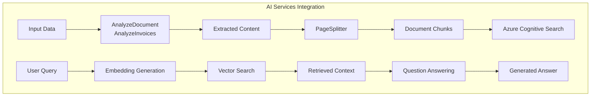
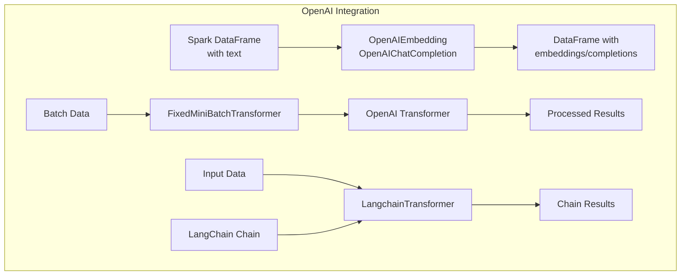
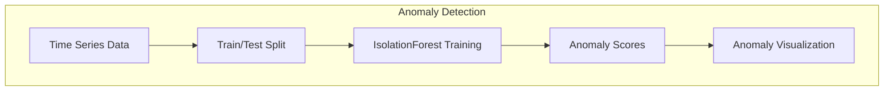
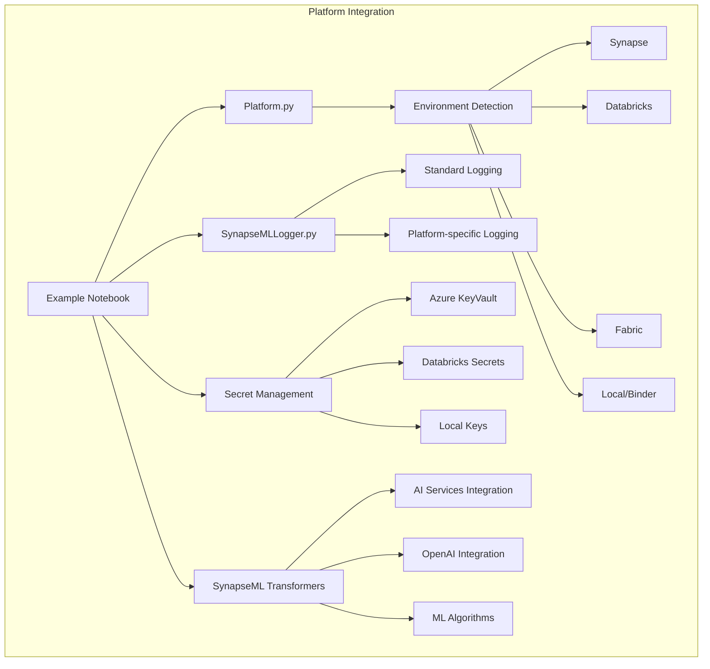
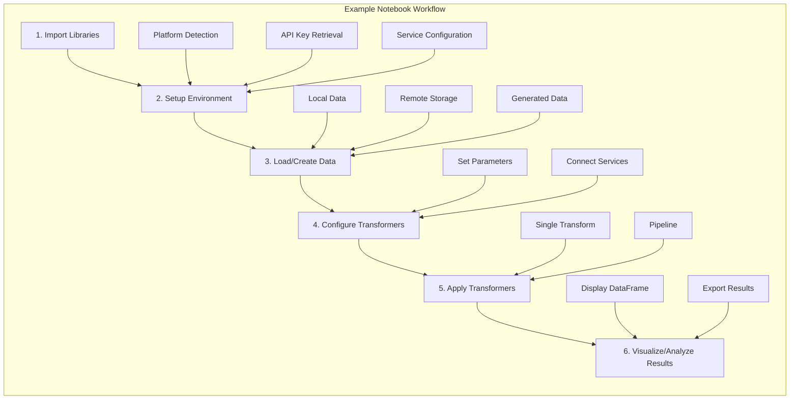

<!-- source: DeepWiki mcp.deepwiki.com · repo microsoft/SynapseML · page 7.3 Example Notebooks · fetched 2026-10-26 -->

# Example Notebooks

<details>
<summary>Relevant source files</summary>

The following files were used as context for generating this wiki page:

- [cognitive/src/test/scala/com/microsoft/azure/synapse/ml/services/form/FormOntologyLearnerSuite.scala](cognitive/src/test/scala/com/microsoft/azure/synapse/ml/services/form/FormOntologyLearnerSuite.scala)
- [core/src/test/scala/com/microsoft/azure/synapse/ml/Secrets.scala](core/src/test/scala/com/microsoft/azure/synapse/ml/Secrets.scala)
- [core/src/test/scala/com/microsoft/azure/synapse/ml/nbtest/SharedNotebookE2ETestUtilities.scala](core/src/test/scala/com/microsoft/azure/synapse/ml/nbtest/SharedNotebookE2ETestUtilities.scala)
- [core/src/test/scala/com/microsoft/azure/synapse/ml/nbtest/SynapseExtension/SynapseExtensionSchemas.scala](core/src/test/scala/com/microsoft/azure/synapse/ml/nbtest/SynapseExtension/SynapseExtensionSchemas.scala)
- [core/src/test/scala/com/microsoft/azure/synapse/ml/nbtest/SynapseExtension/SynapseExtensionUtilities.scala](core/src/test/scala/com/microsoft/azure/synapse/ml/nbtest/SynapseExtension/SynapseExtensionUtilities.scala)
- [core/src/test/scala/com/microsoft/azure/synapse/ml/nbtest/SynapseExtension/SynapseExtensionsTests.scala](core/src/test/scala/com/microsoft/azure/synapse/ml/nbtest/SynapseExtension/SynapseExtensionsTests.scala)
- [core/src/test/scala/com/microsoft/azure/synapse/ml/nbtest/SynapseTests.scala](core/src/test/scala/com/microsoft/azure/synapse/ml/nbtest/SynapseTests.scala)
- [core/src/test/scala/com/microsoft/azure/synapse/ml/nbtest/SynapseUtilities.scala](core/src/test/scala/com/microsoft/azure/synapse/ml/nbtest/SynapseUtilities.scala)
- [docs/Explore Algorithms/AI Services/Quickstart - Create Audiobooks.ipynb](docs/Explore Algorithms/AI Services/Quickstart - Create Audiobooks.ipynb)
- [docs/Explore Algorithms/AI Services/Quickstart - Document Question and Answering with PDFs.ipynb](docs/Explore Algorithms/AI Services/Quickstart - Document Question and Answering with PDFs.ipynb)
- [docs/Explore Algorithms/Deep Learning/Quickstart - Chat Completion with Azure AI Foundry Model.ipynb](docs/Explore Algorithms/Deep Learning/Quickstart - Chat Completion with Azure AI Foundry Model.ipynb)
- [docs/Explore Algorithms/OpenAI/Langchain.ipynb](docs/Explore Algorithms/OpenAI/Langchain.ipynb)
- [docs/Explore Algorithms/OpenAI/Quickstart - OpenAI Embedding and GPU based KNN.ipynb](docs/Explore Algorithms/OpenAI/Quickstart - OpenAI Embedding and GPU based KNN.ipynb)
- [docs/Explore Algorithms/OpenAI/Quickstart - OpenAI Embedding.ipynb](docs/Explore Algorithms/OpenAI/Quickstart - OpenAI Embedding.ipynb)
- [docs/Explore Algorithms/OpenAI/Quickstart - Understand and Search Forms.ipynb](docs/Explore Algorithms/OpenAI/Quickstart - Understand and Search Forms.ipynb)
- [docs/Explore Algorithms/Vowpal Wabbit/Quickstart - Classification using VW-native Format.ipynb](docs/Explore Algorithms/Vowpal Wabbit/Quickstart - Classification using VW-native Format.ipynb)
- [docs/Get Started/Install SynapseML.md](docs/Get Started/Install SynapseML.md)
- [src/test/scala/com/microsoft/azure/synapse/ml/core/test/fuzzing/FuzzingTest.scala](src/test/scala/com/microsoft/azure/synapse/ml/core/test/fuzzing/FuzzingTest.scala)
- [website/docusaurus.config.js](website/docusaurus.config.js)
- [website/package.json](website/package.json)
- [website/src/theme/CodeSnippet/index.js](website/src/theme/CodeSnippet/index.js)
- [website/src/theme/NotFound/index.js](website/src/theme/NotFound/index.js)
- [website/src/theme/SampleSnippet/index.js](website/src/theme/SampleSnippet/index.js)
- [website/yarn.lock](website/yarn.lock)

</details>


Example notebooks in SynapseML provide practical demonstrations of how to use the library's features across various machine learning and AI scenarios. These notebooks serve as hands-on tutorials to help users understand implementation patterns and best practices for using SynapseML.

For information about installing SynapseML in your environment, please see [Install SynapseML](#2.2).

## Organization of Example Notebooks

SynapseML example notebooks are organized into categories based on functionality and service integration:

```mermaid
graph TD
    root["Example Notebooks"]
    aiServices["AI Services"]
    openai["OpenAI"]
    anomaly["Anomaly Detection"]
    class["Classification"]
    deep["Deep Learning"]
    causal["Causal Inference"]
    
    root --> aiServices
    root --> openai
    root --> anomaly
    root --> class
    root --> deep
    root --> causal
    
    aiServices --> ai1["Document QA with PDFs"]
    aiServices --> ai2["Advanced Usage (Async/Batching)"]
    aiServices --> ai3["Create Audiobooks"]
    aiServices --> ai4["Multivariate Anomaly Detection"]
    
    openai --> o1["Azure OpenAI Basics"]
    openai --> o2["LangChain Integration"]
    openai --> o3["Embeddings & Vector Search"]
    openai --> o4["Form Understanding & Search"]
    
    anomaly --> an1["Isolation Forests"]
    
    class --> c1["SparkML vs SynapseML"]
    
    deep --> d1["ONNX Model Inference"]
    
    causal --> ca1["Measure Causal Effects"]
```

Sources: [docs/Explore Algorithms/AI Services/Quickstart - Document Question and Answering with PDFs.ipynb](), [docs/Explore Algorithms/OpenAI/OpenAI.ipynb](), [docs/Explore Algorithms/AI Services/Overview.ipynb](), [docs/Explore Algorithms/Anomaly Detection/Quickstart - Isolation Forests.ipynb](), [docs/Explore Algorithms/OpenAI/Langchain.ipynb]()

## Key Notebook Categories

### AI Services Notebooks

These notebooks demonstrate integration with Azure AI Services for tasks like language understanding, computer vision, and document intelligence.

Key examples include:
- **Document QA with PDFs** - Builds a question-answering system using PDF content
- **Advanced Usage** - Demonstrates async processing, batching, and multi-key scenarios
- **Create Audiobooks** - Shows text-to-speech capabilities



Sources: [docs/Explore Algorithms/AI Services/Quickstart - Document Question and Answering with PDFs.ipynb](), [docs/Explore Algorithms/AI Services/Advanced Usage - Async, Batching, and Multi-Key.ipynb]()

### OpenAI Notebooks

These notebooks demonstrate how to use Azure OpenAI models with SynapseML for text generation, embeddings, and language model applications.

Key examples include:
- **OpenAI Basics** - Shows fundamental OpenAI integration
- **LangChain** - Demonstrates using the LangchainTransformer for complex workflows
- **Embeddings** - Shows how to generate and use embeddings



Sources: [docs/Explore Algorithms/OpenAI/OpenAI.ipynb](), [docs/Explore Algorithms/OpenAI/Langchain.ipynb](), [docs/Explore Algorithms/OpenAI/Quickstart - Understand and Search Forms.ipynb]()

### Anomaly Detection Notebooks

These notebooks show how to implement anomaly detection using SynapseML.

Key examples include:
- **Isolation Forests** - Demonstrates multivariate anomaly detection



Sources: [docs/Explore Algorithms/Anomaly Detection/Quickstart - Isolation Forests.ipynb]()

## Common Code Patterns

### Platform Detection and Secret Management

Example notebooks use the `Platform` module to detect the runtime environment and securely access API keys:

```python
from synapse.ml.core.platform import find_secret, current_platform

# Get the current platform (Synapse, Databricks, Fabric, etc.)
platform = current_platform()

# Securely retrieve API keys
service_key = find_secret(
    secret_name="ai-services-api-key", keyvault="your-keyvault-name"
)
```

Sources: [core/src/main/python/synapse/ml/core/platform/Platform.py:17-92]()

### Transformer Configuration

Notebooks consistently demonstrate the fluent API for configuring transformers:

```python
# OpenAI embedding example
embedding = (
    OpenAIEmbedding()
    .setSubscriptionKey(key)
    .setDeploymentName(deployment_name_embeddings)
    .setCustomServiceName(service_name)
    .setTextCol("prompt")
    .setErrorCol("error")
    .setOutputCol("embeddings")
)

result_df = embedding.transform(df)
```

Sources: [docs/Explore Algorithms/OpenAI/OpenAI.ipynb:194-206]()

### Asynchronous Processing

Many notebooks demonstrate how to improve throughput using asynchronous processing:

```python
# Set concurrency level for parallel requests
analyzer = (
    AnalyzeImage()
    .setLocation(service_loc)
    .setSubscriptionKey(service_key)
    .setVisualFeatures(["Categories", "Description"])
    .setConcurrency(3)  # Process 3 requests in parallel
)
```

Sources: [docs/Explore Algorithms/AI Services/Advanced Usage - Async, Batching, and Multi-Key.ipynb:244-257]()

### Request Batching

Notebooks show how to batch requests for improved efficiency:

```python
# Batch processing example
sentiment = (
    AnalyzeText()
    .setKind("SentimentAnalysis")
    .setTextCol("text")
    .setSubscriptionKey(service_key)
    .setOutputCol("sentiment")
    .setBatchSize(10)  # Process 10 texts in a single API call
)
```

Sources: [docs/Explore Algorithms/AI Services/Advanced Usage - Async, Batching, and Multi-Key.ipynb:316-327]()

### Logging and Telemetry

Advanced examples utilize SynapseML's logging system:

```python
from synapse.ml.core.logging.SynapseMLLogger import SynapseMLLogger

class MyTransformer(SynapseMLLogger):
    def __init__(self):
        super().__init__()
        
    @SynapseMLLogger.log_transform()
    def transform(self, df):
        # Transform logic here
        return result_df
```

Sources: [core/src/main/python/synapse/ml/core/logging/SynapseMLLogger.py:185-216](), [core/src/test/python/synapsemltest/core/test_logging.py:16-35]()

## Platform Integration Architecture

SynapseML example notebooks are designed to work across different platforms, with built-in utilities to handle platform-specific functionality:



Sources: [core/src/main/python/synapse/ml/core/platform/Platform.py](), [core/src/main/python/synapse/ml/core/logging/SynapseMLLogger.py]()

## Example Notebook Workflow

SynapseML example notebooks typically follow this workflow pattern:



Sources: [docs/Explore Algorithms/AI Services/Quickstart - Document Question and Answering with PDFs.ipynb](), [docs/Explore Algorithms/OpenAI/OpenAI.ipynb](), [docs/Explore Algorithms/OpenAI/Langchain.ipynb]()

## Running Example Notebooks

To run SynapseML example notebooks:

1. Set up a computing environment (Fabric, Synapse, Databricks, etc.)
2. Install SynapseML if needed (see [Install SynapseML](#2.2))
3. Set up required service resources (Azure OpenAI, Azure AI Services, etc.)
4. Import the notebook to your environment
5. Provide API keys (directly or through key vault)
6. Execute the notebook cells sequentially

### Environment-Specific Considerations

The example notebooks use the `Platform.py` module to handle environment-specific requirements:

```python
# Platform detection example
from synapse.ml.core.platform import running_on_synapse, running_on_databricks

if running_on_synapse():
    # Synapse-specific code
elif running_on_databricks():
    # Databricks-specific code
else:
    # Generic handling
```

Sources: [core/src/main/python/synapse/ml/core/platform/Platform.py:37-54]()

## Conclusion

SynapseML example notebooks provide practical demonstrations of the library's capabilities, showing users how to integrate with various services and implement machine learning workflows at scale. They serve as both learning resources and code templates for developing your own solutions.

For specific examples, explore the notebooks in the [SynapseML GitHub repository](https://github.com/microsoft/SynapseML).

---

