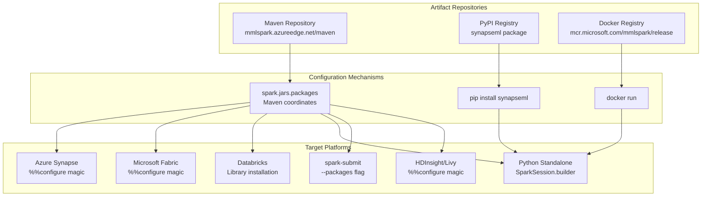
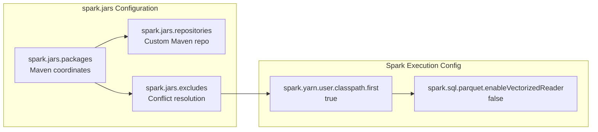
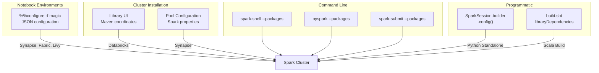

<!-- source: DeepWiki mcp.deepwiki.com · repo microsoft/SynapseML · page 8 Deployment · fetched 2026-10-26 -->

# Deployment

<details>
<summary>Relevant source files</summary>

The following files were used as context for generating this wiki page:

- [CONTRIBUTING.md](CONTRIBUTING.md)
- [README.md](README.md)

</details>


## Purpose and Scope

This document provides an overview of SynapseML deployment options, artifact distribution channels, and platform-specific configuration patterns. It covers the high-level deployment architecture and common configuration approaches across all supported platforms.

For detailed platform-specific instructions, see:
- [Installation and Distribution](#8.1) - artifact repositories and version management
- [Docker Environments](#8.2) - containerized deployments
- [Azure Synapse Deployment](#8.3) - Synapse Analytics Spark pools
- [Microsoft Fabric Deployment](#8.4) - Fabric notebooks and workloads
- [Databricks Deployment](#8.5) - Databricks clusters
- [Standalone and Other Platforms](#8.6) - Python standalone, spark-submit, SBT, HDInsight

For information about the build and release pipeline that produces deployment artifacts, see [CI/CD Pipeline](#3.1).

## Deployment Architecture

SynapseML supports deployment to multiple platforms through a centralized artifact distribution model. Artifacts are published to standard repositories (Maven, PyPI, Docker) and consumed by target platforms using platform-specific configuration mechanisms.



**Deployment Architecture Flow**

Sources: [README.md:70-266]()

## Artifact Distribution Channels

SynapseML artifacts are distributed through four primary channels:

| Channel | Endpoint | Artifact Type | Primary Use Case |
|---------|----------|---------------|------------------|
| Maven | `https://mmlspark.azureedge.net/maven` | JAR files with dependencies | Spark cluster deployments |
| PyPI | `https://pypi.org/project/synapseml/` | Python wheel | Standalone Python installations |
| Docker | `mcr.microsoft.com/mmlspark/release` | Container images | Local development and evaluation |
| Blob Storage | `mmlspark.blob.core.windows.net` | API docs, notebooks, archives | Documentation and examples |

### Maven Coordinates

The primary distribution mechanism uses Maven coordinates in the format:

```
com.microsoft.azure:synapseml_2.12:<version>
```

Current stable version: `1.1.0`

Version-specific coordinates for different Spark versions:
- **Spark 3.5**: `com.microsoft.azure:synapseml_2.12:1.1.0`
- **Spark 3.4**: `com.microsoft.azure:synapseml_2.12:1.0.15`
- **Spark 3.3**: `com.microsoft.azure:synapseml_2.12:0.11.4-spark3.3`

Sources: [README.md:9, 106, 129, 145, 161, 181, 200, 211, 222, 236]()

### Docker Images

Docker images are published to Microsoft Container Registry:

```bash
docker run -it -p 8888:8888 -e ACCEPT_EULA=yes mcr.microsoft.com/mmlspark/release jupyter notebook
```

The image includes:
- Pre-configured Jupyter notebook server
- SynapseML with all dependencies
- Example notebooks at `/notebooks`

Sources: [README.md:242-254]()

## Common Configuration Parameters

All Spark-based deployments share a common set of configuration parameters:



**Configuration Parameter Dependencies**

### Required Parameters

| Parameter | Value | Purpose |
|-----------|-------|---------|
| `spark.jars.packages` | `com.microsoft.azure:synapseml_2.12:<version>` | Specifies SynapseML Maven artifact |
| `spark.jars.repositories` | `https://mmlspark.azureedge.net/maven` | Custom Maven repository location |
| `spark.jars.excludes` | See exclusion list below | Prevents dependency conflicts |
| `spark.yarn.user.classpath.first` | `true` | Prioritizes user classpath over system |
| `spark.sql.parquet.enableVectorizedReader` | `false` | Disables vectorized reader for compatibility |

### Standard Exclusion List

```
org.scala-lang:scala-reflect
org.apache.spark:spark-tags_2.12
org.scalactic:scalactic_2.12
org.scalatest:scalatest_2.12
com.fasterxml.jackson.core:jackson-databind
```

These exclusions prevent conflicts with Spark's built-in dependencies, particularly in Livy-based environments (Synapse, HDInsight).

Sources: [README.md:103-113, 124-136, 140-152, 156-168, 232-240]()

## Platform Configuration Formats

Different platforms use different mechanisms to apply Spark configuration:



**Platform Configuration Mechanism Mapping**

### Notebook Magic Configuration

Used by Azure Synapse, Microsoft Fabric, and HDInsight/Livy:

```json
%%configure -f
{
  "name": "synapseml",
  "conf": {
      "spark.jars.packages": "com.microsoft.azure:synapseml_2.12:1.1.0",
      "spark.jars.repositories": "https://mmlspark.azureedge.net/maven",
      "spark.jars.excludes": "<exclusion-list>",
      "spark.yarn.user.classpath.first": "true",
      "spark.sql.parquet.enableVectorizedReader": "false"
  }
}
```

The `-f` flag forces session recreation with new configuration.

Sources: [README.md:101-113, 124-136, 140-152, 156-168, 232-240]()

### Databricks Library Installation

Databricks uses a library installation UI with Maven coordinates:

```
Coordinates: com.microsoft.azure:synapseml_2.12:1.1.0
Repository: https://mmlspark.azureedge.net/maven
```

The library must be attached to target clusters. Databricks manages dependency resolution automatically.

Sources: [README.md:174-189]()

### Python Standalone Configuration

For standalone Python installations with PySpark:

```python
import pyspark
spark = pyspark.sql.SparkSession.builder.appName("MyApp") \
            .config("spark.jars.packages", "com.microsoft.azure:synapseml_2.12:1.1.0") \
            .getOrCreate()
import synapse.ml
```

Sources: [README.md:191-203]()

### Command Line Packages

For spark-submit, spark-shell, or pyspark:

```bash
spark-shell --packages com.microsoft.azure:synapseml_2.12:1.1.0
pyspark --packages com.microsoft.azure:synapseml_2.12:1.1.0
spark-submit --packages com.microsoft.azure:synapseml_2.12:1.1.0 MyApp.jar
```

Sources: [README.md:205-214]()

### SBT Build Configuration

For Scala applications built with SBT:

```scala
libraryDependencies += "com.microsoft.azure" % "synapseml_2.12" % "1.1.0"
```

Sources: [README.md:216-224]()

## Version Management and Compatibility

SynapseML versions are tied to specific Spark and Scala versions:

| SynapseML Version | Spark Version | Scala Version | Notes |
|-------------------|---------------|---------------|-------|
| 1.1.0 | 3.5.x | 2.12 | Latest stable release |
| 1.0.15 | 3.4.x | 2.12 | Spark 3.4 compatible |
| 0.11.4-spark3.3 | 3.3.x | 2.12 | Spark 3.3 compatible |

### Minimum Requirements

- **Scala**: 2.12
- **Spark**: 3.4+ (3.3 supported with legacy version)
- **Python**: 3.8+

Sources: [README.md:9, 129, 145, 161]()

## Platform-Specific Considerations

### Microsoft Fabric

Fabric has SynapseML **pre-installed**. Configuration is only needed to change the default version.

Sources: [README.md:96-113]()

### Databricks Compatibility

- Minimum Spark 3.2, Scala 2.12
- Recommended: DBR 10.1 or later to avoid Netty dependency issues
- GPU support available for deep learning workloads

Sources: [README.md:174-189]()

### Livy Environments

Livy 0.5 requires specific package exclusions due to dependency conflicts. The standard exclusion list addresses these issues.

Sources: [README.md:225-240]()

## Deployment Verification

After deployment, verify the installation:

```python
import synapse.ml
from synapse.ml.core import __spark_package_version__
print(__spark_package_version__)
```

For Scala:

```scala
import com.microsoft.azure.synapse.ml.core.spark.BuildInfo
println(BuildInfo.version)
```

Sources: [README.md:197-203]()

## Platform Detection System

SynapseML includes platform detection capabilities that adapt behavior based on the execution environment. This system is documented in [Platform Detection and Adaptation](#2.3) and affects logging, telemetry, and credential management.

The deployment configuration does not need to specify the platform explicitly - detection happens automatically at runtime based on environment variables and available APIs (e.g., `mssparkutils`, `dbutils`).

Sources: Referenced from architectural diagrams

## Release and Snapshot Versions

Release versions follow semantic versioning (e.g., `1.1.0`). Development snapshots are available for testing new features before official releases. Snapshot versions end with `.devN` suffix.

Snapshot artifacts are published to the same Maven repository but should not be used in production deployments.

Sources: [README.md:14, CONTRIBUTING.md:74-77]()

## Additional Resources

- **Example notebooks**: Available at `https://mmlspark.blob.core.windows.net/dbcs/SynapseMLExamplesv1.1.0.dbc` for Databricks
- **API Documentation**: Hosted at `mmlspark.blob.core.windows.net/docs/<version>/`
- **Docker EULA**: View with `docker run -it -p 8888:8888 mcr.microsoft.com/mmlspark/release eula`

Sources: [README.md:189, 254]()

---

