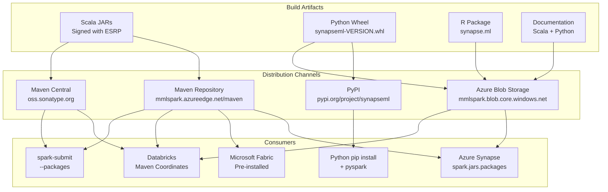
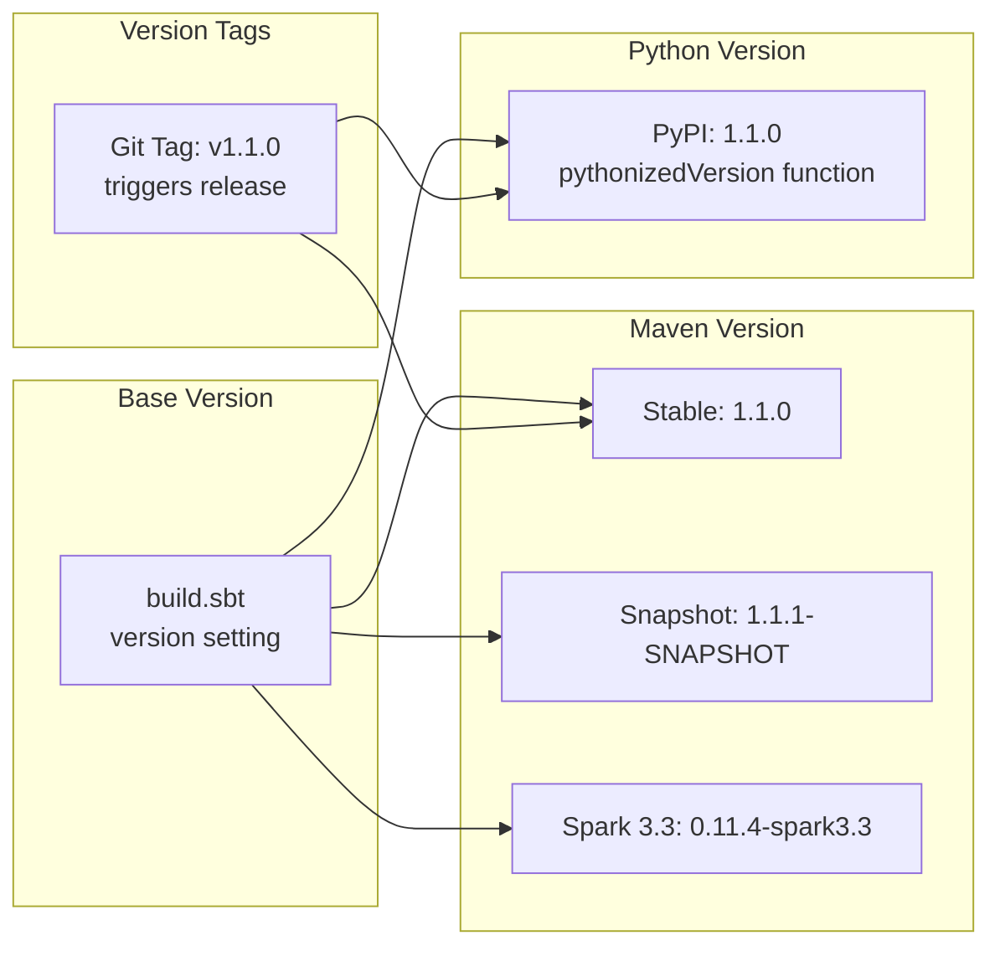
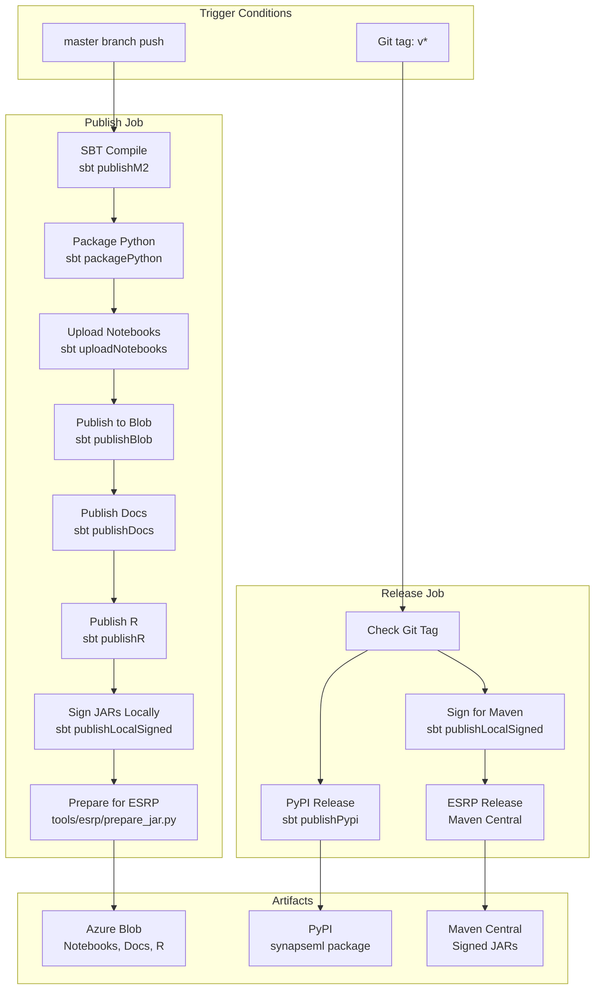
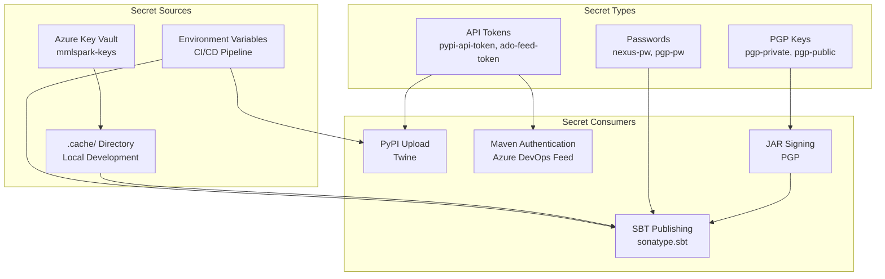

<!-- source: DeepWiki mcp.deepwiki.com · repo microsoft/SynapseML · page 8.1 Installation and Distribution · fetched 2026-10-26 -->

# Installation and Distribution

<details>
<summary>Relevant source files</summary>

The following files were used as context for generating this wiki page:

- [.gitignore](.gitignore)
- [CONTRIBUTING.md](CONTRIBUTING.md)
- [README.md](README.md)
- [build.sbt](build.sbt)
- [deep-learning/src/test/python/synapsemltest/dl/conftest.py](deep-learning/src/test/python/synapsemltest/dl/conftest.py)
- [environment.yml](environment.yml)
- [pipeline.yaml](pipeline.yaml)
- [project/PublishPlugin.scala](project/PublishPlugin.scala)
- [project/Secrets.scala](project/Secrets.scala)
- [sonatype.sbt](sonatype.sbt)
- [templates/codecov.yml](templates/codecov.yml)
- [templates/conda.yml](templates/conda.yml)
- [templates/kv.yml](templates/kv.yml)
- [tools/esrp/prepare_jar.py](tools/esrp/prepare_jar.py)

</details>


This document describes how SynapseML artifacts are packaged, published, and distributed to end users. It covers the artifact distribution channels (Maven, PyPI, Docker), version management strategies, and the publishing pipeline that creates and deploys these artifacts.

For platform-specific deployment instructions, see:
- [Azure Synapse Deployment](#8.3)
- [Microsoft Fabric Deployment](#8.4)
- [Databricks Deployment](#8.5)
- [Docker Environments](#8.2)
- [Standalone and Other Platforms](#8.6)

For information about the CI/CD pipeline that produces these artifacts, see [CI/CD Pipeline](#3.1).

---

## Distribution Channels

SynapseML distributes artifacts through four primary channels, each serving different platform requirements and use cases.

### Distribution Channel Overview



Sources: [README.md:70-266](), [pipeline.yaml:87-135](), [build.sbt:265]()

### Maven Artifacts

Maven artifacts are the primary distribution method for Spark-based platforms. These artifacts consist of signed JAR files containing compiled Scala code and auto-generated Python/R wrappers.

**Maven Coordinates:**
- Group ID: `com.microsoft.azure`
- Artifact ID: `synapseml_2.12` (for Scala 2.12)
- Version: `1.1.0` (latest stable), or snapshot versions like `1.1.1-SNAPSHOT`

**Repositories:**
1. **Primary Repository**: `https://mmlspark.azureedge.net/maven` - Azure-hosted repository for all releases
2. **Maven Central**: `https://oss.sonatype.org` - Public Maven Central for official releases
3. **Azure DevOps Feed**: `msdata.pkgs.visualstudio.com/.../SynapseML_PublicPackages` - Internal Microsoft feed

The Maven artifacts exclude certain dependencies to avoid conflicts with Spark's built-in libraries:
- `org.scala-lang:scala-reflect`
- `org.apache.spark:spark-tags_2.12`
- `org.scalactic:scalactic_2.12`
- `org.scalatest:scalatest_2.12`
- `com.fasterxml.jackson.core:jackson-databind`

Sources: [README.md:106-108](), [README.md:129-131](), [README.md:181-183](), [build.sbt:17-21](), [build.sbt:47-48](), [sonatype.sbt:1-46]()

### PyPI Package

The `synapseml` Python package is distributed through PyPI, enabling standalone Python installations without requiring pre-existing Spark infrastructure.

**Package Details:**
- Package name: `synapseml`
- Version format: Python-compatible (e.g., `1.1.0` becomes `1.1.0` in PyPI)
- Dependencies: Requires `pyspark` to be installed separately
- Installation: `pip install synapseml`

The Python wheel contains:
- Auto-generated Python wrappers for all Scala classes
- Namespace package structure: `synapse.ml.*`
- License and README files

The package is built using the `packageSynapseML` task and published via the `publishPypi` task.

Sources: [README.md:191-203](), [build.sbt:132-185](), [build.sbt:187-197](), [pipeline.yaml:309-323]()

### Docker Images

Docker images are published to Microsoft Container Registry (MCR) but are currently disabled in the pipeline (commented out in pipeline.yaml).

**Image Types (when enabled):**
1. **Demo Image**: `mcr.microsoft.com/mmlspark/build-demo:VERSION` - Full environment with Jupyter
2. **Minimal Image**: `mcr.microsoft.com/mmlspark/build-minimal:VERSION` - Minimal runtime
3. **Release Image**: `mcr.microsoft.com/mmlspark/release:VERSION` and `latest` - Tagged releases

Sources: [pipeline.yaml:184-257](), [README.md:242-254]()

### Azure Blob Storage

Azure Blob Storage hosts supplementary artifacts that don't fit into standard package managers:

| Container | Contents | Purpose |
|-----------|----------|---------|
| `docs/` | API documentation (Scala, Python) | Version-specific documentation |
| `docs/` | Jupyter notebooks (`.ipynb`, converted `.py`) | Example notebooks and tutorials |
| `installers/` | Datasets for testing | Test data (e.g., `datasets-2023-04-03.tgz`) |
| `icons/` | Badges and graphics | Website badges, version indicators |

Sources: [build.sbt:199-220](), [build.sbt:222-241](), [build.sbt:243-248](), [build.sbt:72-89]()

---

## Version Management

SynapseML uses a structured versioning scheme that adapts to different distribution channels and Spark versions.

### Version Format Structure



Sources: [build.sbt:10-15](), [README.md:14](), [pipeline.yaml:266-267]()

### Version Requirements

SynapseML enforces specific version requirements across its technology stack:

| Component | Required Version | Location |
|-----------|------------------|----------|
| Scala | 2.12.17 | [build.sbt:13]() |
| Spark | 3.5.0 (variable: `sparkVersion`) | [build.sbt:10]() |
| Python | 3.11.8 | [environment.yml:6]() |
| R | 4.1.1 | [environment.yml:9]() |

**Spark Version Compatibility:**
- Spark 3.5 Pools: `synapseml_2.12:1.1.0`
- Spark 3.4 Pools: `synapseml_2.12:1.0.15`
- Spark 3.3 Pools: `synapseml_2.12:0.11.4-spark3.3`

Sources: [README.md:9](), [README.md:122-168](), [build.sbt:10-15](), [environment.yml:6-11]()

### Snapshot Versions

Development versions follow the pattern `X.Y.Z-SNAPSHOT` and are published to the Azure Maven repository on every commit to master. The `dynverSeparator` setting in `sonatype.sbt` uses `-` as the separator.

Sources: [sonatype.sbt:45-46](), [pipeline.yaml:63]()

---

## Publishing Pipeline

The publishing pipeline transforms source code into distributable artifacts through a multi-stage process involving compilation, packaging, signing, and deployment.

### Publishing Pipeline Flow



Sources: [pipeline.yaml:87-135](), [pipeline.yaml:259-353]()

### Publish Job Tasks

The `Publish` job runs on every build and generates all artifacts, storing them in Azure Blob Storage and the internal Maven feed.

**Task Sequence:**

1. **Environment Setup**
   - Authenticate with Azure DevOps Maven feed
   - Activate conda environment `synapseml`
   - Install build dependencies (graphviz, doxygen)

2. **Python Packaging** (`sbt packagePython uploadNotebooks`)
   - Auto-generates Python wrappers from Scala code
   - Creates wheel file structure
   - Uploads example notebooks to blob storage

3. **Artifact Publishing** (`sbt publishBlob publishDocs publishR publishPython`)
   - `publishBlob`: Uploads artifacts to Azure Blob Storage
   - `publishDocs`: Generates and uploads Scala/Python API docs
   - `publishR`: Packages and uploads R bindings
   - `publishPython`: Prepares Python wheel (not pushed to PyPI yet)

4. **Local Signing** (`sbt publishLocalSigned`)
   - Signs JARs with PGP keys
   - Stores signed artifacts in `~/.ivy2/local/com.microsoft.azure/`

5. **ESRP Preparation** (`python tools/esrp/prepare_jar.py`)
   - Flattens directory structure
   - Renames JARs to include version numbers
   - Prepares for Enterprise Software Release Process (ESRP)

Sources: [pipeline.yaml:92-135](), [build.sbt:132-185](), [build.sbt:199-220](), [tools/esrp/prepare_jar.py:1-80]()

### Release Job Tasks

The `Release` job only runs when a git tag starting with `v` is pushed to the master branch, triggering public releases.

**Conditional Execution:**
```yaml
condition: and(eq(variables.isMaster, true), startsWith(variables['tag'], 'v'))
```

**Task Sequence:**

1. **PyPI Publication** (`sbt publishPypi`)
   - Packages the complete `synapseml` wheel
   - Uses Twine to upload to PyPI with API token authentication
   - Skips existing versions to enable idempotency

2. **Maven Central Publication**
   - Re-signs JARs locally
   - Runs ESRP preparation script
   - Invokes ESRP Release task with Maven content type
   - Requires approval from designated approvers
   - Publishes to Maven Central via Sonatype

**ESRP Configuration:**
- Service Connection: `SynapseML-ESRP-Service-Connection`
- Key Vault: `esrp-kv-ame`
- Owners: `zhoubo@microsoft.com, marcozo@microsoft.com, romanbat@microsoft.com`
- Approvers: `romanbat@microsoft.com, markus.weimer@microsoft.com, negust@microsoft.com`

Sources: [pipeline.yaml:259-353](), [build.sbt:187-197]()

---

## Secret Management for Publishing

Publishing requires authentication credentials stored in Azure Key Vault and accessed via environment variables or cached files.

### Secret Architecture



Sources: [project/Secrets.scala:1-194](), [pipeline.yaml:95-123](), [sonatype.sbt:29-36]()

### Secret Retrieval Strategy

The `Secrets` object implements a three-tier priority system for retrieving credentials:

1. **Environment Variables** (highest priority): Used by CI/CD pipeline
2. **Local Cache** (`.cache/` directory): Used for PGP ring files in development
3. **Azure Key Vault** (fallback): Direct fetch via Azure CLI

**Key Secret Names:**

| Secret Name | Environment Variable | Purpose |
|-------------|---------------------|---------|
| `pgp-private` | `PGP-PRIVATE` | Private PGP key for JAR signing |
| `pgp-public` | `PGP-PUBLIC` | Public PGP key for JAR signing |
| `pgp-pw` | `PGP-PW` | Passphrase for PGP keys |
| `nexus-un` | `NEXUS-UN` | Sonatype Nexus username |
| `nexus-pw` | `NEXUS-PW` | Sonatype Nexus password |
| `pypi-api-token` | `PYPI-API-TOKEN` | PyPI API token for uploads |
| `ado-feed-token` | `ADO-FEED-TOKEN` | Azure DevOps feed token |

**Publishing Enable Flag:**
Publishing tasks only run when `SYNAPSEML_ENABLE_PUBLISH=true` is set in the environment.

Sources: [project/Secrets.scala:13-194](), [pipeline.yaml:118-124](), [pipeline.yaml:314-323]()

---

## Installation Methods Overview

SynapseML can be installed through multiple methods depending on the target platform. Below is a summary with links to detailed platform-specific documentation.

### Installation Methods by Platform

| Platform | Installation Method | Artifact Source | Details |
|----------|---------------------|-----------------|---------|
| **Microsoft Fabric** | Pre-installed or `%%configure` magic | Maven | [Fabric Deployment](#8.4) |
| **Azure Synapse** | `%%configure` magic in notebook | Maven | [Synapse Deployment](#8.3) |
| **Databricks** | Maven library coordinates | Maven Central | [Databricks Deployment](#8.5) |
| **Python Standalone** | `pip install synapseml` | PyPI | [Standalone Platforms](#8.6) |
| **Spark Submit** | `--packages` flag | Maven | [Standalone Platforms](#8.6) |
| **SBT** | `libraryDependencies +=` | Maven Central | [Standalone Platforms](#8.6) |
| **Apache Livy** | `%%configure` magic | Maven | [Standalone Platforms](#8.6) |
| **Docker** | Pre-built images | MCR | [Docker Environments](#8.2) |
| **R** | `sparklyr` + Maven | Maven | [Standalone Platforms](#8.6) |

Sources: [README.md:70-266]()

### Common Configuration Parameters

Most Spark-based platforms require similar configuration parameters when installing SynapseML:

**Required Spark Configuration:**
```scala
spark.jars.packages = "com.microsoft.azure:synapseml_2.12:1.1.0"
spark.jars.repositories = "https://mmlspark.azureedge.net/maven"
```

**Common Exclusions:**
```scala
spark.jars.excludes = "org.scala-lang:scala-reflect,org.apache.spark:spark-tags_2.12,org.scalactic:scalactic_2.12,org.scalatest:scalatest_2.12,com.fasterxml.jackson.core:jackson-databind"
```

**Additional Configurations:**
```scala
spark.yarn.user.classpath.first = "true"  // Prioritize user classpath
spark.sql.parquet.enableVectorizedReader = "false"  // Compatibility setting
```

Sources: [README.md:102-113](), [README.md:126-136]()

### Build Information Publication

The pipeline publishes build metadata and documentation links to `target/Build.md` during the `genBuildInfo` task. This file contains:
- Scala API documentation URL
- Python API documentation URL  
- Version-specific documentation paths

The `publishBadges` task creates SVG badges indicating the current master version and uploads them to blob storage with no-cache headers.

Sources: [build.sbt:91-105](), [build.sbt:222-241]()

---

## Dependency Management

SynapseML carefully manages its dependencies to avoid conflicts with Spark's built-in libraries and to maintain compatibility across different Spark versions.

### Core Dependencies

**Spark Dependencies:**
- `spark-core`, `spark-mllib`, `spark-avro`: Version matches `sparkVersion` variable
- `spark-tags`: Test scope only
- All Spark dependencies exclude `com.google.protobuf:protobuf-java` to avoid version conflicts

**Additional Dependencies:**
```scala
commons-lang:commons-lang:2.6
org.scalactic:scalactic:3.2.14
io.spray:spray-json:1.3.5
com.jcraft:jsch:0.1.54
org.apache.httpcomponents.client5:httpclient5:5.1.3
org.apache.httpcomponents:httpmime:4.5.13
com.linkedin.isolation-forest:isolation-forest_3.5.0:3.0.5
```

**Module-Specific Dependencies:**
- **Deep Learning**: `onnx-protobuf`, `onnxruntime_gpu`, `hadoop-common`, `hadoop-azure`
- **LightGBM**: `lightgbmlib:3.3.510`
- **Vowpal Wabbit**: `vw-jni:9.3.0`
- **Cognitive Services**: `client-sdk:1.24.1`
- **OpenCV**: `opencv:3.2.0-1`

All extra dependencies have global exclusion rules applied to prevent conflicts with Spark.

Sources: [build.sbt:17-43](), [build.sbt:267-324]()

### POM Transformation

The build process transforms the Maven POM file to remove scoped dependencies and omitted dependencies, adding XML comments to explain their exclusion. This is handled by the `pomPostFunc` function.

**Omitted Dependencies:**
- `spark-core_2.12`
- `spark-mllib_2.12`
- `org.scala-lang` packages

These are assumed to be provided by the Spark runtime environment.

Sources: [build.sbt:45-70]()

---

## Conda Environment

The project uses Conda for reproducible development and CI/CD environments. The environment is defined in `environment.yml` and cached in Azure Pipelines to speed up builds.

### Conda Environment Configuration

**Channels:**
- `conda-forge`
- `default`

**Key Conda Packages:**
- Python 3.11.8
- R base 4.1.1 with sparklyr
- CMake ≤ 3.27

**Key Pip Packages:**
- PySpark 3.5.0
- PyArrow 10.0.1
- PyTorch 2.1.0 + TorchVision 0.16.0
- Transformers 4.49.0
- Horovod (from git commit)
- LangChain 0.0.152
- Testing frameworks (pytest, pytest-cov, pytest-codeblocks)
- Documentation tools (Sphinx, nbconvert)
- Publishing tools (Twine, azure-storage-blob)

**Caching Strategy:**
The CI/CD pipeline caches the conda environment at `$(CONDA_CACHE_DIR)` (`/usr/share/miniconda/envs`) using a cache key based on the OS and `environment.yml` hash. This dramatically reduces build times by avoiding repeated environment creation.

**Disk Space Management:**
The pipeline includes a cleanup step that removes unused SDKs (`/usr/local/lib/android`, `/usr/lib/google-cloud-sdk`) to free disk space before creating the conda environment.

Sources: [environment.yml:1-58](), [templates/conda.yml:1-42](), [pipeline.yaml:60]()

---

## Summary

SynapseML's distribution strategy supports multiple platforms through carefully orchestrated publishing to Maven repositories, PyPI, and Azure Blob Storage. The build system uses SBT to compile Scala code, auto-generate language bindings, and package artifacts. The CI/CD pipeline publishes snapshots on every commit and official releases when git tags are pushed. Version management accommodates different Spark versions while maintaining a consistent versioning scheme. Secret management via Azure Key Vault enables secure publishing operations, and conda environments ensure reproducible builds across development and CI/CD environments.

---

