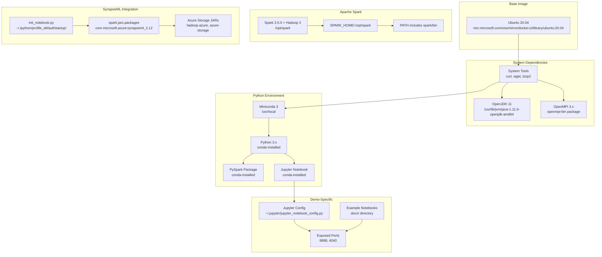
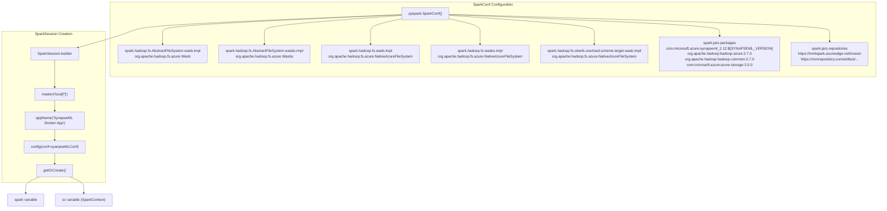
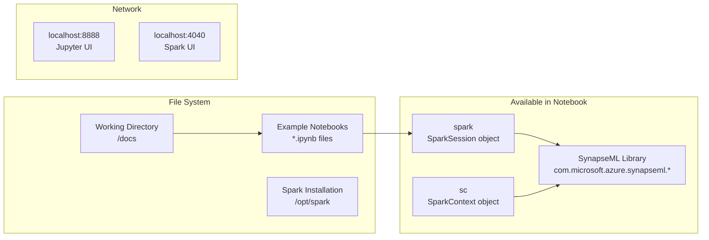

<!-- source: DeepWiki mcp.deepwiki.com · repo microsoft/SynapseML · page 8.2 Docker Environments · fetched 2026-10-26 -->

# Docker Environments

<details>
<summary>Relevant source files</summary>

The following files were used as context for generating this wiki page:

- [core/src/main/scala/com/microsoft/azure/synapse/ml/io/binary/BinaryFileFormat.scala](core/src/main/scala/com/microsoft/azure/synapse/ml/io/binary/BinaryFileFormat.scala)
- [core/src/main/scala/org/apache/spark/ml/source/image/PatchedImageFileFormat.scala](core/src/main/scala/org/apache/spark/ml/source/image/PatchedImageFileFormat.scala)
- [core/src/main/scala/org/apache/spark/sql/execution/streaming/continuous/HTTPSinkV2.scala](core/src/main/scala/org/apache/spark/sql/execution/streaming/continuous/HTTPSinkV2.scala)
- [core/src/test/scala/com/microsoft/azure/synapse/ml/codegen/RTestGen.scala](core/src/test/scala/com/microsoft/azure/synapse/ml/codegen/RTestGen.scala)
- [core/src/test/scala/com/microsoft/azure/synapse/ml/io/split2/DistributedHTTPSuite.scala](core/src/test/scala/com/microsoft/azure/synapse/ml/io/split2/DistributedHTTPSuite.scala)
- [start](start)
- [tools/docker/demo/Dockerfile](tools/docker/demo/Dockerfile)
- [tools/docker/demo/README.md](tools/docker/demo/README.md)
- [tools/docker/demo/init_notebook.py](tools/docker/demo/init_notebook.py)
- [tools/docker/minimal/Dockerfile](tools/docker/minimal/Dockerfile)
- [tools/tests/run_r_tests.R](tools/tests/run_r_tests.R)
- [vw/src/main/scala/com/microsoft/azure/synapse/ml/vw/VowpalWabbitBaseModel.scala](vw/src/main/scala/com/microsoft/azure/synapse/ml/vw/VowpalWabbitBaseModel.scala)

</details>


This document describes the Docker container images provided by SynapseML for local development, experimentation, and notebook execution. These containerized environments bundle Apache Spark, SynapseML, Jupyter Notebook, and all required dependencies into portable images that can run on any Docker-compatible system.

For information about deploying to other platforms, see [Installation and Distribution](#8.1) for general artifact distribution, [Azure Synapse Deployment](#8.3) for Synapse-specific instructions, or [Standalone and Other Platforms](#8.6) for alternative deployment options.

## Overview

SynapseML provides pre-configured Docker images that enable users to experiment with SynapseML capabilities without manual environment setup. The repository currently maintains two primary Docker image variants:

| Image Type | Path | Purpose |
|------------|------|---------|
| **demo** | `tools/docker/demo/Dockerfile` | Full-featured image with Jupyter Notebook and example notebooks for interactive exploration |
| **minimal** | `tools/docker/minimal/Dockerfile` | Lightweight image with core dependencies only, suitable as a base for custom environments |

Both images are based on Ubuntu 20.04 and include Apache Spark, Python, Java, and the SynapseML library configured for immediate use.

Sources: [tools/docker/demo/Dockerfile:1-71](), [tools/docker/minimal/Dockerfile:1-52]()

## Docker Image Architecture



Sources: [tools/docker/demo/Dockerfile:1-71](), [tools/docker/minimal/Dockerfile:1-52]()

## Demo Docker Image

The demo image provides a complete interactive environment with Jupyter Notebook and example notebooks.

### Build Arguments and Environment Variables

The demo Dockerfile accepts build arguments and sets environment variables that control versions and paths:

| Variable | Type | Default Value | Description |
|----------|------|---------------|-------------|
| `SYNAPSEML_VERSION` | Build Arg | `1.1.0` | Version of SynapseML to install |
| `DEBIAN_FRONTEND` | Build Arg | `noninteractive` | Prevents apt-get prompts during build |
| `SPARK_VERSION` | Environment | `3.5.0` | Apache Spark version |
| `HADOOP_VERSION` | Environment | `3` | Hadoop major version |
| `JAVA_HOME` | Environment | `/usr/lib/jvm/java-1.11.0-openjdk-amd64` | Java installation path |
| `SPARK_HOME` | Environment | `/opt/spark` | Spark installation path |
| `PYTHONPATH` | Environment | `$SPARK_HOME/python/:$SPARK_HOME/python/lib/py4j*:$PYTHON_PATH` | Python import paths |

Sources: [tools/docker/demo/Dockerfile:3-43]()

### Image Construction Process

```mermaid
graph LR
    subgraph "Stage 1: System Setup"
        S1["apt-get update"] --> S2["Install Java, curl, wget, bzip2, openmpi"]
        S2 --> S3["apt-get upgrade & clean"]
    end
    
    subgraph "Stage 2: Miniconda"
        S3 --> M1["Download Miniconda installer"]
        M1 --> M2["Install to /usr/local"]
        M2 --> M3["conda install python=3 jupyter pyspark"]
        M3 --> M4["conda clean --all"]
    end
    
    subgraph "Stage 3: Spark"
        M4 --> SP1["Download spark-3.5.0-bin-hadoop3.tgz"]
        SP1 --> SP2["Extract to /opt/spark"]
        SP2 --> SP3["Set SPARK_HOME environment"]
    end
    
    subgraph "Stage 4: Cleanup"
        SP3 --> C1["apt-get remove curl, wget, bzip2"]
        C1 --> C2["Clean apt cache"]
    end
    
    subgraph "Stage 5: Jupyter"
        C2 --> J1["jupyter-notebook --generate-config"]
        J1 --> J2["Configure token-free access"]
        J2 --> J3["Set IP to 0.0.0.0"]
        J3 --> J4["Allow root execution"]
    end
    
    subgraph "Stage 6: Demo Content"
        J4 --> D1["Copy init_notebook.py"]
        D1 --> D2["Copy docs directory"]
        D2 --> D3["EXPOSE 8888, 4040"]
    end
```



Sources: [tools/docker/demo/Dockerfile:11-71]()

### Jupyter Notebook Configuration

The demo image configures Jupyter Notebook for immediate use without authentication in a containerized environment:

**Configuration file**: `~/.jupyter/jupyter_notebook_config.py`

```
c.NotebookApp.token = ''              # Disable authentication token
c.NotebookApp.ip = '0.0.0.0'         # Listen on all interfaces
c.NotebookApp.allow_root = True      # Allow running as root user
```

Sources: [tools/docker/demo/Dockerfile:54-59]()

### Exposed Ports

The demo image exposes two ports for web access:

- **Port 8888**: Jupyter Notebook web interface
- **Port 4040**: Spark UI for monitoring running applications

Sources: [tools/docker/demo/Dockerfile:66-70]()

## Minimal Docker Image

The minimal image provides a bare-bones Spark + SynapseML environment without Jupyter configuration or example notebooks. It follows the same construction process as the demo image through Stage 4 (Cleanup), then stops without adding Jupyter configuration or example content.

### Key Differences from Demo Image

| Feature | Demo Image | Minimal Image |
|---------|-----------|---------------|
| Jupyter Config | Configured, token-free | Basic installation only |
| Startup Script | `init_notebook.py` included | Not included |
| Example Notebooks | `docs/` directory copied | Not included |
| Exposed Ports | 8888, 4040 | None declared |
| Working Directory | `docs` | Root directory |

The minimal image is suitable for:
- Custom Dockerfile base image (`FROM synapseml-minimal`)
- Non-interactive batch processing
- CI/CD pipeline execution environments
- Resource-constrained deployments

Sources: [tools/docker/minimal/Dockerfile:1-52]()

## Jupyter Initialization Script

### Purpose and Location

The file `init_notebook.py` is automatically executed when Jupyter starts, creating a pre-configured `SparkSession` with SynapseML and Azure storage dependencies.

**Installation path**: `~/.ipython/profile_default/startup/init_notebook.py`

This directory is IPython's startup script location, ensuring execution before any user notebooks run.

Sources: [tools/docker/demo/Dockerfile:62](), [tools/docker/demo/init_notebook.py:1-47]()

### Spark Configuration



Sources: [tools/docker/demo/init_notebook.py:5-46]()

### Azure Storage Integration

The initialization script configures Hadoop FileSystem implementations for Azure Storage access:

**WASB (Windows Azure Storage Blob) Protocol Support:**
- `wasb://` - Non-SSL Azure Blob access
- `wasbs://` - SSL-encrypted Azure Blob access

This configuration enables notebooks to read/write data directly from Azure Blob Storage using paths like:
```
wasbs://container@account.blob.core.windows.net/path/to/data
```

Sources: [tools/docker/demo/init_notebook.py:8-26]()

### Maven Package Resolution

The script dynamically resolves the SynapseML version from the `SYNAPSEML_VERSION` environment variable:

```python
"spark.jars.packages",
"com.microsoft.azure:synapseml_2.12:" + os.getenv("SYNAPSEML_VERSION", "1.1.0") + 
",org.apache.hadoop:hadoop-azure:2.7.0,org.apache.hadoop:hadoop-common:2.7.0,com.microsoft.azure:azure-storage:2.0.0"
```

Maven repositories are configured to fetch artifacts from:
1. Primary: `https://mmlspark.azureedge.net/maven`
2. Fallback: `https://mvnrepository.com/artifact/`

Sources: [tools/docker/demo/init_notebook.py:28-36]()

## Building Docker Images

### Demo Image Build Commands

**Build from current repository state:**
```bash
docker build . -f tools/docker/demo/Dockerfile -t synapseml
```

**Build specific version:**
```bash
docker build . \
  --build-arg SYNAPSEML_VERSION=1.1.0 \
  -f tools/docker/demo/Dockerfile \
  -t synapseml:1.1.0
```

The build argument `SYNAPSEML_VERSION` controls which version of SynapseML is downloaded from Maven during the initialization script execution.

Sources: [tools/docker/demo/README.md:5-21]()

### Minimal Image Build

```bash
docker build . -f tools/docker/minimal/Dockerfile -t synapseml-minimal
```

The minimal image can be versioned similarly using the `SYNAPSEML_VERSION` build argument.

Sources: [tools/docker/minimal/Dockerfile:1-52]()

## Running Docker Containers

### Demo Image Execution

**Start Jupyter Notebook server:**
```bash
docker run -p 4040:4040 -p 8888:8888 -ti synapseml jupyter notebook ./
```

**Port mappings:**
- `-p 8888:8888` - Maps Jupyter Notebook interface to localhost:8888
- `-p 4040:4040` - Maps Spark UI to localhost:4040

**Access points:**
- Jupyter Notebook: `http://localhost:8888`
- Spark UI: `http://localhost:4040`

The Jupyter interface provides token-free access to all example notebooks in the `docs/` directory, with a pre-configured Spark session available as the `spark` variable.

Sources: [tools/docker/demo/README.md:23-29]()

### Container Environment Details

When the container starts, the following environment is available:



Sources: [tools/docker/demo/init_notebook.py:40-46](), [tools/docker/demo/Dockerfile:64]()

## Version Configuration

### Environment Version Matrix

The Docker images support specific versions configured at build time:

| Component | Version | Configuration Method |
|-----------|---------|---------------------|
| Ubuntu | 20.04 | Base image |
| Java | OpenJDK 11 | apt-get package |
| Python | 3.x (latest from conda) | Conda package |
| Apache Spark | 3.5.0 | Environment variable `SPARK_VERSION` |
| Hadoop | 3.x | Environment variable `HADOOP_VERSION` |
| SynapseML | Configurable | Build argument `SYNAPSEML_VERSION` |
| OpenMPI | 3.x | apt-get package |

Sources: [tools/docker/demo/Dockerfile:3-9](), [start:3-7]()

### Binder Compatibility

The `start` script in the repository root defines versions for Binder (mybinder.org) compatibility:

```bash
export OPENMPI_VERSION="3.1.2"
export SPARK_VERSION="3.5.0"
export HADOOP_VERSION="3.3"
export SYNAPSEML_VERSION="1.1.0"  # Binder compatibility version
```

This script ensures consistent versioning across Docker and Binder deployments.

Sources: [start:1-10]()

## Use Cases

### Local Development

The Docker images support local development workflows:

1. **Interactive Exploration**: Use the demo image to experiment with SynapseML features in Jupyter
2. **Notebook Testing**: Test notebooks locally before deploying to cloud platforms
3. **Environment Reproducibility**: Ensure consistent behavior across developer machines

### CI/CD Integration

The minimal image serves as a base for automated testing:

```dockerfile
FROM synapseml-minimal:latest
COPY tests/ /tests/
RUN python -m pytest /tests/
```

### Custom Environment Base

Both images can be extended for specific use cases:

```dockerfile
FROM synapseml:1.1.0
RUN pip install additional-package
COPY custom-notebooks/ /notebooks/
```

Sources: [tools/docker/demo/README.md:1-3]()

## Related Infrastructure

The Docker environments interact with other SynapseML testing and deployment systems:

- **Testing Infrastructure**: Docker containers can execute the same notebooks used in E2E testing (see [Testing Strategy](#4.1))
- **HTTP Services**: The HTTP server/sink functionality is available in Docker for local REST API testing (see [Custom Spark Data Sources](#5.5))
- **Binary File Formats**: Custom file formats like `BinaryFileFormat` work within containers (see [Custom Spark Data Sources](#5.5))
- **Platform Detection**: The Docker environment is detected as a standalone platform by `Platform.current_platform()` (see [Platform Detection and Adaptation](#2.3))

Sources: [core/src/test/scala/com/microsoft/azure/synapse/ml/io/split2/DistributedHTTPSuite.scala](), [core/src/main/scala/com/microsoft/azure/synapse/ml/io/binary/BinaryFileFormat.scala]()

---

