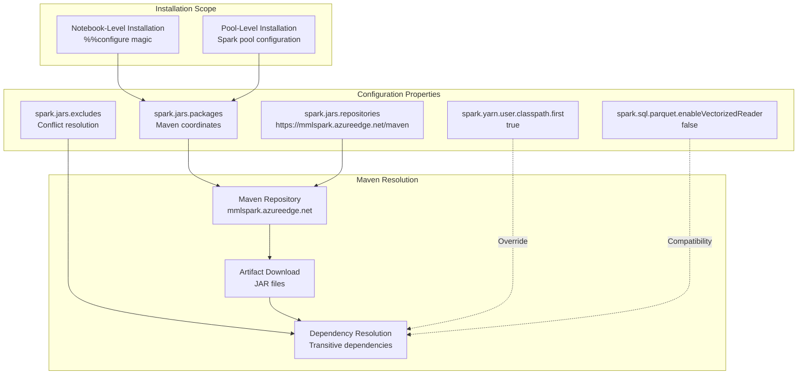
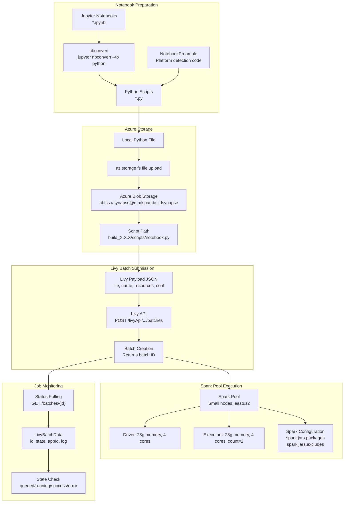
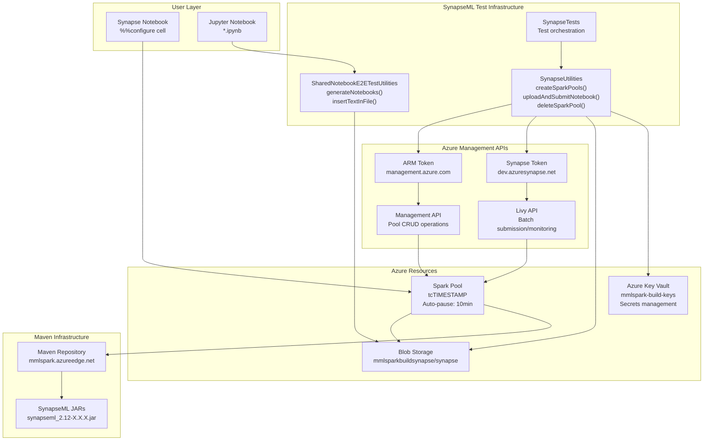
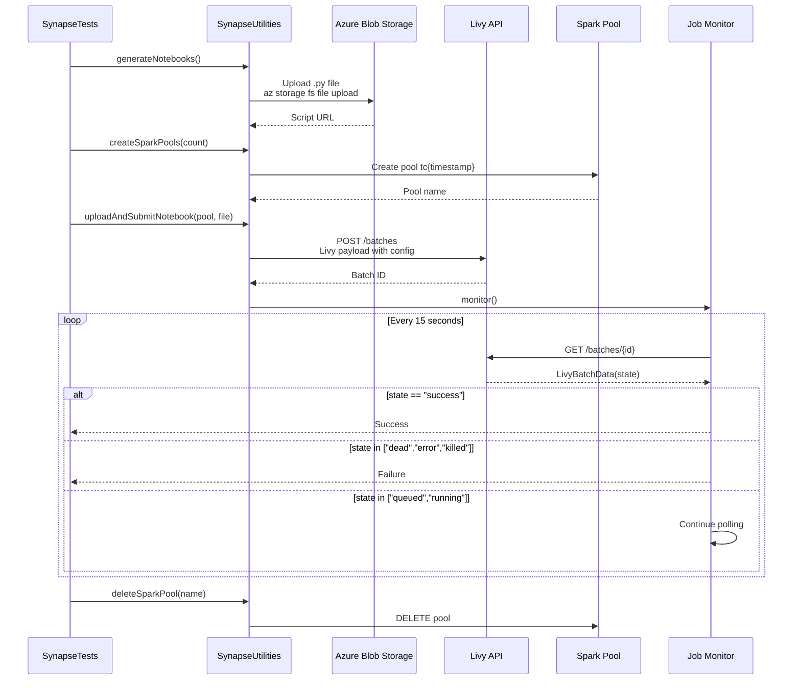

<!-- source: DeepWiki mcp.deepwiki.com · repo microsoft/SynapseML · page 8.3 Azure Synapse Deployment · fetched 2026-10-26 -->

# Azure Synapse Deployment

<details>
<summary>Relevant source files</summary>

The following files were used as context for generating this wiki page:

- [CONTRIBUTING.md](CONTRIBUTING.md)
- [README.md](README.md)
- [cognitive/src/test/scala/com/microsoft/azure/synapse/ml/services/form/FormOntologyLearnerSuite.scala](cognitive/src/test/scala/com/microsoft/azure/synapse/ml/services/form/FormOntologyLearnerSuite.scala)
- [core/src/test/scala/com/microsoft/azure/synapse/ml/Secrets.scala](core/src/test/scala/com/microsoft/azure/synapse/ml/Secrets.scala)
- [core/src/test/scala/com/microsoft/azure/synapse/ml/nbtest/SharedNotebookE2ETestUtilities.scala](core/src/test/scala/com/microsoft/azure/synapse/ml/nbtest/SharedNotebookE2ETestUtilities.scala)
- [core/src/test/scala/com/microsoft/azure/synapse/ml/nbtest/SynapseExtension/SynapseExtensionSchemas.scala](core/src/test/scala/com/microsoft/azure/synapse/ml/nbtest/SynapseExtension/SynapseExtensionSchemas.scala)
- [core/src/test/scala/com/microsoft/azure/synapse/ml/nbtest/SynapseExtension/SynapseExtensionUtilities.scala](core/src/test/scala/com/microsoft/azure/synapse/ml/nbtest/SynapseExtension/SynapseExtensionUtilities.scala)
- [core/src/test/scala/com/microsoft/azure/synapse/ml/nbtest/SynapseExtension/SynapseExtensionsTests.scala](core/src/test/scala/com/microsoft/azure/synapse/ml/nbtest/SynapseExtension/SynapseExtensionsTests.scala)
- [core/src/test/scala/com/microsoft/azure/synapse/ml/nbtest/SynapseTests.scala](core/src/test/scala/com/microsoft/azure/synapse/ml/nbtest/SynapseTests.scala)
- [core/src/test/scala/com/microsoft/azure/synapse/ml/nbtest/SynapseUtilities.scala](core/src/test/scala/com/microsoft/azure/synapse/ml/nbtest/SynapseUtilities.scala)
- [docs/Explore Algorithms/AI Services/Quickstart - Create Audiobooks.ipynb](docs/Explore Algorithms/AI Services/Quickstart - Create Audiobooks.ipynb)
- [docs/Explore Algorithms/AI Services/Quickstart - Document Question and Answering with PDFs.ipynb](docs/Explore Algorithms/AI Services/Quickstart - Document Question and Answering with PDFs.ipynb)
- [docs/Explore Algorithms/Deep Learning/Quickstart - Chat Completion with Azure AI Foundry Model.ipynb](docs/Explore Algorithms/Deep Learning/Quickstart - Chat Completion with Azure AI Foundry Model.ipynb)
- [docs/Explore Algorithms/OpenAI/Langchain.ipynb](docs/Explore Algorithms/OpenAI/Langchain.ipynb)
- [docs/Explore Algorithms/OpenAI/Quickstart - OpenAI Embedding and GPU based KNN.ipynb](docs/Explore Algorithms/OpenAI/Quickstart - OpenAI Embedding and GPU based KNN.ipynb)
- [docs/Explore Algorithms/OpenAI/Quickstart - OpenAI Embedding.ipynb](docs/Explore Algorithms/OpenAI/Quickstart - OpenAI Embedding.ipynb)
- [docs/Explore Algorithms/OpenAI/Quickstart - Understand and Search Forms.ipynb](docs/Explore Algorithms/OpenAI/Quickstart - Understand and Search Forms.ipynb)
- [docs/Get Started/Install SynapseML.md](docs/Get Started/Install SynapseML.md)
- [src/test/scala/com/microsoft/azure/synapse/ml/core/test/fuzzing/FuzzingTest.scala](src/test/scala/com/microsoft/azure/synapse/ml/core/test/fuzzing/FuzzingTest.scala)

</details>


## Purpose and Scope

This document describes how to deploy and use SynapseML in Azure Synapse Analytics environments. It covers notebook-level and pool-level installation, Spark configuration requirements, Livy batch execution for automated workflows, and resource management strategies.

For deployment to other platforms, see [Microsoft Fabric Deployment](#8.4), [Databricks Deployment](#8.5), or [Standalone and Other Platforms](#8.6). For general installation instructions across all platforms, see [Installation and Distribution](#8.1).

## Installation Methods

### Notebook-Level Installation

SynapseML can be installed at the notebook level using the `%%configure` magic command in the first cell. This approach allows version control per notebook without affecting the entire Spark pool.

**Configuration Cell Structure:**

```python
%%configure -f
{
  "name": "synapseml",
  "conf": {
      "spark.jars.packages": "com.microsoft.azure:synapseml_2.12:<version>",
      "spark.jars.repositories": "https://mmlspark.azureedge.net/maven",
      "spark.jars.excludes": "org.scala-lang:scala-reflect,org.apache.spark:spark-tags_2.12,org.scalactic:scalactic_2.12,org.scalatest:scalatest_2.12,com.fasterxml.jackson.core:jackson-databind",
      "spark.yarn.user.classpath.first": "true",
      "spark.sql.parquet.enableVectorizedReader": "false"
  }
}
```

**Version-Specific Configurations:**

| Spark Version | SynapseML Version | Configuration |
|---------------|-------------------|---------------|
| 3.5 | 1.1.0 | `synapseml_2.12:1.1.0` |
| 3.4 | 1.0.15 | `synapseml_2.12:1.0.15` |
| 3.3 | 0.11.4-spark3.3 | `synapseml_2.12:0.11.4-spark3.3` |

Sources: [README.md:118-168](), [docs/Get Started/Install SynapseML.md:25-72]()

### Pool-Level Installation

For consistent library availability across all notebooks in a Spark pool, add the configuration properties to the pool's Apache Spark configuration settings. This eliminates the need for per-notebook configuration cells.



Sources: [README.md:172](), [docs/Get Started/Install SynapseML.md:152-166]()

## Configuration Parameters

### Maven Coordinates

The `spark.jars.packages` parameter specifies the Maven coordinates for SynapseML:

```
com.microsoft.azure:synapseml_2.12:<version>
```

- **Group ID**: `com.microsoft.azure`
- **Artifact ID**: `synapseml_2.12` (Scala 2.12 build)
- **Version**: Matches Spark version (1.1.0 for Spark 3.5, 1.0.15 for Spark 3.4)

Sources: [README.md:129,145,161]()

### Dependency Exclusions

The `spark.jars.excludes` parameter prevents JAR conflicts by excluding specific artifacts that conflict with Synapse's built-in libraries:

| Excluded Artifact | Reason |
|-------------------|--------|
| `scala-reflect` | Conflicts with Spark's Scala runtime |
| `spark-tags_2.12` | Conflicts with Spark core |
| `scalactic_2.12`, `scalatest_2.12` | Test dependencies, not needed at runtime |
| `jackson-databind` | Version conflicts with Synapse's Jackson |

Sources: [README.md:131,147,163](), [core/src/test/scala/com/microsoft/azure/synapse/ml/nbtest/SynapseUtilities.scala:201-205]()

### Classpath Priority

`spark.yarn.user.classpath.first: "true"` ensures user-provided JARs (SynapseML) take precedence over system JARs. This is critical for overriding Synapse's pre-installed versions or resolving version conflicts.

Sources: [README.md:132,148,164]()

### Parquet Vectorized Reader

`spark.sql.parquet.enableVectorizedReader: "false"` disables vectorized Parquet reading for compatibility with certain SynapseML operations.

Sources: [README.md:133,149,165]()

## Spark Pool Requirements

### Supported Spark Versions

SynapseML requires:
- **Spark**: 3.4 or higher (3.5 recommended)
- **Scala**: 2.12
- **Python**: 3.8+

Sources: [README.md:9]()

### Pool Configuration for E2E Testing

The E2E testing infrastructure creates Spark pools with specific configurations:

```scala
// Pool properties
val PoolNodeSize: String = "Small"
val PoolLocation: String = "eastus2"
val SparkVersion: String = "3.5"

// Auto-scaling configuration
"autoScale": {
  "enabled": "true",
  "maxNodeCount": "10",
  "minNodeCount": "3"
}

// Dynamic executor allocation
"dynamicExecutorAllocation": {
  "enabled": "true",
  "maxExecutors": "8",
  "minExecutors": "2"
}
```

Sources: [core/src/test/scala/com/microsoft/azure/synapse/ml/nbtest/SynapseUtilities.scala:145-146,276]()

## Livy Batch Execution Architecture

SynapseML's automated testing and deployment leverage Apache Livy for batch job submission. This architecture enables distributed execution of notebooks as Python scripts.



Sources: [core/src/test/scala/com/microsoft/azure/synapse/ml/nbtest/SynapseUtilities.scala:188-236](), [core/src/test/scala/com/microsoft/azure/synapse/ml/nbtest/SharedNotebookE2ETestUtilities.scala:82-122]()

### Livy Batch Submission Process

The `SynapseUtilities.uploadAndSubmitNotebook` function orchestrates the submission:

1. **Upload to Azure Blob Storage**: Scripts are uploaded to `abfss://synapse@mmlsparkbuildsynapse.dfs.core.windows.net/build_{version}/scripts/{filename}`

2. **Construct Livy Payload**:
```json
{
  "file": "abfss://...",
  "name": "notebook_name",
  "driverMemory": "28g",
  "driverCores": 4,
  "executorMemory": "28g",
  "executorCores": 4,
  "numExecutors": 2,
  "conf": {
    "spark.jars.packages": "...",
    "spark.jars.repositories": "...",
    "spark.jars.excludes": "...",
    "spark.yarn.user.classpath.first": "true"
  }
}
```

3. **Submit to Livy API**:
```
POST https://mmlsparkbuildtest.dev.azuresynapse.net/livyApi/versions/2019-11-01-preview/sparkPools/{poolName}/batches
```

Sources: [core/src/test/scala/com/microsoft/azure/synapse/ml/nbtest/SynapseUtilities.scala:188-236]()

### Job Monitoring

The `LivyBatch.monitor()` method polls job status asynchronously:

```scala
case class LivyBatchData(
  id: Int,
  state: String,
  appId: Option[String],
  log: Option[Seq[String]]
)
```

**State Transitions:**
- `queued` → `running` → `success` (successful completion)
- `queued` → `running` → `dead`/`error`/`killed` (failure states)

The monitoring loop polls every 15 seconds and times out after 30 minutes.

Sources: [core/src/test/scala/com/microsoft/azure/synapse/ml/nbtest/SynapseUtilities.scala:28-106]()

## Component Interaction Diagram



Sources: [core/src/test/scala/com/microsoft/azure/synapse/ml/nbtest/SynapseUtilities.scala:133-348](), [core/src/test/scala/com/microsoft/azure/synapse/ml/nbtest/SynapseTests.scala:48-220]()

## Resource Management

### Spark Pool Lifecycle

**Pool Creation:**
The testing infrastructure creates pools with timestamp-based names (`tc{milliseconds}`) to ensure uniqueness:

```scala
val ClusterPrefix = "tc"
val triggerTime = Calendar.getInstance().getTimeInMillis.toString
val bigDataPoolName = s"$ClusterPrefix$triggerTime"
```

Pool properties include:
- **Auto-pause**: 10 minutes of inactivity
- **Auto-scale**: 3-10 nodes
- **Session-level packages**: Enabled
- **Spark version**: 3.5

Sources: [core/src/test/scala/com/microsoft/azure/synapse/ml/nbtest/SynapseUtilities.scala:151,318-337]()

### Cleanup Strategies

**Automated Cleanup:**
The `tryDeleteOldSparkPools()` function removes pools older than 24 hours to prevent resource accumulation:

```scala
val dayAgoTsInMillis = Calendar.getInstance().getTimeInMillis - 24 * 60 * 60 * 1000

// Query pools with filter
val getBigDataPoolsUri = s"""
  $ManagementUrlRoot/resources?api-version=2021-04-01&
  $$filter=substringof(name, '$WorkspaceName/$ClusterPrefix') and
  resourceType eq 'Microsoft.Synapse/workspaces/bigDataPools'
""".stripMargin
```

Pools are identified by:
1. Name prefix (`tc`)
2. Creation timestamp in tags
3. Age comparison

Sources: [core/src/test/scala/com/microsoft/azure/synapse/ml/nbtest/SynapseUtilities.scala:283-316]()

**Test Cleanup:**
After test completion, pools are deleted if they were created by the test:

```scala
protected override def afterAll(): Unit = {
  existingPoolNameOpt match {
    case Some(pool) =>
      println(s"Existing pool '$pool' was used; skipping deletion.")
    case None =>
      val poolsToDelete = sparkPools.distinct.filter(_.startsWith(ClusterPrefix))
      poolsToDelete.map(pool => Try(deleteSparkPool(pool)))
  }
  super.afterAll()
}
```

Sources: [core/src/test/scala/com/microsoft/azure/synapse/ml/nbtest/SynapseTests.scala:200-219]()

### Job Monitoring and Retry Logic

**Retry Mechanism:**
Failed jobs are automatically retried up to 5 times with exponential backoff plus jitter:

```scala
@tailrec
private def retryBatch(maxRetries: Int, delayMillis: Long, attempt: Int = 1)(block: => LivyBatch): LivyBatch = {
  val livyBatch = block
  livyBatch.isSuccess match {
    case true => livyBatch
    case false if attempt < maxRetries =>
      val jitter = scala.util.Random.nextInt(5000)
      Thread.sleep(delayMillis + jitter)
      retryBatch(maxRetries, delayMillis, attempt + 1)(block)
    case false => livyBatch
  }
}
```

**Status Monitoring:**
Jobs are monitored with 15-second polling intervals:

```scala
@tailrec
private def pollLivyUrl(lastStatus: Option[String] = None): LivyBatch = {
  val newData = sendAndParseJson(getStatusRequest).convertTo[LivyBatchData]
  if (newData.state == "success") {
    LivyBatch(newData, runName, sparkPool, startTime)
  } else if (Set("dead", "error", "killed")(newData.state.toLowerCase)) {
    LivyBatch(newData, runName, sparkPool, startTime)
  } else {
    Thread.sleep(15000)
    pollLivyUrl(Some(newData.state))
  }
}
```

Sources: [core/src/test/scala/com/microsoft/azure/synapse/ml/nbtest/SynapseTests.scala:138-149,161](), [core/src/test/scala/com/microsoft/azure/synapse/ml/nbtest/SynapseUtilities.scala:63-82]()

## Authentication and Token Management

### Token Acquisition

SynapseML's Synapse deployment uses two types of tokens:

**ARM Token (Azure Resource Manager):**
```scala
lazy val ArmToken: String = getAccessToken("https://management.azure.com/")
```
Used for management plane operations (creating/deleting pools).

**Synapse Token:**
```scala
lazy val SynapseToken: String = getAccessToken("https://dev.azuresynapse.net/")
```
Used for data plane operations (Livy API calls).

Sources: [core/src/test/scala/com/microsoft/azure/synapse/ml/nbtest/SynapseUtilities.scala:137-138]()

### Secret Management

Secrets are retrieved from Azure Key Vault using the Azure CLI:

```scala
def getSecret(secretName: String): String = {
  println(s"[info] fetching secret: $secretName from $AccountString")
  val secretJson = exec(s"az keyvault secret show --vault-name $KvName --name $secretName")
  secretJson.parseJson.asJsObject().fields("value").convertTo[String]
}
```

Key secrets:
- `openai-api-key-2`: OpenAI service key
- `ai-services-api-key`: Azure AI Services key
- `azure-search-key`: Cognitive Search key

Sources: [core/src/test/scala/com/microsoft/azure/synapse/ml/Secrets.scala:44-79]()

### Platform Detection

Notebooks detect the Synapse environment using the notebook preamble:

```python
from synapse.ml.core.platform import running_on_synapse

if running_on_synapse():
    from IPython import get_ipython
    from IPython.terminal.interactiveshell import TerminalInteractiveShell
    from synapse.ml.core.platform import materializing_display as display
    from pyspark.sql import SparkSession
    
    spark = SparkSession.builder.getOrCreate()
```

This ensures compatibility with Synapse-specific APIs like `mssparkutils`.

Sources: [core/src/test/scala/com/microsoft/azure/synapse/ml/nbtest/SharedNotebookE2ETestUtilities.scala:22-42]()

## Notebook Execution Flow



Sources: [core/src/test/scala/com/microsoft/azure/synapse/ml/nbtest/SynapseTests.scala:98-198](), [core/src/test/scala/com/microsoft/azure/synapse/ml/nbtest/SynapseUtilities.scala:188-236]()

## Best Practices

### Version Selection

Choose the SynapseML version that matches your Spark pool version:
- **Spark 3.5**: Use `synapseml_2.12:1.1.0`
- **Spark 3.4**: Use `synapseml_2.12:1.0.15`
- **Spark 3.3**: Use `synapseml_2.12:0.11.4-spark3.3`

Mismatched versions may cause binary compatibility issues.

### Configuration Order

Always place the `%%configure` cell as the **first cell** in your notebook. The `-f` flag forces session restart to apply configuration changes.

### Pool-Level vs Notebook-Level

**Use pool-level installation when:**
- All notebooks in the pool use the same SynapseML version
- You want to reduce notebook startup time
- You need consistent library availability

**Use notebook-level installation when:**
- Different notebooks require different versions
- You're testing new SynapseML releases
- You want version control per notebook

### Resource Optimization

**For production workloads:**
- Enable auto-pause with appropriate timeout (10-15 minutes)
- Configure auto-scale based on workload patterns
- Use dynamic executor allocation for variable workloads

**For development:**
- Use smaller node sizes ("Small") for cost efficiency
- Set lower minimum node counts
- Implement aggressive auto-pause policies

Sources: [core/src/test/scala/com/microsoft/azure/synapse/ml/nbtest/SynapseUtilities.scala:238-279]()

## Troubleshooting

### Common Issues

**JAR Conflicts:**
If you encounter `NoClassDefFoundError` or `NoSuchMethodError`, ensure `spark.yarn.user.classpath.first` is set to `true` and all conflicting dependencies are excluded.

**Livy Timeout:**
Batch submissions may timeout if the pool is cold-starting. The default timeout is 30 minutes. Monitor job status at:
```
https://web-staging.azuresynapse.net/en-us/monitoring/sparkapplication/{runName}
```

**Dependency Resolution Failures:**
Verify that `spark.jars.repositories` includes `https://mmlspark.azureedge.net/maven`. Network issues may prevent Maven artifact download.

Sources: [core/src/test/scala/com/microsoft/azure/synapse/ml/nbtest/SynapseUtilities.scala:97-104](), [README.md:131-133]()

---

