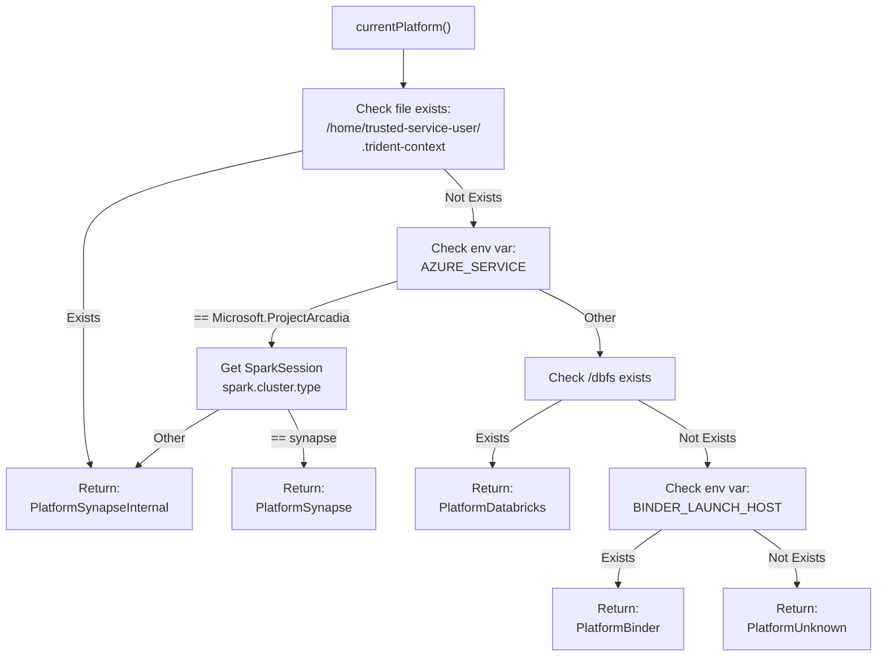
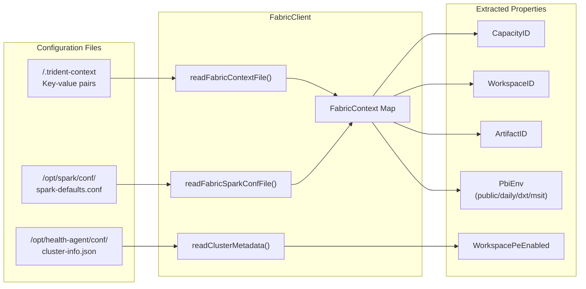
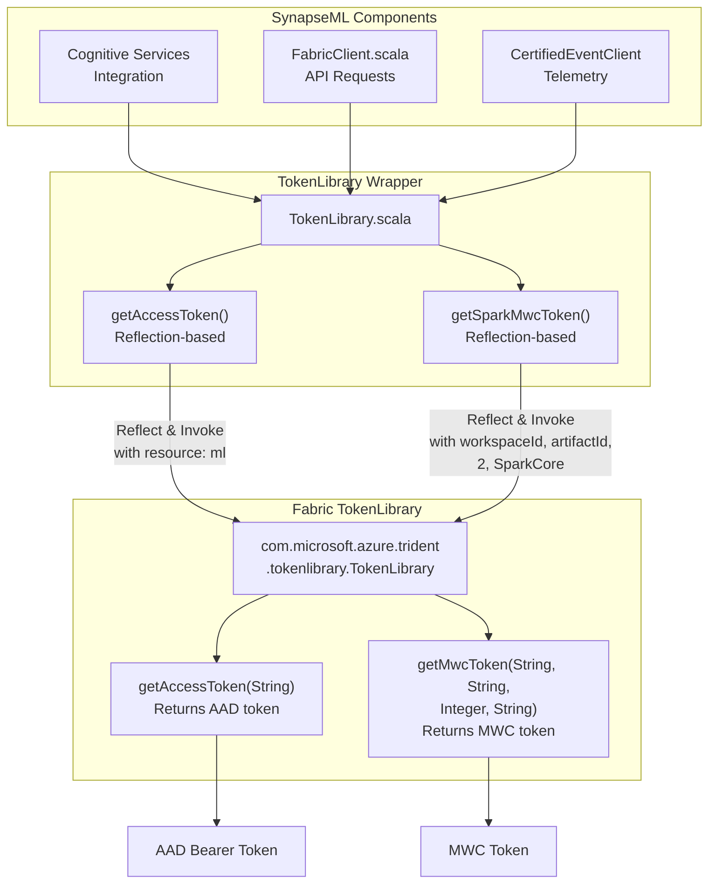
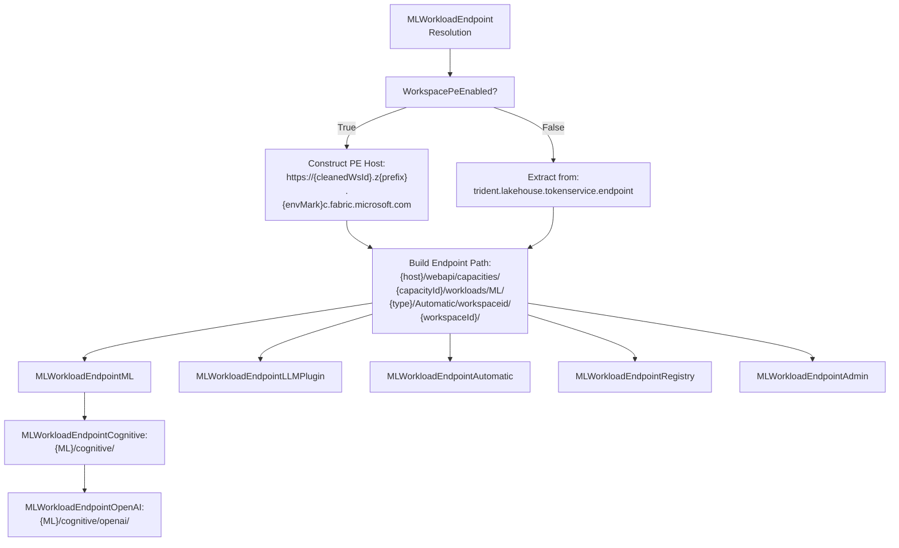
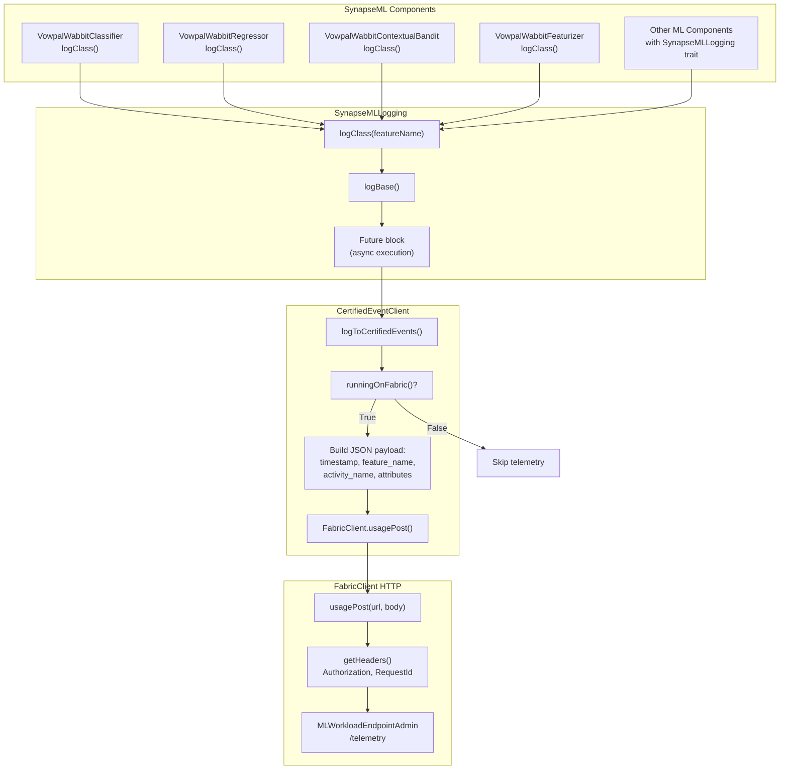

<!-- source: DeepWiki mcp.deepwiki.com · repo microsoft/SynapseML · page 8.4 Microsoft Fabric Deployment · fetched 2026-10-26 -->

# Microsoft Fabric Deployment

<details>
<summary>Relevant source files</summary>

The following files were used as context for generating this wiki page:

- [.github/ISSUE_TEMPLATE/bug_report_template.yaml](.github/ISSUE_TEMPLATE/bug_report_template.yaml)
- [.github/ISSUE_TEMPLATE/feature_request.md](.github/ISSUE_TEMPLATE/feature_request.md)
- [CONTRIBUTING.md](CONTRIBUTING.md)
- [README.md](README.md)
- [core/src/main/scala/com/microsoft/azure/synapse/ml/fabric/FabricClient.scala](core/src/main/scala/com/microsoft/azure/synapse/ml/fabric/FabricClient.scala)
- [core/src/main/scala/com/microsoft/azure/synapse/ml/fabric/TokenLibrary.scala](core/src/main/scala/com/microsoft/azure/synapse/ml/fabric/TokenLibrary.scala)
- [core/src/main/scala/com/microsoft/azure/synapse/ml/io/http/HTTPClients.scala](core/src/main/scala/com/microsoft/azure/synapse/ml/io/http/HTTPClients.scala)
- [core/src/main/scala/com/microsoft/azure/synapse/ml/logging/SynapseMLLogging.scala](core/src/main/scala/com/microsoft/azure/synapse/ml/logging/SynapseMLLogging.scala)
- [core/src/main/scala/com/microsoft/azure/synapse/ml/logging/common/PlatformDetails.scala](core/src/main/scala/com/microsoft/azure/synapse/ml/logging/common/PlatformDetails.scala)
- [core/src/main/scala/com/microsoft/azure/synapse/ml/logging/common/Scrubber.scala](core/src/main/scala/com/microsoft/azure/synapse/ml/logging/common/Scrubber.scala)
- [core/src/main/scala/com/microsoft/azure/synapse/ml/logging/fabric/CertifiedEventClient.scala](core/src/main/scala/com/microsoft/azure/synapse/ml/logging/fabric/CertifiedEventClient.scala)
- [core/src/test/scala/com/microsoft/azure/synapse/ml/logging/LoggingScrubberTests.scala](core/src/test/scala/com/microsoft/azure/synapse/ml/logging/LoggingScrubberTests.scala)
- [vw/src/main/scala/com/microsoft/azure/synapse/ml/vw/VectorZipper.scala](vw/src/main/scala/com/microsoft/azure/synapse/ml/vw/VectorZipper.scala)
- [vw/src/main/scala/com/microsoft/azure/synapse/ml/vw/VowpalWabbitCSETransformer.scala](vw/src/main/scala/com/microsoft/azure/synapse/ml/vw/VowpalWabbitCSETransformer.scala)
- [vw/src/main/scala/com/microsoft/azure/synapse/ml/vw/VowpalWabbitClassifier.scala](vw/src/main/scala/com/microsoft/azure/synapse/ml/vw/VowpalWabbitClassifier.scala)
- [vw/src/main/scala/com/microsoft/azure/synapse/ml/vw/VowpalWabbitContextualBandit.scala](vw/src/main/scala/com/microsoft/azure/synapse/ml/vw/VowpalWabbitContextualBandit.scala)
- [vw/src/main/scala/com/microsoft/azure/synapse/ml/vw/VowpalWabbitDSJsonTransformer.scala](vw/src/main/scala/com/microsoft/azure/synapse/ml/vw/VowpalWabbitDSJsonTransformer.scala)
- [vw/src/main/scala/com/microsoft/azure/synapse/ml/vw/VowpalWabbitFeaturizer.scala](vw/src/main/scala/com/microsoft/azure/synapse/ml/vw/VowpalWabbitFeaturizer.scala)
- [vw/src/main/scala/com/microsoft/azure/synapse/ml/vw/VowpalWabbitRegressor.scala](vw/src/main/scala/com/microsoft/azure/synapse/ml/vw/VowpalWabbitRegressor.scala)

</details>


## Purpose and Scope

This document explains how SynapseML is deployed and integrated with Microsoft Fabric, including pre-installation details, environment detection mechanisms, token management for authentication, workload endpoint resolution, and telemetry integration. For deployment on other platforms, see [Azure Synapse Deployment](#8.3), [Databricks Deployment](#8.5), and [Standalone and Other Platforms](#8.6). For general installation and distribution mechanisms, see [Installation and Distribution](#8.1).

## Pre-Installation and Version Management

SynapseML comes pre-installed in Microsoft Fabric notebooks. Users can optionally override the default version by placing a configuration cell at the beginning of their notebook:

```bash
%%configure -f
{
  "name": "synapseml",
  "conf": {
      "spark.jars.packages": "com.microsoft.azure:synapseml_2.12:<VERSION>",
      "spark.jars.repositories": "https://mmlspark.azureedge.net/maven",
      "spark.jars.excludes": "org.scala-lang:scala-reflect,org.apache.spark:spark-tags_2.12,org.scalactic:scalactic_2.12,org.scalatest:scalatest_2.12,com.fasterxml.jackson.core:jackson-databind",
      "spark.yarn.user.classpath.first": "true",
      "spark.sql.parquet.enableVectorizedReader": "false"
  }
}
```

The `%%configure -f` magic command reconfigures the Spark session with the specified SynapseML version and Maven coordinates. The `-f` flag forces a session restart to apply the new configuration.

**Sources:** [README.md:96-113]()

## Platform Detection

SynapseML automatically detects when it is running in Microsoft Fabric using a multi-layered detection mechanism. This detection enables platform-specific behavior for authentication, telemetry, and endpoint resolution.

### Detection Flow Diagram



The detection logic prioritizes the presence of the Trident context file, which is unique to Microsoft Fabric environments. The constant `PlatformSynapseInternal` is used internally to refer to Fabric, distinguishing it from regular Azure Synapse (`PlatformSynapse`).

**Sources:** [core/src/main/scala/com/microsoft/azure/synapse/ml/logging/common/PlatformDetails.scala:17-47]()

### Platform Detection Usage

Components throughout SynapseML use the `runningOnFabric()` helper method to conditionally enable Fabric-specific features:

```scala
def runningOnFabric(): Boolean = CurrentPlatform == PlatformSynapseInternal
```

This is used primarily for:
- Enabling certified event telemetry
- Using Fabric-specific token acquisition
- Resolving Fabric workload endpoints

**Sources:** [core/src/main/scala/com/microsoft/azure/synapse/ml/logging/common/PlatformDetails.scala:42-46]()

## Fabric Environment Configuration

When running in Fabric, SynapseML reads configuration from multiple sources to identify the execution context and construct appropriate service endpoints.

### Configuration Sources Diagram



### Key Configuration Properties

| Property | Source Key | Description |
|----------|------------|-------------|
| **CapacityID** | `trident.capacity.id` | Unique identifier for the Fabric capacity |
| **WorkspaceID** | `trident.artifact.workspace.id` or `trident.workspace.id` | Workspace containing the notebook/artifact |
| **ArtifactID** | `trident.artifact.id` | Current artifact (notebook) identifier |
| **PbiEnv** | `spark.trident.pbienv` | Environment: `public`, `daily`, `dxt`, `msit` (defaults to `public`) |
| **WorkspacePeEnabled** | `workspace-pe-enabled` (from cluster metadata) | Whether private endpoints are enabled |

**Sources:** [core/src/main/scala/com/microsoft/azure/synapse/ml/fabric/FabricClient.scala:23-29, 51-143]()

### Configuration File Parsing

The `FabricClient` object lazily loads configuration on first access using Scala `lazy val` initialization:

- **Trident Context**: Parsed as simple `key=value` pairs from [core/src/main/scala/com/microsoft/azure/synapse/ml/fabric/FabricClient.scala:90-106]()
- **Spark Configuration**: Parsed from Spark defaults file, filtering comment lines [core/src/main/scala/com/microsoft/azure/synapse/ml/fabric/FabricClient.scala:108-124]()
- **Cluster Metadata**: Parsed as JSON to extract private endpoint settings [core/src/main/scala/com/microsoft/azure/synapse/ml/fabric/FabricClient.scala:126-138]()

## Token Management and Authentication

SynapseML requires authentication tokens to access Fabric ML workload services and Azure Cognitive Services. Token acquisition uses reflection to access the Fabric-provided TokenLibrary without creating a compile-time dependency.

### Token Acquisition Architecture



### Token Types and Usage

| Token Type | Method | Format | Usage |
|------------|--------|--------|-------|
| **AAD Token** | `getMLWorkloadAADAuthHeader()` | `Bearer <token>` | ML Workload API requests, telemetry |
| **MWC Token** | `getCognitiveMWCTokenAuthHeader()` | `MwcToken <token>` | Cognitive Services requests |

The AAD token is obtained by calling `TokenLibrary.getAccessToken("ml")`, which requests an Azure Active Directory token for the ML resource. The MWC (Managed Workspace Container) token is obtained for specific workspace and artifact IDs, used primarily for cognitive services integration.

**Sources:** [core/src/main/scala/com/microsoft/azure/synapse/ml/fabric/TokenLibrary.scala:9-51](), [core/src/main/scala/com/microsoft/azure/synapse/ml/fabric/FabricClient.scala:194-198]()

### Reflection-Based Token Acquisition

Since the Fabric TokenLibrary is not available in all environments, SynapseML uses reflection to avoid compile-time dependencies:

```scala
val objectName = "com.microsoft.azure.trident.tokenlibrary.TokenLibrary"
val mirror = currentMirror
val module = mirror.staticModule(objectName)
val obj = mirror.reflectModule(module).instance
val methodMirror = mirror.reflect(obj).reflectMethod(selectedMethodSymbol.asMethod)
methodMirror("ml").asInstanceOf[String]
```

This pattern allows SynapseML to work in non-Fabric environments (where TokenLibrary doesn't exist) while leveraging it when available.

**Sources:** [core/src/main/scala/com/microsoft/azure/synapse/ml/fabric/TokenLibrary.scala:10-27]()

## Workload Endpoints

SynapseML constructs ML workload endpoints dynamically based on the detected Fabric environment configuration. These endpoints provide access to ML services, cognitive services, and telemetry infrastructure.

### Endpoint Resolution Flow



### Endpoint Types and Structure

The following endpoint types are constructed by `FabricClient`:

| Constant | Endpoint Type | Path Suffix | Purpose |
|----------|---------------|-------------|---------|
| `MLWorkloadEndpointML` | `ML` | Base ML workload | General ML operations |
| `MLWorkloadEndpointLLMPlugin` | `LlmPlugin` | LLM plugin | Language model services |
| `MLWorkloadEndpointAutomatic` | `Automatic` | Automatic ML | AutoML services |
| `MLWorkloadEndpointRegistry` | `Registry` | Model registry | Model management |
| `MLWorkloadEndpointAdmin` | `MLAdmin` | Admin operations | Telemetry, administration |
| `MLWorkloadEndpointCognitive` | N/A | `{ML}/cognitive/` | Cognitive Services proxy |
| `MLWorkloadEndpointOpenAI` | N/A | `{ML}/cognitive/openai/` | OpenAI Services proxy |

**Sources:** [core/src/main/scala/com/microsoft/azure/synapse/ml/fabric/FabricClient.scala:14-38, 185-188]()

### Private Endpoint Support

When `WorkspacePeEnabled` is true (read from cluster metadata), Fabric uses workspace-specific private endpoints instead of shared public endpoints. The private endpoint host is constructed using the workspace ID:

```scala
val cleanedWsId = wsId.toLowerCase.replace("-", "")
val envMark = PbiEnv match {
  case "daily" | "dxt" | "msit" => s"$PbiEnv-"
  case _ => ""
}
s"https://${cleanedWsId}.z${cleanedWsId.take(2)}.${envMark}c.fabric.microsoft.com"
```

This ensures network traffic stays within private network boundaries for workspaces with private endpoint enabled.

**Sources:** [core/src/main/scala/com/microsoft/azure/synapse/ml/fabric/FabricClient.scala:78-88, 140-143]()

## Telemetry and Certified Events

SynapseML integrates with Fabric's certified events telemetry system to log usage metrics. This provides visibility into feature adoption and helps track usage for capacity billing and analytics.

### Telemetry Architecture



### Certified Event Payload

Each telemetry event includes:

- **Timestamp**: Unix epoch seconds from `Instant.now().getEpochSecond`
- **Feature Name**: The library name (e.g., "SynapseML")
- **Activity Name**: The specific feature or component (e.g., "VowpalWabbit")
- **Attributes**: Empty object (extensible for future metadata)

Example payload:
```json
{
  "timestamp": 1234567890,
  "feature_name": "SynapseML",
  "activity_name": "VowpalWabbit",
  "attributes": {}
}
```

**Sources:** [core/src/main/scala/com/microsoft/azure/synapse/ml/logging/fabric/CertifiedEventClient.scala:13-35]()

### Asynchronous Logging

Telemetry is logged asynchronously to avoid blocking ML operations. The `logBase()` method wraps the telemetry call in a Scala `Future`:

```scala
if (featureName.isDefined) {
  Future {
    logToCertifiedEvents(
      info("libraryName"),
      featureName.get
    )
  }.failed.map {
    case e: Exception => logErrorBase("certifiedEventLogging", e)
  }
}
```

Errors in telemetry logging are caught and logged locally but don't propagate to user code, ensuring telemetry failures don't affect ML workload execution.

**Sources:** [core/src/main/scala/com/microsoft/azure/synapse/ml/logging/SynapseMLLogging.scala:127-140]()

### Feature Name Constants

Components that use certified events telemetry reference feature names from the `FeatureNames` object:

```scala
logClass(FeatureNames.VowpalWabbit)
```

This ensures consistent naming across the codebase for telemetry aggregation and reporting.

**Sources:** [vw/src/main/scala/com/microsoft/azure/synapse/ml/vw/VowpalWabbitClassifier.scala:30](), [vw/src/main/scala/com/microsoft/azure/synapse/ml/vw/VowpalWabbitRegressor.scala:23](), [vw/src/main/scala/com/microsoft/azure/synapse/ml/vw/VowpalWabbitContextualBandit.scala:110](), [vw/src/main/scala/com/microsoft/azure/synapse/ml/vw/VowpalWabbitFeaturizer.scala:29]()

## HTTP Request Infrastructure

All communication with Fabric workload endpoints uses the shared HTTP client infrastructure with platform-aware headers and authentication.

### Request Headers

The `FabricClient.getHeaders()` method constructs standard headers for all ML workload requests:

| Header | Value | Purpose |
|--------|-------|---------|
| `Authorization` | `Bearer <AAD_token>` | Authentication via Azure AD |
| `RequestId` | `UUID.randomUUID()` | Request correlation/tracing |
| `Content-Type` | `application/json` | Request body format |
| `x-ms-workload-resource-moniker` | `UUID.randomUUID()` | Workload resource tracking |

**Sources:** [core/src/main/scala/com/microsoft/azure/synapse/ml/fabric/FabricClient.scala:145-152]()

### RESTUtils Integration

`FabricClient` extends `RESTUtils` trait which provides the `usagePost()` method for making HTTP POST requests:

```scala
def usagePost(url: String, body: String): JsValue = {
  usagePost(url, body, getHeaders)
}
```

This method handles JSON serialization, HTTP communication, and response parsing, with authentication headers automatically included.

**Sources:** [core/src/main/scala/com/microsoft/azure/synapse/ml/fabric/FabricClient.scala:13, 190-192]()

## Platform-Aware Logging

The logging system integrates Fabric-specific metadata when running in Fabric environments. The `SynapseMLLogging` trait collects Hadoop configuration entries that contain Fabric workspace and capacity information.

### Hadoop Configuration Keys

```scala
val HadoopKeysToLog: mutable.Map[String, String] = mutable.Map(
  "trident.artifact.id" -> "artifactId",
  "trident.workspace.id" -> "workspaceId",
  "trident.capacity.id" -> "capacityId",
  "trident.artifact.workspace.id" -> "artifactWorkspaceId",
  "trident.lakehouse.id" -> "lakehouseId",
  "trident.activity.id" -> "livyId",
  "trident.artifact.type" -> "artifactType",
  "trident.tenant.id" -> "tenantId"
)
```

These properties are automatically included in structured log messages, enabling correlation of log entries with specific Fabric resources.

**Sources:** [core/src/main/scala/com/microsoft/azure/synapse/ml/logging/SynapseMLLogging.scala:52-62]()

### Log Message Structure

Each log entry includes standard fields:
- `modelUid`: Unique identifier for the component instance
- `className`: Fully qualified class name
- `method`: Operation being performed (e.g., "fit", "transform")
- `libraryVersion`: SynapseML version
- `libraryName`: Always "SynapseML"
- `protocolVersion`: Logging schema version
- Plus any Fabric-specific metadata from Hadoop configuration

**Sources:** [core/src/main/scala/com/microsoft/azure/synapse/ml/logging/SynapseMLLogging.scala:19-32, 98-113]()

### SAS Token Scrubbing

All log messages are scrubbed to remove Shared Access Signature (SAS) tokens before logging. The `SASScrubber` uses regex pattern matching to replace SAS signatures with a placeholder:

```scala
val pattern = new Regex("(?i)sig=[a-z0-9%]{43,63}%3d")
pattern replaceAllIn(message, "sig=####")
```

This prevents accidental logging of sensitive credentials in telemetry or application logs.

**Sources:** [core/src/main/scala/com/microsoft/azure/synapse/ml/logging/common/Scrubber.scala:19-24](), [core/src/main/scala/com/microsoft/azure/synapse/ml/logging/SynapseMLLogging.scala:87-91]()

## Summary

Microsoft Fabric deployment of SynapseML is characterized by:

1. **Zero-Configuration**: SynapseML is pre-installed, requiring no manual package installation
2. **Automatic Detection**: Platform detection via Trident context file enables Fabric-specific behavior
3. **Seamless Authentication**: Reflection-based token acquisition provides transparent access to Fabric services
4. **Dynamic Endpoint Resolution**: Workload endpoints adapt to environment (public/daily/dxt/msit) and private endpoint settings
5. **Integrated Telemetry**: Certified events track feature usage without impacting performance
6. **Secure Logging**: Automatic scrubbing of sensitive credentials from all log output

This integration allows data scientists to focus on ML workloads without worrying about infrastructure configuration, while providing the Fabric platform with visibility into library usage and performance metrics.

---

