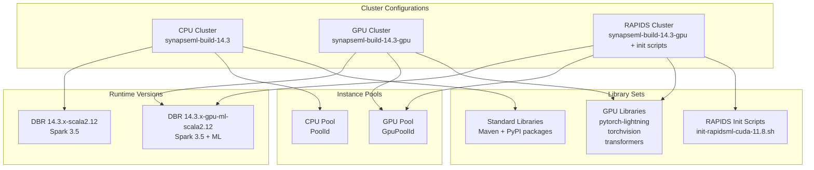
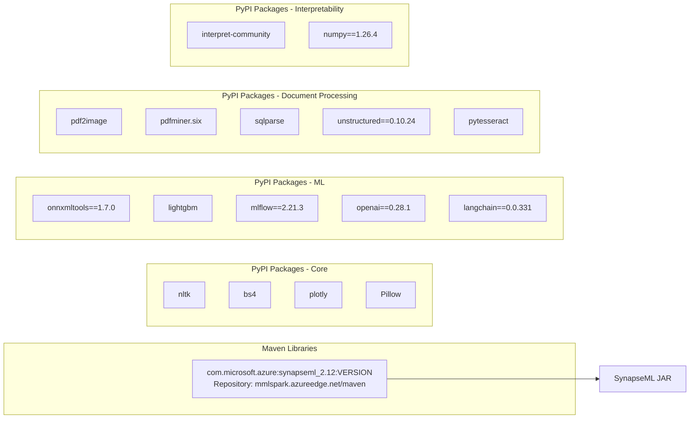
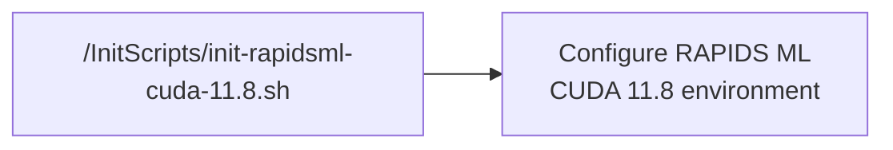
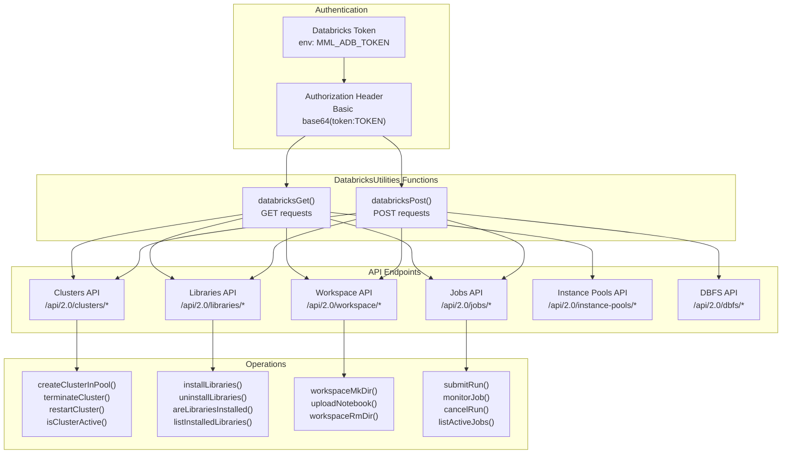
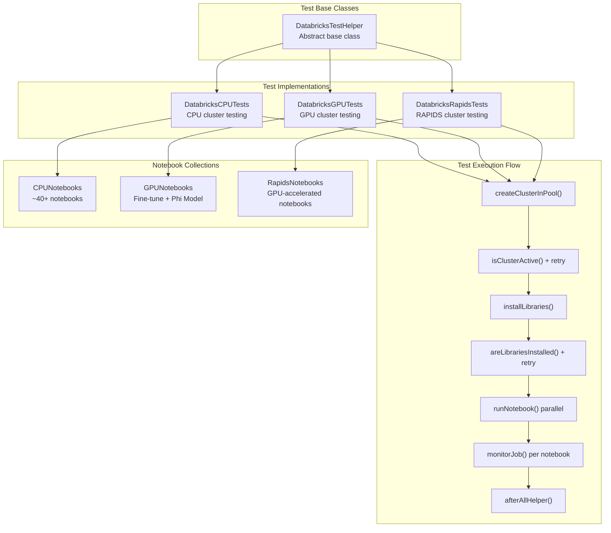
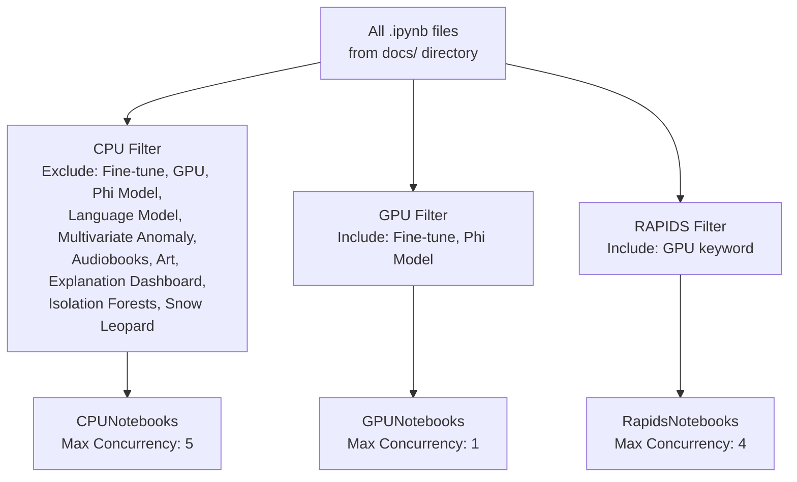
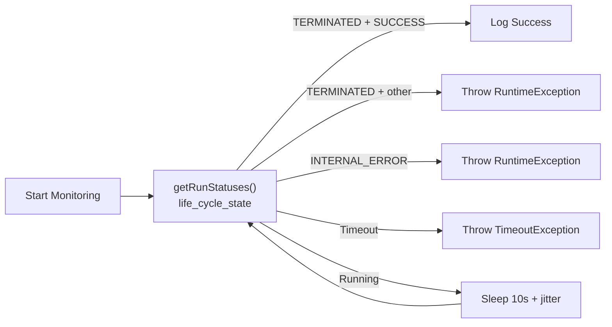
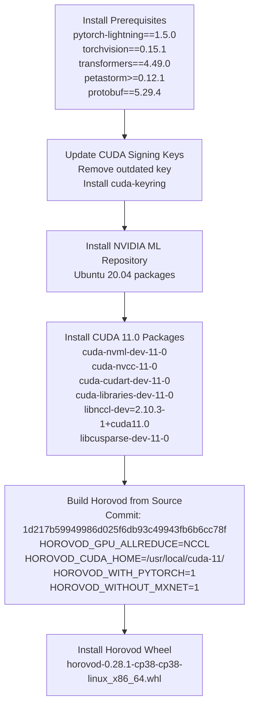
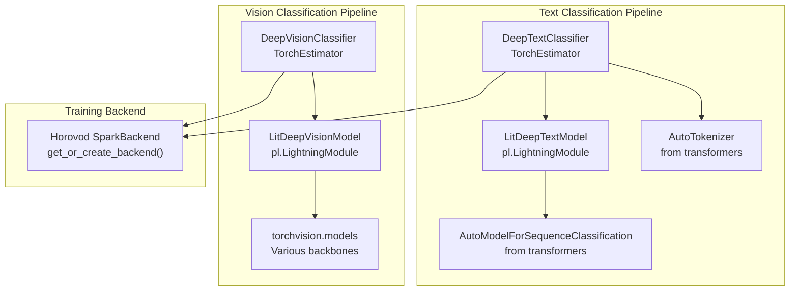

<!-- source: DeepWiki mcp.deepwiki.com · repo microsoft/SynapseML · page 8.5 Databricks Deployment · fetched 2026-10-26 -->

# Databricks Deployment

<details>
<summary>Relevant source files</summary>

The following files were used as context for generating this wiki page:

- [CONTRIBUTING.md](CONTRIBUTING.md)
- [README.md](README.md)
- [cognitive/src/test/scala/com/microsoft/azure/synapse/ml/services/anomaly/MultivariateAnamolyDetectionSuite.scala](cognitive/src/test/scala/com/microsoft/azure/synapse/ml/services/anomaly/MultivariateAnamolyDetectionSuite.scala)
- [core/src/test/scala/com/microsoft/azure/synapse/ml/nbtest/DatabricksCPUTests.scala](core/src/test/scala/com/microsoft/azure/synapse/ml/nbtest/DatabricksCPUTests.scala)
- [core/src/test/scala/com/microsoft/azure/synapse/ml/nbtest/DatabricksGPUTests.scala](core/src/test/scala/com/microsoft/azure/synapse/ml/nbtest/DatabricksGPUTests.scala)
- [core/src/test/scala/com/microsoft/azure/synapse/ml/nbtest/DatabricksRapidsTests.scala](core/src/test/scala/com/microsoft/azure/synapse/ml/nbtest/DatabricksRapidsTests.scala)
- [core/src/test/scala/com/microsoft/azure/synapse/ml/nbtest/DatabricksUtilities.scala](core/src/test/scala/com/microsoft/azure/synapse/ml/nbtest/DatabricksUtilities.scala)
- [deep-learning/src/main/python/horovod_installation.sh](deep-learning/src/main/python/horovod_installation.sh)
- [deep-learning/src/main/python/synapse/ml/dl/DeepTextClassifier.py](deep-learning/src/main/python/synapse/ml/dl/DeepTextClassifier.py)
- [deep-learning/src/main/python/synapse/ml/dl/DeepVisionClassifier.py](deep-learning/src/main/python/synapse/ml/dl/DeepVisionClassifier.py)
- [deep-learning/src/main/python/synapse/ml/dl/LitDeepTextModel.py](deep-learning/src/main/python/synapse/ml/dl/LitDeepTextModel.py)
- [deep-learning/src/main/python/synapse/ml/dl/LitDeepVisionModel.py](deep-learning/src/main/python/synapse/ml/dl/LitDeepVisionModel.py)
- [docs/Explore Algorithms/Other Algorithms/Quickstart - Anomalous Access Detection.ipynb](docs/Explore Algorithms/Other Algorithms/Quickstart - Anomalous Access Detection.ipynb)

</details>


## Purpose and Scope

This document describes how to deploy and configure SynapseML on Databricks clusters, including installation methods, cluster configurations, library dependencies, and testing infrastructure. For general installation information across all platforms, see [Installation and Distribution](#8.1). For Azure Synapse-specific deployment, see [Azure Synapse Deployment](#8.3). For Microsoft Fabric deployment, see [Microsoft Fabric Deployment](#8.4).

## Installation Overview

SynapseML integrates with Databricks through Maven coordinate-based library installation. The system supports three primary cluster types: CPU clusters for general workloads, GPU clusters for deep learning training, and RAPIDS-enabled GPU clusters for accelerated DataFrame operations.

### Basic Installation via Maven Coordinates

```python
# Maven coordinates for SynapseML
com.microsoft.azure:synapseml_2.12:1.1.0

# Maven repository
https://mmlspark.azureedge.net/maven
```

**Sources:** [README.md:174-189]()

### Cluster Configuration Cell

The `%%configure` magic is not used on Databricks. Instead, libraries are installed at the cluster level through the Databricks UI using Maven coordinates.

## Cluster Configuration Architecture

### Cluster Types and Runtimes



**Sources:** [core/src/test/scala/com/microsoft/azure/synapse/ml/nbtest/DatabricksUtilities.scala:34-51]()

### Cluster Creation Parameters

| Parameter | CPU Cluster | GPU Cluster | RAPIDS Cluster |
|-----------|-------------|-------------|----------------|
| Runtime | `14.3.x-scala2.12` | `14.3.x-gpu-ml-scala2.12` | `14.3.x-gpu-ml-scala2.12` |
| Pool Name | `synapseml-build-14.3` | `synapseml-build-14.3-gpu` | `synapseml-build-14.3-gpu` |
| Num Workers | 5 | 2 | 1 |
| Auto-termination | 15 minutes | 15 minutes | 15 minutes |
| Init Scripts | None | None | `/InitScripts/init-rapidsml-cuda-11.8.sh` |
| Memory Config | Optional: 7g | Default | Default |

**Sources:** [core/src/test/scala/com/microsoft/azure/synapse/ml/nbtest/DatabricksUtilities.scala:34-51](), [core/src/test/scala/com/microsoft/azure/synapse/ml/nbtest/DatabricksCPUTests.scala:12](), [core/src/test/scala/com/microsoft/azure/synapse/ml/nbtest/DatabricksGPUTests.scala:10](), [core/src/test/scala/com/microsoft/azure/synapse/ml/nbtest/DatabricksRapidsTests.scala:10]()

## Library Dependencies

### Core Library Dependencies

The `Libraries` constant defines the standard package set for CPU clusters:



**Sources:** [core/src/test/scala/com/microsoft/azure/synapse/ml/nbtest/DatabricksUtilities.scala:56-74](), [core/src/test/scala/com/microsoft/azure/synapse/ml/nbtest/DatabricksUtilities.scala:78-82]()

### GPU-Specific Library Dependencies

The `GPULibraries` constant defines additional packages for GPU and deep learning workloads:

```json
[
  {
    "maven": {
      "coordinates": "com.microsoft.azure:synapseml_2.12:VERSION",
      "repo": "https://mmlspark.azureedge.net/maven"
    }
  },
  {
    "pypi": {
      "package": "pytorch-lightning==1.5.0"
    }
  },
  {
    "pypi": {
      "package": "torchvision==0.15.1"
    }
  },
  {
    "pypi": {
      "package": "transformers==4.49.0"
    }
  },
  {
    "pypi": {
      "package": "jinja2==3.1.6"
    }
  },
  {
    "pypi": {
      "package": "petastorm==0.12.1"
    }
  },
  {
    "pypi": {
      "package": "protobuf==5.29.4"
    }
  },
  {
    "pypi": {
      "package": "accelerate==0.26.0"
    }
  }
]
```

**Sources:** [core/src/test/scala/com/microsoft/azure/synapse/ml/nbtest/DatabricksUtilities.scala:84-93]()

### RAPIDS Configuration

RAPIDS clusters require initialization scripts for CUDA setup:



**Sources:** [core/src/test/scala/com/microsoft/azure/synapse/ml/nbtest/DatabricksUtilities.scala:95-97]()

## Databricks REST API Integration

### API Client Architecture



**Sources:** [core/src/test/scala/com/microsoft/azure/synapse/ml/nbtest/DatabricksUtilities.scala:43-46](), [core/src/test/scala/com/microsoft/azure/synapse/ml/nbtest/DatabricksUtilities.scala:76](), [core/src/test/scala/com/microsoft/azure/synapse/ml/nbtest/DatabricksUtilities.scala:126-141]()

### Key API Functions

The `DatabricksUtilities` object provides the following key functions for cluster and job management:

| Function | Purpose | API Endpoint |
|----------|---------|--------------|
| `getPoolIdByName()` | Retrieve instance pool ID | `instance-pools/list` |
| `createClusterInPool()` | Create cluster in instance pool | `clusters/create` |
| `isClusterActive()` | Check cluster status | `clusters/get` |
| `installLibraries()` | Install libraries on cluster | `libraries/install` |
| `areLibrariesInstalled()` | Check library installation status | `libraries/cluster-status` |
| `uploadNotebook()` | Upload notebook to workspace | `workspace/import` |
| `submitRun()` | Submit notebook job run | `jobs/runs/submit` |
| `monitorJob()` | Monitor job execution | `jobs/runs/get` |
| `terminateCluster()` | Terminate cluster | `clusters/delete` |
| `permanentDeleteCluster()` | Permanently delete cluster | `clusters/permanent-delete` |

**Sources:** [core/src/test/scala/com/microsoft/azure/synapse/ml/nbtest/DatabricksUtilities.scala:143-426]()

## Testing Infrastructure

### Test Suite Architecture



**Sources:** [core/src/test/scala/com/microsoft/azure/synapse/ml/nbtest/DatabricksUtilities.scala:432-487](), [core/src/test/scala/com/microsoft/azure/synapse/ml/nbtest/DatabricksCPUTests.scala:1-25](), [core/src/test/scala/com/microsoft/azure/synapse/ml/nbtest/DatabricksGPUTests.scala:1-19](), [core/src/test/scala/com/microsoft/azure/synapse/ml/nbtest/DatabricksRapidsTests.scala:1-19]()

### Test Helper Methods

The `databricksTestHelper()` method orchestrates the complete test workflow:

```scala
def databricksTestHelper(
  clusterId: String,
  libraries: String,
  notebooks: Seq[File],
  maxConcurrency: Int,
  retries: List[Int] = List(1000 * 15)
): Unit
```

**Test Workflow:**
1. Wait for cluster to become active (up to 20 minutes, polling every 1 second)
2. Install libraries on cluster
3. Wait for library installation (up to 6 minutes, polling every 1 second)
4. Execute notebooks in parallel with configurable concurrency
5. Monitor each notebook run with timeout of 50 minutes
6. Retry failed notebooks based on retry configuration

**Sources:** [core/src/test/scala/com/microsoft/azure/synapse/ml/nbtest/DatabricksUtilities.scala:436-472]()

### Notebook Categorization

The test system categorizes notebooks based on their resource requirements:



**Sources:** [core/src/test/scala/com/microsoft/azure/synapse/ml/nbtest/DatabricksUtilities.scala:102-124]()

### Job Monitoring

The `monitorJob()` function tracks notebook execution:



Parameters:
- **Timeout:** 50 minutes (`TimeoutInMillis`)
- **Polling Interval:** 10 seconds + random jitter (0-1000ms)
- **Log Level:** Configurable (0=minimal, 1=normal, 2=verbose)

**Sources:** [core/src/test/scala/com/microsoft/azure/synapse/ml/nbtest/DatabricksUtilities.scala:100](), [core/src/test/scala/com/microsoft/azure/synapse/ml/nbtest/DatabricksUtilities.scala:328-366]()

## Deep Learning Configuration

### Horovod Installation for GPU Clusters

Deep learning models using `DeepTextClassifier` and `DeepVisionClassifier` require Horovod with NCCL support. The installation script handles CUDA setup:



**Sources:** [deep-learning/src/main/python/horovod_installation.sh:1-48]()

### Deep Learning Model Requirements

Both `DeepTextClassifier` and `DeepVisionClassifier` have specific version requirements:

| Component | Required Version | Purpose |
|-----------|------------------|---------|
| `horovod` | 0.28.1 | Distributed training framework |
| `pytorch-lightning` | 1.5.0 | Training orchestration |
| `torchvision` | 0.15.1 | Vision model backbones |
| `transformers` | 4.49.0 | Text model backbones |
| `petastorm` | 0.12.1+ | Spark-to-PyTorch data conversion |
| `protobuf` | 5.29.4 | Serialization |
| `accelerate` | 0.26.0 | Model optimization |

**Sources:** [deep-learning/src/main/python/synapse/ml/dl/DeepTextClassifier.py:10-24](), [deep-learning/src/main/python/synapse/ml/dl/DeepVisionClassifier.py:18-28](), [deep-learning/src/main/python/synapse/ml/dl/LitDeepTextModel.py:12-26](), [deep-learning/src/main/python/synapse/ml/dl/LitDeepVisionModel.py:15-27]()

### Deep Learning Model Architecture



**Sources:** [deep-learning/src/main/python/synapse/ml/dl/DeepTextClassifier.py:27-289](), [deep-learning/src/main/python/synapse/ml/dl/DeepVisionClassifier.py:31-269](), [deep-learning/src/main/python/synapse/ml/dl/LitDeepTextModel.py:29-177](), [deep-learning/src/main/python/synapse/ml/dl/LitDeepVisionModel.py:30-234]()

## Example Notebooks and Workspace Setup

### Notebook Import Process


**Notebook Upload Parameters:**
- **Content:** Base64-encoded notebook file
- **Path:** `/SynapseMLBuild/build_{version}/{relative_path}/{notebook_name}`
- **Format:** `JUPYTER`
- **Overwrite:** `true`

**Sources:** [core/src/test/scala/com/microsoft/azure/synapse/ml/nbtest/DatabricksUtilities.scala:53](), [core/src/test/scala/com/microsoft/azure/synapse/ml/nbtest/DatabricksUtilities.scala:163-177](), [core/src/test/scala/com/microsoft/azure/synapse/ml/nbtest/DatabricksUtilities.scala:368-380]()

### Example: CyberML Notebook Configuration

The CyberML anomalous access detection notebook demonstrates platform-specific configuration:

```python
from synapse.ml.core.platform import running_on_databricks, running_on_synapse

if running_on_databricks():
    spark.sparkContext.setCheckpointDir("dbfs:/checkpoint_path/")
else:
    spark.sparkContext.setCheckpointDir("./tmp/checkpoint_path/")
```

**Sources:** [docs/Explore Algorithms/Other Algorithms/Quickstart - Anomalous Access Detection.ipynb:97-102]()

## Installation Instructions for End Users

### Step 1: Create Library in Databricks

1. Navigate to the Databricks workspace
2. Go to **Workspace** → **Shared** → **Create** → **Library**
3. Select **Maven** as the library source
4. Enter coordinates:
   ```
   com.microsoft.azure:synapseml_2.12:1.1.0
   ```
5. Enter repository:
   ```
   https://mmlspark.azureedge.net/maven
   ```
6. Click **Create**

### Step 2: Attach Library to Cluster

1. Select the created library
2. Click **Install**
3. Select target cluster(s)
4. Wait for installation to complete (status: **Installed**)

### Step 3: Verify Installation

```python
import synapse.ml
print(synapse.ml.__version__)
```

### Step 4: Import Example Notebooks

Import the example notebook archive to get started:

```
https://mmlspark.blob.core.windows.net/dbcs/SynapseMLExamplesv1.1.0.dbc
```

1. Navigate to **Workspace** → **Users** → **Your User**
2. Click dropdown → **Import**
3. Select **URL** and paste the archive URL
4. Click **Import**

**Sources:** [README.md:176-189]()

## Cluster Requirements and Compatibility

### Minimum Requirements

| Component | Minimum Version |
|-----------|----------------|
| Spark | 3.2 |
| Scala | 2.12 |
| Databricks Runtime | 10.1+ (for Netty compatibility) |
| Python | 3.8+ |

### Recommended Configurations

**CPU Clusters:**
- Runtime: DBR 14.3 LTS
- Worker Memory: 7GB+ for large models
- Workers: 5+ for parallel notebook execution

**GPU Clusters:**
- Runtime: DBR 14.3 ML GPU
- GPU Type: NVIDIA with CUDA 11.0+
- Workers: 2+ for distributed training
- Init Scripts: Not required for standard workloads

**RAPIDS Clusters:**
- Runtime: DBR 14.3 ML GPU  
- GPU Type: NVIDIA with CUDA 11.8
- Workers: 1-4 (RAPIDS handles parallelism differently)
- Init Scripts: `/InitScripts/init-rapidsml-cuda-11.8.sh` required

**Sources:** [README.md:185-186](), [core/src/test/scala/com/microsoft/azure/synapse/ml/nbtest/DatabricksUtilities.scala:34-51]()

## Troubleshooting

### Common Issues

**Netty Dependency Conflicts:**
- Use DBR 10.1 or later
- SynapseML includes specific Netty version exclusions

**Library Installation Failures:**
- Check that the Maven repository URL is correct: `https://mmlspark.azureedge.net/maven`
- Verify cluster has internet access
- Review library status logs for specific error messages

**GPU/RAPIDS Setup Issues:**
- Ensure GPU runtime is selected (not CPU runtime)
- Verify init scripts are properly configured for RAPIDS
- Check CUDA version compatibility

**Notebook Execution Timeouts:**
- Default timeout is 50 minutes per notebook
- Large model training may require timeout adjustment
- Monitor cluster resource utilization

**Sources:** [README.md:185-186](), [core/src/test/scala/com/microsoft/azure/synapse/ml/nbtest/DatabricksUtilities.scala:100]()

---

