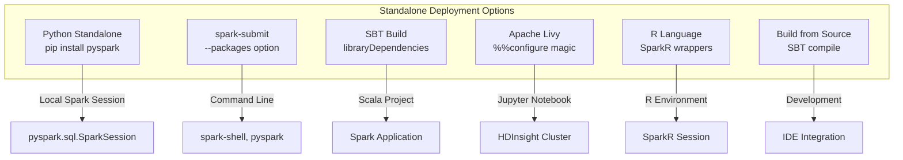
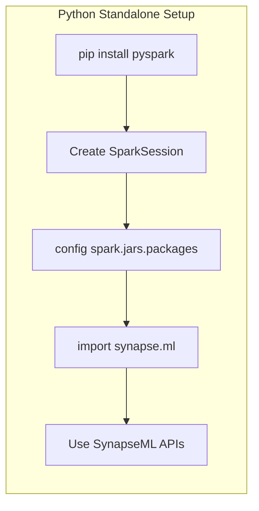
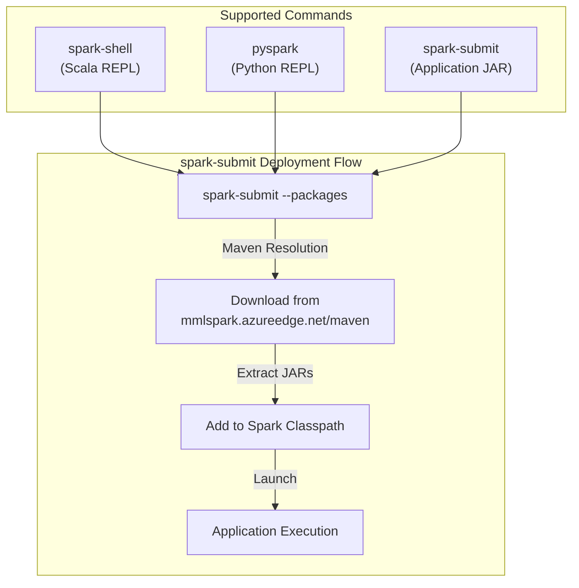
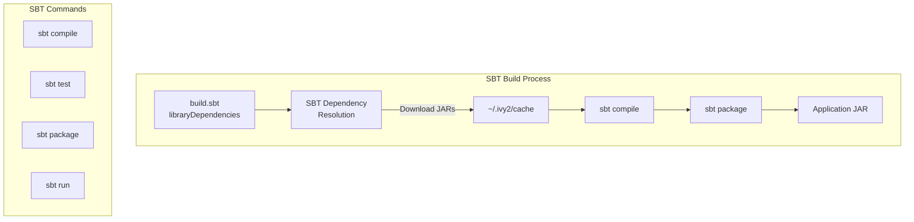
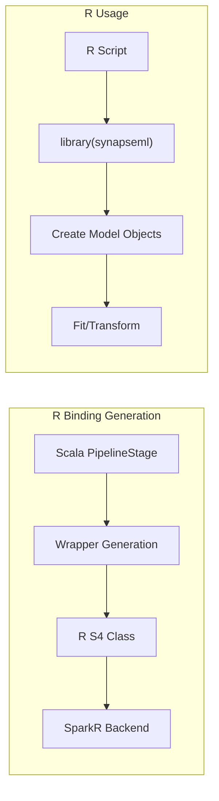
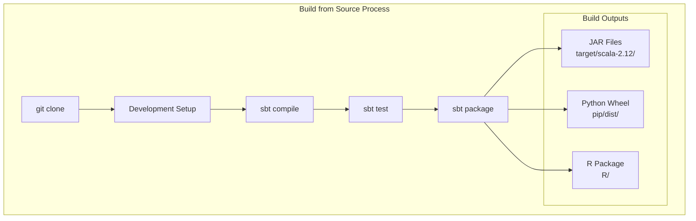
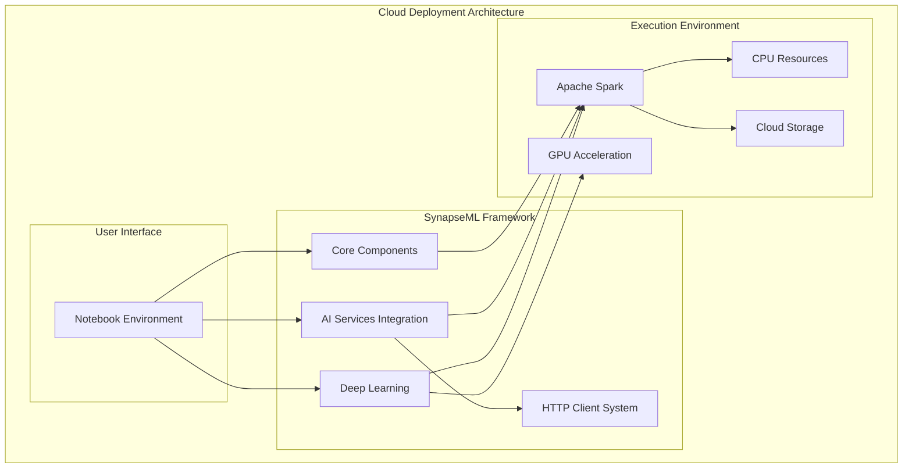
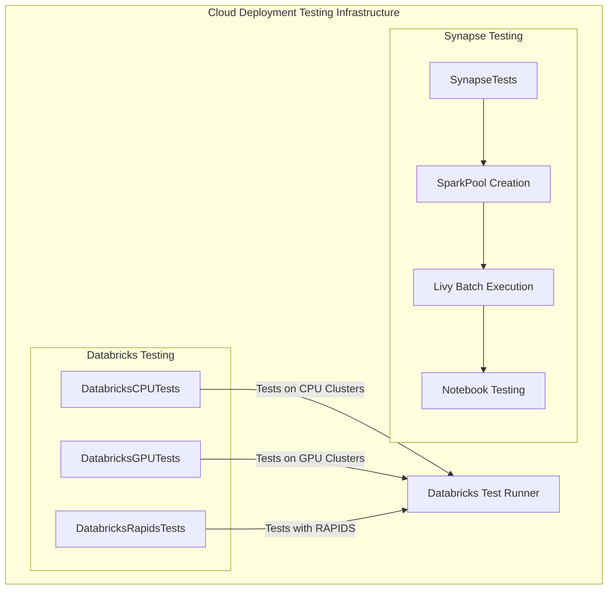

```mermaid
graph TB
    subgraph "Apache Livy Deployment"
        JupyterNB["Jupyter Notebook"] --> ConfigureMagic["%%configure -f magic"]
        ConfigureMagic --> |"REST API"| LivyServer["Livy Server"]
        LivyServer --> |"Create Session"| SparkSession["Spark Session<br/>with SynapseML"]
        SparkSession --> ExecuteCode["Execute Notebook<br/>Cells"]
    end
    
    subgraph "Livy Session Lifecycle"
        CreateSession["Create Session<br/>POST /sessions"]
        SubmitCode["Submit Code<br/>POST /sessions/:id/statements"]
        GetResults["Get Results<br/>GET /sessions/:id/statements/:id"]
        DeleteSession["Delete Session<br/>DELETE /sessions/:id"]
        
        CreateSession --> SubmitCode
        SubmitCode --> GetResults
        GetResults --> DeleteSession
    end
```

<!-- source: DeepWiki mcp.deepwiki.com · repo microsoft/SynapseML · page 8.6 Standalone and Other Platforms · fetched 2026-10-26 -->

# Standalone and Other Platforms

<details>
<summary>Relevant source files</summary>

The following files were used as context for generating this wiki page:

- [CONTRIBUTING.md](CONTRIBUTING.md)
- [README.md](README.md)

</details>


This page covers deployment options for SynapseML outside of the major cloud platforms (Fabric, Synapse, Databricks). These include Python standalone installations, spark-submit command-line usage, SBT builds, Apache Livy/HDInsight, R language bindings, and building from source. For cloud platform deployments, see pages 8.3, 8.4, and 8.5.

## Overview of Standalone Deployment Options

SynapseML supports several deployment scenarios beyond managed cloud platforms, enabling usage in local development environments, custom Spark clusters, and build systems.



Sources: [README.md:72-92]()

## Python Standalone Deployment

Python standalone deployment enables SynapseML usage in local Python environments without requiring a managed cloud platform. This approach is suitable for development, testing, and small-scale workloads.

### Installation Process

The Python standalone deployment requires two steps:

1. **Install PySpark**: `pip install pyspark`
2. **Configure SynapseML packages** when creating the SparkSession



### SparkSession Configuration

The key configuration parameter is `spark.jars.packages`, which tells Spark to download SynapseML from Maven at runtime:

```python
import pyspark
spark = pyspark.sql.SparkSession.builder.appName("MyApp") \
            .config("spark.jars.packages", "com.microsoft.azure:synapseml_2.12:1.1.0") \
            .getOrCreate()
import synapse.ml
```

This configuration triggers Maven dependency resolution through the `pyspark.sql.SparkSession.builder` API, downloading SynapseML JARs and their dependencies automatically.

Sources: [README.md:191-203]()

### Use Cases

Python standalone deployment is appropriate for:

| Use Case | Description |
|----------|-------------|
| Local Development | Test SynapseML code on a development machine |
| CI/CD Testing | Run unit tests in automated pipelines |
| Small Datasets | Process data that fits on a single machine |
| Prototyping | Experiment with SynapseML APIs before cloud deployment |

Sources: [README.md:191-203]()

## spark-submit Deployment

The `spark-submit` command provides a standard way to deploy SynapseML to existing Spark clusters. This method uses the `--packages` option to automatically download and include SynapseML dependencies.

### Command-Line Usage

SynapseML can be added to any Spark application using the `--packages` flag:

```bash
spark-shell --packages com.microsoft.azure:synapseml_2.12:1.1.0
pyspark --packages com.microsoft.azure:synapseml_2.12:1.1.0
spark-submit --packages com.microsoft.azure:synapseml_2.12:1.1.0 MyApp.jar
```



Sources: [README.md:205-214]()

### Package Resolution

When using `--packages`, Spark performs the following steps:

1. **Parse Maven coordinates**: `com.microsoft.azure:synapseml_2.12:1.1.0`
2. **Resolve dependencies**: Download transitive dependencies from Maven repositories
3. **Add to classpath**: Include all JARs in the Spark driver and executor classpaths

The Maven repository URL is configured by default but can be overridden with `--repositories`:

```bash
spark-submit --packages com.microsoft.azure:synapseml_2.12:1.1.0 \
             --repositories https://mmlspark.azureedge.net/maven \
             MyApp.jar
```

Sources: [README.md:205-214]()

### Application Deployment

For submitting pre-built Spark applications (JAR files), use `spark-submit` with the `--packages` option:

```bash
spark-submit \
  --packages com.microsoft.azure:synapseml_2.12:1.1.0 \
  --class com.example.MyMLApp \
  myapp.jar
```

This deployment method is commonly used in production environments where applications are packaged as JAR files and deployed to existing Spark clusters.

Sources: [README.md:205-214]()

## SBT Deployment

For Scala developers building Spark applications with SBT (Simple Build Tool), SynapseML can be included as a library dependency in the project's `build.sbt` file.

### build.sbt Configuration

Add SynapseML as a library dependency in your `build.sbt`:

```scala
libraryDependencies += "com.microsoft.azure" % "synapseml_2.12" % "1.1.0"
```



Sources: [README.md:216-223]()

### Maven Repository Configuration

By default, SBT uses Maven Central and standard Scala repositories. For SynapseML, the custom Maven repository is already configured in the artifact metadata, so no additional resolver configuration is typically needed. However, if needed, you can explicitly add the repository:

```scala
resolvers += "SynapseML" at "https://mmlspark.azureedge.net/maven"
```

### Project Structure

A typical SBT project using SynapseML has this structure:

```
myproject/
├── build.sbt                    # Project configuration
├── project/
│   └── build.properties         # SBT version
└── src/
    └── main/
        └── scala/
            └── MyApp.scala      # Spark application code
```

Sources: [README.md:216-223]()

### Build and Package

To build a Scala application with SynapseML:

1. **Compile**: `sbt compile` - Compiles Scala sources
2. **Test**: `sbt test` - Runs test suites
3. **Package**: `sbt package` - Creates application JAR
4. **Run**: `sbt run` - Executes the main class locally

The resulting JAR can be deployed using `spark-submit` as described in the previous section.

Sources: [README.md:216-223]()

## Apache Livy and HDInsight

Apache Livy provides a REST interface for Spark clusters and is used in Azure HDInsight for running Spark jobs. SynapseML can be installed in Livy-based notebooks using the `%%configure` magic command.

### Configuration Magic

To install SynapseML in a Jupyter notebook served by Apache Livy:

```bash
%%configure -f
{
    "name": "synapseml",
    "conf": {
        "spark.jars.packages": "com.microsoft.azure:synapseml_2.12:1.1.0",
        "spark.jars.excludes": "org.scala-lang:scala-reflect,org.apache.spark:spark-tags_2.12,org.scalactic:scalactic_2.12,org.scalatest:scalatest_2.12,com.fasterxml.jackson.core:jackson-databind"
    }
}
```



Sources: [README.md:225-240]()

### Session Management

**Important**: A new Spark session must be started after executing the `%%configure` cell. The `-f` flag forces the creation of a new session with the specified configuration.

### HDInsight-Specific Considerations

When using HDInsight, certain packages must be excluded to avoid conflicts with the pre-installed libraries. The `spark.jars.excludes` configuration addresses compatibility issues with Livy 0.5.

| Excluded Package | Reason |
|-----------------|---------|
| `org.scala-lang:scala-reflect` | Conflicts with cluster Scala version |
| `org.apache.spark:spark-tags_2.12` | Already present in cluster |
| `org.scalactic:scalactic_2.12` | Testing library not needed at runtime |
| `org.scalatest:scalatest_2.12` | Testing library not needed at runtime |
| `com.fasterxml.jackson.core:jackson-databind` | Version conflicts with cluster Jackson |

Sources: [README.md:225-240]()

### Livy REST API Integration

Livy exposes Spark functionality through REST endpoints. The `%%configure` magic translates to Livy API calls:

1. **Session Creation**: `POST /sessions` with configuration JSON
2. **Code Execution**: `POST /sessions/{sessionId}/statements` with code
3. **Result Retrieval**: `GET /sessions/{sessionId}/statements/{statementId}`

Sources: [README.md:225-240]()

## R Language Deployment

SynapseML provides R language bindings through auto-generated SparkR wrappers, enabling R developers to use SynapseML algorithms in their workflows.

### R Setup

To use SynapseML from R, follow the instructions in the R Setup documentation. The R bindings are generated automatically from the Scala implementations, providing a consistent API across languages.



Sources: [README.md:256-260]()

### Current Status

The R bindings are under active development. Some custom wrappers may be missing for specialized functionality. For the most complete experience, Python or Scala APIs are recommended.

| Feature | Status |
|---------|--------|
| Core Transformers | Supported |
| LightGBM | Supported |
| Cognitive Services | Supported |
| Deep Learning | Partial Support |
| Custom Wrappers | In Development |

Sources: [README.md:256-260]()

## Building from Source

For developers contributing to SynapseML or requiring customized builds, the project can be built from source using SBT.

### Development Setup

SynapseML uses a modular build infrastructure that supports platform-independent development. The build system integrates with IntelliJ IDEA and SBT for development workflows.



Sources: [README.md:262-270]()

### Build System Architecture

The SynapseML build system uses SBT with multiple sub-projects:

- **core**: Core functionality and utilities
- **cognitive**: Azure Cognitive Services integration
- **deep-learning**: Deep learning components (ONNX, Horovod)
- **lightgbm**: LightGBM integration
- **vw**: Vowpal Wabbit integration
- **opencv**: OpenCV integration

Each sub-project can be built independently or as part of the full build.

Sources: [README.md:262-270]()

### Developer Documentation

Detailed instructions for development setup, including IDE configuration and build commands, are available in the Developer Setup documentation. This includes:

- Platform-independent setup instructions
- IntelliJ IDEA integration
- SBT configuration
- Testing procedures
- Code generation for Python/R bindings

For issues during development setup, contact the SynapseML support team.

Sources: [README.md:262-270]()

## Deployment Comparison

The following table compares the different standalone deployment options:

| Deployment Method | Use Case | Installation Complexity | Platform Independence | Best For |
|-------------------|----------|------------------------|-----------------------|----------|
| Python Standalone | Local development, testing | Low | High | Quick prototyping |
| spark-submit | Production clusters, automation | Low | High | Existing Spark infrastructure |
| SBT | Scala application development | Medium | High | Custom Spark applications |
| Apache Livy / HDInsight | Notebook-based workflows | Medium | Medium | Interactive analysis on HDInsight |
| R | R language developers | Medium | Medium | R-based data science workflows |
| Build from Source | Contributing, customization | High | High | Development and contributions |

Sources: [README.md:191-270]()

## Version Management

### Maven Coordinates Format

All standalone deployments use Maven coordinates to specify SynapseML:

```
com.microsoft.azure:synapseml_2.12:1.1.0
       ^                  ^        ^    ^
       |                  |        |    |
    Group ID          Artifact  Scala  Version
                                Version
```

### Current Versions

| SynapseML Version | Spark Version | Scala Version | Status |
|-------------------|---------------|---------------|--------|
| 1.1.0 | 3.5+ | 2.12 | Latest Stable |
| 1.0.15 | 3.4 | 2.12 | Stable |
| 0.11.4-spark3.3 | 3.3 | 2.12 | Legacy |

Sources: [README.md:9-18]()

## Maven Repository Configuration

All standalone deployments resolve dependencies from the SynapseML Maven repository:

**Repository URL**: `https://mmlspark.azureedge.net/maven`

This repository is automatically configured in the artifact metadata for most deployment scenarios. For manual configuration:

- **spark-submit**: Use `--repositories` flag
- **SBT**: Add to `resolvers` in `build.sbt`
- **Maven**: Add `<repository>` to `pom.xml`

Sources: [README.md:107, 182, 222]()

## Deployment Architecture

The following diagram illustrates how SynapseML components interact with cloud platforms and underlying infrastructure:



Sources: [README.md:47-65]()

## Testing Cloud Deployments

SynapseML includes a comprehensive testing infrastructure to ensure proper functionality across different cloud platforms.

### Databricks Testing

The framework includes utilities for testing on Databricks clusters, supporting both CPU and GPU tests:

- `DatabricksCPUTests`: Tests on standard Databricks clusters
- `DatabricksGPUTests`: Tests on GPU-enabled clusters
- `DatabricksRapidsTests`: Tests for RAPIDS acceleration on GPU clusters

### Azure Synapse Testing

Synapse-specific tests are implemented in `SynapseTests` which:
- Creates temporary Spark pools for testing
- Uploads and executes notebooks
- Manages Livy batch execution
- Cleans up resources after testing



Sources: [core/src/test/scala/com/microsoft/azure/synapse/ml/nbtest/DatabricksCPUTests.scala:1-26](), [core/src/test/scala/com/microsoft/azure/synapse/ml/nbtest/DatabricksGPUTests.scala:1-19](), [core/src/test/scala/com/microsoft/azure/synapse/ml/nbtest/DatabricksRapidsTests.scala:1-20](), [core/src/test/scala/com/microsoft/azure/synapse/ml/nbtest/SynapseTests.scala:1-113]()

## Troubleshooting Cloud Deployments

Common issues when deploying SynapseML to cloud environments and their solutions:

### Dependency Conflicts

SynapseML requires specific versions of dependencies. Common issues include:

- **Netty dependency issues**: Use the exclusion pattern in the configuration to avoid conflicts
- **Transformers version mismatch**: Ensure you're using the correct version (4.49.0 for current SynapseML)
- **Horovod compatibility**: Version 0.28.1 is required for deep learning features

### Platform-Specific Issues

| Platform | Common Issue | Solution |
|----------|--------------|----------|
| Databricks | Netty dependency conflicts | Use DBR 10.1+ or add exclusions |
| Synapse | Package not found | Check spark.jars.repositories setting |
| Fabric | Version conflicts | Ensure proper exclusions in configuration |
| All | Memory issues with large models | Increase executor memory allocation |

Sources: [README.md:147-150](), [deep-learning/src/main/python/synapse/ml/dl/LitDeepTextModel.py:17-26](), [environment.yml:1-56]()