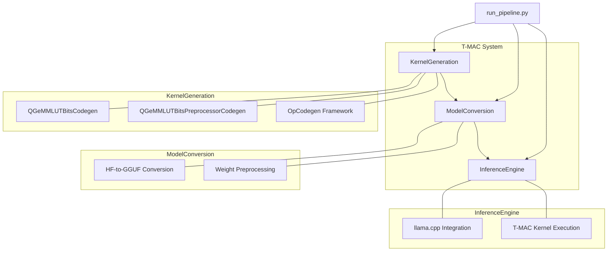
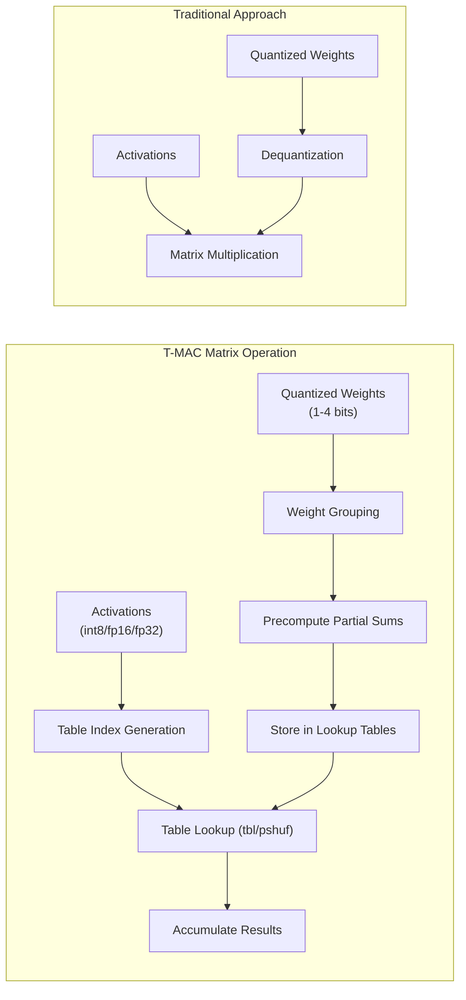
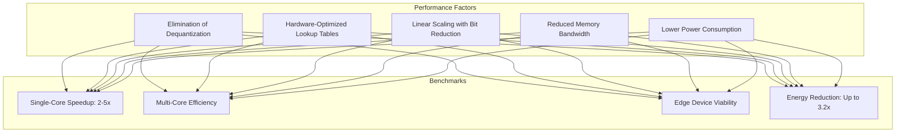
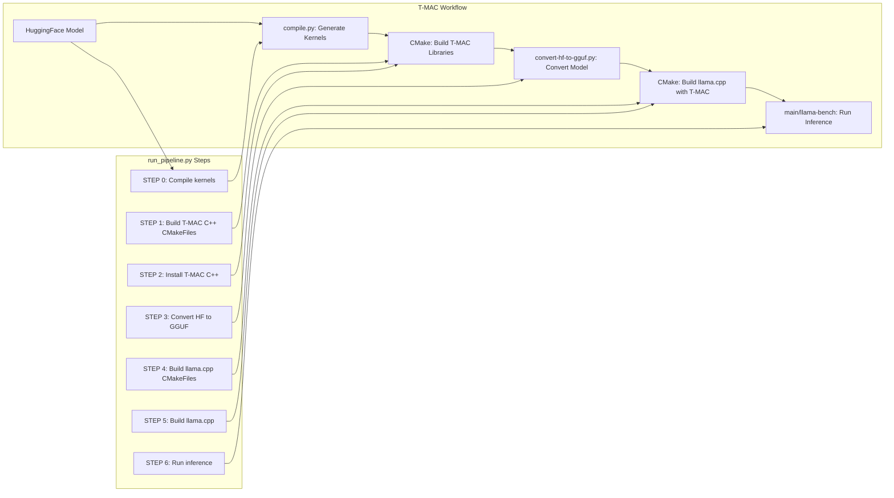
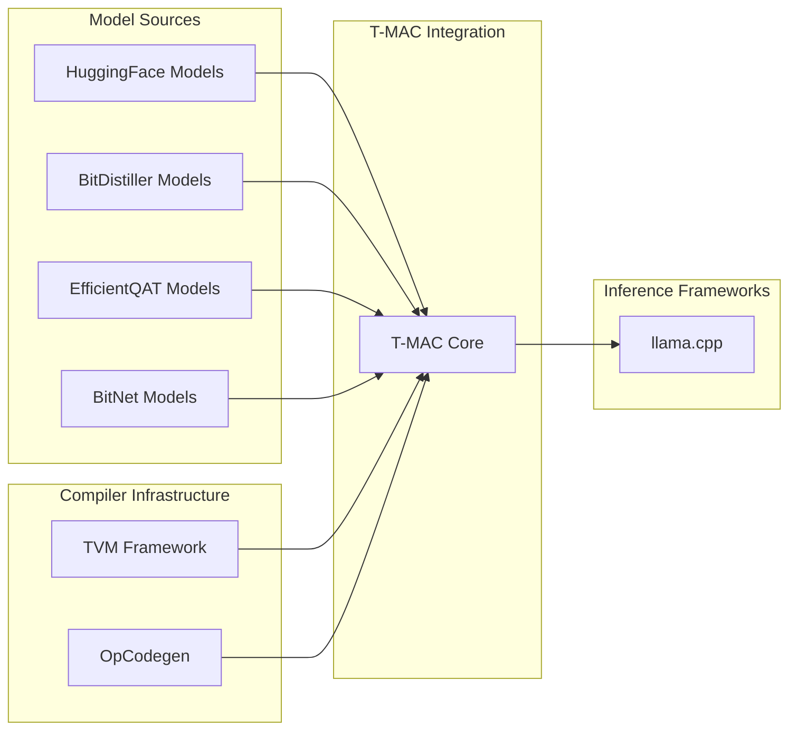

<!-- source: DeepWiki mcp.deepwiki.com · repo microsoft/T-MAC · page 1 Overview · fetched 2026-10-26 -->

# Overview

Relevant source files

The following files were used as context for generating this wiki page:

- [README.md](README.md)

T-MAC is a kernel library designed to accelerate low-bit Large Language Model (LLM) inference on CPUs. It provides direct support for mixed-precision matrix multiplication (int1/2/3/4 x int8/fp16/fp32) without requiring dequantization by utilizing lookup tables. This page introduces the T-MAC project, its core concepts, and high-level architecture.

For detailed information about the underlying architecture, see [Architecture](#2). For setup instructions, refer to [Installation and Setup](#3).

## Purpose and Scope

T-MAC aims to significantly improve the performance of low-bit quantized LLMs on CPU platforms ranging from edge devices to high-performance servers. It currently supports various low-bit models including:

- 1-bit models like BitNet (W1.58A8)
- 2-bit models from frameworks like EfficientQAT/BitDistiller (W2A16)
- 4-bit models from GPTQ/GGUF quantization (W4A16)

The system works across OSX, Linux, and Windows operating systems on both ARM and x86 platforms. T-MAC is specifically designed to address the performance bottlenecks in traditional dequantization-based matrix multiplication approaches.

Sources: [README.md:31-37]()

## System Overview

T-MAC consists of three primary subsystems that work together to provide accelerated LLM inference:

1. **Kernel Generation**: Produces optimized matrix multiplication kernels specialized for different bit-widths and hardware targets
2. **Model Conversion**: Transforms models from Hugging Face format to GGUF with T-MAC-specific optimizations
3. **Inference Engine**: Integrates with llama.cpp to efficiently execute models using the optimized kernels

These components are orchestrated by the `run_pipeline.py` script, which provides an end-to-end workflow from model preparation to inference.

Sources: [README.md:322-339]()

## Key Technical Concepts

At the core of T-MAC is its novel approach to quantized matrix operations using lookup tables:

T-MAC's approach eliminates the need for dequantization by:

1. **Grouping**: One-bit weights are grouped (e.g., into groups of 4)
2. **Precomputation**: All possible partial sums are precomputed
3. **Lookup Tables**: These sums are stored in memory for fast access
4. **Fast Lookup**: Using CPU instructions like `tbl` (ARM) or `pshufb` (x86) for efficient retrieval
5. **Accumulation**: Results are accumulated using simple addition operations

This method delivers better performance than conventional approaches, especially as bit-width decreases, providing a linear scaling ratio of computational cost relative to the number of bits.

Sources: [README.md:373-388]()

## Performance Characteristics

T-MAC demonstrates significant performance improvements over traditional methods:

Key performance highlights include:

| Model | Device | T-MAC (tokens/sec) | llama.cpp (tokens/sec) | Speedup |
|-------|--------|-------------------:|------------------------|---------|
| BitNet-3B | Surface Laptop 7 (1 core) | 20 | ~5 | 4x |
| BitNet-3B | Surface Laptop 7 (4 cores) | 48 | ~12 | 4x |
| Llama-2-7B (W2) | M2-Ultra | 95+ | 30-35 | 3x |
| BitNet-3B | Raspberry Pi 5 | 11 | 3-4 | 3x |

T-MAC can achieve the same performance as traditional methods using significantly fewer CPU cores, which translates to reduced power consumption and improved energy efficiency.

Sources: [README.md:38-48](), [README.md:96-102]()

## End-to-End Workflow

The typical workflow for using T-MAC involves several steps, from model compilation to inference:

The entire process is automated by the `run_pipeline.py` script, which orchestrates the compilation, building, conversion, and inference steps. This script provides options for selecting specific steps, using prebuilt kernels, or automatically detecting model configurations.

Sources: [README.md:340-367]()

## Supported Platforms

T-MAC offers cross-platform support for a wide range of devices:

| Platform | Architecture | Support Details |
|----------|--------------|-----------------|
| macOS | Apple Silicon (M1/M2/M3) | Native ARM support with excellent performance |
| Linux | ARM64, x86_64 | Full support for server and edge deployments |
| Windows | x86_64, ARM64 | Native support including Surface devices |
| Android | ARM64 | Cross-compilation support |
| Embedded | Raspberry Pi, Jetson | Optimized for edge AI applications |

The system includes platform detection to automatically select the appropriate optimizations for the target hardware.

Sources: [README.md:140-307]()

## Comparison with Alternative Approaches

T-MAC's lookup table-based approach offers several advantages over traditional dequantization-based methods and dedicated hardware accelerators:

| Solution | Approach | Performance Scaling | Power Efficiency | Model Support |
|----------|----------|---------------------|------------------|---------------|
| T-MAC | Lookup Tables | Linear with bit reduction | High | 1-4 bit models |
| llama.cpp | Dequantization | Limited scaling at lower bits | Moderate | 2-8 bit models |
| NPUs | Dedicated Hardware | High for supported ops | Moderate | Limited quantization |
| GPUs | Parallel Computation | High for large batches | Low | Variable |

T-MAC can match or exceed the performance of NPUs on platforms like Snapdragon X Elite while consuming less power. It also provides better performance scaling as bit-width decreases compared to dequantization-based methods.

Sources: [README.md:104-138]()

## Integration with External Frameworks

T-MAC integrates with several external frameworks to provide a complete solution:

Key integrations include:

1. **Model Sources**: Support for models from HuggingFace, BitDistiller, EfficientQAT, and BitNet
2. **Inference Framework**: Deep integration with llama.cpp for efficient execution
3. **Compiler Infrastructure**: Built on TVM and OpCodegen for hardware-optimized code generation

These integrations allow T-MAC to support a wide range of models and deployment scenarios while leveraging existing tools and frameworks.

Sources: [README.md:31-37](), [README.md:322-339]()

---

