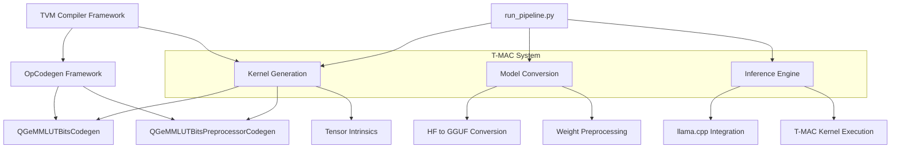
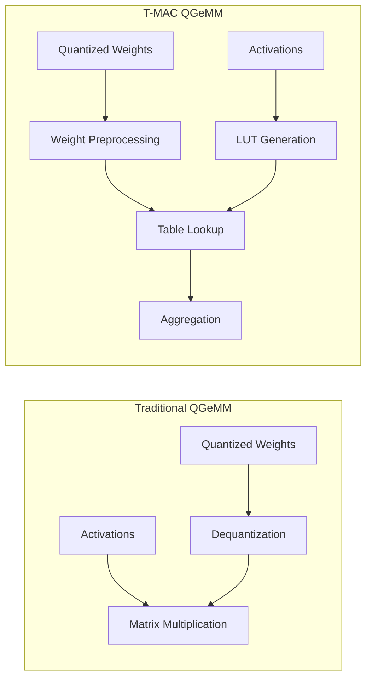
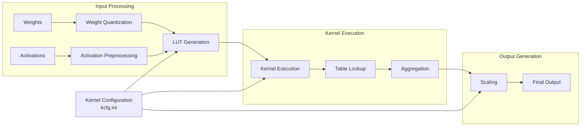
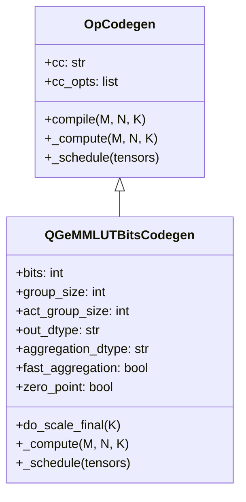
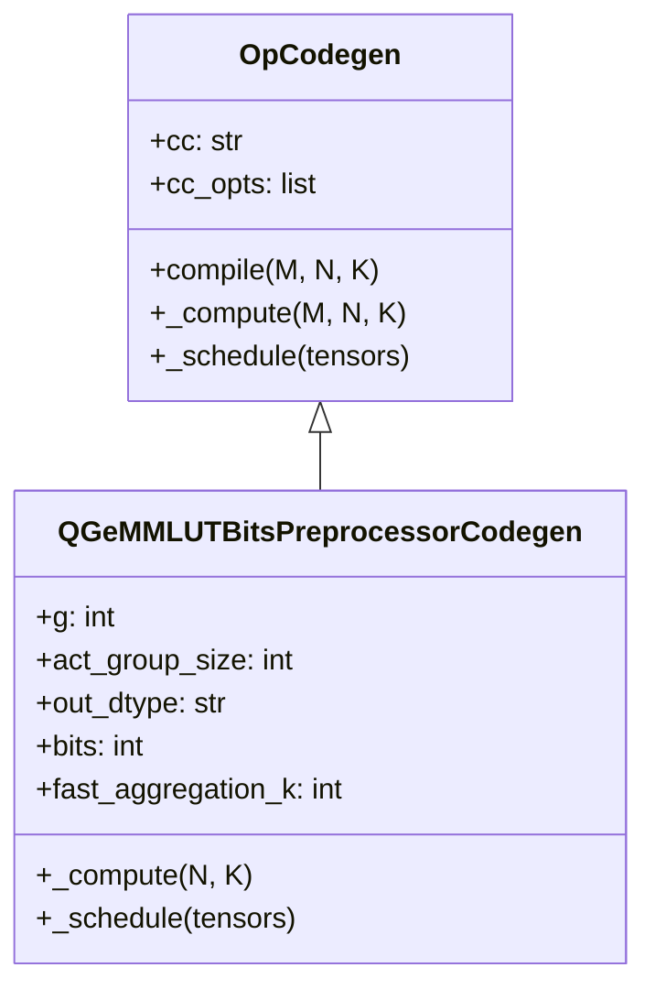
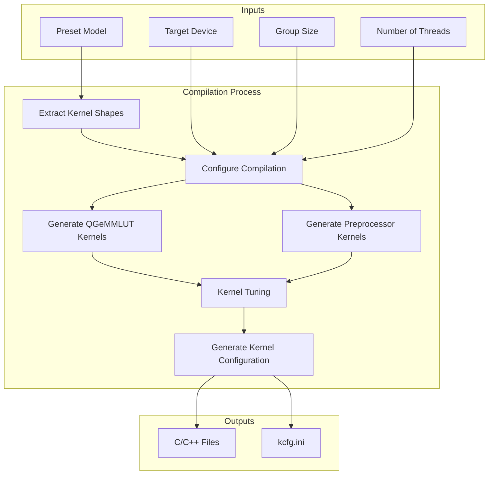
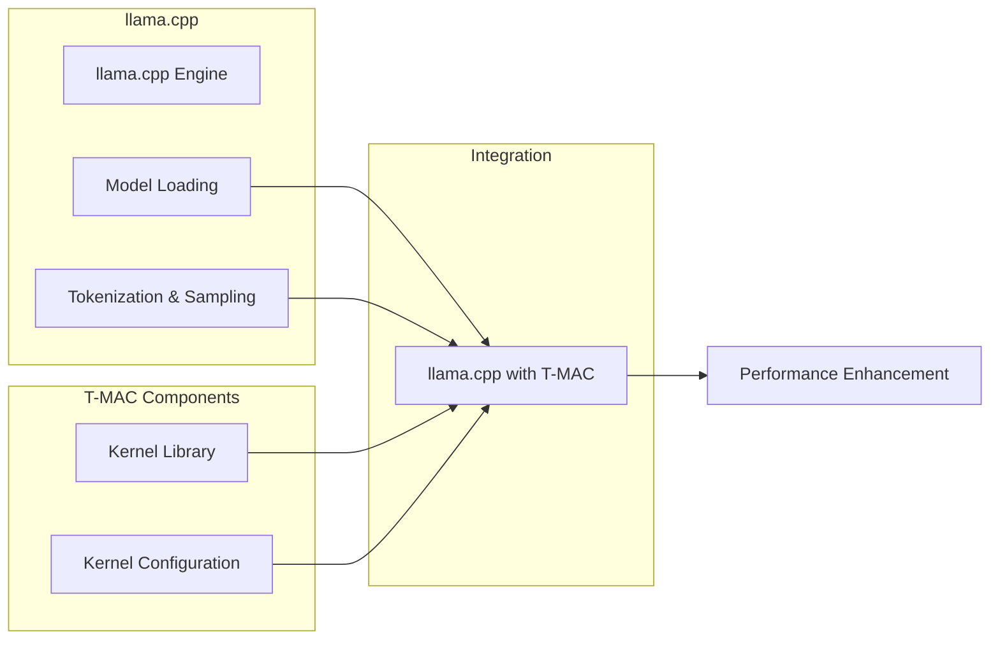
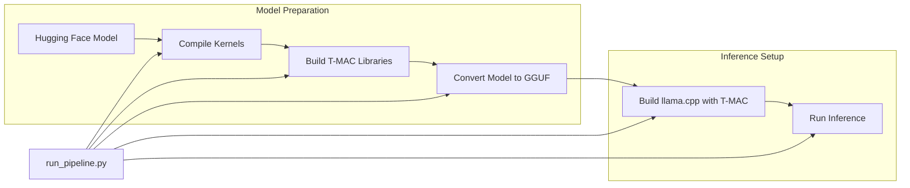

<!-- source: DeepWiki mcp.deepwiki.com · repo microsoft/T-MAC · page 2 Architecture · fetched 2026-10-26 -->

# Architecture

Relevant source files

The following files were used as context for generating this wiki page:

- [README.md](README.md)
- [deploy/compile.py](deploy/compile.py)
- [python/t_mac/ops/qgemm.py](python/t_mac/ops/qgemm.py)

This document describes the high-level architecture of T-MAC, a kernel library that enables direct mixed-precision matrix multiplication using lookup tables. It covers the core components, their interactions, and the underlying technical approach that enables efficient inference of low-bit Large Language Models on CPU devices.

For installation instructions, see [Installation and Setup](#3). For detailed usage guidance, see [Usage Guide](#4).

## System Overview

T-MAC is designed to accelerate low-bit LLM inference on CPUs by replacing traditional dequantization-based matrix multiplication with a lookup table-based approach. This fundamental shift in computation strategy enables significant performance improvements, especially for 1-2 bit models.

Sources: [README.md:1-401](), [deploy/compile.py:1-245]()

## Core Components

T-MAC consists of three main components that work together to enable efficient low-bit inference:

### Kernel Generation

The kernel generation component is responsible for creating optimized code for quantized matrix operations:

1. **QGeMMLUTBitsCodegen**: Generates optimized kernels for quantized general matrix multiplication using lookup tables.
2. **QGeMMLUTBitsPreprocessorCodegen**: Generates code for preprocessing operations, such as creating lookup tables for activations.
3. **Tensor Intrinsics**: Low-level operations optimized for specific hardware, particularly focused on table lookup instructions like `tbl` for ARM and SIMD operations.

These components leverage the TVM compiler framework to generate hardware-specific code that maximizes performance.

Sources: [python/t_mac/ops/qgemm.py:1-520](), [deploy/compile.py:1-245]()

### Model Conversion

The model conversion component handles transforming models from their original format to a T-MAC-optimized representation:

1. **HF to GGUF Conversion**: Converts models from Hugging Face format to GGUF format with T-MAC-specific optimizations.
2. **Weight Preprocessing**: Organizes weights to enable efficient lookup table operations.

Sources: [README.md:312-365]()

### Inference Engine

The inference engine executes the optimized models:

1. **llama.cpp Integration**: T-MAC integrates with the llama.cpp framework to leverage its ecosystem.
2. **T-MAC Kernel Execution**: The core execution of T-MAC's optimized kernels during inference.

Sources: [README.md:312-365]()

## Technical Approach

T-MAC's primary innovation is its lookup table-based approach to mixed-precision matrix multiplication:

Sources: [README.md:375-388](), [python/t_mac/ops/qgemm.py:16-348]()

### Lookup Table Mechanism

The lookup table approach works as follows:

1. **Weight Preprocessing**: Quantized weights are organized into groups (typically 4 bits), and all possible partial sums are precomputed and stored in lookup tables.
2. **Activation Processing**: Activations are used to generate lookup tables that represent the matrix multiplication operation.
3. **Table Lookup**: Instead of performing multiply-accumulate operations, T-MAC performs table lookups using optimized instructions (`tbl` on ARM, `pshuf` on x86).
4. **Aggregation**: Results from lookup operations are accumulated to produce the final output.

This approach shows linear scaling of performance with the reduction in bit precision, unlike traditional methods that often see diminishing returns below 4 bits.

Sources: [README.md:375-388](), [python/t_mac/ops/qgemm.py:16-348]()

## Data Flow

Sources: [deploy/compile.py:152-204](), [python/t_mac/ops/qgemm.py:155-206]()

## Implementation Details

The core implementation involves several key components:

### QGeMMLUTBitsCodegen

This class generates kernels for quantized matrix multiplication using lookup tables:

Key attributes of `QGeMMLUTBitsCodegen`:
- `bits`: Number of bits for each weight group (1, 2, 3, or 4)
- `group_size`: Group size for weight quantization (typically 128)
- `act_group_size`: Group size for activation quantization
- `m_groups`: Number of weight scale groups

Sources: [python/t_mac/ops/qgemm.py:16-351]()

### QGeMMLUTBitsPreprocessorCodegen

This class generates code for preprocessing activations and creating lookup tables:

Key attributes:
- `g`: Group size for lookup table (typically 4)
- `act_group_size`: Group size for activation quantization
- `fast_aggregation_k`: Factor for accelerated aggregation

Sources: [python/t_mac/ops/qgemm.py:353-520]()

## Compilation Pipeline

The compilation pipeline is responsible for generating optimized kernels for specific hardware targets:

The compilation process:
1. Extracts kernel shapes from the model
2. Configures compilation parameters based on the target device and model
3. Generates quantized matrix multiplication kernels and preprocessor kernels
4. Tunes kernels for optimal performance
5. Outputs optimized C/C++ code and kernel configuration

Sources: [deploy/compile.py:19-204]()

## Integration with llama.cpp

T-MAC integrates with the llama.cpp framework to leverage its ecosystem and provide a complete inference solution:

The integration enables:
1. Loading models with T-MAC optimizations
2. Executing inference using T-MAC's optimized kernels
3. Achieving significant performance improvements over standard llama.cpp

Sources: [README.md:312-365]()

## End-to-End Workflow

The complete T-MAC workflow involves multiple steps, orchestrated by the `run_pipeline.py` script:

The workflow steps:
1. Compile optimized kernels using T-MAC's compilation pipeline
2. Build T-MAC C++ libraries with the generated kernels
3. Convert the model from Hugging Face format to GGUF with T-MAC optimizations
4. Build llama.cpp with T-MAC support
5. Run inference with the optimized implementation

Sources: [README.md:312-365]()

## Cross-Platform Support

T-MAC is designed to support multiple hardware platforms, with optimized kernels for each:

| Platform | Optimization Approach | Instruction Sets |
|----------|------------------------|------------------|
| Apple Silicon | ARM NEON, tbl instructions | NEON SIMD |
| x86 with AVX2 | pshuf instructions | AVX2 SIMD |
| ARM Android | ARM NEON, tbl instructions | NEON SIMD |
| Jetson | ARM NEON, tbl instructions | NEON SIMD |

T-MAC automatically detects the hardware platform and selects the appropriate optimization strategy.

Sources: [README.md:193-307]()

## Performance Optimizations

T-MAC incorporates several key optimizations to maximize performance:

1. **Table Lookup**: Using tbl/pshuf instructions for fast table lookup instead of multiply-accumulate operations
2. **Fast Aggregation**: Optional fast aggregation mode for additional 10-20% speedup
3. **Multi-Threading**: Optimized thread affinity and parallelization strategies
4. **SIMD Vectorization**: Leveraging SIMD instructions for parallel computations

These optimizations together enable T-MAC to achieve significant speedups over traditional approaches, especially for 1-2 bit models.

Sources: [README.md:77-138](), [python/t_mac/ops/qgemm.py:254-274]()

## Summary

T-MAC's architecture represents a fundamentally different approach to quantized matrix multiplication for low-bit LLM inference. By replacing traditional dequantization-based methods with lookup table operations, T-MAC achieves significant performance improvements that scale linearly with bit reduction. The system integrates with llama.cpp to provide a complete inference solution with cross-platform support.

For more detailed information about specific components, see:
- [Matrix Operations](#2.1) for details on the quantized matrix operations
- [Compilation Pipeline](#2.2) for details on kernel generation and tuning
- [Integration with llama.cpp](#2.3) for details on the inference engine

---

