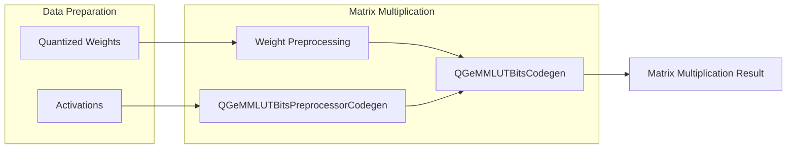
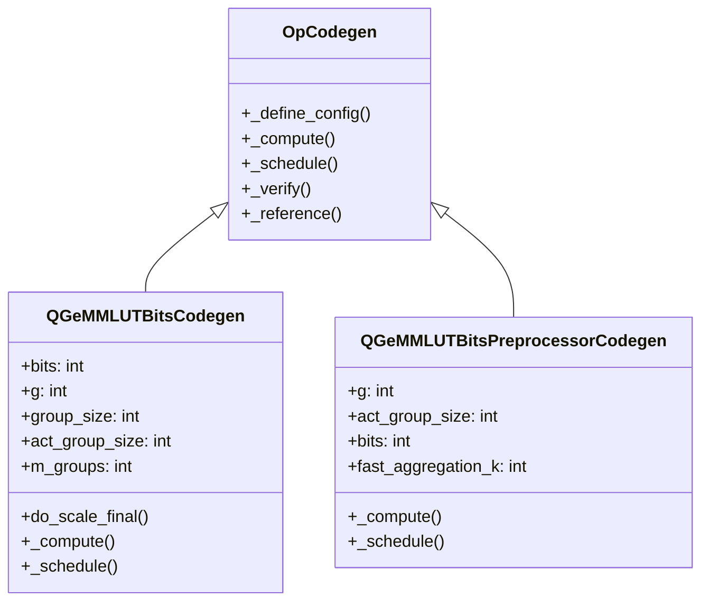
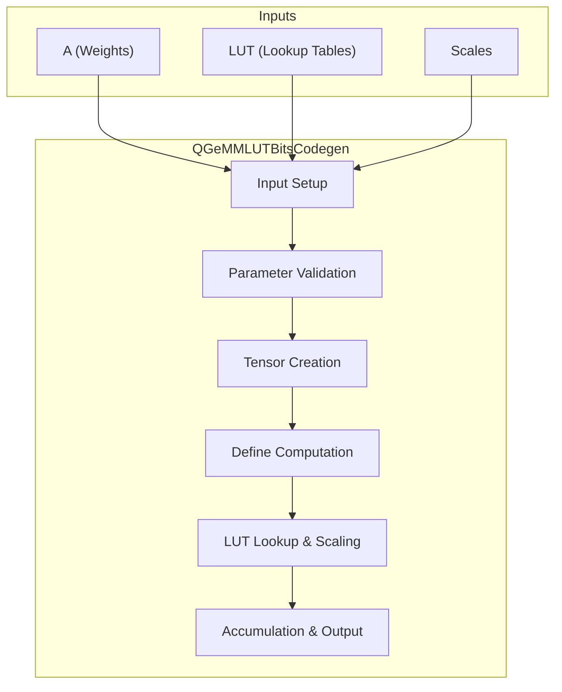
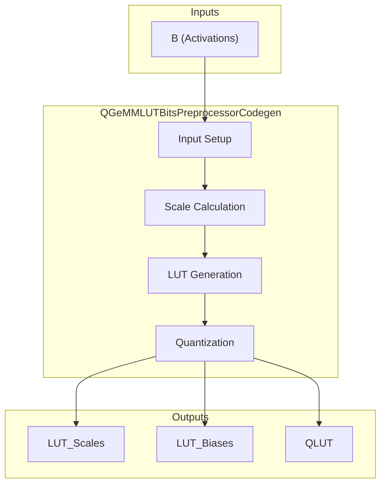
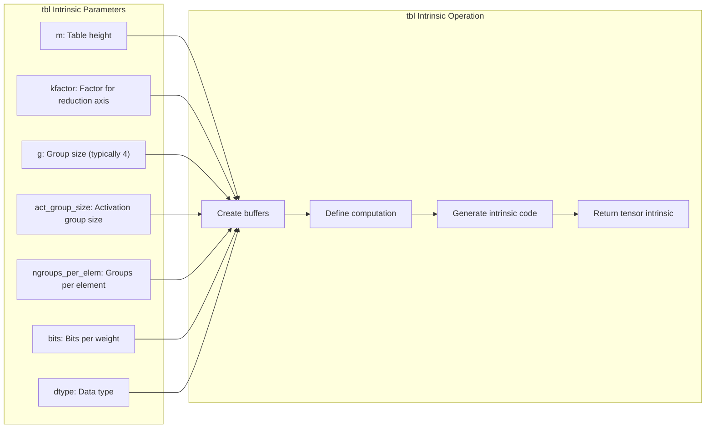
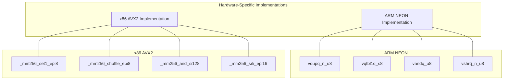
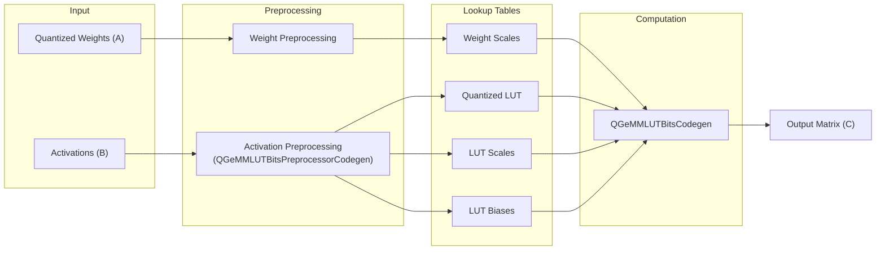
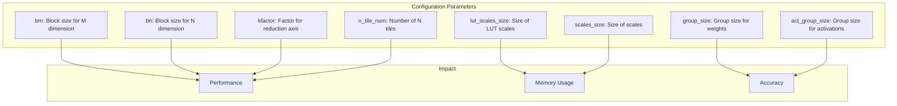
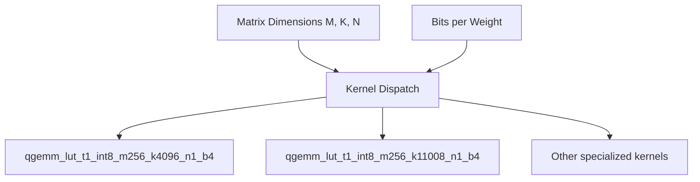
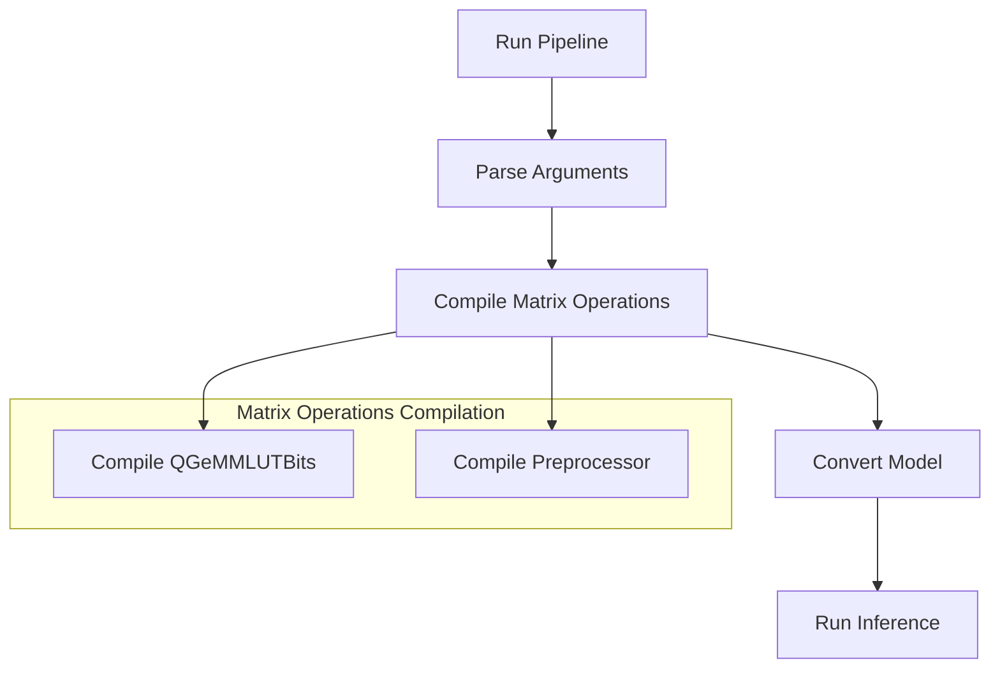

<!-- source: DeepWiki mcp.deepwiki.com · repo microsoft/T-MAC · page 2.1 Matrix Operations · fetched 2026-10-26 -->

# Matrix Operations

Relevant source files

The following files were used as context for generating this wiki page:

- [deploy/tuned/kcfg.ini](deploy/tuned/kcfg.ini)
- [deploy/tuned/kernels.cc](deploy/tuned/kernels.cc)
- [deploy/tuned/kernels.h](deploy/tuned/kernels.h)
- [python/t_mac/intrins/tbl.cc](python/t_mac/intrins/tbl.cc)
- [python/t_mac/intrins/tbl.py](python/t_mac/intrins/tbl.py)
- [python/t_mac/ops/qgemm.py](python/t_mac/ops/qgemm.py)
- [tools/all_in_one.sh](tools/all_in_one.sh)

## Purpose and Scope

This document describes the quantized matrix multiplication operations that form the core of the T-MAC system. We focus on the implementation of QGeMMLUT (Quantized General Matrix Multiplication with Lookup Tables), which enables efficient inference by using lookup-based matrix multiplication for quantized neural networks. This page covers the algorithm design, implementation details, and optimization techniques used in T-MAC's matrix operations.

For information about how these operations are integrated into the broader compilation pipeline, see [Compilation Pipeline](#2.2). For details on how these operations are used with llama.cpp, see [Integration with llama.cpp](#2.3).

## Overview

T-MAC's matrix operations are based on a lookup table approach to quantized matrix multiplication. This approach provides significant performance benefits for inference, especially for low-bit quantized models. The system uses two primary components:

1. **Preprocessor** - Prepares activation lookup tables before the actual computation
2. **QGeMM Kernel** - Performs the actual matrix multiplication using the prepared lookup tables

Sources: [python/t_mac/ops/qgemm.py:16-351](). [python/t_mac/ops/qgemm.py:353-519]()

## Core Components

The Matrix Operations system consists of two main classes:

1. **QGeMMLUTBitsCodegen** - Implements the quantized matrix multiplication kernel
2. **QGeMMLUTBitsPreprocessorCodegen** - Handles the preprocessing of activations to generate lookup tables

These classes inherit from the OpCodegen base class, which provides the framework for code generation.

Sources: [python/t_mac/ops/qgemm.py:16-18](). [python/t_mac/ops/qgemm.py:353-356]()

## QGeMMLUTBitsCodegen

The QGeMMLUTBitsCodegen class implements the core matrix multiplication with lookup tables. It takes various parameters to control the quantization and computation process.

### Key Parameters

| Parameter | Description |
|-----------|-------------|
| `bits` | Number of bits for each weight group (typically 1-4) |
| `g` | Group size of LUT (typically 4) |
| `group_size` | Group size of weights for quantization |
| `act_group_size` | Group size of activations |
| `out_dtype` | Output data type (e.g., "float16") |
| `simd_n_in` | Number of SIMD lanes for input |
| `simd_n_out` | Number of SIMD lanes for output |
| `m_groups` | Number of groups for M dimension |
| `fast_aggregation` | Toggle fast aggregation for additional speedup |

Sources: [python/t_mac/ops/qgemm.py:18-67](). [deploy/tuned/kcfg.ini:1-30]()

### Computation Process

The computation in QGeMMLUTBitsCodegen follows these steps:

1. Set up the parameters and check for appropriate dimensions
2. Define the input tensors (A for weights, LUT for lookup tables, Scales for scaling factors)
3. Implement the computation logic for fetching values from LUT based on weight indices
4. Scale the values and accumulate the results

Sources: [python/t_mac/ops/qgemm.py:117-211]()

### Scheduling and Optimization

The QGeMMLUTBitsCodegen includes scheduling logic to optimize the computation for specific hardware:

1. Tile the computation into blocks for efficient processing
2. Cache intermediate results to reduce memory access
3. Use tensorization to map computations to hardware intrinsics
4. Apply parallelization based on available threads

The key optimization is the use of the `tbl` tensor intrinsic, which leverages SIMD instructions to perform table lookups efficiently.

Sources: [python/t_mac/ops/qgemm.py:213-275]()

## QGeMMLUTBitsPreprocessorCodegen

The QGeMMLUTBitsPreprocessorCodegen class handles the preprocessing of activations to generate lookup tables.

### Key Parameters

| Parameter | Description |
|-----------|-------------|
| `g` | Group size of LUT (typically 4) |
| `act_group_size` | Group size of activations |
| `out_dtype` | Output data type (e.g., "float16") |
| `bits` | Number of bits for quantization |
| `fast_aggregation_k` | K value for fast aggregation |

Sources: [python/t_mac/ops/qgemm.py:359-393]()

### Computation Process

The preprocessor computes the lookup tables for activations:

1. Calculate the maximum absolute values to determine scaling factors
2. Quantize the values to the target data type
3. Store the results in the output lookup table

Sources: [python/t_mac/ops/qgemm.py:399-431]()

### Scheduling and Optimization

Similar to the main kernel, the preprocessor includes scheduling logic:

1. Split and reorder the computation for efficient processing
2. Use the `partial_max` intrinsic to efficiently compute maximum values
3. Apply the `lut_ctor` intrinsic for lookup table construction

Sources: [python/t_mac/ops/qgemm.py:433-481]()

## Tensor Intrinsics

The matrix operations rely heavily on tensor intrinsics to achieve high performance. These intrinsics map high-level operations to efficient low-level implementations.

### tbl Intrinsic

The `tbl` intrinsic is the core operation for table lookups. It takes several parameters:

The `tbl` intrinsic is implemented with platform-specific code for both ARM NEON and x86 AVX2, using SIMD instructions to perform multiple table lookups in parallel.

Sources: [python/t_mac/intrins/tbl.py:10-185](). [python/t_mac/intrins/tbl.cc:1-719]()

## Hardware-Specific Implementations

T-MAC's matrix operations are optimized for different hardware platforms through the use of platform-specific intrinsics.

### ARM NEON Implementation

For ARM platforms, the implementation uses:
- NEON SIMD instructions
- Vector table lookup (`vqtbl1q_s8`)
- Vector arithmetic operations
- SignedHalvingAdder and SignedWideningAdder for efficient accumulation

### x86 AVX2 Implementation

For x86 platforms, the implementation uses:
- AVX2 SIMD instructions
- Shuffle operations for table lookup
- Vector arithmetic operations
- Specialized accumulation logic

Sources: [python/t_mac/intrins/tbl.cc:10-282](). [python/t_mac/intrins/tbl.cc:284-682]()

## Data Flow

The complete data flow for T-MAC's matrix operations is illustrated below:

Sources: [python/t_mac/ops/qgemm.py:93-211](). [python/t_mac/ops/qgemm.py:399-431]()

## Configuration Parameters

The behavior of the matrix operations can be controlled through various configuration parameters. These are typically specified in a configuration file like `kcfg.ini`:

Sources: [deploy/tuned/kcfg.ini:1-30]()

## Kernel Dispatch

The kernel dispatch mechanism selects the appropriate kernel based on the dimensions and quantization parameters:

Sources: [deploy/tuned/kernels.h:21-38]()

## Integration with Run Pipeline

The matrix operations are integrated into the overall T-MAC pipeline through the `run_pipeline.py` script. This script orchestrates the compilation, model conversion, and execution processes.

Sources: [tools/all_in_one.sh:67-102]()

## Performance Considerations

When using T-MAC's matrix operations, several factors affect performance:

1. **Matrix Dimensions**: The sizes of M, N, and K dimensions affect how well the computation can be tiled and parallelized
2. **Quantization Parameters**: The number of bits and group sizes impact both computation speed and accuracy
3. **Hardware Platform**: Different optimizations are applied for ARM NEON vs. x86 AVX2
4. **Configuration Parameters**: Block sizes, tile sizes, and other parameters can be tuned for specific workloads

The fast aggregation option provides additional speedup at the cost of slightly reduced accuracy. This tradeoff may be acceptable for many applications.

Sources: [python/t_mac/ops/qgemm.py:62-63](). [python/t_mac/ops/qgemm.py:279-282]()

---

