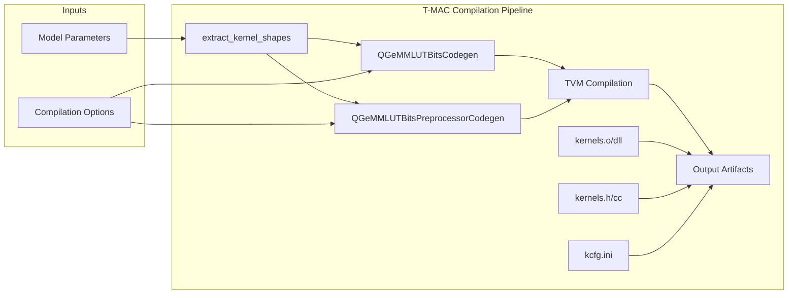
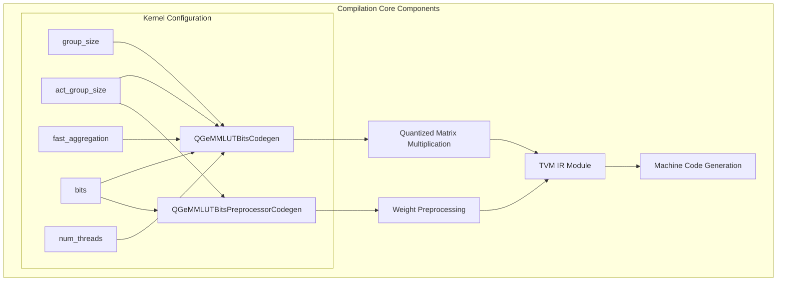
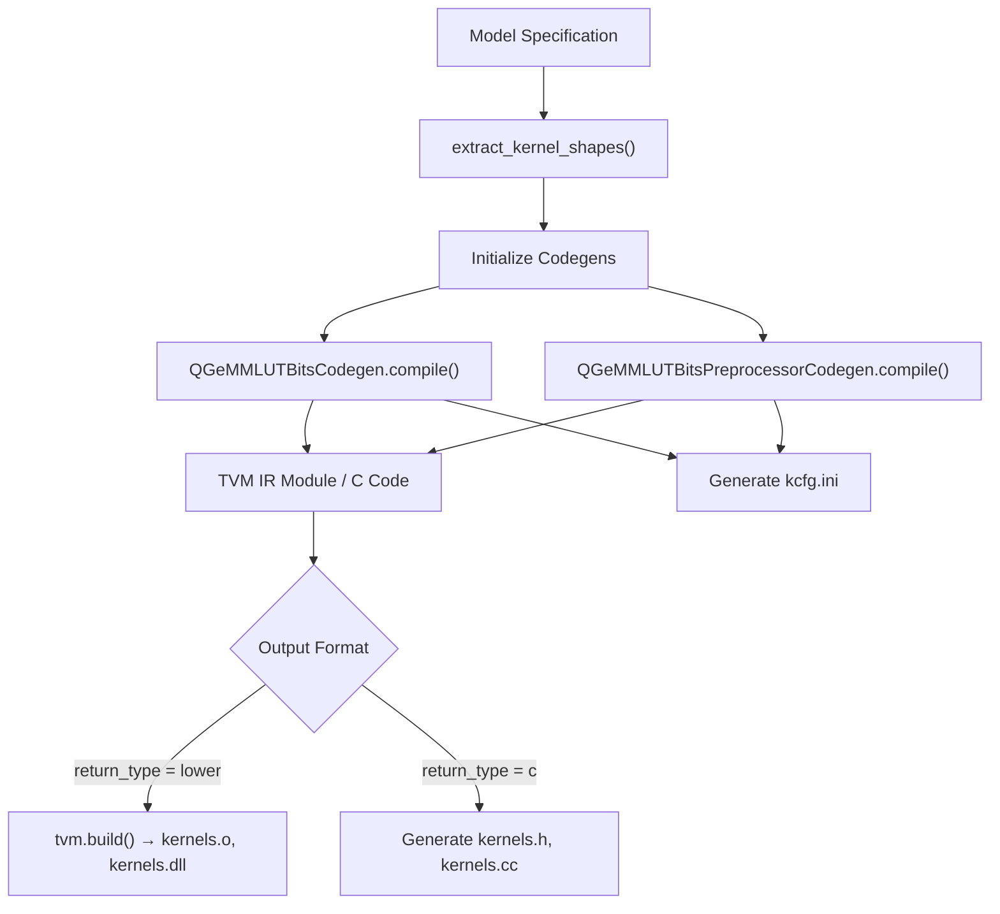
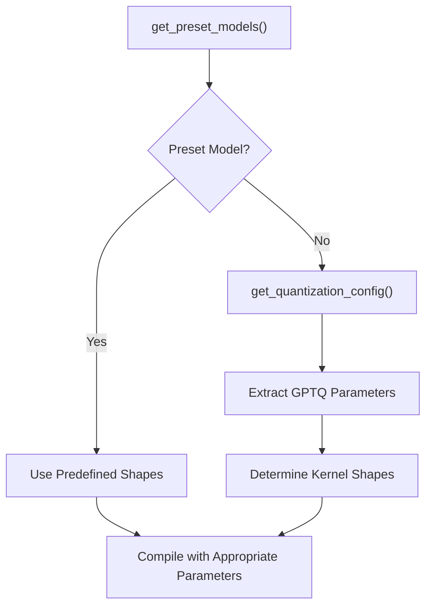
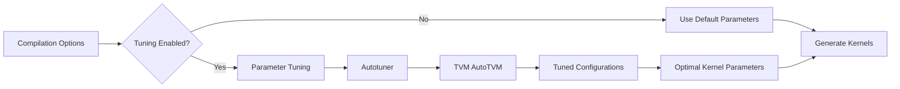
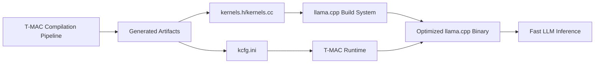

<!-- source: DeepWiki mcp.deepwiki.com · repo microsoft/T-MAC · page 2.2 Compilation Pipeline · fetched 2026-10-26 -->

# Compilation Pipeline

<details>
<summary>Relevant source files</summary>

The following files were used as context for generating this wiki page:

- [.gitmodules](.gitmodules)
- [deploy/compile.py](deploy/compile.py)
- [deploy/tuned/kernels.dll](deploy/tuned/kernels.dll)
- [deploy/tuned/kernels.o](deploy/tuned/kernels.o)
- [docs/codegen.md](docs/codegen.md)
- [requirements-codegen.txt](requirements-codegen.txt)

</details>


This page documents the T-MAC compilation pipeline, which optimizes quantized matrix operations for specific hardware targets. The compilation pipeline is responsible for generating highly efficient kernels for both matrix multiplication and weight preprocessing operations, which are critical components for accelerating LLM inference. For information about the actual matrix operations being compiled, see [Matrix Operations](#2.1).

## Overview

The T-MAC compilation pipeline transforms mathematical tensor operations into optimized machine code for specific hardware architectures. It leverages the TVM (Tensor Virtual Machine) compiler framework to generate specialized kernels for quantized general matrix multiplication with lookup tables (QGeMMLUT) and associated preprocessing operations.



**Diagram: T-MAC Compilation Pipeline Components**

Sources: [deploy/compile.py:1-5](), [deploy/compile.py:19-29]()

## Core Components

The compilation pipeline consists of two main code generators, both working on top of the TVM framework:

1. **QGeMMLUTBitsCodegen**: Generates optimized kernels for quantized matrix multiplication operations using lookup tables.
2. **QGeMMLUTBitsPreprocessorCodegen**: Generates kernels for preprocessing weight matrices before quantized operations.



**Diagram: Core Components of the Compilation System**

Sources: [deploy/compile.py:108-121]()

## Compilation Process

The compilation pipeline follows a systematic process to transform model parameters into optimized kernels:

1. **Extract Kernel Shapes**: Determine the required kernel dimensions based on the model specification.
2. **Initialize Codegen Objects**: Set up the codegen instances with appropriate parameters.
3. **Compile Kernels**: Generate optimized code for both matrix multiplication and preprocessing.
4. **Create Configuration**: Generate configuration files for runtime use.
5. **Output Artifacts**: Produce either compiled object files or portable C code.



**Diagram: Compilation Process Flow**

Sources: [deploy/compile.py:91-204]()

## Kernel Shape Extraction

The pipeline extracts kernel shapes from models based on either preset configurations or by analyzing the model structure. For GPTQ quantized models, it automatically detects:

- Matrix dimensions (M, K, N)
- Quantization bits
- Group structure (m_groups)



**Diagram: Kernel Shape Extraction Process**

Sources: [deploy/compile.py:91-104]()

## Configuration Options

The compilation pipeline supports numerous configuration options to optimize kernels for specific hardware and workloads:

| Option Category | Parameters | Description |
|-----------------|------------|-------------|
| Target | `target` | Hardware target (`llvm`, `opencl`, `vulkan`) |
| Threading | `num_threads`, `thread_affinity`, `one_thread_block` | Threading model configuration |
| Quantization | `bits`, `group_size`, `act_group_size`, `zero_point` | Quantization parameters |
| Optimization | `tune`, `reuse_tuned`, `fast_aggregation` | Performance tuning options |
| Output | `gen_c_code`, `out_path` | Output format control |

These options can be specified via command-line arguments when running the compilation script.

Sources: [deploy/compile.py:34-48](), [deploy/compile.py:207-228]()

## Output Artifacts

The compilation pipeline produces several important artifacts:

1. **Compiled Kernels**:
   - When `gen_c_code=False`: `kernels.o` (static library) and `kernels.dll` (dynamic library)
   - When `gen_c_code=True`: `kernels.h` and `kernels.cc` (portable C/C++ code)

2. **Configuration File**:
   - `kcfg.ini`: Contains kernel configurations such as tile sizes, SIMD parameters, and scaling factors

These artifacts are used by the T-MAC inference engine to perform optimized matrix operations at runtime.

Sample `kcfg.ini` structure:
```
[qgemm_lut_t1_int8_m16384_k11008_n1_b4]
bm = 16384
simd_n_in = 8
simd_n_out = 4
kfactor = 32
group_size = 128
lut_scales_size = 172
scales_size = 16384
n_tile_num = 1
```

Sources: [deploy/compile.py:156-165](), [deploy/compile.py:186-204]()

## Tuning Process

The compilation pipeline can optionally tune kernels for optimal performance on the target hardware:



**Diagram: Kernel Tuning Process**

The tuning process explores different parameter values (such as tile sizes and loop unrolling factors) to identify the most efficient implementation for the target hardware.

Sources: [deploy/compile.py:40-41](), [docs/codegen.md:68-76]()

## Platform Support

The compilation pipeline supports various hardware platforms through target-specific optimizations:

| Platform | Target | Optimization Features |
|----------|--------|------------------------|
| Apple Silicon | `llvm` | NEON intrinsics, ARM-specific optimizations |
| x86 with AVX2 | `llvm` | AVX2 intrinsics, x86-specific optimizations |
| ARM Android | `llvm`/`opencl` | NEON intrinsics, cross-compilation support |
| NVIDIA Jetson | `llvm`/`opencl` | NEON intrinsics, GPU acceleration |

Platform-specific optimizations are applied through TVM's target system, which selects appropriate intrinsics and code generation strategies.

Sources: [deploy/compile.py:29-32](), [docs/codegen.md:64-76]()

## Command-Line Interface

The compilation pipeline is primarily accessed through the `compile.py` script, which provides numerous options:

```
python compile.py [-o OUT_PATH] [-d DEVICE] [-tgt TARGET] [-t] [-r] [-v] [-tb] 
                 [-gc] [-da] [-nt NUM_THREADS] [-ta THREAD_AFFINITY] 
                 [-gs GROUP_SIZE] [-ags ACT_GROUP_SIZE] [-fa] [-zp]
                 [-m PRESET_MODEL] [-md MODEL_DIR]
```

Key options include:
- `-t`: Enable tuning
- `-tb`: One thread block mode for llama.cpp integration
- `-gc`: Generate portable C code
- `-gs`/`-ags`: Set group sizes for quantization
- `-m`: Specify preset model

Sources: [deploy/compile.py:207-228](), [docs/codegen.md:78-91]()

## Integration with T-MAC

The compilation pipeline outputs are used by the T-MAC inference engine, particularly through integration with llama.cpp:



**Diagram: Integration with T-MAC System**

The compiled kernels enable T-MAC to achieve substantial performance improvements over baseline implementations, with speedups ranging from 1.1x to 4.1x depending on the model and hardware platform.

Sources: [deploy/compile.py:186-204]()

---

