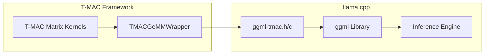
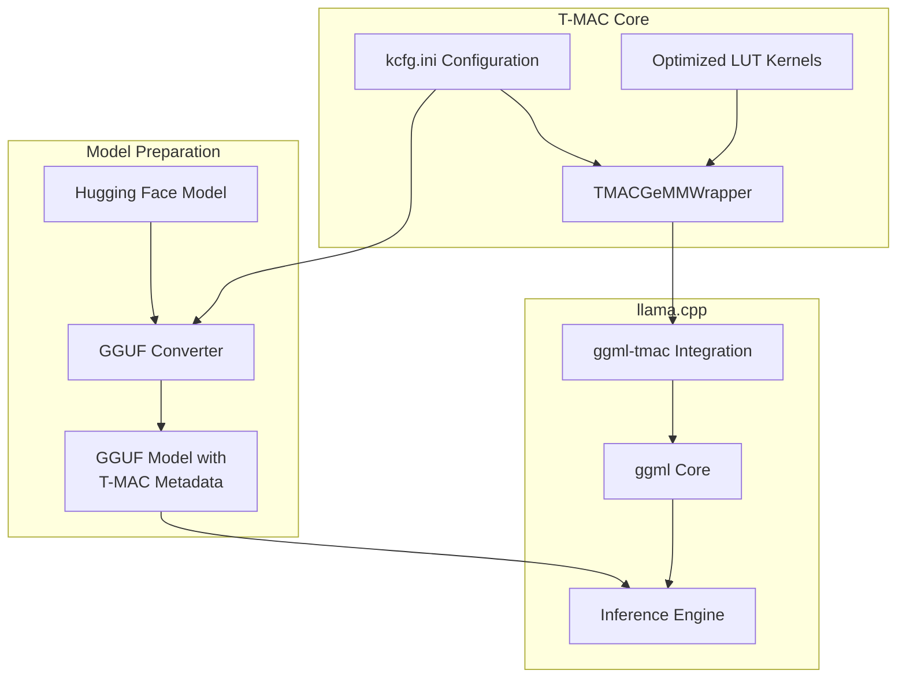
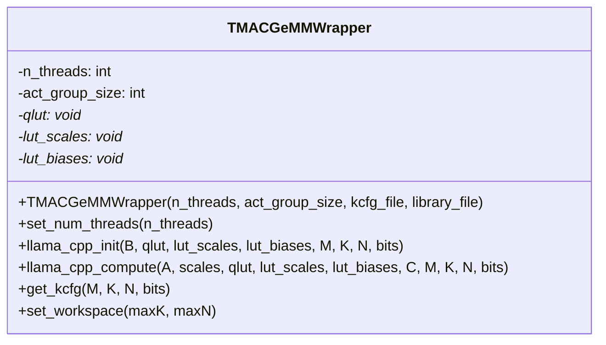
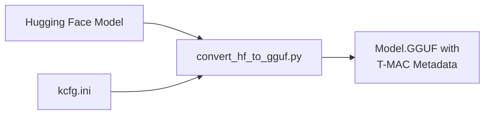
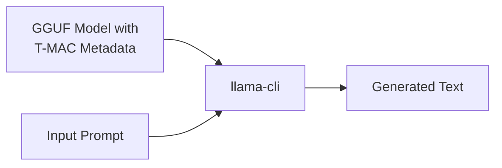

<!-- source: DeepWiki mcp.deepwiki.com · repo microsoft/T-MAC · page 2.3 Integration with llama.cpp · fetched 2026-10-26 -->

# Integration with llama.cpp

<details>
<summary>Relevant source files</summary>

The following files were used as context for generating this wiki page:

- [CMakeLists.txt](CMakeLists.txt)
- [README.md](README.md)
- [cmake/TMACConfig.cmake.in](cmake/TMACConfig.cmake.in)
- [include/t-mac/tmac_gemm_wrapper.h](include/t-mac/tmac_gemm_wrapper.h)
- [tools/run_pipeline.py](tools/run_pipeline.py)

</details>


This document explains how T-MAC integrates with llama.cpp to accelerate inference for quantized language models. It covers the architecture of the integration, key components, workflow, and usage patterns. For information about matrix operations and kernel compilation, see [Matrix Operations](#2.1) and [Compilation Pipeline](#2.2).

## 1. Integration Overview

T-MAC integrates with llama.cpp to provide a high-performance inference solution for low-bit quantized models. The integration enables llama.cpp to utilize T-MAC's lookup table (LUT) based matrix multiplication kernels instead of the default dequantization-based approach, resulting in significant performance improvements, especially for 1-bit and 2-bit models.



The integration is achieved through several components:

1. **TMACGeMMWrapper**: Provides a C++ interface to T-MAC's optimized kernels
2. **ggml-tmac**: llama.cpp components that interface with T-MAC 
3. **GGUF model conversion**: Adds T-MAC-specific metadata to model files
4. **CMake integration**: Enables building llama.cpp with T-MAC support

Sources: [include/t-mac/tmac_gemm_wrapper.h](), [README.md:389-401]()

## 2. Integration Architecture

T-MAC is designed as a plugin architecture for llama.cpp, allowing seamless integration without major modifications to the core llama.cpp codebase. The integration happens at two key points:

1. **Model conversion**: Enhancing GGUF files with T-MAC configurations
2. **Matrix multiplication operations**: Replacing GGML's default quantized operations with T-MAC kernels



The integration is designed to be non-invasive, allowing llama.cpp to fall back to its native implementation when T-MAC is not available or not enabled.

Sources: [tools/run_pipeline.py:138-176](), [README.md:315-368]()

## 3. TMACGeMMWrapper Interface

The `TMACGeMMWrapper` class serves as the primary interface between T-MAC's optimized kernels and llama.cpp. It provides methods for initializing LUT tables and performing quantized matrix multiplications.

Key components of the wrapper class:

- **Constructor**: Initializes the wrapper with thread count and configuration file
- **llama_cpp_init**: Preprocesses activations to generate lookup tables
- **llama_cpp_compute**: Performs the quantized matrix multiplication using the lookup tables
- **get_kcfg**: Retrieves kernel configuration parameters from the configuration file



The wrapper handles both preprocessor operations (generating lookup tables from activations) and the actual matrix multiplication operations.

Sources: [include/t-mac/tmac_gemm_wrapper.h:79-348]()

## 4. Integration Workflow

The integration workflow consists of several steps, managed by the `run_pipeline.py` script:

### 4.1 Compilation of T-MAC Kernels

First, T-MAC kernels are compiled for the target architecture:


The compiled kernels are stored in the `tuned` directory along with a configuration file (`kcfg.ini`) that specifies kernel parameters.

Sources: [tools/run_pipeline.py:54-101]()

### 4.2 Building T-MAC Libraries

The T-MAC C++ libraries are built and installed:


This step compiles the T-MAC wrapper and other components needed for integration.

Sources: [tools/run_pipeline.py:110-137](), [CMakeLists.txt:1-129]()

### 4.3 Model Conversion

Hugging Face models are converted to GGUF format with T-MAC-specific metadata:



The conversion process adds T-MAC configuration information to the GGUF file, enabling llama.cpp to use T-MAC kernels when processing the model.

Sources: [tools/run_pipeline.py:139-177]()

### 4.4 Building llama.cpp with T-MAC Support

llama.cpp is built with T-MAC support enabled:


This step enables llama.cpp to use T-MAC's optimized kernels for quantized operations.

Sources: [tools/run_pipeline.py:178-221]()

### 4.5 Running Inference

Finally, inference is performed using the integrated system:



During inference, llama.cpp automatically uses T-MAC kernels for matrix operations based on the model's metadata.

Sources: [tools/run_pipeline.py:222-277](), [README.md:315-368]()

## 5. CMake Integration

T-MAC integrates with llama.cpp through CMake, which manages the build configuration and dependencies. The key components are:

### 5.1 T-MAC CMake Configuration

The T-MAC CMakeLists.txt file defines how T-MAC is built and installed:

1. Builds the T-MAC library with TVM support
2. Installs the library, headers, and kernel files
3. Creates a CMake package configuration file for downstream projects

### 5.2 T-MAC Config Package

The TMACConfig.cmake.in template creates a CMake package that can be consumed by llama.cpp:

1. Defines the T-MAC library location
2. Sets include directories
3. Defines compilation flags and dependencies
4. Creates T-MAC targets that llama.cpp can link against

### 5.3 llama.cpp CMake Integration

The llama.cpp CMake configuration uses the T-MAC package to enable integration:

```
cmake .. -DGGML_TMAC=ON -DCMAKE_PREFIX_PATH=/path/to/t-mac/cmake
```

This configuration enables the T-MAC-specific code in llama.cpp and links against the T-MAC libraries.

Sources: [CMakeLists.txt:1-129](), [cmake/TMACConfig.cmake.in:1-77](), [tools/run_pipeline.py:178-214]()

## 6. Performance Benefits

The integration of T-MAC with llama.cpp delivers significant performance improvements, particularly for low-bit models:

| Model | Device | Threads | T-MAC (tokens/sec) | llama.cpp (tokens/sec) | Speedup |
|-------|--------|---------|---------------------|------------------------|---------|
| BitNet-3B | M2-Ultra | 4 | 48.7 | 11.9 | 4.1x |
| Llama-2-7B (W2) | M2-Ultra | 4 | 29.6 | 13.2 | 2.2x |
| Llama-2-7B (W4) | M2-Ultra | 4 | 23.1 | 15.4 | 1.5x |
| BitNet-3B | Surface Laptop 7 | 4 | 48.0 | 10.6 | 4.5x |
| Llama-2-7B (W2) | Surface Laptop 7 | 4 | 28.4 | 10.5 | 2.7x |
| BitNet-3B | Raspberry Pi 5 | 4 | 11.3 | 3.1 | 3.6x |

The performance advantage is more significant for lower-bit models (1-bit and 2-bit) and becomes less pronounced for 4-bit models. This is because T-MAC's table lookup approach is more efficient than dequantization for very low-bit models.

Sources: [README.md:38-63]()

## 7. Usage Guide

To use T-MAC with llama.cpp, follow the end-to-end pipeline provided by the `run_pipeline.py` script:

### 7.1 Basic Usage

```bash
# Download a model
huggingface-cli download 1bitLLM/bitnet_b1_58-3B --local-dir ${model_dir}

# Run the pipeline
python tools/run_pipeline.py -o ${model_dir} -q int_n
```

This command will:
1. Compile T-MAC kernels
2. Build T-MAC libraries
3. Convert the model to GGUF format with T-MAC metadata
4. Build llama.cpp with T-MAC support
5. Run inference using the integrated system

### 7.2 GPTQ Models

T-MAC also supports models in GPTQ format:

```bash
huggingface-cli download ChenMnZ/Llama-3-8b-instruct-EfficientQAT-w2g128-GPTQ --local-dir ${model_dir}
python tools/run_pipeline.py -o ${model_dir} -m llama-3-8b-2bit -q int_n
```

### 7.3 Configuration Options

The `run_pipeline.py` script provides several configuration options:

- `-m`: Specify model preset
- `-p` or `-s`: Select specific pipeline steps to run
- `-u`: Use prebuilt kernels
- `-nt`: Set number of threads
- `-q`: Set quantization type
- `-d`: Target device for cross-compilation

For benchmarking purposes, the pipeline can also run llama-bench to measure performance.

Sources: [tools/run_pipeline.py:333-440](), [README.md:315-368]()

## 8. Cross-Platform Considerations

The T-MAC integration with llama.cpp supports multiple platforms:

- Apple Silicon (M1/M2)
- x86 with AVX2
- ARM devices (Android, Raspberry Pi)
- Windows on ARM

Each platform may require specific build configurations and settings. The `run_pipeline.py` script handles these differences automatically by detecting the platform and applying the appropriate settings.

For cross-compilation (e.g., compiling for Android on a desktop), additional parameters such as NDK path and remote directory may be required.

Sources: [README.md:139-307](), [tools/run_pipeline.py:34-44](), [tools/run_pipeline.py:387-392]()

---

