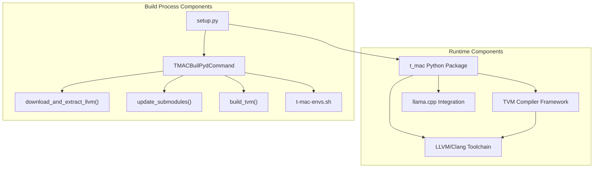
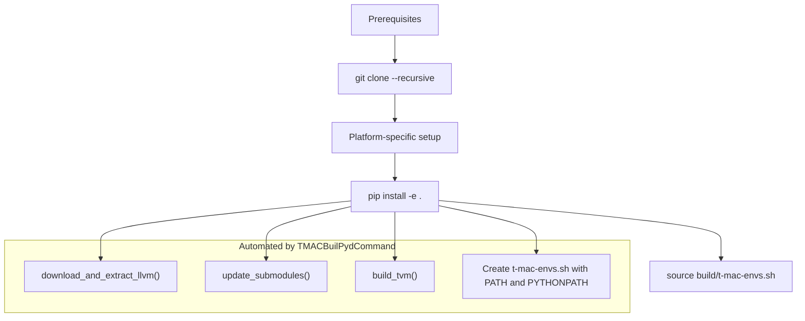
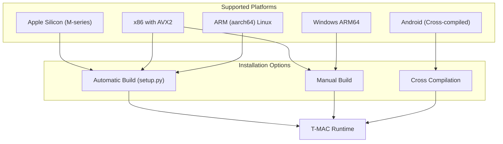

<!-- source: DeepWiki mcp.deepwiki.com · repo microsoft/T-MAC · page 3 Installation and Setup · fetched 2026-10-26 -->

# Installation and Setup

<details>
<summary>Relevant source files</summary>

The following files were used as context for generating this wiki page:

- [README.md](README.md)
- [conda/tvm-build-environment.yaml](conda/tvm-build-environment.yaml)
- [pyproject.toml](pyproject.toml)
- [python/t_mac/__init__.py](python/t_mac/__init__.py)
- [requirements.txt](requirements.txt)
- [setup.py](setup.py)

</details>


This page provides detailed instructions for installing and configuring T-MAC across different platforms. T-MAC is a kernel library that accelerates low-bit LLM inference on CPUs through lookup table-based matrix multiplication without dequantization.

For information about using T-MAC after installation, see [Usage Guide](#4).

## Installation Architecture

The following diagram illustrates the key components involved in the T-MAC installation process:



Sources: [setup.py:134-160](), [README.md:139-140]()

## Installation Workflow

The installation process follows this sequence:



Sources: [setup.py:134-160](), [README.md:160-161]()

## Prerequisites

Before installing T-MAC, ensure your system meets these requirements:

| Component | Requirement | Notes |
|-----------|-------------|-------|
| Python    | 3.8 | Required for TVM compatibility |
| virtualenv | Recommended | For isolated environment |
| cmake     | >= 3.22 | For building components |

Sources: [README.md:142-146](), [pyproject.toml:4]()

## Cross-Platform Support

T-MAC is designed to work efficiently across multiple platforms:



The installation method depends on your platform:

| Platform | Architecture | Installation Method | Notes |
|----------|--------------|---------------------|-------|
| macOS | Apple Silicon | Automatic | Best performance on M-series chips |
| Linux | aarch64 | Automatic | Good performance on ARM servers |
| Linux | x86_64 | Automatic | Requires AVX2 support for optimal performance |
| Windows | x86_64 | Semi-manual | Requires additional setup steps |
| Windows | ARM64 | Manual | Requires native ARM tools |
| Android | ARM | Cross-compilation | Requires desktop for building |

Sources: [README.md:139-306](), [setup.py:16-22]()

## Platform-Specific Installation

### macOS (Apple Silicon)

1. Install required dependencies:
   ```bash
   brew install cmake zstd libomp
   ```

2. Clone the repository and install:
   ```bash
   git clone --recursive https://github.com/microsoft/T-MAC.git
   cd T-MAC
   pip install -e . -v
   source build/t-mac-envs.sh
   ```

During installation, the script automatically downloads LLVM 17.0.6 for arm64-apple-darwin22.0 and builds TVM with LLVM support.

Sources: [README.md:148-165](), [setup.py:17-18](), [setup.py:126-131]()

### Ubuntu (aarch64/x86_64)

1. Install cmake >= 3.22 from the official website

2. Install TVM build dependencies:
   ```bash
   sudo apt install build-essential libtinfo-dev zlib1g-dev libzstd-dev libxml2-dev
   ```

3. Clone the repository and install:
   ```bash
   git clone --recursive https://github.com/microsoft/T-MAC.git
   cd T-MAC
   pip install -e . -v
   source build/t-mac-envs.sh
   ```

For Ubuntu, the script downloads LLVM 17.0.6 for either aarch64-linux-gnu or x86_64-linux-gnu-ubuntu-22.04 depending on your architecture.

Sources: [README.md:170-189](), [setup.py:18-21]()

### Windows (x86_64)

1. Install Visual Studio 2022/2019 with "Desktop development with C++" workload
   > Important: Do NOT toggle on "C++ Clang tools for Windows" as the version might be incompatible.

2. Install Clang-17.0.6 from LLVM official release and add to PATH

3. Create a conda environment:
   ```powershell
   git clone --recursive https://github.com/microsoft/T-MAC.git
   cd T-MAC
   conda env create --file conda\tvm-build-environment.yaml
   conda activate tvm-build
   ```

4. Build TVM:
   ```powershell
   cd 3rdparty\tvm
   mkdir build
   cp cmake\config.cmake build
   ```

5. Append `set(USE_LLVM llvm-config)` to `build\config.cmake`

6. Continue building TVM:
   ```powershell
   cd build
   cmake .. -A x64
   cmake --build . --config Release -- /m
   ```

7. Install T-MAC:
   ```powershell
   cd ..\..\..\  # back to project root directory
   $env:MANUAL_BUILD = "1"
   $env:PYTHONPATH = "$pwd\3rdparty\tvm\python"
   pip install -e . -v
   ```

Windows installation requires more manual steps due to platform complexities.

Sources: [README.md:196-238](), [conda/tvm-build-environment.yaml:1-22]()

### Windows (ARM64)

For Windows ARM64, the installation is more complex:

1. Follow steps 1-4 of Windows (x86_64) installation
2. Build TVM in x64 mode (since Python and dependencies are x64)
3. Install native ARM64 tools:
   - CMake from the official Windows ARM installer
   - Ninja from the release page and add to Path
   - Clang from the LLVM release page
4. Run the following outside of Developer Command Prompt:
   ```powershell
   conda activate tvm-build
   conda uninstall cmake  # Prevent conflict with native ARM64 cmake
   cd ..\..\..\  # back to project root directory
   $env:MANUAL_BUILD = "1"
   $env:PYTHONPATH = "$pwd\3rdparty\tvm\python"
   pip install wmi  # To detect native ARM64 CPU within x64 python
   pip install -e . -v
   ```

Sources: [README.md:243-296]()

### Android

For Android deployment:

1. Install T-MAC on your PC (OSX/Ubuntu recommended)
2. Follow the Android Cross Compilation Guidance in the documentation

Sources: [README.md:300-306]()

## Installation Internals

The `setup.py` script defines a custom installation process through the `TMACBuilPydCommand` class, which handles:

1. Platform detection using `get_system_info()`
2. LLVM download and extraction via `download_and_extract_llvm()`
3. Git submodule updates through `update_submodules()`
4. TVM compilation with `build_tvm()`
5. Environment setup by creating `build/t-mac-envs.sh`

The supported platforms and their corresponding LLVM versions are defined in the `PLATFORM_LLVM_MAP` dictionary.

Sources: [setup.py:16-22](), [setup.py:134-160]()

## Verification

After installation, verify T-MAC is correctly installed:

```bash
python -c "import t_mac; print(t_mac.__version__); from tvm.contrib.clang import find_clang; print(find_clang())"
```

This command should display the T-MAC version and the path to the Clang compiler.

Sources: [README.md:311-312]()

## Next Steps

After successful installation, you can proceed to [Usage Guide](#4) to learn how to use T-MAC for model optimization and inference. The basic workflow involves:

1. Compiling optimized kernels for your hardware
2. Converting models to GGUF format with T-MAC optimizations
3. Running inference through the llama.cpp integration

All of these steps can be automated using the provided `tools/run_pipeline.py` script.

Sources: [README.md:313-368]()

---

