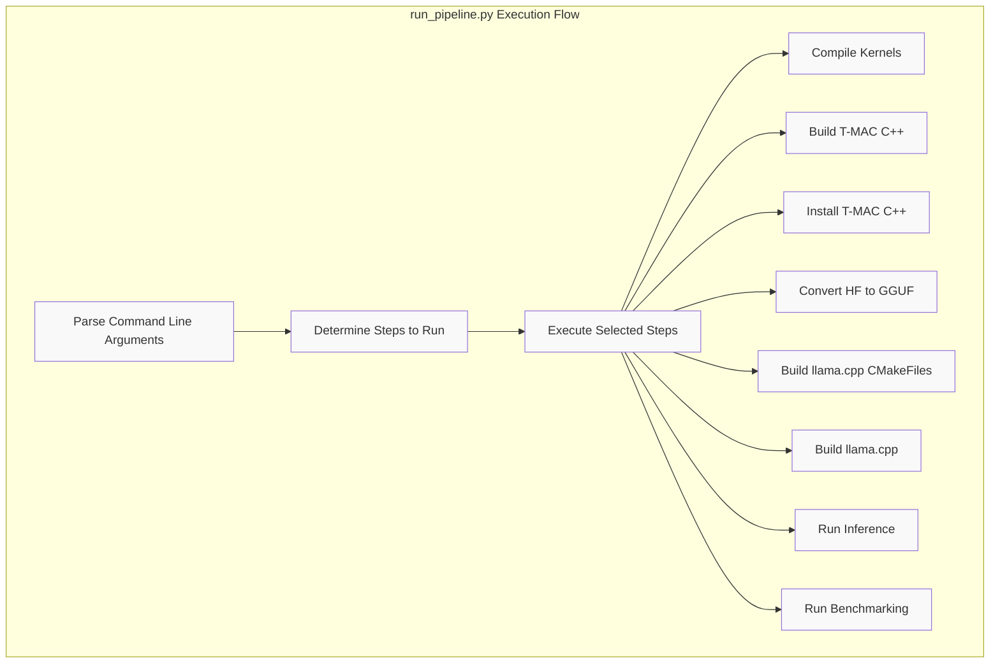
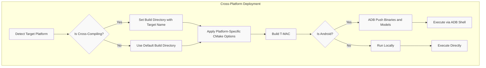

<!-- source: DeepWiki mcp.deepwiki.com · repo microsoft/T-MAC · page 4 Usage Guide · fetched 2026-10-26 -->

# Usage Guide

<details>
<summary>Relevant source files</summary>

The following files were used as context for generating this wiki page:

- [README.md](README.md)
- [tools/run_pipeline.py](tools/run_pipeline.py)

</details>


## Purpose and Scope

This guide explains how to use T-MAC for optimizing and running inference with low-bit quantized language models. It covers the end-to-end workflow from model conversion to inference execution. For information about the architecture and how T-MAC works internally, see [Architecture](#2).

T-MAC enables efficient execution of 1/2/3/4-bit quantized models on CPUs through its lookup table-based matrix multiplication approach, eliminating the need for dequantization.

## End-to-End Workflow Overview

T-MAC provides an all-in-one script (`run_pipeline.py`) that handles the complete workflow from model compilation to inference. The typical workflow consists of the following steps:


Sources: [README.md:313-368](), [tools/run_pipeline.py:333-342]()

## Using the All-in-One Script

The simplest way to use T-MAC is with the `run_pipeline.py` script, which automates the entire process.

### Basic Usage

```bash
# Install required dependencies
pip install 3rdparty/llama.cpp/gguf-py

# Download a model from Hugging Face
huggingface-cli download 1bitLLM/bitnet_b1_58-3B --local-dir ${model_dir}

# Run the pipeline with basic options
python tools/run_pipeline.py -o ${model_dir} -q int_n
```

This example downloads the BitNet model and runs the complete pipeline, from kernel compilation to inference.

Sources: [README.md:319-323]()

### GPTQ Format Support

T-MAC also supports models in GPTQ format from repositories like GPTQModel and EfficientQAT:

```bash
# Download a GPTQ-formatted model
huggingface-cli download ChenMnZ/Llama-3-8b-instruct-EfficientQAT-w2g128-GPTQ --local-dir ${model_dir}

# Run the pipeline specifying the model type
python tools/run_pipeline.py -o ${model_dir} -m llama-3-8b-2bit -q int_n
```

For GPTQ models not in the preset list, use the `-m gptq-auto` option to automatically detect and validate kernel shapes and quantization configurations.

Sources: [README.md:325-338]()

## Pipeline Steps

The `run_pipeline.py` script executes the following steps by default:

1. **Compile kernels**: Generates optimized kernels for the target hardware
2. **Build T-MAC C++ CMakeFiles**: Prepares the build system for T-MAC
3. **Install T-MAC C++**: Builds and installs T-MAC libraries
4. **Convert HF to GGUF**: Converts the model to GGUF format
5. **Build llama.cpp CMakeFiles**: Prepares the build system for llama.cpp with T-MAC
6. **Build llama.cpp**: Builds the inference engine
7. **Run inference**: Executes the model for text generation

You can select specific steps to run using the `-s` or `-p` arguments.



Sources: [tools/run_pipeline.py:333-342](), [tools/run_pipeline.py:422-432]()

## Command Line Arguments

T-MAC's `run_pipeline.py` script provides numerous options to customize the execution:

| Argument | Description | Default |
|----------|-------------|---------|
| `-o, --model_dir` | Directory containing the model | Required |
| `-nt, --num_threads` | Number of threads to use | 4 |
| `-m, --model` | Model type | hf-bitnet-3b |
| `-p, --steps_preset` | Preset of steps to run (all, fast, compile) | all |
| `-s, --steps` | Specific steps to run (comma-separated) | None |
| `-q, --quant_type` | Quantization model type (int_n, f16, f32, tq1_0, tq2_0, q4_0) | None |
| `-d, --device` | Target device for cross-compilation | Local device |
| `-u, --use_prebuilt` | Use prebuilt kernels for ARM | False |
| `-dt, --disable_tune` | Disable kernel tuning | False |
| `-v, --verbose` | Enable verbose output | False |
| `-rc, --rechunk` | Enable rechunking in computation | False |
| `--disable-t-mac` | Disable T-MAC (for comparison) | False |

Sources: [tools/run_pipeline.py:363-395]()

## Model Compatibility

T-MAC supports various low-bit models in different formats:

| Bits | Supported Model Formats |
|------|-------------------------|
| 1-bit | BitNet models (W1.58A8) |
| 2-bit | BitDistiller, EfficientQAT, GPTQ models |
| 3-bit | GPTQ models |
| 4-bit | GPTQ, GGUF models |

For GPTQ models, T-MAC automatically detects the model architecture and configures the appropriate kernels when using `-m gptq-auto`.

Sources: [README.md:33-35](), [README.md:325-338]()

## Configuration for Different Model Types

### BitNet Models

For 1-bit BitNet models:

```bash
huggingface-cli download 1bitLLM/bitnet_b1_58-3B --local-dir ${model_dir}
python tools/run_pipeline.py -o ${model_dir} -q int_n
```

### Llama-2 W2 Models

For 2-bit quantized Llama models from EfficientQAT:

```bash
huggingface-cli download ChenMnZ/Llama-3-8b-instruct-EfficientQAT-w2g128-GPTQ --local-dir ${model_dir}
python tools/run_pipeline.py -o ${model_dir} -m llama-3-8b-2bit -q int_n
```

### Standard GPTQ Models

For standard GPTQ models:

```bash
# For automatically detecting model architecture
python tools/run_pipeline.py -o ${model_dir} -m gptq-auto -q int_n
```

Sources: [README.md:319-338]()

## Using Prebuilt Kernels

For ARM devices, T-MAC provides prebuilt kernels to simplify deployment. To use them:

```bash
python tools/run_pipeline.py -o ${model_dir} -q int_n -u
```

The `-u` flag tells T-MAC to use prebuilt kernels instead of compiling them on the target device.

Sources: [tools/run_pipeline.py:54-63](), [tools/run_pipeline.py:386]()

## Cross-Platform Deployment

T-MAC supports multiple platforms including:
- Apple Silicon (M1/M2/M3)
- x86 with AVX2
- ARM devices (including Android)
- NVIDIA Jetson

### Android Deployment

To deploy on Android:

1. Install T-MAC on your development machine (OSX/Ubuntu recommended)
2. Use the `-d android` flag to cross-compile for Android:

```bash
python tools/run_pipeline.py -o ${model_dir} -q int_n -d android -ndk /path/to/ndk
```

The script will handle cross-compilation and ADB commands to push the necessary files to the Android device.



Sources: [tools/run_pipeline.py:42-52](), [tools/run_pipeline.py:189-202](), [tools/run_pipeline.py:234-264]()

## Performance Tuning

T-MAC provides several options to tune performance:

### Kernel Tuning

By default, T-MAC tunes kernels for optimal performance on your hardware. To disable tuning and use default kernels:

```bash
python tools/run_pipeline.py -o ${model_dir} -q int_n -dt
```

### Reuse Previously Tuned Kernels

If you've already tuned kernels for your hardware, you can reuse them:

```bash
python tools/run_pipeline.py -o ${model_dir} -q int_n -r
```

### Thread Count Optimization

Setting the optimal number of threads is crucial for performance:

```bash
python tools/run_pipeline.py -o ${model_dir} -q int_n -nt 8
```

For token generation, T-MAC can match the same performance using fewer CPU cores compared to traditional approaches, which is beneficial for power efficiency and resource utilization.

Sources: [tools/run_pipeline.py:54-95](), [README.md:40-53]()

## Benchmarking

To benchmark T-MAC's performance, the pipeline includes the `llama-bench` step:

```bash
# Run only the benchmarking step
python tools/run_pipeline.py -o ${model_dir} -q int_n -s 7
```

This runs the `llama-bench` tool with appropriate parameters to measure token generation throughput.

The benchmark results will be written to the logs directory specified by `-ld`.

Sources: [tools/run_pipeline.py:279-331]()

## Troubleshooting

### Logs and Debugging

T-MAC writes detailed logs to the `logs` directory (configurable with `-ld`). Each command execution creates a timestamped log file:

```
logs/2024-07-15-17-10-11.log
```

If a step fails, check the corresponding log file for error details.

### Verbose Mode

For more detailed output during execution:

```bash
python tools/run_pipeline.py -o ${model_dir} -q int_n -v
```

This enables verbose logging to help diagnose issues.

Sources: [tools/run_pipeline.py:15-31](), [tools/run_pipeline.py:436-439]()

## Integration with External Projects

T-MAC integrates with llama.cpp to accelerate inference. After building with T-MAC support, you can use the regular llama.cpp tools with the converted model:

```bash
# Run the converted model with llama.cpp's main executable
./3rdparty/llama.cpp/build/bin/main -m ${model_dir}/model.int_n.gguf -n 128 -t 4 -p "Your prompt text" -ngl 0 -c 2048
```

For advanced use cases like chat interfaces or API servers, you can use other llama.cpp executables like `server` with T-MAC-optimized models.

Sources: [README.md:363-368]()

---

