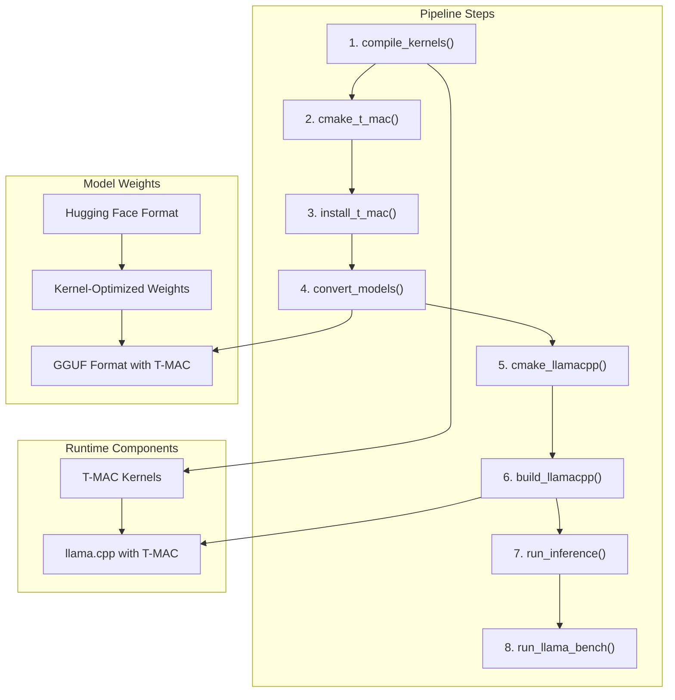
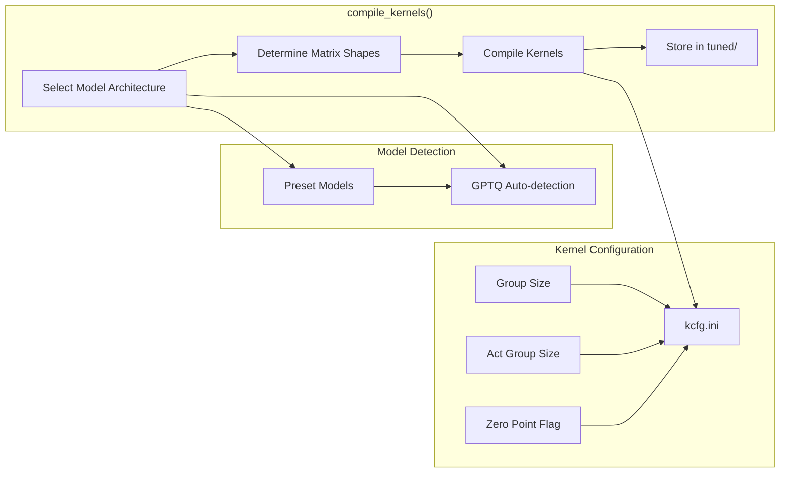
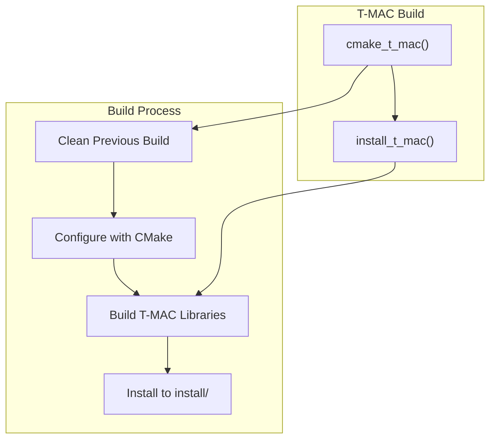
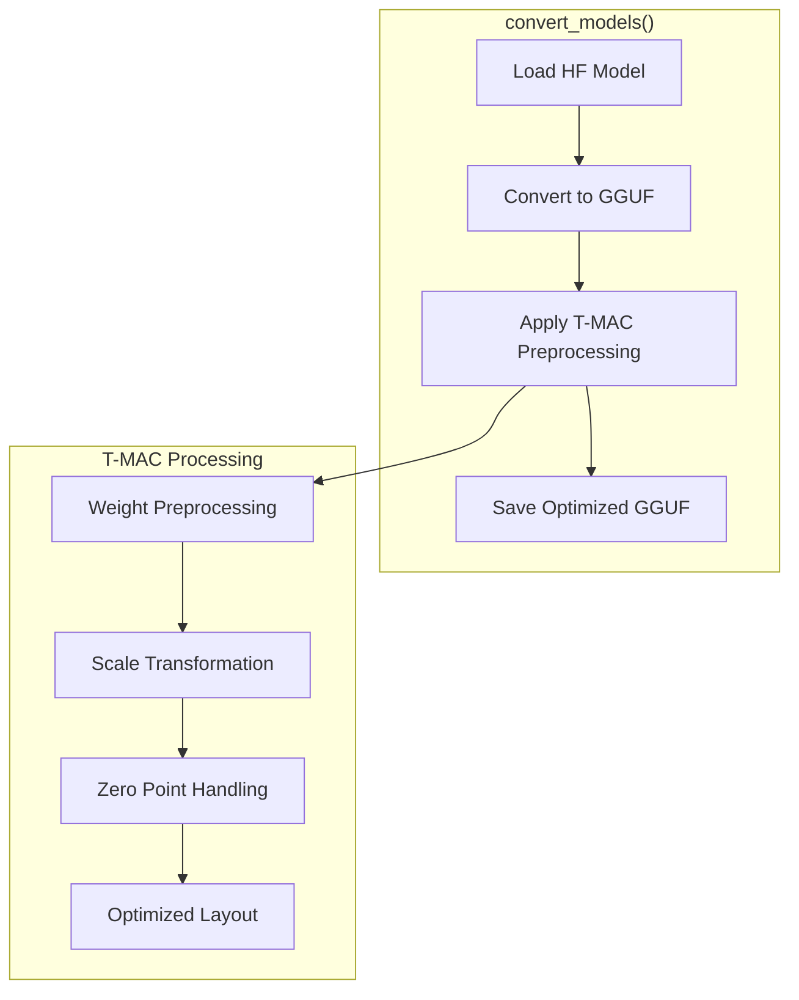
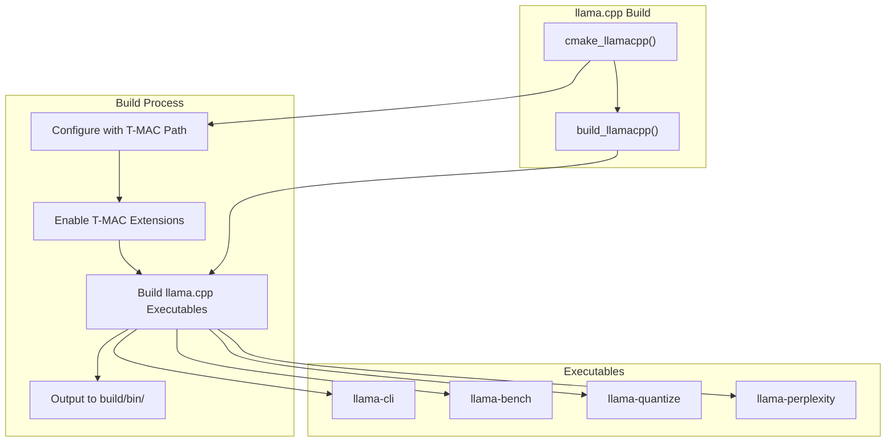
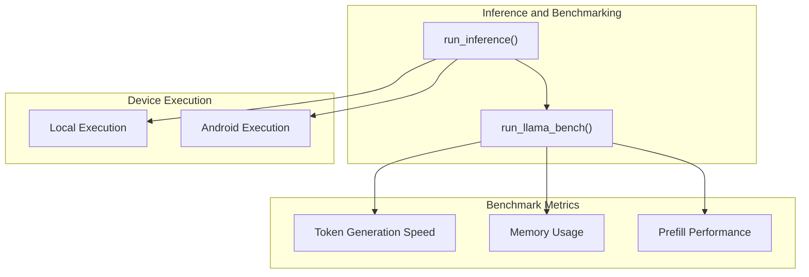
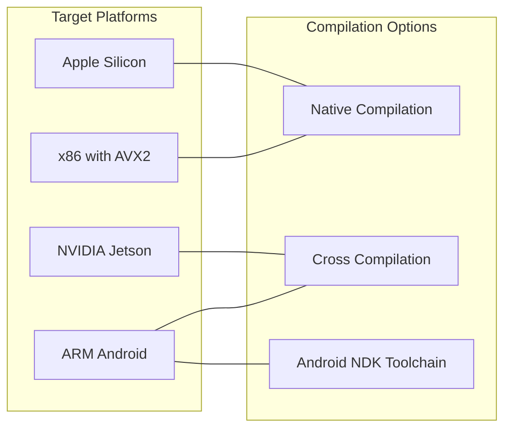
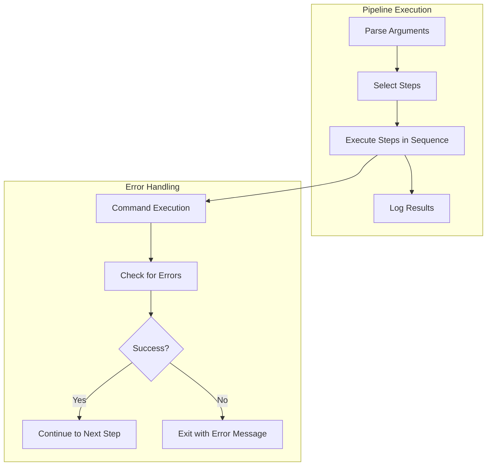

<!-- source: DeepWiki mcp.deepwiki.com · repo microsoft/T-MAC · page 4.1 End-to-End Pipeline · fetched 2026-10-26 -->

# End-to-End Pipeline

<details>
<summary>Relevant source files</summary>

The following files were used as context for generating this wiki page:

- [python/t_mac/model_utils.py](python/t_mac/model_utils.py)
- [tools/run_pipeline.py](tools/run_pipeline.py)

</details>


This document explains the complete workflow for optimizing and running LLM inference with T-MAC, from compiling custom kernels to measuring performance benchmarks. For details about the architecture and components of T-MAC, see [Architecture](#2).

## Pipeline Overview

The T-MAC pipeline transforms Hugging Face models into optimized deployable artifacts with T-MAC's quantized matrix operations. This process involves multiple steps coordinated by the `run_pipeline.py` script.


Sources: [tools/run_pipeline.py:333-342]()

## Pipeline Components and Workflow

The complete end-to-end pipeline consists of the following sequential steps:



Sources: [tools/run_pipeline.py:333-342](), [tools/run_pipeline.py:54-101](), [tools/run_pipeline.py:139-176]()

## Step 1: Kernel Compilation

The first step compiles optimized kernels for specific matrix shapes commonly found in the target model.



This step compiles QGeMMLUT (Quantized General Matrix Multiplication with Lookup Tables) kernels optimized for the target hardware. The model's architecture determines which kernel shapes to compile.

Sources: [tools/run_pipeline.py:54-101](), [python/t_mac/model_utils.py:206-216]()

### Kernel Parameters

| Parameter | Description | Default Value |
|-----------|-------------|--------------|
| `group_size` | Size of weight groups for quantization | 128 |
| `act_group_size` | Size of activation groups | 64 or model-specific |
| `zero_point` | Whether to use zero point in quantization | Model-dependent |

Sources: [tools/run_pipeline.py:405-419](), [python/t_mac/model_utils.py:19-88]()

## Step 2: T-MAC C++ Library Build

This step builds the T-MAC C++ libraries required for integration with llama.cpp.



The T-MAC C++ libraries provide the interface between llama.cpp and the optimized QGeMMLUT kernels.

Sources: [tools/run_pipeline.py:110-136]()

## Step 3: Model Conversion

This step converts the model from Hugging Face format to GGUF with T-MAC optimizations.



The conversion process takes the Hugging Face model and applies T-MAC-specific weight preprocessing before saving in GGUF format. This includes specialized transformations for quantized weights that optimize them for the compiled kernels.

Sources: [tools/run_pipeline.py:139-176](), [python/t_mac/model_utils.py:243-271]()

## Step 4: llama.cpp Integration

This step builds llama.cpp with T-MAC support.



The llama.cpp integration enables the use of T-MAC's optimized kernels for inference, providing significant speedups on supported hardware.

Sources: [tools/run_pipeline.py:178-219]()

## Step 5: Inference and Benchmarking

The final steps run inference and benchmarking with the optimized model.



Inference can run on the local machine or be deployed to Android devices through ADB.

Sources: [tools/run_pipeline.py:222-331]()

## Cross-Platform Support

The pipeline supports multiple target platforms through cross-compilation.



For cross-compilation to Android, the pipeline uses the Android NDK toolchain specified with `--ndk_home`.

Sources: [tools/run_pipeline.py:42-51](), [tools/run_pipeline.py:190-201]()

## Running the Complete Pipeline

To run the complete end-to-end pipeline, use the `run_pipeline.py` script:

```
python tools/run_pipeline.py --model hf-bitnet-3b --model_dir /path/to/model --num_threads 4
```

### Common Pipeline Presets

| Preset | Description | Steps Included |
|--------|-------------|---------------|
| `all` | Complete workflow | 0, 1, 2, 3, 4, 5, 6 |
| `fast` | Skip CMake configuration | 0, 2, 3, 5, 6 |
| `compile` | Only compile components | 0, 2, 5 |

Sources: [tools/run_pipeline.py:345-349](), [tools/run_pipeline.py:363-440]()

### Important Configuration Options

| Option | Description |
|--------|-------------|
| `--model` | Model architecture (e.g., hf-bitnet-3b, llama-2-7b-4bit) |
| `--model_dir` | Path to the Hugging Face model |
| `--num_threads` | Number of threads for inference |
| `--quant_type` | Quantization type (int_n, f16, f32, tq1_0, tq2_0, q4_0) |
| `--device` | Target device for cross-compilation |
| `--disable_tune` | Skip kernel tuning (faster, but potentially less optimized) |
| `--use_prebuilt` | Use prebuilt kernels if available |
| `--rechunk` | Enable rechunking in computation |

Sources: [tools/run_pipeline.py:363-396]()

## Flow Control and Error Handling

The pipeline implements error handling and logging for each step:



Each command execution is logged to a timestamped file in the `logs` directory, making it easier to diagnose issues.

Sources: [tools/run_pipeline.py:15-31](), [tools/run_pipeline.py:422-440]()

---

