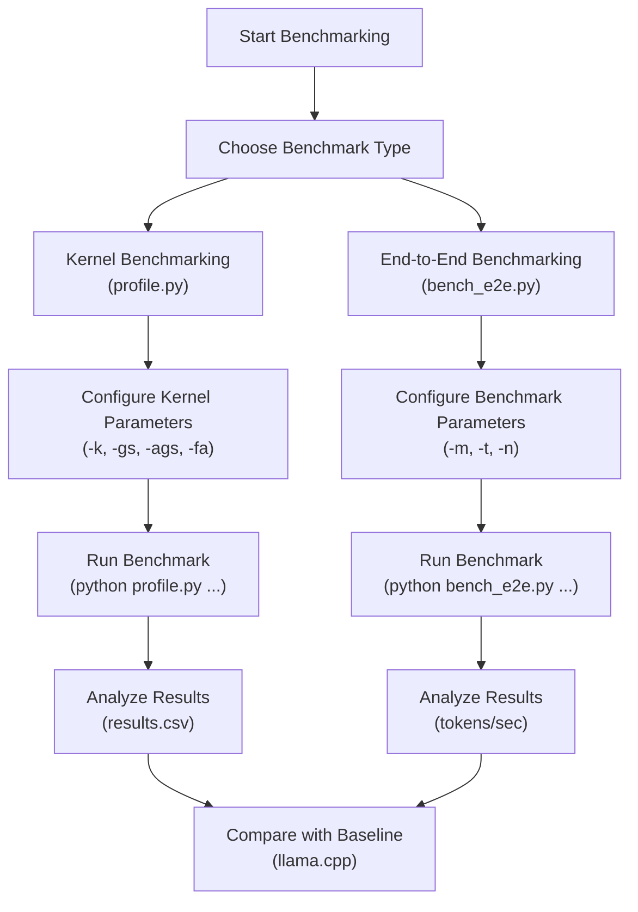
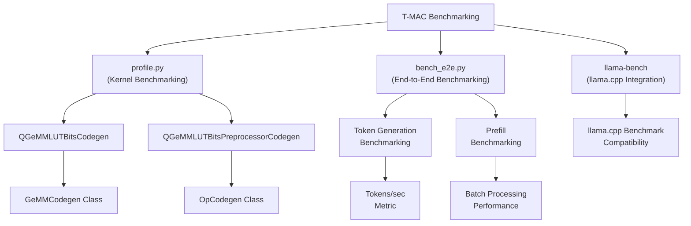

<!-- source: DeepWiki mcp.deepwiki.com · repo microsoft/T-MAC · page 4.2 Benchmarking · fetched 2026-10-26 -->

# Benchmarking

<details>
<summary>Relevant source files</summary>

The following files were used as context for generating this wiki page:

- [README.md](README.md)
- [assets/e2e_threads.png](assets/e2e_threads.png)
- [assets/e2e_threads.zip](assets/e2e_threads.zip)
- [docs/profiling_data.md](docs/profiling_data.md)
- [tools/profile.py](tools/profile.py)

</details>


This page provides guidance on how to benchmark T-MAC's performance and interpret the results. Benchmarking is crucial for understanding the performance benefits of T-MAC compared to baseline frameworks like llama.cpp, optimizing configurations for specific hardware, and evaluating the impact of different parameters on performance.

For comprehensive performance analysis and comparisons with other frameworks across various hardware platforms, see [Performance Analysis](#7).

## Benchmarking Tools

T-MAC provides several tools for performance measurement:

### Kernel-level Benchmarking

The `profile.py` script measures the performance of individual T-MAC kernels, such as QGeMMLUT (Quantized General Matrix Multiplication with Lookup Tables) and the preprocessor.

```bash
python tools/profile.py -o [output_dir] -d [device] -k [kernel] -t -r -gs [group_size] -ags [act_group_size] -fa
```

Key parameters:
- `-o`: Output directory for benchmark results
- `-d`: Target device
- `-k`: Kernel type (`qgemm_lut` or `preprocessor`)
- `-t`: Enable tuning to find optimal configurations
- `-r`: Reuse previously tuned kernels
- `-gs`: Weight group size (default: 128)
- `-ags`: Activation group size (default: 64, -1 for BitNet-like unified scale)
- `-fa`: Enable fast aggregation

Example:
```bash
python tools/profile.py -o tuned -k qgemm_lut -t -r -gs 128 -ags 64 -fa
```

Sources: [tools/profile.py:1-222]()

### End-to-End Benchmarking

For comprehensive performance evaluation, T-MAC provides end-to-end benchmarking through:

1. **bench_e2e.py**: A dedicated script for measuring complete inference performance
   ```bash
   python tools/bench_e2e.py -m [model_path] -t [num_threads]
   ```

2. **llama-bench**: Integration with llama.cpp's benchmarking utility
   ```bash
   ./3rdparty/llama.cpp/build/bin/llama-bench -m [model_path] -t [num_threads] -ngl 0
   ```

Sources: [README.md:367-368]()

## T-MAC Benchmarking Workflow

The following diagram illustrates the T-MAC benchmarking process:



Sources: [README.md:364-368](), [tools/profile.py:101-223]()

## T-MAC Benchmarking Components



Sources: [tools/profile.py:1-10](), [README.md:367-368]()

## Running Benchmarks

### Kernel-level Benchmarks

To evaluate kernel performance:

1. **Setup the benchmark parameters**:
   ```bash
   python tools/profile.py -o out -k qgemm_lut -t -r -gs 128 -ags 64 -fa
   ```

2. **Analyze the results**:
   The script outputs timing information (in milliseconds) and saves results to a CSV file in the specified output directory.

Sources: [tools/profile.py:101-215]()

### End-to-End Benchmarks

For complete model inference benchmarking:

1. **Run the full pipeline**:
   ```bash
   python tools/run_pipeline.py -o [model_dir] -q int_n
   ```
   
   This script handles steps from compiling kernels to running inference.

2. **Dedicated benchmarking**:
   ```bash
   python tools/bench_e2e.py -m [model_path] -t [num_threads]
   ```
   
   This is useful when you want to benchmark specific configurations.

3. **Using llama-bench**:
   ```bash
   ./3rdparty/llama.cpp/build/bin/llama-bench -m [model_path] -t [num_threads] -ngl 0
   ```

Sources: [README.md:317-368]()

## Interpreting Benchmark Results

### Kernel-level Benchmark Metrics

- **Execution time (ms)**: Lower values indicate better performance
- **Bit-width scaling**: T-MAC should show better scaling for lower bit-widths
- **Group size impact**: Different group sizes may affect performance significantly

### End-to-End Benchmark Metrics

- **Tokens per second (tokens/sec)**: Higher values indicate better performance
- **Thread scaling**: How performance improves with more threads
- **Speedup over baseline**: T-MAC should show significant speedups compared to llama.cpp

## Expected Benchmark Results

Based on extensive testing, you can expect the following performance improvements when benchmarking T-MAC compared to llama.cpp:

### Single-Thread Performance

| Model           | Device         | llama.cpp (tokens/sec) | T-MAC (tokens/sec) | Speedup |
|-----------------|----------------|------------------------|---------------------|---------|
| BitNet-3B       | M2-Ultra       | 6.49                  | 22.08              | 3.4x    |
| Llama-2-7B (W2) | M2-Ultra       | 3.82                  | 16.68              | 4.4x    |
| Llama-2-7B (W4) | M2-Ultra       | 5.65                  | 8.97               | 1.6x    |
| BitNet-3B       | Raspberry Pi 5 | 1.37                  | 8.03               | 5.9x    |
| Llama-2-7B (W2) | Raspberry Pi 5 | 0.66                  | 4.40               | 6.7x    |
| Llama-2-7B (W4) | Raspberry Pi 5 | 0.85                  | 2.42               | 2.8x    |

Sources: [docs/profiling_data.md:1-32]()

### Multi-Thread Scaling

| Model           | Device    | Threads | llama.cpp (tokens/sec) | T-MAC (tokens/sec) |
|-----------------|-----------|---------|------------------------|---------------------|
| BitNet-3B       | M2-Ultra | 1       | 6.49                  | 22.08              |
| BitNet-3B       | M2-Ultra | 4       | 22.09                 | 54.46              |
| Llama-2-7B (W2) | M2-Ultra | 1       | 3.82                  | 16.68              |
| Llama-2-7B (W2) | M2-Ultra | 8       | 22.06                 | 51.01              |

Sources: [docs/profiling_data.md:1-32]()

### Prefill Performance

For applications requiring batch processing (prefill phase):

| Model           | Threads | Batch Size | T-MAC (tokens/sec) | llama.cpp (OpenBLAS) | llama.cpp |
|-----------------|---------|------------|--------------------|-----------------------|-----------|
| Llama-2-7B (W2) | 4       | 256        | 50.1               | 21.5                 | 12.0      |
| Llama-2-7B (W2) | 8       | 256        | 94.4               | 37.7                 | 21.3      |

Sources: [README.md:67-76]()

### Power and Energy Consumption

T-MAC provides significant benefits in power consumption and energy efficiency:

| Framework       | Throughput (tokens/sec) | Power (W) | Energy (J/token) |
|-----------------|-------------------------|-----------|------------------|
| llama.cpp (CPU) | 7.08                    | 15.0      | 2.12             |
| llama.cpp (GPU) | 20.03                   | 30.8      | 1.54             |
| T-MAC (CPU)     | 15.62                   | 10.4      | 0.66             |

Sources: [README.md:127-135]()

## Tips for Effective Benchmarking

1. **Consistency**: Ensure your device is in a consistent state (thermal, background processes) between benchmark runs
2. **Multiple Runs**: Run benchmarks multiple times and average the results for reliable measurements
3. **Thread Counts**: Test various thread counts to find the optimal configuration for your hardware
4. **Fast Aggregation**: Toggle the fast aggregation option (`-fa`) to evaluate its impact on performance
5. **Resource Monitoring**: Track power and temperature during benchmarks to understand efficiency
6. **Group Sizes**: Experiment with different group sizes (`-gs` and `-ags`) to find optimal configurations

Sources: [tools/profile.py:101-123](), [README.md:52-53]()

## Common Issues and Solutions

- **Unstable performance**: If you observe unstable performance, especially on edge devices, it may be due to thermal throttling. Try running benchmarks with fewer threads or with cooling solutions.
- **Lower than expected performance**: Ensure you've built T-MAC with the correct optimizations for your hardware platform.
- **Diminishing returns with threads**: As you increase thread count, you may see diminishing returns due to memory bandwidth limitations or thermal constraints.

By following this guide, you should be able to effectively benchmark T-MAC on your hardware and interpret the results to optimize your configuration.

---

