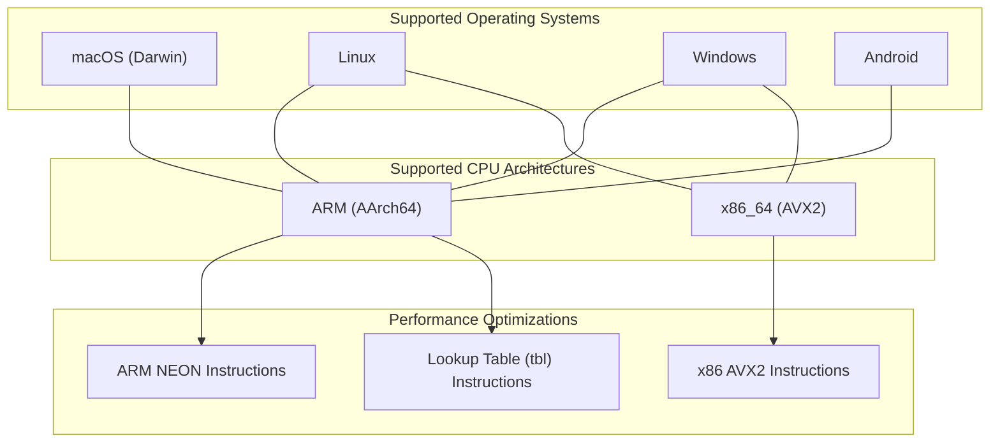
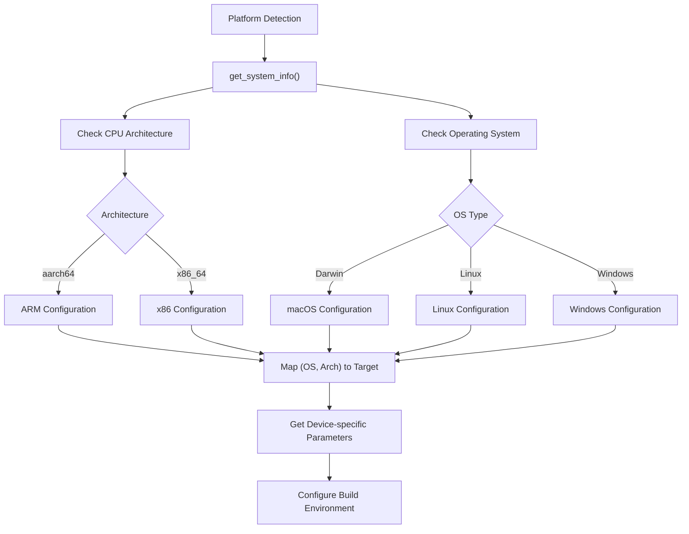
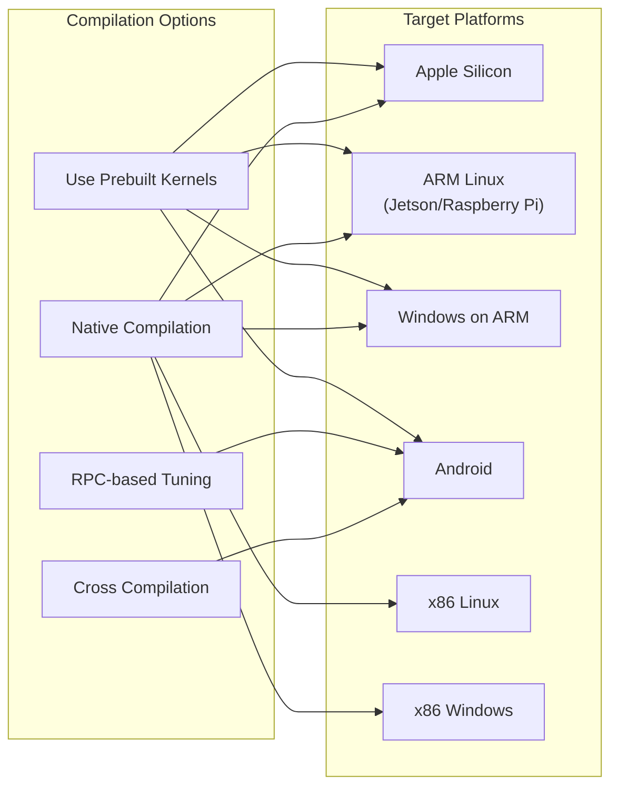
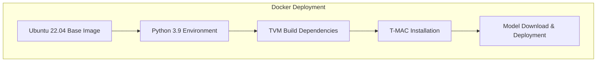
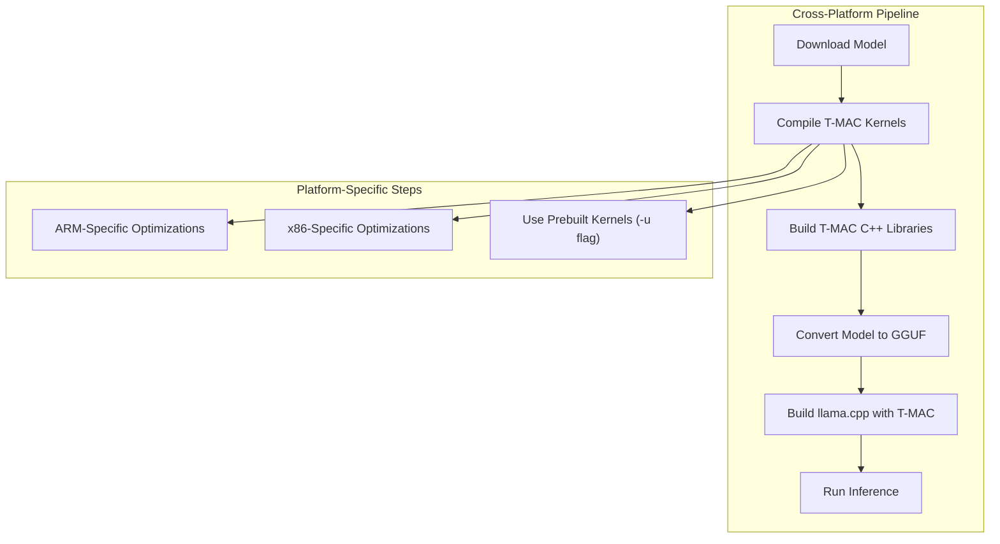

<!-- source: DeepWiki mcp.deepwiki.com · repo microsoft/T-MAC · page 5 Cross-Platform Support · fetched 2026-10-26 -->

# Cross-Platform Support

<details>
<summary>Relevant source files</summary>

The following files were used as context for generating this wiki page:

- [README.md](README.md)
- [docker/Dockerfile.x86_64](docker/Dockerfile.x86_64)
- [docker/scripts/run_example_on_docker_x86_64.sh](docker/scripts/run_example_on_docker_x86_64.sh)
- [docs/e2e.md](docs/e2e.md)
- [python/t_mac/platform.py](python/t_mac/platform.py)

</details>


This page provides an overview of T-MAC's platform support across different CPU architectures and operating systems. It documents the platform detection mechanism, architecture-specific optimizations, compilation options, and deployment strategies. For specific Android deployment instructions, see [Android Deployment](#5.1).

## Supported Platforms

T-MAC is designed to run efficiently on multiple platforms, with optimizations for various CPU architectures. The library currently supports:

- Apple Silicon (M1/M2 series)
- x86 with AVX2 (Intel/AMD)
- ARM64 devices (Jetson, Raspberry Pi, etc.)
- Windows on ARM (e.g., Surface Laptop 7)
- Android devices



Sources: [README.md:31-37](), [python/t_mac/platform.py:165-171]()

## Platform Detection Mechanism

T-MAC uses a platform detection system that identifies both the operating system and CPU architecture to configure appropriate build parameters. This mechanism is implemented in the `platform.py` module.



The platform detection involves:

1. **OS Detection**: Identifies if the system is running macOS (Darwin), Linux, or Windows
2. **Architecture Detection**: Identifies if the CPU is ARM-based (aarch64) or x86-based (x86_64)
3. **Platform Mapping**: Maps the OS and architecture to a specific target configuration

On Windows ARM64 platforms, T-MAC uses additional detection methods to identify the native architecture accurately, as shown in the code:

```python
# Special handling for Windows on ARM
try:
    import wmi
    arch = wmi.WMI().Win32_Processor()[0].Architecture
    WIN_ARCH_MAP = {
        0: "x86",
        9: "AMD64",
        12: "ARM64",
    }
    processor = WIN_ARCH_MAP[arch]
except ImportError:
    # Fallback to environment variable
    arch = os.environ.get("TMAC_NATIVE_CPU_ARCH")
```

Sources: [python/t_mac/platform.py:11-45](), [python/t_mac/platform.py:165-171](), [python/t_mac/platform.py:174-177]()

## Architecture-Specific Optimizations

T-MAC applies architecture-specific optimizations to maximize performance on each target platform.

### ARM-Specific Optimizations

For ARM platforms (Apple Silicon, Jetson, Raspberry Pi, etc.), T-MAC leverages:

- **ARM NEON SIMD Instructions**: Vectorized operations for parallel processing
- **ARM v8.2a Features**: Optimized for half-precision floating point (FP16) operations
- **Table Lookup Instructions**: Fast `tbl` instruction implementation

### x86-Specific Optimizations

For x86 platforms, T-MAC utilizes:

- **AVX2 SIMD Extensions**: Vector operations for parallel processing
- **Native Compilation Flags**: Architecture-specific compilation flags (`-march=native`)

The target-specific configurations are defined in `_device_kwargs` dictionary:

| Platform | Target Triple | Optimization Flags |
|----------|---------------|-------------------|
| Apple Silicon | `arm64-apple-darwin` | `-mcpu=apple-m2`, FP16 support |
| ARM Linux | `aarch64-linux-gnu` | `+v8.2a,+fullfp16,+fp-armv8,+neon` |
| ARM Windows | `aarch64-pc-windows-msvc` | `+v8.2a,+fullfp16,+fp-armv8,+neon` |
| x86 Linux | `x86_64-unknown-linux-gnu` | `-mcpu=core-avx2` |
| x86 Windows | `x86_64-pc-windows-msvc` | `-mcpu=core-avx2` |

Sources: [python/t_mac/platform.py:75-157](), [README.md:80-86]()

## Compilation Options

T-MAC offers several compilation options to facilitate deployment across different platforms:



### Native Compilation

Native compilation builds the kernels on the same platform where they will run. This is the most straightforward approach and works for:
- Apple Silicon Macs
- x86 Linux/Windows machines
- ARM-based devices like Jetson or Raspberry Pi

### Cross Compilation

Cross compilation builds kernels on a development machine for running on a different target platform:
- Building for Android devices from a development machine
- Building for embedded ARM platforms from x86 machines

### RPC-Based Tuning

Remote Procedure Call (RPC) based tuning allows for kernel optimization targeting remote devices:
- Tuning kernels for Android devices
- Optimizing for specific ARM platforms remotely

### Using Prebuilt Kernels

For convenience, T-MAC offers prebuilt kernels for common platforms:

```bash
# Example using prebuilt kernels for ARM
cd deploy
cp tuned/arm-hf-bitnet-3b/* tuned/
```

Sources: [README.md:313-307](), [docs/e2e.md:9-19](), [python/t_mac/platform.py:96-111]()

## Containerized Deployment

T-MAC supports containerized deployment using Docker, which provides consistent environments across different platforms. This is especially useful for cloud deployments or ensuring reproducible environments.

The project includes Docker configuration files for x86_64 platforms:



The Docker setup:
1. Uses Ubuntu 22.04 as the base image
2. Installs Python 3.9 and necessary build dependencies
3. Configures CMake 3.30.4 for building
4. Sets up a virtual environment for T-MAC
5. Clones and builds T-MAC from source
6. Provides scripts for running examples within the container

Sources: [docker/Dockerfile.x86_64:1-56](), [docker/scripts/run_example_on_docker_x86_64.sh:1-6]()

## Performance Comparison Across Platforms

T-MAC delivers significant performance advantages across different platforms compared to baseline implementations like llama.cpp.

The following table represents the performance characteristics for different models across platforms:

| Platform | Model | Threads | T-MAC (tokens/sec) | llama.cpp (tokens/sec) | Speedup |
|----------|-------|---------|-------------------|------------------------|---------|
| Surface Laptop 7 | BitNet-3B | 1 | 20 | 4-5 | 4-5x |
| Surface Laptop 7 | BitNet-3B | 4 | 48 | ~12 | 4x |
| M2-Ultra | Llama-2-7B (W2) | 4 | ~40 | ~15 | 2.7x |
| Jetson AGX Orin | Llama-2-7B (W2) | 2 | ~10 | <3 | >3x |
| Raspberry Pi 5 | BitNet-3B | All cores | 11 | <3 | >3x |
| Snapdragon X Elite | Llama-2-7B (W4) | 2 | 12.6 | - | >NPU (10.4) |

T-MAC shows particular strengths on ARM platforms, with performance improvements ranging from 2x to 5x depending on the model and device. Even compared to NPU acceleration on newer Snapdragon platforms, T-MAC's CPU implementation can deliver better performance.

A key benefit is that T-MAC requires fewer CPU cores to achieve the same performance levels, allowing devices to conserve power and computational resources:

- To achieve 40 tokens/sec on Surface Laptop 7, T-MAC requires only 2 cores while llama.cpp needs 8 cores
- To reach 10 tokens/sec on Jetson AGX Orin, T-MAC requires 2 cores versus 12 cores for llama.cpp

Sources: [README.md:34-44](), [README.md:47-50](), [README.md:107-121]()

## Platform-Specific Setup Instructions

### macOS (Apple Silicon)

```bash
# Install dependencies
brew install cmake zstd libomp

# Install T-MAC
git clone --recursive https://github.com/microsoft/T-MAC.git
pip install -e . -v
source build/t-mac-envs.sh
```

### Linux (ARM/x86)

```bash
# Install dependencies
sudo apt install build-essential libtinfo-dev zlib1g-dev libzstd-dev libxml2-dev

# Install T-MAC
git clone --recursive https://github.com/microsoft/T-MAC.git
pip install -e . -v
source build/t-mac-envs.sh
```

### Windows (ARM64/x86_64)

Windows setup requires more steps due to toolchain configurations:

1. Install Visual Studio 2022 with "Desktop development with C++"
2. Install Clang-17.0.6 from LLVM
3. Setup conda environment
4. Build TVM with specific configurations
5. Install T-MAC with manual build flag

For Windows on ARM, additional steps are needed to ensure native ARM64 tools are used:
- Install native ARM64 CMake, Ninja and Clang
- Use specific environment configurations for cross-architecture support

Sources: [README.md:148-296]()

## Cross-Platform End-to-End Pipeline

T-MAC provides a unified pipeline script that works across all supported platforms:



The pipeline script (`run_pipeline.py`) adapts automatically to the platform it's running on, selecting appropriate compilation targets and optimizations:

```bash
# Example usage across platforms
python tools/run_pipeline.py -o ${model_dir} -q int_n

# Use prebuilt kernels (useful for ARM platforms)
python tools/run_pipeline.py -o ${model_dir} -q int_n -u

# Specify thread count (platform-specific optimization)
python tools/run_pipeline.py -o ${model_dir} -q int_n -nt 4
```

Sources: [README.md:319-340](), [docs/e2e.md:1-57]()

## Conclusion

T-MAC's cross-platform support enables efficient deployment of LLM inference across a wide range of CPU architectures and operating systems. By using architecture-specific optimizations, flexible compilation options, and efficient lookup table-based computation, T-MAC delivers significant performance improvements over traditional approaches, particularly for low-bit quantized models.

The platform detection and configuration system ensures optimal performance on each target platform, while the unified pipeline script simplifies the end-to-end deployment process across all supported platforms.

---

