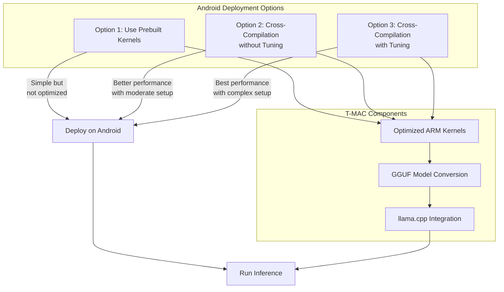
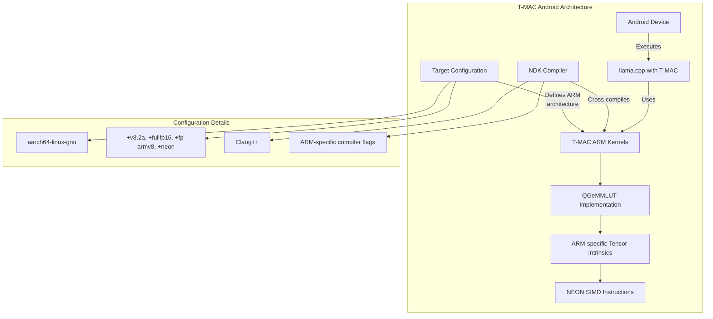
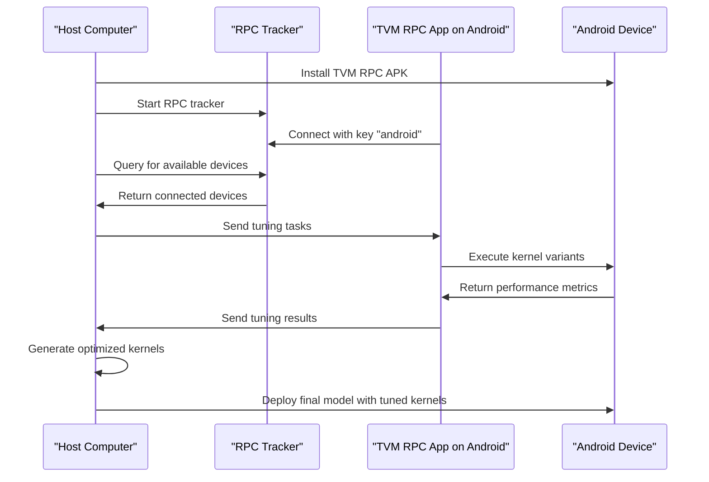
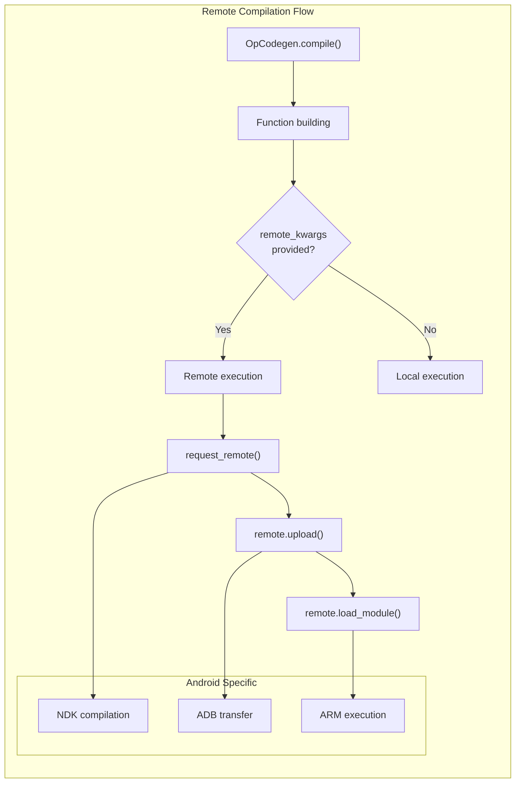

<!-- source: DeepWiki mcp.deepwiki.com · repo microsoft/T-MAC · page 5.1 Android Deployment · fetched 2026-10-26 -->

# Android Deployment

<details>
<summary>Relevant source files</summary>

The following files were used as context for generating this wiki page:

- [deploy/tvmrpc-release.apk](deploy/tvmrpc-release.apk)
- [docs/android.md](docs/android.md)
- [docs/e2e.md](docs/e2e.md)
- [python/t_mac/ops/base.py](python/t_mac/ops/base.py)
- [python/t_mac/platform.py](python/t_mac/platform.py)

</details>


This document provides detailed instructions for deploying T-MAC on Android devices. It covers prerequisites, deployment options, and step-by-step procedures for running optimized LLM inference on Android hardware. For general cross-platform support information, see [Cross-Platform Support](#5).

## Overview of Android Deployment

T-MAC supports efficient LLM inference on Android devices through optimized ARM-specific kernels. The deployment process involves cross-compiling kernels for the ARM architecture, converting models to the appropriate format, and running inference through the llama.cpp integration with T-MAC extensions.



Sources: [docs/android.md:1-101](), [python/t_mac/platform.py:94-111]()

## Prerequisites

Before deploying T-MAC on Android, ensure you have the following components installed and configured:

1. **Android SDK platform-tools** - For ADB communication with Android devices
2. **Android NDK** - For cross-compilation (verified with version 26.1)
3. **Python environment** - With T-MAC dependencies installed

Set up the required environment variables:

```bash
export PATH="$HOME/Library/Android/sdk/platform-tools:$PATH"
export NDK_HOME="$HOME/Library/Android/sdk/ndk/26.1.10909125"
```

Sources: [docs/android.md:3-14]()

## Android Deployment Architecture

T-MAC on Android leverages the ARM-specific architecture defined in the platform configuration:



Sources: [python/t_mac/platform.py:94-111](), [python/t_mac/ops/base.py:310-324]()

## Deployment Options

T-MAC offers three options for deploying on Android devices, with varying levels of complexity and performance optimization.

### Option 1: Using Prebuilt Kernels

This is the simplest approach, using kernels that have been pre-optimized for ARM devices.

```bash
python tools/run_pipeline.py -o [OUTPUT_DIR] -m [MODEL_NAME] -d android -ndk $NDK_HOME -u
```

Additional arguments:
- `-as, --adb_serial`: Specify a particular Android device if multiple are connected
- `-rd, --remote_dir`: Set custom remote directory (default: `/data/local/tmp`)

Sources: [docs/android.md:18-31]()

### Option 2: Cross-Compilation without Tuning

This approach provides better performance by cross-compiling kernels specifically for your Android device, but without performance tuning.

```bash
# Create standalone toolchain
cd $NDK_HOME/build/tools
python make_standalone_toolchain.py --arch arm64 --install-dir /opt/android-toolchain-arm64
export TVM_NDK_CC=/opt/android-toolchain-arm64/bin/clang++

# Run pipeline with tuning disabled
python tools/run_pipeline.py -o [OUTPUT_DIR] -m [MODEL_NAME] -d android -ndk $NDK_HOME -dt
```

Sources: [docs/android.md:33-42]()

### Option 3: Cross-Compilation with Tuning (Experimental)

This option provides the best performance by tuning kernels specifically for your Android device's characteristics using TVM's RPC mechanism.



Sources: [docs/android.md:44-100](), [python/t_mac/ops/base.py:84-127]()

#### Setup Steps for Tuning

1. Install the TVM RPC APK on your Android device:
   ```bash
   adb install deploy/tvmrpc-release.apk
   ```

2. Start the RPC tracker on your host computer:
   ```bash
   python -m tvm.exec.rpc_tracker
   ```

3. In the TVM RPC app on your Android device:
   - Set the IP address of your host computer
   - Set the port to 9190
   - Set the key to "android"
   - Toggle on "Enable RPC"

4. Verify the connection:
   ```bash
   python -m tvm.exec.query_rpc_tracker
   ```

5. Create standalone toolchain and build:
   ```bash
   cd $NDK_HOME/build/tools
   python make_standalone_toolchain.py --arch arm64 --install-dir /opt/android-toolchain-arm64
   export TVM_NDK_CC=/opt/android-toolchain-arm64/bin/clang++
   python tools/run_pipeline.py -o [OUTPUT_DIR] -m [MODEL_NAME] -d android -ndk $NDK_HOME
   ```

Sources: [docs/android.md:44-100](), [python/t_mac/ops/base.py:84-127]()

## Technical Implementation Details

The Android deployment in T-MAC leverages several key components in the codebase:

### Platform Configuration

T-MAC defines Android-specific settings in the platform configuration:

```python
# Android device configuration
"android": {
    "target": "llvm -device=arm_cpu -mtriple=aarch64-linux-gnu -mattr=+v8.2a,+fullfp16,+fp-armv8,+neon",
    "eval_kwargs": {
        "number": 10,
        "repeat": 10,
    },
    "remote_kwargs": {
        "key": "android",
        "host": os.environ.get("TVM_TRACKER_HOST", "0.0.0.0"),
        "port": int(os.environ.get("TVM_TRACKER_PORT", 9190)),
        "build_func": "ndk",
        "timeout": 600,
    },
    "cc": os.environ.get("TVM_NDK_CC", "clang++"),
    "cc_opts": ["-O3", "-march=armv8.2a+fp16", "-mllvm", "-inline-threshold=10000"],
    "out_dtype": "float16",
    "aggregation_dtype": "int32",
}
```

Sources: [python/t_mac/platform.py:94-111]()

### Remote Compilation and Evaluation

T-MAC's `OpCodegen` class contains functionality for remote compilation and evaluation, which is used during Android deployment:



Sources: [python/t_mac/ops/base.py:310-324](), [python/t_mac/ops/base.py:236-294]()

## Troubleshooting

### Common Issues

1. **No device listed in RPC tracker query**
   - Ensure your firewall isn't blocking incoming connections for Python
   - Try temporarily disabling the firewall

2. **Connection reset error in RPC Tracker**
   - Make sure the TVM RPC app is active and not in the background
   - Check that the Android device and host computer are on the same network

3. **Compilation failures with NDK**
   - Verify NDK version compatibility (version 26.1 recommended)
   - Ensure TVM_NDK_CC is correctly set to the Clang++ compiler path

Sources: [docs/android.md:102-111]()

## Performance Considerations

When deploying T-MAC on Android, consider these factors to optimize performance:

1. **Thread count**: Set appropriate number of threads based on the device's CPU cores
2. **Batch size**: Smaller batch sizes often work better on mobile devices
3. **Quantization**: Lower bit quantization (e.g., 2-bit or 4-bit) provides better performance
4. **Context length**: Limit context length based on device memory constraints

For benchmarking on Android, use:

```bash
./bin/llama-bench -m [MODEL_PATH] -t [THREADS] -c [CONTEXT_LENGTH]
```

Sources: [docs/e2e.md:52-56]()

---

