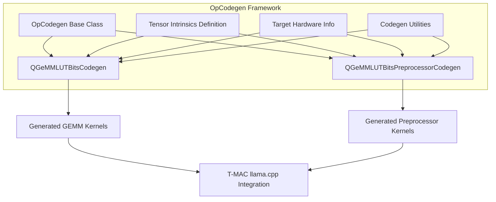
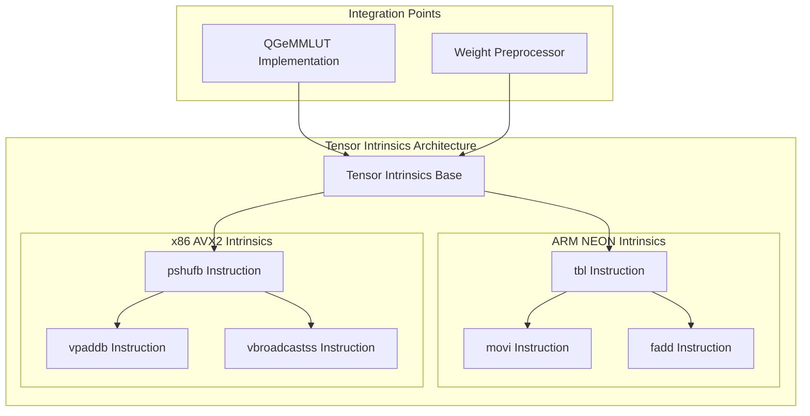

<!-- source: DeepWiki mcp.deepwiki.com · repo microsoft/T-MAC · page 6 Advanced Topics · fetched 2026-10-26 -->

# Advanced Topics

<details>
<summary>Relevant source files</summary>

The following files were used as context for generating this wiki page:

- [README.md](README.md)
- [python/t_mac/utils.py](python/t_mac/utils.py)

</details>


## Purpose and Scope

This document covers advanced technical topics for developers who are extending, modifying, or deeply understanding the T-MAC framework. It explores the underlying mechanisms of T-MAC's optimized matrix operations, code generation frameworks, and platform-specific optimizations. For basic usage and setup information, see [Installation and Setup](#3), and for general architecture overview, see [Architecture](#2).

## OpCodegen Framework

The OpCodegen framework serves as T-MAC's foundation for generating optimized code across different hardware platforms. It provides abstractions for creating highly optimized matrix multiplication kernels without manually writing platform-specific code.



OpCodegen uses TVM's abstractions to express tensor computations while providing additional specialized utilities for quantized operations. The two main codegen classes derive from the base OpCodegen:

1. **QGeMMLUTBitsCodegen**: Generates the core matrix multiplication kernels
2. **QGeMMLUTBitsPreprocessorCodegen**: Generates preprocessing kernels for weight transformation

The codegen process creates optimized C++ kernels tailored to the target platform's architecture, vectorization capabilities, and memory access patterns.

Sources: [README.md:377-387]()

## QGeMMLUT Implementation Details

QGeMMLUT (Quantized General Matrix Multiplication with Lookup Tables) is the core algorithm powering T-MAC's performance improvements. It eliminates the need for dequantization by directly operating on quantized weights using table lookup operations.

```mermaid
flowchart LR
    subgraph "QGeMMLUT Execution Flow"
        direction LR
        QWeights["Quantized Weights\n(1-4 bits)"]
        Activations["Activations\n(int8/fp16/fp32)"]
        Preprocessor["Weight Preprocessor"]
        LUTGen["LUT Generator"]
        TBLOp["Table Lookup Operations"]
        Accumulator["Partial Sum Accumulator"]
        Result["Matrix Multiplication Result"]
        
        QWeights --> Preprocessor
        Preprocessor --> |"Transformed Weights"| TBLOp
        Activations --> LUTGen
        LUTGen --> |"Generated LUTs"| TBLOp
        TBLOp --> |"Partial Results"| Accumulator
        Accumulator --> Result
    end
    
    subgraph "Key Optimizations"
        direction TB
        BitPacking["Bit Packing"]
        GroupedSums["Grouped Partial Sums"]
        TBLIntrinsic["TBL/PSHUF Intrinsics"]
        SignBitOpt["Sign Bit Optimization"]
        
        BitPacking -.-> GroupedSums
        GroupedSums -.-> TBLIntrinsic
        TBLIntrinsic -.-> SignBitOpt
    end
    
    Key Optimizations -.-> QGeMMLUT Execution Flow
```

### Key Technical Optimizations:

1. **Bit Packing**: Rather than dequantizing weights, T-MAC groups one-bit weights (e.g., into groups of 4) to create compact representations.

2. **Precomputed Partial Sums**: For each possible combination of grouped weights, partial sums are precomputed and stored in lookup tables.

3. **Table Size Reduction**: T-MAC reduces table size from 2^n to 2^(n-1) by incorporating a sign bit to accelerate LUT precomputation.

4. **Shift and Accumulate**: To support scalable bits from 1 to 4, T-MAC employs shift and accumulate operations that scale linearly with bit width.

The implementation shows linear scaling of computational cost with the number of bits, unlike traditional dequantization approaches that plateau in performance below 4 bits.

Sources: [README.md:377-387]()

## Tensor Intrinsics

T-MAC leverages specialized tensor intrinsics for hardware-accelerated lookup operations across different platforms. These intrinsics are crucial for achieving optimal performance of the LUT-based approach.



### Key Tensor Intrinsics:

1. **ARM NEON `tbl` Instruction**: This intrinsic performs table lookups using byte indices, allowing for efficient implementation of the LUT-based matrix multiplication on ARM platforms.

2. **x86 AVX2 `pshufb` Instruction**: On x86 platforms, T-MAC uses the `pshufb` instruction to achieve similar table lookup functionality, albeit with different optimization strategies.

These intrinsics are abstracted in the codebase to allow the same logical operations to be performed efficiently across different hardware architectures. The T-MAC code generation process automatically selects the appropriate intrinsics based on the target platform.

Sources: [README.md:381-382]()

## Cross-Platform Optimization Strategies

T-MAC implements several strategies to ensure optimal performance across diverse hardware platforms, from high-performance servers to resource-constrained edge devices.

```mermaid
flowchart TD
    subgraph "Platform Detection and Optimization"
        PlatformDetect["Platform Detection\nLogic"]
        
        subgraph "ARM Platforms"
            AppleSilicon["Apple Silicon"]
            ARM64Linux["ARM64 Linux"]
            AndroidARM["Android ARM"]
            RaspberryPi["Raspberry Pi"]
        end
        
        subgraph "x86 Platforms"
            AVX2["x86 with AVX2"]
            AVX512["x86 with AVX512"]
        end
        
        PlatformDetect --> ARM Platforms
        PlatformDetect --> x86 Platforms
        
        subgraph "Optimization Techniques"
            KernelTuning["Kernel Tuning"]
            VectorizationOpt["Vectorization\nOptimization"]
            MemoryAccess["Memory Access\nPatterns"]
            ThreadingModel["Threading Model"]
        end
        
        ARM Platforms --> Optimization Techniques
        x86 Platforms --> Optimization Techniques
        
        Optimization Techniques --> KernelParams["Optimized Kernel\nParameters"]
    end
    
    KernelParams --> CompiledKernels["Platform-specific\nOptimized Kernels"]
```

### Platform-Specific Optimizations:

1. **Kernel Tuning**: T-MAC uses platform-specific parameters to tune kernels for optimal performance on each target device. This includes blocking factors, vectorization width, and memory access patterns.

2. **Cross-Compilation Support**: The framework supports various compilation methods, including:
   - Using prebuilt kernels for common platforms
   - Cross-compilation for deployment on different architectures
   - RPC-based tuning for maximum performance

3. **Energy Efficiency**: On edge devices, T-MAC optimizes not just for speed but also for energy efficiency, making trade-offs where appropriate to maximize battery life.

These platform-specific optimizations are particularly important for edge deployment scenarios, where hardware constraints can vary dramatically between devices.

Sources: [README.md:95-138]()

## Advanced Kernel Customization

Developers can customize T-MAC kernels for specific models or hardware configurations to achieve optimal performance. The kernel customization process involves modifying configuration parameters and potentially extending the codegen infrastructure.

```mermaid
graph TD
    subgraph "Kernel Customization Flow"
        ModelAnalysis["Model Analysis"]
        HardwareProfile["Hardware Profiling"]
        
        ConfigParams["Configuration Parameters"]
        
        CustomCodegen["Custom Codegen\nImplementation"]
        
        TuningProcess["Kernel Tuning Process"]
        
        Deployment["Deployment and\nBenchmarking"]
        
        ModelAnalysis --> ConfigParams
        HardwareProfile --> ConfigParams
        
        ConfigParams --> TuningProcess
        CustomCodegen --> TuningProcess
        
        TuningProcess --> Deployment
        Deployment --> |"Feedback"| TuningProcess
    end
    
    subgraph "Key Configuration Parameters"
        GrpSize["Group Size (gs)"]
        AlphaGrpSize["Alpha Group Size (ags)"]
        TileDims["Tile Dimensions"]
        VectorWidth["Vector Width"]
        OtherParams["Other Parameters"]
    end
    
    ConfigParams --> Key Configuration Parameters
```

### Key Customization Parameters:

1. **Group Size (`gs`)**: Controls how weights are grouped for the lookup table. Larger group sizes can reduce computation but increase memory usage.

2. **Alpha Group Size (`ags`)**: Determines how activation values are grouped in the lookup process.

3. **Tile Dimensions**: Affects the blocking strategy for matrix operations, which impacts cache utilization.

4. **Vector Width**: Specifies the SIMD vector width to use for the target platform.

Developers can use the `compile.py` script with various arguments to control these parameters and generate optimized kernels for specific use cases.

To implement custom codegen for new hardware or specialized operations, developers may need to extend the `OpCodegen` base class and implement target-specific logic.

Sources: [README.md:339-368]()

## Performance Analysis and Debugging

T-MAC provides tools and methodologies for analyzing kernel performance, identifying bottlenecks, and debugging implementation issues.

### Performance Analysis Methods:

1. **Benchmarking Framework**: T-MAC includes a comprehensive benchmarking suite that can measure various performance metrics:
   - Token generation throughput (tokens/sec)
   - Power consumption (W)
   - Energy efficiency (J/token)

2. **Profiling Tools Integration**: The framework can integrate with platform-specific profiling tools:
   - `powermetrics` for Apple platforms
   - `jetson-stats` for NVIDIA Jetson platforms

3. **Comparative Analysis**: T-MAC enables direct comparison against alternative implementations (e.g., llama.cpp) and hardware accelerators (e.g., NPUs, GPUs).

### Debugging Techniques:

1. **Kernel Validation**: Tools to verify correctness of generated kernels against reference implementations.

2. **Numerical Precision Analysis**: Methods to assess numerical accuracy, including normalized mean squared error (NMSE) comparison.

3. **Step-by-Step Execution**: The framework allows isolating specific pipeline stages for debugging.

```mermaid
graph TD
    subgraph "Performance Analysis Workflow"
        ModelConfig["Model Configuration"]
        HardwareSelection["Hardware Selection"]
        KernelConfig["Kernel Configuration"]
        
        BenchmarkExecution["Benchmark Execution"]
        
        MetricsCollection["Metrics Collection"]
        
        Analysis["Analysis and\nOptimization"]
        
        ModelConfig --> BenchmarkExecution
        HardwareSelection --> BenchmarkExecution
        KernelConfig --> BenchmarkExecution
        
        BenchmarkExecution --> MetricsCollection
        MetricsCollection --> Analysis
        Analysis --> |"Feedback"| KernelConfig
    end
    
    subgraph "Key Metrics"
        TokensPerSec["Tokens/sec"]
        LatencyMetrics["Latency"]
        PowerMetrics["Power (W)"]
        EnergyMetrics["Energy (J/token)"]
        MemoryUsage["Memory Usage"]
    end
    
    MetricsCollection --> Key Metrics
```

For numerical validation, T-MAC provides utilities such as the normalized mean squared error function in [python/t_mac/utils.py:11-13](), which helps assess the impact of quantization and optimization on model accuracy.

Sources: [python/t_mac/utils.py:11-13](), [README.md:95-138]()

## Future Extensions

T-MAC's architecture is designed to be extensible, allowing developers to add support for new hardware platforms, quantization schemes, and model architectures.

### Potential Extension Areas:

1. **New Hardware Targets**: Adding support for emerging CPU architectures or specialized accelerators.

2. **Additional Quantization Schemes**: Extending beyond the current 1-4 bit support to accommodate other quantization approaches.

3. **Model Architecture Support**: Adapting the framework for specialized model architectures beyond the current transformer-based models.

4. **Integration with Other Frameworks**: Extending T-MAC's integration beyond llama.cpp to other inference frameworks.

Developers interested in contributing to these areas should refer to the project's contribution guidelines and the detailed implementation documentation in the subpages for specific components.

Sources: [README.md:369-372]()

---

