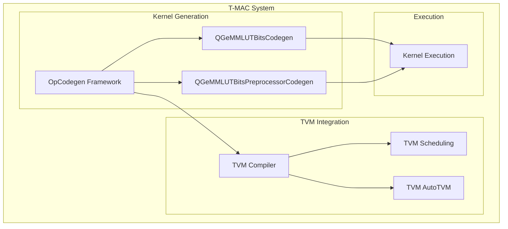
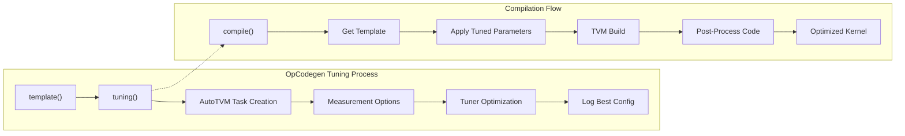
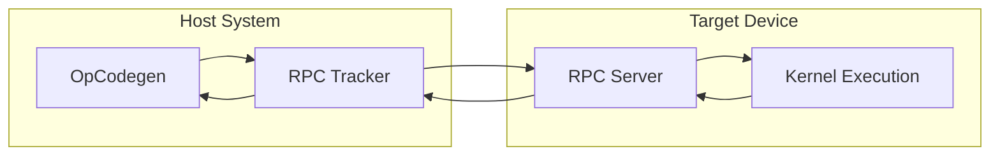

<!-- source: DeepWiki mcp.deepwiki.com · repo microsoft/T-MAC · page 6.1 OpCodegen Framework · fetched 2026-10-26 -->

# OpCodegen Framework

<details>
<summary>Relevant source files</summary>

The following files were used as context for generating this wiki page:

- [.gitmodules](.gitmodules)
- [deploy/tvmrpc-release.apk](deploy/tvmrpc-release.apk)
- [docs/android.md](docs/android.md)
- [docs/codegen.md](docs/codegen.md)
- [python/t_mac/ops/base.py](python/t_mac/ops/base.py)
- [requirements-codegen.txt](requirements-codegen.txt)

</details>


## Purpose and Scope

The OpCodegen Framework is a core component of T-MAC that facilitates generating optimized code for tensor operations across various hardware targets. This framework abstracts the process of defining, scheduling, tuning, and compiling tensor operations, providing a unified interface for generating high-performance implementations of matrix operations crucial for efficient model inference.

This page focuses on the architecture and usage of the OpCodegen base class. For specific implementations using this framework, see [QGeMMLUT Implementation](#6.2) and [Tensor Intrinsics](#6.3).

Sources: [python/t_mac/ops/base.py:19-51]()

## Architecture Overview

The OpCodegen framework serves as an abstraction layer on top of the TVM compiler infrastructure, providing specialized functionality for generating optimized code for T-MAC's quantized matrix operations.

### OpCodegen in T-MAC System



Sources: [python/t_mac/ops/base.py:19-358](), [.gitmodules:1-8]()

### Core Components and Workflow

```mermaid
classDiagram
    class "OpCodegen" {
        +__init__(dtype, target, name, tune, ...)
        +compile(*args, n_trial, thread_affinity, ...)
        +evaluate(*args, thread_affinity, ...)
        +tuning(*args, n_trial, thread_affinity, ...)
        -_schedule(tensors)
        -_compute(*args)
        -_reference(*args)
        -_define_config(cfg, *args)
        -_postprocess_tvm_c_code(c_code, template_name)
        -_verify(tvm_arrays, arrays)
    }
    
    class "Derived Implementations" {
        +QGeMMLUTBitsCodegen
        +QGeMMLUTBitsPreprocessorCodegen
    }
    
    class "TVM Components" {
        +te.Tensor
        +autotvm
        +tvm.target.Target
        +tvm.build
    }
    
    "OpCodegen" <|-- "Derived Implementations"
    "OpCodegen" --> "TVM Components" : uses
```

Sources: [python/t_mac/ops/base.py:19-51](), [python/t_mac/ops/base.py:52-65]()

## Key Functionality

The OpCodegen framework provides several key functions for generating optimized tensor operation code:

### 1. Abstract Interface

OpCodegen is designed as an abstract base class that provides a template for implementing specialized code generators. Derived classes must implement:

- `_compute`: Define the computation to be performed
- `_schedule`: Define how the computation should be scheduled
- `_reference`: Provide a reference implementation for verification

Sources: [python/t_mac/ops/base.py:53-60]()

### 2. AutoTVM Integration

OpCodegen seamlessly integrates with TVM's AutoTVM framework for automatic performance tuning:



Sources: [python/t_mac/ops/base.py:66-75](), [python/t_mac/ops/base.py:84-127]()

### 3. Code Generation and Transformation

OpCodegen can generate highly optimized C code or compiled libraries for different hardware targets:

- C code generation with extensive post-processing for optimal performance
- Support for dynamic library generation
- Cross-compilation for different architectures

The framework includes sophisticated code transformation capabilities in the `_postprocess_tvm_c_code` method, which modifies TVM-generated C code to make it:

1. More portable
2. Free from TVM-specific dependencies
3. Optimized for stack memory usage
4. Properly aligned for SIMD operations

Sources: [python/t_mac/ops/base.py:129-234](), [python/t_mac/ops/base.py:236-291]()

## Cross-Platform Support

The OpCodegen framework is designed to support multiple hardware targets, with particular attention to cross-platform compatibility.

### Supported Platforms

| Platform | Target Description | Configuration |
|----------|-------------------|---------------|
| x86 with AVX2 | Intel CPUs supporting AVX2 | Use `-d intel_win` |
| Apple Silicon | M1/M2/M3 Mac devices | Use `-d m2` |
| ARM-based devices | Including Android devices | Use `-d android` |
| NVIDIA Jetson | NVIDIA's Jetson platform | Use `-d jetson` |

Sources: [docs/codegen.md:70-92](), [docs/android.md:1-110]()

### Remote Execution and Tuning

OpCodegen supports remote execution and tuning through TVM's RPC mechanism:



This enables:
- Cross-compilation for remote targets
- Performance tuning on actual target hardware
- Remote benchmarking and verification

Sources: [python/t_mac/ops/base.py:299-358](), [docs/android.md:44-100](), [docs/codegen.md:54-67]()

## Usage Examples

### Basic Usage Pattern

When implementing a specialized code generator using the OpCodegen framework, you need to:

1. Subclass `OpCodegen`
2. Implement the required abstract methods
3. Use the provided compilation and tuning infrastructure

```
# Example workflow (pseudocode)
op = CustomOpCodegen(dtype="float16", target="llvm -mcpu=core-avx2", name="my_custom_op")
func, arrays = op.compile(M, N, K, n_trial=1000)
latency = op.evaluate(M, N, K)
```

### Compilation Options

OpCodegen provides several compilation options:

| Option | Description | Default |
|--------|-------------|---------|
| `tune` | Whether to tune the implementation | `False` |
| `reuse_tuned` | Whether to reuse previously tuned parameters | `False` |
| `verify` | Whether to verify the implementation against reference | `True` |
| `num_threads` | Number of threads to use | `4` |
| `return_type` | Type of compilation result ("mod", "lower", "c") | `"mod"` |

Sources: [python/t_mac/ops/base.py:21-51](), [python/t_mac/ops/base.py:236-294]()

### Integration with Build Systems

The framework can output various formats to integrate with existing build systems:

1. Compiled object files
2. Assembly code
3. LLVM IR
4. C source code

These outputs can be found in the save directory specified during initialization.

Sources: [python/t_mac/ops/base.py:270-291]()

## Advanced Features

### Code Optimization

The OpCodegen framework performs several advanced code optimizations:

1. **Memory Management Transformation**: Converts dynamic memory allocation to stack allocation
2. **Alignment Optimization**: Adds alignment specifiers for better SIMD performance
3. **Dependency Removal**: Eliminates dependencies on TVM runtime
4. **Function Signature Transformation**: Simplifies function signatures for better interoperability

Sources: [python/t_mac/ops/base.py:129-234]()

### Thread Management

OpCodegen provides sophisticated thread management capabilities:

- Thread affinity control
- Thread pool configuration
- Multi-threaded evaluation

This is especially important for achieving optimal performance on multi-core systems.

Sources: [python/t_mac/ops/base.py:339-340](), [python/t_mac/ops/base.py:33-34]()

## Requirements and Dependencies

To use the OpCodegen framework, several dependencies are required:

- TVM (Apache TVM submodule)
- NumPy
- Various Python packages for tuning and code generation

For a complete list of dependencies, see the `requirements-codegen.txt` file.

Sources: [requirements-codegen.txt:1-10](), [.gitmodules:1-3]()

## Summary

The OpCodegen framework serves as a powerful abstraction layer for generating highly optimized tensor operation code in T-MAC. By leveraging TVM's compiler infrastructure and adding specialized functionality for code generation, tuning, and cross-platform support, it enables the creation of efficient implementations of quantized matrix operations crucial for model inference.

---

