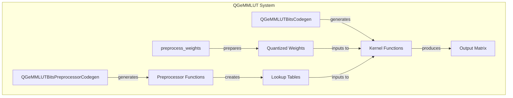
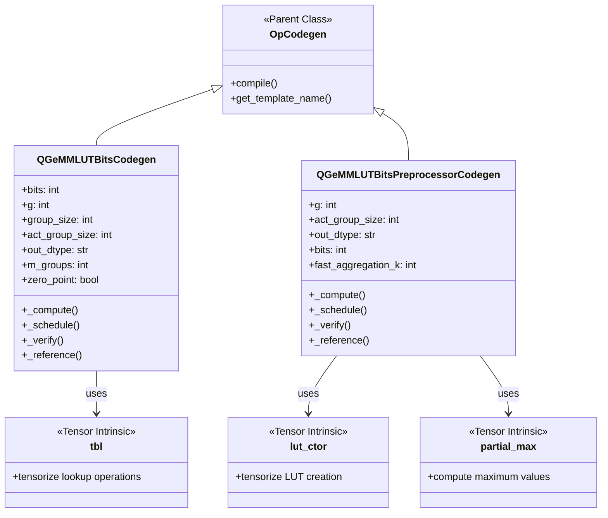
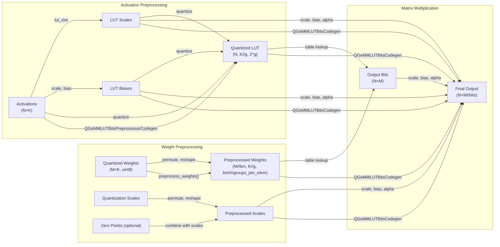
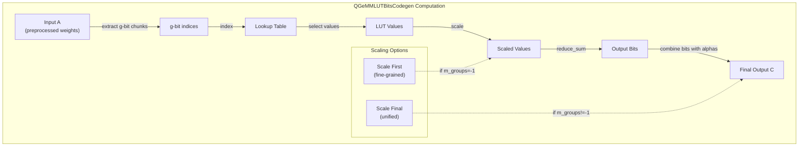
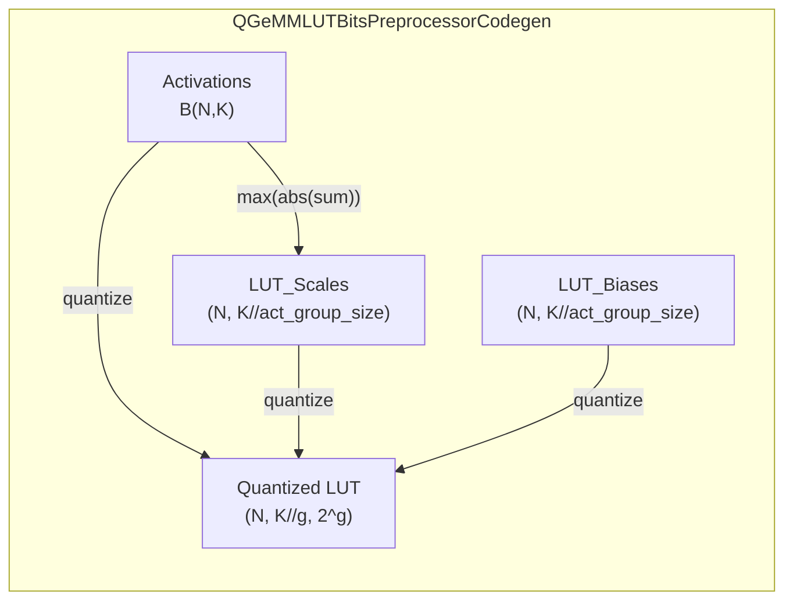
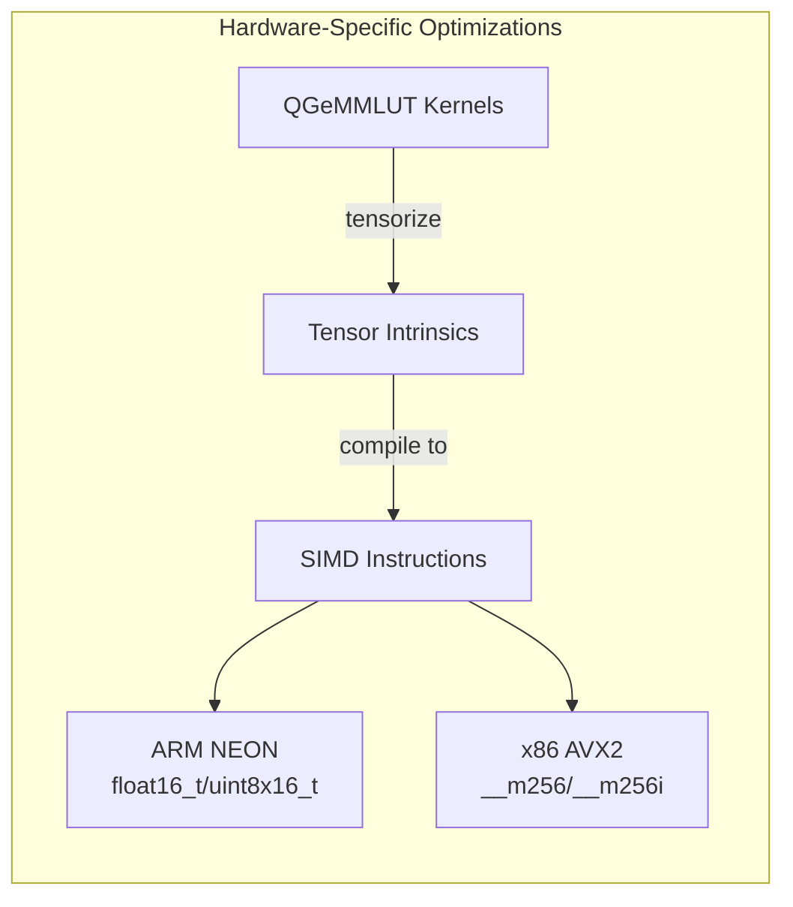
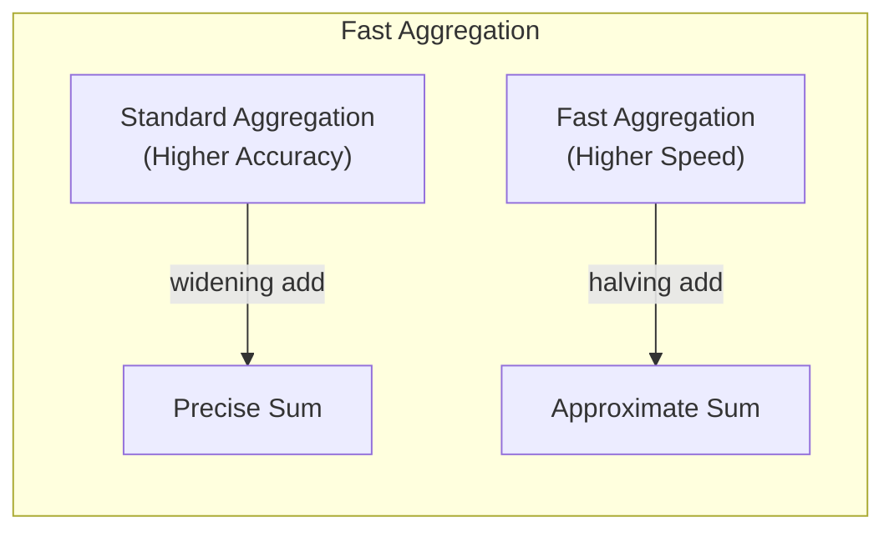

<!-- source: DeepWiki mcp.deepwiki.com · repo microsoft/T-MAC · page 6.2 QGeMMLUT Implementation · fetched 2026-10-26 -->

# QGeMMLUT Implementation

<details>
<summary>Relevant source files</summary>

The following files were used as context for generating this wiki page:

- [deploy/tuned/kcfg.ini](deploy/tuned/kcfg.ini)
- [deploy/tuned/kernels.cc](deploy/tuned/kernels.cc)
- [deploy/tuned/kernels.h](deploy/tuned/kernels.h)
- [python/t_mac/intrins/__init__.py](python/t_mac/intrins/__init__.py)
- [python/t_mac/ops/qgemm.py](python/t_mac/ops/qgemm.py)
- [python/t_mac/weights.py](python/t_mac/weights.py)
- [tests/test_e2e.py](tests/test_e2e.py)

</details>


This document provides a detailed technical explanation of the QGeMMLUT (Quantized General Matrix-Matrix Multiplication with Look-Up Table) implementation in T-MAC. QGeMMLUT is a core computational component that enables efficient inference of low-bit quantized neural networks.

For information on the overall matrix operations architecture, see [Matrix Operations](#2.1). For details on the tensor intrinsics used by QGeMMLUT, see [Tensor Intrinsics](#6.3).

## Overview

QGeMMLUT is a specialized matrix multiplication algorithm designed for ultra-low precision (1-4 bit) quantized weights. It replaces traditional matrix multiplication with table lookups and bit manipulations to dramatically accelerate computation while maintaining acceptable accuracy.



Sources: [python/t_mac/ops/qgemm.py:16-351](), [python/t_mac/ops/qgemm.py:353-519](), [python/t_mac/weights.py:5-88]()

## Architecture

The QGeMMLUT implementation consists of two primary components:

1. **QGeMMLUTBitsCodegen**: Generates optimized kernels for the main matrix multiplication operation
2. **QGeMMLUTBitsPreprocessorCodegen**: Generates preprocessor functions that create lookup tables

These components work together with weight preprocessing utilities to deliver an efficient end-to-end matrix multiplication pipeline.



Sources: [python/t_mac/ops/qgemm.py:16-87](), [python/t_mac/ops/qgemm.py:353-396](), [python/t_mac/intrins/__init__.py:1-3]()

## Key Parameters and Terminology

QGeMMLUT uses several key parameters to control its behavior:

| Parameter | Description |
|-----------|-------------|
| `bits` | Number of bits for each weight element (1-4) |
| `g` | Group size of LUT (typically 4) |
| `group_size` | Group size of weights (quantization granularity) |
| `act_group_size` | Group size of activations |
| `m_groups` | Number of groups for M dimension (-1 for GPTQ-like fine-grained scales, 1/2/3 for BitNet-like unified scales) |
| `zero_point` | Whether to use zero point with scales |
| `fast_aggregation` | Toggle for faster aggregation with some accuracy loss |

Sources: [python/t_mac/ops/qgemm.py:18-67](), [python/t_mac/ops/qgemm.py:359-395]()

## Data Flow

The QGeMMLUT data flow consists of three main stages: weight preprocessing, activation preprocessing, and matrix multiplication.



Sources: [python/t_mac/ops/qgemm.py:118-206](), [python/t_mac/ops/qgemm.py:400-429](), [python/t_mac/weights.py:5-88]()

## Implementation Details

### QGeMMLUTBitsCodegen

The main matrix multiplication component works by:

1. Taking preprocessed weights, preprocessed LUTs, and scales as input
2. Extracting bits from weight elements using mask and shift operations
3. Using these bits to index into the lookup tables
4. Aggregating the LUT values and applying appropriate scaling
5. Combining results with alpha values to produce the final output

The core computation is defined in the `_compute` method:



Sources: [python/t_mac/ops/qgemm.py:118-206]()

Key optimization techniques include:

1. **Tensorization**: The `tbl` intrinsic is used to tensorize operations, leveraging SIMD instructions
2. **Tiling**: The matrix is divided into tiles for better cache utilization
3. **Parallelism**: The computation is parallelized across multiple threads when available

Sources: [python/t_mac/ops/qgemm.py:213-275]()

### QGeMMLUTBitsPreprocessorCodegen

The preprocessor generates lookup tables for the activations:

1. Computes maximum absolute values to determine appropriate scaling factors
2. Constructs lookup tables based on activation values
3. Scales and quantizes the lookup tables to the target data type



Sources: [python/t_mac/ops/qgemm.py:400-429](), [python/t_mac/ops/qgemm.py:433-468]()

### Weight Preprocessing

The `preprocess_weights` function prepares weights and scales for efficient computation:

1. Extracts bits from weight elements
2. Reshapes and transposes arrays for optimal memory access patterns
3. Combines with scales and zero points as needed

Sources: [python/t_mac/weights.py:5-88]()

## Hardware Optimization Details

QGeMMLUT is heavily optimized for SIMD instructions on different architectures:



The implementation includes specialized functions for different hardware:

1. **ARM NEON** implementation using `uint8x16_t`, `float16x8_t`, and other NEON types
2. **x86 AVX2** implementation using `__m256`, `__m256i`, and other AVX2 intrinsics

Sources: [deploy/tuned/kernels.cc:4-808]()

The selection of the appropriate kernel is controlled by the `kcfg.ini` configuration file, which contains optimal parameters for different matrix sizes and quantization settings.

Sources: [deploy/tuned/kcfg.ini:1-31](), [deploy/tuned/kernels.h:1-38]()

## Performance Optimizations

Several optimizations are implemented to maximize performance:

### Fast Aggregation

QGeMMLUT can use a fast aggregation approach that trades a small amount of accuracy for better performance:



The halving adder implementations use SIMD instructions like `vrhaddq_s8` (ARM) or `_mm256_avg_epu8` (x86) to compute approximate sums with fewer operations.

Sources: [deploy/tuned/kernels.cc:87-286]()

### Lookup Table Optimization

The lookup table construction is optimized for both accuracy and speed:

1. Bias correction for fast aggregation
2. Efficient packing of LUT values
3. SIMD-optimized table construction

Sources: [deploy/tuned/kernels.cc:567-755]()

### Memory Layout

The weight preprocessing step optimizes memory layout for:

1. Maximizing cache locality
2. Aligning data for SIMD operations
3. Minimizing address calculation overhead during computation

Sources: [python/t_mac/weights.py:50-74]()

## Usage Example

Below is a simplified example of how to use QGeMMLUT:

```python
# Initialize codegen classes
preprocessor = QGeMMLUTBitsPreprocessorCodegen(
    name="preprocessor", 
    bits=4, 
    out_dtype="float16"
)
qgemm = QGeMMLUTBitsCodegen(
    name="qgemm_lut", 
    bits=4,
    group_size=128, 
    act_group_size=64
)

# Compile the functions
pf, _ = preprocessor.compile(N, K)
qf, _ = qgemm.compile(M, N, K)

# Preprocess weights
A_t, Scales_t = preprocess_weights(
    Aref, Sref, Zref, 
    bits=4, g=4, bm=qgemm.bm, kfactor=qgemm.kfactor
)

# Preprocess activations
pf(B_t, LUT_Scales, LUT_Biases, QLUT)

# Perform matrix multiplication
qf(A_t, QLUT, Scales_t, LUT_Scales, LUT_Biases, C_t)
```

Sources: [tests/test_e2e.py:46-96]()

## Configuration and Tuning

QGeMMLUT performance depends on tuned parameters stored in `kcfg.ini`. These parameters include:

- Block sizes for matrix tiling (`bm`)
- SIMD lane counts (`simd_n_in`, `simd_n_out`)
- Kernel tiling factor (`kfactor`)
- Group sizes for quantization (`group_size`)

Each parameter set is optimized for specific matrix dimensions and quantization settings.

Sources: [deploy/tuned/kcfg.ini:1-31]()

## Conclusion

QGeMMLUT provides a highly optimized implementation of matrix multiplication for low-bit quantized neural networks. By leveraging lookup tables, bit manipulation, and SIMD instructions, it achieves significant speedups compared to conventional approaches while maintaining acceptable accuracy.

The implementation is flexible, supporting different quantization schemes (GPTQ-like and BitNet-like), bit widths, and hardware architectures, making it suitable for a wide range of low-precision inference workloads.

---

