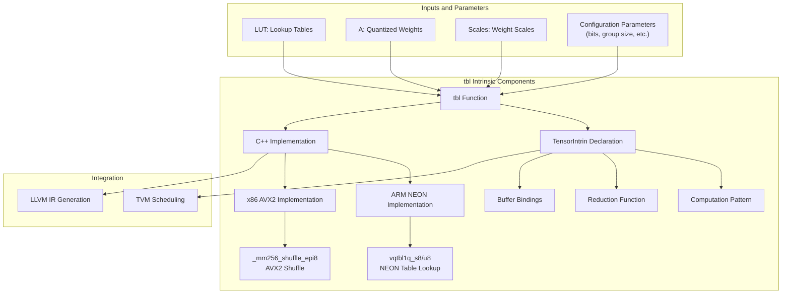
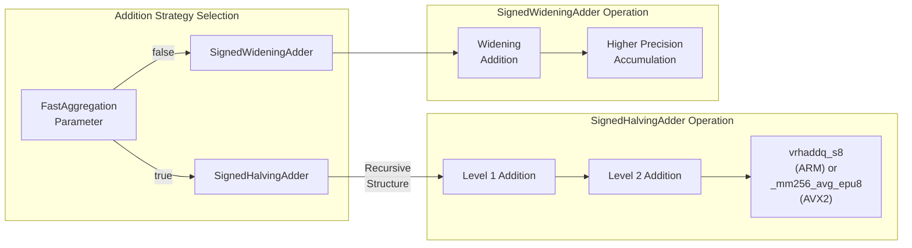
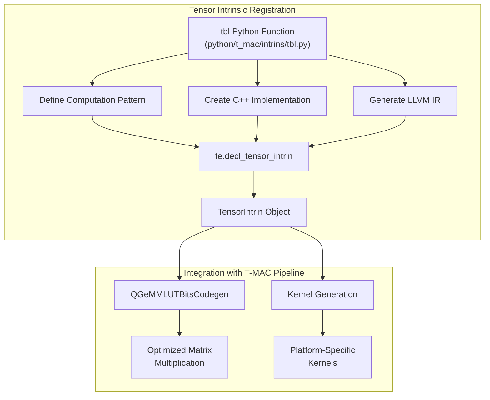
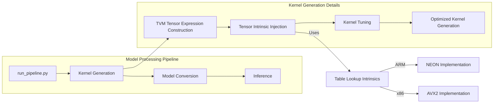

<!-- source: DeepWiki mcp.deepwiki.com · repo microsoft/T-MAC · page 6.3 Tensor Intrinsics · fetched 2026-10-26 -->

# Tensor Intrinsics

Relevant source files

The following files were used as context for generating this wiki page:

- [MANIFEST.in](MANIFEST.in)
- [python/t_mac/intrins/tbl.cc](python/t_mac/intrins/tbl.cc)
- [python/t_mac/intrins/tbl.py](python/t_mac/intrins/tbl.py)
- [python/t_mac/intrins/utils.py](python/t_mac/intrins/utils.py)
- [tools/all_in_one.sh](tools/all_in_one.sh)

This page documents the tensor intrinsics system in T-MAC, which provides hardware-accelerated primitive operations for efficient quantized matrix multiplication. Tensor intrinsics are a critical component that enables T-MAC to achieve high performance through optimized low-level SIMD operations across different hardware platforms.

For information about the overall quantized matrix multiplication implementation, see [QGeMMLUT Implementation](#6.2). For details on the code generation framework used to generate these intrinsics, see [OpCodegen Framework](#6.1).

## Overview of Tensor Intrinsics

Tensor intrinsics in T-MAC provide hardware-optimized implementations of elementary tensor operations. The primary focus is on the efficient implementation of table lookup operations (`tbl`), which are fundamental to T-MAC's quantized matrix multiplication with lookup tables (QGeMMLUT) approach.

These intrinsics bridge the gap between high-level tensor operations described in the TVM computation graph and low-level hardware-specific SIMD instructions, enabling efficient execution on diverse hardware platforms.

Sources: [python/t_mac/intrins/tbl.py:10-30](), [python/t_mac/intrins/tbl.cc:1-18]()

## Table Lookup (tbl) Intrinsics

The core tensor intrinsic in T-MAC is the table lookup operation, implemented through the `tbl` function. This intrinsic maps quantized weight values to pre-computed values in lookup tables, enabling efficient matrix multiplication with quantized weights.

### Architecture of Table Lookup Operations

The table lookup operation processes quantized weights by:
1. Extracting quantized values from the weight matrix using bit manipulation
2. Using these values as indices into lookup tables
3. Aggregating the looked-up values with appropriate scaling
4. Accumulating results in the output matrix

This operation is heavily optimized using SIMD instructions specific to each target architecture, with different implementations for ARM NEON and x86 AVX2.

Sources: [python/t_mac/intrins/tbl.py:10-185](), [python/t_mac/intrins/tbl.cc:19-105]()

## Implementation Details

### Core Function Types

T-MAC implements several variants of table lookup functions to handle different data types and scenarios:

| Function | Input Type | Output Type | Description |
|----------|------------|-------------|-------------|
| `tbl_g4_float_float_update_impl` | float16/float32 | float16/float32 | Updates floating-point outputs using float lookup tables |
| `tbl_g4_int8_float_update_impl` | int8 | float16/float32 | Converts int8 lookup values to float outputs |
| `tbl_g4_int8_int32_update_impl` | int8 | int32 | Updates int32 outputs using int8 lookup tables |
| `tbl_g4_int8_int16_update_impl` | int8 | int16 | Updates int16 outputs using int8 lookup tables |

Each function is highly templated to support different quantization parameters, scaling behaviors, and optimization strategies.

Sources: [python/t_mac/intrins/tbl.cc:22-83](), [python/t_mac/intrins/tbl.cc:323-532](), [python/t_mac/intrins/tbl.cc:536-630](), [python/t_mac/intrins/tbl.cc:632-670]()

### Efficient Value Aggregation

T-MAC employs specialized adder implementations to efficiently aggregate values from lookup tables:

These specialized adders handle vector addition with different strategies:

1. **SignedHalvingAdder**: Uses halving add operations (averaging) for fast but approximate accumulation
2. **SignedWideningAdder**: Widens the intermediate results to avoid overflow during accumulation

The choice between these strategies is controlled by the `FastAggregation` template parameter.

Sources: [python/t_mac/intrins/tbl.cc:86-194](), [python/t_mac/intrins/tbl.cc:195-280](), [python/t_mac/intrins/tbl.cc:284-285]()

## Hardware-Specific Optimizations

### ARM NEON Implementation

On ARM platforms, T-MAC uses specialized NEON SIMD instructions:

- `vqtbl1q_s8`/`vqtbl1q_u8`: Table lookup operations for int8/uint8 data
- `vrhaddq_s8`: Halving addition for efficient vector addition
- `vmovl_s8`/`vmovl_high_s8`: Vector widening operations

The ARM implementation is optimized for mobile and embedded devices, particularly targeting modern ARM processors found in smartphones, tablets, and edge devices.

Sources: [python/t_mac/intrins/tbl.cc:24-79](), [python/t_mac/intrins/tbl.cc:347-352]()

### x86 AVX2 Implementation

For x86 platforms, T-MAC leverages AVX2 vector instructions:

- `_mm256_shuffle_epi8`: Performs the table lookup operation
- `_mm256_avg_epu8`: Computes the average of unsigned 8-bit integers
- `_mm256_cvtepi8_epi16`/`_mm256_cvtepi16_epi32`: Vector widening conversions

The x86 implementation enables high performance on desktop CPUs, servers, and laptops with Intel or AMD processors supporting AVX2.

Sources: [python/t_mac/intrins/tbl.cc:196-199](), [python/t_mac/intrins/tbl.cc:460-462]()

## Integration with TVM

T-MAC's tensor intrinsics are integrated with the TVM compiler framework through TensorIntrin declarations.

The integration process involves:

1. Defining the computation pattern using TVM's Tensor Expression (TE) language
2. Implementing the tensor operation in C++ with hardware-specific optimizations
3. Registering the operation as a TensorIntrin object
4. Using the registered intrinsic during kernel generation and scheduling

This approach allows the T-MAC system to leverage TVM's powerful optimization capabilities while still accessing low-level hardware-specific operations.

Sources: [python/t_mac/intrins/tbl.py:125-184](), [python/t_mac/intrins/utils.py:15-30]()

## Configuration Parameters

The tensor intrinsics system is highly configurable, with parameters controlling various aspects of the operation:

| Parameter | Description |
|-----------|-------------|
| `g` | Number of bits per group (typically 4) |
| `kfactor` | Number of loops to be unrolled |
| `bits` | Quantization bit-width |
| `act_group_size` | Size of activation groups |
| `fast_aggregation` | Whether to use fast approximate aggregation |
| `zero_point` | Whether to use zero-point correction |
| `has_scale` | Whether to apply scaling |
| `has_lut_scale` | Whether to apply LUT-specific scaling |

These parameters allow fine-tuning the tensor intrinsics for specific models and hardware targets, balancing performance and accuracy requirements.

Sources: [python/t_mac/intrins/tbl.py:10-28](), [python/t_mac/intrins/tbl.py:107-123]()

## Usage in the T-MAC Pipeline

Tensor intrinsics are used by the T-MAC pipeline during the kernel generation phase. The `run_pipeline.py` script orchestrates this process, compiling optimized kernels with the appropriate intrinsics for the target hardware.

During kernel generation, T-MAC:

1. Constructs tensor expressions representing the computation
2. Injects appropriate tensor intrinsics based on the target hardware
3. Tunes the kernel parameters for optimal performance
4. Generates optimized code using the selected intrinsics

This results in highly optimized kernels that leverage hardware-specific acceleration for quantized matrix operations.

Sources: [tools/all_in_one.sh:82-94]()

## Conclusion

Tensor intrinsics form the backbone of T-MAC's performance optimizations, providing efficient, hardware-accelerated implementations of critical operations for quantized neural network inference. By leveraging architecture-specific SIMD instructions and specialized algorithms, these intrinsics enable T-MAC to achieve significant speedups compared to generic implementations.

The flexible design allows T-MAC to target diverse hardware platforms while maintaining high performance, making it suitable for deploying efficient LLM inference across a wide range of devices.

---

