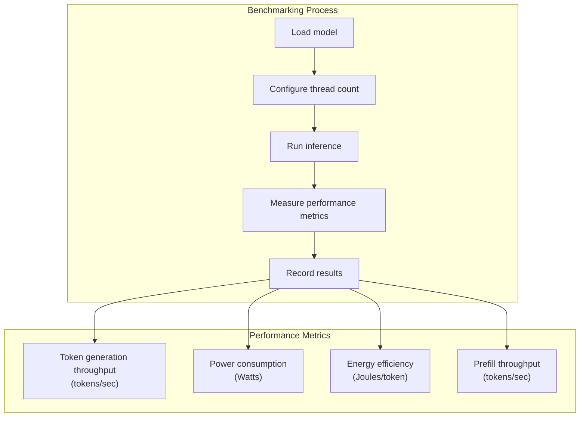
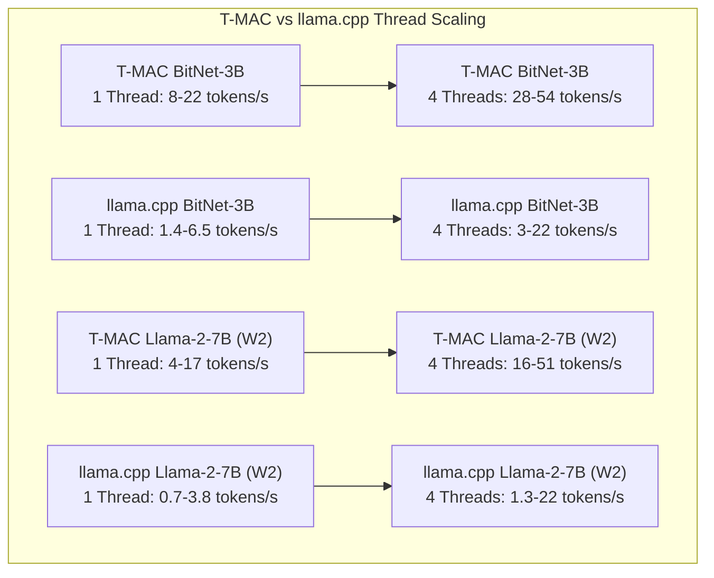
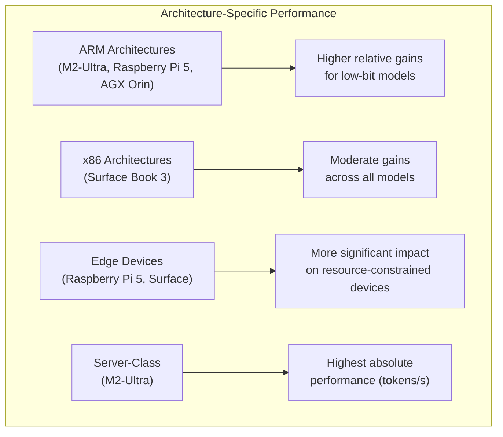
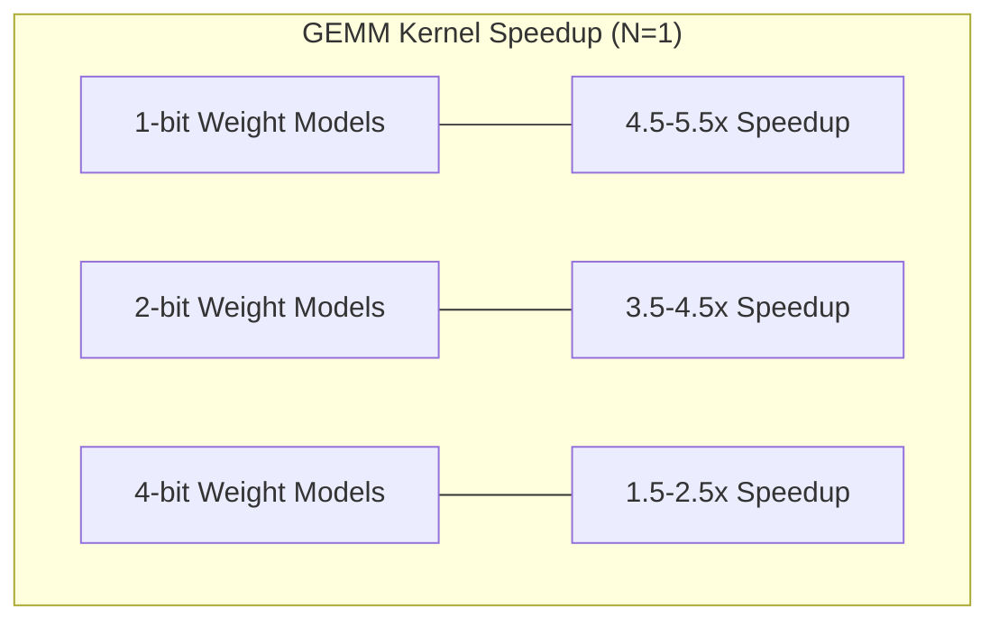
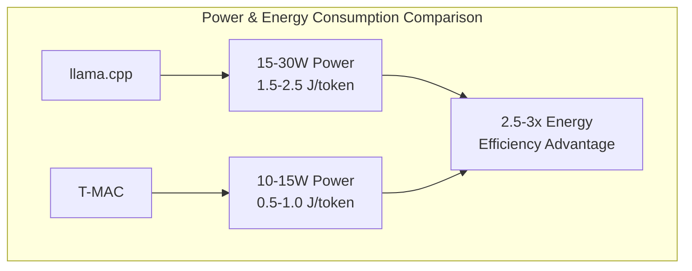
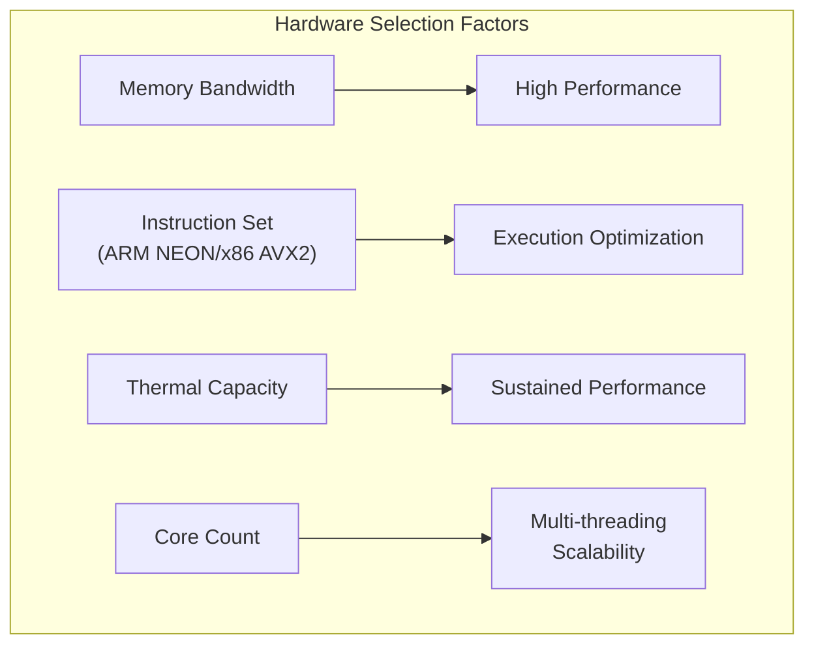

<!-- source: DeepWiki mcp.deepwiki.com · repo microsoft/T-MAC · page 7 Performance Analysis · fetched 2026-10-26 -->

# Performance Analysis

Relevant source files

The following files were used as context for generating this wiki page:

- [README.md](README.md)
- [assets/e2e_threads.png](assets/e2e_threads.png)
- [assets/e2e_threads.zip](assets/e2e_threads.zip)
- [docs/profiling_data.md](docs/profiling_data.md)

This page provides a comprehensive analysis of T-MAC's performance across various hardware platforms, model sizes, and quantization levels. It examines both end-to-end inference and kernel-level benchmarks, comparing T-MAC against baseline approaches, particularly llama.cpp.

## Testing Methodology

T-MAC's performance was evaluated using standardized benchmarking approaches across multiple dimensions:

- **Hardware platforms**: Apple M2-Ultra, NVIDIA Jetson AGX Orin, Raspberry Pi 5, Surface Book 3, Surface Laptop 7
- **Models**: BitNet-3B, Llama-2-7B (W2/2-bit), Llama-2-7B (W4/4-bit)
- **Thread configurations**: Various thread counts (1, 2, 4, 8, 12) depending on hardware
- **Metrics**: Token generation speed (tokens/sec), power consumption (W), energy efficiency (J/token)

Tests were conducted using the T-MAC integration with llama.cpp and compared against llama.cpp's native implementation (with and without OpenBLAS for prefill benchmarks).

Sources: [README.md:65-76](), [docs/profiling_data.md:1-33]()

## End-to-End Performance Analysis

T-MAC demonstrates significant performance improvements over llama.cpp across all tested platforms and models. The improvements are particularly pronounced for lower-bit models like BitNet-3B and Llama-2-7B (W2).

### Single-Thread Performance

The following table shows single-thread token generation speed across different hardware platforms:

| Model              | Device         | llama.cpp (tokens/sec) | T-MAC (tokens/sec) | Speedup |
|--------------------|--------------:|------------------------:|-------------------:|--------:|
| BitNet-3B          | M2-Ultra      | 6.49                   | 22.08              | 3.40x   |
| Llama-2-7B (W2)    | M2-Ultra      | 3.82                   | 16.68              | 4.37x   |
| Llama-2-7B (W4)    | M2-Ultra      | 5.65                   | 8.97               | 1.59x   |
| BitNet-3B          | AGX Orin      | 1.62                   | 8.18               | 5.05x   |
| Llama-2-7B (W2)    | AGX Orin      | 0.79                   | 4.36               | 5.52x   |
| Llama-2-7B (W4)    | AGX Orin      | 1.04                   | 2.46               | 2.37x   |
| BitNet-3B          | Raspberry Pi 5| 1.37                   | 8.03               | 5.86x   |
| Llama-2-7B (W2)    | Raspberry Pi 5| 0.66                   | 4.40               | 6.67x   |
| Llama-2-7B (W4)    | Raspberry Pi 5| 0.85                   | 2.42               | 2.85x   |

Key observations:
1. T-MAC consistently outperforms llama.cpp in single-thread scenarios
2. Speedups are more pronounced for lower bit-precision models (BitNet-3B and Llama-2-7B W2)
3. Performance gains are particularly significant on resource-constrained devices like Raspberry Pi 5

Sources: [README.md:77-92](), [docs/profiling_data.md:6-32]()

### Scaling with Thread Count

T-MAC demonstrates superior scaling with increased thread count compared to llama.cpp, as illustrated in the diagram below:

A key finding is that T-MAC can match or exceed the performance of llama.cpp while using significantly fewer CPU cores. For example:
- To achieve 40 tokens/second on M2-Ultra, T-MAC requires only 2 cores while llama.cpp needs 8 cores
- To reach 10 tokens/second on AGX Orin, T-MAC needs 2 cores while llama.cpp must use all 12 cores

This efficiency in core utilization has important implications for power consumption and the ability to run other applications concurrently.

Sources: [README.md:42-64]()

### Performance on Different CPU Architectures

Performance varies across CPU architectures, with some notable patterns:

T-MAC shows the highest relative performance gains on ARM architectures and edge devices, where the efficient lookup table approach has the most impact. The absolute performance is highest on server-class hardware like the M2-Ultra, which combines high-performance ARM cores with ample memory bandwidth.

Sources: [README.md:31-37](), [docs/profiling_data.md:6-32]()

## Kernel-Level Performance Analysis

Beyond end-to-end benchmarks, T-MAC demonstrates significant performance improvements at the kernel level, particularly for GEMM operations during token generation (N=1) and multi-batch processing (N>1).

### Token Generation GEMM Performance (N=1)

For token generation, T-MAC's kernel-level operations show substantial speedups over llama.cpp:

Key observations:
1. T-MAC shows a linear relationship between bit reduction and performance gains
2. The LUT-based approach eliminates the dequantization overhead that bottlenecks llama.cpp
3. The performance advantage is consistent across all tested hardware platforms

Sources: [README.md:77-92]()

### Multi-Batch GEMM Performance (N>1)

For prefill operations and multi-batch token generation, T-MAC also outperforms llama.cpp and even llama.cpp with OpenBLAS:

| Model           | NUM_THREADS | Batch Size | T-MAC (tokens/sec) | llama.cpp (OpenBLAS) | llama.cpp |
|-----------------|-------------|------------|:-------------------|:---------------------|:----------|
| llama-2-7b (W2) | 4           | 256        | 50.1               | 21.5                 | 12.0      |
| llama-2-7b (W2) | 8           | 256        | 94.4               | 37.7                 | 21.3      |

Sources: [README.md:65-76]()

T-MAC's performance advantage for multi-batch operations stems from the reduced computational cost of the LUT-based approach. This ensures superior performance on prompt evaluation and multi-batch token generation.

One exception is the M2-Ultra, which has a specialized AMX coprocessor that accelerates multi-batch GEMM operations. Even in this case, T-MAC achieves comparable performance at 2-bit precision.

## Power and Energy Efficiency

T-MAC not only improves performance but also significantly reduces power consumption and energy usage compared to other approaches.

### Power Consumption Comparison

By replacing heavy fused-multiply-add instructions with table lookup instructions, T-MAC reduces power consumption substantially:

Measurements on NVIDIA Jetson AGX Orin demonstrate this efficiency:

| Framework       | Throughput (tokens/sec) | Power (W) | Energy (J/token) |
|-----------------|:------------------------|:----------|:-----------------|
| llama.cpp (CPU) | 7.08                    | 15.0      | 2.12             |
| llama.cpp (GPU) | 20.03                   | 30.8      | 1.54             |
| T-MAC (CPU)     | 15.62                   | 10.4      | 0.66             |

This data shows that T-MAC not only achieves 2.2x faster inference than CPU-based llama.cpp, but also uses 3.2x less energy per token. When compared to GPU-accelerated llama.cpp, T-MAC still provides 2.3x better energy efficiency while delivering 78% of the throughput.

Sources: [README.md:93-138]()

## Cross-Platform Comparisons

### CPU vs NPU Performance

An interesting finding is that on the latest Snapdragon X Elite chipset, T-MAC running on CPU can outperform the NPU using Qualcomm's NPE:

| Framework       | Model           | NUM_THREADS | Throughput (tokens/sec) |
|-----------------|-----------------|-------------|:------------------------|
| T-MAC (CPU)     | llama-2-7b (W4) | 2           | 12.6                    |
| T-MAC (CPU)     | llama-2-7b (W4) | 4           | 18.7                    |
| T-MAC (CPU)     | llama-2-7b (W2) | 1           | 9.3                     |
| T-MAC (CPU)     | llama-2-7b (W2) | 4           | 28.4                    |
| NPE (NPU)       | llama-2-7b (W4) | -           | 10.4                    |

This comparison highlights T-MAC's efficiency, especially with low-bit models where the 2-bit model with a single CPU core nearly matches the 4-bit model on the NPU.

Sources: [README.md:104-122]()

### CPU vs GPU Performance

On platforms with both CPU and GPU, such as the NVIDIA Jetson AGX Orin, T-MAC on CPU can deliver competitive performance with significantly lower power consumption:

| Framework       | Throughput (tokens/sec) | Power (W) | Energy (J/token) |
|-----------------|:------------------------|:----------|:-----------------|
| llama.cpp (CPU) | 7.08                    | 15.0      | 2.12             |
| llama.cpp (GPU) | 20.03                   | 30.8      | 1.54             |
| T-MAC (CPU)     | 15.62                   | 10.4      | 0.66             |

While the GPU still provides higher absolute throughput, T-MAC on CPU offers a much better balance of performance and energy efficiency, making it particularly suitable for edge devices with power constraints.

Sources: [README.md:123-138]()

## Performance Considerations and Best Practices

### Hardware Selection

Performance varies significantly across hardware platforms. Some key considerations:

1. **ARM vs x86**: T-MAC shows larger relative gains on ARM platforms due to efficient ARM NEON instructions for table lookups
2. **Memory Bandwidth**: Higher memory bandwidth generally translates to better performance, especially for larger models
3. **Thermal Constraints**: As shown in the analysis of Surface Laptop 7, thermal limits can affect sustained performance, particularly with multi-threading

Sources: [README.md:53-61]()

### Model Selection and Quantization

1. **Bit Precision**: T-MAC shows linear scaling with reduced bit precision, unlike dequantization-based approaches
2. **Model Size**: Smaller models (like BitNet-3B) generally provide better tokens/sec than larger models (Llama-2-7B)
3. **Quantization Method**: T-MAC supports models quantized via GPTQ/gguf (W4A16), BitDistiller/EfficientQAT (W2A16), and BitNet (W1.58A8)

Sources: [README.md:31-37]()

### Performance Optimization

1. **Thread Count Optimization**: Find the optimal thread count for your hardware—more threads aren't always better due to thermal constraints
2. **Fast Aggregation**: Toggle on fast-aggregation (`-fa`) for an additional 10-20% speedup
3. **Power Mode Selection**: On laptops and mobile devices, performance mode settings significantly impact throughput

Sources: [README.md:52-61]()

## Conclusion

T-MAC delivers substantial performance improvements over existing solutions like llama.cpp across various hardware platforms, model sizes, and quantization levels. The gains are particularly significant for low-bit models (1-bit and 2-bit) and on resource-constrained devices.

The performance advantages come from T-MAC's innovative approach of using lookup tables instead of dequantization, which not only improves throughput but also reduces power consumption and improves energy efficiency.

For edge devices and scenarios where power efficiency is crucial, T-MAC represents a significant advancement in deploying LLMs on CPUs. The ability to achieve comparable or better performance than specialized hardware (NPUs and GPUs) in some scenarios further highlights the effectiveness of the approach.

Sources: [README.md:31-138]()