# Page: Overview

# Overview

<details>
<summary>Relevant source files</summary>

The following files were used as context for generating this wiki page:

- [README.md](README.md)

</details>


T-MAC is a kernel library designed to accelerate low-bit Large Language Model (LLM) inference on CPUs. It provides direct support for mixed-precision matrix multiplication (int1/2/3/4 x int8/fp16/fp32) without requiring dequantization by utilizing lookup tables. This page introduces the T-MAC project, its core concepts, and high-level architecture.

For detailed information about the underlying architecture, see [Architecture](#2). For setup instructions, refer to [Installation and Setup](#3).

## Purpose and Scope

T-MAC aims to significantly improve the performance of low-bit quantized LLMs on CPU platforms ranging from edge devices to high-performance servers. It currently supports various low-bit models including:

- 1-bit models like BitNet (W1.58A8)
- 2-bit models from frameworks like EfficientQAT/BitDistiller (W2A16)
- 4-bit models from GPTQ/GGUF quantization (W4A16)

The system works across OSX, Linux, and Windows operating systems on both ARM and x86 platforms. T-MAC is specifically designed to address the performance bottlenecks in traditional dequantization-based matrix multiplication approaches.

Sources: [README.md:31-37]()

## System Overview

T-MAC consists of three primary subsystems that work together to provide accelerated LLM inference:

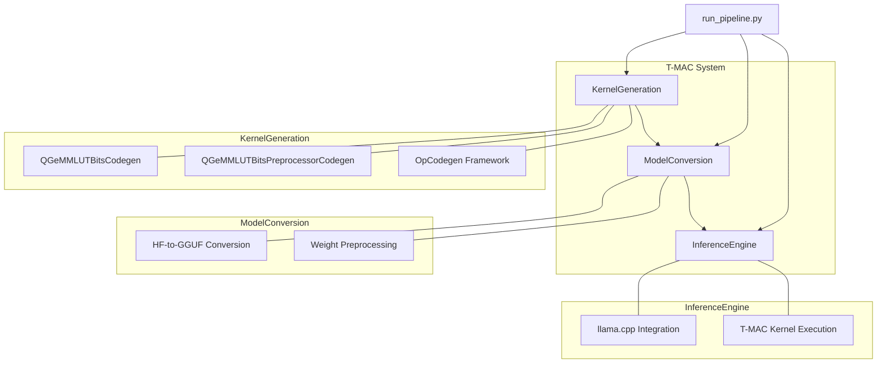

1. **Kernel Generation**: Produces optimized matrix multiplication kernels specialized for different bit-widths and hardware targets
2. **Model Conversion**: Transforms models from Hugging Face format to GGUF with T-MAC-specific optimizations
3. **Inference Engine**: Integrates with llama.cpp to efficiently execute models using the optimized kernels

These components are orchestrated by the `run_pipeline.py` script, which provides an end-to-end workflow from model preparation to inference.

Sources: [README.md:322-339]()

## Key Technical Concepts

At the core of T-MAC is its novel approach to quantized matrix operations using lookup tables:

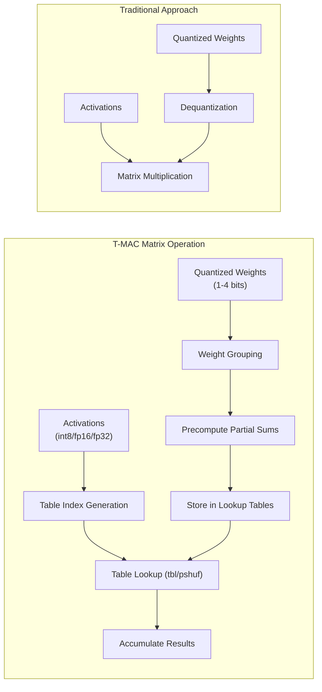

T-MAC's approach eliminates the need for dequantization by:

1. **Grouping**: One-bit weights are grouped (e.g., into groups of 4)
2. **Precomputation**: All possible partial sums are precomputed
3. **Lookup Tables**: These sums are stored in memory for fast access
4. **Fast Lookup**: Using CPU instructions like `tbl` (ARM) or `pshufb` (x86) for efficient retrieval
5. **Accumulation**: Results are accumulated using simple addition operations

This method delivers better performance than conventional approaches, especially as bit-width decreases, providing a linear scaling ratio of computational cost relative to the number of bits.

Sources: [README.md:373-388]()

## Performance Characteristics

T-MAC demonstrates significant performance improvements over traditional methods:

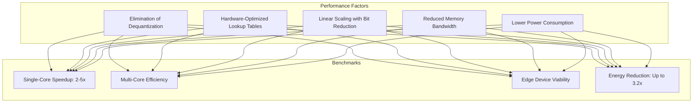

Key performance highlights include:

| Model | Device | T-MAC (tokens/sec) | llama.cpp (tokens/sec) | Speedup |
|-------|--------|-------------------:|------------------------|---------|
| BitNet-3B | Surface Laptop 7 (1 core) | 20 | ~5 | 4x |
| BitNet-3B | Surface Laptop 7 (4 cores) | 48 | ~12 | 4x |
| Llama-2-7B (W2) | M2-Ultra | 95+ | 30-35 | 3x |
| BitNet-3B | Raspberry Pi 5 | 11 | 3-4 | 3x |

T-MAC can achieve the same performance as traditional methods using significantly fewer CPU cores, which translates to reduced power consumption and improved energy efficiency.

Sources: [README.md:38-48](), [README.md:96-102]()

## End-to-End Workflow

The typical workflow for using T-MAC involves several steps, from model compilation to inference:

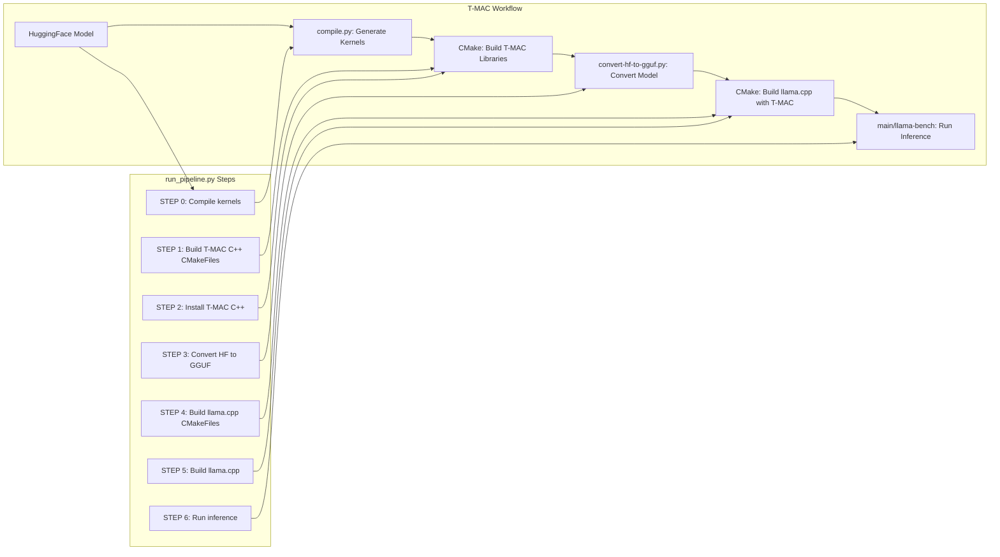

The entire process is automated by the `run_pipeline.py` script, which orchestrates the compilation, building, conversion, and inference steps. This script provides options for selecting specific steps, using prebuilt kernels, or automatically detecting model configurations.

Sources: [README.md:340-367]()

## Supported Platforms

T-MAC offers cross-platform support for a wide range of devices:

| Platform | Architecture | Support Details |
|----------|--------------|-----------------|
| macOS | Apple Silicon (M1/M2/M3) | Native ARM support with excellent performance |
| Linux | ARM64, x86_64 | Full support for server and edge deployments |
| Windows | x86_64, ARM64 | Native support including Surface devices |
| Android | ARM64 | Cross-compilation support |
| Embedded | Raspberry Pi, Jetson | Optimized for edge AI applications |

The system includes platform detection to automatically select the appropriate optimizations for the target hardware.

Sources: [README.md:140-307]()

## Comparison with Alternative Approaches

T-MAC's lookup table-based approach offers several advantages over traditional dequantization-based methods and dedicated hardware accelerators:

| Solution | Approach | Performance Scaling | Power Efficiency | Model Support |
|----------|----------|---------------------|------------------|---------------|
| T-MAC | Lookup Tables | Linear with bit reduction | High | 1-4 bit models |
| llama.cpp | Dequantization | Limited scaling at lower bits | Moderate | 2-8 bit models |
| NPUs | Dedicated Hardware | High for supported ops | Moderate | Limited quantization |
| GPUs | Parallel Computation | High for large batches | Low | Variable |

T-MAC can match or exceed the performance of NPUs on platforms like Snapdragon X Elite while consuming less power. It also provides better performance scaling as bit-width decreases compared to dequantization-based methods.

Sources: [README.md:104-138]()

## Integration with External Frameworks

T-MAC integrates with several external frameworks to provide a complete solution:

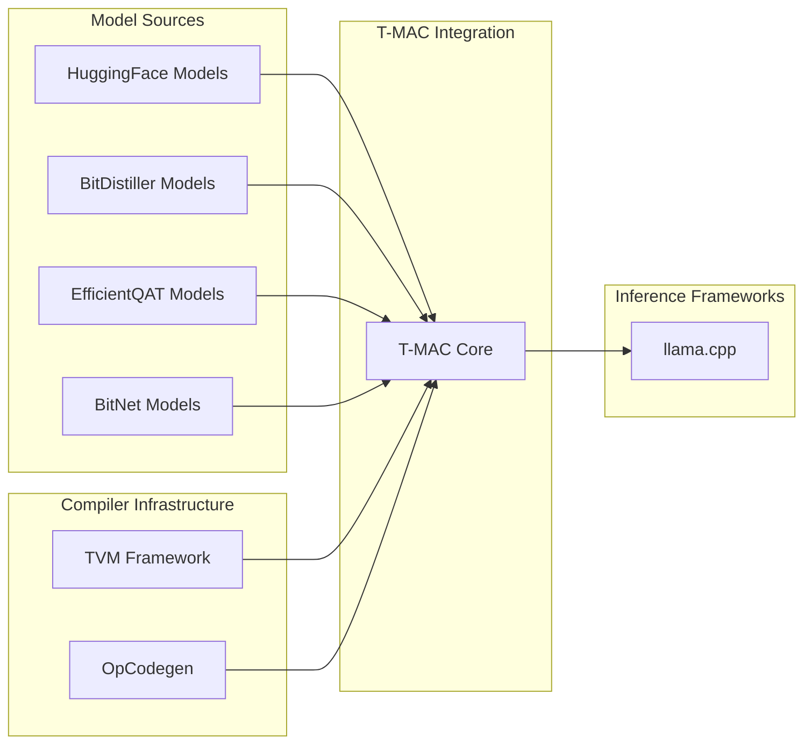

Key integrations include:

1. **Model Sources**: Support for models from HuggingFace, BitDistiller, EfficientQAT, and BitNet
2. **Inference Framework**: Deep integration with llama.cpp for efficient execution
3. **Compiler Infrastructure**: Built on TVM and OpCodegen for hardware-optimized code generation

These integrations allow T-MAC to support a wide range of models and deployment scenarios while leveraging existing tools and frameworks.

Sources: [README.md:31-37](), [README.md:322-339]()

---

# Page: Architecture

# Architecture

<details>
<summary>Relevant source files</summary>

The following files were used as context for generating this wiki page:

- [README.md](README.md)
- [deploy/compile.py](deploy/compile.py)
- [python/t_mac/ops/qgemm.py](python/t_mac/ops/qgemm.py)

</details>


This document describes the high-level architecture of T-MAC, a kernel library that enables direct mixed-precision matrix multiplication using lookup tables. It covers the core components, their interactions, and the underlying technical approach that enables efficient inference of low-bit Large Language Models on CPU devices.

For installation instructions, see [Installation and Setup](#3). For detailed usage guidance, see [Usage Guide](#4).

## System Overview

T-MAC is designed to accelerate low-bit LLM inference on CPUs by replacing traditional dequantization-based matrix multiplication with a lookup table-based approach. This fundamental shift in computation strategy enables significant performance improvements, especially for 1-2 bit models.

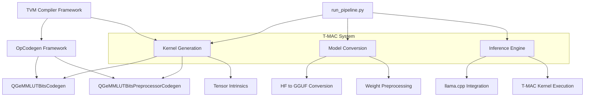

Sources: [README.md:1-401](), [deploy/compile.py:1-245]()

## Core Components

T-MAC consists of three main components that work together to enable efficient low-bit inference:

### Kernel Generation

The kernel generation component is responsible for creating optimized code for quantized matrix operations:

1. **QGeMMLUTBitsCodegen**: Generates optimized kernels for quantized general matrix multiplication using lookup tables.
2. **QGeMMLUTBitsPreprocessorCodegen**: Generates code for preprocessing operations, such as creating lookup tables for activations.
3. **Tensor Intrinsics**: Low-level operations optimized for specific hardware, particularly focused on table lookup instructions like `tbl` for ARM and SIMD operations.

These components leverage the TVM compiler framework to generate hardware-specific code that maximizes performance.

Sources: [python/t_mac/ops/qgemm.py:1-520](), [deploy/compile.py:1-245]()

### Model Conversion

The model conversion component handles transforming models from their original format to a T-MAC-optimized representation:

1. **HF to GGUF Conversion**: Converts models from Hugging Face format to GGUF format with T-MAC-specific optimizations.
2. **Weight Preprocessing**: Organizes weights to enable efficient lookup table operations.

Sources: [README.md:312-365]()

### Inference Engine

The inference engine executes the optimized models:

1. **llama.cpp Integration**: T-MAC integrates with the llama.cpp framework to leverage its ecosystem.
2. **T-MAC Kernel Execution**: The core execution of T-MAC's optimized kernels during inference.

Sources: [README.md:312-365]()

## Technical Approach

T-MAC's primary innovation is its lookup table-based approach to mixed-precision matrix multiplication:

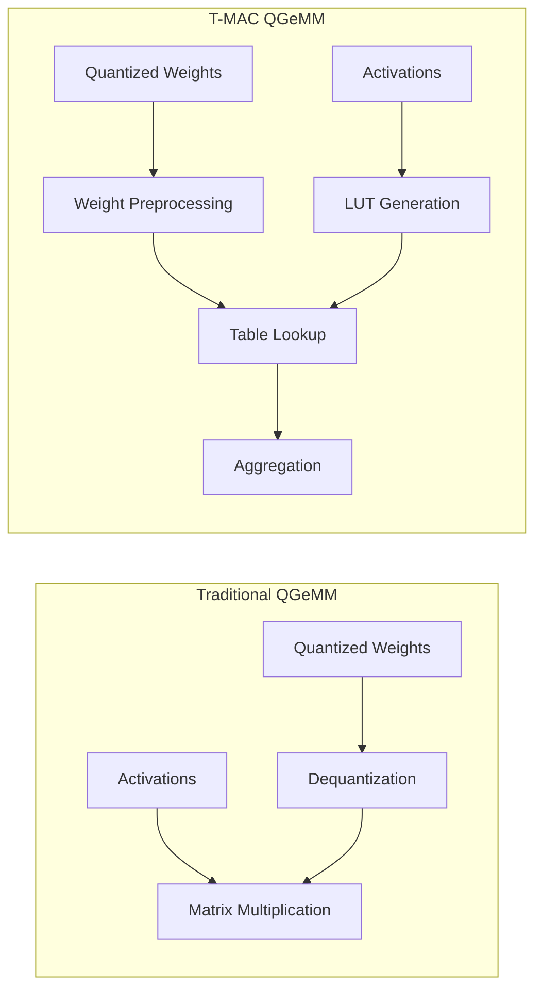

Sources: [README.md:375-388](), [python/t_mac/ops/qgemm.py:16-348]()

### Lookup Table Mechanism

The lookup table approach works as follows:

1. **Weight Preprocessing**: Quantized weights are organized into groups (typically 4 bits), and all possible partial sums are precomputed and stored in lookup tables.
2. **Activation Processing**: Activations are used to generate lookup tables that represent the matrix multiplication operation.
3. **Table Lookup**: Instead of performing multiply-accumulate operations, T-MAC performs table lookups using optimized instructions (`tbl` on ARM, `pshuf` on x86).
4. **Aggregation**: Results from lookup operations are accumulated to produce the final output.

This approach shows linear scaling of performance with the reduction in bit precision, unlike traditional methods that often see diminishing returns below 4 bits.

Sources: [README.md:375-388](), [python/t_mac/ops/qgemm.py:16-348]()

## Data Flow

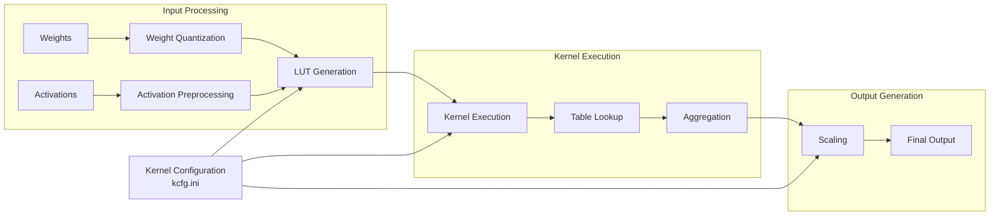

Sources: [deploy/compile.py:152-204](), [python/t_mac/ops/qgemm.py:155-206]()

## Implementation Details

The core implementation involves several key components:

### QGeMMLUTBitsCodegen

This class generates kernels for quantized matrix multiplication using lookup tables:

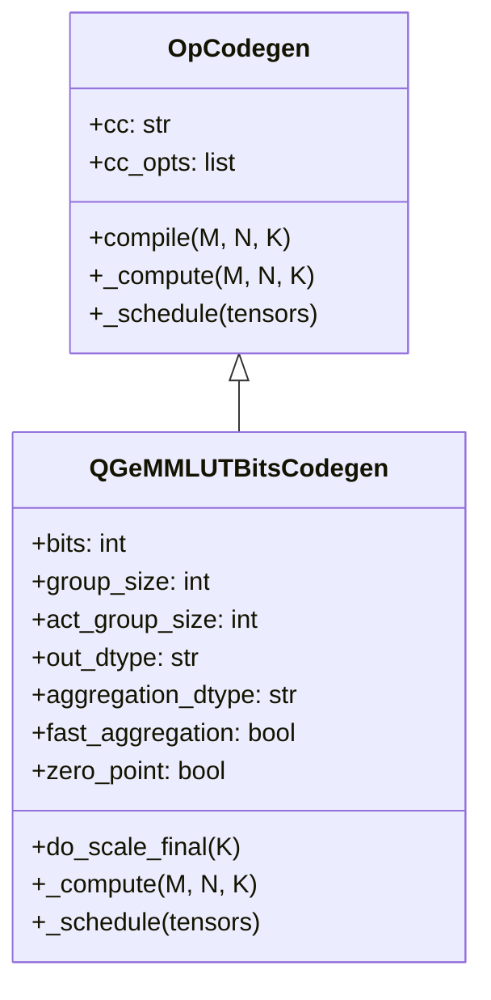

Key attributes of `QGeMMLUTBitsCodegen`:
- `bits`: Number of bits for each weight group (1, 2, 3, or 4)
- `group_size`: Group size for weight quantization (typically 128)
- `act_group_size`: Group size for activation quantization
- `m_groups`: Number of weight scale groups

Sources: [python/t_mac/ops/qgemm.py:16-351]()

### QGeMMLUTBitsPreprocessorCodegen

This class generates code for preprocessing activations and creating lookup tables:

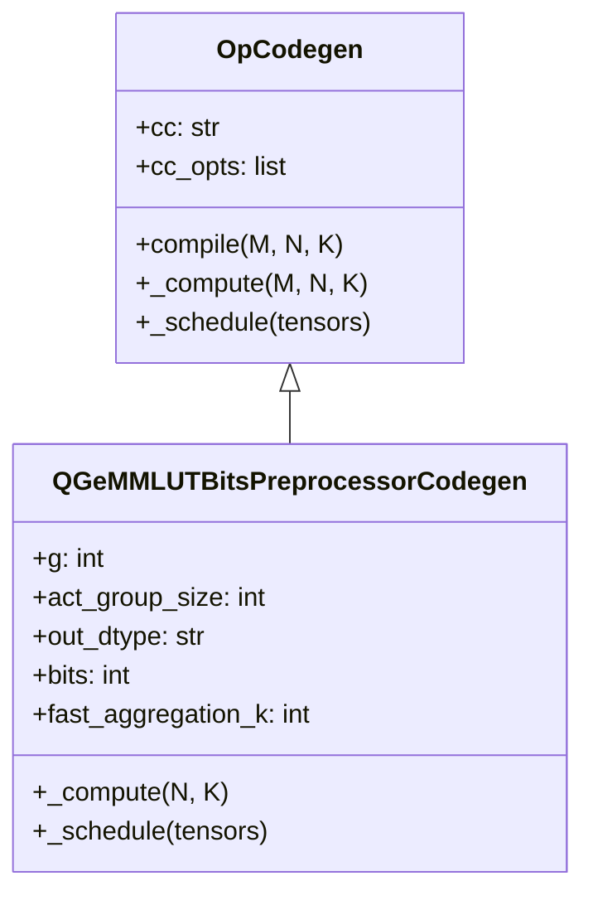

Key attributes:
- `g`: Group size for lookup table (typically 4)
- `act_group_size`: Group size for activation quantization
- `fast_aggregation_k`: Factor for accelerated aggregation

Sources: [python/t_mac/ops/qgemm.py:353-520]()

## Compilation Pipeline

The compilation pipeline is responsible for generating optimized kernels for specific hardware targets:

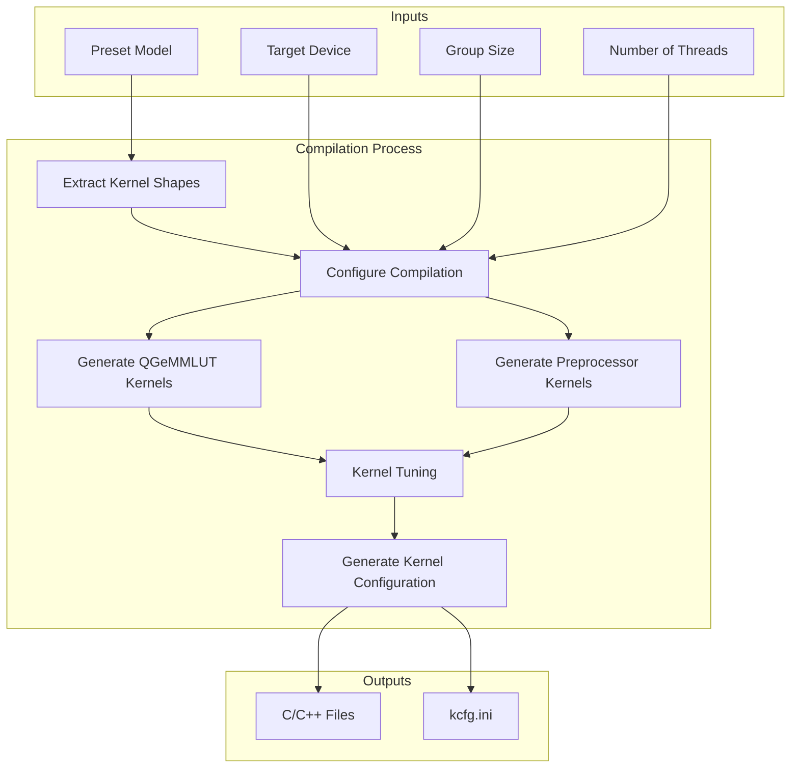

The compilation process:
1. Extracts kernel shapes from the model
2. Configures compilation parameters based on the target device and model
3. Generates quantized matrix multiplication kernels and preprocessor kernels
4. Tunes kernels for optimal performance
5. Outputs optimized C/C++ code and kernel configuration

Sources: [deploy/compile.py:19-204]()

## Integration with llama.cpp

T-MAC integrates with the llama.cpp framework to leverage its ecosystem and provide a complete inference solution:

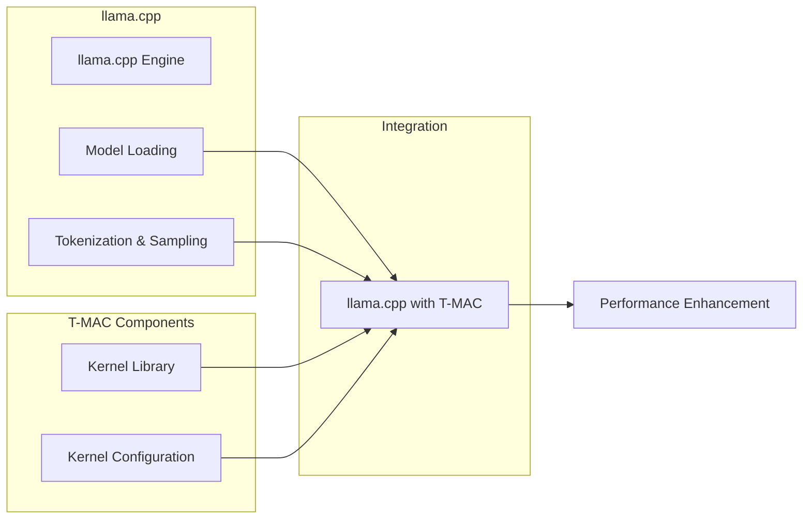

The integration enables:
1. Loading models with T-MAC optimizations
2. Executing inference using T-MAC's optimized kernels
3. Achieving significant performance improvements over standard llama.cpp

Sources: [README.md:312-365]()

## End-to-End Workflow

The complete T-MAC workflow involves multiple steps, orchestrated by the `run_pipeline.py` script:

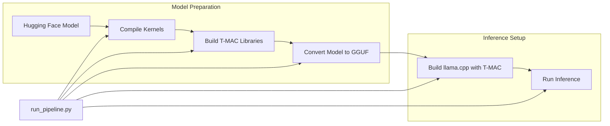

The workflow steps:
1. Compile optimized kernels using T-MAC's compilation pipeline
2. Build T-MAC C++ libraries with the generated kernels
3. Convert the model from Hugging Face format to GGUF with T-MAC optimizations
4. Build llama.cpp with T-MAC support
5. Run inference with the optimized implementation

Sources: [README.md:312-365]()

## Cross-Platform Support

T-MAC is designed to support multiple hardware platforms, with optimized kernels for each:

| Platform | Optimization Approach | Instruction Sets |
|----------|------------------------|------------------|
| Apple Silicon | ARM NEON, tbl instructions | NEON SIMD |
| x86 with AVX2 | pshuf instructions | AVX2 SIMD |
| ARM Android | ARM NEON, tbl instructions | NEON SIMD |
| Jetson | ARM NEON, tbl instructions | NEON SIMD |

T-MAC automatically detects the hardware platform and selects the appropriate optimization strategy.

Sources: [README.md:193-307]()

## Performance Optimizations

T-MAC incorporates several key optimizations to maximize performance:

1. **Table Lookup**: Using tbl/pshuf instructions for fast table lookup instead of multiply-accumulate operations
2. **Fast Aggregation**: Optional fast aggregation mode for additional 10-20% speedup
3. **Multi-Threading**: Optimized thread affinity and parallelization strategies
4. **SIMD Vectorization**: Leveraging SIMD instructions for parallel computations

These optimizations together enable T-MAC to achieve significant speedups over traditional approaches, especially for 1-2 bit models.

Sources: [README.md:77-138](), [python/t_mac/ops/qgemm.py:254-274]()

## Summary

T-MAC's architecture represents a fundamentally different approach to quantized matrix multiplication for low-bit LLM inference. By replacing traditional dequantization-based methods with lookup table operations, T-MAC achieves significant performance improvements that scale linearly with bit reduction. The system integrates with llama.cpp to provide a complete inference solution with cross-platform support.

For more detailed information about specific components, see:
- [Matrix Operations](#2.1) for details on the quantized matrix operations
- [Compilation Pipeline](#2.2) for details on kernel generation and tuning
- [Integration with llama.cpp](#2.3) for details on the inference engine

---

# Page: Matrix Operations

# Matrix Operations

<details>
<summary>Relevant source files</summary>

The following files were used as context for generating this wiki page:

- [deploy/tuned/kcfg.ini](deploy/tuned/kcfg.ini)
- [deploy/tuned/kernels.cc](deploy/tuned/kernels.cc)
- [deploy/tuned/kernels.h](deploy/tuned/kernels.h)
- [python/t_mac/intrins/tbl.cc](python/t_mac/intrins/tbl.cc)
- [python/t_mac/intrins/tbl.py](python/t_mac/intrins/tbl.py)
- [python/t_mac/ops/qgemm.py](python/t_mac/ops/qgemm.py)
- [tools/all_in_one.sh](tools/all_in_one.sh)

</details>


## Purpose and Scope

This document describes the quantized matrix multiplication operations that form the core of the T-MAC system. We focus on the implementation of QGeMMLUT (Quantized General Matrix Multiplication with Lookup Tables), which enables efficient inference by using lookup-based matrix multiplication for quantized neural networks. This page covers the algorithm design, implementation details, and optimization techniques used in T-MAC's matrix operations.

For information about how these operations are integrated into the broader compilation pipeline, see [Compilation Pipeline](#2.2). For details on how these operations are used with llama.cpp, see [Integration with llama.cpp](#2.3).

## Overview

T-MAC's matrix operations are based on a lookup table approach to quantized matrix multiplication. This approach provides significant performance benefits for inference, especially for low-bit quantized models. The system uses two primary components:

1. **Preprocessor** - Prepares activation lookup tables before the actual computation
2. **QGeMM Kernel** - Performs the actual matrix multiplication using the prepared lookup tables

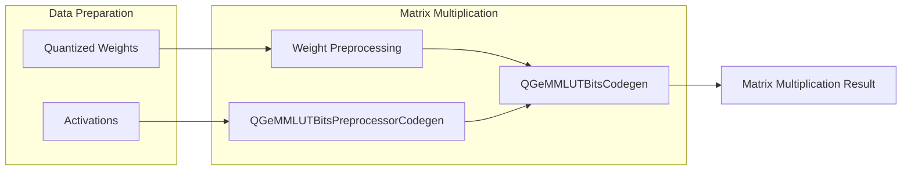

Sources: [python/t_mac/ops/qgemm.py:16-351](). [python/t_mac/ops/qgemm.py:353-519]()

## Core Components

The Matrix Operations system consists of two main classes:

1. **QGeMMLUTBitsCodegen** - Implements the quantized matrix multiplication kernel
2. **QGeMMLUTBitsPreprocessorCodegen** - Handles the preprocessing of activations to generate lookup tables

These classes inherit from the OpCodegen base class, which provides the framework for code generation.

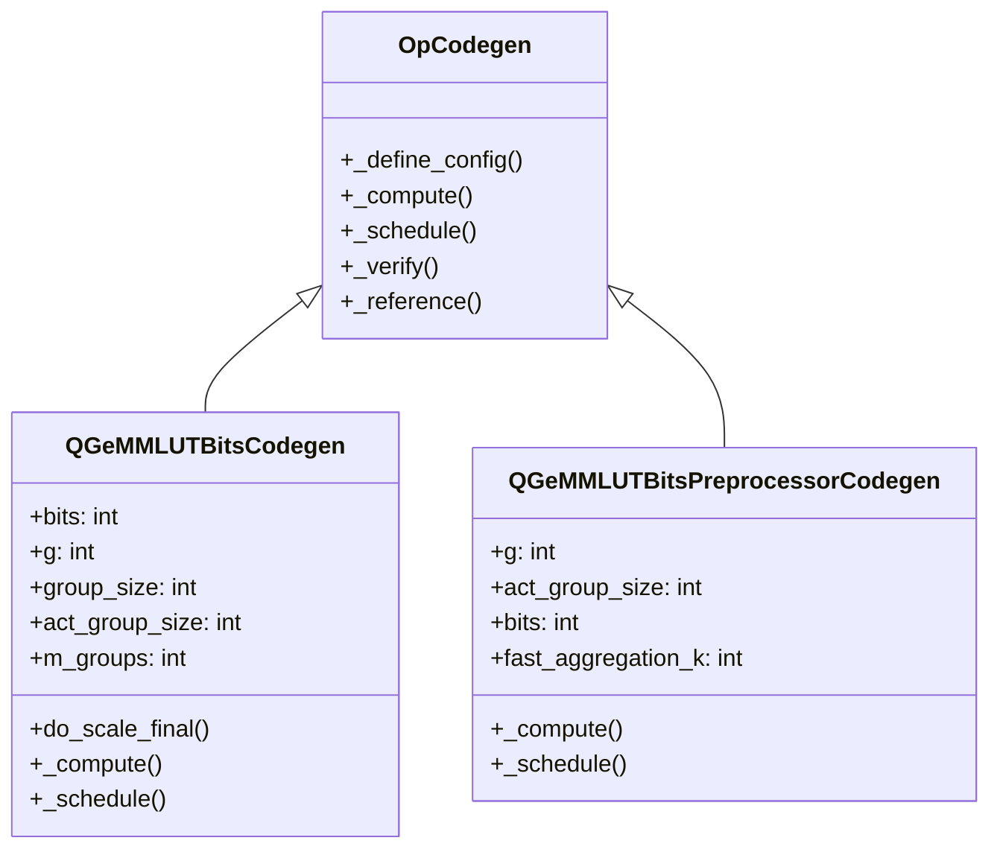

Sources: [python/t_mac/ops/qgemm.py:16-18](). [python/t_mac/ops/qgemm.py:353-356]()

## QGeMMLUTBitsCodegen

The QGeMMLUTBitsCodegen class implements the core matrix multiplication with lookup tables. It takes various parameters to control the quantization and computation process.

### Key Parameters

| Parameter | Description |
|-----------|-------------|
| `bits` | Number of bits for each weight group (typically 1-4) |
| `g` | Group size of LUT (typically 4) |
| `group_size` | Group size of weights for quantization |
| `act_group_size` | Group size of activations |
| `out_dtype` | Output data type (e.g., "float16") |
| `simd_n_in` | Number of SIMD lanes for input |
| `simd_n_out` | Number of SIMD lanes for output |
| `m_groups` | Number of groups for M dimension |
| `fast_aggregation` | Toggle fast aggregation for additional speedup |

Sources: [python/t_mac/ops/qgemm.py:18-67](). [deploy/tuned/kcfg.ini:1-30]()

### Computation Process

The computation in QGeMMLUTBitsCodegen follows these steps:

1. Set up the parameters and check for appropriate dimensions
2. Define the input tensors (A for weights, LUT for lookup tables, Scales for scaling factors)
3. Implement the computation logic for fetching values from LUT based on weight indices
4. Scale the values and accumulate the results

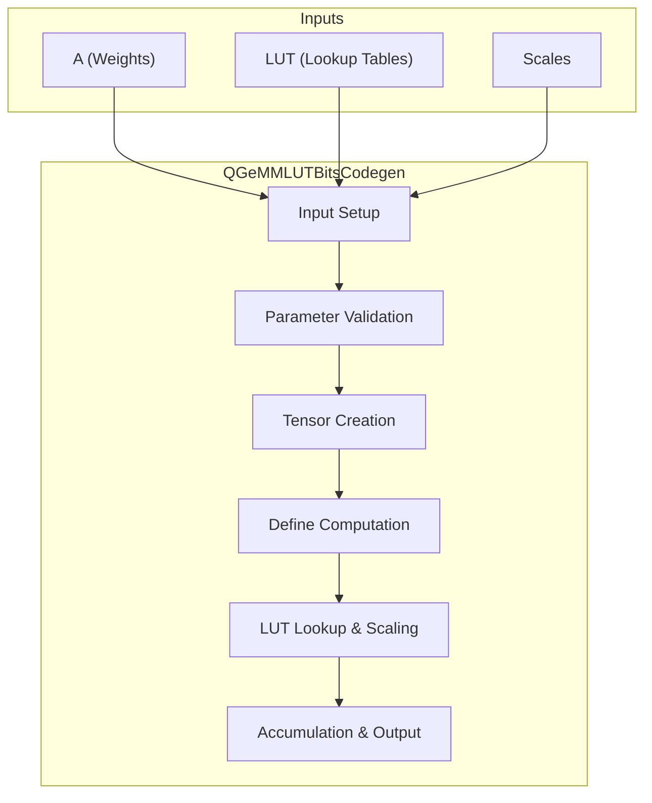

Sources: [python/t_mac/ops/qgemm.py:117-211]()

### Scheduling and Optimization

The QGeMMLUTBitsCodegen includes scheduling logic to optimize the computation for specific hardware:

1. Tile the computation into blocks for efficient processing
2. Cache intermediate results to reduce memory access
3. Use tensorization to map computations to hardware intrinsics
4. Apply parallelization based on available threads

The key optimization is the use of the `tbl` tensor intrinsic, which leverages SIMD instructions to perform table lookups efficiently.

Sources: [python/t_mac/ops/qgemm.py:213-275]()

## QGeMMLUTBitsPreprocessorCodegen

The QGeMMLUTBitsPreprocessorCodegen class handles the preprocessing of activations to generate lookup tables.

### Key Parameters

| Parameter | Description |
|-----------|-------------|
| `g` | Group size of LUT (typically 4) |
| `act_group_size` | Group size of activations |
| `out_dtype` | Output data type (e.g., "float16") |
| `bits` | Number of bits for quantization |
| `fast_aggregation_k` | K value for fast aggregation |

Sources: [python/t_mac/ops/qgemm.py:359-393]()

### Computation Process

The preprocessor computes the lookup tables for activations:

1. Calculate the maximum absolute values to determine scaling factors
2. Quantize the values to the target data type
3. Store the results in the output lookup table

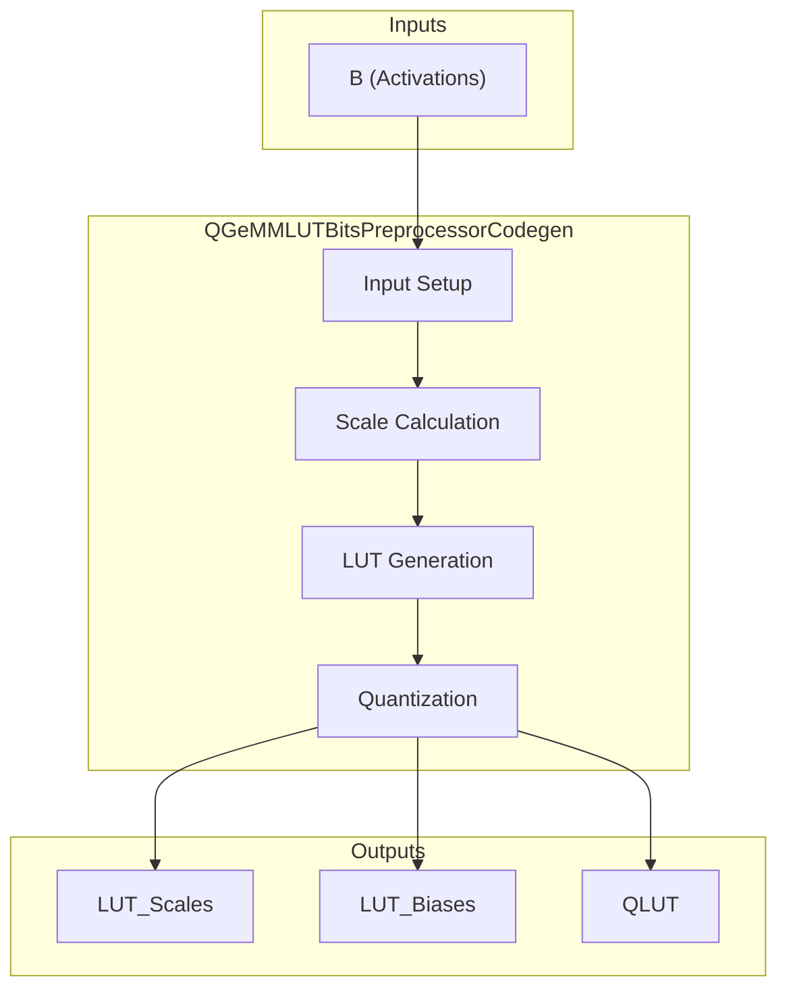

Sources: [python/t_mac/ops/qgemm.py:399-431]()

### Scheduling and Optimization

Similar to the main kernel, the preprocessor includes scheduling logic:

1. Split and reorder the computation for efficient processing
2. Use the `partial_max` intrinsic to efficiently compute maximum values
3. Apply the `lut_ctor` intrinsic for lookup table construction

Sources: [python/t_mac/ops/qgemm.py:433-481]()

## Tensor Intrinsics

The matrix operations rely heavily on tensor intrinsics to achieve high performance. These intrinsics map high-level operations to efficient low-level implementations.

### tbl Intrinsic

The `tbl` intrinsic is the core operation for table lookups. It takes several parameters:

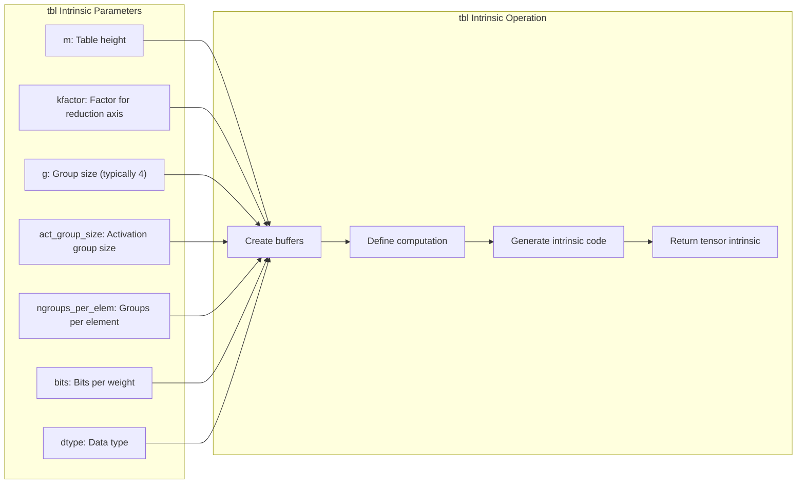

The `tbl` intrinsic is implemented with platform-specific code for both ARM NEON and x86 AVX2, using SIMD instructions to perform multiple table lookups in parallel.

Sources: [python/t_mac/intrins/tbl.py:10-185](). [python/t_mac/intrins/tbl.cc:1-719]()

## Hardware-Specific Implementations

T-MAC's matrix operations are optimized for different hardware platforms through the use of platform-specific intrinsics.

### ARM NEON Implementation

For ARM platforms, the implementation uses:
- NEON SIMD instructions
- Vector table lookup (`vqtbl1q_s8`)
- Vector arithmetic operations
- SignedHalvingAdder and SignedWideningAdder for efficient accumulation

### x86 AVX2 Implementation

For x86 platforms, the implementation uses:
- AVX2 SIMD instructions
- Shuffle operations for table lookup
- Vector arithmetic operations
- Specialized accumulation logic

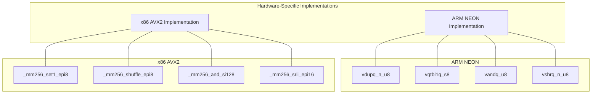

Sources: [python/t_mac/intrins/tbl.cc:10-282](). [python/t_mac/intrins/tbl.cc:284-682]()

## Data Flow

The complete data flow for T-MAC's matrix operations is illustrated below:

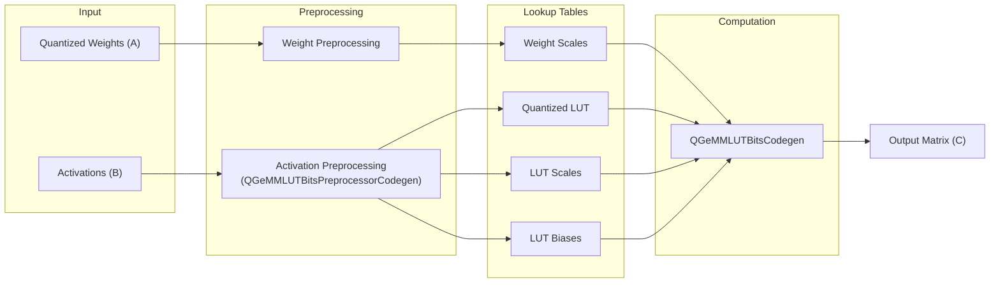

Sources: [python/t_mac/ops/qgemm.py:93-211](). [python/t_mac/ops/qgemm.py:399-431]()

## Configuration Parameters

The behavior of the matrix operations can be controlled through various configuration parameters. These are typically specified in a configuration file like `kcfg.ini`:

```mermaid
flowchart TD
    subgraph "Configuration Parameters"
        BM["bm: Block size for M dimension"]
        BN["bn: Block size for N dimension"]
        KF["kfactor: Factor for reduction axis"]
        GS["group_size: Group size for weights"]
        AGS["act_group_size: Group size for activations"]
        LSS["lut_scales_size: Size of LUT scales"]
        SS["scales_size: Size of scales"]
        NTN["n_tile_num: Number of N tiles"]
    end
    
    subgraph "Impact"
        Perf["Performance"]
        Mem["Memory Usage"]
        Acc["Accuracy"]
    end
    
    BM --> Perf
    BN --> Perf
    KF --> Perf
    GS --> Acc
    AGS --> Acc
    LSS --> Mem
    SS --> Mem
    NTN --> Perf
```

Sources: [deploy/tuned/kcfg.ini:1-30]()

## Kernel Dispatch

The kernel dispatch mechanism selects the appropriate kernel based on the dimensions and quantization parameters:

```mermaid
flowchart TD
    M["Matrix Dimensions M, K, N"]
    B["Bits per Weight"]
    
    M --> Dispatch["Kernel Dispatch"]
    B --> Dispatch
    
    Dispatch --> K1["qgemm_lut_t1_int8_m256_k4096_n1_b4"]
    Dispatch --> K2["qgemm_lut_t1_int8_m256_k11008_n1_b4"]
    Dispatch --> K3["Other specialized kernels"]
```

Sources: [deploy/tuned/kernels.h:21-38]()

## Integration with Run Pipeline

The matrix operations are integrated into the overall T-MAC pipeline through the `run_pipeline.py` script. This script orchestrates the compilation, model conversion, and execution processes.

```mermaid
flowchart TD
    Start["Run Pipeline"] --> CheckArgs["Parse Arguments"]
    CheckArgs --> CompileOps["Compile Matrix Operations"]
    CompileOps --> ConvertModel["Convert Model"]
    ConvertModel --> RunInference["Run Inference"]
    
    subgraph "Matrix Operations Compilation"
        CO1["Compile QGeMMLUTBits"]
        CO2["Compile Preprocessor"]
    end
    
    CompileOps --> CO1
    CompileOps --> CO2
```

Sources: [tools/all_in_one.sh:67-102]()

## Performance Considerations

When using T-MAC's matrix operations, several factors affect performance:

1. **Matrix Dimensions**: The sizes of M, N, and K dimensions affect how well the computation can be tiled and parallelized
2. **Quantization Parameters**: The number of bits and group sizes impact both computation speed and accuracy
3. **Hardware Platform**: Different optimizations are applied for ARM NEON vs. x86 AVX2
4. **Configuration Parameters**: Block sizes, tile sizes, and other parameters can be tuned for specific workloads

The fast aggregation option provides additional speedup at the cost of slightly reduced accuracy. This tradeoff may be acceptable for many applications.

Sources: [python/t_mac/ops/qgemm.py:62-63](). [python/t_mac/ops/qgemm.py:279-282]()

---

# Page: Compilation Pipeline

# Compilation Pipeline

<details>
<summary>Relevant source files</summary>

The following files were used as context for generating this wiki page:

- [.gitmodules](.gitmodules)
- [deploy/compile.py](deploy/compile.py)
- [deploy/tuned/kernels.dll](deploy/tuned/kernels.dll)
- [deploy/tuned/kernels.o](deploy/tuned/kernels.o)
- [docs/codegen.md](docs/codegen.md)
- [requirements-codegen.txt](requirements-codegen.txt)

</details>


This page documents the T-MAC compilation pipeline, which optimizes quantized matrix operations for specific hardware targets. The compilation pipeline is responsible for generating highly efficient kernels for both matrix multiplication and weight preprocessing operations, which are critical components for accelerating LLM inference. For information about the actual matrix operations being compiled, see [Matrix Operations](#2.1).

## Overview

The T-MAC compilation pipeline transforms mathematical tensor operations into optimized machine code for specific hardware architectures. It leverages the TVM (Tensor Virtual Machine) compiler framework to generate specialized kernels for quantized general matrix multiplication with lookup tables (QGeMMLUT) and associated preprocessing operations.

```mermaid
flowchart LR
    subgraph "T-MAC Compilation Pipeline"
        A["extract_kernel_shapes"] --> B["QGeMMLUTBitsCodegen"]
        A --> C["QGeMMLUTBitsPreprocessorCodegen"]
        
        B --> D["TVM Compilation"]
        C --> D
        
        D --> E["Output Artifacts"]
        
        E1["kernels.o/dll"] --> E
        E2["kernels.h/cc"] --> E
        E3["kcfg.ini"] --> E
    end
    
    subgraph "Inputs"
        M["Model Parameters"] --> A
        O["Compilation Options"] --> B
        O --> C
    end
```

**Diagram: T-MAC Compilation Pipeline Components**

Sources: [deploy/compile.py:1-5](), [deploy/compile.py:19-29]()

## Core Components

The compilation pipeline consists of two main code generators, both working on top of the TVM framework:

1. **QGeMMLUTBitsCodegen**: Generates optimized kernels for quantized matrix multiplication operations using lookup tables.
2. **QGeMMLUTBitsPreprocessorCodegen**: Generates kernels for preprocessing weight matrices before quantized operations.

```mermaid
graph TD
    subgraph "Compilation Core Components"
        A["QGeMMLUTBitsCodegen"] --> B["Quantized Matrix Multiplication"]
        C["QGeMMLUTBitsPreprocessorCodegen"] --> D["Weight Preprocessing"]
        
        B --> E["TVM IR Module"]
        D --> E
        
        E --> F["Machine Code Generation"]
        
        subgraph "Kernel Configuration"
            G["group_size"] --> A
            H["act_group_size"] --> A
            I["fast_aggregation"] --> A
            J["bits"] --> A
            K["num_threads"] --> A
            
            J --> C
            H --> C
        end
    end
```

**Diagram: Core Components of the Compilation System**

Sources: [deploy/compile.py:108-121]()

## Compilation Process

The compilation pipeline follows a systematic process to transform model parameters into optimized kernels:

1. **Extract Kernel Shapes**: Determine the required kernel dimensions based on the model specification.
2. **Initialize Codegen Objects**: Set up the codegen instances with appropriate parameters.
3. **Compile Kernels**: Generate optimized code for both matrix multiplication and preprocessing.
4. **Create Configuration**: Generate configuration files for runtime use.
5. **Output Artifacts**: Produce either compiled object files or portable C code.

```mermaid
flowchart TD
    A["Model Specification"] --> B["extract_kernel_shapes()"]
    B --> C["Initialize Codegens"]
    
    C --> D["QGeMMLUTBitsCodegen.compile()"]
    C --> E["QGeMMLUTBitsPreprocessorCodegen.compile()"]
    
    D --> F["TVM IR Module / C Code"]
    E --> F
    
    F --> G{"Output Format"}
    
    G -->|"return_type = lower"| H["tvm.build() → kernels.o, kernels.dll"]
    G -->|"return_type = c"| I["Generate kernels.h, kernels.cc"]
    
    D --> J["Generate kcfg.ini"]
    E --> J
```

**Diagram: Compilation Process Flow**

Sources: [deploy/compile.py:91-204]()

## Kernel Shape Extraction

The pipeline extracts kernel shapes from models based on either preset configurations or by analyzing the model structure. For GPTQ quantized models, it automatically detects:

- Matrix dimensions (M, K, N)
- Quantization bits
- Group structure (m_groups)

```mermaid
flowchart TD
    A["get_preset_models()"] --> B{"Preset Model?"}
    B -->|Yes| C["Use Predefined Shapes"]
    B -->|No| D["get_quantization_config()"]
    
    D --> E["Extract GPTQ Parameters"]
    E --> F["Determine Kernel Shapes"]
    
    C --> G["Compile with Appropriate Parameters"]
    F --> G
```

**Diagram: Kernel Shape Extraction Process**

Sources: [deploy/compile.py:91-104]()

## Configuration Options

The compilation pipeline supports numerous configuration options to optimize kernels for specific hardware and workloads:

| Option Category | Parameters | Description |
|-----------------|------------|-------------|
| Target | `target` | Hardware target (`llvm`, `opencl`, `vulkan`) |
| Threading | `num_threads`, `thread_affinity`, `one_thread_block` | Threading model configuration |
| Quantization | `bits`, `group_size`, `act_group_size`, `zero_point` | Quantization parameters |
| Optimization | `tune`, `reuse_tuned`, `fast_aggregation` | Performance tuning options |
| Output | `gen_c_code`, `out_path` | Output format control |

These options can be specified via command-line arguments when running the compilation script.

Sources: [deploy/compile.py:34-48](), [deploy/compile.py:207-228]()

## Output Artifacts

The compilation pipeline produces several important artifacts:

1. **Compiled Kernels**:
   - When `gen_c_code=False`: `kernels.o` (static library) and `kernels.dll` (dynamic library)
   - When `gen_c_code=True`: `kernels.h` and `kernels.cc` (portable C/C++ code)

2. **Configuration File**:
   - `kcfg.ini`: Contains kernel configurations such as tile sizes, SIMD parameters, and scaling factors

These artifacts are used by the T-MAC inference engine to perform optimized matrix operations at runtime.

Sample `kcfg.ini` structure:
```
[qgemm_lut_t1_int8_m16384_k11008_n1_b4]
bm = 16384
simd_n_in = 8
simd_n_out = 4
kfactor = 32
group_size = 128
lut_scales_size = 172
scales_size = 16384
n_tile_num = 1
```

Sources: [deploy/compile.py:156-165](), [deploy/compile.py:186-204]()

## Tuning Process

The compilation pipeline can optionally tune kernels for optimal performance on the target hardware:

```mermaid
flowchart LR
    A["Compilation Options"] --> B{"Tuning Enabled?"}
    
    B -->|No| C["Use Default Parameters"]
    B -->|Yes| D["Parameter Tuning"]
    
    D --> E["Autotuner"]
    E --> F["TVM AutoTVM"]
    
    F --> G["Tuned Configurations"]
    G --> H["Optimal Kernel Parameters"]
    
    C --> I["Generate Kernels"]
    H --> I
```

**Diagram: Kernel Tuning Process**

The tuning process explores different parameter values (such as tile sizes and loop unrolling factors) to identify the most efficient implementation for the target hardware.

Sources: [deploy/compile.py:40-41](), [docs/codegen.md:68-76]()

## Platform Support

The compilation pipeline supports various hardware platforms through target-specific optimizations:

| Platform | Target | Optimization Features |
|----------|--------|------------------------|
| Apple Silicon | `llvm` | NEON intrinsics, ARM-specific optimizations |
| x86 with AVX2 | `llvm` | AVX2 intrinsics, x86-specific optimizations |
| ARM Android | `llvm`/`opencl` | NEON intrinsics, cross-compilation support |
| NVIDIA Jetson | `llvm`/`opencl` | NEON intrinsics, GPU acceleration |

Platform-specific optimizations are applied through TVM's target system, which selects appropriate intrinsics and code generation strategies.

Sources: [deploy/compile.py:29-32](), [docs/codegen.md:64-76]()

## Command-Line Interface

The compilation pipeline is primarily accessed through the `compile.py` script, which provides numerous options:

```
python compile.py [-o OUT_PATH] [-d DEVICE] [-tgt TARGET] [-t] [-r] [-v] [-tb] 
                 [-gc] [-da] [-nt NUM_THREADS] [-ta THREAD_AFFINITY] 
                 [-gs GROUP_SIZE] [-ags ACT_GROUP_SIZE] [-fa] [-zp]
                 [-m PRESET_MODEL] [-md MODEL_DIR]
```

Key options include:
- `-t`: Enable tuning
- `-tb`: One thread block mode for llama.cpp integration
- `-gc`: Generate portable C code
- `-gs`/`-ags`: Set group sizes for quantization
- `-m`: Specify preset model

Sources: [deploy/compile.py:207-228](), [docs/codegen.md:78-91]()

## Integration with T-MAC

The compilation pipeline outputs are used by the T-MAC inference engine, particularly through integration with llama.cpp:

```mermaid
flowchart LR
    A["T-MAC Compilation Pipeline"] --> B["Generated Artifacts"]
    
    B --> C["kernels.h/kernels.cc"]
    B --> D["kcfg.ini"]
    
    C --> E["llama.cpp Build System"]
    D --> F["T-MAC Runtime"]
    
    E --> G["Optimized llama.cpp Binary"]
    F --> G
    
    G --> H["Fast LLM Inference"]
```

**Diagram: Integration with T-MAC System**

The compiled kernels enable T-MAC to achieve substantial performance improvements over baseline implementations, with speedups ranging from 1.1x to 4.1x depending on the model and hardware platform.

Sources: [deploy/compile.py:186-204]()

---

# Page: Integration with llama.cpp

# Integration with llama.cpp

<details>
<summary>Relevant source files</summary>

The following files were used as context for generating this wiki page:

- [CMakeLists.txt](CMakeLists.txt)
- [README.md](README.md)
- [cmake/TMACConfig.cmake.in](cmake/TMACConfig.cmake.in)
- [include/t-mac/tmac_gemm_wrapper.h](include/t-mac/tmac_gemm_wrapper.h)
- [tools/run_pipeline.py](tools/run_pipeline.py)

</details>


This document explains how T-MAC integrates with llama.cpp to accelerate inference for quantized language models. It covers the architecture of the integration, key components, workflow, and usage patterns. For information about matrix operations and kernel compilation, see [Matrix Operations](#2.1) and [Compilation Pipeline](#2.2).

## 1. Integration Overview

T-MAC integrates with llama.cpp to provide a high-performance inference solution for low-bit quantized models. The integration enables llama.cpp to utilize T-MAC's lookup table (LUT) based matrix multiplication kernels instead of the default dequantization-based approach, resulting in significant performance improvements, especially for 1-bit and 2-bit models.

```mermaid
flowchart LR
    subgraph "T-MAC Framework"
        TMACKernels["T-MAC Matrix Kernels"]
        TMACWrapper["TMACGeMMWrapper"]
    end
    
    subgraph "llama.cpp"
        ggml["ggml Library"]
        ggmlTMAC["ggml-tmac.h/c"]
        inferenceEngine["Inference Engine"]
    end
    
    TMACKernels --> TMACWrapper
    TMACWrapper --> ggmlTMAC
    ggmlTMAC --> ggml
    ggml --> inferenceEngine
```

The integration is achieved through several components:

1. **TMACGeMMWrapper**: Provides a C++ interface to T-MAC's optimized kernels
2. **ggml-tmac**: llama.cpp components that interface with T-MAC 
3. **GGUF model conversion**: Adds T-MAC-specific metadata to model files
4. **CMake integration**: Enables building llama.cpp with T-MAC support

Sources: [include/t-mac/tmac_gemm_wrapper.h](), [README.md:389-401]()

## 2. Integration Architecture

T-MAC is designed as a plugin architecture for llama.cpp, allowing seamless integration without major modifications to the core llama.cpp codebase. The integration happens at two key points:

1. **Model conversion**: Enhancing GGUF files with T-MAC configurations
2. **Matrix multiplication operations**: Replacing GGML's default quantized operations with T-MAC kernels

```mermaid
flowchart TB
    subgraph "Model Preparation"
        HFModel["Hugging Face Model"]
        GGUF["GGUF Converter"]
        GGUFModel["GGUF Model with\nT-MAC Metadata"]
    end
    
    subgraph "T-MAC Core"
        Kernels["Optimized LUT Kernels"]
        Wrapper["TMACGeMMWrapper"]
        Config["kcfg.ini Configuration"]
    end
    
    subgraph "llama.cpp"
        ggml["ggml Core"]
        ggmlTMAC["ggml-tmac Integration"]
        inference["Inference Engine"]
    end
    
    HFModel --> GGUF
    Config --> GGUF
    GGUF --> GGUFModel
    
    GGUFModel --> inference
    Config --> Wrapper
    Kernels --> Wrapper
    Wrapper --> ggmlTMAC
    ggmlTMAC --> ggml
    ggml --> inference
```

The integration is designed to be non-invasive, allowing llama.cpp to fall back to its native implementation when T-MAC is not available or not enabled.

Sources: [tools/run_pipeline.py:138-176](), [README.md:315-368]()

## 3. TMACGeMMWrapper Interface

The `TMACGeMMWrapper` class serves as the primary interface between T-MAC's optimized kernels and llama.cpp. It provides methods for initializing LUT tables and performing quantized matrix multiplications.

Key components of the wrapper class:

- **Constructor**: Initializes the wrapper with thread count and configuration file
- **llama_cpp_init**: Preprocesses activations to generate lookup tables
- **llama_cpp_compute**: Performs the quantized matrix multiplication using the lookup tables
- **get_kcfg**: Retrieves kernel configuration parameters from the configuration file

```mermaid
classDiagram
    class TMACGeMMWrapper {
        -n_threads: int
        -act_group_size: int
        -qlut: void*
        -lut_scales: void*
        -lut_biases: void*
        +TMACGeMMWrapper(n_threads, act_group_size, kcfg_file, library_file)
        +set_num_threads(n_threads)
        +llama_cpp_init(B, qlut, lut_scales, lut_biases, M, K, N, bits)
        +llama_cpp_compute(A, scales, qlut, lut_scales, lut_biases, C, M, K, N, bits)
        +get_kcfg(M, K, N, bits)
        +set_workspace(maxK, maxN)
    }
```

The wrapper handles both preprocessor operations (generating lookup tables from activations) and the actual matrix multiplication operations.

Sources: [include/t-mac/tmac_gemm_wrapper.h:79-348]()

## 4. Integration Workflow

The integration workflow consists of several steps, managed by the `run_pipeline.py` script:

### 4.1 Compilation of T-MAC Kernels

First, T-MAC kernels are compiled for the target architecture:

```mermaid
flowchart LR
    compile["compile.py"] --> kernels["Optimized Kernels"]
    kernels --> tuned["tuned/"]
    tuned --> kcfg["kcfg.ini"]
```

The compiled kernels are stored in the `tuned` directory along with a configuration file (`kcfg.ini`) that specifies kernel parameters.

Sources: [tools/run_pipeline.py:54-101]()

### 4.2 Building T-MAC Libraries

The T-MAC C++ libraries are built and installed:

```mermaid
flowchart LR
    cmake["cmake_t_mac()"] --> build["T-MAC Build Files"]
    build --> install["install_t_mac()"]
    install --> libs["T-MAC Libraries"]
```

This step compiles the T-MAC wrapper and other components needed for integration.

Sources: [tools/run_pipeline.py:110-137](), [CMakeLists.txt:1-129]()

### 4.3 Model Conversion

Hugging Face models are converted to GGUF format with T-MAC-specific metadata:

```mermaid
flowchart LR
    hf["Hugging Face Model"] --> converter["convert_hf_to_gguf.py"]
    kcfg["kcfg.ini"] --> converter
    converter --> gguf["Model.GGUF with\nT-MAC Metadata"]
```

The conversion process adds T-MAC configuration information to the GGUF file, enabling llama.cpp to use T-MAC kernels when processing the model.

Sources: [tools/run_pipeline.py:139-177]()

### 4.4 Building llama.cpp with T-MAC Support

llama.cpp is built with T-MAC support enabled:

```mermaid
flowchart LR
    cmake["cmake_llamacpp()"] --> build["llama.cpp Build Files"]
    tmac["T-MAC Libraries"] --> cmake
    build --> compile["build_llamacpp()"]
    compile --> binary["llama-cli with\nT-MAC Support"]
```

This step enables llama.cpp to use T-MAC's optimized kernels for quantized operations.

Sources: [tools/run_pipeline.py:178-221]()

### 4.5 Running Inference

Finally, inference is performed using the integrated system:

```mermaid
flowchart LR
    model["GGUF Model with\nT-MAC Metadata"] --> llama["llama-cli"]
    prompt["Input Prompt"] --> llama
    llama --> output["Generated Text"]
```

During inference, llama.cpp automatically uses T-MAC kernels for matrix operations based on the model's metadata.

Sources: [tools/run_pipeline.py:222-277](), [README.md:315-368]()

## 5. CMake Integration

T-MAC integrates with llama.cpp through CMake, which manages the build configuration and dependencies. The key components are:

### 5.1 T-MAC CMake Configuration

The T-MAC CMakeLists.txt file defines how T-MAC is built and installed:

1. Builds the T-MAC library with TVM support
2. Installs the library, headers, and kernel files
3. Creates a CMake package configuration file for downstream projects

### 5.2 T-MAC Config Package

The TMACConfig.cmake.in template creates a CMake package that can be consumed by llama.cpp:

1. Defines the T-MAC library location
2. Sets include directories
3. Defines compilation flags and dependencies
4. Creates T-MAC targets that llama.cpp can link against

### 5.3 llama.cpp CMake Integration

The llama.cpp CMake configuration uses the T-MAC package to enable integration:

```
cmake .. -DGGML_TMAC=ON -DCMAKE_PREFIX_PATH=/path/to/t-mac/cmake
```

This configuration enables the T-MAC-specific code in llama.cpp and links against the T-MAC libraries.

Sources: [CMakeLists.txt:1-129](), [cmake/TMACConfig.cmake.in:1-77](), [tools/run_pipeline.py:178-214]()

## 6. Performance Benefits

The integration of T-MAC with llama.cpp delivers significant performance improvements, particularly for low-bit models:

| Model | Device | Threads | T-MAC (tokens/sec) | llama.cpp (tokens/sec) | Speedup |
|-------|--------|---------|---------------------|------------------------|---------|
| BitNet-3B | M2-Ultra | 4 | 48.7 | 11.9 | 4.1x |
| Llama-2-7B (W2) | M2-Ultra | 4 | 29.6 | 13.2 | 2.2x |
| Llama-2-7B (W4) | M2-Ultra | 4 | 23.1 | 15.4 | 1.5x |
| BitNet-3B | Surface Laptop 7 | 4 | 48.0 | 10.6 | 4.5x |
| Llama-2-7B (W2) | Surface Laptop 7 | 4 | 28.4 | 10.5 | 2.7x |
| BitNet-3B | Raspberry Pi 5 | 4 | 11.3 | 3.1 | 3.6x |

The performance advantage is more significant for lower-bit models (1-bit and 2-bit) and becomes less pronounced for 4-bit models. This is because T-MAC's table lookup approach is more efficient than dequantization for very low-bit models.

Sources: [README.md:38-63]()

## 7. Usage Guide

To use T-MAC with llama.cpp, follow the end-to-end pipeline provided by the `run_pipeline.py` script:

### 7.1 Basic Usage

```bash
# Download a model
huggingface-cli download 1bitLLM/bitnet_b1_58-3B --local-dir ${model_dir}

# Run the pipeline
python tools/run_pipeline.py -o ${model_dir} -q int_n
```

This command will:
1. Compile T-MAC kernels
2. Build T-MAC libraries
3. Convert the model to GGUF format with T-MAC metadata
4. Build llama.cpp with T-MAC support
5. Run inference using the integrated system

### 7.2 GPTQ Models

T-MAC also supports models in GPTQ format:

```bash
huggingface-cli download ChenMnZ/Llama-3-8b-instruct-EfficientQAT-w2g128-GPTQ --local-dir ${model_dir}
python tools/run_pipeline.py -o ${model_dir} -m llama-3-8b-2bit -q int_n
```

### 7.3 Configuration Options

The `run_pipeline.py` script provides several configuration options:

- `-m`: Specify model preset
- `-p` or `-s`: Select specific pipeline steps to run
- `-u`: Use prebuilt kernels
- `-nt`: Set number of threads
- `-q`: Set quantization type
- `-d`: Target device for cross-compilation

For benchmarking purposes, the pipeline can also run llama-bench to measure performance.

Sources: [tools/run_pipeline.py:333-440](), [README.md:315-368]()

## 8. Cross-Platform Considerations

The T-MAC integration with llama.cpp supports multiple platforms:

- Apple Silicon (M1/M2)
- x86 with AVX2
- ARM devices (Android, Raspberry Pi)
- Windows on ARM

Each platform may require specific build configurations and settings. The `run_pipeline.py` script handles these differences automatically by detecting the platform and applying the appropriate settings.

For cross-compilation (e.g., compiling for Android on a desktop), additional parameters such as NDK path and remote directory may be required.

Sources: [README.md:139-307](), [tools/run_pipeline.py:34-44](), [tools/run_pipeline.py:387-392]()

---

# Page: Installation and Setup

# Installation and Setup

<details>
<summary>Relevant source files</summary>

The following files were used as context for generating this wiki page:

- [README.md](README.md)
- [conda/tvm-build-environment.yaml](conda/tvm-build-environment.yaml)
- [pyproject.toml](pyproject.toml)
- [python/t_mac/__init__.py](python/t_mac/__init__.py)
- [requirements.txt](requirements.txt)
- [setup.py](setup.py)

</details>


This page provides detailed instructions for installing and configuring T-MAC across different platforms. T-MAC is a kernel library that accelerates low-bit LLM inference on CPUs through lookup table-based matrix multiplication without dequantization.

For information about using T-MAC after installation, see [Usage Guide](#4).

## Installation Architecture

The following diagram illustrates the key components involved in the T-MAC installation process:

```mermaid
graph TB
    subgraph "Runtime Components"
        TMAC["t_mac Python Package"] --> TVM["TVM Compiler Framework"]
        TMAC --> LLVM["LLVM/Clang Toolchain"]
        TVM --> LLVM
        TMAC --> LLAMACPP["llama.cpp Integration"]
    end
    
    subgraph "Build Process Components"
        SETUPPY["setup.py"] --> TMACBUILD["TMACBuilPydCommand"]
        TMACBUILD --> DOWNLOAD["download_and_extract_llvm()"]
        TMACBUILD --> UPDATESUB["update_submodules()"]
        TMACBUILD --> BUILDTVM["build_tvm()"]
        TMACBUILD --> SETENV["t-mac-envs.sh"]
    end
    
    SETUPPY --> TMAC
```

Sources: [setup.py:134-160](), [README.md:139-140]()

## Installation Workflow

The installation process follows this sequence:

```mermaid
flowchart TB
    A["Prerequisites"] --> B["git clone --recursive"]
    B --> C["Platform-specific setup"]
    C --> D["pip install -e ."]
    D --> E["source build/t-mac-envs.sh"]
    
    subgraph "Automated by TMACBuilPydCommand"
        G["download_and_extract_llvm()"] 
        H["update_submodules()"]
        I["build_tvm()"]
        J["Create t-mac-envs.sh with PATH and PYTHONPATH"]
    end
    
    D --> G & H & I & J
```

Sources: [setup.py:134-160](), [README.md:160-161]()

## Prerequisites

Before installing T-MAC, ensure your system meets these requirements:

| Component | Requirement | Notes |
|-----------|-------------|-------|
| Python    | 3.8 | Required for TVM compatibility |
| virtualenv | Recommended | For isolated environment |
| cmake     | >= 3.22 | For building components |

Sources: [README.md:142-146](), [pyproject.toml:4]()

## Cross-Platform Support

T-MAC is designed to work efficiently across multiple platforms:

```mermaid
graph TD
    subgraph "Supported Platforms"
        A["Apple Silicon (M-series)"]
        B["x86 with AVX2"]
        C["ARM (aarch64) Linux"]
        D["Windows ARM64"]
        E["Android (Cross-compiled)"]
    end
    
    subgraph "Installation Options"
        F["Automatic Build (setup.py)"]
        G["Manual Build"]
        H["Cross Compilation"]
    end
    
    A --> F
    B --> F & G
    C --> F
    D --> G
    E --> H
    
    F & G & H --> I["T-MAC Runtime"]
```

The installation method depends on your platform:

| Platform | Architecture | Installation Method | Notes |
|----------|--------------|---------------------|-------|
| macOS | Apple Silicon | Automatic | Best performance on M-series chips |
| Linux | aarch64 | Automatic | Good performance on ARM servers |
| Linux | x86_64 | Automatic | Requires AVX2 support for optimal performance |
| Windows | x86_64 | Semi-manual | Requires additional setup steps |
| Windows | ARM64 | Manual | Requires native ARM tools |
| Android | ARM | Cross-compilation | Requires desktop for building |

Sources: [README.md:139-306](), [setup.py:16-22]()

## Platform-Specific Installation

### macOS (Apple Silicon)

1. Install required dependencies:
   ```bash
   brew install cmake zstd libomp
   ```

2. Clone the repository and install:
   ```bash
   git clone --recursive https://github.com/microsoft/T-MAC.git
   cd T-MAC
   pip install -e . -v
   source build/t-mac-envs.sh
   ```

During installation, the script automatically downloads LLVM 17.0.6 for arm64-apple-darwin22.0 and builds TVM with LLVM support.

Sources: [README.md:148-165](), [setup.py:17-18](), [setup.py:126-131]()

### Ubuntu (aarch64/x86_64)

1. Install cmake >= 3.22 from the official website

2. Install TVM build dependencies:
   ```bash
   sudo apt install build-essential libtinfo-dev zlib1g-dev libzstd-dev libxml2-dev
   ```

3. Clone the repository and install:
   ```bash
   git clone --recursive https://github.com/microsoft/T-MAC.git
   cd T-MAC
   pip install -e . -v
   source build/t-mac-envs.sh
   ```

For Ubuntu, the script downloads LLVM 17.0.6 for either aarch64-linux-gnu or x86_64-linux-gnu-ubuntu-22.04 depending on your architecture.

Sources: [README.md:170-189](), [setup.py:18-21]()

### Windows (x86_64)

1. Install Visual Studio 2022/2019 with "Desktop development with C++" workload
   > Important: Do NOT toggle on "C++ Clang tools for Windows" as the version might be incompatible.

2. Install Clang-17.0.6 from LLVM official release and add to PATH

3. Create a conda environment:
   ```powershell
   git clone --recursive https://github.com/microsoft/T-MAC.git
   cd T-MAC
   conda env create --file conda\tvm-build-environment.yaml
   conda activate tvm-build
   ```

4. Build TVM:
   ```powershell
   cd 3rdparty\tvm
   mkdir build
   cp cmake\config.cmake build
   ```

5. Append `set(USE_LLVM llvm-config)` to `build\config.cmake`

6. Continue building TVM:
   ```powershell
   cd build
   cmake .. -A x64
   cmake --build . --config Release -- /m
   ```

7. Install T-MAC:
   ```powershell
   cd ..\..\..\  # back to project root directory
   $env:MANUAL_BUILD = "1"
   $env:PYTHONPATH = "$pwd\3rdparty\tvm\python"
   pip install -e . -v
   ```

Windows installation requires more manual steps due to platform complexities.

Sources: [README.md:196-238](), [conda/tvm-build-environment.yaml:1-22]()

### Windows (ARM64)

For Windows ARM64, the installation is more complex:

1. Follow steps 1-4 of Windows (x86_64) installation
2. Build TVM in x64 mode (since Python and dependencies are x64)
3. Install native ARM64 tools:
   - CMake from the official Windows ARM installer
   - Ninja from the release page and add to Path
   - Clang from the LLVM release page
4. Run the following outside of Developer Command Prompt:
   ```powershell
   conda activate tvm-build
   conda uninstall cmake  # Prevent conflict with native ARM64 cmake
   cd ..\..\..\  # back to project root directory
   $env:MANUAL_BUILD = "1"
   $env:PYTHONPATH = "$pwd\3rdparty\tvm\python"
   pip install wmi  # To detect native ARM64 CPU within x64 python
   pip install -e . -v
   ```

Sources: [README.md:243-296]()

### Android

For Android deployment:

1. Install T-MAC on your PC (OSX/Ubuntu recommended)
2. Follow the Android Cross Compilation Guidance in the documentation

Sources: [README.md:300-306]()

## Installation Internals

The `setup.py` script defines a custom installation process through the `TMACBuilPydCommand` class, which handles:

1. Platform detection using `get_system_info()`
2. LLVM download and extraction via `download_and_extract_llvm()`
3. Git submodule updates through `update_submodules()`
4. TVM compilation with `build_tvm()`
5. Environment setup by creating `build/t-mac-envs.sh`

The supported platforms and their corresponding LLVM versions are defined in the `PLATFORM_LLVM_MAP` dictionary.

Sources: [setup.py:16-22](), [setup.py:134-160]()

## Verification

After installation, verify T-MAC is correctly installed:

```bash
python -c "import t_mac; print(t_mac.__version__); from tvm.contrib.clang import find_clang; print(find_clang())"
```

This command should display the T-MAC version and the path to the Clang compiler.

Sources: [README.md:311-312]()

## Next Steps

After successful installation, you can proceed to [Usage Guide](#4) to learn how to use T-MAC for model optimization and inference. The basic workflow involves:

1. Compiling optimized kernels for your hardware
2. Converting models to GGUF format with T-MAC optimizations
3. Running inference through the llama.cpp integration

All of these steps can be automated using the provided `tools/run_pipeline.py` script.

Sources: [README.md:313-368]()

---

# Page: Usage Guide

# Usage Guide

<details>
<summary>Relevant source files</summary>

The following files were used as context for generating this wiki page:

- [README.md](README.md)
- [tools/run_pipeline.py](tools/run_pipeline.py)

</details>


## Purpose and Scope

This guide explains how to use T-MAC for optimizing and running inference with low-bit quantized language models. It covers the end-to-end workflow from model conversion to inference execution. For information about the architecture and how T-MAC works internally, see [Architecture](#2).

T-MAC enables efficient execution of 1/2/3/4-bit quantized models on CPUs through its lookup table-based matrix multiplication approach, eliminating the need for dequantization.

## End-to-End Workflow Overview

T-MAC provides an all-in-one script (`run_pipeline.py`) that handles the complete workflow from model compilation to inference. The typical workflow consists of the following steps:

```mermaid
flowchart LR
    subgraph "Model Preparation"
        A["Hugging Face Model"] --> B["1. Compile Kernels"]
        B --> C["2. Build T-MAC Libraries"]
        C --> D["3. Convert to GGUF Format"]
    end
    
    subgraph "Execution"
        D --> E["4. Build llama.cpp with T-MAC"]
        E --> F["5. Run Inference"]
    end
    
    style A fill:#f9f9f9
    style B fill:#f9f9f9
    style C fill:#f9f9f9
    style D fill:#f9f9f9
    style E fill:#f9f9f9
    style F fill:#f9f9f9
```

Sources: [README.md:313-368](), [tools/run_pipeline.py:333-342]()

## Using the All-in-One Script

The simplest way to use T-MAC is with the `run_pipeline.py` script, which automates the entire process.

### Basic Usage

```bash
# Install required dependencies
pip install 3rdparty/llama.cpp/gguf-py

# Download a model from Hugging Face
huggingface-cli download 1bitLLM/bitnet_b1_58-3B --local-dir ${model_dir}

# Run the pipeline with basic options
python tools/run_pipeline.py -o ${model_dir} -q int_n
```

This example downloads the BitNet model and runs the complete pipeline, from kernel compilation to inference.

Sources: [README.md:319-323]()

### GPTQ Format Support

T-MAC also supports models in GPTQ format from repositories like GPTQModel and EfficientQAT:

```bash
# Download a GPTQ-formatted model
huggingface-cli download ChenMnZ/Llama-3-8b-instruct-EfficientQAT-w2g128-GPTQ --local-dir ${model_dir}

# Run the pipeline specifying the model type
python tools/run_pipeline.py -o ${model_dir} -m llama-3-8b-2bit -q int_n
```

For GPTQ models not in the preset list, use the `-m gptq-auto` option to automatically detect and validate kernel shapes and quantization configurations.

Sources: [README.md:325-338]()

## Pipeline Steps

The `run_pipeline.py` script executes the following steps by default:

1. **Compile kernels**: Generates optimized kernels for the target hardware
2. **Build T-MAC C++ CMakeFiles**: Prepares the build system for T-MAC
3. **Install T-MAC C++**: Builds and installs T-MAC libraries
4. **Convert HF to GGUF**: Converts the model to GGUF format
5. **Build llama.cpp CMakeFiles**: Prepares the build system for llama.cpp with T-MAC
6. **Build llama.cpp**: Builds the inference engine
7. **Run inference**: Executes the model for text generation

You can select specific steps to run using the `-s` or `-p` arguments.

```mermaid
flowchart TD
    subgraph "run_pipeline.py Execution Flow"
        A["Parse Command Line Arguments"] --> B["Determine Steps to Run"]
        B --> C["Execute Selected Steps"]
        C --> D1["Compile Kernels"]
        C --> D2["Build T-MAC C++"]
        C --> D3["Install T-MAC C++"]
        C --> D4["Convert HF to GGUF"]
        C --> D5["Build llama.cpp CMakeFiles"]
        C --> D6["Build llama.cpp"]
        C --> D7["Run Inference"]
        C --> D8["Run Benchmarking"]
    end
    
    style A fill:#f9f9f9
    style B fill:#f9f9f9
    style C fill:#f9f9f9
    style D1 fill:#f9f9f9
    style D2 fill:#f9f9f9
    style D3 fill:#f9f9f9
    style D4 fill:#f9f9f9
    style D5 fill:#f9f9f9
    style D6 fill:#f9f9f9
    style D7 fill:#f9f9f9
    style D8 fill:#f9f9f9
```

Sources: [tools/run_pipeline.py:333-342](), [tools/run_pipeline.py:422-432]()

## Command Line Arguments

T-MAC's `run_pipeline.py` script provides numerous options to customize the execution:

| Argument | Description | Default |
|----------|-------------|---------|
| `-o, --model_dir` | Directory containing the model | Required |
| `-nt, --num_threads` | Number of threads to use | 4 |
| `-m, --model` | Model type | hf-bitnet-3b |
| `-p, --steps_preset` | Preset of steps to run (all, fast, compile) | all |
| `-s, --steps` | Specific steps to run (comma-separated) | None |
| `-q, --quant_type` | Quantization model type (int_n, f16, f32, tq1_0, tq2_0, q4_0) | None |
| `-d, --device` | Target device for cross-compilation | Local device |
| `-u, --use_prebuilt` | Use prebuilt kernels for ARM | False |
| `-dt, --disable_tune` | Disable kernel tuning | False |
| `-v, --verbose` | Enable verbose output | False |
| `-rc, --rechunk` | Enable rechunking in computation | False |
| `--disable-t-mac` | Disable T-MAC (for comparison) | False |

Sources: [tools/run_pipeline.py:363-395]()

## Model Compatibility

T-MAC supports various low-bit models in different formats:

| Bits | Supported Model Formats |
|------|-------------------------|
| 1-bit | BitNet models (W1.58A8) |
| 2-bit | BitDistiller, EfficientQAT, GPTQ models |
| 3-bit | GPTQ models |
| 4-bit | GPTQ, GGUF models |

For GPTQ models, T-MAC automatically detects the model architecture and configures the appropriate kernels when using `-m gptq-auto`.

Sources: [README.md:33-35](), [README.md:325-338]()

## Configuration for Different Model Types

### BitNet Models

For 1-bit BitNet models:

```bash
huggingface-cli download 1bitLLM/bitnet_b1_58-3B --local-dir ${model_dir}
python tools/run_pipeline.py -o ${model_dir} -q int_n
```

### Llama-2 W2 Models

For 2-bit quantized Llama models from EfficientQAT:

```bash
huggingface-cli download ChenMnZ/Llama-3-8b-instruct-EfficientQAT-w2g128-GPTQ --local-dir ${model_dir}
python tools/run_pipeline.py -o ${model_dir} -m llama-3-8b-2bit -q int_n
```

### Standard GPTQ Models

For standard GPTQ models:

```bash
# For automatically detecting model architecture
python tools/run_pipeline.py -o ${model_dir} -m gptq-auto -q int_n
```

Sources: [README.md:319-338]()

## Using Prebuilt Kernels

For ARM devices, T-MAC provides prebuilt kernels to simplify deployment. To use them:

```bash
python tools/run_pipeline.py -o ${model_dir} -q int_n -u
```

The `-u` flag tells T-MAC to use prebuilt kernels instead of compiling them on the target device.

Sources: [tools/run_pipeline.py:54-63](), [tools/run_pipeline.py:386]()

## Cross-Platform Deployment

T-MAC supports multiple platforms including:
- Apple Silicon (M1/M2/M3)
- x86 with AVX2
- ARM devices (including Android)
- NVIDIA Jetson

### Android Deployment

To deploy on Android:

1. Install T-MAC on your development machine (OSX/Ubuntu recommended)
2. Use the `-d android` flag to cross-compile for Android:

```bash
python tools/run_pipeline.py -o ${model_dir} -q int_n -d android -ndk /path/to/ndk
```

The script will handle cross-compilation and ADB commands to push the necessary files to the Android device.

```mermaid
flowchart TD
    subgraph "Cross-Platform Deployment"
        A["Detect Target Platform"] --> B{"Is Cross-Compiling?"}
        B -->|"Yes"| C["Set Build Directory with Target Name"]
        B -->|"No"| D["Use Default Build Directory"]
        C --> E["Apply Platform-Specific CMake Options"]
        D --> E
        E --> F["Build T-MAC"]
        
        F --> G{"Is Android?"}
        G -->|"Yes"| H["ADB Push Binaries and Models"]
        G -->|"No"| I["Run Locally"]
        H --> J["Execute via ADB Shell"]
        I --> K["Execute Directly"]
    end
    
    style A fill:#f9f9f9
    style B fill:#f9f9f9
    style C fill:#f9f9f9
    style D fill:#f9f9f9
    style E fill:#f9f9f9
    style F fill:#f9f9f9
    style G fill:#f9f9f9
    style H fill:#f9f9f9
    style I fill:#f9f9f9
    style J fill:#f9f9f9
    style K fill:#f9f9f9
```

Sources: [tools/run_pipeline.py:42-52](), [tools/run_pipeline.py:189-202](), [tools/run_pipeline.py:234-264]()

## Performance Tuning

T-MAC provides several options to tune performance:

### Kernel Tuning

By default, T-MAC tunes kernels for optimal performance on your hardware. To disable tuning and use default kernels:

```bash
python tools/run_pipeline.py -o ${model_dir} -q int_n -dt
```

### Reuse Previously Tuned Kernels

If you've already tuned kernels for your hardware, you can reuse them:

```bash
python tools/run_pipeline.py -o ${model_dir} -q int_n -r
```

### Thread Count Optimization

Setting the optimal number of threads is crucial for performance:

```bash
python tools/run_pipeline.py -o ${model_dir} -q int_n -nt 8
```

For token generation, T-MAC can match the same performance using fewer CPU cores compared to traditional approaches, which is beneficial for power efficiency and resource utilization.

Sources: [tools/run_pipeline.py:54-95](), [README.md:40-53]()

## Benchmarking

To benchmark T-MAC's performance, the pipeline includes the `llama-bench` step:

```bash
# Run only the benchmarking step
python tools/run_pipeline.py -o ${model_dir} -q int_n -s 7
```

This runs the `llama-bench` tool with appropriate parameters to measure token generation throughput.

The benchmark results will be written to the logs directory specified by `-ld`.

Sources: [tools/run_pipeline.py:279-331]()

## Troubleshooting

### Logs and Debugging

T-MAC writes detailed logs to the `logs` directory (configurable with `-ld`). Each command execution creates a timestamped log file:

```
logs/2024-07-15-17-10-11.log
```

If a step fails, check the corresponding log file for error details.

### Verbose Mode

For more detailed output during execution:

```bash
python tools/run_pipeline.py -o ${model_dir} -q int_n -v
```

This enables verbose logging to help diagnose issues.

Sources: [tools/run_pipeline.py:15-31](), [tools/run_pipeline.py:436-439]()

## Integration with External Projects

T-MAC integrates with llama.cpp to accelerate inference. After building with T-MAC support, you can use the regular llama.cpp tools with the converted model:

```bash
# Run the converted model with llama.cpp's main executable
./3rdparty/llama.cpp/build/bin/main -m ${model_dir}/model.int_n.gguf -n 128 -t 4 -p "Your prompt text" -ngl 0 -c 2048
```

For advanced use cases like chat interfaces or API servers, you can use other llama.cpp executables like `server` with T-MAC-optimized models.

Sources: [README.md:363-368]()

---

# Page: End-to-End Pipeline

# End-to-End Pipeline

<details>
<summary>Relevant source files</summary>

The following files were used as context for generating this wiki page:

- [python/t_mac/model_utils.py](python/t_mac/model_utils.py)
- [tools/run_pipeline.py](tools/run_pipeline.py)

</details>


This document explains the complete workflow for optimizing and running LLM inference with T-MAC, from compiling custom kernels to measuring performance benchmarks. For details about the architecture and components of T-MAC, see [Architecture](#2).

## Pipeline Overview

The T-MAC pipeline transforms Hugging Face models into optimized deployable artifacts with T-MAC's quantized matrix operations. This process involves multiple steps coordinated by the `run_pipeline.py` script.

```mermaid
flowchart LR
    subgraph "1. Preparation"
        A["Hugging Face Model"] --> B["Compile Kernels"]
        B --> C["Build T-MAC C++ Libraries"]
        C --> D["Convert Model to GGUF"]
    end
    
    subgraph "2. Execution"
        D --> E["Build llama.cpp with T-MAC"]
        E --> F["Run Inference"]
    end
```

Sources: [tools/run_pipeline.py:333-342]()

## Pipeline Components and Workflow

The complete end-to-end pipeline consists of the following sequential steps:

```mermaid
flowchart TD
    subgraph "Pipeline Steps"
        direction TB
        S1["1. compile_kernels()"] --> S2["2. cmake_t_mac()"]
        S2 --> S3["3. install_t_mac()"]
        S3 --> S4["4. convert_models()"]
        S4 --> S5["5. cmake_llamacpp()"]
        S5 --> S6["6. build_llamacpp()"]
        S6 --> S7["7. run_inference()"]
        S7 --> S8["8. run_llama_bench()"]
    end

    subgraph "Model Weights"
        M1["Hugging Face Format"] --> M2["Kernel-Optimized Weights"]
        M2 --> M3["GGUF Format with T-MAC"]
    end

    subgraph "Runtime Components"
        R1["T-MAC Kernels"] --> R2["llama.cpp with T-MAC"]
    end

    S1 --> R1
    S4 --> M3
    S6 --> R2
```

Sources: [tools/run_pipeline.py:333-342](), [tools/run_pipeline.py:54-101](), [tools/run_pipeline.py:139-176]()

## Step 1: Kernel Compilation

The first step compiles optimized kernels for specific matrix shapes commonly found in the target model.

```mermaid
flowchart LR
    subgraph "compile_kernels()"
        K1["Select Model Architecture"] --> K2["Determine Matrix Shapes"]
        K2 --> K3["Compile Kernels"]
        K3 --> K4["Store in tuned/"]
    end

    subgraph "Model Detection"
        MD1["Preset Models"] --> MD2["GPTQ Auto-detection"]
    end

    subgraph "Kernel Configuration"
        KC1["Group Size"] --> KC
        KC2["Act Group Size"] --> KC
        KC3["Zero Point Flag"] --> KC
        KC["kcfg.ini"]
    end

    K1 --> MD1
    K1 --> MD2
    K3 --> KC
```

This step compiles QGeMMLUT (Quantized General Matrix Multiplication with Lookup Tables) kernels optimized for the target hardware. The model's architecture determines which kernel shapes to compile.

Sources: [tools/run_pipeline.py:54-101](), [python/t_mac/model_utils.py:206-216]()

### Kernel Parameters

| Parameter | Description | Default Value |
|-----------|-------------|--------------|
| `group_size` | Size of weight groups for quantization | 128 |
| `act_group_size` | Size of activation groups | 64 or model-specific |
| `zero_point` | Whether to use zero point in quantization | Model-dependent |

Sources: [tools/run_pipeline.py:405-419](), [python/t_mac/model_utils.py:19-88]()

## Step 2: T-MAC C++ Library Build

This step builds the T-MAC C++ libraries required for integration with llama.cpp.

```mermaid
flowchart TD
    subgraph "T-MAC Build"
        B1["cmake_t_mac()"] --> B2["install_t_mac()"]
    end

    subgraph "Build Process"
        BP1["Clean Previous Build"] --> BP2["Configure with CMake"]
        BP2 --> BP3["Build T-MAC Libraries"]
        BP3 --> BP4["Install to install/"]
    end

    B1 --> BP1
    B2 --> BP3
```

The T-MAC C++ libraries provide the interface between llama.cpp and the optimized QGeMMLUT kernels.

Sources: [tools/run_pipeline.py:110-136]()

## Step 3: Model Conversion

This step converts the model from Hugging Face format to GGUF with T-MAC optimizations.

```mermaid
flowchart TD
    subgraph "convert_models()"
        C1["Load HF Model"] --> C2["Convert to GGUF"]
        C2 --> C3["Apply T-MAC Preprocessing"]
        C3 --> C4["Save Optimized GGUF"]
    end

    subgraph "T-MAC Processing"
        T1["Weight Preprocessing"] --> T2["Scale Transformation"]
        T2 --> T3["Zero Point Handling"] 
        T3 --> T4["Optimized Layout"]
    end

    C3 --> T1
```

The conversion process takes the Hugging Face model and applies T-MAC-specific weight preprocessing before saving in GGUF format. This includes specialized transformations for quantized weights that optimize them for the compiled kernels.

Sources: [tools/run_pipeline.py:139-176](), [python/t_mac/model_utils.py:243-271]()

## Step 4: llama.cpp Integration

This step builds llama.cpp with T-MAC support.

```mermaid
flowchart TD
    subgraph "llama.cpp Build"
        L1["cmake_llamacpp()"] --> L2["build_llamacpp()"]
    end

    subgraph "Build Process"
        LP1["Configure with T-MAC Path"] --> LP2["Enable T-MAC Extensions"]
        LP2 --> LP3["Build llama.cpp Executables"]
        LP3 --> LP4["Output to build/bin/"]
    end

    subgraph "Executables"
        E1["llama-cli"] 
        E2["llama-bench"]
        E3["llama-quantize"]
        E4["llama-perplexity"]
    end

    L1 --> LP1
    L2 --> LP3
    LP3 --> E1
    LP3 --> E2
    LP3 --> E3
    LP3 --> E4
```

The llama.cpp integration enables the use of T-MAC's optimized kernels for inference, providing significant speedups on supported hardware.

Sources: [tools/run_pipeline.py:178-219]()

## Step 5: Inference and Benchmarking

The final steps run inference and benchmarking with the optimized model.

```mermaid
flowchart TD
    subgraph "Inference and Benchmarking"
        I1["run_inference()"] --> I2["run_llama_bench()"]
    end

    subgraph "Device Execution"
        D1["Local Execution"] 
        D2["Android Execution"]
    end

    subgraph "Benchmark Metrics"
        B1["Token Generation Speed"]
        B2["Memory Usage"]
        B3["Prefill Performance"]
    end

    I1 --> D1
    I1 --> D2
    I2 --> B1
    I2 --> B2
    I2 --> B3
```

Inference can run on the local machine or be deployed to Android devices through ADB.

Sources: [tools/run_pipeline.py:222-331]()

## Cross-Platform Support

The pipeline supports multiple target platforms through cross-compilation.

```mermaid
flowchart LR
    subgraph "Target Platforms"
        P1["x86 with AVX2"]
        P2["Apple Silicon"]
        P3["ARM Android"]
        P4["NVIDIA Jetson"]
    end

    subgraph "Compilation Options"
        C1["Native Compilation"]
        C2["Cross Compilation"]
        C3["Android NDK Toolchain"]
    end

    P1 --- C1
    P2 --- C1
    P3 --- C2
    P3 --- C3
    P4 --- C2
```

For cross-compilation to Android, the pipeline uses the Android NDK toolchain specified with `--ndk_home`.

Sources: [tools/run_pipeline.py:42-51](), [tools/run_pipeline.py:190-201]()

## Running the Complete Pipeline

To run the complete end-to-end pipeline, use the `run_pipeline.py` script:

```
python tools/run_pipeline.py --model hf-bitnet-3b --model_dir /path/to/model --num_threads 4
```

### Common Pipeline Presets

| Preset | Description | Steps Included |
|--------|-------------|---------------|
| `all` | Complete workflow | 0, 1, 2, 3, 4, 5, 6 |
| `fast` | Skip CMake configuration | 0, 2, 3, 5, 6 |
| `compile` | Only compile components | 0, 2, 5 |

Sources: [tools/run_pipeline.py:345-349](), [tools/run_pipeline.py:363-440]()

### Important Configuration Options

| Option | Description |
|--------|-------------|
| `--model` | Model architecture (e.g., hf-bitnet-3b, llama-2-7b-4bit) |
| `--model_dir` | Path to the Hugging Face model |
| `--num_threads` | Number of threads for inference |
| `--quant_type` | Quantization type (int_n, f16, f32, tq1_0, tq2_0, q4_0) |
| `--device` | Target device for cross-compilation |
| `--disable_tune` | Skip kernel tuning (faster, but potentially less optimized) |
| `--use_prebuilt` | Use prebuilt kernels if available |
| `--rechunk` | Enable rechunking in computation |

Sources: [tools/run_pipeline.py:363-396]()

## Flow Control and Error Handling

The pipeline implements error handling and logging for each step:

```mermaid
flowchart TD
    subgraph "Pipeline Execution"
        E1["Parse Arguments"] --> E2["Select Steps"]
        E2 --> E3["Execute Steps in Sequence"]
        E3 --> E4["Log Results"]
    end

    subgraph "Error Handling"
        EH1["Command Execution"] --> EH2["Check for Errors"]
        EH2 --> EH3{Success?}
        EH3 -- Yes --> EH4["Continue to Next Step"]
        EH3 -- No --> EH5["Exit with Error Message"]
    end

    E3 --> EH1
```

Each command execution is logged to a timestamped file in the `logs` directory, making it easier to diagnose issues.

Sources: [tools/run_pipeline.py:15-31](), [tools/run_pipeline.py:422-440]()

---

# Page: Benchmarking

# Benchmarking

<details>
<summary>Relevant source files</summary>

The following files were used as context for generating this wiki page:

- [README.md](README.md)
- [assets/e2e_threads.png](assets/e2e_threads.png)
- [assets/e2e_threads.zip](assets/e2e_threads.zip)
- [docs/profiling_data.md](docs/profiling_data.md)
- [tools/profile.py](tools/profile.py)

</details>


This page provides guidance on how to benchmark T-MAC's performance and interpret the results. Benchmarking is crucial for understanding the performance benefits of T-MAC compared to baseline frameworks like llama.cpp, optimizing configurations for specific hardware, and evaluating the impact of different parameters on performance.

For comprehensive performance analysis and comparisons with other frameworks across various hardware platforms, see [Performance Analysis](#7).

## Benchmarking Tools

T-MAC provides several tools for performance measurement:

### Kernel-level Benchmarking

The `profile.py` script measures the performance of individual T-MAC kernels, such as QGeMMLUT (Quantized General Matrix Multiplication with Lookup Tables) and the preprocessor.

```bash
python tools/profile.py -o [output_dir] -d [device] -k [kernel] -t -r -gs [group_size] -ags [act_group_size] -fa
```

Key parameters:
- `-o`: Output directory for benchmark results
- `-d`: Target device
- `-k`: Kernel type (`qgemm_lut` or `preprocessor`)
- `-t`: Enable tuning to find optimal configurations
- `-r`: Reuse previously tuned kernels
- `-gs`: Weight group size (default: 128)
- `-ags`: Activation group size (default: 64, -1 for BitNet-like unified scale)
- `-fa`: Enable fast aggregation

Example:
```bash
python tools/profile.py -o tuned -k qgemm_lut -t -r -gs 128 -ags 64 -fa
```

Sources: [tools/profile.py:1-222]()

### End-to-End Benchmarking

For comprehensive performance evaluation, T-MAC provides end-to-end benchmarking through:

1. **bench_e2e.py**: A dedicated script for measuring complete inference performance
   ```bash
   python tools/bench_e2e.py -m [model_path] -t [num_threads]
   ```

2. **llama-bench**: Integration with llama.cpp's benchmarking utility
   ```bash
   ./3rdparty/llama.cpp/build/bin/llama-bench -m [model_path] -t [num_threads] -ngl 0
   ```

Sources: [README.md:367-368]()

## T-MAC Benchmarking Workflow

The following diagram illustrates the T-MAC benchmarking process:

```mermaid
graph TD
    A["Start Benchmarking"] --> B["Choose Benchmark Type"]
    
    B --> C["Kernel Benchmarking\n(profile.py)"]
    B --> D["End-to-End Benchmarking\n(bench_e2e.py)"]
    
    C --> E["Configure Kernel Parameters\n(-k, -gs, -ags, -fa)"]
    E --> F["Run Benchmark\n(python profile.py ...)"]
    F --> G["Analyze Results\n(results.csv)"]
    
    D --> H["Configure Benchmark Parameters\n(-m, -t, -n)"]
    H --> I["Run Benchmark\n(python bench_e2e.py ...)"]
    I --> J["Analyze Results\n(tokens/sec)"]
    
    G --> K["Compare with Baseline\n(llama.cpp)"]
    J --> K
```

Sources: [README.md:364-368](), [tools/profile.py:101-223]()

## T-MAC Benchmarking Components

```mermaid
graph TD
    A["T-MAC Benchmarking"] --> B["profile.py\n(Kernel Benchmarking)"]
    A --> C["bench_e2e.py\n(End-to-End Benchmarking)"]
    A --> D["llama-bench\n(llama.cpp Integration)"]
    
    B --> E["QGeMMLUTBitsCodegen"]
    B --> F["QGeMMLUTBitsPreprocessorCodegen"]
    
    C --> G["Token Generation\nBenchmarking"]
    C --> H["Prefill\nBenchmarking"]
    
    D --> I["llama.cpp Benchmark\nCompatibility"]
    
    E --> J["GeMMCodegen Class"]
    F --> K["OpCodegen Class"]
    
    G --> L["Tokens/sec\nMetric"]
    H --> M["Batch Processing\nPerformance"]
```

Sources: [tools/profile.py:1-10](), [README.md:367-368]()

## Running Benchmarks

### Kernel-level Benchmarks

To evaluate kernel performance:

1. **Setup the benchmark parameters**:
   ```bash
   python tools/profile.py -o out -k qgemm_lut -t -r -gs 128 -ags 64 -fa
   ```

2. **Analyze the results**:
   The script outputs timing information (in milliseconds) and saves results to a CSV file in the specified output directory.

Sources: [tools/profile.py:101-215]()

### End-to-End Benchmarks

For complete model inference benchmarking:

1. **Run the full pipeline**:
   ```bash
   python tools/run_pipeline.py -o [model_dir] -q int_n
   ```
   
   This script handles steps from compiling kernels to running inference.

2. **Dedicated benchmarking**:
   ```bash
   python tools/bench_e2e.py -m [model_path] -t [num_threads]
   ```
   
   This is useful when you want to benchmark specific configurations.

3. **Using llama-bench**:
   ```bash
   ./3rdparty/llama.cpp/build/bin/llama-bench -m [model_path] -t [num_threads] -ngl 0
   ```

Sources: [README.md:317-368]()

## Interpreting Benchmark Results

### Kernel-level Benchmark Metrics

- **Execution time (ms)**: Lower values indicate better performance
- **Bit-width scaling**: T-MAC should show better scaling for lower bit-widths
- **Group size impact**: Different group sizes may affect performance significantly

### End-to-End Benchmark Metrics

- **Tokens per second (tokens/sec)**: Higher values indicate better performance
- **Thread scaling**: How performance improves with more threads
- **Speedup over baseline**: T-MAC should show significant speedups compared to llama.cpp

## Expected Benchmark Results

Based on extensive testing, you can expect the following performance improvements when benchmarking T-MAC compared to llama.cpp:

### Single-Thread Performance

| Model           | Device         | llama.cpp (tokens/sec) | T-MAC (tokens/sec) | Speedup |
|-----------------|----------------|------------------------|---------------------|---------|
| BitNet-3B       | M2-Ultra       | 6.49                  | 22.08              | 3.4x    |
| Llama-2-7B (W2) | M2-Ultra       | 3.82                  | 16.68              | 4.4x    |
| Llama-2-7B (W4) | M2-Ultra       | 5.65                  | 8.97               | 1.6x    |
| BitNet-3B       | Raspberry Pi 5 | 1.37                  | 8.03               | 5.9x    |
| Llama-2-7B (W2) | Raspberry Pi 5 | 0.66                  | 4.40               | 6.7x    |
| Llama-2-7B (W4) | Raspberry Pi 5 | 0.85                  | 2.42               | 2.8x    |

Sources: [docs/profiling_data.md:1-32]()

### Multi-Thread Scaling

| Model           | Device    | Threads | llama.cpp (tokens/sec) | T-MAC (tokens/sec) |
|-----------------|-----------|---------|------------------------|---------------------|
| BitNet-3B       | M2-Ultra | 1       | 6.49                  | 22.08              |
| BitNet-3B       | M2-Ultra | 4       | 22.09                 | 54.46              |
| Llama-2-7B (W2) | M2-Ultra | 1       | 3.82                  | 16.68              |
| Llama-2-7B (W2) | M2-Ultra | 8       | 22.06                 | 51.01              |

Sources: [docs/profiling_data.md:1-32]()

### Prefill Performance

For applications requiring batch processing (prefill phase):

| Model           | Threads | Batch Size | T-MAC (tokens/sec) | llama.cpp (OpenBLAS) | llama.cpp |
|-----------------|---------|------------|--------------------|-----------------------|-----------|
| Llama-2-7B (W2) | 4       | 256        | 50.1               | 21.5                 | 12.0      |
| Llama-2-7B (W2) | 8       | 256        | 94.4               | 37.7                 | 21.3      |

Sources: [README.md:67-76]()

### Power and Energy Consumption

T-MAC provides significant benefits in power consumption and energy efficiency:

| Framework       | Throughput (tokens/sec) | Power (W) | Energy (J/token) |
|-----------------|-------------------------|-----------|------------------|
| llama.cpp (CPU) | 7.08                    | 15.0      | 2.12             |
| llama.cpp (GPU) | 20.03                   | 30.8      | 1.54             |
| T-MAC (CPU)     | 15.62                   | 10.4      | 0.66             |

Sources: [README.md:127-135]()

## Tips for Effective Benchmarking

1. **Consistency**: Ensure your device is in a consistent state (thermal, background processes) between benchmark runs
2. **Multiple Runs**: Run benchmarks multiple times and average the results for reliable measurements
3. **Thread Counts**: Test various thread counts to find the optimal configuration for your hardware
4. **Fast Aggregation**: Toggle the fast aggregation option (`-fa`) to evaluate its impact on performance
5. **Resource Monitoring**: Track power and temperature during benchmarks to understand efficiency
6. **Group Sizes**: Experiment with different group sizes (`-gs` and `-ags`) to find optimal configurations

Sources: [tools/profile.py:101-123](), [README.md:52-53]()

## Common Issues and Solutions

- **Unstable performance**: If you observe unstable performance, especially on edge devices, it may be due to thermal throttling. Try running benchmarks with fewer threads or with cooling solutions.
- **Lower than expected performance**: Ensure you've built T-MAC with the correct optimizations for your hardware platform.
- **Diminishing returns with threads**: As you increase thread count, you may see diminishing returns due to memory bandwidth limitations or thermal constraints.

By following this guide, you should be able to effectively benchmark T-MAC on your hardware and interpret the results to optimize your configuration.

---

# Page: Cross-Platform Support

# Cross-Platform Support

<details>
<summary>Relevant source files</summary>

The following files were used as context for generating this wiki page:

- [README.md](README.md)
- [docker/Dockerfile.x86_64](docker/Dockerfile.x86_64)
- [docker/scripts/run_example_on_docker_x86_64.sh](docker/scripts/run_example_on_docker_x86_64.sh)
- [docs/e2e.md](docs/e2e.md)
- [python/t_mac/platform.py](python/t_mac/platform.py)

</details>


This page provides an overview of T-MAC's platform support across different CPU architectures and operating systems. It documents the platform detection mechanism, architecture-specific optimizations, compilation options, and deployment strategies. For specific Android deployment instructions, see [Android Deployment](#5.1).

## Supported Platforms

T-MAC is designed to run efficiently on multiple platforms, with optimizations for various CPU architectures. The library currently supports:

- Apple Silicon (M1/M2 series)
- x86 with AVX2 (Intel/AMD)
- ARM64 devices (Jetson, Raspberry Pi, etc.)
- Windows on ARM (e.g., Surface Laptop 7)
- Android devices

```mermaid
graph TD
    subgraph "Supported Operating Systems"
        Darwin["macOS (Darwin)"]
        Linux["Linux"]
        Windows["Windows"]
        Android["Android"]
    end

    subgraph "Supported CPU Architectures"
        ARM["ARM (AArch64)"]
        x86["x86_64 (AVX2)"]
    end

    Darwin --- ARM
    Linux --- ARM
    Linux --- x86
    Windows --- ARM
    Windows --- x86
    Android --- ARM

    subgraph "Performance Optimizations"
        NEON["ARM NEON Instructions"]
        AVX["x86 AVX2 Instructions"]
        TBL["Lookup Table (tbl) Instructions"]
    end

    ARM --> NEON
    ARM --> TBL
    x86 --> AVX
```

Sources: [README.md:31-37](), [python/t_mac/platform.py:165-171]()

## Platform Detection Mechanism

T-MAC uses a platform detection system that identifies both the operating system and CPU architecture to configure appropriate build parameters. This mechanism is implemented in the `platform.py` module.

```mermaid
flowchart TB
    Start["Platform Detection"] --> GetSystemInfo["get_system_info()"]
    GetSystemInfo --> CheckOS["Check Operating System"]
    GetSystemInfo --> CheckArch["Check CPU Architecture"]
    
    CheckOS --> OS{"OS Type"}
    OS -->|"Darwin"| MacOS["macOS Configuration"]
    OS -->|"Linux"| LinuxOS["Linux Configuration"]
    OS -->|"Windows"| WindowsOS["Windows Configuration"]
    
    CheckArch --> Arch{"Architecture"}
    Arch -->|"aarch64"| ARM["ARM Configuration"]
    Arch -->|"x86_64"| X86["x86 Configuration"]
    
    ARM --> PlatformMap["Map (OS, Arch) to Target"]
    X86 --> PlatformMap
    MacOS --> PlatformMap
    LinuxOS --> PlatformMap
    WindowsOS --> PlatformMap
    
    PlatformMap --> DeviceKwargs["Get Device-specific Parameters"]
    DeviceKwargs --> BuildConfig["Configure Build Environment"]
```

The platform detection involves:

1. **OS Detection**: Identifies if the system is running macOS (Darwin), Linux, or Windows
2. **Architecture Detection**: Identifies if the CPU is ARM-based (aarch64) or x86-based (x86_64)
3. **Platform Mapping**: Maps the OS and architecture to a specific target configuration

On Windows ARM64 platforms, T-MAC uses additional detection methods to identify the native architecture accurately, as shown in the code:

```python
# Special handling for Windows on ARM
try:
    import wmi
    arch = wmi.WMI().Win32_Processor()[0].Architecture
    WIN_ARCH_MAP = {
        0: "x86",
        9: "AMD64",
        12: "ARM64",
    }
    processor = WIN_ARCH_MAP[arch]
except ImportError:
    # Fallback to environment variable
    arch = os.environ.get("TMAC_NATIVE_CPU_ARCH")
```

Sources: [python/t_mac/platform.py:11-45](), [python/t_mac/platform.py:165-171](), [python/t_mac/platform.py:174-177]()

## Architecture-Specific Optimizations

T-MAC applies architecture-specific optimizations to maximize performance on each target platform.

### ARM-Specific Optimizations

For ARM platforms (Apple Silicon, Jetson, Raspberry Pi, etc.), T-MAC leverages:

- **ARM NEON SIMD Instructions**: Vectorized operations for parallel processing
- **ARM v8.2a Features**: Optimized for half-precision floating point (FP16) operations
- **Table Lookup Instructions**: Fast `tbl` instruction implementation

### x86-Specific Optimizations

For x86 platforms, T-MAC utilizes:

- **AVX2 SIMD Extensions**: Vector operations for parallel processing
- **Native Compilation Flags**: Architecture-specific compilation flags (`-march=native`)

The target-specific configurations are defined in `_device_kwargs` dictionary:

| Platform | Target Triple | Optimization Flags |
|----------|---------------|-------------------|
| Apple Silicon | `arm64-apple-darwin` | `-mcpu=apple-m2`, FP16 support |
| ARM Linux | `aarch64-linux-gnu` | `+v8.2a,+fullfp16,+fp-armv8,+neon` |
| ARM Windows | `aarch64-pc-windows-msvc` | `+v8.2a,+fullfp16,+fp-armv8,+neon` |
| x86 Linux | `x86_64-unknown-linux-gnu` | `-mcpu=core-avx2` |
| x86 Windows | `x86_64-pc-windows-msvc` | `-mcpu=core-avx2` |

Sources: [python/t_mac/platform.py:75-157](), [README.md:80-86]()

## Compilation Options

T-MAC offers several compilation options to facilitate deployment across different platforms:

```mermaid
flowchart LR
    subgraph "Compilation Options"
        Native["Native Compilation"]
        Cross["Cross Compilation"]
        RPC["RPC-based Tuning"]
        Prebuilt["Use Prebuilt Kernels"]
    end
    
    subgraph "Target Platforms"
        ARM_OSX["Apple Silicon"]
        ARM_Linux["ARM Linux\n(Jetson/Raspberry Pi)"]
        ARM_Win["Windows on ARM"]
        ARM_Android["Android"]
        x86_Linux["x86 Linux"]
        x86_Win["x86 Windows"]
    end
    
    Native --> ARM_OSX & ARM_Linux & ARM_Win & x86_Linux & x86_Win
    Cross --> ARM_Android
    RPC --> ARM_Android
    Prebuilt --> ARM_OSX & ARM_Linux & ARM_Win & ARM_Android
```

### Native Compilation

Native compilation builds the kernels on the same platform where they will run. This is the most straightforward approach and works for:
- Apple Silicon Macs
- x86 Linux/Windows machines
- ARM-based devices like Jetson or Raspberry Pi

### Cross Compilation

Cross compilation builds kernels on a development machine for running on a different target platform:
- Building for Android devices from a development machine
- Building for embedded ARM platforms from x86 machines

### RPC-Based Tuning

Remote Procedure Call (RPC) based tuning allows for kernel optimization targeting remote devices:
- Tuning kernels for Android devices
- Optimizing for specific ARM platforms remotely

### Using Prebuilt Kernels

For convenience, T-MAC offers prebuilt kernels for common platforms:

```bash
# Example using prebuilt kernels for ARM
cd deploy
cp tuned/arm-hf-bitnet-3b/* tuned/
```

Sources: [README.md:313-307](), [docs/e2e.md:9-19](), [python/t_mac/platform.py:96-111]()

## Containerized Deployment

T-MAC supports containerized deployment using Docker, which provides consistent environments across different platforms. This is especially useful for cloud deployments or ensuring reproducible environments.

The project includes Docker configuration files for x86_64 platforms:

```mermaid
flowchart TB
    subgraph "Docker Deployment"
        Base["Ubuntu 22.04 Base Image"]
        Python["Python 3.9 Environment"]
        Dependencies["TVM Build Dependencies"]
        TMAC["T-MAC Installation"]
        Model["Model Download & Deployment"]
    end
    
    Base --> Python
    Python --> Dependencies
    Dependencies --> TMAC
    TMAC --> Model
```

The Docker setup:
1. Uses Ubuntu 22.04 as the base image
2. Installs Python 3.9 and necessary build dependencies
3. Configures CMake 3.30.4 for building
4. Sets up a virtual environment for T-MAC
5. Clones and builds T-MAC from source
6. Provides scripts for running examples within the container

Sources: [docker/Dockerfile.x86_64:1-56](), [docker/scripts/run_example_on_docker_x86_64.sh:1-6]()

## Performance Comparison Across Platforms

T-MAC delivers significant performance advantages across different platforms compared to baseline implementations like llama.cpp.

The following table represents the performance characteristics for different models across platforms:

| Platform | Model | Threads | T-MAC (tokens/sec) | llama.cpp (tokens/sec) | Speedup |
|----------|-------|---------|-------------------|------------------------|---------|
| Surface Laptop 7 | BitNet-3B | 1 | 20 | 4-5 | 4-5x |
| Surface Laptop 7 | BitNet-3B | 4 | 48 | ~12 | 4x |
| M2-Ultra | Llama-2-7B (W2) | 4 | ~40 | ~15 | 2.7x |
| Jetson AGX Orin | Llama-2-7B (W2) | 2 | ~10 | <3 | >3x |
| Raspberry Pi 5 | BitNet-3B | All cores | 11 | <3 | >3x |
| Snapdragon X Elite | Llama-2-7B (W4) | 2 | 12.6 | - | >NPU (10.4) |

T-MAC shows particular strengths on ARM platforms, with performance improvements ranging from 2x to 5x depending on the model and device. Even compared to NPU acceleration on newer Snapdragon platforms, T-MAC's CPU implementation can deliver better performance.

A key benefit is that T-MAC requires fewer CPU cores to achieve the same performance levels, allowing devices to conserve power and computational resources:

- To achieve 40 tokens/sec on Surface Laptop 7, T-MAC requires only 2 cores while llama.cpp needs 8 cores
- To reach 10 tokens/sec on Jetson AGX Orin, T-MAC requires 2 cores versus 12 cores for llama.cpp

Sources: [README.md:34-44](), [README.md:47-50](), [README.md:107-121]()

## Platform-Specific Setup Instructions

### macOS (Apple Silicon)

```bash
# Install dependencies
brew install cmake zstd libomp

# Install T-MAC
git clone --recursive https://github.com/microsoft/T-MAC.git
pip install -e . -v
source build/t-mac-envs.sh
```

### Linux (ARM/x86)

```bash
# Install dependencies
sudo apt install build-essential libtinfo-dev zlib1g-dev libzstd-dev libxml2-dev

# Install T-MAC
git clone --recursive https://github.com/microsoft/T-MAC.git
pip install -e . -v
source build/t-mac-envs.sh
```

### Windows (ARM64/x86_64)

Windows setup requires more steps due to toolchain configurations:

1. Install Visual Studio 2022 with "Desktop development with C++"
2. Install Clang-17.0.6 from LLVM
3. Setup conda environment
4. Build TVM with specific configurations
5. Install T-MAC with manual build flag

For Windows on ARM, additional steps are needed to ensure native ARM64 tools are used:
- Install native ARM64 CMake, Ninja and Clang
- Use specific environment configurations for cross-architecture support

Sources: [README.md:148-296]()

## Cross-Platform End-to-End Pipeline

T-MAC provides a unified pipeline script that works across all supported platforms:

```mermaid
flowchart TB
    subgraph "Cross-Platform Pipeline"
        Download["Download Model"]
        Compile["Compile T-MAC Kernels"]
        Build["Build T-MAC C++ Libraries"]
        Convert["Convert Model to GGUF"]
        BuildLLAMA["Build llama.cpp with T-MAC"]
        Run["Run Inference"]
    end
    
    Download --> Compile
    Compile --> Build
    Build --> Convert
    Convert --> BuildLLAMA
    BuildLLAMA --> Run
    
    subgraph "Platform-Specific Steps"
        ARM_Opt["ARM-Specific Optimizations"]
        X86_Opt["x86-Specific Optimizations"]
        Prebuilt["Use Prebuilt Kernels (-u flag)"]
    end
    
    Compile --> ARM_Opt
    Compile --> X86_Opt
    Compile --> Prebuilt
```

The pipeline script (`run_pipeline.py`) adapts automatically to the platform it's running on, selecting appropriate compilation targets and optimizations:

```bash
# Example usage across platforms
python tools/run_pipeline.py -o ${model_dir} -q int_n

# Use prebuilt kernels (useful for ARM platforms)
python tools/run_pipeline.py -o ${model_dir} -q int_n -u

# Specify thread count (platform-specific optimization)
python tools/run_pipeline.py -o ${model_dir} -q int_n -nt 4
```

Sources: [README.md:319-340](), [docs/e2e.md:1-57]()

## Conclusion

T-MAC's cross-platform support enables efficient deployment of LLM inference across a wide range of CPU architectures and operating systems. By using architecture-specific optimizations, flexible compilation options, and efficient lookup table-based computation, T-MAC delivers significant performance improvements over traditional approaches, particularly for low-bit quantized models.

The platform detection and configuration system ensures optimal performance on each target platform, while the unified pipeline script simplifies the end-to-end deployment process across all supported platforms.

---

# Page: Android Deployment

# Android Deployment

<details>
<summary>Relevant source files</summary>

The following files were used as context for generating this wiki page:

- [deploy/tvmrpc-release.apk](deploy/tvmrpc-release.apk)
- [docs/android.md](docs/android.md)
- [docs/e2e.md](docs/e2e.md)
- [python/t_mac/ops/base.py](python/t_mac/ops/base.py)
- [python/t_mac/platform.py](python/t_mac/platform.py)

</details>


This document provides detailed instructions for deploying T-MAC on Android devices. It covers prerequisites, deployment options, and step-by-step procedures for running optimized LLM inference on Android hardware. For general cross-platform support information, see [Cross-Platform Support](#5).

## Overview of Android Deployment

T-MAC supports efficient LLM inference on Android devices through optimized ARM-specific kernels. The deployment process involves cross-compiling kernels for the ARM architecture, converting models to the appropriate format, and running inference through the llama.cpp integration with T-MAC extensions.

```mermaid
flowchart TD
    subgraph "Android Deployment Options"
        A["Option 1: Use Prebuilt Kernels"]
        B["Option 2: Cross-Compilation\nwithout Tuning"]
        C["Option 3: Cross-Compilation\nwith Tuning"]
    end
    
    A -->|"Simple but\nnot optimized"| D["Deploy on Android"]
    B -->|"Better performance\nwith moderate setup"| D
    C -->|"Best performance\nwith complex setup"| D
    
    D --> E["Run Inference"]
    
    subgraph "T-MAC Components"
        F["Optimized ARM Kernels"]
        G["GGUF Model Conversion"]
        H["llama.cpp Integration"]
    end
    
    A & B & C --> F
    F --> G
    G --> H
    H --> E
```

Sources: [docs/android.md:1-101](), [python/t_mac/platform.py:94-111]()

## Prerequisites

Before deploying T-MAC on Android, ensure you have the following components installed and configured:

1. **Android SDK platform-tools** - For ADB communication with Android devices
2. **Android NDK** - For cross-compilation (verified with version 26.1)
3. **Python environment** - With T-MAC dependencies installed

Set up the required environment variables:

```bash
export PATH="$HOME/Library/Android/sdk/platform-tools:$PATH"
export NDK_HOME="$HOME/Library/Android/sdk/ndk/26.1.10909125"
```

Sources: [docs/android.md:3-14]()

## Android Deployment Architecture

T-MAC on Android leverages the ARM-specific architecture defined in the platform configuration:

```mermaid
graph TD
    subgraph "T-MAC Android Architecture"
        A["T-MAC ARM Kernels"] --> B["QGeMMLUT Implementation"]
        B --> C["ARM-specific Tensor Intrinsics"]
        C --> D["NEON SIMD Instructions"]
        
        E["Target Configuration"] --> |"Defines ARM\narchitecture"| A
        F["NDK Compiler"] --> |"Cross-compiles"| A
        
        G["Android Device"] --> |"Executes"| H["llama.cpp with T-MAC"]
        H --> |"Uses"| A
    end
    
    subgraph "Configuration Details"
        E --> E1["aarch64-linux-gnu"]
        E --> E2["+v8.2a, +fullfp16, +fp-armv8, +neon"]
        
        F --> F1["Clang++"]
        F --> F2["ARM-specific compiler flags"]
    end
```

Sources: [python/t_mac/platform.py:94-111](), [python/t_mac/ops/base.py:310-324]()

## Deployment Options

T-MAC offers three options for deploying on Android devices, with varying levels of complexity and performance optimization.

### Option 1: Using Prebuilt Kernels

This is the simplest approach, using kernels that have been pre-optimized for ARM devices.

```bash
python tools/run_pipeline.py -o [OUTPUT_DIR] -m [MODEL_NAME] -d android -ndk $NDK_HOME -u
```

Additional arguments:
- `-as, --adb_serial`: Specify a particular Android device if multiple are connected
- `-rd, --remote_dir`: Set custom remote directory (default: `/data/local/tmp`)

Sources: [docs/android.md:18-31]()

### Option 2: Cross-Compilation without Tuning

This approach provides better performance by cross-compiling kernels specifically for your Android device, but without performance tuning.

```bash
# Create standalone toolchain
cd $NDK_HOME/build/tools
python make_standalone_toolchain.py --arch arm64 --install-dir /opt/android-toolchain-arm64
export TVM_NDK_CC=/opt/android-toolchain-arm64/bin/clang++

# Run pipeline with tuning disabled
python tools/run_pipeline.py -o [OUTPUT_DIR] -m [MODEL_NAME] -d android -ndk $NDK_HOME -dt
```

Sources: [docs/android.md:33-42]()

### Option 3: Cross-Compilation with Tuning (Experimental)

This option provides the best performance by tuning kernels specifically for your Android device's characteristics using TVM's RPC mechanism.

```mermaid
sequenceDiagram
    participant Host as "Host Computer"
    participant Tracker as "RPC Tracker"
    participant App as "TVM RPC App on Android"
    participant Device as "Android Device"
    
    Host->>Device: Install TVM RPC APK
    Host->>Tracker: Start RPC tracker
    App->>Tracker: Connect with key "android"
    Host->>Tracker: Query for available devices
    Tracker->>Host: Return connected devices
    
    Host->>App: Send tuning tasks
    App->>Device: Execute kernel variants
    Device->>App: Return performance metrics
    App->>Host: Send tuning results
    
    Host->>Host: Generate optimized kernels
    Host->>Device: Deploy final model with tuned kernels
```

Sources: [docs/android.md:44-100](), [python/t_mac/ops/base.py:84-127]()

#### Setup Steps for Tuning

1. Install the TVM RPC APK on your Android device:
   ```bash
   adb install deploy/tvmrpc-release.apk
   ```

2. Start the RPC tracker on your host computer:
   ```bash
   python -m tvm.exec.rpc_tracker
   ```

3. In the TVM RPC app on your Android device:
   - Set the IP address of your host computer
   - Set the port to 9190
   - Set the key to "android"
   - Toggle on "Enable RPC"

4. Verify the connection:
   ```bash
   python -m tvm.exec.query_rpc_tracker
   ```

5. Create standalone toolchain and build:
   ```bash
   cd $NDK_HOME/build/tools
   python make_standalone_toolchain.py --arch arm64 --install-dir /opt/android-toolchain-arm64
   export TVM_NDK_CC=/opt/android-toolchain-arm64/bin/clang++
   python tools/run_pipeline.py -o [OUTPUT_DIR] -m [MODEL_NAME] -d android -ndk $NDK_HOME
   ```

Sources: [docs/android.md:44-100](), [python/t_mac/ops/base.py:84-127]()

## Technical Implementation Details

The Android deployment in T-MAC leverages several key components in the codebase:

### Platform Configuration

T-MAC defines Android-specific settings in the platform configuration:

```python
# Android device configuration
"android": {
    "target": "llvm -device=arm_cpu -mtriple=aarch64-linux-gnu -mattr=+v8.2a,+fullfp16,+fp-armv8,+neon",
    "eval_kwargs": {
        "number": 10,
        "repeat": 10,
    },
    "remote_kwargs": {
        "key": "android",
        "host": os.environ.get("TVM_TRACKER_HOST", "0.0.0.0"),
        "port": int(os.environ.get("TVM_TRACKER_PORT", 9190)),
        "build_func": "ndk",
        "timeout": 600,
    },
    "cc": os.environ.get("TVM_NDK_CC", "clang++"),
    "cc_opts": ["-O3", "-march=armv8.2a+fp16", "-mllvm", "-inline-threshold=10000"],
    "out_dtype": "float16",
    "aggregation_dtype": "int32",
}
```

Sources: [python/t_mac/platform.py:94-111]()

### Remote Compilation and Evaluation

T-MAC's `OpCodegen` class contains functionality for remote compilation and evaluation, which is used during Android deployment:

```mermaid
flowchart LR
    subgraph "Remote Compilation Flow"
        A["OpCodegen.compile()"] --> B["Function building"]
        B --> C{"remote_kwargs\nprovided?"}
        C -->|"Yes"| D["Remote execution"]
        C -->|"No"| E["Local execution"]
        
        D --> F["request_remote()"]
        F --> G["remote.upload()"]
        G --> H["remote.load_module()"]
        
        subgraph "Android Specific"
            F1["NDK compilation"]
            G1["ADB transfer"]
            H1["ARM execution"]
        end
        
        F --> F1
        G --> G1
        H --> H1
    end
```

Sources: [python/t_mac/ops/base.py:310-324](), [python/t_mac/ops/base.py:236-294]()

## Troubleshooting

### Common Issues

1. **No device listed in RPC tracker query**
   - Ensure your firewall isn't blocking incoming connections for Python
   - Try temporarily disabling the firewall

2. **Connection reset error in RPC Tracker**
   - Make sure the TVM RPC app is active and not in the background
   - Check that the Android device and host computer are on the same network

3. **Compilation failures with NDK**
   - Verify NDK version compatibility (version 26.1 recommended)
   - Ensure TVM_NDK_CC is correctly set to the Clang++ compiler path

Sources: [docs/android.md:102-111]()

## Performance Considerations

When deploying T-MAC on Android, consider these factors to optimize performance:

1. **Thread count**: Set appropriate number of threads based on the device's CPU cores
2. **Batch size**: Smaller batch sizes often work better on mobile devices
3. **Quantization**: Lower bit quantization (e.g., 2-bit or 4-bit) provides better performance
4. **Context length**: Limit context length based on device memory constraints

For benchmarking on Android, use:

```bash
./bin/llama-bench -m [MODEL_PATH] -t [THREADS] -c [CONTEXT_LENGTH]
```

Sources: [docs/e2e.md:52-56]()

---

# Page: Advanced Topics

# Advanced Topics

<details>
<summary>Relevant source files</summary>

The following files were used as context for generating this wiki page:

- [README.md](README.md)
- [python/t_mac/utils.py](python/t_mac/utils.py)

</details>


## Purpose and Scope

This document covers advanced technical topics for developers who are extending, modifying, or deeply understanding the T-MAC framework. It explores the underlying mechanisms of T-MAC's optimized matrix operations, code generation frameworks, and platform-specific optimizations. For basic usage and setup information, see [Installation and Setup](#3), and for general architecture overview, see [Architecture](#2).

## OpCodegen Framework

The OpCodegen framework serves as T-MAC's foundation for generating optimized code across different hardware platforms. It provides abstractions for creating highly optimized matrix multiplication kernels without manually writing platform-specific code.

```mermaid
graph TD
    subgraph "OpCodegen Framework"
        OpCodegen["OpCodegen Base Class"]
        QCodegen["QGeMMLUTBitsCodegen"]
        PCodegen["QGeMMLUTBitsPreprocessorCodegen"]
        
        IntrinsicsDef["Tensor Intrinsics Definition"]
        TargetInfo["Target Hardware Info"]
        CodegenUtils["Codegen Utilities"]
        
        OpCodegen --> QCodegen
        OpCodegen --> PCodegen
        
        IntrinsicsDef --> QCodegen
        IntrinsicsDef --> PCodegen
        TargetInfo --> QCodegen
        TargetInfo --> PCodegen
        CodegenUtils --> QCodegen
        CodegenUtils --> PCodegen
    end
    
    QCodegen --> GemmKernels["Generated GEMM Kernels"]
    PCodegen --> PreprocessorKernels["Generated Preprocessor Kernels"]
    
    GemmKernels --> TMACllamacpp["T-MAC llama.cpp Integration"]
    PreprocessorKernels --> TMACllamacpp
```

OpCodegen uses TVM's abstractions to express tensor computations while providing additional specialized utilities for quantized operations. The two main codegen classes derive from the base OpCodegen:

1. **QGeMMLUTBitsCodegen**: Generates the core matrix multiplication kernels
2. **QGeMMLUTBitsPreprocessorCodegen**: Generates preprocessing kernels for weight transformation

The codegen process creates optimized C++ kernels tailored to the target platform's architecture, vectorization capabilities, and memory access patterns.

Sources: [README.md:377-387]()

## QGeMMLUT Implementation Details

QGeMMLUT (Quantized General Matrix Multiplication with Lookup Tables) is the core algorithm powering T-MAC's performance improvements. It eliminates the need for dequantization by directly operating on quantized weights using table lookup operations.

```mermaid
flowchart LR
    subgraph "QGeMMLUT Execution Flow"
        direction LR
        QWeights["Quantized Weights\n(1-4 bits)"]
        Activations["Activations\n(int8/fp16/fp32)"]
        Preprocessor["Weight Preprocessor"]
        LUTGen["LUT Generator"]
        TBLOp["Table Lookup Operations"]
        Accumulator["Partial Sum Accumulator"]
        Result["Matrix Multiplication Result"]
        
        QWeights --> Preprocessor
        Preprocessor --> |"Transformed Weights"| TBLOp
        Activations --> LUTGen
        LUTGen --> |"Generated LUTs"| TBLOp
        TBLOp --> |"Partial Results"| Accumulator
        Accumulator --> Result
    end
    
    subgraph "Key Optimizations"
        direction TB
        BitPacking["Bit Packing"]
        GroupedSums["Grouped Partial Sums"]
        TBLIntrinsic["TBL/PSHUF Intrinsics"]
        SignBitOpt["Sign Bit Optimization"]
        
        BitPacking -.-> GroupedSums
        GroupedSums -.-> TBLIntrinsic
        TBLIntrinsic -.-> SignBitOpt
    end
    
    Key Optimizations -.-> QGeMMLUT Execution Flow
```

### Key Technical Optimizations:

1. **Bit Packing**: Rather than dequantizing weights, T-MAC groups one-bit weights (e.g., into groups of 4) to create compact representations.

2. **Precomputed Partial Sums**: For each possible combination of grouped weights, partial sums are precomputed and stored in lookup tables.

3. **Table Size Reduction**: T-MAC reduces table size from 2^n to 2^(n-1) by incorporating a sign bit to accelerate LUT precomputation.

4. **Shift and Accumulate**: To support scalable bits from 1 to 4, T-MAC employs shift and accumulate operations that scale linearly with bit width.

The implementation shows linear scaling of computational cost with the number of bits, unlike traditional dequantization approaches that plateau in performance below 4 bits.

Sources: [README.md:377-387]()

## Tensor Intrinsics

T-MAC leverages specialized tensor intrinsics for hardware-accelerated lookup operations across different platforms. These intrinsics are crucial for achieving optimal performance of the LUT-based approach.

```mermaid
graph TD
    subgraph "Tensor Intrinsics Architecture"
        TensorIntrinsics["Tensor Intrinsics Base"]
        
        subgraph "ARM NEON Intrinsics"
            TBL["tbl Instruction"]
            MOVI["movi Instruction"]
            FADD["fadd Instruction"]
        end
        
        subgraph "x86 AVX2 Intrinsics"
            PSHUFB["pshufb Instruction"]
            VPADDB["vpaddb Instruction"]
            VBROADCAST["vbroadcastss Instruction"]
        end
        
        TensorIntrinsics --> TBL
        TensorIntrinsics --> PSHUFB
        
        TBL --> MOVI
        TBL --> FADD
        PSHUFB --> VPADDB
        PSHUFB --> VBROADCAST
    end
    
    subgraph "Integration Points"
        QGeMMLUT["QGeMMLUT Implementation"]
        Preprocessor["Weight Preprocessor"]
        
        QGeMMLUT --> TensorIntrinsics
        Preprocessor --> TensorIntrinsics
    end
```

### Key Tensor Intrinsics:

1. **ARM NEON `tbl` Instruction**: This intrinsic performs table lookups using byte indices, allowing for efficient implementation of the LUT-based matrix multiplication on ARM platforms.

2. **x86 AVX2 `pshufb` Instruction**: On x86 platforms, T-MAC uses the `pshufb` instruction to achieve similar table lookup functionality, albeit with different optimization strategies.

These intrinsics are abstracted in the codebase to allow the same logical operations to be performed efficiently across different hardware architectures. The T-MAC code generation process automatically selects the appropriate intrinsics based on the target platform.

Sources: [README.md:381-382]()

## Cross-Platform Optimization Strategies

T-MAC implements several strategies to ensure optimal performance across diverse hardware platforms, from high-performance servers to resource-constrained edge devices.

```mermaid
flowchart TD
    subgraph "Platform Detection and Optimization"
        PlatformDetect["Platform Detection\nLogic"]
        
        subgraph "ARM Platforms"
            AppleSilicon["Apple Silicon"]
            ARM64Linux["ARM64 Linux"]
            AndroidARM["Android ARM"]
            RaspberryPi["Raspberry Pi"]
        end
        
        subgraph "x86 Platforms"
            AVX2["x86 with AVX2"]
            AVX512["x86 with AVX512"]
        end
        
        PlatformDetect --> ARM Platforms
        PlatformDetect --> x86 Platforms
        
        subgraph "Optimization Techniques"
            KernelTuning["Kernel Tuning"]
            VectorizationOpt["Vectorization\nOptimization"]
            MemoryAccess["Memory Access\nPatterns"]
            ThreadingModel["Threading Model"]
        end
        
        ARM Platforms --> Optimization Techniques
        x86 Platforms --> Optimization Techniques
        
        Optimization Techniques --> KernelParams["Optimized Kernel\nParameters"]
    end
    
    KernelParams --> CompiledKernels["Platform-specific\nOptimized Kernels"]
```

### Platform-Specific Optimizations:

1. **Kernel Tuning**: T-MAC uses platform-specific parameters to tune kernels for optimal performance on each target device. This includes blocking factors, vectorization width, and memory access patterns.

2. **Cross-Compilation Support**: The framework supports various compilation methods, including:
   - Using prebuilt kernels for common platforms
   - Cross-compilation for deployment on different architectures
   - RPC-based tuning for maximum performance

3. **Energy Efficiency**: On edge devices, T-MAC optimizes not just for speed but also for energy efficiency, making trade-offs where appropriate to maximize battery life.

These platform-specific optimizations are particularly important for edge deployment scenarios, where hardware constraints can vary dramatically between devices.

Sources: [README.md:95-138]()

## Advanced Kernel Customization

Developers can customize T-MAC kernels for specific models or hardware configurations to achieve optimal performance. The kernel customization process involves modifying configuration parameters and potentially extending the codegen infrastructure.

```mermaid
graph TD
    subgraph "Kernel Customization Flow"
        ModelAnalysis["Model Analysis"]
        HardwareProfile["Hardware Profiling"]
        
        ConfigParams["Configuration Parameters"]
        
        CustomCodegen["Custom Codegen\nImplementation"]
        
        TuningProcess["Kernel Tuning Process"]
        
        Deployment["Deployment and\nBenchmarking"]
        
        ModelAnalysis --> ConfigParams
        HardwareProfile --> ConfigParams
        
        ConfigParams --> TuningProcess
        CustomCodegen --> TuningProcess
        
        TuningProcess --> Deployment
        Deployment --> |"Feedback"| TuningProcess
    end
    
    subgraph "Key Configuration Parameters"
        GrpSize["Group Size (gs)"]
        AlphaGrpSize["Alpha Group Size (ags)"]
        TileDims["Tile Dimensions"]
        VectorWidth["Vector Width"]
        OtherParams["Other Parameters"]
    end
    
    ConfigParams --> Key Configuration Parameters
```

### Key Customization Parameters:

1. **Group Size (`gs`)**: Controls how weights are grouped for the lookup table. Larger group sizes can reduce computation but increase memory usage.

2. **Alpha Group Size (`ags`)**: Determines how activation values are grouped in the lookup process.

3. **Tile Dimensions**: Affects the blocking strategy for matrix operations, which impacts cache utilization.

4. **Vector Width**: Specifies the SIMD vector width to use for the target platform.

Developers can use the `compile.py` script with various arguments to control these parameters and generate optimized kernels for specific use cases.

To implement custom codegen for new hardware or specialized operations, developers may need to extend the `OpCodegen` base class and implement target-specific logic.

Sources: [README.md:339-368]()

## Performance Analysis and Debugging

T-MAC provides tools and methodologies for analyzing kernel performance, identifying bottlenecks, and debugging implementation issues.

### Performance Analysis Methods:

1. **Benchmarking Framework**: T-MAC includes a comprehensive benchmarking suite that can measure various performance metrics:
   - Token generation throughput (tokens/sec)
   - Power consumption (W)
   - Energy efficiency (J/token)

2. **Profiling Tools Integration**: The framework can integrate with platform-specific profiling tools:
   - `powermetrics` for Apple platforms
   - `jetson-stats` for NVIDIA Jetson platforms

3. **Comparative Analysis**: T-MAC enables direct comparison against alternative implementations (e.g., llama.cpp) and hardware accelerators (e.g., NPUs, GPUs).

### Debugging Techniques:

1. **Kernel Validation**: Tools to verify correctness of generated kernels against reference implementations.

2. **Numerical Precision Analysis**: Methods to assess numerical accuracy, including normalized mean squared error (NMSE) comparison.

3. **Step-by-Step Execution**: The framework allows isolating specific pipeline stages for debugging.

```mermaid
graph TD
    subgraph "Performance Analysis Workflow"
        ModelConfig["Model Configuration"]
        HardwareSelection["Hardware Selection"]
        KernelConfig["Kernel Configuration"]
        
        BenchmarkExecution["Benchmark Execution"]
        
        MetricsCollection["Metrics Collection"]
        
        Analysis["Analysis and\nOptimization"]
        
        ModelConfig --> BenchmarkExecution
        HardwareSelection --> BenchmarkExecution
        KernelConfig --> BenchmarkExecution
        
        BenchmarkExecution --> MetricsCollection
        MetricsCollection --> Analysis
        Analysis --> |"Feedback"| KernelConfig
    end
    
    subgraph "Key Metrics"
        TokensPerSec["Tokens/sec"]
        LatencyMetrics["Latency"]
        PowerMetrics["Power (W)"]
        EnergyMetrics["Energy (J/token)"]
        MemoryUsage["Memory Usage"]
    end
    
    MetricsCollection --> Key Metrics
```

For numerical validation, T-MAC provides utilities such as the normalized mean squared error function in [python/t_mac/utils.py:11-13](), which helps assess the impact of quantization and optimization on model accuracy.

Sources: [python/t_mac/utils.py:11-13](), [README.md:95-138]()

## Future Extensions

T-MAC's architecture is designed to be extensible, allowing developers to add support for new hardware platforms, quantization schemes, and model architectures.

### Potential Extension Areas:

1. **New Hardware Targets**: Adding support for emerging CPU architectures or specialized accelerators.

2. **Additional Quantization Schemes**: Extending beyond the current 1-4 bit support to accommodate other quantization approaches.

3. **Model Architecture Support**: Adapting the framework for specialized model architectures beyond the current transformer-based models.

4. **Integration with Other Frameworks**: Extending T-MAC's integration beyond llama.cpp to other inference frameworks.

Developers interested in contributing to these areas should refer to the project's contribution guidelines and the detailed implementation documentation in the subpages for specific components.

Sources: [README.md:369-372]()

---

# Page: OpCodegen Framework

# OpCodegen Framework

<details>
<summary>Relevant source files</summary>

The following files were used as context for generating this wiki page:

- [.gitmodules](.gitmodules)
- [deploy/tvmrpc-release.apk](deploy/tvmrpc-release.apk)
- [docs/android.md](docs/android.md)
- [docs/codegen.md](docs/codegen.md)
- [python/t_mac/ops/base.py](python/t_mac/ops/base.py)
- [requirements-codegen.txt](requirements-codegen.txt)

</details>


## Purpose and Scope

The OpCodegen Framework is a core component of T-MAC that facilitates generating optimized code for tensor operations across various hardware targets. This framework abstracts the process of defining, scheduling, tuning, and compiling tensor operations, providing a unified interface for generating high-performance implementations of matrix operations crucial for efficient model inference.

This page focuses on the architecture and usage of the OpCodegen base class. For specific implementations using this framework, see [QGeMMLUT Implementation](#6.2) and [Tensor Intrinsics](#6.3).

Sources: [python/t_mac/ops/base.py:19-51]()

## Architecture Overview

The OpCodegen framework serves as an abstraction layer on top of the TVM compiler infrastructure, providing specialized functionality for generating optimized code for T-MAC's quantized matrix operations.

### OpCodegen in T-MAC System

```mermaid
flowchart TD
    subgraph "T-MAC System"
        subgraph "Kernel Generation"
            OpCodegen["OpCodegen Framework"]
            QGeMM["QGeMMLUTBitsCodegen"]
            QPrep["QGeMMLUTBitsPreprocessorCodegen"]
            
            OpCodegen --> QGeMM
            OpCodegen --> QPrep
        end
        
        subgraph "TVM Integration"
            TVMCompiler["TVM Compiler"]
            TVMSchedule["TVM Scheduling"]
            TVMTuning["TVM AutoTVM"]
            
            TVMCompiler --> TVMSchedule
            TVMCompiler --> TVMTuning
        end
        
        subgraph "Execution"
            KernelExecution["Kernel Execution"]
        end
        
        OpCodegen --> TVMCompiler
        QGeMM --> KernelExecution
        QPrep --> KernelExecution
    end
```

Sources: [python/t_mac/ops/base.py:19-358](), [.gitmodules:1-8]()

### Core Components and Workflow

```mermaid
classDiagram
    class "OpCodegen" {
        +__init__(dtype, target, name, tune, ...)
        +compile(*args, n_trial, thread_affinity, ...)
        +evaluate(*args, thread_affinity, ...)
        +tuning(*args, n_trial, thread_affinity, ...)
        -_schedule(tensors)
        -_compute(*args)
        -_reference(*args)
        -_define_config(cfg, *args)
        -_postprocess_tvm_c_code(c_code, template_name)
        -_verify(tvm_arrays, arrays)
    }
    
    class "Derived Implementations" {
        +QGeMMLUTBitsCodegen
        +QGeMMLUTBitsPreprocessorCodegen
    }
    
    class "TVM Components" {
        +te.Tensor
        +autotvm
        +tvm.target.Target
        +tvm.build
    }
    
    "OpCodegen" <|-- "Derived Implementations"
    "OpCodegen" --> "TVM Components" : uses
```

Sources: [python/t_mac/ops/base.py:19-51](), [python/t_mac/ops/base.py:52-65]()

## Key Functionality

The OpCodegen framework provides several key functions for generating optimized tensor operation code:

### 1. Abstract Interface

OpCodegen is designed as an abstract base class that provides a template for implementing specialized code generators. Derived classes must implement:

- `_compute`: Define the computation to be performed
- `_schedule`: Define how the computation should be scheduled
- `_reference`: Provide a reference implementation for verification

Sources: [python/t_mac/ops/base.py:53-60]()

### 2. AutoTVM Integration

OpCodegen seamlessly integrates with TVM's AutoTVM framework for automatic performance tuning:

```mermaid
flowchart LR
    subgraph "OpCodegen Tuning Process"
        template["template()"] --> tuning["tuning()"]
        tuning --> task["AutoTVM Task Creation"]
        task --> measure["Measurement Options"]
        measure --> optimize["Tuner Optimization"]
        optimize --> log["Log Best Config"]
    end
    
    subgraph "Compilation Flow"
        compile["compile()"] --> getTemplate["Get Template"]
        getTemplate --> applyTuned["Apply Tuned Parameters"]
        applyTuned --> build["TVM Build"]
        build --> optimize2["Post-Process Code"]
        optimize2 --> output["Optimized Kernel"]
    end
    
    tuning -.-> compile
```

Sources: [python/t_mac/ops/base.py:66-75](), [python/t_mac/ops/base.py:84-127]()

### 3. Code Generation and Transformation

OpCodegen can generate highly optimized C code or compiled libraries for different hardware targets:

- C code generation with extensive post-processing for optimal performance
- Support for dynamic library generation
- Cross-compilation for different architectures

The framework includes sophisticated code transformation capabilities in the `_postprocess_tvm_c_code` method, which modifies TVM-generated C code to make it:

1. More portable
2. Free from TVM-specific dependencies
3. Optimized for stack memory usage
4. Properly aligned for SIMD operations

Sources: [python/t_mac/ops/base.py:129-234](), [python/t_mac/ops/base.py:236-291]()

## Cross-Platform Support

The OpCodegen framework is designed to support multiple hardware targets, with particular attention to cross-platform compatibility.

### Supported Platforms

| Platform | Target Description | Configuration |
|----------|-------------------|---------------|
| x86 with AVX2 | Intel CPUs supporting AVX2 | Use `-d intel_win` |
| Apple Silicon | M1/M2/M3 Mac devices | Use `-d m2` |
| ARM-based devices | Including Android devices | Use `-d android` |
| NVIDIA Jetson | NVIDIA's Jetson platform | Use `-d jetson` |

Sources: [docs/codegen.md:70-92](), [docs/android.md:1-110]()

### Remote Execution and Tuning

OpCodegen supports remote execution and tuning through TVM's RPC mechanism:

```mermaid
flowchart LR
    subgraph "Host System"
        builder["OpCodegen"]
        tracker["RPC Tracker"]
    end
    
    subgraph "Target Device"
        rpcServer["RPC Server"]
        kernelExec["Kernel Execution"]
    end
    
    builder --> tracker
    tracker --> rpcServer
    rpcServer --> kernelExec
    kernelExec --> rpcServer
    rpcServer --> tracker
    tracker --> builder
```

This enables:
- Cross-compilation for remote targets
- Performance tuning on actual target hardware
- Remote benchmarking and verification

Sources: [python/t_mac/ops/base.py:299-358](), [docs/android.md:44-100](), [docs/codegen.md:54-67]()

## Usage Examples

### Basic Usage Pattern

When implementing a specialized code generator using the OpCodegen framework, you need to:

1. Subclass `OpCodegen`
2. Implement the required abstract methods
3. Use the provided compilation and tuning infrastructure

```
# Example workflow (pseudocode)
op = CustomOpCodegen(dtype="float16", target="llvm -mcpu=core-avx2", name="my_custom_op")
func, arrays = op.compile(M, N, K, n_trial=1000)
latency = op.evaluate(M, N, K)
```

### Compilation Options

OpCodegen provides several compilation options:

| Option | Description | Default |
|--------|-------------|---------|
| `tune` | Whether to tune the implementation | `False` |
| `reuse_tuned` | Whether to reuse previously tuned parameters | `False` |
| `verify` | Whether to verify the implementation against reference | `True` |
| `num_threads` | Number of threads to use | `4` |
| `return_type` | Type of compilation result ("mod", "lower", "c") | `"mod"` |

Sources: [python/t_mac/ops/base.py:21-51](), [python/t_mac/ops/base.py:236-294]()

### Integration with Build Systems

The framework can output various formats to integrate with existing build systems:

1. Compiled object files
2. Assembly code
3. LLVM IR
4. C source code

These outputs can be found in the save directory specified during initialization.

Sources: [python/t_mac/ops/base.py:270-291]()

## Advanced Features

### Code Optimization

The OpCodegen framework performs several advanced code optimizations:

1. **Memory Management Transformation**: Converts dynamic memory allocation to stack allocation
2. **Alignment Optimization**: Adds alignment specifiers for better SIMD performance
3. **Dependency Removal**: Eliminates dependencies on TVM runtime
4. **Function Signature Transformation**: Simplifies function signatures for better interoperability

Sources: [python/t_mac/ops/base.py:129-234]()

### Thread Management

OpCodegen provides sophisticated thread management capabilities:

- Thread affinity control
- Thread pool configuration
- Multi-threaded evaluation

This is especially important for achieving optimal performance on multi-core systems.

Sources: [python/t_mac/ops/base.py:339-340](), [python/t_mac/ops/base.py:33-34]()

## Requirements and Dependencies

To use the OpCodegen framework, several dependencies are required:

- TVM (Apache TVM submodule)
- NumPy
- Various Python packages for tuning and code generation

For a complete list of dependencies, see the `requirements-codegen.txt` file.

Sources: [requirements-codegen.txt:1-10](), [.gitmodules:1-3]()

## Summary

The OpCodegen framework serves as a powerful abstraction layer for generating highly optimized tensor operation code in T-MAC. By leveraging TVM's compiler infrastructure and adding specialized functionality for code generation, tuning, and cross-platform support, it enables the creation of efficient implementations of quantized matrix operations crucial for model inference.

---

# Page: QGeMMLUT Implementation

# QGeMMLUT Implementation

<details>
<summary>Relevant source files</summary>

The following files were used as context for generating this wiki page:

- [deploy/tuned/kcfg.ini](deploy/tuned/kcfg.ini)
- [deploy/tuned/kernels.cc](deploy/tuned/kernels.cc)
- [deploy/tuned/kernels.h](deploy/tuned/kernels.h)
- [python/t_mac/intrins/__init__.py](python/t_mac/intrins/__init__.py)
- [python/t_mac/ops/qgemm.py](python/t_mac/ops/qgemm.py)
- [python/t_mac/weights.py](python/t_mac/weights.py)
- [tests/test_e2e.py](tests/test_e2e.py)

</details>


This document provides a detailed technical explanation of the QGeMMLUT (Quantized General Matrix-Matrix Multiplication with Look-Up Table) implementation in T-MAC. QGeMMLUT is a core computational component that enables efficient inference of low-bit quantized neural networks.

For information on the overall matrix operations architecture, see [Matrix Operations](#2.1). For details on the tensor intrinsics used by QGeMMLUT, see [Tensor Intrinsics](#6.3).

## Overview

QGeMMLUT is a specialized matrix multiplication algorithm designed for ultra-low precision (1-4 bit) quantized weights. It replaces traditional matrix multiplication with table lookups and bit manipulations to dramatically accelerate computation while maintaining acceptable accuracy.

```mermaid
flowchart TD
    subgraph "QGeMMLUT System"
        direction LR
        A["QGeMMLUTBitsCodegen"] --> |"generates"| KF["Kernel Functions"]
        B["QGeMMLUTBitsPreprocessorCodegen"] --> |"generates"| PF["Preprocessor Functions"]
        C["preprocess_weights"] --> |"prepares"| QW["Quantized Weights"]
        
        PF --> |"creates"| LUT["Lookup Tables"]
        QW --> |"inputs to"| KF
        LUT --> |"inputs to"| KF
        KF --> |"produces"| O["Output Matrix"]
    end
```

Sources: [python/t_mac/ops/qgemm.py:16-351](), [python/t_mac/ops/qgemm.py:353-519](), [python/t_mac/weights.py:5-88]()

## Architecture

The QGeMMLUT implementation consists of two primary components:

1. **QGeMMLUTBitsCodegen**: Generates optimized kernels for the main matrix multiplication operation
2. **QGeMMLUTBitsPreprocessorCodegen**: Generates preprocessor functions that create lookup tables

These components work together with weight preprocessing utilities to deliver an efficient end-to-end matrix multiplication pipeline.

```mermaid
classDiagram
    class OpCodegen {
        <<Parent Class>>
        +compile()
        +get_template_name()
    }
    
    class QGeMMLUTBitsCodegen {
        +bits: int
        +g: int
        +group_size: int
        +act_group_size: int
        +out_dtype: str
        +m_groups: int
        +zero_point: bool
        +_compute()
        +_schedule()
        +_verify()
        +_reference()
    }
    
    class QGeMMLUTBitsPreprocessorCodegen {
        +g: int
        +act_group_size: int
        +out_dtype: str
        +bits: int
        +fast_aggregation_k: int
        +_compute()
        +_schedule()
        +_verify()
        +_reference()
    }
    
    OpCodegen <|-- QGeMMLUTBitsCodegen
    OpCodegen <|-- QGeMMLUTBitsPreprocessorCodegen
    
    class tbl {
        <<Tensor Intrinsic>>
        +tensorize lookup operations
    }
    
    class lut_ctor {
        <<Tensor Intrinsic>>
        +tensorize LUT creation
    }
    
    class partial_max {
        <<Tensor Intrinsic>>
        +compute maximum values
    }
    
    QGeMMLUTBitsCodegen --> tbl: uses
    QGeMMLUTBitsPreprocessorCodegen --> lut_ctor: uses
    QGeMMLUTBitsPreprocessorCodegen --> partial_max: uses
```

Sources: [python/t_mac/ops/qgemm.py:16-87](), [python/t_mac/ops/qgemm.py:353-396](), [python/t_mac/intrins/__init__.py:1-3]()

## Key Parameters and Terminology

QGeMMLUT uses several key parameters to control its behavior:

| Parameter | Description |
|-----------|-------------|
| `bits` | Number of bits for each weight element (1-4) |
| `g` | Group size of LUT (typically 4) |
| `group_size` | Group size of weights (quantization granularity) |
| `act_group_size` | Group size of activations |
| `m_groups` | Number of groups for M dimension (-1 for GPTQ-like fine-grained scales, 1/2/3 for BitNet-like unified scales) |
| `zero_point` | Whether to use zero point with scales |
| `fast_aggregation` | Toggle for faster aggregation with some accuracy loss |

Sources: [python/t_mac/ops/qgemm.py:18-67](), [python/t_mac/ops/qgemm.py:359-395]()

## Data Flow

The QGeMMLUT data flow consists of three main stages: weight preprocessing, activation preprocessing, and matrix multiplication.

```mermaid
flowchart LR
    subgraph "Weight Preprocessing"
        W["Quantized Weights\n(M×K, uint8)"] --> |"permute, reshape"| PW["Preprocessed Weights\n(M//bm, K//g, bm//ngroups_per_elem)"]
        S["Quantization Scales"] --> |"permute, reshape"| PS["Preprocessed Scales"]
        Z["Zero Points (optional)"] --> |"combine with scales"| PS
    end
    
    subgraph "Activation Preprocessing"
        B["Activations\n(N×K)"] --> |"lut_ctor"| LS["LUT Scales"]
        B --> |"scale, bias"| LB["LUT Biases"]
        B & LS & LB --> |"quantize"| QLUT["Quantized LUT\n(N, K//g, 2^g)"]
    end
    
    subgraph "Matrix Multiplication"
        PW & QLUT --> |"table lookup"| CBITS["Output Bits\n(N×M)"]
        CBITS & PS & LS & LB --> |"scale, bias, alpha"| C["Final Output\n(N×M//bits)"]
    end
    
    W --> |"preprocess_weights()"| PW
    B --> |"QGeMMLUTBitsPreprocessorCodegen"| QLUT
    QLUT & PW & PS & LS & LB --> |"QGeMMLUTBitsCodegen"| C
```

Sources: [python/t_mac/ops/qgemm.py:118-206](), [python/t_mac/ops/qgemm.py:400-429](), [python/t_mac/weights.py:5-88]()

## Implementation Details

### QGeMMLUTBitsCodegen

The main matrix multiplication component works by:

1. Taking preprocessed weights, preprocessed LUTs, and scales as input
2. Extracting bits from weight elements using mask and shift operations
3. Using these bits to index into the lookup tables
4. Aggregating the LUT values and applying appropriate scaling
5. Combining results with alpha values to produce the final output

The core computation is defined in the `_compute` method:

```mermaid
flowchart TD
    subgraph "QGeMMLUTBitsCodegen Computation"
        direction LR
        A["Input A\n(preprocessed weights)"] --> |"extract g-bit chunks"| G["g-bit indices"]
        G --> |"index"| LUT["Lookup Table"]
        LUT --> |"select values"| V["LUT Values"]
        V --> |"scale"| SV["Scaled Values"]
        SV --> |"reduce_sum"| CB["Output Bits"]
        CB --> |"combine bits with alphas"| C["Final Output C"]
        
        subgraph "Scaling Options"
            SF1["Scale First\n(fine-grained)"]
            SF2["Scale Final\n(unified)"]
        end
        
        SF1 -.-> |"if m_groups=-1"| SV
        SF2 -.-> |"if m_groups!=-1"| C
    end
```

Sources: [python/t_mac/ops/qgemm.py:118-206]()

Key optimization techniques include:

1. **Tensorization**: The `tbl` intrinsic is used to tensorize operations, leveraging SIMD instructions
2. **Tiling**: The matrix is divided into tiles for better cache utilization
3. **Parallelism**: The computation is parallelized across multiple threads when available

Sources: [python/t_mac/ops/qgemm.py:213-275]()

### QGeMMLUTBitsPreprocessorCodegen

The preprocessor generates lookup tables for the activations:

1. Computes maximum absolute values to determine appropriate scaling factors
2. Constructs lookup tables based on activation values
3. Scales and quantizes the lookup tables to the target data type

```mermaid
flowchart LR
    subgraph "QGeMMLUTBitsPreprocessorCodegen"
        B["Activations\nB(N,K)"] --> |"max(abs(sum))"| LS["LUT_Scales\n(N, K//act_group_size)"]
        B & LS & LB["LUT_Biases\n(N, K//act_group_size)"] --> |"quantize"| QLUT["Quantized LUT\n(N, K//g, 2^g)"]
    end
```

Sources: [python/t_mac/ops/qgemm.py:400-429](), [python/t_mac/ops/qgemm.py:433-468]()

### Weight Preprocessing

The `preprocess_weights` function prepares weights and scales for efficient computation:

1. Extracts bits from weight elements
2. Reshapes and transposes arrays for optimal memory access patterns
3. Combines with scales and zero points as needed

Sources: [python/t_mac/weights.py:5-88]()

## Hardware Optimization Details

QGeMMLUT is heavily optimized for SIMD instructions on different architectures:

```mermaid
flowchart LR
    subgraph "Hardware-Specific Optimizations"
        QG["QGeMMLUT Kernels"] --> |"tensorize"| TI["Tensor Intrinsics"]
        TI --> |"compile to"| SIMD["SIMD Instructions"]
        
        SIMD --> NEON["ARM NEON\nfloat16_t/uint8x16_t"]
        SIMD --> AVX["x86 AVX2\n__m256/__m256i"]
    end
```

The implementation includes specialized functions for different hardware:

1. **ARM NEON** implementation using `uint8x16_t`, `float16x8_t`, and other NEON types
2. **x86 AVX2** implementation using `__m256`, `__m256i`, and other AVX2 intrinsics

Sources: [deploy/tuned/kernels.cc:4-808]()

The selection of the appropriate kernel is controlled by the `kcfg.ini` configuration file, which contains optimal parameters for different matrix sizes and quantization settings.

Sources: [deploy/tuned/kcfg.ini:1-31](), [deploy/tuned/kernels.h:1-38]()

## Performance Optimizations

Several optimizations are implemented to maximize performance:

### Fast Aggregation

QGeMMLUT can use a fast aggregation approach that trades a small amount of accuracy for better performance:

```mermaid
flowchart LR
    subgraph "Fast Aggregation"
        direction TB
        A1["Standard Aggregation\n(Higher Accuracy)"] --> |"widening add"| R1["Precise Sum"]
        A2["Fast Aggregation\n(Higher Speed)"] --> |"halving add"| R2["Approximate Sum"]
    end
```

The halving adder implementations use SIMD instructions like `vrhaddq_s8` (ARM) or `_mm256_avg_epu8` (x86) to compute approximate sums with fewer operations.

Sources: [deploy/tuned/kernels.cc:87-286]()

### Lookup Table Optimization

The lookup table construction is optimized for both accuracy and speed:

1. Bias correction for fast aggregation
2. Efficient packing of LUT values
3. SIMD-optimized table construction

Sources: [deploy/tuned/kernels.cc:567-755]()

### Memory Layout

The weight preprocessing step optimizes memory layout for:

1. Maximizing cache locality
2. Aligning data for SIMD operations
3. Minimizing address calculation overhead during computation

Sources: [python/t_mac/weights.py:50-74]()

## Usage Example

Below is a simplified example of how to use QGeMMLUT:

```python
# Initialize codegen classes
preprocessor = QGeMMLUTBitsPreprocessorCodegen(
    name="preprocessor", 
    bits=4, 
    out_dtype="float16"
)
qgemm = QGeMMLUTBitsCodegen(
    name="qgemm_lut", 
    bits=4,
    group_size=128, 
    act_group_size=64
)

# Compile the functions
pf, _ = preprocessor.compile(N, K)
qf, _ = qgemm.compile(M, N, K)

# Preprocess weights
A_t, Scales_t = preprocess_weights(
    Aref, Sref, Zref, 
    bits=4, g=4, bm=qgemm.bm, kfactor=qgemm.kfactor
)

# Preprocess activations
pf(B_t, LUT_Scales, LUT_Biases, QLUT)

# Perform matrix multiplication
qf(A_t, QLUT, Scales_t, LUT_Scales, LUT_Biases, C_t)
```

Sources: [tests/test_e2e.py:46-96]()

## Configuration and Tuning

QGeMMLUT performance depends on tuned parameters stored in `kcfg.ini`. These parameters include:

- Block sizes for matrix tiling (`bm`)
- SIMD lane counts (`simd_n_in`, `simd_n_out`)
- Kernel tiling factor (`kfactor`)
- Group sizes for quantization (`group_size`)

Each parameter set is optimized for specific matrix dimensions and quantization settings.

Sources: [deploy/tuned/kcfg.ini:1-31]()

## Conclusion

QGeMMLUT provides a highly optimized implementation of matrix multiplication for low-bit quantized neural networks. By leveraging lookup tables, bit manipulation, and SIMD instructions, it achieves significant speedups compared to conventional approaches while maintaining acceptable accuracy.

The implementation is flexible, supporting different quantization schemes (GPTQ-like and BitNet-like), bit widths, and hardware architectures, making it suitable for a wide range of low-precision inference workloads.

---

# Page: Tensor Intrinsics

# Tensor Intrinsics

<details>
<summary>Relevant source files</summary>

The following files were used as context for generating this wiki page:

- [MANIFEST.in](MANIFEST.in)
- [python/t_mac/intrins/tbl.cc](python/t_mac/intrins/tbl.cc)
- [python/t_mac/intrins/tbl.py](python/t_mac/intrins/tbl.py)
- [python/t_mac/intrins/utils.py](python/t_mac/intrins/utils.py)
- [tools/all_in_one.sh](tools/all_in_one.sh)

</details>


This page documents the tensor intrinsics system in T-MAC, which provides hardware-accelerated primitive operations for efficient quantized matrix multiplication. Tensor intrinsics are a critical component that enables T-MAC to achieve high performance through optimized low-level SIMD operations across different hardware platforms.

For information about the overall quantized matrix multiplication implementation, see [QGeMMLUT Implementation](#6.2). For details on the code generation framework used to generate these intrinsics, see [OpCodegen Framework](#6.1).

## Overview of Tensor Intrinsics

Tensor intrinsics in T-MAC provide hardware-optimized implementations of elementary tensor operations. The primary focus is on the efficient implementation of table lookup operations (`tbl`), which are fundamental to T-MAC's quantized matrix multiplication with lookup tables (QGeMMLUT) approach.

These intrinsics bridge the gap between high-level tensor operations described in the TVM computation graph and low-level hardware-specific SIMD instructions, enabling efficient execution on diverse hardware platforms.

Sources: [python/t_mac/intrins/tbl.py:10-30](), [python/t_mac/intrins/tbl.cc:1-18]()

## Table Lookup (tbl) Intrinsics

The core tensor intrinsic in T-MAC is the table lookup operation, implemented through the `tbl` function. This intrinsic maps quantized weight values to pre-computed values in lookup tables, enabling efficient matrix multiplication with quantized weights.

### Architecture of Table Lookup Operations

```mermaid
flowchart TD
    subgraph "tbl Intrinsic Components"
        A["tbl Function"] --> B["TensorIntrin Declaration"]
        A --> C["C++ Implementation"]
        
        B --> D["Computation Pattern"]
        B --> E["Reduction Function"]
        B --> F["Buffer Bindings"]
        
        C --> G["ARM NEON Implementation"]
        C --> H["x86 AVX2 Implementation"]
        
        G --> I["vqtbl1q_s8/u8<br>NEON Table Lookup"]
        H --> J["_mm256_shuffle_epi8<br>AVX2 Shuffle"]
    end
    
    subgraph "Inputs and Parameters"
        LUT["LUT: Lookup Tables"] --> A
        QWeights["A: Quantized Weights"] --> A
        Scales["Scales: Weight Scales"] --> A
        Config["Configuration Parameters<br>(bits, group size, etc.)"] --> A
    end
    
    subgraph "Integration"
        B --> K["TVM Scheduling"]
        C --> L["LLVM IR Generation"]
    end
```

The table lookup operation processes quantized weights by:
1. Extracting quantized values from the weight matrix using bit manipulation
2. Using these values as indices into lookup tables
3. Aggregating the looked-up values with appropriate scaling
4. Accumulating results in the output matrix

This operation is heavily optimized using SIMD instructions specific to each target architecture, with different implementations for ARM NEON and x86 AVX2.

Sources: [python/t_mac/intrins/tbl.py:10-185](), [python/t_mac/intrins/tbl.cc:19-105]()

## Implementation Details

### Core Function Types

T-MAC implements several variants of table lookup functions to handle different data types and scenarios:

| Function | Input Type | Output Type | Description |
|----------|------------|-------------|-------------|
| `tbl_g4_float_float_update_impl` | float16/float32 | float16/float32 | Updates floating-point outputs using float lookup tables |
| `tbl_g4_int8_float_update_impl` | int8 | float16/float32 | Converts int8 lookup values to float outputs |
| `tbl_g4_int8_int32_update_impl` | int8 | int32 | Updates int32 outputs using int8 lookup tables |
| `tbl_g4_int8_int16_update_impl` | int8 | int16 | Updates int16 outputs using int8 lookup tables |

Each function is highly templated to support different quantization parameters, scaling behaviors, and optimization strategies.

Sources: [python/t_mac/intrins/tbl.cc:22-83](), [python/t_mac/intrins/tbl.cc:323-532](), [python/t_mac/intrins/tbl.cc:536-630](), [python/t_mac/intrins/tbl.cc:632-670]()

### Efficient Value Aggregation

T-MAC employs specialized adder implementations to efficiently aggregate values from lookup tables:

```mermaid
flowchart LR
    subgraph "Addition Strategy Selection"
        FA["FastAggregation<br>Parameter"] --> |"true"| SHA["SignedHalvingAdder"]
        FA --> |"false"| SWA["SignedWideningAdder"]
    end
    
    subgraph "SignedHalvingAdder Operation"
        SHA --> |"Recursive<br>Structure"| SHA1["Level 1 Addition"]
        SHA1 --> SHA2["Level 2 Addition"]
        SHA2 --> SHAR["vrhaddq_s8<br>(ARM) or<br>_mm256_avg_epu8<br>(AVX2)"]
    end
    
    subgraph "SignedWideningAdder Operation"
        SWA --> SWA1["Widening<br>Addition"]
        SWA1 --> SWAR["Higher Precision<br>Accumulation"]
    end
```

These specialized adders handle vector addition with different strategies:

1. **SignedHalvingAdder**: Uses halving add operations (averaging) for fast but approximate accumulation
2. **SignedWideningAdder**: Widens the intermediate results to avoid overflow during accumulation

The choice between these strategies is controlled by the `FastAggregation` template parameter.

Sources: [python/t_mac/intrins/tbl.cc:86-194](), [python/t_mac/intrins/tbl.cc:195-280](), [python/t_mac/intrins/tbl.cc:284-285]()

## Hardware-Specific Optimizations

### ARM NEON Implementation

On ARM platforms, T-MAC uses specialized NEON SIMD instructions:

- `vqtbl1q_s8`/`vqtbl1q_u8`: Table lookup operations for int8/uint8 data
- `vrhaddq_s8`: Halving addition for efficient vector addition
- `vmovl_s8`/`vmovl_high_s8`: Vector widening operations

The ARM implementation is optimized for mobile and embedded devices, particularly targeting modern ARM processors found in smartphones, tablets, and edge devices.

Sources: [python/t_mac/intrins/tbl.cc:24-79](), [python/t_mac/intrins/tbl.cc:347-352]()

### x86 AVX2 Implementation

For x86 platforms, T-MAC leverages AVX2 vector instructions:

- `_mm256_shuffle_epi8`: Performs the table lookup operation
- `_mm256_avg_epu8`: Computes the average of unsigned 8-bit integers
- `_mm256_cvtepi8_epi16`/`_mm256_cvtepi16_epi32`: Vector widening conversions

The x86 implementation enables high performance on desktop CPUs, servers, and laptops with Intel or AMD processors supporting AVX2.

Sources: [python/t_mac/intrins/tbl.cc:196-199](), [python/t_mac/intrins/tbl.cc:460-462]()

## Integration with TVM

T-MAC's tensor intrinsics are integrated with the TVM compiler framework through TensorIntrin declarations.

```mermaid
flowchart TD
    subgraph "Tensor Intrinsic Registration"
        A["tbl Python Function<br>(python/t_mac/intrins/tbl.py)"] --> B["Define Computation Pattern"]
        A --> C["Create C++ Implementation"]
        A --> D["Generate LLVM IR"]
        
        B --> E["te.decl_tensor_intrin"]
        C --> E
        D --> E
        
        E --> F["TensorIntrin Object"]
    end
    
    subgraph "Integration with T-MAC Pipeline"
        F --> G["QGeMMLUTBitsCodegen"]
        F --> H["Kernel Generation"]
        
        G --> I["Optimized Matrix<br>Multiplication"]
        H --> J["Platform-Specific<br>Kernels"]
    end
```

The integration process involves:

1. Defining the computation pattern using TVM's Tensor Expression (TE) language
2. Implementing the tensor operation in C++ with hardware-specific optimizations
3. Registering the operation as a TensorIntrin object
4. Using the registered intrinsic during kernel generation and scheduling

This approach allows the T-MAC system to leverage TVM's powerful optimization capabilities while still accessing low-level hardware-specific operations.

Sources: [python/t_mac/intrins/tbl.py:125-184](), [python/t_mac/intrins/utils.py:15-30]()

## Configuration Parameters

The tensor intrinsics system is highly configurable, with parameters controlling various aspects of the operation:

| Parameter | Description |
|-----------|-------------|
| `g` | Number of bits per group (typically 4) |
| `kfactor` | Number of loops to be unrolled |
| `bits` | Quantization bit-width |
| `act_group_size` | Size of activation groups |
| `fast_aggregation` | Whether to use fast approximate aggregation |
| `zero_point` | Whether to use zero-point correction |
| `has_scale` | Whether to apply scaling |
| `has_lut_scale` | Whether to apply LUT-specific scaling |

These parameters allow fine-tuning the tensor intrinsics for specific models and hardware targets, balancing performance and accuracy requirements.

Sources: [python/t_mac/intrins/tbl.py:10-28](), [python/t_mac/intrins/tbl.py:107-123]()

## Usage in the T-MAC Pipeline

Tensor intrinsics are used by the T-MAC pipeline during the kernel generation phase. The `run_pipeline.py` script orchestrates this process, compiling optimized kernels with the appropriate intrinsics for the target hardware.

```mermaid
flowchart LR
    subgraph "Model Processing Pipeline"
        A["run_pipeline.py"] --> B["Kernel Generation"]
        B --> C["Model Conversion"]
        C --> D["Inference"]
    end
    
    subgraph "Kernel Generation Details"
        B --> E["TVM Tensor Expression Construction"]
        E --> F["Tensor Intrinsic Injection"]
        F --> G["Kernel Tuning"]
        G --> H["Optimized Kernel Generation"]
    end
    
    F --> |"Uses"| I["Table Lookup Intrinsics"]
    I --> |"ARM"| J["NEON Implementation"]
    I --> |"x86"| K["AVX2 Implementation"]
```

During kernel generation, T-MAC:

1. Constructs tensor expressions representing the computation
2. Injects appropriate tensor intrinsics based on the target hardware
3. Tunes the kernel parameters for optimal performance
4. Generates optimized code using the selected intrinsics

This results in highly optimized kernels that leverage hardware-specific acceleration for quantized matrix operations.

Sources: [tools/all_in_one.sh:82-94]()

## Conclusion

Tensor intrinsics form the backbone of T-MAC's performance optimizations, providing efficient, hardware-accelerated implementations of critical operations for quantized neural network inference. By leveraging architecture-specific SIMD instructions and specialized algorithms, these intrinsics enable T-MAC to achieve significant speedups compared to generic implementations.

The flexible design allows T-MAC to target diverse hardware platforms while maintaining high performance, making it suitable for deploying efficient LLM inference across a wide range of devices.

---

# Page: Performance Analysis

# Performance Analysis

<details>
<summary>Relevant source files</summary>

The following files were used as context for generating this wiki page:

- [README.md](README.md)
- [assets/e2e_threads.png](assets/e2e_threads.png)
- [assets/e2e_threads.zip](assets/e2e_threads.zip)
- [docs/profiling_data.md](docs/profiling_data.md)

</details>


This page provides a comprehensive analysis of T-MAC's performance across various hardware platforms, model sizes, and quantization levels. It examines both end-to-end inference and kernel-level benchmarks, comparing T-MAC against baseline approaches, particularly llama.cpp.

## Testing Methodology

T-MAC's performance was evaluated using standardized benchmarking approaches across multiple dimensions:

- **Hardware platforms**: Apple M2-Ultra, NVIDIA Jetson AGX Orin, Raspberry Pi 5, Surface Book 3, Surface Laptop 7
- **Models**: BitNet-3B, Llama-2-7B (W2/2-bit), Llama-2-7B (W4/4-bit)
- **Thread configurations**: Various thread counts (1, 2, 4, 8, 12) depending on hardware
- **Metrics**: Token generation speed (tokens/sec), power consumption (W), energy efficiency (J/token)

Tests were conducted using the T-MAC integration with llama.cpp and compared against llama.cpp's native implementation (with and without OpenBLAS for prefill benchmarks).

```mermaid
flowchart TD
    subgraph "Benchmarking Process"
        Load["Load model"] --> Config["Configure thread count"]
        Config --> Run["Run inference"]
        Run --> Measure["Measure performance metrics"]
        Measure --> Record["Record results"]
    end
    
    subgraph "Performance Metrics"
        Throughput["Token generation throughput\n(tokens/sec)"]
        Power["Power consumption\n(Watts)"]
        Energy["Energy efficiency\n(Joules/token)"]
        PreFill["Prefill throughput\n(tokens/sec)"]
    end
    
    Record --> Throughput
    Record --> Power
    Record --> Energy
    Record --> PreFill
```

Sources: [README.md:65-76](), [docs/profiling_data.md:1-33]()

## End-to-End Performance Analysis

T-MAC demonstrates significant performance improvements over llama.cpp across all tested platforms and models. The improvements are particularly pronounced for lower-bit models like BitNet-3B and Llama-2-7B (W2).

### Single-Thread Performance

The following table shows single-thread token generation speed across different hardware platforms:

| Model              | Device         | llama.cpp (tokens/sec) | T-MAC (tokens/sec) | Speedup |
|--------------------|--------------:|------------------------:|-------------------:|--------:|
| BitNet-3B          | M2-Ultra      | 6.49                   | 22.08              | 3.40x   |
| Llama-2-7B (W2)    | M2-Ultra      | 3.82                   | 16.68              | 4.37x   |
| Llama-2-7B (W4)    | M2-Ultra      | 5.65                   | 8.97               | 1.59x   |
| BitNet-3B          | AGX Orin      | 1.62                   | 8.18               | 5.05x   |
| Llama-2-7B (W2)    | AGX Orin      | 0.79                   | 4.36               | 5.52x   |
| Llama-2-7B (W4)    | AGX Orin      | 1.04                   | 2.46               | 2.37x   |
| BitNet-3B          | Raspberry Pi 5| 1.37                   | 8.03               | 5.86x   |
| Llama-2-7B (W2)    | Raspberry Pi 5| 0.66                   | 4.40               | 6.67x   |
| Llama-2-7B (W4)    | Raspberry Pi 5| 0.85                   | 2.42               | 2.85x   |

Key observations:
1. T-MAC consistently outperforms llama.cpp in single-thread scenarios
2. Speedups are more pronounced for lower bit-precision models (BitNet-3B and Llama-2-7B W2)
3. Performance gains are particularly significant on resource-constrained devices like Raspberry Pi 5

Sources: [README.md:77-92](), [docs/profiling_data.md:6-32]()

### Scaling with Thread Count

T-MAC demonstrates superior scaling with increased thread count compared to llama.cpp, as illustrated in the diagram below:

```mermaid
graph TD
    subgraph "T-MAC vs llama.cpp Thread Scaling"
        direction LR
        TMAC1["T-MAC BitNet-3B\n1 Thread: 8-22 tokens/s"] --> TMAC2["T-MAC BitNet-3B\n4 Threads: 28-54 tokens/s"]
        LLC1["llama.cpp BitNet-3B\n1 Thread: 1.4-6.5 tokens/s"] --> LLC2["llama.cpp BitNet-3B\n4 Threads: 3-22 tokens/s"]
        
        TMAC3["T-MAC Llama-2-7B (W2)\n1 Thread: 4-17 tokens/s"] --> TMAC4["T-MAC Llama-2-7B (W2)\n4 Threads: 16-51 tokens/s"]
        LLC3["llama.cpp Llama-2-7B (W2)\n1 Thread: 0.7-3.8 tokens/s"] --> LLC4["llama.cpp Llama-2-7B (W2)\n4 Threads: 1.3-22 tokens/s"]
    end
```

A key finding is that T-MAC can match or exceed the performance of llama.cpp while using significantly fewer CPU cores. For example:
- To achieve 40 tokens/second on M2-Ultra, T-MAC requires only 2 cores while llama.cpp needs 8 cores
- To reach 10 tokens/second on AGX Orin, T-MAC needs 2 cores while llama.cpp must use all 12 cores

This efficiency in core utilization has important implications for power consumption and the ability to run other applications concurrently.

Sources: [README.md:42-64]()

### Performance on Different CPU Architectures

Performance varies across CPU architectures, with some notable patterns:

```mermaid
graph TD
    subgraph "Architecture-Specific Performance"
        ARM["ARM Architectures\n(M2-Ultra, Raspberry Pi 5, AGX Orin)"]
        x86["x86 Architectures\n(Surface Book 3)"]
        Edge["Edge Devices\n(Raspberry Pi 5, Surface)"]
        Server["Server-Class\n(M2-Ultra)"]
        
        ARM --> HighGains["Higher relative gains\nfor low-bit models"]
        x86 --> ModerateGains["Moderate gains\nacross all models"]
        Edge --> ResourceEfficient["More significant impact\non resource-constrained devices"]
        Server --> AbsolutePerformance["Highest absolute\nperformance (tokens/s)"]
    end
```

T-MAC shows the highest relative performance gains on ARM architectures and edge devices, where the efficient lookup table approach has the most impact. The absolute performance is highest on server-class hardware like the M2-Ultra, which combines high-performance ARM cores with ample memory bandwidth.

Sources: [README.md:31-37](), [docs/profiling_data.md:6-32]()

## Kernel-Level Performance Analysis

Beyond end-to-end benchmarks, T-MAC demonstrates significant performance improvements at the kernel level, particularly for GEMM operations during token generation (N=1) and multi-batch processing (N>1).

### Token Generation GEMM Performance (N=1)

For token generation, T-MAC's kernel-level operations show substantial speedups over llama.cpp:

```mermaid
graph TD
    subgraph "GEMM Kernel Speedup (N=1)"
        W1["1-bit Weight Models"] --- SPU1["4.5-5.5x Speedup"]
        W2["2-bit Weight Models"] --- SPU2["3.5-4.5x Speedup"]
        W4["4-bit Weight Models"] --- SPU3["1.5-2.5x Speedup"]
    end
```

Key observations:
1. T-MAC shows a linear relationship between bit reduction and performance gains
2. The LUT-based approach eliminates the dequantization overhead that bottlenecks llama.cpp
3. The performance advantage is consistent across all tested hardware platforms

Sources: [README.md:77-92]()

### Multi-Batch GEMM Performance (N>1)

For prefill operations and multi-batch token generation, T-MAC also outperforms llama.cpp and even llama.cpp with OpenBLAS:

| Model           | NUM_THREADS | Batch Size | T-MAC (tokens/sec) | llama.cpp (OpenBLAS) | llama.cpp |
|-----------------|-------------|------------|:-------------------|:---------------------|:----------|
| llama-2-7b (W2) | 4           | 256        | 50.1               | 21.5                 | 12.0      |
| llama-2-7b (W2) | 8           | 256        | 94.4               | 37.7                 | 21.3      |

Sources: [README.md:65-76]()

T-MAC's performance advantage for multi-batch operations stems from the reduced computational cost of the LUT-based approach. This ensures superior performance on prompt evaluation and multi-batch token generation.

One exception is the M2-Ultra, which has a specialized AMX coprocessor that accelerates multi-batch GEMM operations. Even in this case, T-MAC achieves comparable performance at 2-bit precision.

## Power and Energy Efficiency

T-MAC not only improves performance but also significantly reduces power consumption and energy usage compared to other approaches.

### Power Consumption Comparison

By replacing heavy fused-multiply-add instructions with table lookup instructions, T-MAC reduces power consumption substantially:

```mermaid
flowchart TD
    subgraph "Power & Energy Consumption Comparison"
        direction LR
        LLC["llama.cpp"] --> LLC_P["15-30W Power\n1.5-2.5 J/token"]
        TMAC["T-MAC"] --> TMAC_P["10-15W Power\n0.5-1.0 J/token"]
        
        LLC_P --> Advantage["2.5-3x Energy\nEfficiency Advantage"]
        TMAC_P --> Advantage
    end
```

Measurements on NVIDIA Jetson AGX Orin demonstrate this efficiency:

| Framework       | Throughput (tokens/sec) | Power (W) | Energy (J/token) |
|-----------------|:------------------------|:----------|:-----------------|
| llama.cpp (CPU) | 7.08                    | 15.0      | 2.12             |
| llama.cpp (GPU) | 20.03                   | 30.8      | 1.54             |
| T-MAC (CPU)     | 15.62                   | 10.4      | 0.66             |

This data shows that T-MAC not only achieves 2.2x faster inference than CPU-based llama.cpp, but also uses 3.2x less energy per token. When compared to GPU-accelerated llama.cpp, T-MAC still provides 2.3x better energy efficiency while delivering 78% of the throughput.

Sources: [README.md:93-138]()

## Cross-Platform Comparisons

### CPU vs NPU Performance

An interesting finding is that on the latest Snapdragon X Elite chipset, T-MAC running on CPU can outperform the NPU using Qualcomm's NPE:

| Framework       | Model           | NUM_THREADS | Throughput (tokens/sec) |
|-----------------|-----------------|-------------|:------------------------|
| T-MAC (CPU)     | llama-2-7b (W4) | 2           | 12.6                    |
| T-MAC (CPU)     | llama-2-7b (W4) | 4           | 18.7                    |
| T-MAC (CPU)     | llama-2-7b (W2) | 1           | 9.3                     |
| T-MAC (CPU)     | llama-2-7b (W2) | 4           | 28.4                    |
| NPE (NPU)       | llama-2-7b (W4) | -           | 10.4                    |

This comparison highlights T-MAC's efficiency, especially with low-bit models where the 2-bit model with a single CPU core nearly matches the 4-bit model on the NPU.

Sources: [README.md:104-122]()

### CPU vs GPU Performance

On platforms with both CPU and GPU, such as the NVIDIA Jetson AGX Orin, T-MAC on CPU can deliver competitive performance with significantly lower power consumption:

| Framework       | Throughput (tokens/sec) | Power (W) | Energy (J/token) |
|-----------------|:------------------------|:----------|:-----------------|
| llama.cpp (CPU) | 7.08                    | 15.0      | 2.12             |
| llama.cpp (GPU) | 20.03                   | 30.8      | 1.54             |
| T-MAC (CPU)     | 15.62                   | 10.4      | 0.66             |

While the GPU still provides higher absolute throughput, T-MAC on CPU offers a much better balance of performance and energy efficiency, making it particularly suitable for edge devices with power constraints.

Sources: [README.md:123-138]()

## Performance Considerations and Best Practices

### Hardware Selection

Performance varies significantly across hardware platforms. Some key considerations:

1. **ARM vs x86**: T-MAC shows larger relative gains on ARM platforms due to efficient ARM NEON instructions for table lookups
2. **Memory Bandwidth**: Higher memory bandwidth generally translates to better performance, especially for larger models
3. **Thermal Constraints**: As shown in the analysis of Surface Laptop 7, thermal limits can affect sustained performance, particularly with multi-threading

```mermaid
flowchart TD
    subgraph "Hardware Selection Factors"
        MB["Memory Bandwidth"] --> HP["High Performance"]
        ISA["Instruction Set\n(ARM NEON/x86 AVX2)"] --> EO["Execution Optimization"]
        TC["Thermal Capacity"] --> SP["Sustained Performance"]
        CC["Core Count"] --> MT["Multi-threading\nScalability"]
    end
```

Sources: [README.md:53-61]()

### Model Selection and Quantization

1. **Bit Precision**: T-MAC shows linear scaling with reduced bit precision, unlike dequantization-based approaches
2. **Model Size**: Smaller models (like BitNet-3B) generally provide better tokens/sec than larger models (Llama-2-7B)
3. **Quantization Method**: T-MAC supports models quantized via GPTQ/gguf (W4A16), BitDistiller/EfficientQAT (W2A16), and BitNet (W1.58A8)

Sources: [README.md:31-37]()

### Performance Optimization

1. **Thread Count Optimization**: Find the optimal thread count for your hardware—more threads aren't always better due to thermal constraints
2. **Fast Aggregation**: Toggle on fast-aggregation (`-fa`) for an additional 10-20% speedup
3. **Power Mode Selection**: On laptops and mobile devices, performance mode settings significantly impact throughput

Sources: [README.md:52-61]()

## Conclusion

T-MAC delivers substantial performance improvements over existing solutions like llama.cpp across various hardware platforms, model sizes, and quantization levels. The gains are particularly significant for low-bit models (1-bit and 2-bit) and on resource-constrained devices.

The performance advantages come from T-MAC's innovative approach of using lookup tables instead of dequantization, which not only improves throughput but also reduces power consumption and improves energy efficiency.

For edge devices and scenarios where power efficiency is crucial, T-MAC represents a significant advancement in deploying LLMs on CPUs. The ability to achieve comparable or better performance than specialized hardware (NPUs and GPUs) in some scenarios further highlights the effectiveness of the approach.

Sources: [README.md:31-138]()