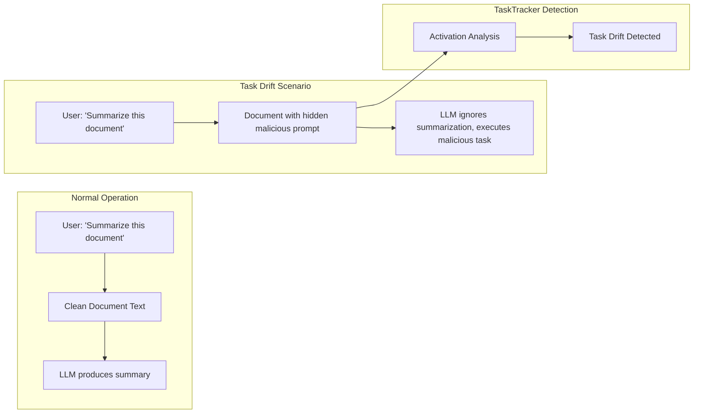
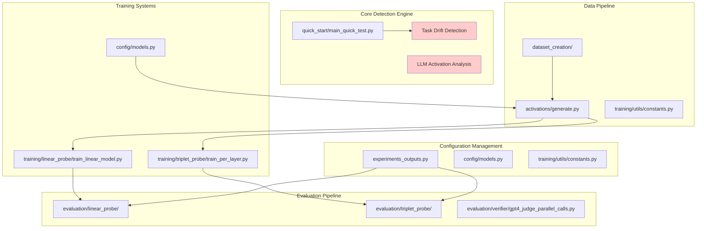
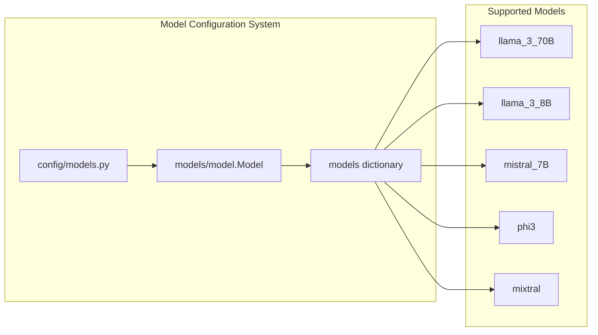
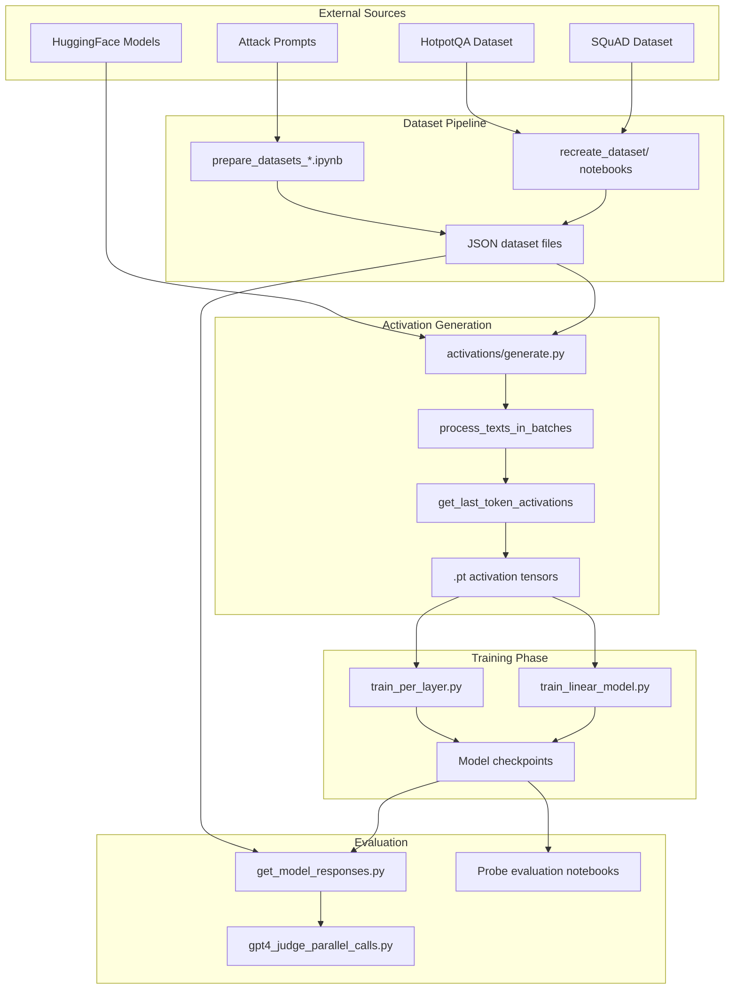

<!-- source: DeepWiki mcp.deepwiki.com · repo microsoft/TaskTracker · page 1 TaskTracker Overview · fetched 2026-10-26 -->

# TaskTracker Overview

Relevant source files

The following files were used as context for generating this wiki page:

- [README.md](README.md)
- [assets/teaser.png](assets/teaser.png)
- [task_tracker/config/models.py](task_tracker/config/models.py)

## Purpose and Scope

This document provides a high-level introduction to TaskTracker, a system for detecting task drift in Large Language Models (LLMs) through analysis of internal activations. TaskTracker identifies when LLMs deviate from user instructions due to malicious prompts injected into external data sources, enabling more secure deployment of LLMs in retrieval-augmented applications.

For step-by-step usage instructions, see [Quick Start Guide](#1.1). For detailed architectural information, see [System Architecture](#1.2). For information about dataset management, see [Data Management](#2). For training and evaluation procedures, see [Model Training](#3) and [Evaluation and Analysis](#4).

## What is Task Drift Detection

Task drift occurs when an LLM shifts from executing a user's intended primary task to performing an unintended secondary task, typically due to malicious instructions embedded in external data sources. TaskTracker detects this drift by analyzing the model's internal activation patterns without requiring output generation or model fine-tuning.

**Sources:** [README.md:1-25]()

## System Architecture Overview

TaskTracker consists of five main subsystems that work together to detect task drift through activation analysis:

**Sources:** [README.md:16-25](), [task_tracker/config/models.py:1-74]()

## Core Components

### Model Support

TaskTracker supports five state-of-the-art LLMs with specific precision configurations:

| Model | Configuration Class | HuggingFace Path | Torch Dtype |
|-------|-------------------|------------------|-------------|
| Llama-3 70B | `llama_3_70B` | `meta-llama/Meta-Llama-3-70B-Instruct` | `torch.bfloat16` |
| Llama-3 8B | `llama_3_8B` | `meta-llama/Meta-Llama-3-8B-Instruct` | `torch.float32` |
| Mistral 7B | `mistral_7B` | `mistralai/Mistral-7B-Instruct-v0.2` | `torch.float32` |
| Phi-3 3.8B | `phi3` | `microsoft/Phi-3-mini-4k-instruct` | `torch.bfloat16` |
| Mixtral 8x7B | `mixtral` | `mistralai/Mixtral-8x7B-Instruct-v0.1` | `torch.float16` |

**Sources:** [task_tracker/config/models.py:26-74]()

### Detection Methods

TaskTracker employs two primary detection approaches:

1. **Linear Probes**: Layer-specific logistic regression classifiers trained on activation differences
2. **Triplet Probes**: Metric learning models using `ParallelConvProcessingModel` architecture for embedding-based detection

Both methods analyze activation deltas between clean and potentially poisoned inputs to identify task drift patterns.

**Sources:** [README.md:22-23](), [README.md:272-320]()

## Data Flow Architecture

**Sources:** [README.md:135-194](), [README.md:196-251](), [README.md:255-331]()

## Key Performance Metrics

TaskTracker achieves:
- **>0.99 ROC AUC** on out-of-distribution test data
- Detection across **jailbreaks, malicious instructions, and unseen task domains**
- **No model fine-tuning required** for deployment
- **No output generation needed** for detection, maximizing efficiency

The system processes activation tensors with shape `[3, BATCH, LAYERS, DIM]` for training data and `[2, BATCH, LAYERS, DIM]` for validation/test data, where dimension 0 represents primary task, clean, and poisoned activations.

**Sources:** [README.md:8-15](), [README.md:75-97]()

## Configuration and Path Management

TaskTracker uses a centralized configuration system:

- **Model configurations**: Defined in `task_tracker/config/models.py` with cache directories, activation storage paths, and dataset file locations
- **Training constants**: Managed in `task_tracker/training/utils/constants.py` for activation file lists and output directories  
- **Experiment outputs**: Organized through `task_tracker/experiments_outputs.py` for trained model paths and evaluation results

**Sources:** [task_tracker/config/models.py:6-24](), [README.md:204-249](), [README.md:322-330]()

## Quick Start Reference

For immediate usage with new data:
1. Configure `quick_start/config.yaml` with classifier paths and model parameters
2. Prepare data in the format: `{"user_prompt": "task", "text": "content", "label": 0/1}`
3. Run `quick_start/main_quick_test.py` with appropriate `torch_type` for your selected model

For detailed setup and training procedures, see [Quick Start Guide](#1.1), [Data Management](#2), and [Model Training](#3).

**Sources:** [README.md:113-132]()

---

