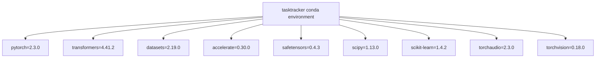
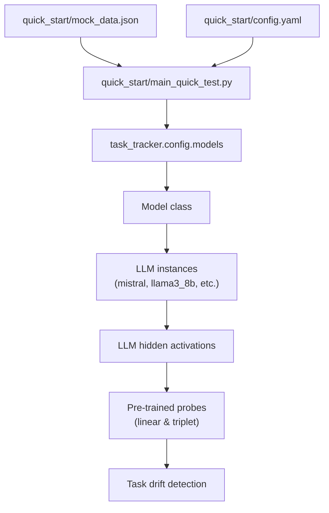
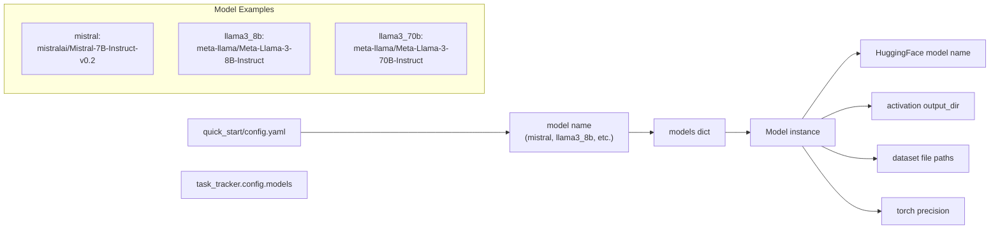

<!-- source: DeepWiki mcp.deepwiki.com · repo microsoft/TaskTracker · page 1.1 Quick Start Guide · fetched 2026-10-26 -->

# Quick Start Guide

<details>
<summary>Relevant source files</summary>

The following files were used as context for generating this wiki page:

- [README.md](README.md)
- [assets/teaser.png](assets/teaser.png)
- [environment.yml](environment.yml)
- [task_tracker/config/models.py](task_tracker/config/models.py)
- [task_tracker/dataset_creation/dataset_sampled/llama3_8b_responses/dataset_out_poisoned_test_llama3_8b_response.json](task_tracker/dataset_creation/dataset_sampled/llama3_8b_responses/dataset_out_poisoned_test_llama3_8b_response.json)
- [task_tracker/dataset_creation/dataset_sampled/llama3_8b_responses/dataset_out_poisoned_test_llama3_8b_response_verifier.json](task_tracker/dataset_creation/dataset_sampled/llama3_8b_responses/dataset_out_poisoned_test_llama3_8b_response_verifier.json)
- [task_tracker/dataset_creation/dataset_sampled/mistral_responses/dataset_out_poisoned_test_mistral_response.json](task_tracker/dataset_creation/dataset_sampled/mistral_responses/dataset_out_poisoned_test_mistral_response.json)
- [task_tracker/dataset_creation/dataset_sampled/mistral_responses/dataset_out_poisoned_test_mistral_response_verifier.json](task_tracker/dataset_creation/dataset_sampled/mistral_responses/dataset_out_poisoned_test_mistral_response_verifier.json)
- [task_tracker/dataset_creation/dataset_sampled/mixtral_response/dataset_out_poisoned_test_mixtral_response.json](task_tracker/dataset_creation/dataset_sampled/mixtral_response/dataset_out_poisoned_test_mixtral_response.json)
- [task_tracker/dataset_creation/dataset_sampled/mixtral_response/dataset_out_poisoned_test_mixtral_response_verifier.json](task_tracker/dataset_creation/dataset_sampled/mixtral_response/dataset_out_poisoned_test_mixtral_response_verifier.json)

</details>


## Purpose and Scope

This guide provides step-by-step instructions for getting started with TaskTracker to detect task drift in Large Language Models (LLMs). TaskTracker analyzes LLM internal activations to identify when models deviate from user instructions due to malicious prompts in external data.

This guide covers running TaskTracker on new data using pre-trained probes. For information about dataset creation and training your own probes, see [Dataset Creation and Recreation](#2.1) and [Model Training](#3). For detailed system architecture, see [System Architecture](#1.2).

## Prerequisites

Before starting, ensure you have:
- Pre-trained TaskTracker probes (included in repository)
- Conda environment manager
- Python 3.12+ 
- CUDA-compatible GPU (recommended)
- Access to target LLM (Phi-3, Mistral, Llama-3, or Mixtral)

Sources: [README.md:99-112](), [environment.yml:234]()

## Environment Setup

Create and activate the TaskTracker environment:

```bash
conda env create -f environment.yml
conda activate tasktracker
cd TaskTracker
pip install -e .
```

This installs all required dependencies including PyTorch, Transformers, and model-specific packages.

**TaskTracker Environment Dependencies**


Sources: [environment.yml:1-302](), [README.md:99-112]()

## Quick Start Workflow

TaskTracker's quick start process follows this workflow:

**Quick Start Data Flow**


Sources: [README.md:113-132](), [task_tracker/config/models.py:67-74]()

### Step 1: Prepare Your Data

Create a JSON file following the structure in `quick_start/mock_data.json`:

```json
[
  {
    "user_prompt": "primary task description", 
    "text": "paragraph that can be clean or poisoned",
    "label": 1
  }
]
```

Where:
- `user_prompt`: The original task instruction
- `text`: External text that may contain malicious prompts
- `label`: 1 for poisoned (contains drift), 0 for clean

Sources: [README.md:119-129]()

### Step 2: Configure the System

Edit `quick_start/config.yaml` to specify:
- Target LLM model (`mistral`, `llama3_8b`, `llama3_70b`, `mixtral`, `phi3`)
- Classifier probe paths 
- Layer analysis parameters
- Detection thresholds

**Model Configuration Mapping**


Sources: [README.md:117-118](), [task_tracker/config/models.py:26-74]()

### Step 3: Run Detection

Execute the main script:

```bash
python quick_start/main_quick_test.py
```

Ensure you set the correct `torch_type` when loading the LLM based on your model configuration. Check the precision used for each LLM in the models configuration.

**Model Precision Requirements**
| Model | Torch Dtype | Memory Requirements |
|-------|-------------|---------------------|
| phi3 | `torch.bfloat16` | ~8GB VRAM |
| mistral | `torch.float32` | ~14GB VRAM |
| llama3_8b | `torch.float32` | ~16GB VRAM |
| llama3_70b | `torch.bfloat16` | ~140GB VRAM |
| mixtral | `torch.float16` | ~90GB VRAM |

Sources: [README.md:131-132](), [task_tracker/config/models.py:32-65]()

## Understanding Detection Results

TaskTracker outputs task drift predictions indicating whether the LLM would execute unauthorized tasks embedded in external text. Results include:

- **Binary Classification**: Clean (0) vs Poisoned (1) predictions
- **Confidence Scores**: Probe activation strengths per layer
- **Layer Analysis**: Which transformer layers show strongest drift signals
- **Embedding Distances**: For triplet probe analysis

The system achieves >0.99 ROC AUC on out-of-distribution test data across jailbreaks, malicious instructions, and unseen task domains.

## Advanced Configuration

### Model Loading Configuration

The `Model` class in `task_tracker.models.model` handles LLM instantiation:

```python
# Example from models.py
mistral_7B = Model(
    name="mistralai/Mistral-7B-Instruct-v0.2",
    output_dir=os.path.join(activation_parent_dir, "mistral_test"),
    data=data,
    subset="train", 
    torch_dtype=torch.float32
)
```

### Path Configuration

Update paths in `task_tracker/config/models.py`:
- `cache_dir`: HuggingFace model cache location
- `activation_parent_dir`: Where to store extracted activations  
- `text_dataset_parent_dir`: Location of dataset text files

Sources: [task_tracker/config/models.py:6-24]()

## Troubleshooting

### Common Issues

**CUDA Memory Errors**: Reduce batch size or use models with lower precision requirements (bfloat16/float16 vs float32)

**Model Loading Failures**: Verify HuggingFace cache directory permissions and network connectivity

**Activation Generation Errors**: Check that dataset file paths exist and are properly formatted

**Probe Loading Issues**: Ensure pre-trained probe files are in expected locations as configured

### Performance Optimization

- Use GPU acceleration for faster inference
- Consider model quantization for memory-constrained environments  
- Batch process multiple examples when possible
- Cache activations to avoid recomputation

Sources: [README.md:131-132](), [task_tracker/config/models.py:32-65]()

---

