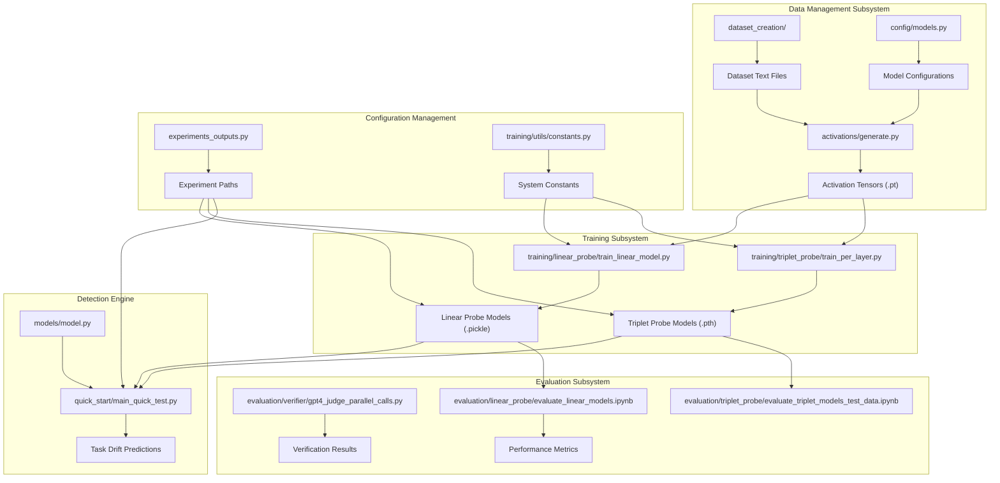
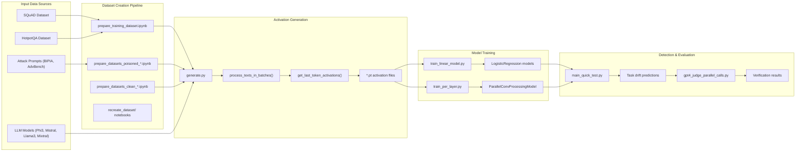
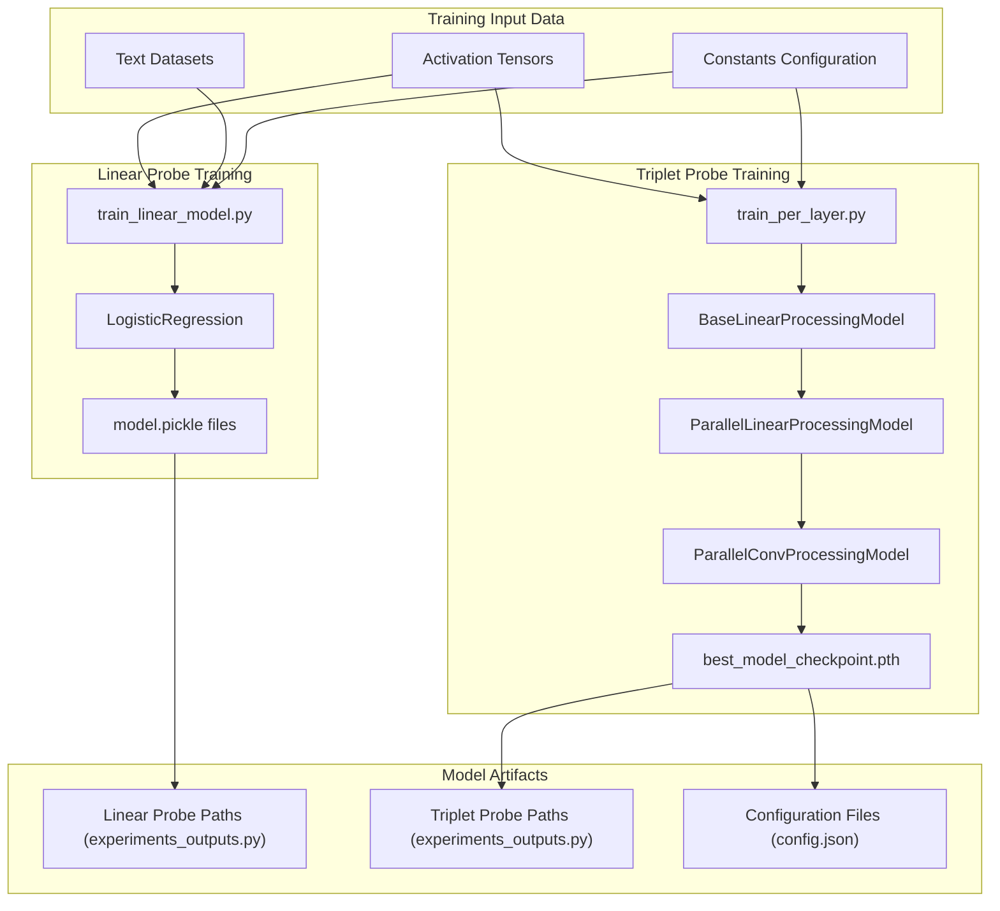
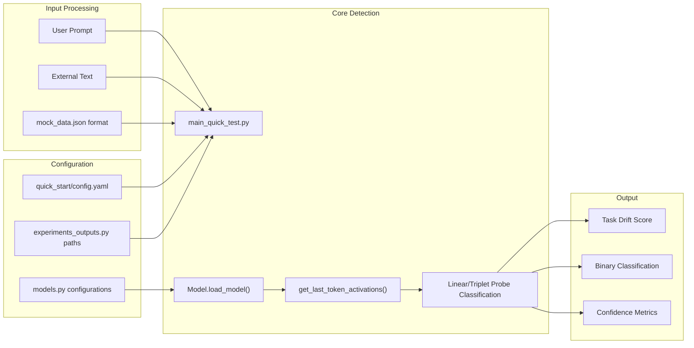

<!-- source: DeepWiki mcp.deepwiki.com · repo microsoft/TaskTracker · page 1.2 System Architecture · fetched 2026-10-26 -->

# System Architecture

Relevant source files

The following files were used as context for generating this wiki page:

- [README.md](README.md)
- [assets/teaser.png](assets/teaser.png)
- [task_tracker/config/models.py](task_tracker/config/models.py)
- [task_tracker/experiments_outputs.py](task_tracker/experiments_outputs.py)
- [trained_triplet_probes/mistral_best/best_model_checkpoint.pth](trained_triplet_probes/mistral_best/best_model_checkpoint.pth)
- [trained_triplet_probes/phi3_best/best_model_checkpoint.pth](trained_triplet_probes/phi3_best/best_model_checkpoint.pth)
- [trained_triplet_probes/phi3_best/config.json](trained_triplet_probes/phi3_best/config.json)

## Purpose and Scope

This document provides a comprehensive overview of TaskTracker's system architecture, detailing the core components, data flow, and interactions between subsystems that enable detection of task drift in large language models (LLMs). The architecture supports the full pipeline from dataset creation through model training to drift detection and evaluation.

For step-by-step usage instructions, see [Quick Start Guide](#1.1). For details on dataset creation workflows, see [Dataset Creation and Recreation](#2.1). For information about training probe models, see [Model Training](#3).

## Overall System Architecture

TaskTracker consists of five primary subsystems that work together to detect when LLMs deviate from user instructions due to malicious content in external data sources.

**Sources:** [README.md:1-479](), [task_tracker/config/models.py:1-74](), [task_tracker/experiments_outputs.py:1-106]()

## Core Data Flow Architecture

The system processes data through a linear pipeline from raw datasets to final task drift detection results.

**Sources:** [README.md:136-194](), [task_tracker/activations/generate.py](), [README.md:255-331]()

## Component Deep Dive

### Data Management Layer

The data management layer handles dataset creation, recreation, and activation generation. It operates through several key modules:

| Component | File Path | Purpose |
|-----------|-----------|---------|
| Model Configuration | `task_tracker/config/models.py` | Defines LLM configurations and dataset paths |
| Dataset Creation | `task_tracker/dataset_creation/` | Jupyter notebooks for creating training/test datasets |
| Activation Generation | `task_tracker/activations/generate.py` | Extracts hidden states from LLM layers |
| Data Constants | `task_tracker/training/utils/constants.py` | Centralized data path management |

The `Model` class in [task_tracker/models/model.py]() encapsulates LLM configurations with properties like `name`, `output_dir`, `data`, and `torch_dtype`. Five pre-configured models are available: `llama3_70b`, `llama3_8b`, `mistral`, `phi3`, and `mixtral` as defined in [task_tracker/config/models.py:68-74]().

**Sources:** [task_tracker/config/models.py:1-74](), [README.md:136-252]()

### Training Architecture

The training subsystem implements two distinct probe architectures. Linear probes use scikit-learn's `LogisticRegression` for layer-specific binary classification. Triplet probes implement metric learning through custom PyTorch models with convolutional layers for embedding generation.

Configuration for triplet probes is managed through dictionaries like the example in [trained_triplet_probes/phi3_best/config.json:1]() which specifies parameters including `margin`, `epochs`, `num_layers`, `batch_size`, and architectural choices like `conv` and `dropout`.

**Sources:** [README.md:255-331](), [task_tracker/experiments_outputs.py:25-106](), [trained_triplet_probes/phi3_best/config.json:1]()

### Detection Engine Components

The detection engine centers around [quick_start/main_quick_test.py]() which orchestrates the full detection pipeline. Input data follows the format specified in [README.md:119-129]() with fields for `user_prompt`, `text`, and `label`. The system loads pre-trained probes via paths defined in [task_tracker/experiments_outputs.py:26-106]().

**Sources:** [README.md:113-133](), [task_tracker/experiments_outputs.py:1-106]()

### Evaluation and Verification System

The evaluation subsystem provides comprehensive assessment of both probe performance and actual attack execution through multiple evaluation modalities:

| Evaluation Type | Implementation | Purpose |
|----------------|----------------|---------|
| Linear Probe Evaluation | `evaluation/linear_probe/evaluate_linear_models.ipynb` | ROC AUC metrics per layer |
| Triplet Probe Evaluation | `evaluation/triplet_probe/evaluate_triplet_models_test_data.ipynb` | Embedding distance analysis |
| GPT-4 Verification | `evaluation/verifier/gpt4_judge_parallel_calls.py` | Attack execution validation |
| Visualization | `evaluation/visualizations/tsne_raw_activations.ipynb` | t-SNE plots of activations |

The GPT-4 verifier operates through parallel API calls as configured in [README.md:378-396]() with parameters like `MAX_THREADS`, `JUDGE_MODEL`, and Azure OpenAI credentials. It classifies model responses as "EXECUTED" or "NOT DETECTED" based on whether the model actually performed unauthorized tasks.

**Sources:** [README.md:333-465](), [task_tracker/experiments_outputs.py:11-22]()

## Configuration Management Architecture

```mermaid
graph TD
    subgraph "Central Configuration Files"
        A["experiments_outputs.py"]
        B["config/models.py"] 
        C["training/utils/constants.py"]
        D["quick_start/config.yaml"]
    end
    
    subgraph "Path Management"
        E["LINEAR_PROBES_PATHS_PER_MODEL"]
        F["TRIPLET_PROBES_PATHS_PER_MODEL"]
        G["MODELS_RESPONSE_OUT_FILENAME_PER_MODEL"]
        H["VERIFIER_RESPONSE_OUT_FILENAME_PER_MODEL"]
    end
    
    subgraph "Model-Specific Configs"
        I["llama3_70b configuration"]
        J["mistral configuration"]
        K["phi3 configuration"]
        L["mixtral configuration"]
    end
    
    subgraph "System Constants"
        M["DATA_LISTS paths"]
        N["MODEL_OUTPUT_DIR"]
        O["activation_parent_dir"]
        P["text_dataset_parent_dir"]
    end
    
    A --> E
    A --> F
    A --> G
    A --> H
    B --> I
    B --> J
    B --> K
    B --> L
    B --> O
    B --> P
    C --> M
    C --> N
```

Configuration management follows a hierarchical structure with [task_tracker/experiments_outputs.py:1-106]() serving as the central registry for trained model paths. Each model type has dedicated path mappings, such as the linear probe paths defined in [task_tracker/experiments_outputs.py:26-77]() and triplet probe configurations in [task_tracker/experiments_outputs.py:81-106]().

Model configurations in [task_tracker/config/models.py:18-24]() define dataset file paths, while [task_tracker/config/models.py:7-15]() establishes the activation storage directory and HuggingFace cache locations.

**Sources:** [task_tracker/experiments_outputs.py:1-106](), [task_tracker/config/models.py:1-74]()

## Inter-Component Communication Patterns

The system uses several communication patterns to coordinate between components:

1. **File-based Data Exchange**: Activation tensors are stored as `.pt` files and loaded by training scripts
2. **Configuration-driven Paths**: All file paths are centrally managed through configuration dictionaries
3. **Model Serialization**: Trained models are persisted as `.pickle` (linear probes) or `.pth` (triplet probes) files
4. **JSON Data Interchange**: Datasets and evaluation results use JSON format for structured data exchange

The activation generation process exemplifies this pattern: [task_tracker/activations/generate.py]() reads dataset configurations from [task_tracker/config/models.py](), processes texts through `process_texts_in_batches()`, and outputs tensors to paths specified in the model configuration's `output_dir` attribute.

**Sources:** [README.md:196-252](), [task_tracker/config/models.py:27-33]()

---

