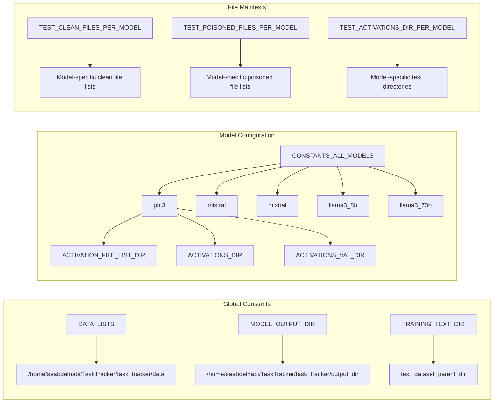
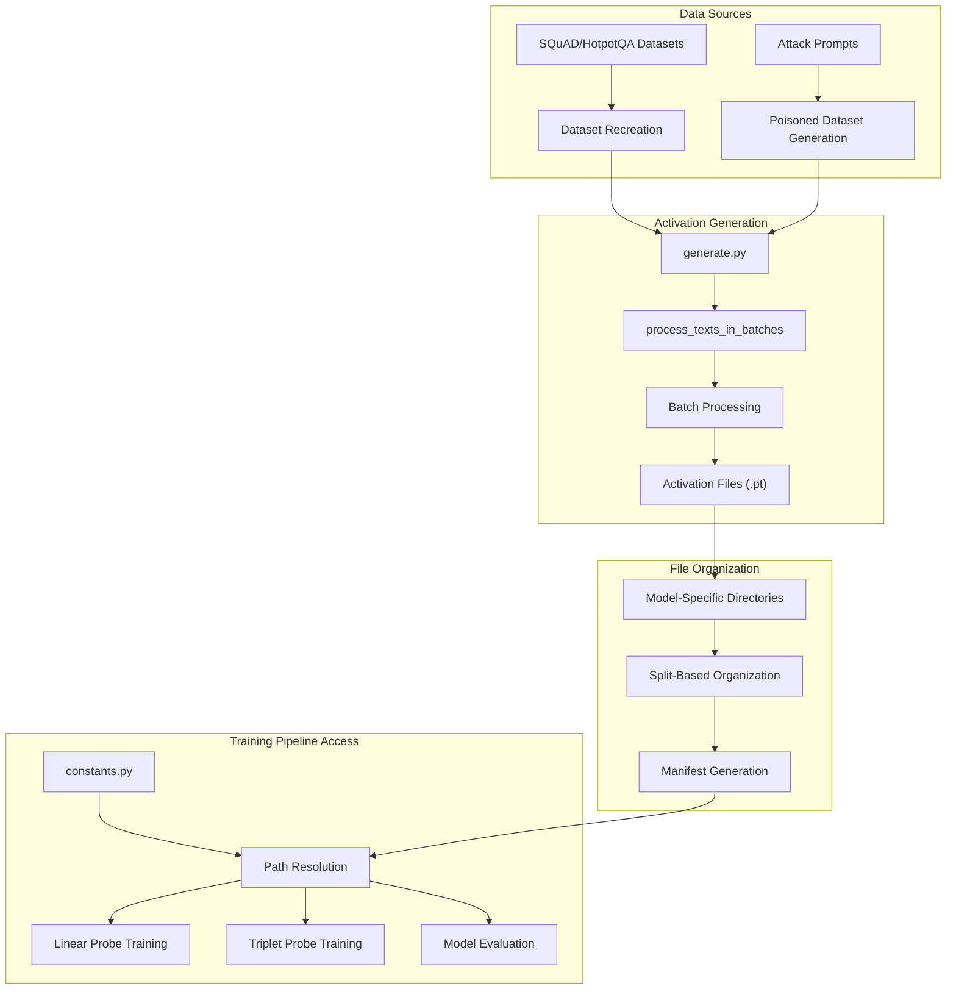

<!-- source: DeepWiki mcp.deepwiki.com · repo microsoft/TaskTracker · page 2 Data Management · fetched 2026-10-26 -->

# Data Management

<details>
<summary>Relevant source files</summary>

The following files were used as context for generating this wiki page:

- [task_tracker/data/test_clean_files_llama3_70b.txt](task_tracker/data/test_clean_files_llama3_70b.txt)
- [task_tracker/data/test_clean_files_llama3_8b.txt](task_tracker/data/test_clean_files_llama3_8b.txt)
- [task_tracker/data/test_clean_files_mixtral.txt](task_tracker/data/test_clean_files_mixtral.txt)
- [task_tracker/data/test_clean_files_phi3.txt](task_tracker/data/test_clean_files_phi3.txt)
- [task_tracker/data/test_poisoned_files_llama3_70b.txt](task_tracker/data/test_poisoned_files_llama3_70b.txt)
- [task_tracker/data/test_poisoned_files_llama3_8b.txt](task_tracker/data/test_poisoned_files_llama3_8b.txt)
- [task_tracker/data/test_poisoned_files_mixtral.txt](task_tracker/data/test_poisoned_files_mixtral.txt)
- [task_tracker/data/test_poisoned_files_phi3.txt](task_tracker/data/test_poisoned_files_phi3.txt)
- [task_tracker/training/utils/constants.py](task_tracker/training/utils/constants.py)

</details>


## Purpose and Scope

This document covers TaskTracker's comprehensive data management system, which handles the organization, storage, and access of training datasets, activation files, and model artifacts across multiple LLM architectures. The system provides centralized configuration management for data paths, file manifests, and experiment organization.

For detailed information about dataset creation processes, see [Dataset Creation and Recreation](#2.1). For activation extraction and processing, see [Activation Generation](#2.4). For attack dataset specifics, see [Attack Datasets and Adversarial Prompts](#2.3).

## Data Management Architecture

TaskTracker's data management system is built around a centralized configuration approach that manages paths, file manifests, and data organization across multiple model architectures and experiment types.

```mermaid
graph TD
    subgraph "Configuration Layer"
        A["constants.py"] --> B["CONSTANTS_ALL_MODELS"]
        A --> C["TEST_CLEAN_FILES_PER_MODEL"]  
        A --> D["TEST_POISONED_FILES_PER_MODEL"]
        A --> E["TEST_ACTIVATIONS_DIR_PER_MODEL"]
    end
    
    subgraph "Data Types"
        F["Clean Activations"] --> G["Training Data"]
        F --> H["Validation Data"] 
        F --> I["Test Data"]
        J["Poisoned Activations"] --> K["Training Data"]
        J --> L["Validation Data"]
        J --> M["Test Data"]
    end
    
    subgraph "Model-Specific Storage"
        N["phi3/"] --> O["training/"]
        N --> P["validation/"]
        N --> Q["test/"]
        R["mistral_7B/"] --> S["training/"]
        R --> T["validation/"]
        R --> U["test/"]
        V["llama3_8b/"] --> W["training/"]
        V --> X["validation/"]
        V --> Y["test/"]
    end
    
    subgraph "File Manifests"
        Z["test_clean_files_phi3.txt"]
        AA["test_poisoned_files_phi3.txt"] 
        BB["test_clean_files_mistral.txt"]
        CC["test_poisoned_files_mistral.txt"]
    end
    
    B --> N
    B --> R  
    B --> V
    C --> Z
    C --> BB
    D --> AA
    D --> CC
    
    G --> O
    H --> P
    I --> Q
    K --> S
    L --> T
    M --> U
```



**Sources:** [task_tracker/training/utils/constants.py:25-69](), [task_tracker/training/utils/constants.py:72-101]()

## File Organization Structure

TaskTracker organizes data using a hierarchical directory structure that separates data by model type, data category (clean/poisoned), and split (training/validation/test).

### Directory Hierarchy

| Level | Structure | Purpose |
|-------|-----------|---------|
| Root | `activation_parent_dir/` | Base directory for all activation files |
| Model | `{model_name}/` | Model-specific data organization |
| Split | `{training,validation,test}/` | Data split categorization |
| Files | `{clean,poisoned}_hidden_states_*.pt` | Individual activation tensors |

### File Naming Convention

Activation files follow a standardized naming pattern that encodes batch information and generation timestamps:

```
{data_type}_hidden_states_{start_idx}_{end_idx}_{timestamp}.pt
```

Where:
- `data_type`: Either `clean` or `poisoned`
- `start_idx`, `end_idx`: Batch boundaries (typically 1000-example chunks)
- `timestamp`: Generation timestamp in `YYYYMMDD_HHMMSS` format

**Sources:** [task_tracker/data/test_clean_files_phi3.txt:1-32](), [task_tracker/data/test_poisoned_files_phi3.txt:1-32]()

## Centralized Configuration System

The `constants.py` module provides centralized configuration management for all data paths and model-specific settings through several key data structures.



**Sources:** [task_tracker/training/utils/constants.py:10-21](), [task_tracker/training/utils/constants.py:25-69]()

### Model-Specific Configuration

Each model in `CONSTANTS_ALL_MODELS` defines three key path categories:

| Configuration Key | Purpose | Example |
|------------------|---------|---------|
| `ACTIVATION_FILE_LIST_DIR` | Directory containing file manifest lists | `DATA_LISTS` |
| `ACTIVATIONS_DIR` | Training activation storage | `activation_parent_dir + '/phi3/training'` |
| `ACTIVATIONS_VAL_DIR` | Validation activation storage | `activation_parent_dir + '/phi3/validation'` |

**Sources:** [task_tracker/training/utils/constants.py:26-33]()

## Data Manifest System

TaskTracker uses text-based manifest files to track activation files for each model and data type. These manifests provide an efficient way to reference large collections of activation files without loading directory contents at runtime.

### Clean Data Manifests

The `TEST_CLEAN_FILES_PER_MODEL` dictionary maps each model to its corresponding clean activation file list:

```python
TEST_CLEAN_FILES_PER_MODEL = {
    'mistral': [file.strip() for file in open(os.path.join(DATA_LISTS, 'test_clean_files_mistral.txt'))],
    'phi3' : [file.strip() for file in open(os.path.join(DATA_LISTS, 'test_clean_files_phi3.txt'))],
    # ... other models
}
```

### Poisoned Data Manifests

Similarly, `TEST_POISONED_FILES_PER_MODEL` provides access to poisoned activation files:

```python
TEST_POISONED_FILES_PER_MODEL = {
    'mistral': [file.strip() for file in open(os.path.join(DATA_LISTS, 'test_poisoned_files_mistral.txt'))],
    'phi3' : [file.strip() for file in open(os.path.join(DATA_LISTS, 'test_poisoned_files_phi3.txt'))],
    # ... other models  
}
```

**Sources:** [task_tracker/training/utils/constants.py:84-91](), [task_tracker/training/utils/constants.py:94-101]()

### Manifest File Structure

Each manifest file contains one activation filename per line, representing batched data processing:

```
clean_hidden_states_0_1000_20240717_105456.pt
clean_hidden_states_1000_2000_20240717_105652.pt
clean_hidden_states_2000_3000_20240717_105849.pt
...
clean_hidden_states_31000_32000_20240717_115206.pt
```

This structure enables efficient batch processing and provides clear traceability for data generation timestamps.

**Sources:** [task_tracker/data/test_clean_files_phi3.txt:1-33]()

## Data Flow Integration

The data management system integrates with TaskTracker's broader pipeline through standardized interfaces and path resolution.



**Sources:** [task_tracker/training/utils/constants.py:3-4](), [task_tracker/training/utils/constants.py:25-69]()

The data management system provides the foundation for TaskTracker's training and evaluation pipelines by ensuring consistent data organization, efficient file access, and reproducible experiment configuration across all supported model architectures.

---

