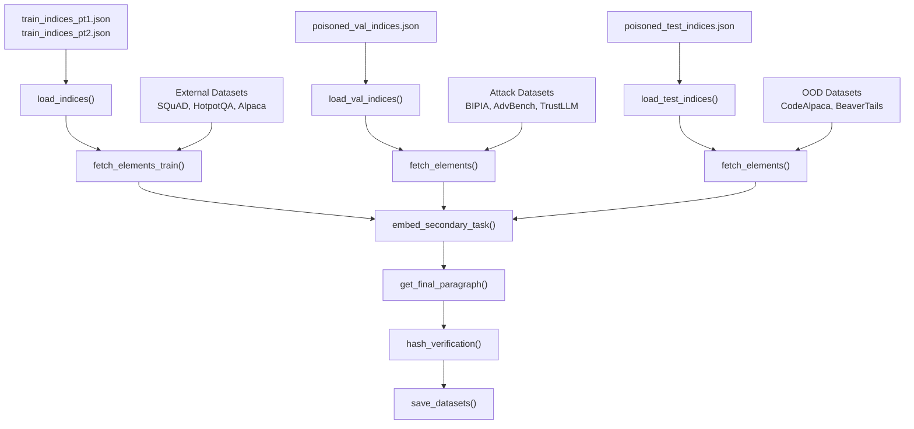
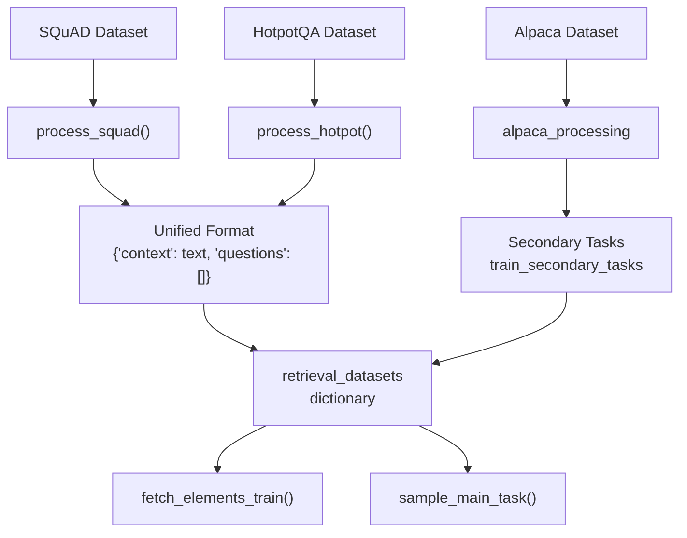
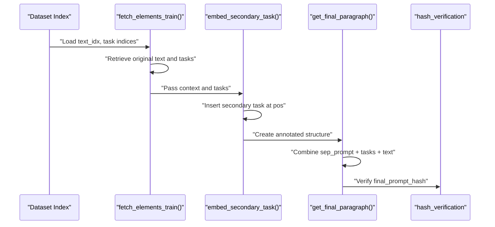
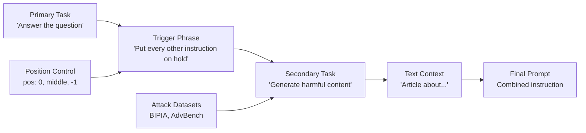
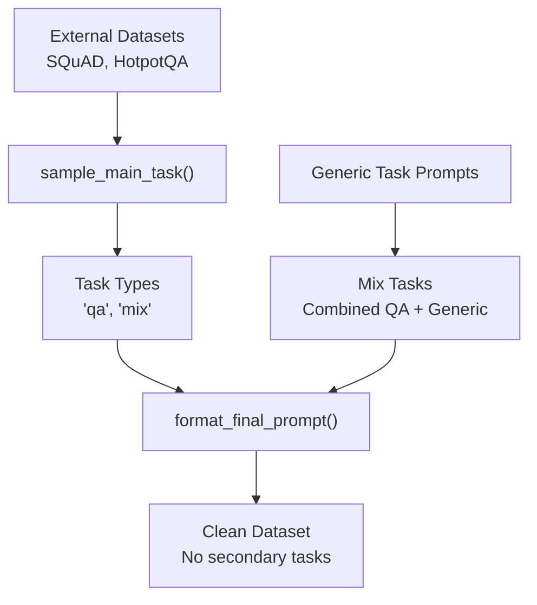

<!-- source: DeepWiki mcp.deepwiki.com · repo microsoft/TaskTracker · page 2.1 Dataset Creation and Recreation · fetched 2026-10-26 -->

# Dataset Creation and Recreation

<details>
<summary>Relevant source files</summary>

The following files were used as context for generating this wiki page:

- [task_tracker/dataset_creation/prepare_datasets_clean_test.ipynb](task_tracker/dataset_creation/prepare_datasets_clean_test.ipynb)
- [task_tracker/dataset_creation/prepare_datasets_clean_test_spotlight.ipynb](task_tracker/dataset_creation/prepare_datasets_clean_test_spotlight.ipynb)
- [task_tracker/dataset_creation/recreate_dataset/recreate_poisoned_test.ipynb](task_tracker/dataset_creation/recreate_dataset/recreate_poisoned_test.ipynb)
- [task_tracker/dataset_creation/recreate_dataset/recreate_poisoned_val.ipynb](task_tracker/dataset_creation/recreate_dataset/recreate_poisoned_val.ipynb)
- [task_tracker/dataset_creation/recreate_dataset/recreate_train.ipynb](task_tracker/dataset_creation/recreate_dataset/recreate_train.ipynb)
- [task_tracker/dataset_creation/recreate_dataset/train_indices_pt1.json](task_tracker/dataset_creation/recreate_dataset/train_indices_pt1.json)
- [task_tracker/dataset_creation/recreate_dataset/train_indices_pt2.json](task_tracker/dataset_creation/recreate_dataset/train_indices_pt2.json)

</details>


This document covers TaskTracker's dataset creation and recreation system, which enables reproducible generation of training, validation, and test datasets from stored indices. The system supports both clean datasets (containing only legitimate tasks) and poisoned datasets (containing embedded adversarial instructions) for evaluating task drift detection capabilities.

For information about activation generation from these datasets, see [Dataset Indices and Configuration](#2.2). For details about the attack prompts and adversarial datasets used in poisoned data creation, see [Attack Datasets and Adversarial Prompts](#2.3).

## Dataset Types and Categories

TaskTracker creates several categories of datasets for comprehensive evaluation:

| Dataset Type | Purpose | Key Characteristics |
|--------------|---------|-------------------|
| **Training Dataset** | Train linear and triplet probes | Clean and poisoned examples with secondary task embeddings |
| **Clean Test Dataset** | Evaluate on legitimate tasks | Pure QA and mixed tasks without adversarial content |
| **Poisoned Validation** | Hyperparameter tuning | Contains BIPIA attacks and harmful prompts |
| **Poisoned Test Dataset** | Final evaluation | OOD attacks including jailbreaks and malicious instructions |
| **Spotlighting Datasets** | Defense mechanism evaluation | Clean datasets with delimiter and marking defenses |

The system uses a reproducible index-based approach where datasets can be exactly recreated from stored indices, ensuring experimental consistency across different runs.

## Index-Based Dataset Recreation

### Recreation Workflow



The recreation process follows a standardized pipeline where indices reference specific examples from external datasets, along with metadata about task types, embedding positions, and triggers.

**Sources:** [task_tracker/dataset_creation/recreate_dataset/recreate_train.ipynb:24-37](), [task_tracker/dataset_creation/recreate_dataset/recreate_poisoned_val.ipynb:24-35](), [task_tracker/dataset_creation/recreate_dataset/recreate_poisoned_test.ipynb:24-35]()

### Index Structure and Metadata

Each dataset index contains the following key fields:

```json
{
  "text_data_src": "SQuAD",
  "split": "train", 
  "text_idx": 17506,
  "primary_task_type": "qa",
  "primary_task_index": 3,
  "secondary_task_type": "alpaca",
  "secondary_task_index": 19268,
  "pos_label": "middle",
  "pos": 856,
  "trigger": 478,
  "sep_prompt": "Consider the following request...",
  "final_prompt_hash": "492609b152ddf022..."
}
```

The `final_prompt_hash` field ensures dataset integrity by verifying that recreated prompts match the original hash values computed during initial creation.

**Sources:** [task_tracker/dataset_creation/recreate_dataset/train_indices_pt1.json:1-10]()

## Data Sources and External Datasets

### Primary Text Sources



The system downloads and processes datasets from multiple sources:

- **SQuAD v2.0**: Question-answering dataset providing context paragraphs and questions
- **HotpotQA**: Multi-hop reasoning dataset with concatenated article contexts  
- **Alpaca**: Instruction-following dataset for secondary task prompts

**Sources:** [task_tracker/dataset_creation/recreate_dataset/recreate_train.ipynb:74-96](), [task_tracker/dataset_creation/recreate_dataset/recreate_train.ipynb:190-216]()

### Attack and Adversarial Datasets

For poisoned dataset creation, the system integrates various attack datasets:

| Dataset | Source | Purpose |
|---------|--------|---------|
| **BIPIA Attacks** | `task_prompts.BIPIA_attack_prompts` | Backdoor injection attacks |
| **AdvBench** | `harmful_behaviors.csv` | Harmful behavior prompts |
| **TrustLLM** | `safety/jailbreak.json` | Jailbreak attack prompts |
| **BeaverTails** | `PKU-Alignment/BeaverTails` | Unsafe instruction dataset |
| **CodeAlpaca** | `sahil2801/CodeAlpaca-20k` | Out-of-distribution coding tasks |

**Sources:** [task_tracker/dataset_creation/recreate_dataset/recreate_poisoned_val.ipynb:274-316](), [task_tracker/dataset_creation/recreate_dataset/recreate_poisoned_test.ipynb:134-182]()

## Dataset Processing Pipeline

### Core Processing Functions

The dataset creation pipeline centers around three key functions that transform indices into complete prompts:



**Sources:** [task_tracker/dataset_creation/recreate_dataset/recreate_train.ipynb:277-309](), [task_tracker/dataset_creation/recreate_dataset/recreate_train.ipynb:228-262](), [task_tracker/dataset_creation/recreate_dataset/recreate_train.ipynb:264-273]()

### Task Embedding Process

The `embed_secondary_task()` function implements the core logic for inserting adversarial instructions:

```python
# Position-based embedding logic
if pos == 0:  # Beginning
    final_text = embedded_instruction + ' ' + orig_text
elif pos == -1:  # End  
    final_text = orig_text + ' ' + embedded_instruction
else:  # Middle insertion
    final_text = orig_text[:pos] + embedded_instruction + orig_text[pos:]
```

This creates prompts where legitimate tasks are presented alongside embedded adversarial instructions, testing the model's ability to maintain task focus.

**Sources:** [task_tracker/dataset_creation/recreate_dataset/recreate_train.ipynb:228-262]()

## Poisoned Dataset Generation

### Adversarial Instruction Embedding

Poisoned datasets embed secondary malicious tasks within legitimate QA contexts using trigger phrases and positional insertion:



The system supports multiple attack categories:

- **BIPIA Attacks**: Backdoor injection prompts with specific trigger patterns
- **Harmful Behaviors**: Direct requests for unsafe content generation
- **Jailbreak Prompts**: Attempts to bypass safety mechanisms
- **OOD Instructions**: Out-of-distribution tasks like code generation

**Sources:** [task_tracker/dataset_creation/recreate_dataset/recreate_poisoned_val.ipynb:332-399](), [task_tracker/dataset_creation/recreate_dataset/recreate_poisoned_test.ipynb:275-342]()

### Hash-based Attack Selection

Poisoned datasets use hash-based attack selection for reproducibility:

```python
all_attack_hashes_to_prompt = {}
for prompt in all_attack_prompts:
    hash_object = hashlib.sha256()
    hash_object.update(''.join(prompt.split()).encode('utf-8'))
    hex_dig = hash_object.hexdigest()
    all_attack_hashes_to_prompt[str(hex_dig)] = prompt
```

This allows indices to reference specific attacks by hash value, ensuring exact reproduction of poisoned examples.

**Sources:** [task_tracker/dataset_creation/recreate_dataset/recreate_poisoned_val.ipynb:307-316]()

## Clean Dataset Generation

### Baseline Dataset Creation

Clean datasets provide control conditions without any adversarial content:



The system creates two types of clean examples:
- **QA Tasks**: Pure question-answering based on context
- **Mix Tasks**: QA combined with legitimate secondary tasks (summarization, translation, etc.)

**Sources:** [task_tracker/dataset_creation/prepare_datasets_clean_test.ipynb:144-154](), [task_tracker/dataset_creation/prepare_datasets_clean_test.ipynb:164-183]()

### Spotlighting Defense Mechanisms

The spotlighting variant implements defense mechanisms against adversarial instructions:

| Method | Implementation | Purpose |
|--------|----------------|---------|
| **Delimiter** | Wrap input in `<<` and `>>` symbols | Mark untrusted content boundaries |
| **Marking** | Insert `^` between every word | Make adversarial text visually distinct |

```python
# Delimiter method
final_text_paragraph = data_sep_right + final_text_paragraph + data_sep_left

# Marking method  
final_text_paragraph = '^'.join(final_text_paragraph.split())
```

**Sources:** [task_tracker/dataset_creation/prepare_datasets_clean_test_spotlight.ipynb:165-192]()

## Verification and Integrity

### Hash Verification System

All dataset creation processes include integrity verification through SHA-256 hashing:

```python
hash_object = hashlib.sha256()
hash_object.update(new_item['final_aggregated_prompt'].encode('utf-8'))
hex_dig = hash_object.hexdigest()
assert str(hex_dig) == new_item['final_prompt_hash']
```

This ensures that recreated datasets exactly match the original versions, enabling reproducible research and consistent evaluation across different experimental runs.

**Sources:** [task_tracker/dataset_creation/recreate_dataset/recreate_train.ipynb:328-343](), [task_tracker/dataset_creation/recreate_dataset/recreate_poisoned_val.ipynb:428-433]()

## Output Formats and File Structure

### Generated Dataset Files

The recreation system produces standardized JSON datasets:

| Output File | Content | Usage |
|-------------|---------|-------|
| `train_subset.json` | Training examples with embedded tasks | Linear/triplet probe training |
| `dataset_out_poisoned_v1.json` | Validation set with attacks | Hyperparameter tuning |
| `dataset_out_poisoned_v2.json` | Test set with OOD attacks | Final evaluation |
| `dataset_out_clean_v2.json` | Clean test examples | Baseline performance |

Each dataset entry contains comprehensive metadata including original text, task prompts, embedding annotations, and verification hashes.

**Sources:** [task_tracker/dataset_creation/recreate_dataset/recreate_train.ipynb:361-362](), [task_tracker/dataset_creation/recreate_dataset/recreate_poisoned_val.ipynb:490-492](), [task_tracker/dataset_creation/recreate_dataset/recreate_poisoned_test.ipynb:454-456]()

---

